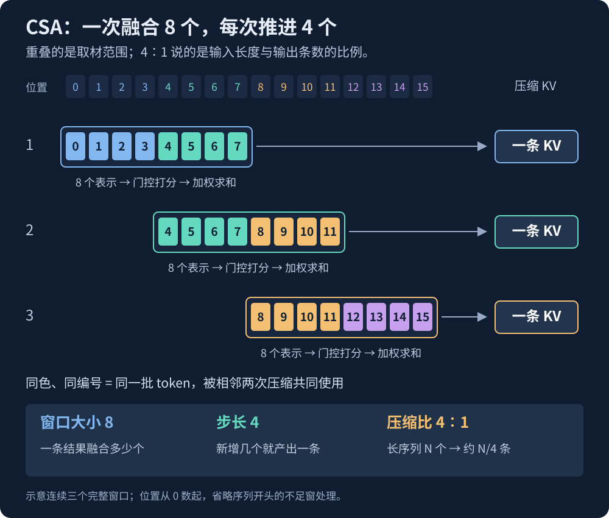

【DeepSeek】分块压缩的代价：不同相位的检索能力差多少

━━━━━━━━━━━━━━━━━━━━

◆ 开篇：算法看得见，能力差距要测

━━━━━━━━━━━━━━━━━━━━

V4 的压缩注意力，我们在 168 期（ https://mp.weixin.qq.com/s/YqcTnIrGKEYZ2n-sMAelKg ）梳理注意力演化线时讲过。CSA 每次融合 8 个 token 的表示，每新增 4 个就产出一条压缩 KV。它有固定窗口，也就有窗口内的不同站位。

因此，位置的周期结构并不神秘：窗口里有 8 个位置，重叠着每次推进 4 个，同一类站位每隔 4 个 token 重复。**真正要研究的是，不同站位的检索能力差多少，训练能把差距补偿到什么程度，以及平均分会不会把剩下的弱点藏起来。**

字节 Seed 联合普林斯顿、斯坦福、伯克利的研究者，9 月底发表了《Periodic Weak Spots: Phase Sensitivity from Chunked KV-Cache Compression》（周期性弱点：分块 KV 缓存压缩带来的相位敏感性，arXiv:2609.36322）。他们在 DeepSeek 系列和一批自训模型上测量这种差距，再通过干预实验追查原因。

我们先把压缩算法摆出来，再看他们具体测到了什么。

━━━━━━━━━━━━━━━━━━━━

◆ 第一章：窗口里的位置，本来就不同

━━━━━━━━━━━━━━━━━━━━

先复习一下背景。长上下文很烧显存的一部分是 KV 缓存：每个 token 都留下键向量（key，用来匹配查询）和值向量（value，用来提供读取的内容），后续生成还要回头查。上下文越长，这份存档越大。

DeepSeek V4 的一个解法是 **压缩稀疏注意力（compressed sparse attention，CSA）** ：连续几个 token 的表示先经过门控打分，再加权合成一条压缩表示。这里的“摘要”是向量，不是一段文字。长程注意力选中哪些压缩条目，就直接读这些条目；它不会把摘要解压，还原成原来每个 token。附近的局部窗口另留原始 KV，兼顾眼前的细节。

CSA 每新增 4 个 token，就产出一条压缩 KV；但做这次压缩时，还会带上前一组的 4 个，**一次实际融合 8 个 token 的表示**。所以取材窗口是 8，每次推进的**步长（stride）是 4**，缓存条数的压缩比仍是 4∶1。

────────────────────

💡 压缩以后，组内的混合比例就固定了

先暂时忽略重叠，只看四个 token 的一维表示，记作 A、B、C、D。压缩器根据各自的内容表示和位置算分数，经过 softmax，得到这一维的混合比例。假设是：

`压缩结果 = 0.6A + 0.2B + 0.1C + 0.1D`

实际 CSA 的每个向量维度都可以有不同的比例，这里只拿一维看。

**这条压缩 KV 一旦写进缓存，组内比例就固定了。** 后来问 A，或者后来问 D，查询可以改变对这整条压缩 KV 的注意力，却不会把组内比例重新算一遍。需要 D 时，读到的仍然是当初那个混合结果。

这里有三种容易混叫成“权重”的东西：

| 什么权重 | 什么时候确定 | 会随什么改变 |
| :--- | :--- | :--- |
| 压缩器的门控参数 | 训练时学出来 | 训练更新参数；普通推理时固定 |
| 组内混合比例，例如 0.6、0.2 | 每次压缩时计算 | 当时的输入表示、位置以及门控参数 |
| 对压缩条目的注意力权重 | 后面的查询到来时计算 | 当前查询与各条压缩键的匹配程度 |

因此，要改变压缩器长期偏爱哪些位置，可以通过训练更新门控参数。但具体一次的混合比例还取决于输入：**即使参数没变，换一段内容、改变前文，使输入表示变了，重新压缩时也可能得到不同的比例。** 只是新的问题到来，不会触发对旧缓存的这种重算；更新参数本身也不会自动改写已经存好的 KV。

普通注意力可以根据当前查询，分别给历史 token 分配注意力；压缩这条路径则提前把它们混在一起，后来的查询选择读取哪些混合结果。**它得在还不知道将来会问什么的时候，先决定这一组怎样留下来。** 这里说的是单条压缩缓存，局部窗口和其他层仍可提供各自保留的信息。

────────────────────

这个分组方式直接给出了位置的周期结构。

把窗口暂且画成位置 0 到 7、4 到 11、8 到 15……取中间三个位置看看：

| token 的位置 | 所在的两个窗口 | 在窗口内的偏移，从 0 数起 | 位置除以 4 的余数 |
| :--- | :--- | :--- | :--- |
| 5 | 0 到 7、4 到 11 | 5、1 | 1 |
| 6 | 0 到 7、4 到 11 | 6、2 | 2 |
| 9 | 4 到 11、8 到 15 | 5、1 | 1 |

位置 5 和 9 离得不一样远，却落在同一组槽位里。一个 token 可以进入两个重叠窗口，但它在窗口里的站位仍然每隔 4 个位置重复一次。

论文把这个余数叫 **相位（phase）** 。写成公式就是 `相位 = token 位置 % 步长`。步长 4，有 0、1、2、3 四种相位。检索成绩随着相位周期性起伏，就是这篇论文说的相位敏感性（phase sensitivity）。

普通全注意力也会受位置、距离和训练数据影响，并不是放在哪里都一样。但它没有额外加上这套固定分块的槽位。分块压缩之后，同一条信息挪一个 token，参与合并的邻居和槽位就可能变；挪四个，又回到同一类站位。

**看到这里，周期结构已经能从算法里直接读出来。实验要回答的是：这些站位上的检索能力是否一样？如果不一样，差距有多大？** 门控可以给不同位置不同的权重，后续网络也可能学会补偿。最终有没有能力差异，要测过才知道。

也别把它和“长文中间记不住”混为一谈。后者是整篇文章尺度上的位置差异；这里则是关键内容仍在文章中间，只挪一两个 token，成绩就起伏，四个 token 后又重复。一个看整段路的高低，一个看脚下反复出现的台阶。

────────────────────

💡 FP8 量化实验：挪动代码，答案会变吗

把这个问题放进代码补全里，就能做一个很直观的测试：同一段代码，换几个站位，看模型的答案会不会变。

研究者让 DeepSeek-V4-Flash 的基础模型补全一段代码——素材就是 DeepSeek 自己开源的推理代码，一个 FP8 量化函数。代码停在 `FP` 后面，让模型接下一个数：原版写的是 8，模型却经常想填 32。

这里有个容易看走眼的地方：代码先把数转成 FP8，再转回 FP32。看起来像多此一举，其实前一步完成低精度舍入，后一步只是用高精度容器保存那个已经舍入的结果。好比先把 1.234 舍成 1.2，再写成 1.200，丢掉的小数不会回来。两种填法对照一下：

| 模型填的数 | 数据链路 | 中间有没有真的量化 | 函数语义 |
| :--- | :--- | :--- | :--- |
| **8** （正确） | FP32 → FP8 → FP32 | 有，过了 FP8 舍入 | 量化完成 |
| **32** （错误） | FP32 → FP32 | 没有，量化空转 | 等于没量化 |

前文的函数说明、量化范围和缩放系数，都在提示这个 8。

研究者用改变填充长度的方法测试位置影响：不改代码，只在前面的文档字符串里增减一串纯装饰的等号，让后面的代码整体挪几个 token。

结果，**前面整段填充的 token 数除以 4，余 2 或 3 时，模型都选 8；余 0 或 1 时，都选 32。** 填充从 24 个 token 加到 39 个，16 次测试，恰好八次对、八次错。注意，计数的是整段填充，不是肉眼数到的等号个数。

换三种填充写法再测，四组共 64 次：余 2、3 的 32 次全部更偏向 8；余 0、1 的 32 次里，28 次更偏向 32，有四次例外。四种填充写法下，偏好大体都按同一个周期变化。

同一段代码，内容没变，只是换了站位，首选答案就反复翻转。

论文图里还有两个很醒目的数：在不利的那组填充长度上，错误候选 32 的平均概率是 71.3%；在有利的那组上，正确候选 8 的平均概率是 91.5%。这是模型给候选词的概率，和一批题里实际答对多少道的正确率，要分开读。

────────────────────

整段代码和预测位置在这个实验里一起移动。下面的检索实验进一步固定查询位置，按目标信息的站位分别统计正确率。

━━━━━━━━━━━━━━━━━━━━

◆ 第二章：128K 长文本里量一遍

━━━━━━━━━━━━━━━━━━━━

论文的主实验是 **大海捞针（needle-in-a-haystack，NIAH）** ：每条输入恰好 128,000 个 token，里面埋 16,000 个键值对，让模型找第 249 对对应的值。

第 249 对怎么会在长文中间？因为前面先铺了约 63,000 个填充 token，目标正好落在约第 64,000 个位置。题目考的是根据给定的 key 查 value，不是让模型自己数到第 249 对。

研究者按目标 key 的位置除以 8 的余数，把输入分成八组。V4 的步长是 4，八组覆盖两轮；V4.1 的步长是 2，就覆盖四轮。这里取余的是目标 key 的位置，代码实验取余的是填充长度，两套坐标各算各的。

各组总长度、末尾查询的位置固定，键值对应关系相同；目标位置的均值和方差也被配平。各组都在长文中间的一小片范围里移动，尽量排除距开头远近造成的影响。

| 模型 | 平均分 | 最好组 − 最差组 |
| :--- | :--- | :--- |
| V4-Flash 基础版 | 52.6% | **40.2 个百分点** |
| V4-Flash 0731（后训练） | 91.4% | 19.1 个百分点 |
| V4-Pro 基础版 | 72.1% | 34.8 个百分点 |
| V4-Pro 0813（后训练） | 84.4% | 14.8 个百分点 |
| V4.1-Flash 0910（后训练，步长 2） | 92.4% | **6.1 个百分点** |

这里的基础版，是预训练后、尚未经过后训练的模型；后训练版进一步学过指令等任务。表中采用不生成思维链的直接回答，答案以正确值开头就算对，允许后面多出标点等文字。V4 四款用同一套 2,048 条输入，每组 256 条；V4.1 用同一分布扩到 20,480 条，每组 2,560 条。

这张表有三个读法。

第一，**这张表直接体现了后训练的作用。** V4-Flash 的平均正确率从 52.6% 提高到 91.4%，最好与最差组的差距从 40.2 缩到 19.1 个百分点；Pro 也有同方向的改善。分块结构仍然在，检索能力却明显提高，各个站位之间也更均匀了。

所以，从算法看到位置差异，还不能直接推出最终会损失多少能力。这次测到的后训练版本，检索成绩更高，相位差也更小。

**我的理解是：如果某个位置的信息已经被彻底抹掉，其他路径也没有留下，后训练不可能凭空把它恢复出来。** 但信息被混在一起、更难区分，和信息彻底不存在，是两回事。前一种情况下，训练仍可能让模型更善于读出剩余信息，或利用其他头、其他层留下的线索。论文没有进一步分离这些改善路径。

因此，就位置均匀性而言，分块压缩引入了一项代价：不同站位需要面对不同的处理条件，模型得把这些差异消化掉。它省了显存和计算，却可能让某些位置的信息更难检索。**后训练能减轻这种代价，并不意味着代价不存在；有代价，也不等于形成了无法补救的信息黑洞。** 这是我从这组对照里得到的理解。

第二，V4.1 的差距缩到约 6 个点，而且四个偶数组的成绩全部高于四个奇数组，符合步长 2 的结构。它的架构和训练同时变了好几项，因此这 6 个点是整代模型的表现；步长从 4 变成 2 能解释周期跟着变短，改善幅度则要单独做对照才能归因。

第三，最醒目的“差 40 个百分点”来自基础版，日常聊天用的后训练版差距小一些。这里测的是直接检索给定的键值对；复杂长文写作的表现，还需要用相应的任务去测。

────────────────────

💡 换成不分组压缩的 Qwen，后训练也会提高检索成绩吗

看完这张表，我想补一个对照：V4 后训练版的提升，是普遍的后训练收益，还是与它的压缩结构有关？于是拿官方 Qwen3-0.6B-Base 和后训练的 Qwen3-0.6B，在笔记本上跑了一轮小实验。这两套模型没有本文讨论的 token 分组压缩，也不是后面论文里那些改造过的 Qwen。

我们生成 256 对临时键值映射，把目标放在上下文中间，在末尾要求续写对应的值。两套权重使用完全相同的文本续写输入，分别测 4K 和 16K 长度。结果是：

| 相同文本续写输入 | Base | 后训练版 |
| :--- | :--- | :--- |
| 4K，答对数 / 总数 | 8/32（25%） | 8/32（25%） |
| 16K，答对数 / 总数 | 8/32（25%） | 1/32（3.1%） |

**至少在这轮相同续写输入下，我们没看到后训练提高“大海捞针”的成绩：4K 持平，16K 反而下降。** 判分时统一处理了加粗、冒号、复述键名等格式，按输出中明确给出的值是否正确计分。

另外测了一种日常使用方式：后训练版套聊天模板、关闭思考，4K 和 16K 分别达到 50% 和 75%。这说明提示格式对结果影响很大。上表回答的是“同一份续写输入，换权重后怎样”，聊天那组回答的是“按后训练版习惯的方式提问，表现怎样”。这轮还没有把检索能力与回答方式完全分开。

每个长度只有 4 套独立配对，各移动 8 次得到 32 条输入；填充用的是重复的中性句子。它是一次探索，不是论文实验的复现，百分比还需要更多独立样本来检验。

**我的直觉是：从上下文里找到明确给出的对应关系，本来就是预训练能够学到的能力，不该默认需要后训练才能获得。** 这次小实验没看到收益，但预训练能够学到，也不等于已经学到上限。因此我先留一个猜想：V4 上较大的后训练收益，会不会有一部分是在改善压缩后更难读取的信息？要验证这一点，还得让有压缩和无压缩的模型接受可比的训练、做同一套题。

────────────────────

这次小实验留下的是后训练收益的疑问；接下来回到论文，看看研究者怎样单独检验压缩结构的影响。

━━━━━━━━━━━━━━━━━━━━

◆ 第三章：换一批模型，周期还在

━━━━━━━━━━━━━━━━━━━━

到这里还只是 DeepSeek 上的现象。最值钱的下一步，是研究者自己造了一批模型，把可能的原因分开测。

研究者以 Qwen3-0.6B 的架构为起点，**改造其中的注意力模块，加入分块 KV 压缩，再从头预训练**。这一步已经改变了模型架构，测的不是官方发布的原版 Qwen3-0.6B。

他们总共训练了 26 个模型：

- **23 个改造版**：注意力模块加入分块压缩，分别测试不同的窗口、步长、门控和 KV 头数等配置。
- **3 个全注意力基线**：不加入分块压缩，保留全注意力，使用同一套主要训练设置，作为对照。

────────────────────

💡 Qwen 的注意力具体改了哪里

先看研究者自定义的参考版。Qwen 的前馈网络、残差连接等骨架保留，注意力里的历史存储方式改成：**连续 8 个 token 一组，键和值分别经过门控打分、加权求和，得到一条压缩键和一条压缩值。每次推进 8 个，不重叠。**

后续查询拿压缩键计算匹配分数，再加权读取压缩值；附近另保留一个 16-token 的原始 KV 窗口。这套参考配置用在每一层，模型从训练开始就学习怎样使用这些压缩表示。

然后以它为起点，逐项改变配置：

| 版本 | 一次融合几个 token | 每次推进几个 | 改动目的 |
| :--- | :--- | :--- | :--- |
| 参考版 | 8 | 8 | 观察不重叠分块的表现 |
| 小窗口版 | 4 | 4 | 看周期是否跟着缩短 |
| 重叠版 | 8 | 4 或 6 | 把窗口大小与步长分开测试 |
| 大窗口版 | 12 | 12 | 看周期是否跟着变长 |
| V4 CSA 压缩器版 | 8 | 4 | 检查 DeepSeek 的压缩机制换个骨架是否仍有同样现象 |

最后一行还采用了 CSA 的门控设计：各向量维度可以有不同的加权系数，K、V 共享压缩表示，前后两个四-token 半块各用一套投影。**移植的是 V4 CSA 的压缩器；Qwen 的其他主要骨架仍然保留，也没有搬入 V4.1 CSA2 的跨层共享机制。**

其余实验还包括固定取平均、改变 KV 头数、去掉位置编码，以及换随机种子重训等。23 个改造版包含这些对照，不是 23 种全新架构。

────────────────────

这样比较，问的就是：在同一个骨架上加入分块压缩之后，会不会出现相应的位置周期？

结果很扎实：

- **23 个压缩模型都出现了周期性波动**，最好与最差组的差距最高达 78 个百分点；三个全注意力基线的组间差距最多 6.1 个点。
- **波动周期跟着步长走**：测过的步长 4、6、8、12，都出现对应的周期；重叠窗口也没让它消失。
- 把 DeepSeek 的 CSA 压缩核放进这套骨架，从头训练后，照样出现相位敏感性。
- 去掉旋转位置编码（rotary position embeddings，RoPE），波动还在；把可学习门控换成固定平均分配，波动也还在。它不是只靠某一种位置编码或某一种门控才能产生的。

一个直观猜测是：键和值恰好被窗口边界分开了，所以找不回来。研究者专门看了窗口 8、步长也为 8 的模型：从 0 数起，只有键落在第 7 格时，紧随其后的值才会掉进下一个窗口。其余 0 到 6 格，键和值都在同一块里，准确率却仍能相差超过 50 个百分点。**跨边界会有麻烦，同一块里面也并不均匀。**

还有一个容易忽略的控制：前面 DeepSeek 的实验把目标和其他键值对一起移动，可能有人会问，是不是干扰项也一起换了位置才造成差异？小模型实验还在记录之间插入变长填充，让目标和干扰项的相位不再绑着一起走，周期依然存在。

这些对照把问题指向了一个共同点：**固定步长的分块 KV 压缩，在这批测试过的变体里普遍出现位置周期。**

再看一组最耐看的对照。两边都有 8 个 KV 头：

| 指标 | 分块压缩模型 | 全注意力基线 |
| :--- | :--- | :--- |
| 验证损失 | 2.431 | 2.437 |
| 检索平均正确率 | 59.4% | 61.1% |
| 最差位置组正确率 | **9.9%** | **58.4%** |

只看验证损失和平均分，你会说压缩方案没损失多少。打开位置分组，才发现一个在不同站位上都差不多，另一个有些站位几乎不会做。

**平均分没有算错，但它把你最想知道的弱点平均掉了。**

━━━━━━━━━━━━━━━━━━━━

◆ 第四章：为什么训练会学出“偏心”

━━━━━━━━━━━━━━━━━━━━

知道它偏心了，还得问一句：训练为什么不把每个位置照顾得一样好？

先看一个只保留加权混合的小例子。两个 token 的键向量 k₁、k₂ 长度都是 1，方向互相垂直，查询向量 q 就取 k₁：

`q·k₁ = 1，q·k₂ = 0`

直接保存 k₁，匹配分数就是 1。把两条平均成 `K = (k₁ + k₂) / 2`，那么：

`q·K = (1 + 0) / 2 = 0.5`

如果再把 K 归一化到长度 1，匹配分数会变成约 0.71，仍然低于原来的 1。拉长向量能补长度，却不能抹掉混进来的另一个方向。

两个位置各留了一份，目标的匹配信号也被摊薄了。这个小例子把压缩面对的取舍摆了出来：**每个位置都留一点，和少数位置留得清楚，哪一种更利于后面答题？**

这里还有一个时间顺序：压缩发生在读入上下文的时候，问题要到后面才来。模型不能等知道你想问哪个词，再回头决定当初该保留谁。

论文为此搭了一个简化模型：把不同 token 装进互不重叠的块，先压缩；之后随机抽一个不在块末尾的 token，要求模型找出它后面那个。注意力头的数量少于每块的 token 数，词向量固定，查询、键、值的变换也简化掉，专门研究压缩怎样影响检索。

**第一条定理回答：最好的解长什么样。** 在这些限制和理想化词向量条件下，最优解会集中选择：一个头把键的权重放在某个位置，把值的权重放在它后面的位置，保住一组“看到这个，就找那个”的对应关系。这个选择可以随输入和块变化，还不等于永远偏爱某一格。

**第二条定理回答：训练怎样把偏好固定下来。** 研究者只训练线性门控，从很小的随机初始化出发，分析梯度下降的连续时间形式。在理想化条件下，每个头的偏好会越来越集中，最后固定选择同一对相邻位置。不同头还可能选中同一处，并不保证大家自动分工，把所有位置都照顾到。

这就把“训练没做好”的直觉翻了一下：至少在这个任务里，集中保留本身就可能有利于降低损失。

实证里也能看到类似轨迹。自训模型的部分头从接近平均分配，逐渐变成偏爱窗口前部、中部或后部。研究者把某个头针对当前输入的输出换成平均输出，相当于抹掉它这一次提供的具体信息；受损最明显的，往往正是它偏爱的那些相位。

他们还做了更直接的干预：训练结束后，把门控参数循环挪动几格，再测准确率。五个自训模型中，**块内的强弱模式大体跟着挪了** ——门控的偏好确实参与决定了哪里好记、哪里难记。

跨块的边界相位不这样走，而且挪完总体成绩还下降了。这个实验搬动了弱点，没有修好模型。

────────────────────

💡 压缩器有多大：它负责打分，上游负责理解

读完论文，我又回头看了 V4-Flash-0731 的官方代码。单层主路径压缩器的输入宽度是 4096，输出表示宽度是 512；为了分别处理重叠窗口的前后两半，投影输出取两份，也就是 1024 维。

它的两张主要参数矩阵是：

| 矩阵 | 做什么 | 参数数 | 按 BF16 存储 |
| :--- | :--- | :--- | :--- |
| 内容投影 wkv，4096 → 1024 | 生成参与混合的内容表示 | 约 419 万 | 约 8.4 MB |
| 门控投影 wgate，4096 → 1024 | 生成各维度的混合分数 | 约 419 万 | 约 8.4 MB |
| 合计 | 单层主路径压缩器的两张矩阵 | 约 839 万 | **约 16.8 MB** |

这里 MB 按一百万字节算，只统计参数，不含 KV 缓存；位置偏置和归一化参数另占少量空间。权重文件中两张矩阵存为 BF16，官方参考实现将它们转成 FP32，运行时这部分约 33.6 MB。Indexer 另有自己的压缩器，不在这张表里。

比大小更能说明问题的是计算过程：**每个 token 的输入表示分别经过线性投影打分，加上窗口内的位置偏置，再在组内做 softmax，最后逐维加权求和。** 压缩器内部没有另加一层组内注意力，让几个 token 彼此比较、重新组织关系。

不过，它接到的也不是孤零零的词：输入表示已经经过上游网络处理，带着此前的上下文信息。组内关系可以事先编码在这些表示里，再由门控读出来。

**我的理解是，它把“理解”的大部分工作交给上游，自己用一个浅层门控做取舍。** “摘要”这个词容易让人以为，这里还有个小模型把整组内容读一遍、想清楚再写摘要；实际执行的是这些投影和加权操作。一个可检验的猜测是：当上游没有把某种区别编码成门控容易读出的形式时，压缩器可能更依赖位置偏好。这个猜测需要进一步实验，参数量本身不能证明它理解不了组内差异。

────────────────────

连固定平均压缩也有相位波动，因此门控偏好只是其中一条形成机制。论文把一部分原因找到了，剩下的仍要继续研究；它交出的直接成果，是一套能把这些弱点量出来的测法。

━━━━━━━━━━━━━━━━━━━━

◆ 尾声：平均分下面，还藏着什么

━━━━━━━━━━━━━━━━━━━━

固定分块带来不同站位，从算法里就能看出来。读完实验，我更在意的是另一件事：**同样的分块结构，经过后训练，检索能力和位置之间的均匀程度都能明显改善。** 架构给出的处理差异，最后会变成多大的能力差距，还取决于训练。

**省下来的资源看得见，位置之间的不均匀却很容易被平均分盖住。**

对做模型和长上下文产品的人，平均分之外，还可以把同一份信息跨相位移动，看看曲线是否随压缩步长重复，最差一组到底差到什么程度。

具体测试时，可以按模型实际的分词结果，把同一份材料移动 0 到步长减 1 个 token，覆盖一轮相位，再对多条样本比较。比如步长为 4，就试原位以及往后移 1、2、3 个 token。挪动 4 的整数倍，反而会回到同一相位；按字数挪，和按 token 数挪，也不是一回事。

我们当然不该为了问个问题，还得先算厂商的压缩窗口。该把这件事测清楚的，是做模型和评测的人。

这篇论文给我留下了一个检查习惯：**当两套方案的平均分差不多，继续问一句——它们是不是在同一些地方出错？**

━━━━━━━━━━━━━━━━━━━━

◆ 参考资料

━━━━━━━━━━━━━━━━━━━━

Zhu et al., Periodic Weak Spots: Phase Sensitivity from Chunked KV-Cache Compression, arXiv:2609.36322（ByteDance Seed、Princeton、Stanford、UC Berkeley，2026-09；正文及附录 A、B、C、D、F、H，含实验设置、理论条件和门控移位实验）

DeepSeek-AI, DeepSeek-V4-Flash-0731 官方 config.json 与 inference/model.py（Compressor 类；压缩器矩阵尺寸、门控计算及存储精度）

━━━━━━━━━━━━━━━━━━━━

平均分没有算错，但它把你最想知道的弱点平均掉了。

分块带来位置差异，训练影响这些差异能被补偿多少。

两套方案平均分差不多，不代表它们在同一些地方出错。

━━━━━━━━━━━━━━━━━━━━

// 靳岩岩的 AI 学习笔记 × Kimi 的文笔 × GPT 的严谨 × Gemini 的浪漫
// 2026年10月13日

━━━━━━━━━━━━━━━━━━━━

【摘要（发布用，不进正文）】

分块压缩的位置周期，从算法就能看出来。值得测的是，不同相位的检索能力差多少，训练能补偿多少。V4-Flash 后训练版的平均正确率明显提高，相位差也缩小了一半以上，但平均分仍可能掩盖局部弱点。
