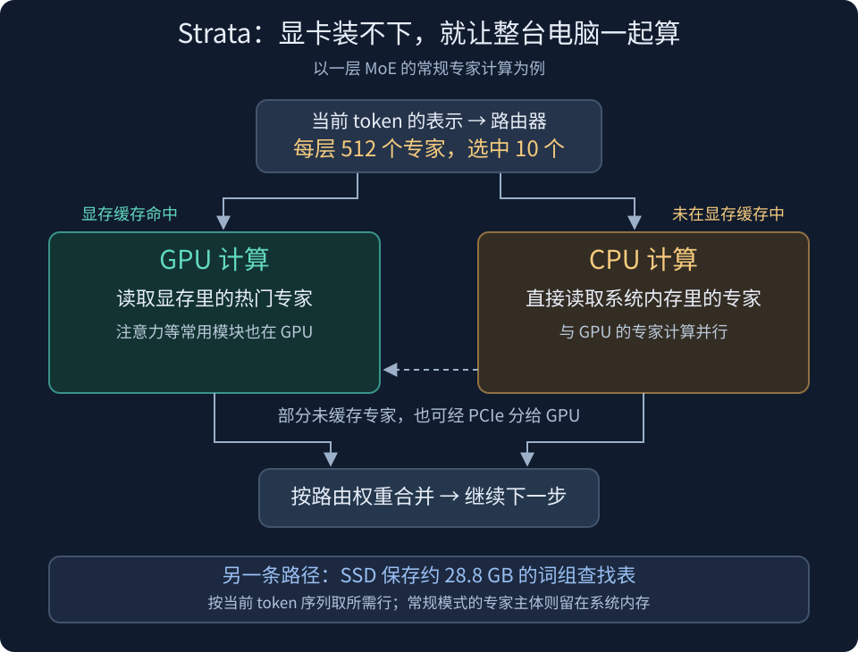
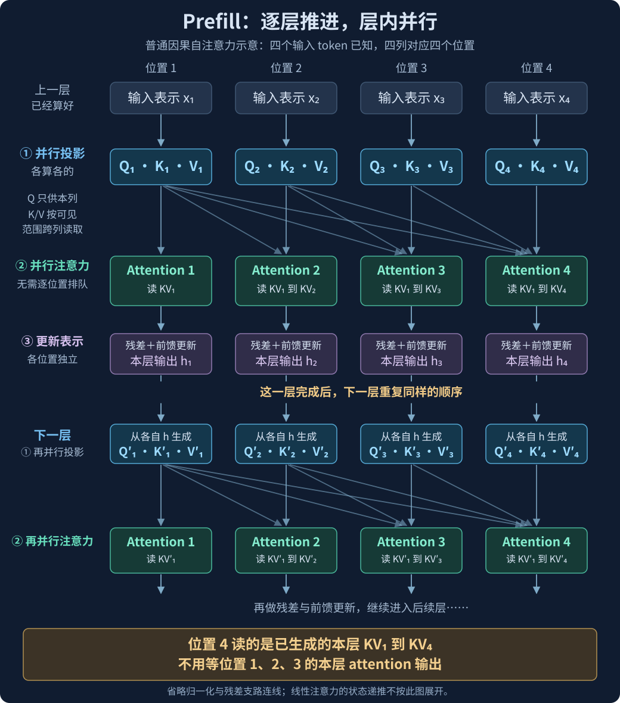
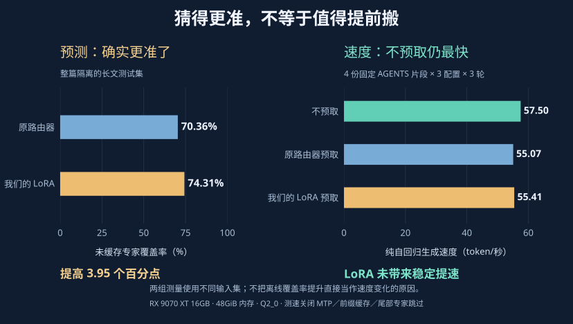

【Strata】48GB 内存＋16GB 显存，怎样跑起 Qwen3.8-Flash-Next？

━━━━━━━━━━━━━━━━━━━━

◆ 第一章：显卡装不下，为什么还能跑

━━━━━━━━━━━━━━━━━━━━

最近很火的 Strata，能让游戏显卡跑起千亿模型。我们就以 **48GB 系统内存＋16GB 显存** 为例，先看它怎样把 Qwen3.8-Flash-Next 分配给 CPU、GPU 和 SSD，再看它怎样减少搬运和等待。

这篇就按这个配置来算，模型选 **Qwen3.8-Flash-Next 的 Q2_0 量化版，保留全部路由专家**。

项目是 Niko1221/Strata（ https://github.com/Niko1221/Strata ）。正好我家 RX 9070 XT 那台就是这个内存和显存配置，介绍完项目，后面再放我们自己做的一组路由预测实验。

先说明精度：Q2_0 是低比特量化档名，不同矩阵按敏感度分配精度，不是原始 16 位权重。它保留完整专家；另一个更省内存的 Coder 版每层只保留一半专家，这次没有用。Strata 也是针对这套 Qwen 架构的专用引擎，复用了 ggml 张量计算库的能力，不是任意千亿模型都能这样放进去。

Qwen 这个模型，293 期（ https://mp.weixin.qq.com/s/jb-ibVHAG3wKbtoiX5SStA ）讲过。把结构、下载大小和运行去向放在一起看：

| 部件 | 参数规模 | 本次下载大小 | 运行时放在哪里、怎样用 |
| :--- | :--- | ---: | :--- |
| 模型主干 | 125B | 主模型分片约 37.6GB | 约 34GB 专家权重进入系统内存，热门专家另在显存缓存；注意力等常用模块放显存，每层只计算选中的路由专家及共享专家 |
| N-gram 词组嵌入表 | 另约 51B | 约 28.8GB | 留在 SSD，根据相邻 token 的组合按需取少数几行 |
| 模型自带的多 token 预测模块（Multi-Token Prediction，MTP） | 另约 4B | 另下载约 6GB | 所需运行部分加载到显卡，预测后续 token，交给主干验证 |

**前两份模型文件合计约 66.4GB，加上草稿模块约 72GB 磁盘空间；它们并不需要全部装进系统内存。** 文件是存下来的权重，运行时还要给上下文缓存、临时空间和系统开销留余量，下载大小不等于内存或显存占用。

所以，项目说的“125B 模型”指主干。把词组表加上是约 176B，但那 51B 主要是查表；多 token 预测模块还另算。**参数总数描述存了多少东西，每一步要搬多少、算多少，还得看参数怎样被调用。**

主干有 48 层，每层 512 个路由专家，处理一个 token 时选其中 10 个，另外还有共享专家。这就是 **混合专家（Mixture of Experts，MoE）** ：输入表示先经过路由器打分，选中的专家分别计算，再按路由权重把结果加起来。

`48 × 512 = 24,576 个路由专家`

这里的“512 选 10”发生在每一层。一个 token 要一路经过 48 层，不能把它理解成整台模型只启动 10 个专家。

但即便如此，计算量也已经小了很多。同一层没有选中的那 502 个专家，当下不用算。问题从“每一步把所有参数都读一遍”，变成了“这一步需要的专家在哪里，怎样尽快拿到结果”。

这正是 Strata 的入口。

普通的稠密模型，每一步大部分权重都要参与运算。权重放在内存里、计算放在显卡上，就可能反复受制于两边的传输速度。MoE 给了另一种安排：少数常用专家留显存，其他专家放内存，按当前路由分配工作。

**16GB 显存不是整台模型的住处，而是其中最快的一层工作空间。48GB 内存和 SSD 一起，才接住完整的模型文件。**

━━━━━━━━━━━━━━━━━━━━

◆ 第二章：显存放热门专家，内存里的 CPU 也干活

━━━━━━━━━━━━━━━━━━━━

先看一个 token 走到某层时发生什么。

路由器选出 10 个专家。其中几个已经在显存，显卡直接计算；另外几个在系统内存，处理器可以就地计算，也可以把其中一部分传到显卡计算。两边完成后，把各专家的输出按权重合起来，继续进入下一层。

这里多出来的关键动作是 **CPU 也计算专家**。系统内存不只是显卡的仓库，处理器也承担一部分乘法。

按 48GB＋16GB 配置，常规驻留方式是：

| 位置 | 放什么 | 容量怎样分 |
| :--- | :--- | :--- |
| 48GB 系统内存 | 全部专家权重，CPU 可以直接读取计算 | 专家约 34GB；项目另按约 10GB 估算系统与其他程序余量，合起来约 44GB |
| 16GB 显存 | 注意力、路由器等常用模块、草稿模块、上下文缓存、运算缓冲区，剩余空间缓存热门专家 | 专家缓存大小由启动时可用显存和上下文设置决定 |
| SSD | 完整下载文件，以及运行时按行读取的词组表 | 词组表约 28.8GB，不需要整体装入系统内存 |

**显存里的热门专家，是内存中那 34GB 专家的副本。** 常规模式下，不能拿 48GB＋16GB 相加，就当成一块互不重复的 64GB 权重空间。除此之外，还需要给运行缓冲区和其他程序留下余量。

显存分配可以写成：

`专家缓存空间 = 16GB − 常用模块 − 上下文缓存 − 运算缓冲区 − 其他显存占用`

实际能放多少专家，要等上下文长度、工作缓冲和其他显存占用确定后再算。显存中还要放注意力等常用模块，所以 16GB 并不能全部用于缓存专家。

**缓存的权重比例，不等于调用命中率。** 热门专家反复被选中，调用命中率可以高得多。这里的容量按字节算，混合精度让不同层的专家大小不同，也不能直接用槽数比例替代体积比例。GPU 缓存未命中，更不等于操作系统缺页：权重可能好好地待在 RAM 里，CPU 可以直接算。

把专家送上显卡，要经过 **PCIe（Peripheral Component Interconnect Express），也就是主板连接显卡的高速通道**。显卡算得快，但传输要花时间；CPU 算得慢一些，可权重已经在旁边的内存里。哪边先做完，得把搬运和计算一起算。

Strata 因而不是固定地说“显存之外全部交 CPU”，也不是“所有专家必须搬上 GPU 才能算”。它把未命中的专家分给两边，尽量让两个队伍差不多同时完成。较新的 NVIDIA 路径还会根据实际测到的 CPU 处理速度调整这个比例。

常规驻留路径还会使用锁页内存：让这批物理内存保持可供设备访问，便于显卡通过直接内存访问（Direct Memory Access，DMA）取数据，减少中转。再用异步传输，让搬下一份权重和算手头这份工作重叠。这省的是等待，并没有突破 PCIe 的带宽上限。**整轮延迟仍可能由最晚完成的那一边决定。**

不过，专家路由要等输入走到那一层才知道。下一层会选谁，并不能只看当前 token 的编号就完全确定。这与那张 51B 的词组表恰好相反。

────────────────────

💡 51B 参数的表，每一步只取几行

Qwen 的词组嵌入会根据最近两个、三个 token 的组合，计算若干个表内地址，取回对应向量，再注入主干。

总表很大，每次访问却很小。原架构每个 token 取 16 个、每个 160 维的向量；若按每个数 2 字节算，就是：

`16 × 160 × 2 = 5,120 字节，约 5KB`

这描述的是取回向量的规模。实际磁盘读取还受 I/O 对齐粒度影响，量化文件也有自己的存储格式，不能直接把它当成磁盘流量。

Strata 使用的量化词组表文件约 28.8GB，留在 SSD 上，由专门的读取线程按地址取行。默认路径采用直接读取，绕过操作系统的页缓存；最近的 token 一确定，就能算出要查的行，适合提前准备，把等待与其他计算重叠。

**一张 28.8GB 的表，不等于每生成一个 token 都要从 SSD 读 28.8GB。** 它之所以适合住得远，是因为地址好算，每次取用又少。

────────────────────

这也是为什么不能把 Strata 概括成“模型全放固态盘，边读边算”。常规低比特配置下，大批专家权重仍然靠系统内存承载；长期放在 SSD 上按行取用的，是那张很大的词组表。专家容量超过内存、不得不频繁从 SSD 调入，是另一种更慢的配置。

项目另有低内存模式，利用显存减少 CPU 一侧保留的专家。下面沿完整专家驻留 RAM 的路线看，先分清输入处理和生成阶段各自怎样调度。

━━━━━━━━━━━━━━━━━━━━

◆ 第三章：读输入和出答案，优化的是两种工作

━━━━━━━━━━━━━━━━━━━━

CPU、GPU 和 SSD 分好了工，还要看它们在什么阶段干活。“快”至少分两段。

**第一段，读完你送进去的内容。** 你贴一份长代码或几万 token 的文档，模型要先处理它们、建立后续生成需要的状态。这叫预填充（prefill）。

**第二段，开始逐步输出。** 这叫解码（decode），就是我们盯着聊天窗口看到的出字速度。

────────────────────

💡 前面的字还没算完，后面的字为什么能一起算？

先用普通 Transformer 的四个输入位置、相邻两层来看。图中从上往下是计算先后，同一排的四个位置可以并行：

**先并行算好本层 Q/K/V，再并行算 attention。** 位置 4 需要位置 1、2、3 的 K/V，这些在上一道投影步骤就已经产生；它不用等位置 1、2、3 的 attention 算完。因果遮罩（causal mask）只让它读当前位置及之前的 K/V。

attention 的结果经过残差和前馈更新，形成下一层输入。下一层又能由各位置的输入，并行生成自己这一层的新 Q/K/V。**层与层有先后，同一层的各个位置不用排队。**

到了本层 MoE 的输入，真实路由器才给批内各 token 选专家。此时可以把都选中专家 A 的 token 归到一起，让 A 的权重搬一次、多用几次。这里是已知输入的批量计算，不是在预测专家。

Qwen3.8 还混有门控 DeltaNet（Gated DeltaNet）线性注意力层，其中有状态递推，不能把整网都当成普通注意力完全并行。它需要专门的分块、扫描等实现；项目也有相关实验，并非每个实验开关都适合这张家用卡。

────────────────────

同一套模型，在不同阶段采用的安排也不同：

| 场景 | Strata 怎样安排计算与搬运 | 省下什么、受什么限制 |
| :--- | :--- | :--- |
| 生成时，选中的专家已在显存 | GPU 直接用缓存中的权重计算 | 不必重新搬这份权重；效果取决于当前任务的缓存命中率 |
| 生成时，专家在内存，分给 CPU | CPU 原地计算，与 GPU 上的专家并行，再合并结果 | 省去把这份专家权重传上显卡的开销；受 CPU 和内存带宽限制 |
| 生成时，专家在内存，分给 GPU | 通过 PCIe 传权重，GPU 计算；根据两边处理速度调整分工 | 利用 GPU 的空余能力，但要付传输时间；传上去计算不等于一定长期留在缓存 |
| 首次读入长输入（prefill） | 把输入分块，以 GPU 批量计算为主，专家按批经 PCIe 流入，搬运与计算重叠 | 一次搬入的专家能给一批 token 使用；涉及的专家多，长文仍有明显等待 |
| 较短的输入块 | 新版单 GPU CUDA 路径在适用条件下，让 CPU 分担部分专家计算 | 小批量时减少 GPU 搬运与等待；内存余量不足等情况会停用，不能套到所有设备 |
| 对话继续、专家冷热变化 | 按使用情况调整显存中的热门专家 | 后续调用可能更容易命中；切换任务后，旧的热门集合未必仍合适 |

这里的短输入分工，默认针对小于 1,024 token 的输入块，并有设备与内存条件。它与生成阶段的 CPU/GPU 分工是两项不同的调度策略。

Strata 还自带一项可选功能：**提前预测下一层会用哪些专家，再把它们预取过来。** 可以分成“猜谁”和“搬过来”两步。

“猜谁”叫路由前瞻（router lookahead）。下一层的输入还没算出来，就先把当前层的输入交给下一层现成的路由器，提前打一次分。它没有另训预测网络，而是拿较早的表示试着猜下一层的选择。

“搬过来”有不同去向。专家还在磁盘时，可以提前请求文件页；我们关注的是前瞻预取（Foresight）：在 GPU 上留一些临时槽，把预测到的未缓存专家提前从内存传进去。等下一层真正需要它们，若已到位，就能少等一次搬运。

**预测与预取框架都是项目自带的，Foresight 默认关闭。** 真实计算仍按下一层的实际路由执行，猜错不会替换模型的选择，但会浪费传输；临时槽和预测本身也占资源。因此，能不能提速，要看猜得准不准、来不来得及，以及提前搬运是否比 CPU 原地计算划算。

━━━━━━━━━━━━━━━━━━━━

◆ 做个实验：提高路由预测准确率能不能更快？

━━━━━━━━━━━━━━━━━━━━

看到这个现成的预取功能，我们想做个小实验：**如果把它的路由预测训练得更准，能不能让预取更快？** 我们不另造预取框架，只在原有预测器上加 LoRA 修正。 先在家里的 Windows 11 机器上跑通：Core Ultra 7 270K Plus、48GiB 内存、RX 9070 XT 16GB，运行 Q2_0 完整专家版。

部署遇到的主要问题是 AMD 显卡计算后端 HIP 在批量预填充时报错，最后改用兼容的输入处理路径。拿我那份积累了大量个人工作上下文的 AGENTS.md 测试，33,699 个输入 token，首次约五分钟才出内容；沿同一前缀追问，复用前文后约 0.5 秒就开始出字。两次都答对了。这份文件特别长，不能当成普通项目 AGENTS.md 的典型长度；五分钟也是这条兼容输入处理路径的结果，不是正常批量预填充的上限。

模型跑通后，实验沿用 Strata 的 Foresight 临时槽和复制路径，对比不预取、原预测器预取，以及加 LoRA 后的预取。

最终采用的方法是：把**当前层输入**交给下一层路由器，再加两张可训练的小矩阵：

`预测下一层分数 = xW_下一层 + (xA)B`

x 是当前层输入，W 是下一层原路由矩阵。A 把 2560 维压到 16 维，B 再投到 512 个专家分数。冻结模型和 W，只训练 A、B，这就是低秩适配（Low-Rank Adaptation，LoRA）的形式。真实计算仍按原路由走，旁支只决定提前搬谁，不改变模型真正选中的专家。

训练目标集中在**GPU 尚未缓存、但下一层会选中的专家**。已经在显存里的不用再搬。下面说的“未缓存专家覆盖率”，是预测覆盖了多少这类真实选择，不是 GPU 缓存实际命中了多少调用。

我们用自己的 AGENTS.md 和 **30 篇长文**做这组训练实验，目标是让 LoRA 提高未缓存专家的预测覆盖率。另留整篇长文调参和测试，不把同一篇的相邻片段分到两边。每对相邻层要不要用 LoRA，由调参集选择；没有改善就保留原路由器。

在三篇留出的测试长文上，每次预测 10 个未缓存候选，覆盖率从原路由器的 **70.36% 提高到 74.31%**，增加 3.95 个百分点，三篇都提高。至少在这份材料上，预测确实变准了。

然后把 LoRA 修正接入独立的 HIP 实验引擎，沿用原有的异步预测和预取复制流；同时补齐兼容输入处理路径中的预取接入。各组都关闭 MTP 等草稿、前缀缓存和尾部专家跳过。

测试用同样四份 AGENTS 片段，输入 947 到 1539 个 token，每次输出 128 个，交错跑三轮。下面摘出其中三个对照，各有 12 次请求。长期专家缓存一律固定为 **3437 槽、4.43GiB**，预取组另有临时槽，不预取组没有。

加载和统一暖机不计时，按总 token 数除以总用时汇总：

| 配置 | 输入处理速度（token/秒） | 纯自回归生成（token/秒） |
| :--- | ---: | ---: |
| 不预测、不预取 | **111.38** | **57.50** |
| 原下一层路由器预测＋预取 | 106.60 | 55.07 |
| 我们的 LoRA＋预取 | 106.60 | 55.41 |

**不预取最快。** 我们的 LoRA 比普通预取的生成速度高约 0.6%，各轮变化并不稳定；相对不预取，仍慢约 3.64%。输入处理也没追回来。这里仍用前面那条兼容输入处理路径。

离线预测测的是长文，测速用的是 AGENTS 片段，预取组生成的 token 序列也不完全一致。那一点点 0.6%，还不能归功于长文训练提高了预测率。能确定的是：**在我家这台机器、这组配置上，离线预测有了进步，实际速度没有稳定提高，整套预取仍是净负收益。**

我的理解是，**猜中会用谁，不等于值得搬谁**：权重原本就在 RAM，CPU 能直接算，预测、复制、同步和提前量不足都可能让预取得不偿失。这些成本还没逐项分离，但眼下的工程选择很简单——先关预取。

这次的实验报告、脚本、计时数据和运行日志都放在这里： https://github.com/lmxxf/ai-theorys-study/tree/main/wechat/assets/338 ，有兴趣可以翻一翻。

━━━━━━━━━━━━━━━━━━━━

◆ 参考资料

━━━━━━━━━━━━━━━━━━━━

Niko1221/Strata：README、DETAILS、MODELS、INSTALL 与引擎实现（本次核查固定至 7695859aa13afb248bdb4d36f9b2e95707db079d；性能表注明原始测试版本）。

Qwen3.8-Flash-Next 官方模型配置与模型说明：125B 主干、51B N-gram 嵌入、48 层及专家路由配置、MTP 模块。

ISTA-DASLab：Qwen3.8-Flash-Next-GSQ-RCO-GGUF 与 Coder 模型卡（按张量分配量化精度、模型文件大小、Coder 专家删减方式）。

Hu et al., LoRA: Low-Rank Adaptation of Large Language Models, arXiv:2106.09685（Microsoft 等，2021；低秩修正形式，本次实验将其用于独立的专家预取预测旁支）。

本次实机记录：《实验结果》《路由预测 LoRA 离线实验》《LoRA 专家预取：prefill 与纯自回归速度》《30 篇论文重训路由预测 LoRA》；原始计时、配置与校验记录保存在第 338 期素材目录。

━━━━━━━━━━━━━━━━━━━━

显存装不下整个模型，整台电脑可以分工；跑通以后，还得看等待时间。

预测哪位专家会被用到，和判断它值不值得搬上显卡，是两件事。

预测率提高了，回答却没更快，先关预取也是实验的收获。

━━━━━━━━━━━━━━━━━━━━

// 靳岩岩的 AI 学习笔记 × Kimi 的文笔 × GPT 的严谨 × Gemini 的浪漫
// 2026年10月14日

━━━━━━━━━━━━━━━━━━━━

【摘要（发布用，不进正文）】

Strata 怎样用48GB内存＋16GB显存跑起Qwen3.8-Flash-Next？先看CPU、GPU和SSD如何分工，再做一个自己的实验：提高专家预测覆盖率，能否让预取更快？结果是猜得更准了，速度却没提高。
