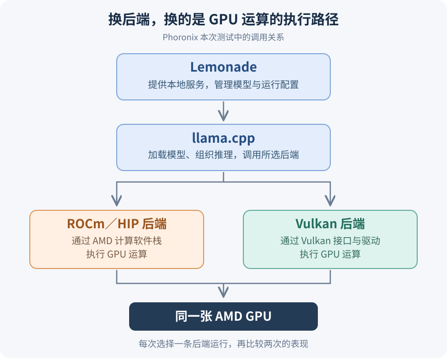

【ROCm vs Vulkan】AMD 显卡跑大模型，到底谁更快？

━━━━━━━━━━━━━━━━━━━━

◆ 第一章：把“快”拆成两段，才能看清谁赢了

━━━━━━━━━━━━━━━━━━━━

最近常看到一句话：AMD 显卡跑大模型，用 Vulkan 居然比用 ROCm 快。

这话乍一听挺反直觉。ROCm 是 AMD 自家的计算软件栈；Vulkan 在大多数人印象里，是游戏设置里和 DirectX 并排的图形接口。专业干计算的，怎么输给了画图的？

看完 Phoronix 在 2026 年 10 月 5 日发的原始评测（ https://www.phoronix.com/review/lemonade-vulkan-rocm ），再拿家里的 RX 9070 XT 亲自跑了一遍分阶段实验，我发现，“快”得分成两段看：等它开口要多久，开口后生成有多快。

**在这批测试里，多数时候 ROCm 更早吐出第一个 token，而 Vulkan 后续每秒生成的 token 更多。**

Phoronix 的测试使用 Lemonade 2026.39.1 本地服务（底层调用 llama.cpp b10825），分别在两台运行 Linux 的 AMD 机器上切换后端对比：一台是配了 Radeon AI PRO R9700 独立显卡的 System76 工作站，另一台是使用 Ryzen AI Max+ 395（内置 Radeon 8060S 图形核心）的 Framework 迷你主机。

先取原评测的代码调试（code-debug）场景，把连续生成吞吐和首 token 等待拆开看（每项测试重复 3 次）：

**第一张表看“开口后说得多快”（连续生成吞吐，token/秒，越高越好）：**

| 设备 | 模型 | ROCm（token/秒） | Vulkan（token/秒） | Vulkan 吞吐提升 |
| :--- | :--- | ---: | ---: | ---: |
| Ryzen AI Max+ 395 | Qwen3-14B | 25.1 | 25.9 | 约 3.2% |
| Ryzen AI Max+ 395 | Qwen3.5-4B | 57.3 | 60.9 | 约 6.3% |
| Radeon AI PRO R9700 | Qwen3-14B | 61.7 | 65.5 | 约 6.2% |
| Radeon AI PRO R9700 | Qwen3.5-4B | 106.7 | 120.6 | 约 13.0% |
| Radeon AI PRO R9700 | MiniCPM4-8B | 88.9 | 103.0 | 约 15.9% |

提升按“Vulkan ÷ ROCm − 1”计算。这几项里，进入连续吐字阶段后确实都是 Vulkan 更快，领先幅度在 **3% 到 16%** 之间。网上流传的“Qwen3-14B 快 1.5 倍、Qwen3.5 快 3 倍”并不符合原图数字，模型名称还把 Qwen3.5-4B 写成了 14B。

**第二张表看“等多久才开口”（首 token 等待 TTFT，毫秒，越低越好）：**

| 设备 | 模型 | ROCm（毫秒） | Vulkan（毫秒） | 等待更短的一方 |
| :--- | :--- | ---: | ---: | :--- |
| Ryzen AI Max+ 395 | Qwen3-14B | 390.3 | 577.7 | **ROCm**（少等 32%） |
| Ryzen AI Max+ 395 | Qwen3.5-4B | 282.7 | 983.8 | **ROCm**（少等 71%） |
| Radeon AI PRO R9700 | Qwen3-14B | 138.5 | 210.0 | **ROCm**（少等 34%） |
| Radeon AI PRO R9700 | Qwen3.5-4B | 452.8 | 195.4 | **Vulkan**（少等 57%） |
| Radeon AI PRO R9700 | MiniCPM4-8B | 131.0 | 194.6 | **ROCm**（少等 33%） |

两张表对照着看，门道就出来了：在 395 上跑 Qwen3.5-4B，Vulkan 连续生成只快约 6.3%，但首字要等 **983.8 毫秒**，ROCm 只需 **282.7 毫秒**。

首 token 等待还包含服务调度、输入准备和首次生成等开销，因此不能直接当成纯预填充耗时。

也有反过来的情况：表里 R9700 跑 Qwen3.5-4B 就是 Vulkan 两项都赢；而在原评测第 3 页的短代码（code-short）场景下，R9700 跑 Qwen3-Coder-Next 则是 **ROCm 连续生成更快（55.1 vs 50.4 token/秒）、Vulkan 首字更早（285.8 vs 1244.9 毫秒）**。

**同一张 AMD 显卡，运行同一个推理引擎、加载同一个模型，只换后端，为什么两个阶段就会表现不同？**

━━━━━━━━━━━━━━━━━━━━

◆ 第二章：读题和答题，干的不是同一种活

━━━━━━━━━━━━━━━━━━━━

模型文件里存的是权重。让它回答问题，软件得把这些数读出来，安排矩阵乘法、注意力计算，再把结果变成下一个 token。

先看其中最常见的矩阵乘法：

Y = X × W

X 是当前输入，W 是模型权重，Y 是结果。虽然式子只有一个乘号，但在模型工作的两个阶段里，X 的形状天差地别：

1. **预填充（Prefill，读题）**：你把一段写好的长代码喂给模型，里面的几百上千个 token 都已知，可以成批送入模型。这时候 X 有很多行，同一块权重 W 读进片上缓存后，可以给这批输入反复乘几百次，数据复用率高，更容易吃满 GPU 并行做矩阵乘法的能力。
2. **解码（Decode，自回归逐字生成）**：开始回答后，下一个字必须接着前一个字往后算，单人聊天每次往往只推进 **1 个 token**。这时候 X 通常只有一行，但对于稠密模型，几 GB 的权重 W 依然得在每一轮参与运算，计算得逐层推进，依次读取各层需要的权重。

这几个名字的关系，画出来更直观：Lemonade 调用 llama.cpp，后者通过所选后端，把运算交给同一张 GPU。

虽然最后都落到同一块硅片上，但 **ROCm（HIP）和 Vulkan 这两条路径的脾气和特性截然不同**：

| 对比维度 | ROCm / HIP 路径 | Vulkan 路径 |
| :--- | :--- | :--- |
| **定位与依赖** | AMD 专用的原生计算栈（对标 CUDA），需配套数 GB 的 ROCm 运行库 | 跨厂商底层图形与计算接口，通常无需另装 ROCm，依赖支持所需特性的显卡驱动 |
| **算子与矩阵库** | 混合路线：大矩阵乘法可直接调用 AMD 官方深度调优的 **rocBLAS** 数学库，配合手写 HIP 内核 | 纯自研着色器路线：没有官方 BLAS 库可调，所有矩阵乘、量化解包全靠 llama.cpp 自己写的 **计算着色器（Compute Shader）** |
| **编译路径** | C++ 核函数由 AMD 的 Clang/LLVM 编译器预先编译成显卡机器码 | 着色器先转成 SPIR-V 中间码，运行时再由显卡驱动（Windows 原厂驱动或 Linux Mesa RADV/ACO）编译成机器码 |
| **任务组织与提交** | 按计算流（Stream）发射内核，也可通过计算图（HIP Graph）捕获重放 | 按图形与计算管线习惯，将一串计算步骤录制进命令缓冲（Command Buffer）提交并由管线屏障控制同步 |

结合我们自己的工程经验，用大白话概括两边快慢不同的原因：
- **为什么读长输入（Prefill）往往是 ROCm 更快？** 因为读长文是一次性算**大矩阵乘法**（拼的是重火力算力），大批量计算更容易发挥 AMD 原厂 **rocBLAS 矩阵库** 的大块吞吐优势。
- **为什么逐字蹦答案（Decode）往往是 Vulkan 更快？** 因为单步生成每次只算 1 个 token，每吐一个字都要把几 GB 的 4-bit 压缩权重搬出来**边读边解包，还要连续跑几百个只执行十几微秒的碎算子**，更考验解包、访存和调度效率。因为大量核显、掌机与跨平台玩家都在用 Vulkan，开源社区把 `llama.cpp` 里 Vulkan 的 **4-bit 量化解包着色器、子群规约与管线衔接** 打磨得极其精细，干起这种“高频小步跑”反而更灵巧。

看清了这两套后端底子的区别，再看它们在两个阶段互有胜负，就一点都不奇怪了。

━━━━━━━━━━━━━━━━━━━━

◆ 第三章：既然自回归看内存速度，同一张卡为什么还会跑出差距？

━━━━━━━━━━━━━━━━━━━━

平时大家常说 **“自回归生成（Decode）是显存带宽受限，主要看内存速度”**。既然我们是在**同一张显卡**上切换 ROCm 和 Vulkan，物理显存带宽一模一样，读的也是同一份模型文件——**那为什么自回归吐字的速度还会差出几个到十几个百分点？**

我们可以拿家里的 **RX 9070 XT**（标称显存带宽 **640 GB/s**）和第 4 章测试的 **Qwen3-14B Q4_K_M**（模型文件约 **9.0 GB**）做一个数量级粗估。

如果每生成 1 个 token 都相当于把约 9.0 GB 的权重数据从显存搬运一遍，那么：

640 GB/秒 ÷ 9.0 GB/token ≈ 71 token/秒

（注：这只是帮助理解数量级的简化估算——实际推理中词表嵌入只是按行查找，且存在片上缓存复用、KV 缓存读写和中间激活读写，模型文件大小并不严格等于每步从物理显存读取的字节数。）

在我们的实测中，这张卡在空上下文连续生成 128 个 token 时，**Vulkan 跑出了 65.33 token/秒，HIP 跑出了 60.30 token/秒**。按文件大小折算，两者都与这个粗估值处于同一数量级，但 Vulkan 依然比 HIP 多榨出了 **8.3%** 的速度。

我们最近在**同一张 RX 9070 XT 上移植和优化 DLSS 5 神经网络**，就遇到过类似的问题。

系列合集： https://mp.weixin.qq.com/mp/appmsgalbum?__biz=MzYzMzMwNzk0NA==&action=getalbum&album_id=4687269655390453762

项目地址： https://github.com/lmxxf/dlss5-on-amd-9070xt-porting

在那个项目里，硬件自始至终没变，模型权重也没变，但我们在调优算子时亲眼看到了三件事：

1. **减少中间数据的显存读写量，速度立刻大涨**：在全分辨率的 C32 阶段，仅仅减少算子之间中间特征的存储字节数，C32 这一组阶段的耗时就从 **10.61 毫秒直接降到了 8.70 毫秒**——少写少读一些显存数据，省下的全是真金白银的时间。
2. **改变权重和激活的存储布局，也能明显改善读取效率**：在 ViT 注意力阶段，数学公式一行没改，只是调整权重和激活的存储布局，让 GPU 更容易连续读取成块的数据，ViT 每层耗时就从 **0.486 毫秒降到了 0.288 毫秒**（耗时减少约 41%）。
3. **减少算子数量，并不保证减少总耗时**：多头 FFN 与后续投影合并后，输出逐位相同，但因为多头段本身偏算力受限，整帧没有加速，最后保留代码、默认关闭。

**显存标称带宽相同，并不意味着程序跑得一样快。** 回到 `llama.cpp` 的自回归生成：每吐出 1 个字，GPU 要连续执行几百次微秒级的短小运算，还要把 4-bit（`Q4_K_M`）量化权重从显存读进来、边解包边乘加。**数据搬多少、怎么排、如何复用，以及几百个小算子之间的计算与等待如何交错**，都会改变同一块硬件能榨出多少实际速度。

────────────────────

💡 落到日常使用：先开口，还是先说完？

设首字等待时间为 T，后续平均生成速度为 r，整段回答有 N 个 token，整次请求的耗时大致满足：

回答总用时 ≈ T + (N − 1) ÷ r

- **如果输入很长、回答较短**（比如丢一大段代码让模型定位问题）：耗时大头在 T，谁读题起步快谁占优；
- **如果输入较短、回答很长**（比如让模型从头写一整篇长文或完整模块）：耗时大头在后面的 (N - 1) / r，每秒多吐几个字的一方就有机会把起步差距追回来。

────────────────────

◆ 第四章：家里 Windows 机器上的分阶段实测

━━━━━━━━━━━━━━━━━━━━

看完 Phoronix 的 Linux 评测，我们就在家里的 **Windows、RX 9070 XT 16GB、48GiB 内存** 机器上做了个分阶段小实验，专门把“读输入（Prefill）”和“连续生成（Decode）”拆开量。

模型选用官方 **Qwen3-14B Q4_K_M**（约 9.0GB，两边校验 SHA-256 完全一致）。测试直接使用 `llama.cpp` 官方 **b11583** 的 `llama-bench` 和 `llama-server`，两套包的主程序与核心库文件哈希一致。HIP 搭配官方 ROCm 10.0.0 便携库，Vulkan 使用 AMD 驱动；显卡驱动版本统一为 `32.0.31007.2048`。

*注：Phoronix 测的是 Linux（Mesa RADV 驱动），我们测的是 Windows（AMD 原生驱动），硬件和软件版本不同，这组实验作为补充观察，用来看同一张卡在两个阶段的表现，不把测得的差距直接套到 Linux 上。*

日志确认两边都选中了 9070 XT，41/41 层全部放进 GPU 显存（8161.75 MiB，约 7.97 GiB），保留正常的 CPU 输入嵌入映射缓冲；统一使用 8 个 CPU 线程，批大小 512、微批大小 256，开启 Flash Attention，KV 缓存采用 FP16，不启用投机解码。

**第一步：用 `llama-bench` 把读输入和连续生成彻底拆开测**（按 `HIP → Vulkan → Vulkan → HIP → HIP → Vulkan` 六个独立进程交错运行，每格 9 个样本取均值）：

| 分阶段测试 | ROCm / HIP（token/秒） | Vulkan（token/秒） | 本机实测谁更快 |
| :--- | ---: | ---: | :--- |
| **读题：处理 512 token 输入（pp512）** | **2216.61** | 1711.46 | **HIP 快 29.5%** |
| **读题：处理 2048 token 输入（pp2048）** | **2159.74** | 1661.09 | **HIP 快 30.0%** |
| **蹦字：从空上下文生成 128 token（tg128）** | 60.30 | **65.33** | **Vulkan 快 8.3%** |

在这台机器和这个模型上，两个阶段各有赢家：**读输入，HIP 快约三成；连续生成，Vulkan 快约 8.3%。**

**第二步：启动 `llama-server`，测从发出请求到回答结束的用时**（上下文固定 4096 token，关闭前缀缓存并核实 `cache_n=0`，分别喂入 512 和 2048 token 输入，每次固定生成 128 token，预热后测 3 次取均值）：

| 输入长度 | HIP 首内容等待 | Vulkan 首内容等待 | HIP 请求总用时 | Vulkan 请求总用时 | 本轮结果 |
| :--- | ---: | ---: | ---: | ---: | :--- |
| **512 token** | **232 毫秒** | 309 毫秒 | 2.387 秒 | **2.299 秒** | HIP 先开口，Vulkan 靠生成速度追回总时间 |
| **2048 token** | **954 毫秒** | 1232 毫秒 | **3.172 秒** | 3.277 秒 | 输入拉长后，HIP 首内容等待的优势让总用时更短 |

（注：服务测试按先 Vulkan、后 HIP 顺序采集，首内容等待包含输入处理与接口开销；本次实验记录、脚本和原始数据已归档： https://github.com/lmxxf/ai-theorys-study/tree/main/wechat/assets/339 ）

两段速度怎样影响完整请求，这张表就看得很直观：**短输入时，HIP 早开口 77 毫秒，但 Vulkan 在后续 128 个 token 的生成中把时间追了回来；一旦输入拉长到 2048 token，HIP 的首内容等待少了近 280 毫秒，整次请求也更早结束。**

━━━━━━━━━━━━━━━━━━━━

◆ 参考资料

━━━━━━━━━━━━━━━━━━━━

Michael Larabel：AMD ROCm vs. Vulkan Performance For Lemonade Local AI Server With Llama.cpp，Phoronix，2026-10-05，第 1 到 3 页。

Lemonade 官方项目：本地 AI 服务与 llama.cpp 后端配置说明。

llama.cpp 官方项目：HIP、Vulkan 后端、构建文档与 llama-bench 使用说明。

本机实测：《本机实测结果》及 hip-vulkan-20261013 目录内的版本校验、分阶段测速、服务请求计时与运行日志。

━━━━━━━━━━━━━━━━━━━━

大批量读题拼的是大矩阵吞吐，ROCm 背靠原厂计算库更容易占优；单步蹦字拼的是量化权重解包与高频碎算子调度，轻量灵活的 Vulkan 往往更讨巧。

第一个字来得早，和整段回答结束得早，是两种不同的快。

选后端之前，先看看自己在等模型读题，还是等它把答案写完。

━━━━━━━━━━━━━━━━━━━━

// 靳岩岩的 AI 学习笔记 × Gemini 的浪漫 × GPT 的严谨
// 2026年10月15日

━━━━━━━━━━━━━━━━━━━━

【摘要（发布用，不进正文）】

AMD 显卡跑大模型，ROCm 和 Vulkan 谁更快？从 Phoronix 评测到自家 9070 XT 实测：先开口和出字快，是两种不同的快。
