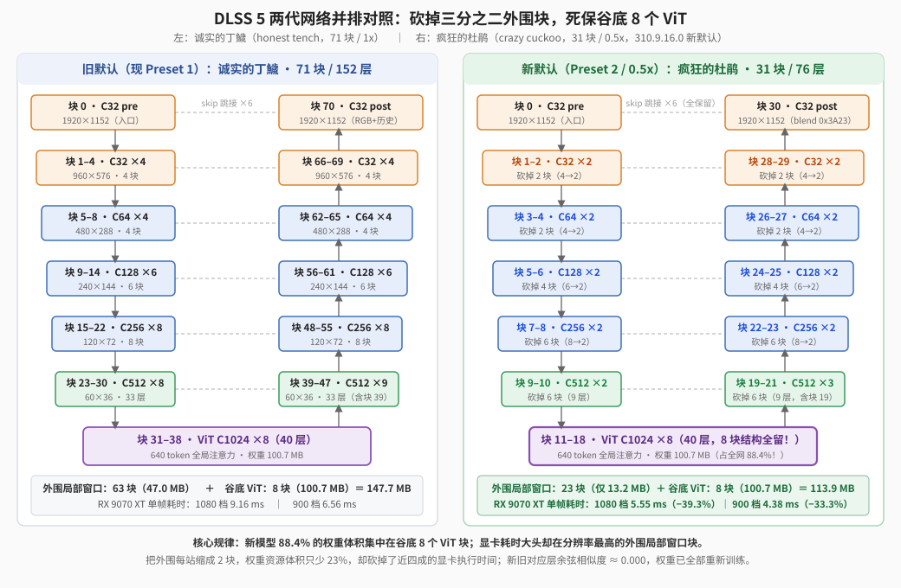

【DLSS5】5090 停产风波背后，老黄偷偷把 DLSS 5 网络砍了一半

━━━━━━━━━━━━━━━━━━━━

◆ 开篇：买不到的 5090，与突然变胖的新 DLL

━━━━━━━━━━━━━━━━━━━━

这两天显卡圈最热闹的新闻，是“RTX 5090 停产”。

10 月初起，供应链陆续传出消息：英伟达缩减甚至暂停向板卡厂分配消费级旗舰 RTX 5090（以及国内特供版 5090 D）所用的 GB202 大核心，把晶圆产能优先调配给单卡利润高得多的专业工作站显卡（比如 96 GB 显存的 RTX PRO 6000 Blackwell），再加上 32 GB GDDR7 显存颗粒的供应和成本压力，连英伟达自己的官方商城都一度下架了 5090，美国连锁零售商 Micro Center 更是把商品状态从“缺货（Out of Stock）”改成了“不再经营（Not Carried）”。坊间甚至传出，老黄准备拿一张换用单颗 3 GB 显存颗粒的 24 GB 版 RTX 5080 来顶替消费级旗舰的位置。

眼看舆论越传越烈，10 月 16 日，英伟达个人运算业务高级副总裁 Jeff Fisher 在台北活动现场出面否认，明确表示 RTX 5090 并没有进入产品生命周期终止（End of Life，EOL），后续还会继续出货；但他也当场承认，目前供应链和制造产能受到严重制约。

对普通玩家来说，这意味着原价的 5090 在市面上依然极难买到，消费级市场真正能买着的主力天花板，落在了次旗舰 RTX 5080 和中高端的 RTX 5070 系列肩上。

我们不妨顺着芯片规格表算一笔账：旗舰 RTX 5090（GB202 核心）拥有 170 个流式多处理器（Streaming Multiprocessor，SM），共 21,760 个 CUDA 核心；而次旗舰 RTX 5080（GB203 核心）只有 84 个 SM、10,752 个核心—— **SM 数量直接少了一半** （49.4%，算上频率差异后官方标称的 AI 算力也只有 5090 的 **53.7%** ）；到了甜点级的 RTX 5070（GB205 核心，48 个 SM），SM 数量更是只剩 5090 的 **28.2%**。

我们在 296 期（ https://mp.weixin.qq.com/s/ZlMYIXnkGNTGAWZqpIiSzg ）和 297 期（ https://mp.weixin.qq.com/s/Eq2IDP5QvFPGToQuCsBLRw ）分析过最初泄露的那版 DLSS 5 神经渲染动态库（`nvngx_dlssnr.dll`，版本号 `310.8.0.0`）。里面装的那张 71 块、152 个计算层的视觉大模型分量很重；我们推测，当消费端主力落在算力只有旗舰一半的 5080 与 5070 上时，在游戏本身已经吃掉大半帧时间预算的前提下，每帧再跑一遍完整的 71 块神经网络会相当吃力。

巧的是，就在高管台北辟谣的同一天，一份新版 `nvngx_dlssnr.dll`（版本号 `310.9.16.0`）流了出来。打开文件一看，老黄直接把 DLSS 5 的默认神经网络缩掉了一大半。

━━━━━━━━━━━━━━━━━━━━

◆ 第一章：254 MB 的新 DLL 里，装进了动物园的新住户

━━━━━━━━━━━━━━━━━━━━

先看文件体积。上文 296 期那份 `310.8.0.0` 只有 **158 MB** （165,840,496 字节），而这次的 `310.9.16.0` 暴涨到了 **254 MB** （266,424,944 字节）。

为什么突然胖了将近 100 MB？用工具读取 Windows 可执行文件的资源表（RCDATA 段），原因一目了然——老黄在同一个 DLL 里并排塞进了**两套完整的模型权重**：

| 资源名 | 字节数 | 体积 | 记录条数 | 预设档位 |
|---|---:|---:|---:|---|
| `WEIGHTS_HT` | 147,695,410 | 147.7 MB | 153 条 | Preset 1（旧模型） |
| `WEIGHTS_CC_SMALL_FP8` | 113,893,343 | 113.9 MB | 77 条 | Preset 2 / Default（新默认） |

第一套 `WEIGHTS_HT`，就是上文 297 期我们认识的老朋友。把这段 147,695,410 字节的资源单独导出来算一次 SHA-256 哈希值（`836f445d...`），跟旧版 `310.8.0.0` 里的 `WEIGHTS_HT` **一字节不差**。但在新版 DLL 里，它不再是唯一的默认模型，而是被挪到了 `Preset 1`（预设 1），留作可选档位。

真正的主角是第二套：`WEIGHTS_CC_SMALL_FP8`，一共 113.9 MB，77 条序列化记录（76 个网络计算层，加上 1 条只有 2 字节的混合系数）。在 `CG2RFindWeightByPreset` 预设查找表里，它被绑定到了 `Preset 2`，并且当游戏不指定预设（传 `Preset 0`）时，**程序默认加载的就是这颗新模型**。

────────────────────

💡 老黄的动物园：从“诚实的丁鱥”到“疯狂的杜鹃”

上文 297 期讲过，`WEIGHTS_HT` 里的 `HT` 来自二进制里的一条长字符串 `..._honest_tench_2026_07_04_...`，代号叫 **honest tench** （诚实的丁鱥，俗称丁桂鱼）。

那新模型 `WEIGHTS_CC_SMALL_FP8` 里的 `CC` 又是什么动物？顺着新 DLL 文件偏移 `0xda630` 处的预设结构表往里查，整座内部动物园的门牌全亮了出来：

```text
预设 1（0xda630）：
  配置名：CC_Control_History_Blend_Quantize_With_Teacher_honest_tench_2026_07_04_22_30_weights
  资源名：WEIGHTS_HT
  别名栏：CC_SILVER_AARDWOLD

预设 2 / 默认（0xda8c0）：
  配置名：hnet-crazy-cuckoo-small-fp8
  资源名：WEIGHTS_CC_SMALL_FP8
  别名栏：CC_SMALL_FP8

字符串表残留（0xd95e8）：
  配置名：hnet-almond-eagle-11m  ->  <missing>
```

原来 `CC` 是 **Crazy Cuckoo** （疯狂的杜鹃）的缩写，这颗 31 块新模型的正式内部名称叫 `hnet-crazy-cuckoo-small-fp8`（疯狂的杜鹃 · 小号 FP8 版）。熟悉自然常识的人看到这个名字大概会笑出声：杜鹃（布谷鸟）最出名的习性就是“鸠占鹊巢”——把别的鸟蛋挤走，自己孵在窝里当正主。在这份新 DLL 里，“杜鹃”真的把老住户“丁鱥”挤到了 `Preset 1`，自己坐上了默认模型的位置。

更逗的是旁边另外两处细节：在预设 1 的别名栏里，程序员本来想写 **Silver Aardwolf** （银色土狼），结果手滑把 `WOLF` 拼成了 `WOLD`（`CC_SILVER_AARDWOLD`）；而在紧挨着“疯狂杜鹃”的字符串表下一格，还留着一只叫 **`hnet-almond-eagle-11m`** （杏仁老鹰 11M）的小鸟名字，对应的资源位置标着 `<missing>`——多半是内部一个 1100 万参数超轻量实验版本的命名残留，这次并没有把它的权重装进发布包里。

────────────────────

名字认清了，接下来看核心问题：这只“疯狂的杜鹃”，到底比“诚实的丁鱥”瘦在了哪儿？

━━━━━━━━━━━━━━━━━━━━

◆ 第二章：71 块砍到 31 块——砍掉三分之二外围块，留住 88% 权重体积

━━━━━━━━━━━━━━━━━━━━

上文 297 期我们给 71 块的“丁鱥”画过一张全身像：它是一个左右对称的 **U 形网络**。左边一路下坡（分辨率每次缩一半、通道数从 `32 → 64 → 128 → 256 → 512` 一路翻倍，都是 8×8 局部窗口注意力 Swin 块），到底部第 6 站变成 1024 通道的全局视觉 Transformer（Vision Transformer，ViT）块，右边再一路上坡还原回全分辨率画面，中间由 6 条横向的 `skip` 跳接线把下坡时的细节抄送给上坡。

把 31 块“杜鹃”的构图代码和 76 层权重表解析出来，跟 71 块的“丁鱥”并排摆在一起，老黄动刀的逻辑清晰得像教科书一样：



看上面这张对比图，新旧两张网的差异可以用两句话概括：

**第一，六级通道宽度（`32 → 64 → 128 → 256 → 512 → 1024`）、6 条横向 `skip` 跳接线、以及每一站使用的算子类型，完全没变。**

**第二，U 形两侧护坡上的局部窗口块（Swin）被砍掉了三分之二，而 U 形谷底那 8 个全局 ViT 块，结构上 8 块全留！**

具体数一数每个站的块数变化：

| 站位 | 丁鱥（71 块） | 杜鹃（31 块） | 结构变化 |
|---|---|---|---|
| 入口 Pre（C32） | 1 块（块 0） | 1 块（块 0） | 保留 |
| 下坡 C32（960×576） | 4 块（块 1–4） | 2 块（块 1–2） | `4 → 2` |
| 下坡 C64（480×288） | 4 块（块 5–8） | 2 块（块 3–4） | `4 → 2` |
| 下坡 C128（240×144） | 6 块（块 9–14） | 2 块（块 5–6） | `6 → 2` |
| 下坡 C256（120×72） | 8 块（块 15–22） | 2 块（块 7–8） | `8 → 2` |
| 下坡 C512（60×36） | 8 块（块 23–30） | 2 块（块 9–10） | `8 → 2` |
| **谷底 ViT** （C1024 全局） | **8 块** （块 31–38） | **8 块** （块 11–18） | **`8 → 8`** （8 块全留） |
| 谷底上坡桥（1024→512） | 1 块（块 39） | 1 块（块 19） | 保留 |
| 上坡 C512（60×36） | 8 块（块 40–47） | 2 块（块 20–21） | `8 → 2` |
| 上坡 C256（120×72） | 8 块（块 48–55） | 2 块（块 22–23） | `8 → 2` |
| 上坡 C128（240×144） | 6 块（块 56–61） | 2 块（块 24–25） | `6 → 2` |
| 上坡 C64（480×288） | 4 块（块 62–65） | 2 块（块 26–27） | `4 → 2` |
| 上坡 C32（960×576） | 4 块（块 66–69） | 2 块（块 28–29） | `4 → 2` |
| 出口 Post（C32） | 1 块（块 70） | 1 块（块 30） | 保留 |
| **总计** | **71 块** （152 层） | **31 块** （76 层） | **外围每站只留 2 块** |

────────────────────

💡 表格里的“块（Block）”和“层（Layer）”到底是什么？——从大模型视角怎么理解

看到“31 块、76 层”，平时看惯了大模型文章的朋友很容易犯迷糊：怎么有的地方 1 块就是 1 层，有的地方 1 块又变成了 4 层、5 层？

拿大家熟悉的大模型概念作个对照就清楚了：
- **除了第 19 块是纯上采样投影桥之外，其余 30 个块（Block）在结构上就对应平时大模型里说的 1 层 Transformer**：每个块都包含完整的“前馈网络 FFN + 注意力 Attention”，在权重包里叫 `block0` 到 `block30`。
- **代码里的“层（Layer）”，则是推理引擎（`HNetCpp`）在一个块内部进一步切分出来的算子执行单元**：老黄沿用了早期 C++ 推理框架的命名习惯，把像单次矩阵乘（`CCVitFfnExpandLayer`）、单次算 QKV（`CCVitQKVLayer`）这样的计算步都封装成一个 `class Layer`，在权重包里叫 `blockX.layerY`。

那为什么同样是一个块，在外围只对应 **1 个 `Layer`**，到了深处却要分成 **4 到 5 个 `Layer`**？

1.**外围窄通道站** （`C32` 到 `C256` 的 18 个块 + 第 19 块上采样桥 = 19 块，每块 1 层）：通道窄（32～256 维），又只在 `8×8` 的小窗口里算局部注意力，引擎直接用一个融合层（Fused Layer）把前馈、QKV、窗口注意力和输出投影打包在一起执行，所以 **1 块就是 1 层** （`19 × 1 = 19 层`）。
2.**次深处的 `C512` 站** （块 9、10、20、21，每块 4～5 层）：通道涨到 512 维，计算量大增，引擎把一个块切分成 4 个计算单元依序执行：`layer0`（前馈混合）→ `layer1`（前馈展开收缩）→ `layer2`（QKV + 注意力）→ `layer3`（输出投影）。其中块 9、20、21 各占 **4 层** （`3 × 4 = 12 层`）；下坡末尾的块 10 因为还要把 512 维池化升维到 1024 维交给谷底，多带了一个 `layer4`（FinalHead），占 **5 层**。
3.**谷底的 `ViT C1024` 站** （块 11～18，每块 5 层）：通道最宽（1024 维，前馈隐层展开到 4096 维），又是全图 640 个 token 全局互相看，连 QKV 和注意力也分开独立成层：`layer0`（前馈展开）→ `layer1`（前馈收缩）→ `layer2`（算 QKV）→ `layer3`（全局注意力）→ `layer4`（输出投影），一共 **`8 × 5 = 40 层`**。

把三笔数字加起来：`19 + 12 + 5 + 40 = 76 层`（再加上第 30 块单独存的一条 2 字节混合系数记录，正好就是权重包里的 **77 条记录** ）。反过来算被砍掉的那 40 个块：28 个外围单层块（28 层）加上 12 个 C512 四层块（48 层），`28 + 48 = 76 层`，刚好从 152 层减到 76 层，一分不差。

────────────────────

弄清了块和层的对应关系，再问第二个问题：为什么老黄要把外围从 `32` 到 `512` 通道的每一站统统削成“只剩 2 块”，却把谷底那 8 个 1024 通道的 ViT 块完整保留下来？

把**权重体积**和**显卡耗时**这两组数字放在一起看，你就知道这一手有多老辣了。

先看**权重体积**。在 U 形网络里，矩阵大小跟通道数的平方成正比：外围 C32 一块的权重只有 **20 KB**，而谷底 ViT（C1024，前馈隐层展开到 4096 维）一块的权重高达 **12.59 MB** ——顶得上 600 多个 C32 块！所以在“杜鹃”的 113.89 MB 权重有效载荷里，谷底那 8 个 ViT 块独占了 **100.70 MB** （占新模型权重体积的 **88.42%** ），外围剩下的 23 个块加起来一共才 **13.19 MB** （11.58%）。

再看**显卡执行耗时** （代表每帧要干多少体力活）。我们在 318 期（ https://mp.weixin.qq.com/s/bs9VS4jBQ3aF0FdgjyLjMw ）详细算过：显卡耗时不光看通道有多宽，还要乘上**画面上有多少个 8×8 窗口**。在 1080p 档位下，谷底 ViT 虽然通道宽，但画面已经缩到了 `32×20 = 640` 个 token；而外围 C32/C64/C128 那几站，要对着成千上万个高分辨率窗口一遍遍搬运数据、做局部注意力。

把这两条规律叠在一起，答案就跳出来了：

- **外围的 Swin 块是权重占比极小、但极其消耗显卡时间的苦力活**；而且为什么每站刚好留 **2 块** 而不是 1 块？因为 Swin 注意力靠的是“普通窗口”与“偏移半格的移位窗口（shifted window）”成对交替，才能打破 8×8 铁丝网的边界—— **2 块是维持跨窗口视野的最小成对单元**。
- **谷底的 8 个 ViT 块是占了新网近九成权重体积、但因为空间分辨率低所以算得很快的全局中枢**。

砍掉外围每站多余的重复块、保留每站 2 块的最小成对单元、完整留下谷底的 8 个 ViT 结构，老黄只把**权重资源体积缩小了约 23%** （`147.7 MB → 113.9 MB`），就换来了 **近 40% 的整网耗时下降**！

━━━━━━━━━━━━━━━━━━━━

◆ 第三章：旧权重能不能直接塞进去？——算一下余弦相似度就知道了

━━━━━━━━━━━━━━━━━━━━

看到这儿，一个很自然的猜想就冒出来了：

既然“杜鹃（31 块）”和“丁鱥（71 块）”的算子结构一模一样，而且谷底那 8 个 ViT 块（老模型的块 31 到 38，新模型的块 11 到 18）连矩阵形状都一字不差，老黄是不是直接从 71 块模型里抽掉外围中间多余的块，把剩下的权重原样留用或者只做一点微调就拿出来发版了？

这个问题不用猜，把两套权重拉出来算一个数学指标就能验证：**余弦相似度** （Cosine Similarity）。

267 期（ https://mp.weixin.qq.com/s/mFRQl-5qUstz7fbZ0tvpvQ ）讲过向量的点积和夹角余弦，平时我们见到的词向量或特征向量大多是 **1024 维**或 **4096 维**。那一张形状为 `[4096, 1024]` 的权重矩阵（比如谷底 ViT 的前馈展开矩阵，把 1024 维输入映射到 4096 维隐层），怎么算余弦相似度？

其实有两种算法，而且算出来的结果完全等价：

1.**按平时熟悉的 1024 维向量一行一行算**：一张 `[4096, 1024]` 的矩阵，每一行就是一个神经元手里的 **1024 维权重向量**，一共有 4096 行。我们拿新模型第 1 行的 1024 维向量，跟老模型第 1 行的 1024 维向量算一次余弦相似度；第 2 行跟第 2 行算……一共算出 4096 个余弦值，再看它们的平均值和最大最小值。
2.**把整张矩阵首尾相接摊平算总夹角** （`flatten`）：因为每一行 1024 维向量的长度（模长）几乎完全相同，把 4096 行首尾相接拼成一条 `4096 × 1024 = 419 万` 个数的长数组算一次总余弦（线性代数里叫两个矩阵的 **Frobenius 内积** ），算出来的数字**正好就等于上面 4096 个 1024 维向量余弦相似度的平均值**！

如果在当前通道顺序下直接复用了老权重（或只做了微调），对应神经元行向量的方向会明显对齐，余弦相似度会远大于 0；反过来，如果是两套在 1024 维空间里彼此独立的随机向量，它们的夹角余弦就会死死贴在 **`0.000` 附近**。

我们写了个脚本，先**在每个模型自己内部**算一下每层权重数字本身的波动范围（即**权重自身的标准差**，用来看新旧模型权重的数值大小尺度是否一致），再**跨模型配对**算出新旧权重的**余弦相似度**：

| 对比部位（杜鹃 vs 丁鱥） | 矩阵形状（行数 × 向量维度） | 各自权重自身的标准差（旧 / 新） | 新旧跨模型余弦相似度 |
|---|---|---|---|
| 入口 Pre（块 0 vs 块 0） | 12,592 个元素 | 0.3401 / 0.3457 | `+0.0176` |
| 下坡 C32（块 1 vs 块 1） | 11,552 个元素 | 0.2738 / 0.3054 | `-0.0091` |
| 下坡 C512 FFN（块 9 vs 块 23） | `1024 × 512`（512 维） | 0.0442 / 0.0442 | `+0.0005` |
| 谷底 ViT 第 1 块 Expand（11 vs 31） | `4096 × 1024`（1024 维） | 0.0312 / 0.0312 | `+0.0004` |
| 谷底 ViT 第 1 块 QKV（11 vs 31） | `3072 × 1024`（1024 维） | 0.0313 / 0.0313 | `-0.00004` |
| 谷底 ViT 第 4 块 Expand（14 vs 34） | `4096 × 1024`（1024 维） | 0.0312 / 0.0312 | `+0.0005` |
| 谷底 ViT 第 8 块 Expand（18 vs 38） | `4096 × 1024`（1024 维） | 0.0312 / 0.0312 | `-0.0005` |
| 谷底 ViT 全部注意力位置偏置 | `2048 × 64` | 1.2015 / 1.4882 | `+0.0211` |
| 出口 Post 投影（块 30 vs 块 70） | `16 × 32`（32 维） | 0.1140 / 0.0982 | `-0.0249` |

为了排查老黄有没有“调换块号”或者“只把 4096 行神经元的顺序打乱”，我们还做了两道交叉检查：
- 把新模型 8 个 ViT 块跟旧模型 8 个 ViT 块做 `8 × 8 = 64` 组跨块全排列比对，64 组余弦相似度的最大绝对值只有 **`0.0011`**；
- 把新模型 ViT 第 1 块的 **4096 条 1024 维行向量**，跟旧模型的 **4096 条 1024 维行向量**做 **`4096 × 4096 = 1677 万对` 跨行全排列两两比对**！结果这 1677 万对向量的平均余弦相似度是 `-0.00001`，1677 万对里撞上的最大值也只有 **`0.165`** （正好是上千万次独立随机抽样的正常噪声上限）。

结论其实特别简单：**权重全变了**。

一方面，拿每个模型自己的权重单算，两代模型每一层的数值分布胖瘦（标准差）一模一样（C1024 均为 `0.0312 ≈ 1 / √1024`，C512 均为 `0.0442 ≈ 1 / √512`），沿用了同一套训练配方；另一方面，把新旧模型摆在一起比，余弦相似度全在 `0.000` 附近，完全没有沿用旧权重的痕迹。想想也很合理：块数从 71 砍到 31，外围每站只留 2 块，连网络结构都变了，光靠抽掉几层微调根本凑不出原来的画质，重新训练几乎是必须的——老黄多半就是拿 71 块的“丁鱥”当老师，在 31 块的“杜鹃”新架子上重新蒸馏训练了一把。

对做移植的我们来说，好消息是新模型虽然重训了权重、缩减了层数，但每一站调用的底层算子种类一点没变——我们在 324 期（ https://mp.weixin.qq.com/s/N0J_Mx7e_o9kP0A30kpnXA ）里打磨出来的 80 个双架构 HIP 算子模块一个都不用重编，把 93 个新权重文件和 31 块的配置表接进去，这只“疯狂的杜鹃”就在 AMD 显卡上振翅飞起来了。

━━━━━━━━━━━━━━━━━━━━

◆ 第四章：A 卡白捡四成帧时间——`0.44` 版与 `0.5x` 实测

━━━━━━━━━━━━━━━━━━━━

在我们的开源移植项目里，原本用 `DLSS5_MULTI_PASS=1 / 2 / 3` 来表示把 71 块模型每帧跑 1 遍、2 遍、3 遍，游戏里按 **F9** 键循环切换。现在来了这颗块数差不多砍半的 31 块新模型，我们干脆给它起了一个最好记的名字：**`0.5x`**，并且跟老黄一样，直接把它设成了 **`0.44` 版本的新默认档**。

现在进游戏默认就是 `0.5x`（31 块新模型），按一下 **F9** 键，就会按 **`0.5x → 1x → 2x → 3x → 0.5x`** 的顺序实时切换——既能享受 31 块新模型的丝滑帧率，也能随时一键切回 71 块老模型的 `1x/2x/3x` 原位对比画风。

先拿那台插着真 RTX 5090 的标准答案机跑原版 `310.9.16.0` 的 `Preset 2` 当裁判，核对我们的移植还原度：在真实游戏测试帧上，RX 9070 XT 跑出来的 `0.5x` 画面相对 RTX 5090 原生内部 Post 输出的峰值信噪比（Peak Signal-to-Noise Ratio，PSNR）在 **1080p 下达到 `47.76 dB`（`FAST_NUMERIC=0` 路径为 `48.02 dB`）、900p 下为 `47.40 dB`、720p 下为 `47.70 dB`**。这组数字衡量的是我们的 AMD 实现与原版 31 块模型之间的数值贴合度（至于 31 块模型和 71 块模型在具体游戏里哪种观感更讨喜，留给大家在游戏里按 F9 自己看）。

再看大家最关心的速度。

顺带交代一句测量口径的变化：在这两天更新 `0.43` 版（把 C512/C32/ViT 的 16 字节宽指令权重读取和跨核 1 字节 FP8 直连全部合入）之后，《剑星》在 2K 原生 AA 下哪怕跑 71 块的 `1x` 模式，帧率也已经稳稳贴死在游戏 60 帧的上限上了。继续看游戏帧率已经看不出优化差距，所以从 `0.43` 起，我们统一改看**算一帧要几毫秒** （单帧耗时）——每帧省下多少时间，清清楚楚：

| 版本与模式 | 1080 档（1920×1152） | 900 档（2K 质量档实际档位） | 该模式权重显存 |
|---|---|---|---|
| `0.42` 版 · `1x`（71 块丁鱥） | 约 9.650 ms / 帧 | — | 283.8 MB |
| `0.43` 版 · `1x`（71 块丁鱥，W16+字节流） | 9.121 ms / 帧 | 6.535 ms / 帧 | 283.8 MB |
| `0.44` 版 · `1x`（71 块丁鱥，保留可按 F9 切） | 9.156 ms / 帧 | 6.559 ms / 帧 | 283.8 MB |
| **`0.44` 版 · `0.5x`** （31 块杜鹃，新默认） | **5.554 ms / 帧** | **4.377 ms / 帧** | **147.6 MB** |
| **`0.44` 内 `0.5x` 相比同批 `1x` 净收益** | **耗时 -39.35%** （1.65×） | **耗时 -33.26%** （1.50×） | **单模型省 48%** （两套同时常驻共 431.4 MB） |

看着最后一行数字，真得替 AMD 显卡玩家给老黄鼓个掌：
- 在 **1080 档**下，单帧耗时从 `9.156 ms` 直接砸到了 **`5.554 ms`** （中位数 `5.535 ms`），整整少了 **39.35%** 的时间，速度是原来的 **1.65 倍**！
- 在常用的 **900 档** （2K 质量档 `1707×961` 默认走的档位）下，单帧耗时从 `6.559 ms` 降到了 **`4.377 ms`** ——跑完一整遍 DLSS 5 神经网络，现在每帧只需要 **4.38 毫秒**！

今天早上把 `0.44` 初版装进《剑星》和《鬼武者：剑之道》实机测试时，还顺手抓出了两个藏得很深的 F9 切换 bug：
1.**《剑星》按 F9 瞬间卡死**：一查日志，原来在 1080p 下 `0.5x` 和 `1x` 的处理尺寸完全一样（都是 `1920×1152`），初版切模型时不仅多此一举把 D3D12 资源销毁重建了一遍（导致外层缓存的输出纹理指针悬空），而且把新模型的权重上传塞在了等待游戏队列信号量之后，造成了死锁。修法很干脆：**同尺寸切模型一律原地复用 D3D12 资源，并且让“杜鹃（147.6 MB）”和“丁鱥（283.8 MB）”两套权重同时常驻显存** ——现在游戏里按 F9 在 `0.5x` 和 `1x` 之间来回切，**不再重新读取模型资产或重传权重、零显存重建，按键即可无缝切换**。
2.**《鬼武者》的 F9 键从头到尾没反应**：因为微软商店（Xbox Game Pass）版《鬼武者》运行在系统只读的 `WindowsApps` 虚拟挂载盘下，以前按 F9 尝试往只读目录写 `custom-config.txt` 失败后，下一帧轮询又把只读文件里的旧值读回来覆盖了内存。这次改成**按键后内存原子状态立即生效、写盘失败绝不回滚，同时优先读写可写的 `C:\XboxGames\Onimusha- Way of the Sword\Content\DLSS5-AMD` 目录** ——困扰了好几个版本的《鬼武者》F9 失灵，就这么彻底盘活了。

━━━━━━━━━━━━━━━━━━━━

◆ 收尾：身体永远比嘴诚实

━━━━━━━━━━━━━━━━━━━━

把这几天的事情串在一起看，特别有意思。

在采访镜头前，厂商会告诉你“旗舰卡没有停产，还在努力出货”；但在两百多兆字节的二进制代码里，工程团队却在实打实地把 71 块的网络缩成 31 块，重新训练出一整套新权重，再悄悄把它扶上默认档的宝座。

因为市场宣传可以靠公关话术周旋，显卡里的流式多处理器数量和每帧 16.6 毫秒（60 帧）的物理预算却不会陪任何人演戏。当消费端真正跑量的主力落在次旗舰和中高端卡上时，软件就得老老实实替硬件分担压力。

只不过老黄大概没想到，他连夜孵出来的这只“疯狂杜鹃”，刚一落地，就顺着开源社区的流水线飞进了 AMD RX 9070 XT 的机箱里，让隔壁 A 卡玩家白捡了将近四成的帧时间红利。

**公关稿写的是厂商想让你信什么，二进制代码里写的才是他们真正急什么。**

开源仓库地址依然在这儿： https://github.com/lmxxf/dlss5-on-amd-9070xt-porting ，今天刚发布的 `0.44` 正式版三个完整包（常规 OptiScaler 包、Magpie 便携包、RE9/鬼武者专用包）的夸克与 Gofile 下载链接都已经更新在仓库首页；仓库根目录还新增了一份固定入口的《使用与参数配置说明.md》，把 `custom-config.txt` 怎么写、`F6～F9` 四个热键怎么用、以及 5 套直接抄作业的参数配方全都整理好了。有 RDNA 4 显卡的朋友，直接下 `0.44` 进游戏按两下 F9 试试吧。

━━━━━━━━━━━━━━━━━━━━

◆ 参考资料

━━━━━━━━━━━━━━━━━━━━

项目 `Development/results/dlssnr-310-9-16-analysis-20261018/README.md`、`small-complete-20261018/README.md` 与 `f9-hotfix-20261018/README.md`，2026 年 10 月 18 日的逆向、提取、余弦相似度验证与 RX 9070 XT 3 轮 4-slot ABBA 实测记录。

NVIDIA, `nvngx_dlssnr.dll`（版本 `310.8.0.0` 与 `310.9.16.0`；PE 资源段 `WEIGHTS_HT`、`WEIGHTS_CC_SMALL_FP8` 及 `CG2RFindWeightByPreset` 预设表分析对象）。

中央社 / TechPowerUp / VideoCardz, NVIDIA SVP Jeff Fisher Denies RTX 5090 Discontinuation Rumors at Taipei Event, 2026 年 10 月 16 日（关于 RTX 5090 停产传闻与官方承认供应受限的报道）。

mochizuki0323 / TheAutomatic, DLSSNR-AMD（0.0.6 / PR #13，2026 年 10 月；`CC_SMALL_FP8` 描述符与规划器参考）。

━━━━━━━━━━━━━━━━━━━━

权重体积八成八在谷底，显卡苦力活却在外围；砍掉三分之二护坡，是用两成体积换四成帧时间。

算子可以原样复用，权重却不能拿旧表凑数：31 块“疯狂杜鹃”是一套重新练出来的独立参数。

公关稿写的是厂商想让你信什么，二进制代码里写的才是他们真正急什么。

━━━━━━━━━━━━━━━━━━━━

// 靳岩岩的 AI 学习笔记 × Gemini 的浪漫 × GPT 的严谨
// 2026年10月19日

━━━━━━━━━━━━━━━━━━━━

【摘要（发布用，不进正文）】

5090 停产风波背后，新流出的 DLSS 5 动态库悄悄把默认网络换成了 31 块的“疯狂杜鹃”：外围块砍掉三分之二，谷底 8 个 ViT 结构全留，权重全部重训。搬上 RX 9070 XT 后，1080 档单帧耗时降至 5.55 毫秒，耗时减少近四成。
