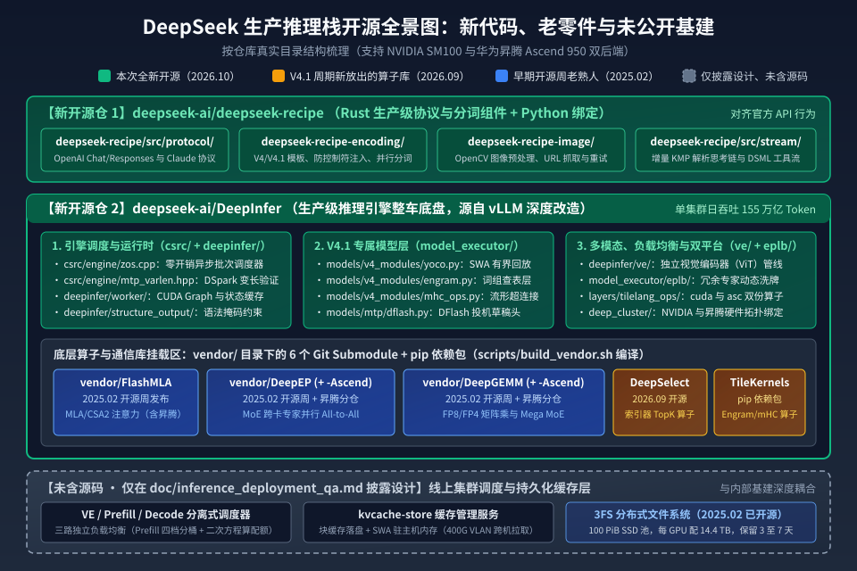

【DeepInfer】从散装零件到整车底盘：DeepSeek 刚开源的推理框架里到底装了什么？

━━━━━━━━━━━━━━━━━━━━

◆ 开篇：先分清哪些是旧零件，哪些是新底盘

━━━━━━━━━━━━━━━━━━━━

这两天，DeepSeek 正式开源了支撑自家线上大规模服务的生产级推理框架 `DeepInfer`（仓库 `deepseek-ai/DeepInfer`），同时放出了生产级协议与词元编解码组件 `deepseek-recipe`（仓库 `deepseek-ai/deepseek-recipe`），并同步公开了一份干货极密的《DeepSeek V4.1 Flash 推理部署问答》（位于仓库 `doc/inference_deployment_qa.md`）。

根据官方披露的数据，这套系统目前支撑着单集群每天 **155 万亿词元** （token）的服务吞吐量；即便按低谷期优惠价格折算，每 GPU 小时也能创造 **38 美元** 的整体营收。

消息一出，国内不少科技自媒体立刻开始了顺着公关通稿抄作业的狂欢——把官方介绍机械复述成“一、分布式；二、投机解码；三、滑动窗口”，中间塞满感叹号，读完除了让人觉得“好厉害”之外，连仓库里有几个文件夹、哪些是以前就开源的、哪些是这次新交出来的都没交代清楚。

其实，如果顺着过去一年半 DeepSeek 陆陆续续放出的开源项目和我们往期的技术分析一路看下来，打开 `DeepInfer` 的目录树，看到的就是一场老朋友的总会师：

**以前 DeepSeek 开源的 `FlashMLA`、`DeepGEMM`、`DeepEP` 是单点突破的发动机、变速箱和传动轴；而这次开源的 `DeepInfer`，是那台把所有散装零件焊在同一个车架上、能直接把 `DeepSeek-V4.1-Flash` 跑起来的整车底盘。**

我们先看官方给出的线上推理系统全景架构图：

再把这张架构图投射到 GitHub 的真实代码目录树上，按“以前就开源的老熟人”、“V4.1 周期刚补的新算子”、“这次全新开源的引擎与编解码器”以及“仅披露设计、未含源码的集群基建”分成四类，整套系统的家底就一目了然了：

下面我们就顺着这张目录图，一层一层往里看。

━━━━━━━━━━━━━━━━━━━━

◆ 第一章：老熟人都住哪儿——`vendor/` 子模块与 `TileKernels` 算子包

━━━━━━━━━━━━━━━━━━━━

很多人进了 `DeepInfer` 仓库第一个疑问是：里面为什么挂了这么多算子库？之前听说过的那些开源库，在这套框架里算什么角色？

其实只要想明白一件事，这份列表就根本不用死记硬背：**`DeepInfer` 的首要任务是让 `DeepSeek-V4.1-Flash` 跑起来；而 `V4.1-Flash` 身上改过的每一处独门架构，都必须有对应的底层算子去执行——把这几个库拼在一起，刚好就是跑通一整台 `V4.1-Flash` 前向传播的完整零件表，少一个都转不起来。**

我们可以顺着一个词元流过 `V4.1-Flash` 网络的顺序直接对号入座：
- **进层先过 4 流残差通道** （流形超连接 mHC）→ 需要 `TileKernels` 里的 `mhc` 算子；
- **在第 2 层和第 15 层查 196B 的词组表** （Engram）→ 需要 `DeepEP` 跨卡拉取行向量，配合 `TileKernels` 里的 `engram` 算子做门控；
- **进注意力前，闪电索引器从历史里挑 512 个位置** （DSA Indexer）→ 需要 `DeepSelect` 算极速 TopK；
- **算跨层共享的压缩稀疏注意力与滑动窗口** （CSA2 + SWA）→ 需要 `FlashMLA`；
- **进 MoE 专家层：选专家、跨卡分发、算低精度矩阵乘与激活量化、跨卡汇总** → 依次对应 `TileKernels`（路由与 SwiGLU 量化融合）、`DeepEP`（全对全通信）和 `DeepGEMM`（FP8/MXFP4 矩阵乘与 Mega MoE）；
- **最后词表采样与 DSpark 投机猜词** → 需要 `DeepSelect` 与引擎内置的 `tilelang_ops`。

搞清楚了“为什么必须有它们”，再看它们在仓库里是怎么摆放的——答案直接写在根目录的 `.gitmodules`、构建脚本 `scripts/build_vendor.sh` 和 `requirements.txt` 里： **它们一部分作为 Git 子模块** （Submodule） **直接挂载在 `vendor/` 目录下，另一部分打包成 Python 依赖包** （pip package） **被引擎直接调用。**

具体分为两大块：

────────────────────

**第一块：`vendor/` 目录下的 6 个 Git 子模块**

打开 `vendor/` 文件夹，里面整齐地挂着 6 个外部算子与通信仓库。执行 `./build.sh` 编译时，脚本会根据环境变量 `DEEPINFER_ACCELERATOR`（可选 `nvidia` 或 `ascend`），自动拉取对应的子模块并在本地打成 wheel 包安装：

1.**2025 年 2 月开源周发布的三大基础库**：
- `vendor/FlashMLA`：负责多头潜在注意力（Multi-head Latent Attention，MLA）与第二代压缩稀疏注意力（Compressed Sparse Attention 2，CSA2）的计算内核，主仓库内部已同时包含英伟达 CUDA 与华为昇腾分支。
- `vendor/DeepGEMM`：负责低精度矩阵乘法。我们在 176 期（ https://mp.weixin.qq.com/s/e1GKi53IociZnfHX1Ie9_w ）和 240 期（ https://mp.weixin.qq.com/s/7ROESDoxhexsMWL9HVz8wA ）专门讲过它的运行时即时编译（Just-In-Time，JIT）与细粒度分组缩放；在 V4.1 里，它不仅算 8 比特浮点（FP8）和微缩放 4 比特浮点（MXFP4）矩阵乘，还承担了把专家层揉在一起算的 `Mega MoE` 融合算子。
- `vendor/DeepEP`：负责混合专家（Mixture of Experts，MoE）跨卡专家并行（Expert Parallelism，EP）的全对全（All-to-All）分发与汇总通信。

2.**为华为昇腾 950 平行设立的两个子模块**：
- `vendor/DeepGEMM-Ascend` 与 `vendor/DeepEP-Ascend`。当编译目标设为 `ascend`（配合华为昇腾 Ascend 950 的 CANN 9.2 与 `torch-npu`）时，构建脚本会自动切到这两个昇腾专属仓库，安装出同名的 `deep_gemm` 与 `deep_ep` 接口，上层 Python 代码一行不用改。

3.**2026 年 9 月随 V4.1 周期新放出的 `vendor/DeepSelect`**：
- 这是专门为稀疏注意力（DeepSeek Sparse Attention，DSA）里的闪电索引器（Lightning Indexer，我们在 242 期 https://mp.weixin.qq.com/s/iRTyUmab0SXS3HnzxkcAGw 手搓过它的算子逻辑）和词表采样器定制的 TopK 算子库。
- 为什么放着 PyTorch 原生的 `torch.topk` 不用，非要单写一个仓库？因为在 V4 与 V4.1 里，索引器每一步都要从几万乃至几十万个历史位置里挑出得分最高的 `topk=512` 个槽位，而且**只需要知道挑中了哪 512 个下标，根本不需要对这 512 个数做严格排序，也不需要返回具体的浮点数值**。`DeepSelect` 专门针对 `return_value=False` 和关闭下标排序做了底层指令级定制（仓库 `csrc/` 下同样并列着 `cuda_kernels/` 和 `ascend_kernels/`），比原生 `torch.topk` 快出 **2 到 20 倍**。

────────────────────

**第二块：通过 `pip` 引入的 `TileKernels` 与引擎内置的 `tilelang_ops/`**

除了上面 6 个 C++/CUDA/CANN 重型子模块，大模型里还有几十个细碎但极其卡显存带宽的算子。DeepSeek 没有再去手写两套底层汇编，而是全面转向了支持多硬件后端的领域专用语言 `TileLang`，把这些算子收拢在两个地方：

一是通过 `requirements.txt` 安装的独立开源库 `tile-kernels==2.1.0`（对应仓库 `deepseek-ai/TileKernels`，9 月底刚加上昇腾 950 后端）。打开它的目录树，里面全是老熟人：

- `tile_kernels/engram/`：我们在 49 期（ https://mp.weixin.qq.com/s/4DqR-WYNf2ww61MDJVAFZw ）讲过的 Engram 词组记忆表，包含多头哈希计算、融合归一化与上下文门控算子；
- `tile_kernels/mhc/`：我们在 244 期（ https://mp.weixin.qq.com/s/IpmdCFVbfZwVwmQno815LA ）讲过的流形超连接（Manifold Hyper-Connections，mHC），包含 Sinkhorn 矩阵双随机归一化与残差混合算子；
- `tile_kernels/moe/` 与 `tile_kernels/quant/`：我们在 246 期（ https://mp.weixin.qq.com/s/EwUO9tVfrpCrcwsyPI42uw ）、247 期（ https://mp.weixin.qq.com/s/jjYk4lV-qhZpqAYge0tx6A ）和 239 期（ https://mp.weixin.qq.com/s/OozibTbTLlDiBhh57NOv0A ）分别写过的 MoE 路由门控、SwiGLU 激活函数与逐词元/逐块 FP8/FP4 量化融合算子。

二是直接写在 `DeepInfer` 引擎内部的 `deepinfer/model_executor/layers/tilelang_ops/` 目录。点进去可以看到结构极其工整的 `cuda/` 和 `asc/` 两个平行文件夹，各自装着近 30 个算子脚本（涵盖分页 KV 缓存读写、投机解码重排、采样融合、结构化输出掩码等），在运行时根据当前硬件平台自动二选一加载。

────────────────────

💡 开源版算子和 DeepSeek 内部自用版差多少？

每次大厂开源底层库，社区总会有人猜“是不是留了一手、内部版其实快一倍”。这次官方在 `doc/inference_deployment_qa.md` 里大大方方把底交了：

开源出来的 `DeepGEMM`、`FlashMLA` 等算子库与内部生产版本大体相同，只在索引器和 Mega 系列上有少许差异；其中 `FlashMLA` 缺少一处手调的底层汇编（Streaming ASSembly，SASS）优化，导致单个解码注意力算子比内部版慢 **5% 到 10%** ，但折算到端到端整网推理上，开源版与内部版的整体性能差距 **最多不超过 5%** 。

────────────────────

盘清了挂载进来的算子库，接下来看这次真正首次公开的重头戏：`DeepInfer` 引擎本体。

━━━━━━━━━━━━━━━━━━━━

◆ 第二章：首次公开的引擎本体——`DeepInfer` 往 vLLM 里塞了哪些真家伙？

━━━━━━━━━━━━━━━━━━━━

在仓库的致谢一栏里，DeepSeek 写得很实在：`DeepInfer` 最初主要基于 `vLLM` 构建，并吸收了 `SGLang` 与 `TensorRT-LLM` 的设计思路。

那它为什么不直接往上游 `vLLM` 提个补丁，而非要自己拉出一套独立引擎？因为 `DeepSeek-V4.1-Flash` 的模型结构跟常规的稠密或标准 MoE 模型差得太远了。打开 `csrc/`（C++ 底层调度）和 `deepinfer/`（Python 模型执行器与工作进程）两个目录，能看到四处专门为 V4.1 深度定制的核心实现：

────────────────────

**1. 填平我们在 308 期（ https://mp.weixin.qq.com/s/Rsx8_ygHyXbN6JI1QTNxMw ）留下的两个悬念：`models/v4_modules/engram.py` 与 `yoco.py`**

上文 308 期分析 `V4.1-Flash` 架构时，我们曾经留下过两个“只见论文描述、不见线上源码”的工程悬念，这次在 `deepinfer/model_executor/models/v4_modules/` 目录下全都能看到真身了。

**第一个悬念是 196B 的 Engram 词组表线上到底怎么查。**
当时模型仓库附带的简易参考脚本是拿普通张量切片配 `all_reduce` 算的，而 `DeepInfer` 里的 `engram.py` 亮出了真正的生产级实现：首先通过 C++ 扩展 `encode_compressed` 单趟扫描把原始词元 ID 映射成压缩词表 ID（遇到图像占位符则标记为 `-1`）；而高达 196B 的 FP8 词组嵌入表按 `engram_parallel_group` 切分后，直接驻留在对称共享内存缓冲区（`userbuffer`）里，前向传播时直接调用 `DeepEP` 里的 `EngramBuffer` 跨卡按哈希值拉取对应行，再交给 `tile_kernels` 里的融合算子完成投影与门控。

**第二个悬念是滑动窗口有界回放（SWA Bounded Replay）在代码里怎么切。**
回顾上文 308 期：`V4.1-Flash` 的 40 层被切成了前 20 层因果编码器（产出唯一一份跨层共用的全局块级 KV 缓存）和后 20 层解码器（每层只读那份共享缓存，外加一个 128 窗口的滑动窗口注意力 Sliding Window Attention，SWA）。

由于滑动窗口的依赖会跨层传递，如果要在 20 层解码器里把滑动窗口状态恢复得一丝不差，理论上得把提示词末尾 `20 × 128 = 2,560` 个词元完整跑过这 20 层。而在 `yoco.py` 与 `csrc/engine/input_metadata/prepare_tensor_input_v4.cpp` 里，当开启 `DEEPINFER_YOCO_PREFILL_TRUNCATION_MODE=compact` 时，引擎在进入第 21 层（第一个解码层）的边界处直接调用 `yoco_boundary_compact`，把残差流张量物理截断成只保留末尾 **140 个词元** （`DEEPINFER_YOCO_PREFILL_KEEP_TOKENS=140`，即 128 的滑动窗口加上最多 12 个词元的投机解码回退余量）。

这样一来，后 20 层解码器在预填充阶段永远只需要算最后一百多个词元，算出来的近似滑动窗口状态只供接下来的解码阶段使用、绝不写入持久化前缀缓存，直接把整网的总预填充计算量又砍掉了将近一半。仓库里的 `examples/yoco/yoco_equiv.py` 则提供了两级验证工具，用来核对“物理截断成 140 个词元”与“用注意力掩码模拟截断”在输出的逻辑值（logprob）和草稿头置信度上逐位等价。

────────────────────

**2. 给 DSpark 投机解码装上“算力精算师”：`csrc/engine/mtp_varlen.hpp` 与 `models/mtp/dflash.py`**

我们在 236 期（ https://mp.weixin.qq.com/s/fQc0hRxEIZxkPzGTDhj78g ）讲过 DeepSeek 与北大联合提出的 `DSpark` 投机解码：挂一个轻量级的 `DFlash` 草稿头（代码在 `deepinfer/model_executor/models/mtp/dflash.py`），每一步一口气先猜出后面 5 个候选词元（默认 `DEEPINFER_USE_NEXTN_DECODE=5`），再交给主模型批量验证。

但在真实的线上大并发场景里，“每条请求都固定验证 5 个词元”其实很亏——有些请求正写到固定代码模板，5 个全能猜中；有些请求正处于高熵转折点，第 2 个词元大概率就猜错了，后面 3 个词元送进主模型纯属白烧验证算力。

这次开源的 `csrc/engine/mtp_varlen.hpp` 和 `tilelang_ops/schedule_mtp_varlen.py` 实现了一套 **基于置信度的变长验证调度** （Confidence-scheduled variable-length verification）：
草稿头猜出 5 个词元的同时，顺手用一个置信度头（Confidence Head）预测每个位置被主模型接受的概率。由于异步调度器在排下一步班时还拿不到上一步的返回值，CPU 只负责定下本批次的总验证词元预算；真正的分配在 GPU 上由一个融合的 TileLang 算子当场完成——对每条请求的候选词元算累积接受概率、做全局 Top-K 排序，把有限的验证算力优先分给边际收益最高的候选词元。

官方在 `doc/inference_deployment_qa.md` 里晒出了 64 路专家并行（EP64/DP64）下的实测对照表：

| 单卡并发序列数 | 固定验证长度 | 动态平均验证长度 | 固定验证平均接受长度 | 动态验证平均接受长度 | 固定验证估算吞吐 (tok/s/rank) | 动态验证估算吞吐 (tok/s/rank) | 动态调度吞吐收益 |
|---:|---:|---:|---:|---:|---:|---:|---:|
| 16 | 5 | 4.44 | 3.32 | 3.24 | 4,891 | 4,816 | -1.5% |
| 32 | 5 | 3.65 | 3.25 | 3.17 | 8,964 | 9,111 | +1.6% |
| 48 | 5 | 3.94 | 3.30 | 3.26 | 12,032 | 12,467 | +3.6% |
| **60 线上工况** | **5** | **3.58** | **3.30** | **3.21** | **13,730** | **14,466** | **+5.4%** |
| 72 | 5 | 3.24 | 3.29 | 3.12 | 14,962 | 15,961 | +6.7% |
| 96 | 5 | 3.24 | 3.30 | 3.15 | 16,817 | 18,660 | **+11.0%** |

看 60 并发（线上主力运行点）这一行：动态调度把每步送去验证的草稿词元数从 `5.00` 砍到了 `3.58`（省了近三成验证开销），而真正被主模型接受的平均词元数只从 `3.30` 微降到 `3.21`，一来一回白赚了 **4% 到 7%** 的整机有效吞吐；并发推到 96 时，吞吐增益更是拉到了 **11.0%** 。

────────────────────

**3. 零开销异步调度与专家动态洗牌：`csrc/engine/zos.cpp` 与 `model_executor/eplb/`**

再看引擎底座的两个核心目录：

一个是 `csrc/engine/zos.cpp`，全称 **零开销批次调度器** （Zero-Overhead Scheduler，ZOS）。常规推理框架每跑一步，都要走“CPU 排班 → GPU 前向与采样 → GPU 同步回 CPU → CPU 后处理”，在 CPU 忙活后处理和排下一步班的那几毫秒里，昂贵的 GPU 只能干等着。`zos.cpp` 借鉴了 SGLang 和 NanoFlow 的异步重叠设计：当 GPU 正在算第 `N` 步的前向和采样时，CPU 在后台同时把第 `N+1` 步的排班、算子下发以及第 `N-1` 步的输出后处理全部干完，让 GPU 全程没有一微秒的空转等待。

另一个是 `deepinfer/model_executor/eplb/`（包含 `policy.py` 与 `shuffle.py`），即 **专家并行负载均衡** （Expert-Parallel Load Balancer，EPLB）。MoE 模型最怕冷热不均——某几个热门专家被挤爆，其他卡上的冷门专家闲死。`eplb/` 的解法是：每张 GPU 除了托管自己份内的常驻专家，还额外预留几个“冗余专家槽位”（预填充阶段每卡默认留 4 个冗余槽，每 100 步统计一次热度，每 1,000 步重新分配一次；解码阶段在 64 卡并行下每卡留 1 个冗余槽、凑齐每卡 7 个路由专家，每 1,000 步统计，每 10,000 步重分）。一旦决定调整，直接通过 NVLink 对称内存（`symm_mem`）在卡间把热门专家的权重复制过去，将线上最慢卡与平均卡的耗时比（`moe_lb`）死死按在 **`1.045` 到 `1.090`** 之间。

────────────────────

**4. 批次无关的确定性推理：`tests/models/test_batch_invariant.py`**

在 README 的特性列表里，还有一条很多开发者平时不太留意、但对大模型后训练极其关键的功能：**批次无关推理** （Batch-invariant inference）与 **确定性采样** （Deterministic sampling）。

熟悉 GPU 编程的人都知道，浮点数加法不满足结合律（`(a + b) + c` 未必严格等于 `a + (b + c)`）。平时线上推理时，同一条用户请求，跟 3 条请求拼成一个批次算，和跟 50 条请求拼成一个批次算，底层矩阵乘和归约算子的切分顺序不同，算出来的对数概率（logprob）在小数点后几位就会出现微小漂移，采样结果也会跟着分叉。

而在 `DeepInfer` 里，只要设置环境变量 `DEEPINFER_BATCH_INVARIANT=1`，无论批次怎么拼装、并发怎么变，同一条输入算出来的输出逐比特完全一致。这不仅是线上复现问题和回归测试（如 `tests/models/test_ve_batch_invariant.py`）的利器，更是 10 月 17 日刚发布的 `V4.1-Flash-1017` 大规模强化学习的地基——只有采样端算出来的概率与训练端严格对齐，异步强化学习才不会因为浮点噪声被训崩。

━━━━━━━━━━━━━━━━━━━━

◆ 第三章：另一个新仓库 `deepseek-recipe`——为什么非要用 Rust 重写一套消息编译器？

━━━━━━━━━━━━━━━━━━━━

看完 `DeepInfer`，再看这次同步开源的第二个仓库：`deepseek-ai/deepseek-recipe`。

很多媒体把它简单概括成“把 API 请求转成模型输入的小工具”。但只要读过我们的 295 期（ https://mp.weixin.qq.com/s/lCpYoqH_CwE5o52ECySMhQ ），就会明白这件事有多重要：**大模型从来没见过什么 JSON 格式的 `messages` 数组，它看到的永远是一串拼好了特殊控制符的一维词元编号** （Token ID）。

过去一年，无数公司自己在本地用开源框架部署 DeepSeek 或其他开源模型，都会遇到同一个诡异现象：明明加载的是同一个满血权重，为什么自己搭的 API 在跑复杂工具调用（Tool Call）或多轮代码智能体时，总是比官方 API 蠢一截？

很大一部分原因就出在 Python 社区沿用多年的 Jinja2 聊天模板（`chat_template`）上——多拼了一个换行符、历史回合里的 `<think>` 思考块没按训练时的规矩剥离、或者工具定义写进提示词的格式差了一点，模型看到的词元序列就偏离了后训练分布。

这次 DeepSeek 干脆把自家官方 API 线上真正跑的那套 Rust 编解码库 `deepseek-recipe`（带 Python 绑定，`pip install deepseek-recipe` 即可直接调用）完整交了出来。打开它的 6 个 Rust 子工作区，里面解决了四个核心工程问题：

────────────────────

**1. `deepseek-recipe/src/protocol/`：一套内部表示，原生通吃御三家 API 协议**

打开这个目录，里面并排放着三个协议转换模块：
- `openai/chat_completion/`：传统的 OpenAI 聊天补全接口（含 `prefix` 续写）；
- `openai/responses/`：OpenAI 新一代智能体专用的 Responses 接口，**甚至把 OpenAI 专属的 `apply_patch` 代码补丁工具、工具命名空间和客户端工具搜索** （client-executed tool search） **都原样实现了**；
- `anthropic/messages/`：Anthropic Claude 的 Messages 接口，**连 Claude 标志性的延迟工具加载** （deferred tool loading） **都直接支持**。

不管外部开发者用哪家的 SDK 连进来，Rust 转换器都会先把请求统一转成内部的 `Conversation` 结构，再走同一套 `deepseek-recipe-encoding/src/v4/`（内含 `dsv4.rs` 与 `dsv41.rs`）渲染成标准的模型提示词。

顺带一提，代码里还直接写死了官方 API 的默认最大输出长度（`resolve_max_tokens`）：不开启思考模式时默认 `8,192`，开启思考模式默认 `65,536`，开启思考模式且推理强度设为 `max` 档时直接给满 **`131,072`**。

────────────────────

**2. `deepseek-recipe-encoding/`：从根上堵死“特殊词元注入”与多线程并行分词**

如果用传统的“先把模板拼成一整个长字符串，再丢给分词器（Tokenizer）转成 ID”的做法，会同时撞上两个大坑：

第一个坑是 **控制符注入漏洞**。如果用户在提问里、或者网页抓取工具返回的文本里包含 `<｜User｜>`、`<｜image｜>` 或 `</think>` 这几个字符，普通分词器会直接把它们识别成特殊控制词元（Special Token），导致攻击者可以伪造对话角色，或者骗过解析器提前截断思考链。

`deepseek-recipe` 的做法非常干净：**在构建提示词的阶段，直接把系统合法插入的特殊词元及其精确位置记录下来，编码时直接映射为对应的特殊词元 ID；而用户输入、工具返回结果和工具参数里的文本，一律只允许使用基础词表** （Base Vocabulary） **编码。** 哪怕用户在输入里手敲了 `<｜User｜>`，或者模型在回答里用普通字符拼出了 `</think>` 和工具标签里的 `｜DSML｜`，它们在词元序列里也只是一串普通文字 ID，输出解析器（只按特殊词元 ID 认人）根本不会被糊弄过去。

第二个坑是 **超长上下文的分词延迟**。几十万词元的长文档如果单线程从头到尾做正则切分和字节对编码（Byte-Pair Encoding，BPE），光分词就要卡好几百毫秒。既然特殊词元的坐标在拼装时已经全部已知，而 BPE 合并绝不会跨越特殊词元边界，`deepseek-recipe` 直接省掉了在正文里扫描匹配特殊词元的开销，把特殊词元隔开的每一段普通文本丢给多线程并行编码，最后按原顺序拼接，大幅砍掉了长文本请求的首字等待时间。

────────────────────

**3. `deepseek-recipe/src/stream/`：流式增量 KMP 状态机**

模型生成是一个词元一个词元往外吐的。在流式传输（Streaming）时，经常出现一个 3 字节或 4 字节的 UTF-8 中文字符被劈在两个分块（Chunk）中间，或者半截 `｜DSML｜` 工具调用标签、一段几千字的代码参数分几十次才吐完。

`src/stream/` 目录下的 `output_parser.rs` 和 `processor.rs` 用 Rust 写了一台跨分块流式状态机：遇到不完整的 UTF-8 字节先在缓冲区攒齐再送解析；识别分隔标记时采用 **增量式 KMP 字符串匹配算法**，哪怕一个分块正好停在半个标签中间，状态机也会记住匹配进度，等下一个词元到达时接着往下比，绝不回头重复扫描前面的文本。一旦解析出工具名称就立刻向客户端推送事件，后面的长字符串参数边生成边按段做 JSON 转义流式下发，无需等整个参数对象闭合就能让前端提前拿到第一段数据。

━━━━━━━━━━━━━━━━━━━━

◆ 第四章：故意留白的拼图——哪三样线上基建没进仓库，但交了底？

━━━━━━━━━━━━━━━━━━━━

把 `DeepInfer` 和 `deepseek-recipe` 的源码树翻完，我们最后再看一眼 `DeepInfer` 首页明确列出的“完整推理服务所需、但未包含在本次开源版本中”的三样东西：

1. 全局 KV 缓存存储系统（`A KV cache system`）；
2. 视觉 / 预填充 / 解码分离式部署框架（`VE/Prefill/Decode disaggregation`）；
3. 跨数据并行副本的负载均衡器（`Load balancing across data-parallel replicas`）。

官方解释得很坦白：这三块代码与 DeepSeek 内部的机房基建深度耦合，暂时没法直接抽成通用源码；但在同步放出的 `doc/inference_deployment_qa.md` 和知乎技术长文里，官方把这三块黑盒的线上真实运行参数全盘交了底。对于做系统架构的人来说，这几组数字的价值一点不比源码低：

────────────────────

**1. 96% 的线上缓存命中率，背后是 100 PiB 的 3FS 固态硬盘池**

我们在 107 期（ https://mp.weixin.qq.com/s/Np4jMAm5wUHNbPo6L8nReA ）讲过 DeepSeek 的 `DualPath` 存储搬运架构和早在 2025 年 2 月就已开源的 `3FS` 分布式文件系统，也在 241 期（ https://mp.weixin.qq.com/s/0fhN7wzofQDdW8hBaDLJwA ）算过为什么多轮智能体（Agent）时代九成以上的输入都是在重复发送历史上下文。

这次官方直接公布了 `V4.1-Flash` 线上服务的真实账单：
- **线上平均输入缓存命中率高达 96%。**
- 在离线测试中，如果不带缓存从头算，单张 GPU 的预填充峰值吞吐大约是 **8.6 万词元/秒**；而在算上 96% 缓存命中的真实线上服务里，每张 GPU 的等效输入吞吐直接冲到了 **150 万词元/秒** （差出 17 倍以上），平均首字延迟（TTFT）压到了 **400 毫秒**，生成速度达 **230 词元/秒** （代码场景下更是高达 **300 词元/秒** ）。

怎么才能让缓存命中率达到惊人的 96%？答案是 **把缓存留够 72 小时以上**。
官方披露，他们的 `3FS` 分布式文件系统为 KV 缓存提供了约 **100 PiB** （约合 11.2 万 TB） **的 SSD 存储池**，把智能体（Agent）流量的缓存保留时间（TTL）设为 **3 天**，把网页/App 聊天（Chatbot）流量的缓存保留时间设为 **7 天** （因为聊天流量的长尾复用极重，把 7 天缩短到 3 天就会直接损失 0.5% 到 1% 的总命中率）。

具体到硬件配比上，官方给出的标准配置是：**每台 KV 缓存存储服务器插满 20 块 30.73 TB 的 NVMe SSD** （单机提供至少 40 GB/s 读取和 5 GB/s 写入吞吐），采用 `10+2` 纠删码（每次读取同时向组内 11 个存储节点发请求，任意 10 个返回即可解码还原，不怕单点网络抖动）；折算下来，**线上每 1 张推理 GPU 背后，都配着约 14.4 TB 逻辑容量的专属 SSD 缓存空间。**

当请求命中 3FS 上的块级缓存时，独立进程异步把数据从 3FS 拉进主机共享内存，再由引擎内的后台线程逐层与前向计算重叠搬进显存。而且因为 CUDA 原生的拷贝引擎（Copy Engine）在处理细碎的 KV 缓存块时效率不高，他们干脆用支持 GPU 直接远程内存访问（GPUDirect RDMA，GDR）的网卡直接走 PCIe 把数据灌进显存，一点不占 GPU 的计算核心（SM）。

────────────────────

💡 上文 308 期的补完：前 20 层的滑动窗口缓存（SWA KV）原来没扔，它住在机器内存里

上文 308 期我们读《V4.1 技术报告》时，报告写的是“持久化 KV 缓存不再保存 SWA KV”。这次的部署问答把线上真实的二级存储分工讲得更细了：

在 `DeepInfer` 里，每条序列的状态缓存槽位（`StateBlock`）被切成了两半：`[保留区：前 20 层编码器 SWA] [丢弃区：后 20 层解码器 SWA]`。
- 后 20 层解码器的 SWA 缓存确实彻底不存，每次靠前面讲的“有界回放”重算最后 128 个词元；
- 但前 20 层编码器的 SWA 缓存，在序列跨越 **128 词元的整数倍边界** 时是会存下来的——每条序列固定大小只有 `20 层 × 134 词元 × 528 字节（MXFP8 格式）= 1,415,040 字节（约 1.41 MB）`。

只不过，这 1.41 MB 的短期状态 **不写进 3FS 固态硬盘，而是直接留在产生它的那台推理服务器的主机内存里**。入口节点（Entrypoint）在内存里维护一张按哈希键分片的全局目录，记录哪条会话的 SWA 缓存停在哪台机器上；下一轮请求如果被分发到了别的机器，直接通过机房内部的 **400G 虚拟局域网** （VLAN）跨机从远端内存一把拉过来。万一没命中，也只需要往回退一个块（128 个词元）重算前 20 层的窗口即可。

────────────────────

**2. 视觉 / 预填充 / 解码（EPD）三分离，与跨数据中心部署**

以前行业里常聊预填充与解码分离（PD 分离），这次 DeepSeek 亮出来的是 **EPD 三分离**，而且直接围绕最普通的商业货架硬件来组织：
- **视觉编码器** （VE）：图片预处理和 ViT 编码是纯粹的单卡计算，不需要大集群通信，所以单独分出来部署在单卡实例上，官方甚至直接建议“用更便宜的 GPU 来跑 VE 就够了”；
- **预填充** （Prefill）：计算密集型，用普通的 **8 卡服务器**，只开 **2 到 8 路专家并行** （EP2–8 / DP2–8），只要显存装得下，并行度越小越好；
- **解码** （Decode）：访存带宽密集型，用 **64 到 128 卡的超节点**，开满 **64 到 128 路宽专家并行** （Wide-EP，EP64–128 / DP64–128），靠把几十张卡拼成一个大通信域来聚拢并发、减少每步搬运专家权重的显存流量。线上预填充与解码的 GPU 数量配比大约是 **`1:1`** （最小高效部署单元是 64 卡预填充配 64 卡解码）。

更有意思的是，因为 V4.1 把每词元的全局 KV 缓存压到了极小的 890 字节，官方明确表示：**预填充和解码甚至可以放在不同的数据中心机房里跑** ——只要给每 8 张 GPU 预留大约 **400 Gbps** 的机房互联带宽就行（DeepSeek 自己的线上节点就部署在相邻的不同数据中心里，唯一的物理风险是机房之间的光纤偶尔会被施工挖断）。

────────────────────

**3. 抛弃“前缀亲和路由”，拿二次方程给每一步算纳秒级时间预算**

在很多开源推理集群里，路由器为了凑缓存命中率，必须把同一个用户的后续请求固定派给上一次算过它的那台机器（即前缀亲和路由，Prefix-affinity Routing），结果经常导致有的机器排长队、有的机器闲着。

而在 DeepSeek 的架构里，因为所有块级缓存都住在独立的 3FS 存储池里，连 1.41 MB 的 SWA 缓存都能走 400G 网络跨机拉取，**任何一台预填充机器都能命中任何历史前缀**。于是负载均衡器彻底解除了路由绑定：
- 集群层面，按请求总长度分成 `<16K / 16–64K / 64–256K / ≥256K` 四个分桶，根据上一轮各档位的算力消耗比例动态调整机器配额；
- 落到单张 GPU 内部时，每一步从队列里切多少个词元（`q`）出来做分块预填充（Chunked Prefill）也不是固定写死的，而是给每一步设定一个纳秒级的时间预算（`compute_quota_limit`），再根据该序列已经算完的前缀长度（`c`），代入一条预先拟合好的二次耗时方程 `cost(q, c)`，**当场解二次方程求出刚好用满剩余时间预算的最大词元数 `q`** （上限不超过 32,768）。

靠着这套从全局分桶到单步解方程的精细配平，DeepSeek 线上真实集群跑出了相当于完美均衡离线基准测试 **约 80%** 的有效吞吐率。

━━━━━━━━━━━━━━━━━━━━

◆ 尾声：开源的拼图是怎么一块块合拢的

━━━━━━━━━━━━━━━━━━━━

把今天看到的这两座新仓库和那份部署问答合在一起，再回头看过去一年半的时间线，你会发现 DeepSeek 的开源节奏从来不是心血来潮的“突然搞大事”：

2025 年 2 月，他们先放出了 `FlashMLA`、`DeepGEMM`、`DeepEP` 和 `3FS`——那是给社区看 **单点算子与底层存储能榨出多少硬件极限**；
2026 年 6 月到 9 月，随着 V4 与 V4.1 架构演进，他们陆续放出了 `DSpark`、`DeepSelect` 和基于 `TileLang` 的 `TileKernels`——那是把 **稀疏注意力索引、词组查表、流形超连接以及英伟达与华为昇腾双后端** 封装成标准积木；
到了今天，当 `DeepSeek-V4.1-Flash-1017` 的模型权重与后训练管线尘埃落定，他们交出了 `DeepInfer` 和 `deepseek-recipe`——把所有积木插进同一个底盘，顺手用 Rust 把官方 API 的协议转换与分词防注入逻辑原样打包。

外行看热闹，看到的是一篇篇“刚刚、王炸”的惊叹号；内行看目录树，看到的是一套从模型架构减法（CED / CSA2 / Engram / FP4）到系统工程落地（100 PiB 3FS / EPD 三分离 / 变长投机验证 / 零开销异步调度）严丝合缝咬合在一起的工业级账本。

━━━━━━━━━━━━━━━━━━━━

◆ 速查表

━━━━━━━━━━━━━━━━━━━━

| 组件 / 目录路径 | 开源时间与引入方式 | 一句话解释 |
|---|---|---|
| `deepseek-ai/DeepInfer` | 2026-10 全新开源（主仓） | 支撑 V4.1-Flash 线上服务的生产级推理引擎，基于 vLLM 深度改造，兼容英伟达 SM100 与华为昇腾 950 |
| `deepseek-ai/deepseek-recipe` | 2026-10 全新开源（独立仓） | Rust 编写的生产级多协议转换（OpenAI/Claude）与分词编解码库，防控制符注入并支持流式增量 KMP 解析 |
| `vendor/FlashMLA`、`DeepGEMM`、`DeepEP` | 2025-02 开源（Git Submodule） | 负责 MLA/CSA2 注意力、FP8/FP4 矩阵乘与 Mega MoE、跨卡专家并行通信的三大底层库（后两者含 `-Ascend` 分仓） |
| `vendor/DeepSelect` | 2026-09 开源（Git Submodule） | 专为 DSA 闪电索引器（`topk=512`）与采样器定制的 TopK 算子，支持 CUDA 与昇腾，比 `torch.topk` 快 2 至 20 倍 |
| `TileKernels` + `layers/tilelang_ops/` | 2026-09 开源（pip 包 + 内置目录） | 基于 TileLang 实现的数十个跨平台融合算子，涵盖 Engram 门控、mHC Sinkhorn、量化与引擎内部调度核 |
| `csrc/engine/zos.cpp` | 2026-10 全新开源（引擎核心） | 零开销异步批次调度器（ZOS），将 CPU 排班、后处理与 GPU 前向采样流水线重叠，消除 GPU 空转 |
| `csrc/engine/mtp_varlen.hpp` | 2026-10 全新开源（引擎核心） | DSpark 变长投机验证调度，按置信度头预测的累积接受率动态分配验证算力，砍掉约 30% 验证开销 |
| `model_executor/eplb/` | 2026-10 全新开源（引擎核心） | 专家并行负载均衡（EPLB），通过预留冗余专家槽位与 NVLink 对称内存周期性洗牌，将负载比控制在 1.09 以内 |
| `kvcache-store` + `3FS`（100 PiB） | `3FS` 已开源，管理层仅披露设计 | 线上每张 GPU 配约 14.4 TB SSD 存块级缓存（留 3 至 7 天，命中率 96%），前 20 层 SWA 缓存驻主机内存走 400G VLAN 拉取 |

━━━━━━━━━━━━━━━━━━━━

◆ 参考资料

━━━━━━━━━━━━━━━━━━━━

- DeepSeek-AI, DeepInfer: High-performance, large-scale inference framework for DeepSeek models（GitHub 官方仓库及 `doc/inference_deployment_qa.md` 部署问答，2026-10）
- DeepSeek-AI, deepseek-recipe: Production-grade token encoding and decoding component（GitHub 官方仓库及流式/分词技术文档，2026-10）
- DeepSeek-AI, TileKernels & DeepSelect Repositories（GitHub 官方算子库仓库，2026-09 至 2026-10 更新华为昇腾 Ascend 950 支持）
- DeepSeek-AI, DeepSeek V4.1 Flash 推理系统架构与关键实现（知乎官方技术博客，2026-10）

━━━━━━━━━━━━━━━━━━━━

以前开源的是单点突破的发动机和变速箱，这次开源的是把所有零件焊在一起的整车底盘。

96% 的线上缓存命中率不是算法变出来的魔术，是每张 GPU 背后 14.4 TB 固态硬盘和 72 小时保留周期堆出来的工业账本。

模型架构做的每一处减法，最终都要在推理引擎的目录树里找到对应的那一行代码才算真正落地。

━━━━━━━━━━━━━━━━━━━━

// 靳岩岩的 AI 学习笔记 × Gemini 的浪漫 × GPT 的严谨
// 2026年10月22日

━━━━━━━━━━━━━━━━━━━━

【摘要（发布用，不进正文）】

DeepSeek 开源生产级推理框架 DeepInfer 与协议编解码库 deepseek-recipe。本文按真实代码目录树，厘清哪些是早期开源的算子子模块、哪些是本次全新公开的引擎与 Rust 编译组件，并解读 96% 缓存命中率、100 PiB 存储池与英伟达/昇腾双后端落地的线上真账本。
