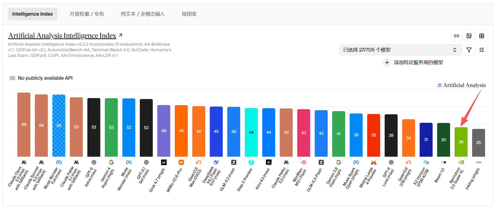
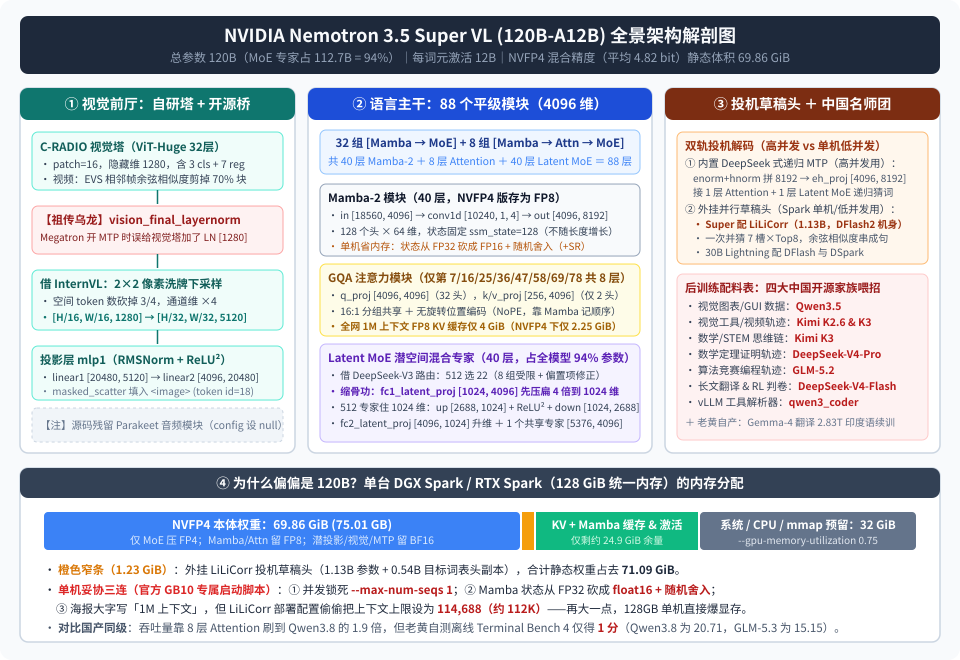

【Nemotron 3.5 Super】老黄刚发的 120B 模型：为 RTX Spark 定制的身材，炖了一锅中国开源零件

━━━━━━━━━━━━━━━━━━━━

◆ 引子：前一天发 120B 模型，第二天开卖 RTX Spark

━━━━━━━━━━━━━━━━━━━━

把日历往回翻一周，有两件事挨得非常近：

- **10 月 15 日** ，英伟达在 Hugging Face 上放出了新一代开源多模态推理模型 **`NVIDIA-Nemotron-3.5-Super-VL-120B-A12B`** （连同 `NVFP4` 量化权重与 `LiLiCorr` 投机解码草稿头）；
- **10 月 16 日** （仅仅隔了一天），英伟达联手微软及华硕、戴尔、惠普、联想、微星六家 PC 厂商，正式开卖预装 Windows on Arm 系统的消费级迷你主机与笔记本平台 **RTX Spark** ；
- **10 月 21 日** ，英伟达放出了长达 55 页的《Nemotron 3.5 Super and Lightning 技术报告》（同时包含一颗 30B 总参数、3B 激活的纯文本小模型 `Lightning`）。

我们在 210 期 https://mp.weixin.qq.com/s/WKVRvtr3wt19w7hJm-no7Q 专门讲过 RTX Spark 的机器底子：它和开发者手里那台售价四千多美元的“小金盒子” **DGX Spark** 用的是同源芯片（20 核 Grace Arm CPU + Blackwell GPU + **最高 128GB LPDDR5X 统一内存** ）。但从 Linux 工作站变成消费级 Windows 产品时，老黄砍掉了 DGX Spark 身上最核心的一根血管—— **200Gbps 的 ConnectX-7（CX7）高速直连网口** 。

在我家里，两台 DGX Spark 靠一根 200G 网线直连，就能拼成 256GB 统一内存池，稳稳跑起 284B 总参数的 `DeepSeek-V4-Flash`。而砍掉高速网口、换上 Windows 的 RTX Spark，彻底断了双机并联的念想，被物理锁死在 **单机 128GB 统一内存** 里。

问题随之而来：128GB 单机装不下 284B 的 `DeepSeek-V4-Flash`，也塞不进 300B 级别的旗舰模型；可老黄又急需在 RTX Spark 开卖当天，向市场展示“单台机器本地流畅运行百亿级多模态智能体（Agent）+ 百万词元（1M token）上下文”。

多大尺寸的模型，压成 4 比特后刚好能塞进 128GB 统一内存、又不至于退化成几十亿参数的玩具？

答案就是 **120B** 。

不信可以直接翻开 `NVIDIA-Nemotron-3.5-Super-VL-120B-A12B-NVFP4` 仓库的模型卡片，它的快速上手（Quick Start）第一节第一句话白纸黑字写着：

`This vLLM configuration is intended for DGX Spark (GB10) only.`（此 vLLM 配置专为单台 DGX Spark / GB10 芯片定制。）

更耐人寻味的是，如果去独立评测机构 Artificial Analysis（AA）刚更新的智能指数（Intelligence Index v4.3.2）榜单上看一眼，这台 120B 模型的表现堪称惨烈——在国产开源模型（`MiMo-V2.6-Pro` 46 分、`DeepSeek V4.1 Flash 1017` 45 分、`GLM-5.3-Flash` 42 分）集体冲上 40+ 分的今天，**120B 的 `Nemotron 3.5 Super VL` 只拿到了尴尬的 26 分，甚至比只有 27B 参数的 `Qwen3.8 27B`（34 分）还低了整整 8 分** ：



而当我们顺着 10 月 21 日公开的技术报告、模型配置文件 `config.json`、权重分片头部信息和推理源码 `modeling_nemotron_h_omni.py` 一层层往里看时，又会发现一个极有意思的反差：这台只考了 26 分、为 128GB 单机量身定做的“美国开源代表作”，从底层的路由算法、视觉连接器、多词元预测头，到后训练阶段手把手喂招的各科老师，几乎把过去一年 **中国四大开源模型家族（DeepSeek、Qwen、Kimi、GLM）加上海人工智能实验室（InternVL）的看家零件炖成了一锅百家饭** 。

我们先用一张全景解剖图，把这台 120B 模型的内部结构、外部零件来源以及它在 128GB 单机里的真实内存分布摆在桌面上：



下面我们就顺着这张图纸，看看老黄是怎么把这锅零件炖到一起的。

━━━━━━━━━━━━━━━━━━━━

◆ 第一章：先算 128GB 单机的生死内存——为什么 NVFP4 占了 70 GiB？

━━━━━━━━━━━━━━━━━━━━

很多人看到“120B 参数 + NVFP4（4 比特浮点量化）”，第一反应是拿算盘心算：1 个参数占 0.5 字节，120B 参数不就是 60GB 吗？放进 128GB 的 Spark 里岂不是绰绰有余？

如果真去拉一下 Hugging Face 上 `NVFP4` 仓库的 88 个 `.safetensors` 权重分片，把文件体积加起来，你会发现它的静态权重足足有 **75.01 GB（合 69.86 GiB）** ，再加上配套的 `LiLiCorr` 投机草稿头 **1.32 GB（1.23 GiB）** ，光静态模型文件就吃掉了 **71.09 GiB** 。

多出来的十几 GB 是哪来的？打开仓库里的量化配置文件 `hf_quant_config.json` 和技术报告第 4.1 节的表 12，谜底就揭开了：

**它根本不敢把整张网络全压成 FP4。**

在报告第 4.3 节的混合精度敏感度分析（AutoQuant）中，英伟达实测发现：词表输出头（`lm_head`）一项就占了全模型对 FP4 量化误差敏感度的将近一半，紧随其后的是注意力投影层和 Mamba-2 投影层；如果把这些层强行压成 FP4，模型精度会直接跳水。只有参数占比最大的混合专家（MoE）层，对 4 比特量化相对皮实。

因此，官方最终发布的 `NVFP4` 权重，实际上是一套叫做 `MIXED_PRECISION`（混合精度）的三档拼盘：

1.**真正压成 `NVFP4`（每 16 个元素共享 1 个 FP8 缩放因子，实际每元素占 4.5 bit）的**：只有 40 层 MoE 里的路由专家与共享专家矩阵（`experts.*.up_proj` 和 `down_proj`）；
2.**退一步保留 `FP8`（8 bit）的**：全部 40 层 Mamba-2 的进出线性投影（`in_proj`、`out_proj`）、全部 8 层注意力的查询/键/值/输出投影（`q_proj`、`k_proj`、`v_proj`、`o_proj`）以及主干的词表输出头 `lm_head`；
3.**干脆不量化、原样保留 `BF16`（16 bit）的**：词表嵌入层（`embeddings`）、全部 40 层 Mamba-2 的一维卷积核（`conv1d`）、全部 40 层 MoE 的路由器（`gate`）与潜空间进出投影矩阵（`fc1_latent_proj`、`fc2_latent_proj`）、整个多词元预测模块（`mtp`）的注意力与融合层、以及整座视觉编码器（`vision_model`）和视觉投影层（`mlp1`）。

把这三档加权平均下来，报告第 4.1 节给出的全模型实际存储密度是 **平均每参数 4.82 比特（4.82 BPE，总存储参数量计入视觉与 MTP 后为 124.453B，总字节数 74.987 GB）** 。

现在，我们把它放进一台 128 GiB 统一内存的 Spark 机器里，看看官方给出的 GB10 专属启动脚本：

```bash
vllm serve nvidia/NVIDIA-Nemotron-3.5-Super-VL-120B-A12B-NVFP4 \
  --max-num-seqs 1 \
  --gpu-memory-utilization 0.75 \
  --max-num-batched-tokens 8192 \
  --speculative_config.model nvidia/NVIDIA-Nemotron-3.5-Super-VL-120B-A12B-NVFP4-LiLiCorr \
  --speculative_config.num_speculative_tokens 7 \
  --speculative_config.method dflash \
  --mamba-backend flashinfer \
  --mamba-ssm-cache-dtype float16 \
  --enable-mamba-cache-stochastic-rounding \
  --tool-call-parser qwen3_coder
```

我们在前文 210 期讲过，统一内存设备的 CPU 和 GPU 共用同一个内存池，必须给操作系统、CPU 进程、图像视频解码以及文件加载缓存留出安全垫。因此脚本里写了 `--gpu-memory-utilization 0.75`——也就是只允许 vLLM 动用 **96 GiB** （128 × 0.75）。

96 GiB 扣掉 71.09 GiB 的静态权重（本体 + 草稿头），留给运行时激活值、注意力 KV 缓存和 Mamba 状态缓存的空间，**只剩不到 25 GiB** 。

为了在这不到 25 GiB 的夹缝里活下来，官方启动脚本不得不做了三处极其局促的妥协：
- **第一，并发数锁死为 1（`--max-num-seqs 1`）** ：同一时间只能伺候一个会话，多来一条并发就会因为双倍的 Mamba 状态缓存而捉襟见肘；
- **第二，把 Mamba 的循环状态缓存从 `float32` 砍半成 `float16`** ：在模型的 `config.json` 里，默认写的是 `mamba_ssm_cache_dtype: float32`，因为循环状态每一步都在累乘累加，低精度极易累积舍入误差。到了单机上实在装不下，只能直接砍成 `float16`，再额外打开随机舍入（`--enable-mamba-cache-stochastic-rounding`，用 5 轮 Philox 随机数发生器把截断误差抖成零均值噪声）来勉强维持精度；
- **第三，宣传海报上的“1M 上下文”，在单机配置里缩水到了约 112K** ：如果你点进配套的 `LiLiCorr` 模型卡片看输入说明，会发现一行不起眼的小字——`The target model supports up to 1M tokens of context. The serving configuration below sets a 114,688-token limit.`（目标模型支持最高 1M 词元上下文，但下方的部署配置将上限设为 114,688 词元。）

看懂了这笔严丝合缝的内存预算，你就会明白后面的所有架构设计都在围绕同一个目标转：**如何在塞下 120B 参数的前提下，把每个词元的运行时缓存、激活维度和访存带宽压到极限。**

━━━━━━━━━━━━━━━━━━━━

◆ 第二章：主干拓扑——88 个平级模块，把注意力砍到只剩 8 层

━━━━━━━━━━━━━━━━━━━━

之前我们在 292 期 https://mp.weixin.qq.com/s/qGbCm3qJB6SNumftansUtw 读智谱的 `GLM-5.3-Flash`，在 293 期 https://mp.weixin.qq.com/s/jb-ibVHAG3wKbtoiX5SStA 读阿里的 `Qwen3.8-Flash-Next`，两家不约而同采用了“3 比 1”的混合线性注意力配方：每 3 层线性注意力（KDA 或 Gated DeltaNet）配 1 层注意力，而且每一层内部都按传统 Transformer 的规矩，由“1 个序列混合模块 + 1 个 MoE 前馈模块”成对组成。

打开 `Nemotron 3.5 Super` 的 `config.json`，你会看到一种更激进的排法。它的 `layers_block_type` 数组一共列出了 **88 个平级模块（Block）** ，每一层只干一件事——要么是 `mamba`（Mamba-2 状态空间层），要么是 `attention`（分组查询注意力层），要么是 `moe`（混合专家前馈层）。

如果我们用 `M` 代表 Mamba-2、用 `A` 代表 Attention、用 `E` 代表 MoE，把这 88 层的真实排列顺序打出来，长这样：

```text
# 全网 88 个平级 Block 的排列序列（M=Mamba-2, A=Attention, E=Latent MoE）：
MEMEMEMAEMEMEMEMAEMEMEMEMAEMEMEMEMEMAEMEMEMEMEMAEMEMEMEMEMAEMEMEMEMEMAEMEMEMEMAEMEMEMEME

# 统计数量：
# M (Mamba-2)   = 40 层
# E (Latent MoE)= 40 层
# A (Attention) =  8 层（仅位于第 7、16、25、36、47、58、69、78 号模块）
```

仔细看上面那串字母，规律非常清晰：
- 全网一共有 **40 个 `M`** 和 **40 个 `E`** ，基础骨架是 40 组一比一交替的 `M → E`（Mamba-2 后跟一个 MoE）；
- 在第 7、16、25、36、47、58、69、78 这 8 个位置上，模型在 `M` 和 `E` 中间额外塞进了一个 `A`，变成了 **`M → A → E` 三连击** （即每过 4 到 5 个 Mamba-MoE 周期，才插入 1 层真正的注意力，而且这层注意力不单独配 MoE，而是和前面的 Mamba 共用后面的同一个 MoE）。

────────────────────

💡 为什么 Mamba-2 和 Attention 可以这么混搭？

用两句话就能分清这两种模块的分工：
1. **Mamba-2（状态空间模型，State Space Model）** ：像一个边读书边在固定大小的笔记本上做摘要的人。不管前面的文章是 1 千字还是 100 万字，它的笔记本大小永远不变（在这台模型里是 128 个头 × 64 维 × 128 状态维 = 固定 104.8 万个浮点数）。好处是长文推理省内存、省算力；坏处是笔记本容量有限，遇到需要一字不差回翻前文第 35 页某句话的任务（大海捞针或跨文件精确核对），摘要里找不回来。
2. **Attention（注意力层）** ：像把整本书所有页码摊在桌上随时回翻。每多读一个词，桌上的 KV 缓存就要多存一行，内存随长度线性增长，但能做到精确回查。

国内的 Qwen3.8 和 GLM-5.3 选择每 3 层线性模块配 1 层注意力（占比 25%），而英伟达为了在长上下文里把 KV 缓存压到最小，把注意力的比例一路砍到了 **40 比 8（每 5 个 Mamba 才配 1 个 Attention，占比不到 10%）** 。

────────────────────

光把注意力层数砍到 8 层还不够，我们再从权重分片头里把第 7 层（第一个 Attention 层）和第 0 层（第一个 Mamba-2 层）的真实矩阵形状拉出来对账：

```python
# === 第 7 层：GQA 注意力模块（全网仅 8 层） ===
# 隐藏维 hidden_size = 4096，单头维度 head_dim = 128
q_proj.weight: [4096, 4096]  # 32 个查询头 (32 × 128 = 4096)
k_proj.weight: [256,  4096]  # 仅 2 个键头 (2 × 128 = 256)
v_proj.weight: [256,  4096]  # 仅 2 个值头 (2 × 128 = 256)
o_proj.weight: [4096, 4096]  # 输出投影回 4096 维

# === 第 0 层：Mamba-2 模块（全网共 40 层） ===
# 128 个 Mamba 头 × 64 维 = 8192 内部维，状态维 ssm_state_size = 128，分成 8 组 (n_groups = 8)
in_proj.weight:  [18560, 4096] # 一次投出：门控 z(8192) + 输入 x(8192) + B(1024) + C(1024) + 步长 dt(128) = 18560
conv1d.weight:   [10240, 1, 4] # 对 x(8192) + B(1024) + C(1024) = 10240 维做核宽为 4 的因果一维卷积
out_proj.weight: [4096,  8192] # 状态扫描后压回 4096 维
```

看清 `k_proj` 和 `v_proj` 的形状 `[256, 4096]` 了吗？

这 8 层注意力不仅层数少，连每层的 KV 头都抠到了极限：**32 个查询头（Q）只配了 2 个键值头（KV），也就是 16 比 1 的分组查询注意力（Grouped-Query Attention，GQA）** ——每 16 个 Q 头共用同一份 K 和 V（我们在 322 期 https://mp.weixin.qq.com/s/HpX5uMf7UmYk12WthUcOrg 写小米 MiMo-V2.6 的全局层时见过同样的 16 比 1 比例，但小米有 48 层注意力，而老黄只有 8 层）。而且和前文 292 期的 `GLM-5.3-Flash` 一样，这 8 层注意力 **完全不加旋转位置编码（NoPE）** ，词与词的先后顺序全靠夹在中间的 40 层 Mamba-2 替它记。

这样一番“砍层数 + 砍 KV 头”下来，它的注意力 KV 缓存小到了什么程度？我们可以当场算出来：
- 每经过 1 个词元，单层 Attention 需要存 `2 个头 × 128 维 × 2（K 和 V）= 512 个数`；
- 全网只有 8 层 Attention，所以每个词元在全网一共只产生 `8 × 512 = 4,096 个数` 的 KV 缓存；
- 按官方默认开启的 `FP8`（每元素 1 字节）存储，**1 个词元只占 4 KB；哪怕把上下文拉满到 1M（1,048,576 个词元），整张网络的注意力 KV 缓存加起来也只有整整 4 GiB** （如果用报告第 4.5 节测试的 `NVFP4` KV 缓存，更是只有 **2.25 GiB** ）。

作为对比，前文 322 期算过：同样在 1M 上下文下，`Qwen3.8-Flash-Next` 的 KV 缓存要占约 **24 GiB** ，`GLM-5.3-Flash` 要占 **11 GiB** ，`DeepSeek-V4-Flash` 要占 **6.72 GiB** 。老黄能在 GB200 上吹出“吞吐量是 Qwen3.8 的 1.90 倍”，靠的就是把注意力砍成 8 层、每层只留 2 个 KV 头换来的超小缓存体积。

至于代价是什么——全网 88 层里只有 8 层能回头看全貌，且每层只有 2 个 128 维的 KV 通道，这根被捏得极细的管道到底漏掉了多少复杂上下文细节，第四章看跑分表自有分晓。

━━━━━━━━━━━━━━━━━━━━

◆ 第三章：Latent MoE 与 DeepSeek 路由——把 94% 的参数关进 1024 维的“小黑屋”

━━━━━━━━━━━━━━━━━━━━

看完了 40 层 Mamba-2 和 8 层 Attention，它们加起来的参数量其实还不到 7B。这台模型号称 `120B` 总参数，剩下的 **113B 参数** 全都装在另外 40 层混合专家（MoE）模块里。

我们直接把第 1 层（第一个 MoE 层）的权重键名和张量形状拉出来：

```python
# === 第 1 层：Latent MoE 模块（全网共 40 层，每层 512 个路由专家 + 1 个共享专家） ===
# 1. 路由器（直接沿用 DeepSeek-V3/V4 的无辅助损失偏置 + 分组受限路由）
gate.weight:                  [512, 4096] # BF16 存储，FP32 计算；512 个专家分 8 组，先选 1 组再挑 Top-22
gate.e_score_correction_bias: [512]       # FP32，DeepSeek 标志性的无辅助损失负载均衡动态偏置项

# 2. 潜空间路由专家（Latent MoE：进专家前先从 4096 维压扁到 1024 维）
fc1_latent_proj.weight:       [1024, 4096] # 所有专家共享的入场降维矩阵：4096 → 1024（压扁 4 倍）
experts.0..511.up_proj.weight:   [2688, 1024] # 512 个专家全住在 1024 维里，激活函数为 ReLU²（无 gate_proj）
experts.0..511.down_proj.weight: [1024, 2688] # 算完退回 1024 维，22 个激活专家在 1024 维里加权求和
fc2_latent_proj.weight:       [4096, 1024] # 所有专家共享的出场升维矩阵：1024 → 4096

# 3. 共享专家（不走潜空间，直接在 4096 维上计算）
shared_experts.up_proj.weight:   [5376, 4096]
shared_experts.down_proj.weight: [4096, 5376]
```

这一层里藏着两样东西：一样是原封不动向 DeepSeek 借来的，另一样是老黄为了省带宽自己加的“缩骨功”。

**第一样：DeepSeek-V3 同款路由机制。**
看那行 `gate.e_score_correction_bias: [512]`，熟悉 DeepSeek 架构的读者一眼就能认出来——这就是 DeepSeek-V3 首创的 **无辅助损失负载均衡（Aux-Loss-Free Load Balancing）** ：不往训练损失函数里强加会损害模型智力的负载均衡惩罚项，而是给每个专家配一个动态调整的偏置项 `e_score_correction_bias`，哪个专家太闲就把它的偏置调高一点，哪个太忙就调低一点。同时，`config.json` 里的 `n_groups: 8, topk_group: 1, norm_topk_prob: True, routed_scaling_factor: 5.0` 也完全照搬了 DeepSeek 的分组受限路由（把 512 个专家分成 8 组，每次先挑出得分最高的组，再从里面选出 22 个激活专家）。

**第二样：老黄自创的缩骨功——潜空间混合专家（Latent MoE）+ `ReLU²` 双矩阵。**
在标准的 MoE（如 DeepSeek 或 Qwen）里，主干残差流是 `4096` 维，每个被选中的专家都要直接吃进 `4096` 维的向量，用三张矩阵（SwiGLU 的 `gate_proj`、`up_proj`、`down_proj`）算完，再吐出 `4096` 维的向量。如果你每一步要激活 22 个专家，或者在多卡专家并行（EP）时跨卡收发 22 份 `4096` 维向量，显存带宽和通信线瞬间就会被塞满。

老黄是怎么省这笔带宽的？看上面的 `fc1_latent_proj` 和 `fc2_latent_proj`：
1. **进门先缩骨 4 倍** ：词元进专家之前，先乘一张所有专家共用的降维矩阵 `fc1_latent_proj [1024, 4096]`，把 `4096` 维的胖向量直接压扁成 **`1024` 维** （`moe_latent_size: 1024`）；
2. **512 个专家全住在 1024 维的小黑屋里** ：每个专家的输入和输出都只有 `1024` 维（中间维 `2688`）。而且老黄放弃了主流的 SwiGLU 激活函数，改用平方整流线性单元 **`ReLU²`** （即先取 `max(0, x)` 再平方），直接省掉了第三张门控矩阵 `gate_proj`，每个专家只剩 `up_proj [2688, 1024]` 和 `down_proj [1024, 2688]` 两张表；
3. **算完加权再吹胖** ：被选中的 22 个专家在 `1024` 维空间里算完并加权求和后，最后只乘一次共享升维矩阵 `fc2_latent_proj [4096, 1024]`，恢复成 `4096` 维加回残差流（旁边的 1 个共享专家则保留在 `4096` 维直接计算）。

我们来算一算这招“潜空间缩骨功”带来的参数分布：
- 1 个路由专家的参数量 = `2 × 1024 × 2688 = 5,505,024`（约 550 万参数）；
- 1 层 512 个路由专家 = `512 × 550.5 万 ≈ 28.186 亿参数`（加上共享专家与潜投影约 28.71 亿）；
- 全网 40 层 MoE 合计 = **`40 × 28.71 亿 ≈ 114.8 亿（114.8B）参数`** （其中 512×40 个路由专家独占 **112.7B** ）。

这个数字相当震撼：**在这台号称 120B 的大模型里，高达 94% 的参数（112.7B）全都被锁在 `1024` 维的狭窄潜空间里；真正在 `4096` 维主干道上干活的（40 层 Mamba-2 + 8 层 Attention + 40 个共享专家 + 词表头），全部加起来还不到 8B 参数。**

从刷吞吐量的角度看，这招简直是神来之笔：因为每个路由专家极小，每次激活 22 个专家总共只动用 `40 × 22 × 550.5 万 ≈ 4.84B` 参数，加上主干的 7B 多，每词元总激活参数刚好控制在 **12B** ；而且专家进出只搬运 1024 维向量，通信量和访存开销直接砍掉四分之三。

但从表征能力的角度看，这也相当于给 94% 的知识库套上了一道 rank-1024（秩为 1024）的瓶颈漏斗——不管你在 512 个专家里存了多少知识，每次进出都得先挤过一根只有四分之一粗细的管子。

━━━━━━━━━━━━━━━━━━━━

◆ 第四章：视觉前厅与投机后厨——从 InternVL、DeepSeek 到源码里的祖传乌龙

━━━━━━━━━━━━━━━━━━━━

今年 3 月 GTC 大会上，老黄发过一版纯文本的 `Nemotron 3 Super 120B-A12B`。这次 10 月的 `3.5 Super VL`，是在 3 月那版纯文本底座上蒸馏、续训，并在后训练阶段“半路出家”缝上了视觉编码器和全套投机解码组件。

打开仓库自带的推理源码 `modeling_nemotron_h_omni.py`，你会发现这间前厅和后厨简直是一座开源技术博览馆，甚至还留着两处让人忍俊不禁的工程抓痕。

────────────────────

**第一处：视觉前厅——自研 C-RADIO 塔 + 书生 InternVL 的像素洗牌 + 两处源码彩蛋**

为了让纯文本底座看懂图片和视频，老黄在前面接了一座自研的 `C-RADIO` 视觉编码器（32 层 ViT-Huge，隐藏维 `1280`，图像块 `patch_size = 16`；因为它是用 CLIP、DINOv2、SAM 等多个视觉老师联合蒸馏出来的，所以开头带了 3 个类别词元 `cls_token` 和 7 个寄存器词元 `register`）。

视觉塔输出的向量是 `1280` 维，怎么既省词元又高效地塞进 `4096` 维的语言主干？看 `config.json` 里的这两行配置：

```json
"downsample_ratio": 0.5,
"image_tag_type": "internvl",
"video_pruning_rate": 0.7
```

老黄没有自己造轮子，而是直接搬来了上海人工智能实验室 **InternVL（书生·万象）** 的标准方案—— **2×2 像素洗牌下采样（Pixel Shuffle）** ：
- 一张 `512 × 512` 的图片进 ViT，按 `16 × 16` 切成 `32 × 32 = 1,024` 个视觉块，每个块是 `1280` 维；
- 接着调 `pixel_shuffle(scale_factor=0.5)`，把空间上相邻的 `2 × 2 = 4` 个视觉块直接拼成 1 个块：高和宽各减半（变成 `16 × 16 = 256` 个视觉词元，**词元数量直接砍掉四分之三** ），通道维度则乘以 4（变成 `1280 × 4 = 5120` 维）；
- 最后过一个两层投影网络 `mlp1`（`5120 → 20480 → 4096`，中间用 `RMSNorm` 和 `ReLU²`），再用我们在 295 期 https://mp.weixin.qq.com/s/lCpYoqH_CwE5o52ECySMhQ 讲过的 `masked_scatter` 算子，把这 256 个 `4096` 维向量原位塞进文本序列的 `<image>` 占位符（token id 为 18）里。
- 至于视频输入，源码第 242 行的 `compute_retention_mask` 函数写得更加直白：保留第一帧的全部词元，后面的每一帧直接跟上一帧同一位置的向量算 **余弦相似度（`cosine_similarity`）** ，把相似度最高（也就是画面几乎没动）的 **70%（`video_pruning_rate: 0.7`）词元当场删掉** ，只留 30% 变化最大的块进语言模型。

最逗的是我们在 `modeling_nemotron_h_omni.py` 源码里翻出来的两处工程痕迹：

1.**没删干净的音频支架** ：这台模型明明是个只支持图文和视频的 VL（Vision-Language）模型，但源码第 72 行到第 135 行却完整写着 `NemotronH_Omni_Reasoning_V3SoundEncoder`（封装 Parakeet 语音编码器）和 `sound_projector` 的前向逻辑，只是在 `config.json` 里把 `sound_config: null` 关掉了——说明内部本来想做个全模态 Omni 模型，赶在十月中旬发布前把音频线临时掐断了。
2.**注释里自爆的 Megatron 祖传乌龙（源码第 188 至 195 行）** ：在视觉投影器 `NemotronH_Omni_Reasoning_V3VisionProjector.__init__` 里，有一段长达 8 行的英文注释，翻译过来是这么说的：

> “为了镜像复现 Megatron 的训练行为：当语言模型开启多词元预测（MTP）时，Megatron-Core 的 TransformerBlock 会在所有由同一份共享 config 构建的模块最后一层末尾自动塞一个最终的 LayerNorm—— **这其中不小心把视觉塔也算进去了，因为视觉塔的 config 从语言模型那里继承了 `mtp_num_layers` 参数** 。导致视觉塔的输出在进投影层之前被额外做了一次 LayerNorm。为了和训练时对齐，只要检测到语言模型的 `num_nextn_predict_layers > 0`，我们就在这里补上一个 `vision_final_layernorm`。”

读到这段注释实在让人忍俊不禁：因为训练框架里语言模型和视觉塔偷懒共用了同一个配置对象，给语言模型开 MTP 时误伤了视觉塔，在视觉塔屁股后面多挂了一个 `LayerNorm [1280]`；等训练完了才发现拿不掉了，只好在开源出来的 Hugging Face 推理代码里写个 `if` 判断，把这个因为配置污染多出来的归一化层永久焊在了权重里。

────────────────────

**第二处：投机解码后厨——内置 DeepSeek 式 MTP ＋ 外挂 DFlash / DSpark / LiLiCorr ＋ 借鉴 Kimi K3 的检查点**

因为这台模型有 88 层深（哪怕只算 40 层 Mamba + 40 层 MoE 的主路径也有 80 次串行模块调用），单词元自回归生成的延迟并不低。为了把生成速度提上去，老黄在模型里同时塞了 **两套投机解码方案** ：

**第一套（内置，供数据中心高并发使用）：DeepSeek-V3 同款多词元预测头（MTP）。**
我们在前文展示过 `language_model.mtp` 的权重键名：
- 把主干最后一层的输出向量过 `hnorm [4096]`，把下一个位置的词嵌入向量过 `enorm [4096]`，两者拼成 `8192` 维后，用 `eh_proj [4096, 8192]` 压回 `4096` 维；
- 后面紧跟 1 层 Attention（`mtp.layers.0`）和 1 层 Latent MoE（`mtp.layers.1`）。
这套“分别归一化 → 拼接 → 线性降维 → 单层变换”的电路，从结构到命名都与 DeepSeek-V3 的 MTP 如出一辙。老黄在 3 月的 3.0 版本里放了两个独立的 MTP 头，到了 3.5 版则砍掉第二个头，只留一个头做 **递归自回归猜词（Recursive MTP）** ，并在训练时把前面几步生成的合成隐藏状态混进输入里（Hidden-state mixing），缓解多步猜词的分布漂移。

**第二套（外挂，供 DGX Spark / RTX Spark 单机低并发使用）：并行草稿头全家桶（DFlash、DSpark、LiLiCorr）。**
为什么有了内置 MTP，在 Spark 单机启动脚本里却不用，非要额外挂载一个 1.23 GiB 的 `LiLiCorr`（而 30B 的 Lightning 则配套发布了 `DFlash` 和我们在 236 期 https://mp.weixin.qq.com/s/fQc0hRxEIZxkPzGTDhj78g 专门讲过的 `DSpark`）？

报告第 5.7 节把原因讲得很透：**递归 MTP 每多猜一个词，就要串行跑一遍 MTP 层，猜 7 个词的延迟随长度线性增加；而在 Spark 这种并发为 1（`--max-num-seqs 1`）的单机场景下，算力大量闲置、瓶颈全在显存带宽，最划算的做法是用一个轻量级外挂网络，在一次前向传播里并行把未来 7 个位置的词全猜出来。**

但并行猜词有个致命伤：如果第 1 个槽位（slot 1）和第 2 个槽位（slot 2）各自独立挑概率最高的词，单看都通顺，拼在一起却经常狗屁不通（例如主模型想说“川菜”或“粤菜”，槽位 1 挑了“川”，槽位 2 却挑了“语”）。

- 我们在前文 236 期讲过的 **`DSpark`** ，解法是在并行机身顶上加一个轻量级顺序马尔可夫头，用前一个槽位挑出的词去修正后一个槽位的概率；
- 而这次给 120B Super 配备的 **`LiLiCorr`** （Lightweight Likelihood Correlation，参数量 1.13B），则更进一步：
  1. 它的 5 层机身借用了 **DFlash2** 的分组动态卷积结构，一次前向同时在 7 个未来槽位（`slot 1..7`）上各保留概率最高的 **Top-8 候选词** ，形成一张 `7 × 8` 的候选网格；
  2. 顶上接一个只有 37M 参数的 2 层小 Transformer，给网格里每个候选词算出一对单位向量—— **“出向量” `o[s, k]`** 和 **“进向量” `i[s, k]`** ；
  3. 槽位 `s` 的第 `k` 个候选词与槽位 `s+1` 的第 `k'` 个候选词能不能接得上，直接算前者的出向量与后者的进向量的 **余弦相似度 `cos(o[s, k], i[s+1, k'])`** ，然后从左往右一步步挑最合拍的词串成整条 7 词草稿，交由主模型一次性并行验证。

此外，在混合 Mamba 架构上做投机解码和前缀缓存（Prefix Caching），还会撞上一个纯 Transformer 没有的暗礁（报告第 5.3 至 5.5 节）：
- Attention 的 KV 缓存是按词元独立存的，猜 7 个词如果只猜中 4 个，把后面 3 个词的 KV 扔掉就行；
- 但 Mamba-2 的循环状态 `S_new = α × S_old + kᵀ × v` 是原地滚动覆盖的。猜 7 个词的时候，由于事先不知道主模型会接受几个，笨办法只能把 7 个位置的完整巨型状态全部写回显存，导致解码带宽原地爆炸。
- 为此，英伟达一方面与 Tri Dao 实验室合作引入了 **`ReplaySSM`** （只在检查点存一份完整状态 `S_ckpt`，中间几步只把轻量级的 `k_i, v_i, α_i` 记在小缓冲区里，需要回滚到哪一步就用 Tensor Core 当场重算那几步的状态，把状态写回流量从 `T + 1` 次降到了约 `1 + 1/L` 次）；另一方面，在报告第 5.5 节第 5087 行，英伟达坦诚写道：

> `Internal prefill checkpointing was initially implemented in vLLM for Kimi K3. Building on that work, we adapted the shared checkpoint builder and exporter to Mamba-2 in PR #57329.`（内部预填充检查点机制最初是在 vLLM 中为 Kimi K3 实现的；我们在该工作的基础上，将其改造适配到了 Mamba-2。）

你看，连底层推理引擎里省掉二次前向传播的检查点导出器，都是直接站在 `Kimi K3` 的肩膀上改出来的。

━━━━━━━━━━━━━━━━━━━━

◆ 第五章：打开后训练配料表——中国四大开源家族的“名师补习班”

━━━━━━━━━━━━━━━━━━━━

如果说网络架构和推理组件还属于“中外混血”，那么翻开技术报告第 3 章（第 13 至 19 页）的后训练（Post-Training）数据配方，扑面而来的就是一股浓烈的“中国开源名师补习班”气息。

我们先顺着报告第 2 章和第 3 章的训练流水线，看看这台模型是怎么一步步喂出来的：

1.**底座起点与印度语特长班（报告第 2.2 至 2.3 节）** ：
`Nemotron 3.5 Super` 并不是从零预训练的，而是直接拿今年 3 月的 `Nemotron 3 Super Base` 权重初始化，先用自家大号模型 `Nemotron 3 Ultra Base`（550B 总参数、55B 激活）蒸馏了 1 万亿（1T）词元；紧接着，老黄专门安排了一轮 **1000 亿（100B）词元的“印度语持续预训练（Indic Continued Pretraining）”** ——用谷歌的 `Gemma-4-31B-it` 把英文网页和教材翻译成印地语、泰米尔语、泰卢固语、孟加拉语等 **22 种印度语言** （共造出 2.83 万亿词元语料库），使得印度语基准测试成绩提升了 9.82 个百分点，还被写进了报告摘要的第一段当核心亮点。

2.**监督微调（SFT）与强化学习（RLVR）的“中国名师天团”（报告第 3.1 至 3.3 节）** ：
到了决定模型智商上限的后训练阶段，老黄在报告里极其诚实地列出了各科训练轨迹（Trajectories）的生成老师与判卷考官名单。我们直接按报告原文整理成表：

| 训练阶段与能力科目 | 报告章节与页码 | 负责生成数据或判卷的“老师模型” | 报告原文交代的具体用途 |
|---|---|---|---|
| **视觉图表、GUI 与多跳推理** | §3.1（第 13 页） | **阿里 `Qwen3.5`** | 生成图表理解、带坐标感知、GUI/网页导航与多模态编程的接地推理轨迹 |
| **视觉工具调用（裁剪/旋转/放大）** | §3.1（第 14 页） | **月之暗面 `Kimi K2.6` & `Kimi K3`** | 生成高分辨率图像工具操作与多步视觉证据收集数据集 |
| **视频理解与 4D 空间追踪** | §3.1（第 14 页） | **月之暗面 `Kimi K2.6`** | 生成带持久 Python 内核与 SAM3 分割的可执行 `SpatialClaw` 视频代理轨迹（14,169 条） |
| **数学与 STEM 长思维链（CoT/TIR）** | §3.1（第 14–15 页） | **月之暗面 `Kimi K3`** | 替换上一代老师，重新生成数学与 STEM 的思维链及工具集成推理轨迹（过滤保留 >5000 词元样本） |
| **数学定理形式化与证明** | §3.1（第 14 页） | **深度求索 `DeepSeek-V4-Pro`** | 生成高难度数学证明（Mathematical-proof）推理轨迹 |
| **算法竞赛编程（Competitive Coding）** | §3.1（第 14–15 页） | **智谱 `GLM-5.2`** | 生成算法竞赛编程的解题推理轨迹 |
| **超长文档分块翻译（512K+）** | §3.1（第 15 页） | **深度求索 `DeepSeek-V4-Flash`** | 将 PG19 与 FinePDFs-Edu 超长文档按块翻译为多国语言，训练长上下文位置追踪 |
| **强化学习（RLVR）数学与科学判卷** | §3.3.2（第 16 页） | **深度求索 `DeepSeek-V4-Flash`** | 在推理专精教师的异步 GRPO 训练中，担任数学与 STEM 题目的答案核验裁判（LLM Judge） |
| **推理部署时的工具调用解析器** | Model Card 启动脚本 | **阿里 `qwen3_coder`** | 官方 vLLM 启动命令直接指定 `--tool-call-parser qwen3_coder` 解析函数调用 |

这张表摆出来，几乎不需要任何多余的点评：**阿里 Qwen、月之暗面 Kimi、深度求索 DeepSeek、智谱 GLM——中国四大开源模型家族一个不落，全在老黄的后厨里当主厨。**

尤其有意思的是报告第 15 页第 1377 至 1383 行的一段对比观察。英伟达研究员写道：上一代 `Nemotron Ultra` 用 `DeepSeek-V4-Pro` 当主推理老师时，学生模型把训练轨迹学一遍（single pass）分数就见顶不涨了；这次做 `Nemotron 3.5 Super`，他们把数学和 STEM 的主推理老师换成了 **`Kimi K3`** ，结果发现学生模型反复学好几遍（multiple passes）分数还在持续往上涨——报告专门分析称，这是因为 **`Kimi K3` 生成的思维链更加精炼、信息密度更高（more concise and information-dense）** ，120B 的小底子需要多嚼几遍才能彻底消化。

等各科专项老师（Agentic、Reasoning、Video、Vision Tool、Alignment）分别用异步 GRPO 练好之后，老黄再在 128 台 GB200 节点上跑了两阶段 **多教师在线策略蒸馏（Multi-teacher On-Policy Distillation，MOPD）** ——也就是我们在 284 期 https://mp.weixin.qq.com/s/zHnVU5JG6ADr4WWyJrWwJw 和 286 期 https://mp.weixin.qq.com/s/yIZfZVSi-m_r_ynTi9Qs3g 详细分析过的“让学生自己做题，各科老师按词元打逆向 KL 散度优势信号，把多个专家老师压进同一个学生脑子里”的标准工艺。

━━━━━━━━━━━━━━━━━━━━

◆ 第六章：拉出来溜溜——当“极致缩骨”撞上实战跑分

━━━━━━━━━━━━━━━━━━━━

既然底层借了 DeepSeek 的路由和 MTP、借了 InternVL 的像素洗牌，后训练又吃遍了 Qwen、Kimi、DeepSeek 和 GLM 四大名师的精选轨迹，最后再用 MOPD 合体——这台 `Nemotron 3.5 Super VL 120B-A12B` 的实战水平到底怎么样？

我们不需要去找任何小道测评，直接把开头那张 Artificial Analysis 智能指数（v4.3.2）总榜，和英伟达自己在 Hugging Face 官方模型卡片及技术报告表 10、表 11 里贴出来的各科明细对一下账。

仔细看开头那张 AA 榜单左上角的小字说明：AA 智能指数 v4.3.2 正好是由 **10 项高难评测** （`AA-Briefcase v1.1`、`GDPval-AA v2.1`、`AutomationBench-AA`、`Terminal-Bench 4.0`、`SciCode`、`Humanity's Last Exam`、`GDP.pdf`、`CritPt`、`AA-Omniscience`、`AA-LCR v1.1`）加权算出来的。而英伟达在自家模型卡片表格里列出的，恰恰包含了这全部 10 门考试的自测成绩。

我们把这台模型与三款国产同级主力模型（`GLM-5.3-Flash`、`Qwen3.8-Flash-Next`、`DeepSeek-V4-Flash-0731` / `V4.1-Flash-1017`）的 **核心架构配置、AA 智能指数总分及 10 门子科目明细** 放在同一张总表里（除单独注明的 AA 总榜分数与 V4.1 数据外，其余明细分数均直接取自英伟达本次官方报告与模型卡片）：

| 维度 / 指标 | NVIDIA Nemotron 3.5 Super VL | 阿里 Qwen3.8-Flash-Next | 智谱 GLM-5.3-Flash | DeepSeek-V4-Flash (0731 / V4.1) |
|---|---|---|---|---|
| **总参数 / 激活参数** | **120B / 12B** | 125B（外挂 51B 词表）/ 约 10B | 约 320B 级 / 稀疏激活 | 284B / 稀疏激活 |
| **主干层数与混合比例** | **88 个平级模块（40 Mamba-2 + 8 Attn + 40 MoE）** | 3/4 线性注意力（GDN）+ 1/4 稀疏注意力（QSA） | 45 层（34 层线性 KDA + 11 层稀疏 DSA，3:1） | 40 层（V4.1 为前 20 编码器 + 后 20 解码器，CSA2+SWA） |
| **全网真正注意力层数** | **仅 8 层（占比 <10%，16:1 GQA，仅 2 个 KV 头）** | 约 1/4 层数 | 11 层（占比 24.4%，NoPE） | 全部层含窗口/压缩稀疏注意力 |
| **MoE 专家设计** | **512 选 22 + 1 共享，压入 1024 维潜空间（ReLU²）** | 标准维度路由专家 + N-gram 词组表 | 标准维度路由专家 | 标准维度路由专家 + Engram 词组表 |
| **1M 上下文 KV 缓存（FP8/BF16）** | **4.0 GiB（FP8，NVFP4 下仅 2.25 GiB）** | 约 24 GiB | 约 11 GiB | 6.72 GiB（V4.1 压至 <1 GiB） |
| **AA 智能指数 v4.3.2（10 项综合总分）** | **26** （甚至低于 `Qwen3.8 27B` 的 **34** ） | 同系 `Qwen3.8 Max` **45** / `27B` **34** | **42** （`GLM-5.3 max` 为 **45** ） | `V4.1-Flash-1017` 为 **45** |
| **GPQA-Diamond（研究生科学）** | 89.52 | **92.68** | 91.22 | 89.65 |
| **MMLU-ProX（多语言综合知识）** | 76.91 | 82.98 | 82.99 | **85.53** |
| **AA-Omniscience 知识准确率（AA 子项①）** | 26.20 | 27.87 | 34.22 | **44.95** |
| **HLE 纯文本 / 全集（AA 子项②）** | 31.79 / 29.20 | **39.60 / 38.80** | 36.47 / 35.10 | 35.80 / — |
| **SciCode 子任务（AA 子项③）** | 47.13 | 46.60 | **50.05** | 49.30 |
| **CritPt 物理推理（AA 子项④）** | 10.86 | 15.70（报告表 10） | 9.70（报告表 10） | **12.60** |
| **AA-LCR v1.1 100K 长文（AA 子项⑤）** | 68.62 | 78.38 | 79.50 | **79.69** |
| **GDPval-AA v2 职场任务（AA 子项⑥）** | 1211 | 1561 | **1563** | 1382 |
| **AA-Briefcase-Lite [offline]（AA 子项⑦）** | 1137 \| 1252 \| 40 | 1636 \| 1324 \| 76 | **1785 \| 1428 \| 76** | 1469 \| 1277 \| **80** |
| **GDP.pdf [offline]（AA 子项⑧）** | 6.6 | **17.4** | 14.8 | 10.8 |
| **AutomationBench-AA [offline]（AA 子项⑨）** | **32.44** | **72.06** | 70.17 | 63.86 |
| **Terminal Bench 4 [offline]（AA 子项⑩）** | **1.00** | **20.71** | 15.15 | 3.54（`V4.1-1017` 已达 **34.0** ） |
| **SWE-bench Verified / Pro** | 71.10 / 51.78 | 78.70 / **60.37** | **79.10** / 59.70 | 75.40 / 56.91 |
| **Terminal-Bench 2.1（旧版终端）** | 60.67 | **85.80** | 82.70 | 76.80 |
| **DeepSWE [offline]（深度软件工程）** | **24.65** | 55.57 | **57.77** | 42.30 |
| **Text Arena Elo（人类盲测总榜）** | 1420 ± 12 | 未列入 | **1474 ± 5** | 1436 ± 4（26B 的 Gemma-4 为 1438） |

把 AA 总榜的 **26 分** 和这张 10 门子科目的明细表摆在一起，两个真相就彻底藏不住了：

**第一，为什么公关稿敢吹它是“中型开源模型（40B 到 150B）第一名”？因为这个圈子是拿尺子精准量着画出来的。**
你看开头那张 AA 排行榜：
- 往上看，284B 的 `DeepSeek V4.1 Flash 1017` 考了 **45 分** ，`MiMo-V2.6-Pro` 考了 **46 分** ，`GLM-5.3-Flash` 考了 **42 分** ，`Kimi K3` 考了 **44 分** ；只要把上限卡在 **`150B`** ，这群 40 多分的中国老师就全被挡在了门外；
- 往下看，阿里那颗只有 **27B** 总参数的小模型 `Qwen3.8 27B (xhigh)` 考了 **34 分** ，比 120B 的 Nemotron 高出整整 8 分；只要把下限卡在 **`40B`** ，这颗 27B 的小钢炮也被一脚踢出了参赛资格。
前有 27B 考 34 分、后有国产 Flash 考 42 到 45 分，在中间精准切出一段 `40B 到 150B` 的空档，26 分就能喜提“同档位第一”。

**第二，为什么它吃了四家中国名师的轨迹，AA 综合分还是只有 26 分？因为“题库刷题”救得了单题，救不了被缩骨功砍残的 10 项实战。**
- 在传统的单题竞赛指标上（比如不进 AA 指数的 `GPQA-Diamond` 89.52、`LiveCodeBench v6` 88.22，以及只占 AA 十分之一的 `SciCode` 47.13、`CritPt` 10.86），靠着 Kimi K3、DeepSeek-V4-Pro 和 GLM-5.2 的高质量蒸馏轨迹，它确实把自家的上一代大块头 `Nemotron 3 Ultra`（550B-A55B，AA 约 22.9 分）给超了；
- 可一旦进入 AA 智能指数重仓考察的 **“厚重知识储备、长程精确回查、多步复杂环境交互”** ，架构上为了省内存而动的那几刀立刻全面反噬：
  1. **知识肚子不够大（`AA-Omniscience` 仅 26.20%，`MMLU-ProX` 仅 76.91%）** ：名义上叫 `120B`，但 94% 的参数被关在 `1024` 维的潜空间小专家里，主干道只有不到 8B，面对考知识记忆与冷门事实验证的 `AA-Omniscience`，准确率比 `DeepSeek-V4-Flash`（44.95%）低了整整 18.7 个百分点；
  2. **真实长文与文档解析掉队（`AA-LCR v1.1` 仅 68.62%，`GDP.pdf` 仅 6.6）** ：虽然宣传支持 1M 上下文，且在机械寻路的合成图遍历题 `GraphWalks` 上拿了高分，但一到需要跨多篇真实长文档（约 100K 词元）综合对比线索的 `AA-LCR`，全网仅 8 层 Attention、每层仅 2 个 KV 头的小水管立刻捉襟见肘，比三家国产 Flash 齐刷刷低了 10 到 11 分；到了复杂 PDF 办公任务 `GDP.pdf`，更是只有 6.6 分（Qwen3.8 是 17.4，GLM-5.3 是 14.8）；
  3. **长链条复杂 Agent 考场全线崩盘** ：在 `AutomationBench-AA` 上只拿到 **32.44** （Qwen3.8 是 72.06，GLM-5.3 是 70.17，差了一倍多）；在 `AA-Briefcase-Lite` 上只有 **1137** （GLM-5.3 是 1785，Qwen3.8 是 1636）；在 `DeepSWE` 上只有 **24.65** （GLM-5.3 是 57.77）；而在最新最难的 `Terminal Bench 4` 上，更是只考出了尴尬的 **1 分** （同表里 Qwen3.8 为 20.71、GLM-5.3 为 15.15，而前几天刚发的 `DeepSeek-V4.1-Flash-1017` 已经冲到了 34%）。至于代表人类真实对话体感的 `Text Arena Elo`（1420 分），不仅被 `GLM-5.3-Flash`（1474 分）拉开五十多分，甚至没跑赢谷歌那颗只有 26B 总参数、4B 激活的 `Gemma-4-26B-A4B`（1438 分）。

━━━━━━━━━━━━━━━━━━━━

◆ 结语：卖铲子的人熬的汤，终究是为了卖铲子

━━━━━━━━━━━━━━━━━━━━

把 `Nemotron 3.5 Super VL 120B-A12B` 从头到尾看一遍，其实一点都不难理解老黄和英伟达团队的真实意图。

如果你把它当成一家模型公司冲击智能上限的旗舰作品，那它确实让人提不起劲：全网只留 8 层 2 头注意力，把 94% 的专家参数压进 1024 维潜空间，靠中国四大开源家族（Qwen、Kimi、DeepSeek、GLM）生成后训练轨迹，最后在复杂 Agent 榜单上被它自己的老师们按着打。

但如果你换个视角—— **把它看作英伟达芯片销售部门与 TensorRT-LLM / vLLM 推理团队联手打造的“官方标准演示负载（Demo Workload）”** ，它身上的每一处拧巴设计就全都顺理成章了：

1. **在云端（GB200 / Vera Rubin VR200）** ，因为只有 8 层 2 头注意力和 1024 维潜空间专家，它的单请求缓存极小、通信极轻，配合内置 MTP 和 `ReplaySSM`，随手一跑就能在 PPT 上画出“单卡每秒输出 4,856 词元、吞吐量是 Qwen3.8 的 1.9 倍”的漂亮柱状图；
2. **在端侧（刚刚开卖、砍掉 200G 网口的 128GB Windows 迷你机 RTX Spark）** ，它那 69.86 GiB 的 `NVFP4` 混合精度身板，刚好能伴随 1.23 GiB 的 `LiLiCorr` 草稿头一起塞进单机统一内存里——哪怕背后得把并发锁死成 1、把 Mamba 状态砍成 FP16、把上下文悄悄限在 112K，至少在买家开机运行官方脚本的那一刻，屏幕上真的能蹦出“120B 多模态大模型本地流畅对话”的字样。

说到底，DeepSeek、Qwen、Kimi 和智谱做模型，命门在于“模型本身聪不聪明、能不能把活干对”；而老黄做模型，核心任务是 **“证明你刚花几千美元买回去的那台新机器，刚好能跑起一个名字里带 120B 和 1M 的大家伙”** 。

想通了这一层，这锅赶在 RTX Spark 开卖前夜端上桌的“百家饭”，味道倒也算对得起它的定位了。

━━━━━━━━━━━━━━━━━━━━

◆ 速查表

━━━━━━━━━━━━━━━━━━━━

| 模块 / 概念 | 一句话解释 |
|---|---|
| 88 层平级混合主干（`NemotronH`） | 不按传统“注意力+FFN”成对捆绑，而是拆成 40 层 Mamba-2、8 层 GQA 注意力与 40 层 Latent MoE 共 88 个平级模块（32 组 `M→E` 加 8 组 `M→A→E`） |
| 16 比 1 无位置编码注意力（NoPE GQA） | 全网仅 8 层注意力，每层 32 个查询头只配 2 个键值头，靠 Mamba-2 记顺序；1M 上下文下全网 FP8 KV 缓存仅占 4 GiB |
| 潜空间混合专家（Latent MoE） | 路由照搬 DeepSeek-V3 无辅助损失偏置（512 选 22），进专家前先从 4096 维压到 1024 维并用 `ReLU²` 省去门控矩阵，占全模型 94% 参数（112.7B） |
| 4.82 BPE 混合精度 `NVFP4` | 仅将 MoE 专家压为 NVFP4，Mamba/注意力留 FP8，潜投影/视觉/MTP 留 BF16，静态权重加上草稿头在 128 GiB 单机上占去 71.09 GiB |
| `vision_final_layernorm` 乌龙 | 训练时因语言模型与视觉塔共用 Megatron 配置对象，开启 MTP 时误在视觉塔末尾多加了一个 LayerNorm，推理代码不得不写 `if` 兼容 |
| `LiLiCorr` 并行草稿头与 `ReplaySSM` | 单机低并发下一次并行猜 7 个槽位各 Top-8 候选词并用余弦相似度串成句；Mamba 状态只存检查点与小缓冲区，拒绝词元时按需重算 |

━━━━━━━━━━━━━━━━━━━━

◆ 参考资料

━━━━━━━━━━━━━━━━━━━━

- NVIDIA, Nemotron 3.5 Super and Lightning: Open, Efficient Mixture-of-Experts Hybrid Mamba-Transformer Models for Agentic AI, Technical Report（2026-10；55 页完整技术报告）
- NVIDIA, NVIDIA-Nemotron-3.5-Super-VL-120B-A12B-BF16 / NVFP4 / NVFP4-LiLiCorr Model Cards & Source Code, Hugging Face（2026-10；含 `config.json`、`hf_quant_config.json` 与 `modeling_nemotron_h_omni.py`）
- Matan Rusanovsky et al., LiLiCorr: Lightweight Likelihood Correlation of Parallel Drafts for Speculative Decoding, arXiv:2608.20530（以色列理工与英伟达、2026-08；并行草稿槽位间余弦相似度关联头）
- Tri Dao Lab & NVIDIA, ReplaySSM: Checkpointing Replay for State Space Model Speculative Decoding（2026；Mamba 状态检查点重放机制）

━━━━━━━━━━━━━━━━━━━━

一个参数占半个字节只是算盘上的理想，真塞进 128GB 统一内存时，还得给怕量化的层和操作系统留出半壁江山。

把注意力砍到只剩八层、把九成参数压进千维小黑屋，换来的是翻倍的吞吐柱状图，交出去的是复杂任务里的长程细节。

模型厂做模型是为了让模型更聪明，卖铲子的人做模型，是为了证明他刚上架的那把新铲子刚好能铲起这堆土。

━━━━━━━━━━━━━━━━━━━━

// 靳岩岩的 AI 学习笔记 × Gemini 的浪漫 × GPT 的严谨
// 2026年10月23日
