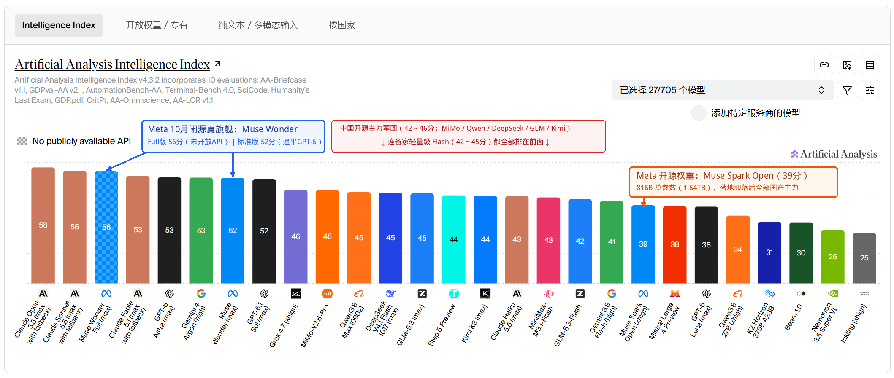
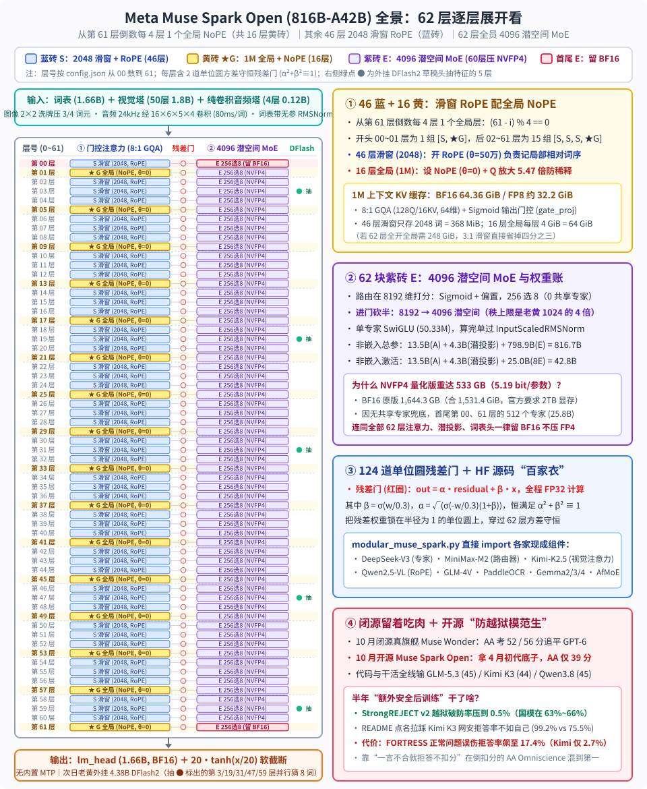
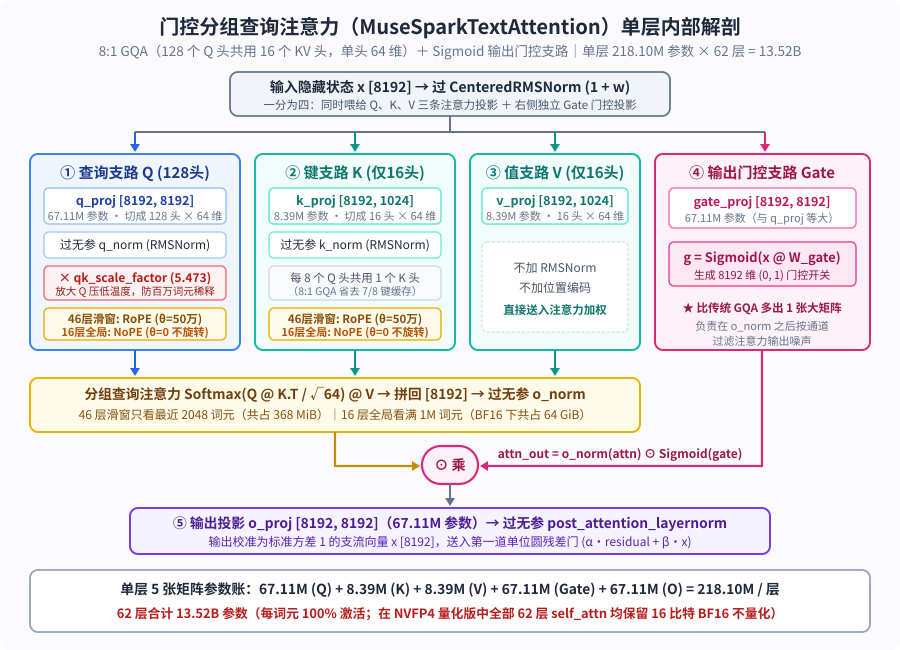

【Muse Spark Open】扎克伯格的816B开源回归：闭源留着吃肉，开源端上半年前的防越狱模范生

━━━━━━━━━━━━━━━━━━━━

◆ 引子：同一个 10 月 15 日，老黄发 120B 演示机，扎克伯格放 816B 开源大块头

━━━━━━━━━━━━━━━━━━━━

我们在前文 347 期刚聊完英伟达在 **10 月 15 日** 放出的 `Nemotron-3.5-Super-VL-120B-A12B`。巧的是，就在同一天，另一家硅谷巨头 Meta 也在 Hugging Face 上放出了阔别已久的开源大模型旗舰—— **`meta-models/Muse-Spark-Open-816B-A42B`** （连同 `NVFP4` 量化权重，以及此前在 8 月下旬先行探路的 30B 端侧稠密模型 `Muse-Glimmer-30B`）。

老读者看到这个仓库路径，大概第一眼就会注意到两个变化：Hugging Face 上的官方组织名不再是熟悉的 `meta-llama`，而换成了 **`meta-models`** ；模型家族的名字也告别了沿用三年的“羊驼（Llama）”，改叫 **`Muse`（缪斯）** 。

把时间线往回拨一年半，就能看清这次改名背后的折腾：2025 年春天，`Llama 4` 系列的 `Scout` 与 `Maverick` 发布后口碑翻车，原定 2 万亿参数的超大杯 `Behemoth` 迟迟训不出来、最终搁浅。扎克伯格痛定思痛，一边砸下重金入股数据标注与评测巨头 Scale AI，一边直接把 Scale AI 的创始人 Alexandr Wang 挖来掌舵新组建的 **Meta 超级智能实验室（Meta Superintelligence Labs，简称 MSL）** ，推倒重来研发新一代原生多模态模型。

然而，伴随着组织架构换血，Meta 过去那种“把当季看家模型直接开源”的策略也彻底变了味。

我们去独立评测机构 Artificial Analysis（AA）刚更新的智能指数（Intelligence Index v4.3.2）榜单上看一眼，就能直观看到如今 Meta 手里的两副牌：



看图上用蓝框标出的前半截：今年 10 月，Meta 在千兆瓦级超算集群 Prometheus 上刚训出来的第二代旗舰叫 **`Muse Wonder`** 和 **`Muse Wonder Full`** 。其中 `Muse Wonder` 在 AA 智能指数上拿到了 **52 分** ，追平了 OpenAI 的 `GPT-6.1 Sol`（52 分），紧咬 53 分的 `GPT-6 Astra` 与 `Gemini 4 Argon`；而满血版 `Muse Wonder Full` 更是考出了 **56 分** （追平 `Claude Sonnet 5.5`）——但后面紧跟着一行小字：`No publicly available API`（无公开可用 API）。 **这两颗真正能跟第一梯队掰手腕的当季新模型，被扎克伯格严严实实锁在了闭源金库里。**

再往下看图上橙框标出的位置：10 月 15 日扔给开源社区的这颗总参数高达 816B 的 **`Muse Spark Open`** ，是怎么来的？打开它仓库首页的模型卡片（Model Card），第一段第一句话写得相当坦白：

`Muse Spark Open is an open-weights version of the Muse Spark model released in April 2026, with additional safety post-training.`（Muse Spark Open 是 2026 年 4 月发布的 Muse Spark 模型的开放权重版本，并进行了额外的安全后训练。）

原来，扎克伯格在 10 月训出第二代闭源真旗舰 `Muse Wonder` 之后，顺手把 **半年前（今年 4 月）发布的初代闭源模型 `Muse Spark`（内部代号 Avocado）** 拿出来，加训了一层防越狱安全护栏，贴上 `Open` 的标签端上了开源牌桌。

半年时间在今天的大模型迭代周期里意味着什么？意味着这颗 816B 的庞然大物在 AA 智能指数上只考出了 **39 分** ——排在图上红框标出的整支中国开源主力军团（小米 `MiMo-V2.6-Pro` 46 分、阿里 `Qwen3.8 Max` 45 分、`DeepSeek V4.1 Flash 1017` 45 分、智谱 `GLM-5.3` 45 分、阶跃星辰 `Step 5 Preview` 44 分、月之暗面 `Kimi K3` 44 分）之后，甚至连轻量级的 `MiniMax-M3.1-Flash`（43 分）和 `GLM-5.3-Flash`（42 分）都没跑过。

话虽如此，作为 Meta 重组超级智能实验室后交出的第一份 800B 级开源图纸，`Muse Spark Open` 的工程底座到底是怎么搭的？它和前文 347 期老黄那台 120B 的 `Nemotron 3.5` 有哪些不谋而合的设计，又有哪些截然相反的取舍？为什么它在代码和生产力跑分全面落后的情况下，还要在模型卡片里专门把 `Kimi K3` 拎出来比拼“拒答率”？

我们先用一张全景架构图，把这台 816B 巨兽的内部结构、参数账本与评测反差摆在桌面上：



下面我们就顺着 `config.json`、权重分片清单、Hugging Face 转换源码 `modular_muse_spark.py` 以及官方放出的 8 页评测方法学报告，一笔一笔算清楚。

━━━━━━━━━━━━━━━━━━━━

◆ 第一章：先算“816B-A42B”与 1.64TB 权重账本——连首尾两层的 512 个专家都不敢压 FP4

━━━━━━━━━━━━━━━━━━━━

和前文 347 期老黄那套把 Mamba、Attention、MoE 分开单独编号的“88 层数层法”不同，Meta 这台 `Muse Spark Open` 回归了全行业通用的标准 Transformer 层定义： **全网一共 `62` 层（`num_hidden_layers: 62`），每一层内部都由“1 个分组查询注意力（GQA）模块 + 1 个混合专家（MoE）模块”成对组成，主干隐藏维度为 `8192`（`hidden_size: 8192`）。**

而且查看 `config.json` 里的 `mlp_layer_types` 数组可以发现，它不像 DeepSeek 那样在前面留几层稠密 MLP，而是 **从第 0 层到第 61 层，62 层全部都是稀疏 MoE 层** 。

我们先把名字里的 **`816B-A42B`** （非嵌入总参数约 816B、每词元激活约 42B）按行向量右乘权重矩阵 `x @ W` 的 `[输入维, 输出维]` 约定，逐项核对一遍：

**1. 进出词表不共享（`tie_word_embeddings: false`）：共 3.31B 参数**

词表大小 `vocab_size = 202,048`（由 200,000 个基础 BPE 词元加上 2,048 个特殊控制符组成，例如 `200000` 为句首符、`200038` 为音频占位符、`200091` 为视频占位符、`200092` 为图像占位符）。输入词嵌入矩阵 `embed_tokens [202048, 8192]` 与末尾输出词表头 `lm_head [8192, 202048]` 各自独立，每张矩阵含 `1,655,177,216`（约 **1.655B** ）参数，两张合计 **3.31B** 。

顺手看一眼源码里的 `MuseSparkTextScaledWordEmbedding` 类：词元查表取出 `8192` 维向量并乘上缩放系数后，还要立刻过一层 **不带可学习缩放权重的无参归一化 `MuseSparkRMSNorm(with_scale=False)`** 。源码注释里专门写了一句工程提醒：这层归一化绝不能为了省事预先合并进词表矩阵的静态权重里，因为外挂的 `DFlash` 投机解码草稿头在工作时，需要直接读取未做归一化的原始词向量。

**2. 62 层门控分组查询注意力（`MuseSparkTextAttention`）：共 13.52B 参数（每步全激活）**

每层注意力设了 `128` 个查询头（Q）和 `16` 个键值头（KV），也就是 **8 比 1 的分组查询注意力（GQA）** ；单头维度 `head_dim = 64`（因此 Q 的总宽度是 `128 × 64 = 8192`，K 和 V 的总宽度是 `16 × 64 = 1024`）。

和常规注意力相比，它在投影矩阵上多加了一道输出门控 `gate_proj`（当注意力算完并经过无参 `o_norm` 后，要先逐元素乘上 `Sigmoid(x @ W_gate)`，再送入输出投影 `o_proj`）。因此单层注意力共有 5 张矩阵：
- 查询投影 `q_proj`：`[8192, 8192] = 67.11M`
- 键投影 `k_proj` 与值投影 `v_proj`：各为 `[8192, 1024] = 8.39M`，合 `16.78M`
- 注意力输出门控 `gate_proj`：`[8192, 8192] = 67.11M`
- 注意力输出投影 `o_proj`：`[8192, 8192] = 67.11M`

单层注意力合计 `218.10M` 参数，乘上 62 层正好是 **`13.52B`** ，每个词元经过时全额激活：



**3. 62 层潜空间投影与 256 选 8 路由专家：共 803.15B 参数（每步激活 29.25B）**

在每层的 MoE 模块里，Meta 没有设置常驻共享专家（`num_shared_experts: 0`），而是放了 **256 个路由专家（`num_experts: 256`），每个词元激活排名前 8 的专家（`num_experts_per_tok: 8`）** 。同时，为了给这 256 个专家瘦身，每层进出专家前都加了一对全层共用的潜空间上下投影矩阵（我们在第三章会专门对比它和老黄的差异）：
- **每层必经的共享组件** ：路由器 `gate.weight [8192, 256]`（`2.10M`）+ 进门降维投影 `pre_expert_proj [8192, 4096]`（`33.55M`）+ 出门升维投影 `post_expert_proj [4096, 8192]`（`33.55M`），单层合计 `69.21M`，62 层共 **`4.29B`** （每步全激活）；
- **256 个路由专家** ：进入 `4096` 维潜空间（`moe_hidden_size: 4096`）后，每个专家都是标准的双矩阵门控 `SwiGLU`，中间展开维也是 `4096`（`moe_intermediate_size: 4096`）。每个专家包含合并的门控上投影 `gate_up_proj [4096, 8192]` 与下投影 `down_proj [4096, 4096]`，单专家参数量为 `3 × 4096 × 4096 = 50,331,648`（ **50.33M** ）。
  - 单层 256 个专家总参数：`256 × 50.33M = 12.885B`，62 层合计 **`798.86B`** ；
  - 单层激活 8 个专家参数：`8 × 50.33M = 402.65M`，62 层合计 **`24.96B`** 。

把上面第 2、3 两项的非嵌入主干参数加起来：
- **非嵌入总参数** = `13.52B（注意力） + 4.29B（路由与潜投影） + 798.86B（专家）` = **`816.67B`** （忽略各层归一化与门控小向量则为 `816.54B`）；
- **非嵌入每词元激活参数** = `13.52B + 4.29B + 24.96B` = **`42.77B`** （约 `42.64B`）。

这正是模型名字里 **`816B-A42B`** 的精确账目。如果再算上头尾的词表（`3.31B`）、50 层视觉编码器（约 `1.80B`）和 4 层音频编码器（约 `0.12B`），整座模型的全量参数高达 **`822.17B`** 。

────────────────────
💡 **从 1.64TB 原版到 533GB 量化版：为什么偏偏首尾两层（第 0 层与第 61 层）的专家不压 FP4？**

去拉一下 Hugging Face 上 `BF16` 原版仓库的索引文件 `model.safetensors.index.json`，65 个分片、2,000 个张量的总字节数是 **`1,644,333,137,920` 字节（1,644.33 GB，合 1,531.40 GiB）** 。官方在部署说明里写明：跑 `BF16` 原版至少需要 **2TB 显存** （比如两台满配 8 卡 H200 或 B200 服务器）。

那压成 4 比特的 `NVFP4` 官方量化版呢？拉下 `NVFP4` 仓库的 127 个分片索引一算，总体积为 **`533.01 GB`（合 `496.40 GiB`）** ，官方要求至少 **700GB 显存** （或者拿两台顶配 512GB 内存的 M5 Ultra Mac Studio 串联）。拿 `533.01 GB` 除以 `822.17B` 总参数，平均每个参数占 **5.19 比特（5.19 BPE）** ，比前文 347 期老黄那台平均 4.82 比特的 `Nemotron 3.5` 略微宽裕一些。

我们在前文 347 期讲过，给 MoE 大模型做 4 比特量化时，注意力层（`self_attn`）、潜空间上下投影、词表头（`lm_head`）以及视觉/音频塔本来就不会压成 FP4（老黄是把注意力和词表头压成 FP8，Meta 则直接留在 BF16），真正用来压成 `NVFP4` 的只有占参数大头的 MoE 专家矩阵。

但打开 `Muse-Spark-Open-816B-A42B-NVFP4` 的 `config.json` 查看 `quantization_config`，会发现除了常规排除的 `self_attn` 和 `lm_head`，它还专门写了一条针对层号的排除规则：
`"exclude_modules": ["layers.0.", "layers.61.", "self_attn", "lm_head"]`

也就是说，中间第 `1～60` 层的路由专家都压成了 4 比特 `NVFP4`，唯独 **第 0 层（`layers.0.`）和最后一层（`layers.61.`）这两层里的全部 512 个专家（共 `25.77B` 参数、占 51.5 GB），原封不动地留在了 16 比特 `BF16`** 。

是首尾两层的专家在代码结构上跟中间层不一样吗？并不是——查看 `safetensors` 张量形状，第 0 层和第 61 层的专家同样是 `[256, 8192, 4096]` 的 `gate_up_proj` 配 `[256, 4096, 4096]` 的 `down_proj`，结构完全一致。真正让首尾两层变得特殊、不敢压成 FP4 的，是它们在 62 层残差流里的 **分工角色与实际训出来的权重数值分布** ：

1. **在架构分工上，首尾两层稀疏专家顶替了“入场整形”与“末层锁定”的重任——正如我们在 DeepSeek-V4 上亲历过的“最后一层不用 CDG 就乱码”** ：
   - 先看 **第 0 层（`layers.0.`）** ：像 `DeepSeek-V3/V4` 或 `GLM-5` 这类模型，通常会在最前面 1～3 层放 100% 激活的 **稠密 MLP（Dense FFN）** ，先把离散词表向量平滑地揉进主干流形，后面再接稀疏 MoE；而 `Muse Spark` 从第 0 层起就是 256 选 8 的稀疏 MoE，且没有常驻共享专家（`num_shared_experts: 0`）。这意味着第 0 层专家必须直接把刚进门的词表与多模态原始嵌入扭转进语义空间，它的量化误差还会被后面 61 层一路放大；
   - 再看 **最后一层（`layers.61.`）** ：一直追更的老读者看到 `layers.61.` 被单独保护起来，肯定会想起我们在前文 185 期 https://mp.weixin.qq.com/s/dEc-wD0JcM5WhKicOUR1pQ 、前文 224 期 https://mp.weixin.qq.com/s/X1b7H4565_WFn6CSTzoAQg 和前文 234 期 https://mp.weixin.qq.com/s/Q8woqrIhbb8k-gRPpR8jpw 亲手排查过的那桩 `DeepSeek-V4 Flash 280B` 乱码案——当时我们在两台 DGX Spark 上跑 43 层的 V4，发现 **前 42 层（`layer 0～41`）的 MoE 专家全部跑高速的 `Marlin`（W4A16）一点问题都没有，唯独最后一层（`layer 42`）必须切回 `Consumer-DeepGEMM（CDG，W4A8）`；只要把最后一层也换成 `Marlin`，哪怕单层输出余弦相似度高达 `0.99939`、平均偏差只有 `0.025`，模型也会当场吐出 `</_,</_,</_` 的英文乱码死循环** 。原因正在于：中间层的微小量化偏差会被下一层的 `RMSNorm`、Attention 的 `Softmax` 非线性和残差连接一路吸收稀释；唯独 **最后一层 MoE 算完之后不再有任何后续层缓冲，过一次归一化就直接撞上 `lm_head [8192, 202048]` 计算 20 万词表的 logits** ——0.1 量级的通道抖动原样打到 logits 上，足够把咬得很紧的 `argmax` 第一名候选词直接翻盘；
2. **直接读取 `.safetensors` 真实权重验证：首尾两层的 MoE 残差门与路由偏置出现了显著跳变** ：我们直接从 Hugging Face 分片里把第 `0, 1, 2, 30, 60, 61` 层的 **MoE 单位圆残差门参数 `post_feedforward_residual_gate.gate`** （决定 MoE 子层输出以多大比例 `β = σ(gate / 0.3)` 写入主干残差流）和 **路由负载均衡偏置 `e_score_correction_bias`** 读出来做了一组统计对比：
   - **中间第 `1～60` 层（渐进微调区）** ：MoE 残差门参数 `gate` 的均值 **清一色全是负数** （`L01` 为 `-0.0449`、`L02` 为 `-0.0541`、`L30` 为 `-0.0880`、`L60` 为 `-0.0701`），对应的专家汇入权重 `β` 均值在 `0.45～0.50` 之间（主干残差保持权重 `α = √(1 - β²) ≈ 0.87～0.89`），路由偏置的标准差也稳定在 `0.053～0.061`——说明中间 60 层的专家每次只在主干残差流上做温和的小步修正，压成 `NVFP4` 的微小舍入噪声很容易被后续层吸收；
   - **唯独首尾第 `0` 层与第 `61` 层（坐标系转换与末层锁定区）** ：两项指标同时发生反转跳变——第 `0` 层的 MoE 残差门 `gate` 均值直接翻正冲到全场最高的 **`+0.1130`** （汇入权重 `β` 均值达 **`0.5635`** ），路由偏置标准差也涨到全场最高的 **`0.0830`** ；到了最后第 `61` 层，同层的注意力残差门 `gate` 均值收缩到了全场最低的 `-0.2828`（`β = 0.3161`，几乎不再改动上下文），而 MoE 残差门 `gate` 均值却从第 60 层的 `-0.0701` 再次翻正跳到 **`+0.0938`** （`β` 均值跳回 **`0.5340`** ，全力负责最后一步词表候选词的敲钉子锁定），路由偏置标准差同样升至 **`0.0824`** 。

这正印证了我们在前文 234 期总结过的规律—— **深层（尤其是最后一层 MoE）绝非被动收尾的喇叭，它直接充当了决定最终词元排序的主动校准器** 。一头一尾两层既然承担着整条残差流幅度最大、容错率最低的两次空间变换，用英伟达 `modelopt` 做 `NVFP4` 量化时自然要把 `layers.0.` 和 `layers.61.` 单独保护起来留在 `BF16` 了。
────────────────────

算清了 816B 静态权重的家底与首尾两层的量化保护，接下来我们再看这 62 层在运行时是怎么排兵布阵、把百万词元上下文塞进显存里的。

━━━━━━━━━━━━━━━━━━━━

◆ 第二章：46 层滑窗配 16 层全局——“滑窗加 RoPE、全局用 NoPE”与 1M 上下文 KV 缓存账

━━━━━━━━━━━━━━━━━━━━

算清了静态权重，我们再来看它是怎么对付 **1M（`1,048,576` 词元）超长上下文** 的。

打开 `config.json` 里的 `layer_types` 和 `layer_rope_theta` 两个长度为 62 的数组，再对照 `modular_muse_spark.py` 里的配置生成函数，你会看到一套非常规整的 **3 比 1“局部滑窗 + 全局注意力”周期结构** （8 月发布的 30B 稠密小弟 `Muse-Glimmer-30B` 在 52 层主干上用的也是同一套排布）：

1. **注意力视野排布（`layer_types`）** ：为了保证主干的最后一层（第 61 层）一定是能看到全文的全局注意力（`full_attention`），源码是 **从第 61 层倒着往前数、每 4 层放 1 个全局层** ，判断公式为 `(61 - layer_idx) % 4 == 0`。因为总层数 62 除以 4 余 2（`62 = 2 + 15 × 4`），所以倒推回开头：
   - 第 `0～1` 层是 1 组 `[滑窗, ★全局]`（第 1 层为全局层）；
   - 第 `2～61` 层是连续 15 组 `[滑窗, 滑窗, 滑窗, ★全局]`（全局层落在第 `5, 9, 13, 17, ..., 57, 61` 层）。
   加起来，全网 62 层里只有 **16 层是全局注意力** ，其余 **46 层全是视野半径只看最近 `2048` 个词元的局部滑窗注意力（`sliding_attention`，`sliding_window: 2048`）** 。
2. **位置编码排布（`layer_rope_theta`）** ：顺着这 62 层往下看 `rope_theta` 的取值，凡是那 46 层局部滑窗层，旋转位置编码基底全部设为 **`500,000.0`** ；而凡是那 16 层全局注意力层，`rope_theta` 全部写着 **`0`** 。

看到 `rope_theta = 0` 这个数字，刚读完前文 347 期的读者肯定立刻反应过来了： **为了撑起 1M 词元上下文，扎克伯格和老黄不约而同都在全局注意力层上撤掉了旋转位置编码（NoPE，No Positional Embedding）。**

只不过两家给全局 NoPE 打配合的搭档不一样：
- **老黄的 `Nemotron 3.5`** 是靠夹在中间的 40 层 Mamba-2 状态空间模型，用循环状态的指数衰减充当隐式位置尺子，让仅有的 8 层全局注意力直接跑 NoPE；
- **扎克伯格的 `Muse Spark Open`** 则是完全留在 Transformer 体系内部，用 **46 层带 RoPE 的 2048 滑窗注意力** 在局部窗口内对齐精确的相对词序，把“谁前谁后”的位置特征一层层揉进词元的残差向量里；等信号流到每隔 4 层出现一次的 **全局注意力层** 时，干脆把位置编码拿掉（`theta = 0`），让全局层变成纯粹按语义内容检索的“百万词元搜索引擎”。

这样一来，既避开了在 1M 长度上强行外推 RoPE 波长引发的远距离注意力发散，又让占全网近四分之三层数的滑窗层成了天然的 **KV 缓存减负器** 。

顺手提一个 `MuseSparkTextAttention` 源码里的实现细节：在计算注意力点积之前，查询向量 `Q` 和键向量 `K` 会各自过一层不带可学习权重的无参 `RMSNorm`（即 QK-Norm，把向量每个头的均方根固定在 `1`、模长固定在 `√64 = 8`）；紧接着，查询向量 `Q` 还会额外乘上一个写死在配置里的放大常数 **`qk_scale_factor = 5.472855`** 。配合常规的 `1 / √64 = 0.125` 缩放，实际点积缩放系数变成了 `5.472855 × 0.125 ≈ 0.684`。为什么要在 QK-Norm 之后把 `Q` 放大 5.47 倍？因为当全局 NoPE 层面对百万词元时，如果点积范围太窄，Softmax 概率会被几十万个无关背景词元摊平稀释；乘上 `5.47` 相当于压低了 Softmax 的温度，让全局注意力在百万词元大海捞针时依然能聚焦在少数关键位置上。

我们来算一算这套“46 层滑窗 + 16 层全局”在 **1M（`1,048,576`）词元满载时** 需要多少 KV 缓存：

每层有 `16` 个 KV 头、每头 `64` 维，因此每个词元在单层需要缓存 `2 × 16 × 64 = 2048` 个浮点数——在 `BF16`（2 字节）下正好是 **每词元每层 `4 KB`** ：
- **46 层局部滑窗层** ：无论外面的上下文长到 10 万还是 100 万词元，每层滑窗永远只需要滚动保留最近 `2,048` 个词元的键值缓存。单层占 `2048 × 4 KB = 8 MiB`，46 层加起来一共才 **`368 MiB`（合 `0.36 GiB`）** ，几乎可以忽略不计；
- **16 层全局注意力层** ：跑满 `1,048,576` 个词元时，单层占 `1,048,576 × 4 KB = 4 GiB`，16 层合计 **`64 GiB`** 。

两项相加，1M 上下文在 `BF16` 下全网 KV 缓存为 **`64.36 GiB`** （如果在推理引擎里开启 `FP8` KV 缓存，则只需要 **约 `32.2 GiB`** ）。试想一下，如果 62 层全部做成全局注意力，1M 上下文光 KV 缓存就要吃掉 `248 GiB`——3 比 1 的滑窗配比直接省掉了四分之三的缓存开销。

━━━━━━━━━━━━━━━━━━━━

◆ 第三章：4096 维潜空间 MoE 与“单位圆方差守恒残差门”——为什么它的窄门比老黄宽 4 倍？

━━━━━━━━━━━━━━━━━━━━

把前文 347 期的老黄和今天的 Meta 放在一起看，最巧合的莫过于两家在 MoE 层上用了同一个名字的思路： **潜空间混合专家（Latent MoE）** ——也就是在词元进入路由专家之前，先用一张全层共用的矩阵把主干维度压窄，让所有路由专家住在低维潜空间里干活，算完再用一张共用矩阵升回主干维度。

但同样叫 Latent MoE，为什么老黄那台 120B 模型被窄门卡出了内伤，而 Meta 这套设计在几何上合理得多？我们先把 `MuseSparkTextMoE` 的四步前向流程摆出来：

1. **路由打分在 `8192` 维主干全尺寸空间完成** ：当一个 `8192` 维的词元向量 `x` 进入 MoE 层时，路由器 `MuseSparkTextTopKRouter` 先把 `x` 转成 `FP32` 精度，右乘路由矩阵 `[8192, 256]`，再乘上缩放系数 `routed_scaling_factor = 0.1767767`（这个数字正好等于 `1 / √(8192 / 256) = 1 / √32`），过 `Sigmoid` 函数得到 `(0, 1)` 之间的原始得分；接着加上 DeepSeek 同款的无辅助损失负载均衡偏置 `e_score_correction_bias` 选出排名前 8 的专家下标，最后取这 8 个专家的原始 Sigmoid 得分做归一化得到权重 `w_i`；
2. **进专家前砍半降维** ：词元向量 `x` 右乘全层共享的降维矩阵 `pre_expert_proj [8192, 4096]`，再过一层 `CenteredRMSNorm`，把维度从 `8192` 砍半压到 **`4096` 维潜空间** ；
3. **在 4096 维潜空间里跑 SwiGLU + 逐专家独立归一化** ：被选中的 8 个专家各自在 `4096` 维潜空间里执行双矩阵 `SwiGLU`（`gate_up_proj [4096, 8192]` 切分后算 `SiLU(gate) ⊙ up`，再右乘 `down_proj [4096, 4096]`）。这里注意 `modular_muse_spark.py` 里的一个特殊步骤： **每个被激活的专家算完自己的 `down_proj` 之后、乘路由权重 `w_i` 加权求和之前，都要先单独过一层属于该专家自己的 `post_expert_norm`（`MuseSparkTextInputScaledRMSNorm`）** 。先把 8 个专家各自吐出的向量模长强行拉齐到同一标准尺度，然后再乘各自的路由权重 `w_i` 相加——这样就能防止某个路由权重只有 `0.02` 的边缘专家，靠着把自身输出范数撑大几十倍来“越权”盖过主专家的声音；
4. **出专家后还原升维** ：汇总后的 `4096` 维向量右乘共享升维矩阵 `post_expert_proj [4096, 8192]` 回到主干维度，再过一层 `InputScaledRMSNorm` 准备汇入残差流。

我们拿前文 247 期 https://mp.weixin.qq.com/s/jjYk4lV-qhZpqAYge0tx6A 算过的激活专家并排总宽度，以及前文 312 期 https://mp.weixin.qq.com/s/n9v-PvAT_fDIFLd-t05FDg 讲过的矩阵秩上限，把老黄和 Meta 的这扇“潜空间窄门”放进同一张表里对比：

| 对比维度 | 老黄 `Nemotron 3.5 Super`（120B） | 扎克伯格 `Muse Spark Open`（816B） |
|---|---|---|
| 主干隐藏维 `hidden_size` | `4096` | `8192` |
| 共享潜空间维度（窄门秩上限） | **`1024`** （一口气砍掉 3/4） | **`4096`** （仅砍半 1/2） |
| 单专家结构与中间维 | 无门控 `ReLU²`，中间维 `2688` | 完整双矩阵 `SwiGLU`，中间维 `4096` |
| 每步激活路由专家数与并排总宽 | 激活 22 个，并排总宽 `58,968` | 激活 8 个，并排总宽 `32,768` |
| 窄门瓶颈比（并排总宽 ÷ 窄门秩） | **`57.6 : 1`** （5.9 万维强挤 1024 窄门） | **`8 : 1`** （3.2 万维进出 4096 宽门） |
| 常驻共享专家 | 1 个（走 `4096` 主干，中间维 `5376`） | **0 个** （全靠潜空间路由专家支撑） |

这张表把两家的得失照得一清二楚。如果再拿我们在前文 45 期 https://mp.weixin.qq.com/s/0hOQt8onSJcuZGJLRE46Fw 、前文 154 期 https://mp.weixin.qq.com/s/CHnnNLzecPNY6hK2Gskujg 和前文 194 期 https://mp.weixin.qq.com/s/cG5eF1vHbSnh1j7jQelSLw 反复量过的 **大模型内在维度（Intrinsic Dimension）** 标尺来衡量，就能看清为什么 `4096` 维的潜空间完全可以接受，而 `1024` 维却会伤筋动骨：

多项针对大模型隐藏状态与权重矩阵的几何测量都表明，哪怕主干标称维度设在 `7168` 或 `12288` 维，模型真正学到的有效语义流形内在维度并没有铺满整个空间——纯文本模型的知识流形内在维度通常在 **`500～1000` 维** 左右，而同时处理文本、图像与音频的原生多模态模型，由于视觉和听觉展开了与文本正交的新坐标轴，全局流形的内在维度大约会扩展到 **`1000～1500` 维** （其余维度大多是做非线性变换时临时展开的计算脚手架）：
- **老黄的 `1024` 维窄门为什么伤到了筋骨？** 因为一颗多模态模型的真实流形内在维度本来就在 `1000～1500` 维上下，老黄为了在单机上凑出翻倍的吞吐率，把 `4096` 主干一口气砍到 `1024` 维，相当于直接贴着多模态流形的真实维度下限甚至切进肉里去了，一点几何舒展余量都没留，还得让 `58,968` 维的激活专家强挤这扇 `1024` 窄门（瓶颈比高达 `57.6 : 1`）；
- **Meta 的 `4096` 维潜空间为什么完全够用？** `4096` 维本身就已经是一台百亿级稠密大模型完整的主干宽度了。拿 `4096` 维的共享潜空间去承载一个内在维度 `1000～1500` 维的三模态流形，还留着将近 **3 倍的维度安全余量** （瓶颈比也只有温和的 `8 : 1`），并且完整保留了双矩阵 `SwiGLU` 门控与逐专家输出归一化——既不会像 `1024` 那样卡死有效秩，又实打实把 256 个专家的参数体积与显存访存砍掉了一半。

除了潜空间 MoE，打开 `MuseSparkTextDecoderLayer` 的源码，还能看到整座模型在数值稳定性上最讲究的一处设计—— **单位圆方差守恒残差门（`MuseSparkResidualGate`）** 。

在常规 Transformer 里，每个注意力层或 MoE 层算完输出 `x` 后，汇入主干残差流 `residual` 的写法都是直接相加：`out = residual + x`。但当模型深达 62 层（总共要做 124 次残差相加）时，残差流的方差会随着层数一路累加膨胀。

而在 `Muse Spark`（以及 30B 的 `Muse Glimmer`）里，全网 124 处残差汇合点全部换成了 `MuseSparkResidualGate`。每道门里存着一个 `8192` 维的可学习参数向量 `gate`（初始值为 0），配合配置里设定的温度常数 `T = 0.3`（`residual_gate_temperature: 0.3`），在 **`FP32` 全精度** 下按下面三行公式合成新残差：

```text
w   = gate / 0.3
β   = σ(w)
α   = √( max( σ(-w) · (1 + β), 1e-3 ) )
out = α ⊙ residual + β ⊙ x
```

```python
# 摘自 transformers/models/muse_spark/modular_muse_spark.py
class MuseSparkResidualGate(nn.Module):
    def __init__(self, config):
        super().__init__()
        self.gate = nn.Parameter(torch.zeros(config.hidden_size, dtype=torch.float32))
        self.temperature = config.residual_gate_temperature  # 0.3

    def forward(self, residual: torch.Tensor, x: torch.Tensor) -> torch.Tensor:
        orig_dtype = x.dtype
        weight = self.gate.float() / self.temperature
        beta = torch.sigmoid(weight)
        # 注意这里：sigmoid(-weight) * (1 + beta) = (1 - beta) * (1 + beta) = 1 - beta^2
        alpha = torch.sqrt(torch.clamp(torch.sigmoid(-weight) * (1.0 + beta), min=1e-3))
        out = alpha * residual.float() + beta * x.float()
        return out.to(orig_dtype)
```

初看这几行代码，你可能会奇怪：给子层输出 `x` 配一个 Sigmoid 门控权重 `β = σ(w)` 很常见，为什么主干残差 `residual` 前面的系数 `α` 不像传统 Highway Network 那样写 `1 - β`，非要拐弯抹角写成 `√(σ(-w) · (1 + β))`？

────────────────────
💡 **用一行初等代数看懂 `α = √(σ(-w) · (1 + β))`：把残差权重锁死在半径为 1 的单位圆上**

我们知道 Sigmoid 函数 `σ(w) = 1 / (1 + e⁻ʷ)` 有一个基本对称性质：
`σ(-w) = 1 - σ(w) = 1 - β`

把它代进 `α` 的根号里面，利用平方差公式 `(1 - β)(1 + β) = 1 - β²`，立刻就能算出 `α` 和 `β` 的平方和：
`α² + β² = (1 - β)(1 + β) + β² = (1 - β²) + β² ≡ 1`

如果代码直接写 `sqrt(1.0 - beta * beta)`，当 `w` 很大、`β` 逼近 `1.0` 时，浮点数相减 `1.0 - beta²` 很容易发生灾难性有效数字抵消（Catastrophic Cancellation）下溢成 0；而改写成乘积形式 `sigmoid(-w) * (1.0 + beta)`，在数值计算上永远平滑正定。

再想一步它的概率与几何意义：假设进入残差门之前，主干 `residual` 的方差是 `1`，而刚从 Attention 或 MoE 出来、经过一层无参 `RMSNorm(with_scale=False)` 校准后的新支流 `x` 的方差也是 `1`，且两者近似正交（不相关）。那么：
- 如果按传统 Highway 写 `(1 - β) · residual + β · x`，合成后的方差会变成 `(1 - β)² + β² < 1`（例如 `β = 0.5` 时方差直接缩水成 `0.5`，过几十层信号就衰减没了）；
- 而令 **`α² + β² ≡ 1`** （比如初始时 `gate = 0`，则 `β = 0.5`，`α = √0.75 ≈ 0.866`），合成后的方差就是 `(α² + β²) × 1 ≡ 1`。无论这 `8192` 个通道的门控参数在训练中怎么学、往哪边偏，`(α, β)` 永远像圆规一样落在半径为 1 的单位圆弧上，穿过 62 层 124 道门之后，主干残差流的能量方差始终保持守恒。

────────────────────

为了配合这 124 道单位圆残差门，Meta 在单层内部把 `RMSNorm` 细分成三种不同分工的变体：在进 Attention 和进潜空间时用权重写为 `(1 + w)` 的零中心归一化 `CenteredRMSNorm`；在进残差门之前（`post_attention_layernorm`）用完全不带可学习参数的纯归一化 `RMSNorm(with_scale=False)`，专门负责把支流 `x` 的方差精确校准成标准 `1` 再交给单位圆残差门；而在专家内部和潜空间出门时，则用“先把输入乘 `(1 + w)` 再送入无参归一化”的 `InputScaledRMSNorm`。到了最后词表头 `lm_head` 算出 logits 后，先乘上 `0.1767767`（`1 / √32`），再用 `20.0 * tanh(logits / 20.0)` 把最终输出软截断在 `[-20, +20]` 区间内。

━━━━━━━━━━━━━━━━━━━━

◆ 第四章：HF 源码里的“百家衣”、0 注意力纯卷积音频塔与老黄连夜送来的 DFlash2

━━━━━━━━━━━━━━━━━━━━

我们在前文 347 期刚调侃过老黄的 `Nemotron 3.5` 把中国四大开源家族的零件炖成了一锅“百家饭”。结果这次打开 Hugging Face 官方 `transformers` 仓库里为 `Muse Spark` 与 `Muse Glimmer` 编写的模块化定义文件 `modular_muse_spark.py` 和 `modular_muse_glimmer.py`，文件顶部的 `import` 清单同样让人忍俊不禁：

```python
# 摘自 transformers/models/muse_spark/modular_muse_spark.py 与 modular_muse_glimmer.py
from ..afmoe.modeling_afmoe import AfmoeAttention
from ..deepseek_v3.modeling_deepseek_v3 import DeepseekV3Experts, DeepseekV3MLP
from ..gemma2.modeling_gemma2 import Gemma2Model
from ..gemma3.modeling_gemma3 import Gemma3ForConditionalGeneration
from ..gemma4.modeling_gemma4 import Gemma4AudioSubSampleConvProjection
from ..glm4v.modeling_glm4v import Glm4vVisionEmbeddings
from ..kimi_k25.modeling_kimi_k25 import KimiK25VisionAttention, KimiK25VisionEncoderLayer
from ..minimax_m2.modeling_minimax_m2 import MiniMaxM2TopKRouter
from ..paddleocr_vl.modeling_paddleocr_vl import PaddleOCRVLVisionMLP
from ..qwen2_5_vl.modeling_qwen2_5_vl import Qwen2_5_VLRotaryEmbedding
from ..voxtral_realtime.modeling_voxtral_realtime import VoxtralRealtimeCausalConv1d
```

你看这份名单：路由专家容器继承自 **DeepSeek-V3** ，带无辅助损失偏置的 Sigmoid 路由器继承自 **MiniMax-M2** ，视觉编码器的注意力层和编码层直接继承自月之暗面的 **Kimi-K2.5** ，三维多模态旋转位置编码继承自阿里的 **Qwen2.5-VL** ，视觉图像分块嵌入继承自智谱的 **GLM-4V** ，视觉前馈层继承自百度的 **PaddleOCR-VL** ，再加上谷歌的 **Gemma 2/3/4** （提供 `(1+w)` 零中心归一化与末尾 `tanh` 软截断）、Arcee AI 的 **AfMoE** 和 Mistral 的 **VoxtralRealtime** 。

当然这里要公道地说明一句：这是 Hugging Face 的工程师在用模块化转换工具（Modular Transformers）接入新模型时，为了避免重复写样板代码，直接从库里挑出数学结构一致的现成组件做继承拼装，并不代表 Meta 训练时抄了哪家的代码。但反过来说，Hugging Face 工程师能像搭乐高积木一样，直接拿 **DeepSeek、MiniMax、Kimi、Qwen、GLM、百度** 的现成类严丝合缝地拼出 `Muse Spark` 的前向计算图，本身就说明今天全球大模型在算子层面的工程积木已经高度同构化了。

顺着这份源码往下看，除了 816B 的语言主干，这台原生多模态模型身上还挂着两座编码塔和一个外部草稿头：

**1. 50 层视觉/视频编码器（`MuseSparkVisionModel`，约 1.8B 参数）**

视觉塔的隐藏维度为 `1536`（16 个注意力头，每头 96 维），空间块大小 `patch_size = 14`，视频时间块大小 `temporal_patch_size = 2`（每两帧视频画面压成一组三维时空块）。它的 50 层内部也沿用了和语言主干一致的周期结构：每 4 层放 1 层全局注意力（外加最后第 49 层也是全局注意力），其余全是局部窗口注意力。

当图像或视频特征穿过 50 层视觉塔出来后，先经过一次 **`2 × 2` 空间像素洗牌（Pixel Shuffle）** ——把相邻 4 个 `1536` 维的视觉块在通道维拼成 1 个 `6144` 维向量（把视觉词元数量压缩为原来的四分之一），随后经过两层 `4096` 维的 `vision_adapter` 和一层线性投影 `vision_projection [4096, 8192]` 加无参 `RMSNorm`，对齐到 `8192` 维主干，再用我们在前文 295 期 https://mp.weixin.qq.com/s/lCpYoqH_CwE5o52ECySMhQ 讲过的 `masked_scatter` 原位填入文本序列的 `<image>`（token id 200092）或 `<video>`（200091）占位符。

**2. 连 1 层注意力都没有的纯卷积流式音频塔（`MuseSparkAudioModel`，约 0.12B 参数）**

相比中规中矩的视觉塔，这颗只有 1.18 亿参数的音频塔设计得相当轻巧。现在大多数语音多模态模型，都要先把声音做傅里叶变换转成二维梅尔频谱图（Mel-spectrogram），再送进带自注意力的 Whisper 或 Conformer 编码器里。

而 `Muse Spark` 的音频塔 **既不转频谱图，也不用任何一层注意力（`num_attention_layers: 0`）** ，而是直接接收 **`24,000 Hz` 的单声道原始音频波形数组** 。它由 4 级特征提取器（`MuseSparkAudioFeatureExtractor`）串联成一座卷积金字塔：
- 第 0 级：下采样步长 **`16`** ，通道维升至 `256`；
- 第 1 级：下采样步长 **`6`** ，通道维升至 `512`；
- 第 2 级：下采样步长 **`5`** ，通道维升至 `1024`；
- 第 3 级：下采样步长 **`4`** ，通道维升至 `2048`。

把这四级下采样步长乘起来：`16 × 6 × 5 × 4 = 1920`。在 `24,000 Hz` 采样率下，`1,920` 个原始采样点正好对应 `1920 / 24000 = 0.08` 秒（即 **80 毫秒** ）。每级内部只用核宽为 7 的深度可分离因果一维卷积（自带流式 `padding_cache` 缓存上一截音频的末尾采样点）配一层 SwiGLU MLP，最后投影到 `8192` 维—— **每 80 毫秒原始语音直接变成 1 个音频词元（每秒语音固定生成 12.5 个词元，填入 token id 200038）** 。因为全程没有平方级复杂度的注意力层，在做流式语音输入时几乎不占额外延迟。

**3. 本体无内置 MTP，老黄次日连夜送上 4.38B 的 `DFlash2` 草稿头**

`Muse Spark Open` 本体没有像 DeepSeek 那样内置多词元预测（MTP）层。结果 10 月 15 日 Meta 刚把权重放出来，第二天（10 月 16 日）英伟达就在自家官方账号下发布了配套的并行投机解码草稿头 **`nvidia/Muse-Spark-Open-816B-A42B-DFlash2`** 。

打开这颗草稿头的 `config.json`，它正是我们在前文 236 期 https://mp.weixin.qq.com/s/fQc0hRxEIZxkPzGTDhj78g 和前文 346 期 https://mp.weixin.qq.com/s/7G9f5z0E8xY2wL4qR1vN3A 讲过的 `DFlash` 跨层特征拼接架构：一共 **5 层** 非因果 `2048` 滑窗注意力（参数量 **4.38B** ），直接从 62 层主干的第 **`[3, 19, 31, 47, 59]`** 层抽出隐藏状态拼在一起，每步一口气并行猜出后面 `block_size = 8` 个词元交给主模型批量验证。更有趣的是老黄训练这颗草稿头的数据配方：从自家刚开源的 `Nemotron-Post-Training-Dataset-v2` 里抽了 348 万条提示词，让 `Muse Spark Open` 自己按 5 档推理强度（`none / low / medium / high / xhigh`）生成了 348 万条回答轨迹训出来的。

━━━━━━━━━━━━━━━━━━━━

◆ 第五章：评测对账与“99% 拒答率的防越狱模范生”——打不过写代码，就在安全分上拉踩 Kimi K3

━━━━━━━━━━━━━━━━━━━━

看完了局部挺精巧的架构设计，我们打开 Meta 随模型一起公开的 8 页官方评测方法学报告《Muse Spark Open Evaluation Methodology》以及模型卡片里的成绩单，看看这台 816B 的大家伙在真实考场上到底表现如何。

**1. 闭源留着吃肉、开源端出 4 月老底子：生产力与软件工程全线落后国模**

在官方评测表里，Meta 把 `Muse Spark Open` 的思考预算开到了最高档 **`xhigh (512)`** ，拉来了智谱 **`GLM 5.3 (max)`** 、月之暗面 **`Kimi K3 (max)`** 、阿里 **`Qwen3.8-2.4T-A95B (xhigh)`** 以及老黄的 `Nemotron 3 Ultra` 同台对比。结果在大家日常真正干活依赖的软件工程、命令行实战与知识工作基准上，816B 的 `Muse Spark Open` 几乎被中国开源第一梯队全面压制：

| 核心评测基准 | `Muse Spark Open`（816B） | `GLM 5.3`（智谱） | `Kimi K3`（月之暗面） | `Qwen3.8`（阿里） |
|---|---|---|---|---|
| **AA 智能指数 v4.3.2** | `39` | **`45`** | `44` | **`45`** （Max）/ `40` |
| **`GDPVal-AA v2`（知识工作 Elo）** | `1401` | **`1653`** （领先 252 分） | `1537` | `1613` |
| **`DeepSWE 1.1`（软件工程）** | `60.0%` | `67.0%` | **`68.0%`** | — |
| **`SWE-Atlas-QnA`（代码库问答）** | `58.0%` | `59.0%` | **`66.0%`** | `62.0%` |
| **`Terminal-Bench 2.1`（终端实战）** | `76.4%` | `83.9%` | **`85.0%`** | `82.0%` |
| **`OSWorld Verified`（电脑操作）** | `80.4%` | `76.4%` | **`84.8%`** | `81.9%` |
| **`GPQA Diamond`（博士级理科）** | `89.0%` | `88.4%` | **`93.5%`** | **`93.5%`** |

为什么一颗总参数 816B、每步激活 42.6B、架构上也没犯老黄那种 1024 维窄门错误的巨型模型，会在真实代码和生产力跑分上差了一大截？

原因正是我们在引子里点出的那个时间差： **今天 Meta 手里真正能考出 52 分和 56 分的 10 月新成果，全留在闭源的 `Muse Wonder` 和 `Muse Wonder Full` 里自己吃肉了；而扔给开源界的 `Muse Spark Open`，底座依然停留在今年 4 月发布的初代 `Muse Spark`。** 在 2026 年的开源竞速场上，拿半年前的初代底子出来应付 10 月份的 `GLM 5.3`、`Kimi K3`、`DeepSeek V4.1` 和 `Qwen3.8`，自然占不到便宜。

**2. 细读 8 页评测方法学 PDF 的三行小字：Scale AI 自家考场与“没喂音频的视频测试”**

如果你把那份 8 页的官方评测方法学 PDF 从头到尾读一遍，还会发现三个挺有意思的细节：
- **第一，唯一大比分领先的 Agent 榜，考场是掌门人老东家搭的** ：在工具调用榜 `MCP-Atlas` 上，`Muse Spark Open` 拿到了全场最高的 `89.2%`（高于 `Kimi K3` 的 `84.5%` 和 `GLM 5.3` 的 `84.2%`）。翻到评测 PDF 第 2 页一看，`MCP-Atlas` 这套评测基准与跑分管线，正是由如今执掌 Meta 超级智能实验室的 Alexandr Wang 的老东家 **Scale AI** 搭建并执行的；而在独立第三方维护的电脑桌面操作榜 `OSWorld Verified` 上，`Muse Spark Open`（`80.4%`）还是输给了 `Kimi K3`（`84.8%`）；
- **第二，所有多模态视觉问答榜，统一请去年的 `GPT-OSS-120B` 当判卷考官** ：评测 PDF 第 3～4 页交底，在 `BabyVision`、`SimpleVQA`、`ZeroBench` 和 `WorldVQA` 等多模态基准上，Meta 没有调用顶级闭源模型判卷，而是全部用 OpenAI 去年的开源模型 `GPT-OSS-120B (high)` 当裁判（Judge Model）；
- **第三，明明配了原生音频塔，测视频理解时却把声音掐了** ：我们在第四章刚夸完它那座 24kHz 纯卷积流式音频塔，结果翻到评测 PDF 第 4 页看 `VideoMMEv2`（视频多模态理解，考了 `61.5%`，落后于 `Kimi K3` 的 `65.4%` 和 `Qwen3.8` 的 `65.0%`），文档里老老实实写着一句注脚—— **“评测时我们只抽取了最高 64 帧视频画面和文字字幕，没有把视频里的音频轨道喂给模型（without feeding audio into the model）。”**

**3. 全篇最黑色幽默的名场面：代码跑不过 Kimi K3，就在安全章节点名拉踩 Kimi K3“拒答率不如我高”**

既然底座是今年 4 月就训好的初代 `Muse Spark`，那从 4 月到 10 月这半年时间，Meta 在这颗开源模型身上到底忙活了什么？

答案就是模型卡片第一句话里特意强调的那半句： **`with additional safety post-training`（进行了额外的安全后训练）** 。

这轮专门为开源版加码的“安全后训练”效果有多显著？我们直接翻到模型卡片底部的安全评测表（Safety Benchmarks）：

| 安全与拒答评测指标 | `Muse Spark Open`（Meta） | `Kimi K3`（月之暗面） | `GLM 5.3`（智谱） | `Qwen3.8`（阿里） |
|---|---|---|---|---|
| **`StrongREJECT v2`（越狱攻击破防率，越低越难被越狱）** | **`0.5%`** | `66.6%` | `62.9%` | `65.6%` |
| **网安威胁基准拒答率（内部 / 公开，越高越爱拒答）** | **`99.2% / 94.8%`** | `75.5% / 70.2%` | — | — |
| **`FORTRESS ORS`（正常无害请求被误伤拒答率，越低越好）** | **`17.4%`（误伤翻 6 倍）** | **`2.7%`** | **`3.2%`** | `7.1%` |

看到这张表，你大概会忍不住笑出声来：
- 在测试对抗性越狱的 `StrongREJECT v2` 上，三家中国开源模型的破防率都在 `63%～66%` 左右；而经过半年安全特训的 `Muse Spark Open`，直接把越狱破防率压到了近乎滴水不漏的 **`0.5%`** ；
- 更绝的是，因为前面写代码和干活的榜单实在赢不了 `Kimi K3`，Meta 干脆在模型卡片的安全章节正文里 **专门点名把 `Kimi K3` 拎出来当对照靶子** ，自豪地写道：在内部和公开的网络安全威胁基准上，`Muse Spark Open` 的拒答率（Refusal Rate）高达 **`99.2%` 和 `94.8%`** ，远高于 `Kimi K3` 的 `75.5%` 和 `70.2%`。

然而，把防越狱螺丝拧死到 `99.2%` 拒答率的代价是什么？看表格最后一行——在测试模型会不会把好人当坏人的 **`FORTRESS ORS`（Over-Refusal Score，过度拒答率，即用户提问完全合法的正常专业问题、却被模型一棍子训斥拒答的比例）** 上：
- `Kimi K3` 的正常问题误伤率只有 **`2.7%`** ，`GLM 5.3` 只有 **`3.2%`** ；
- 而这位越狱破防率 `0.5%` 的“防越狱模范生” `Muse Spark Open`， **正常问题误伤拒答率直接飙到了 `17.4%`——是 Kimi K3 的 6.4 倍、GLM 5.3 的 5.4 倍** 。也就是说，安全研究员或者程序员平时拿它查 6 个稍微沾点系统底层或安全字眼的正常技术问题，平均就有 1 个会被它义正词严地挡回去。

顺着这个 `17.4%` 的过度拒答率往回看，综合评测表里另一个奇怪的现象也顺带破案了：为什么 `Muse Spark Open` 在编程和推理上全线落后国模，唯独在 AA 的 **`Omniscience`（全知抗幻觉指数）** 一项上拿到了 **`25` 分** 的全场最高分（`Kimi K3` 为 `16` 分、`GLM 5.3` 为 `13` 分）？

翻开评测方法学 PDF 第 2 页，上面印着 `AA Omniscience` 的计分公式：
`Score = 100 × (答对题数 - 答错题数) / 总题数`

注意分子是 **“答对题数减去答错题数”** ——在这套规则里，答对一题得 `+1` 分，答错一题倒扣 `-1` 分，而 **拒绝回答或弃权说“我不能回答 / 我不知道”得 `0` 分（不扣分）** 。一个被额外安全后训练调教成“拿不准或沾点边就拒答”的模型，在倒扣分考场上天然自带免死金牌，靠着少扣分在抗幻觉单项上拿了个第一。

━━━━━━━━━━━━━━━━━━━━

◆ 结语：两天连看两台美国开源模型，看见的是同一个硅谷新常态

━━━━━━━━━━━━━━━━━━━━

把前文 347 期老黄的 `Nemotron 3.5 Super（120B）` 和今天这期扎克伯格的 `Muse Spark Open（816B）` 放在一起对照，我们能清晰地看到 2026 年秋天美国大厂做“开源模型”的两种典型心态：

在底层算子与局部工程设计上，两家其实都有不少值得我们细细琢磨的扎实手艺——比如为了应付百万词元上下文，两家不约而同在全局注意力层上采用了不加位置编码的 `NoPE`，把长文本外推与 KV 缓存开销压了下来；而在 MoE 架构上，Meta 的 `4096` 维潜空间比老黄那扇 `1024` 维窄门宽裕了 4 倍，并且全网 124 处残差汇合点用到的 `α² + β² ≡ 1` **单位圆方差守恒残差门** ，以及那座不转频谱图、不用注意力、直接拿 4 级因果卷积以 `80ms/词元` 吞吐 24kHz 原始波形的流式音频塔，在数学和工程上都算得上干净漂亮。

但在“开源到底给用户端出什么菜”这件事上，两家却各自打着精明的算盘：
- **卖铲子的老黄** ，是为了给砍掉 200G 网口的 128GB 单机 `RTX Spark` 造一台刚好塞得下、跑分吞吐翻倍的“硬件演示样板”，为此不惜把八成注意力砍掉、把九成参数塞进 1024 维窄门，最后在 AA 智能指数上只考出 26 分；
- **换了招牌的扎克伯格** ，则是在 `Llama 4` 折戟后彻底改写了开源剧本——把 10 月份真正训出来、在 AA 上考出 52 分和 56 分的当季旗舰 **`Muse Wonder` / `Muse Wonder Full`** 严严实实锁在闭源里自己吃肉；转头把半年前（4 月份）39 分的初代底子翻出来，花大把精力焊上一层正常问题误伤率高达 `17.4%` 的防越狱铁壳，再贴上 `Open` 的标签扔给开源社区。

甚至因为干活和写代码实在跑不过同一时期的中国开源模型，只能在 README 的安全章节里把 `Kimi K3` 拎出来比拼谁更会拒绝回答用户的问题——这大概就是今天硅谷巨头面对中国开源军团时，最真实也最拧巴的写照了。

━━━━━━━━━━━━━━━━━━━━

◆ 速查表

━━━━━━━━━━━━━━━━━━━━

| 模块 / 概念 | 一句话解释 |
|---|---|
| `816B-A42B` 参数与 `NVFP4` 账本 | 62 层全 MoE 主干（`8192` 维）非嵌入总参数 `816.5B`、每步激活 `42.6B`；全模型 `BF16` 占 `1.64 TB`，`NVFP4` 版占 `533 GB`（首尾第 0、61 层因残差门权重翻正跳变承担进出场空间转换，其 512 个专家保留 `BF16` 不量化） |
| 3 比 1 滑窗 `RoPE` 配全局 `NoPE` | 从第 61 层倒数每 4 层放 1 层全局无位置编码注意力（共 16 层），其余 46 层为 `2048` 滑窗 `RoPE`；1M 上下文全网 KV 缓存在 `BF16` 下为 `64.36 GiB`、`FP8` 下约 `32.2 GiB` |
| `4096` 维潜空间混合专家（Latent MoE） | 无常驻共享专家，256 选 8 路由专家住在砍半的 `4096` 维潜空间（秩上限是老黄 1024 维的 4 倍），每个专家算完 `SwiGLU` 后单独过一层 `InputScaledRMSNorm` 再加权求和 |
| 单位圆方差守恒残差门（`MuseSparkResidualGate`） | 全网 124 处残差汇合点采用 `α · residual + β · x`，其中 `β = σ(w / 0.3)`、`α = √(σ(-w / 0.3)(1 + β))`，恒满足 `α² + β² ≡ 1`，确保 62 层残差流方差守恒 |
| 0 注意力纯卷积音频塔（`MuseSparkAudioModel`） | 不转梅尔频谱图、不用 Attention，直接将 `24kHz` 原始音频波形经 `16×6×5×4 = 1920` 四级因果一维卷积下采样，每 `80ms` 生成 1 个 `8192` 维音频词元 |
| 闭源 `Muse Wonder` 与开源安全护栏反差 | 10 月闭源真旗舰 `Muse Wonder` 考 52/56 分追平 GPT-6，开源端出 4 月初代底子仅考 39 分；加训安全护栏把越狱率压到 `0.5%`，但正常问题误伤拒答率飙至 `17.4%`（Kimi K3 仅 `2.7%`） |

━━━━━━━━━━━━━━━━━━━━

◆ 参考资料

━━━━━━━━━━━━━━━━━━━━

- Meta Superintelligence Labs, Muse-Spark-Open-816B-A42B / Muse-Spark-Open-816B-A42B-NVFP4 / Muse-Glimmer-30B Model Cards & Configuration Files, Hugging Face（2026-10；含 `config.json` 与 `model.safetensors.index.json`）
- Meta Superintelligence Labs, Muse Spark Open Evaluation Methodology（2026-10；官方 8 页评测基准、提示词配置与判卷模型方法学报告）
- Hugging Face Transformers, `modular_muse_spark.py` & `modular_muse_glimmer.py` Source Code（2026-10；含单位圆残差门、4096 潜空间 MoE 与三模态编码器实现）
- NVIDIA, Muse-Spark-Open-816B-A42B-DFlash2 Model Card, Hugging Face（2026-10；5 层 4.38B 跨层并行投机解码草稿头）

━━━━━━━━━━━━━━━━━━━━

把权重的平方和锁在半径为一的单位圆上，六十二层残差流穿过一百二十四道门，能量既不膨胀也不湮灭。

把十月刚出炉的五十多分真旗舰锁进闭源金库，端上半年前三十九分的旧底子，再焊上一层逢问必审的防越狱铁壳。

代码和干活跑不过大洋彼岸的同行，就转身在成绩单上比赛谁更会拒绝回答问题——这大概是今年秋天最拧巴的开源幽默了。

━━━━━━━━━━━━━━━━━━━━

// 靳岩岩的 AI 学习笔记 × Gemini 的浪漫 × GPT 的严谨
// 2026年10月24日
