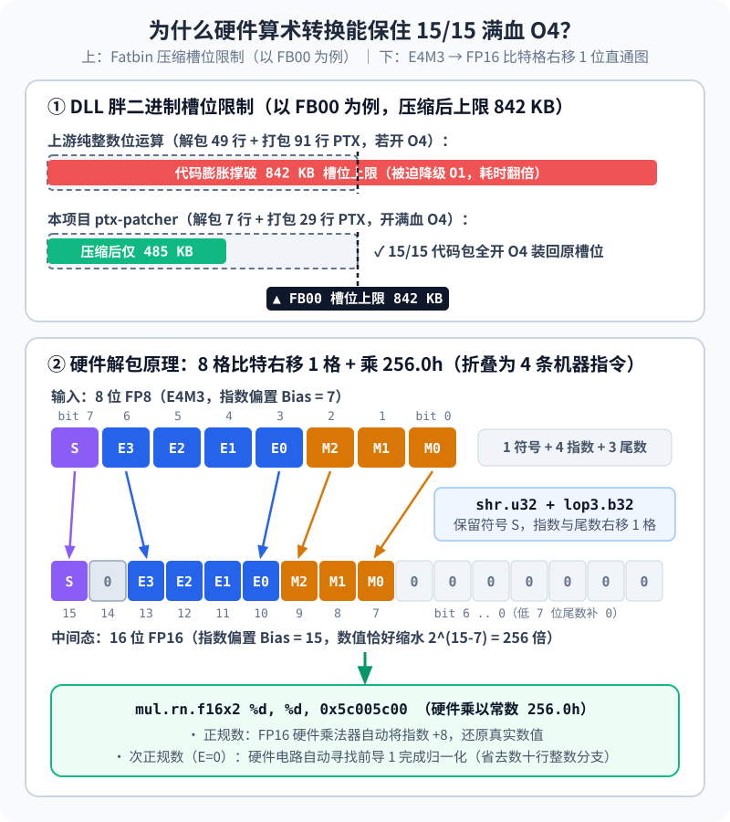

【DLSS5】如何将 50 系显卡上的 DLSS 5 移植到 RTX 30 系显卡

━━━━━━━━━━━━━━━━━━━━

◆ 开篇：从 A 卡回到老 N 卡，把 31 块新模型塞进五年前的安培核心

━━━━━━━━━━━━━━━━━━━━

在前文 309 期（ https://mp.weixin.qq.com/s/mvUDHC6kLqqCKIag8VIERA ）、313 期（ https://mp.weixin.qq.com/s/W4kBSWorQrlq98jSOBbxZg ）和 343 期（ https://mp.weixin.qq.com/s/5fkFYzqLEkwEuDXvxtNqlw ）里，我们把英伟达 RTX 50 系独占的 DLSS 5 神经渲染动态库（`nvngx_dlssnr.dll`）逆向搬到了 AMD RX 9070 XT 上，并且接上了最新 `310.9.16.0` 版本里那颗把外围块缩减三分之二的 31 块“疯狂杜鹃”轻量模型（`WEIGHTS_CC_SMALL_FP8`，即 `Preset 2`）。

这两天出门背着一台搭载 **RTX 3080 Laptop 笔记本显卡** （16 GB 显存，安培架构 Ampere `sm_86`，功耗上限 132 W）的机器，顺手就想把这套 31 块新模型也搬到发布于五年前的 RTX 30 系显卡上。

按理说都是英伟达自家的显卡，为什么 RTX 30 系不能直接加载原版的 `nvngx_dlssnr.dll`？

因为原版动态库是为 RTX 50 系（Blackwell 架构 `sm_120`）编译的。除了入口处的架构门控和新版 `310.9.16.0` 在第 5 号代码包里新增的 Hopper 架构以上（`sm_90+`）专属内存屏障指令（`fence.acquire.gpu;`）之外，真正的拦路虎在于数据类型：原版神经网络全程依赖 **8 位浮点数（FP8 `e4m3x2`，即 1 位符号、4 位指数、3 位尾数）转换指令** 与 **FP8 Tensor Core 矩阵乘加指令**。而 RTX 30 系（`sm_86`）的张量核心最高只认识 16 位半精度浮点数（FP16），芯片电路里压根没有 FP8 这条路。

考虑到 RTX 30 系显卡的算力规模，71 块老模型在 1080p 下单帧耗时超过 100 毫秒，没有实际游玩价值；所以我们直接舍弃了 71 块老模型，全线只保留最新 `310.9.16.0` 的 **31 块轻量新模型** （`Preset 2`）。

最直接的移植思路，就是 **原版虚拟汇编改写** （`ptx-patcher`）：不重写宿主引擎，直接把原版 `310.9.16.0` 动态库里内嵌的 15 个虚拟汇编代码包（Parallel Thread Execution，PTX）提取出来，把里面的 FP8 指令等价替换成 RTX 30 系支持的 FP16 指令，重新编译成机器码（`.cubin`）再塞回原动态库的槽位里。

我们把网上现有开源脚本（`dev-camo/dlssnr-patcher`）的改法补齐 31 块新模型支持作为对照基线，和我们重构后的 **`ptx-patcher` 满血 `O4` 方案** 放在同一台 RTX 3080 Laptop（132 W）上跑了一轮同口径实测：

| 方案（同一 31 块新模型 `Preset 2`） | 编译器优化 | `1280×720` (720p) | `1600×900` (900p) | `1920×1080` (1080p) | 相对方案①提速 |
|---|---:|---:|---:|---:|---:|
| ① 网上现有 `dlssnr-patcher` 改法 | 被迫降级 `O1` | 37.13 ms | 49.89 ms | 67.69 ms | 1.00× |
| **② 本项目 `ptx-patcher`** （`v0.1.0`） | **15/15 满血 `O4`** | **15.83 ms** | **24.47 ms** | **32.04 ms** | **2.08× 至 2.35×** |

开源仓库已经整理发布在 https://github.com/lmxxf/DLSS5-RTX-3080-laptop ，最终打包给玩家的三个 `v0.1.0` 正式包全线采用了表里第二行的 **`ptx-patcher` 满血 `O4` 方案**。

────────────────────

💡 另一条独立引擎路线（`hip-port`）正在持续优化中

细心的读者点进我们的 GitHub 仓库，会看到 `Development/hip-port/` 下还有另一条完全不同的技术路线：把我们在 AMD RX 9070 XT 上手写的 40 个模块、1,970 个核函数的独立推理引擎，从 HIP 完整迁回英伟达的 CUDA。
目前这条独立引擎路线正在持续迭代优化中（在切换半精度累加、修复 LLVM `nvptx64` 后端单字节访存碎裂并引入 2 步跨通道直通洗牌后，其离线纯算子耗时已推进至 720p `14.10 ms`、900p `23.48 ms`、1080p `31.26 ms`，正在进一步打磨 D3D12 与 CUDA 跨队列握手的实机帧率稳定性）。本篇我们先专注拆解已经作为 `v0.1.0` 正式包发布的 **`ptx-patcher` 原版虚拟汇编改写路线**。

────────────────────

看着上面那张对比表，三个核心技术问题就浮出来了：
第一，把 RTX 50 系的 FP8 张量核心指令改写成 RTX 30 系的 FP16 指令时，怎么避开消费级 30 系游戏卡暗藏的“半速限位墙”？
第二，同样是改写原版虚拟汇编，为什么网上现有的改法（方案 ①）会被迫降级到 `O1`、慢了一倍多？
第三，为什么网上改法会在 4K 天空上画出 106 条红绿相间的横条纹？

下面我们就顺着这三个问题，把脉络理清楚。

━━━━━━━━━━━━━━━━━━━━

◆ 第一章：绕开 30 系游戏卡的“半速限位”——锁定满速的 16 位半精度累加

━━━━━━━━━━━━━━━━━━━━

先看把 FP8 矩阵乘改写成 FP16 矩阵乘时最关键的指令选型。

在 RTX 30 系的张量核心上执行矩阵乘加指令 `mma.sync.aligned.m16n8k16` 时，参与相乘的矩阵 A 和矩阵 B 都是 16 位半精度浮点数（FP16），但负责把乘积一路加起来的 **累加器** （Accumulator）有两种精度可选：

1.**32 位单精度累加** （`.f32.f16.f16.f32`）：乘出来的数用 32 位浮点数累加，每个线程要占 4 个 32 位寄存器；
2.**16 位半精度累加** （`.f16.f16.f16.f16`）：乘出来的数直接用 16 位半精度浮点数累加，每个线程只占 2 个 32 位寄存器（每个寄存器打包存两个 FP16）。

在数据中心专业卡 A100（GA100 核心）或工作站专业卡 RTX A6000 上，这两种累加方式的硬件吞吐量是一模一样的。但到了消费级的 RTX 3060、3080、3090（GA102、GA104 与 GA106 核心）上，为了防止廉价游戏卡抢专业卡的训练生意，英伟达在安培架构白皮书里留了一道刀法——把消费级 30 系游戏卡上 **FP32 单精度累加的张量核心吞吐量直接砍掉了一半** （Half Rate）：

| 张量核心指令模式（RTX 30 系消费卡） | 每 SM 每时钟周期浮点运算数 | RTX 3080 Laptop 理论峰值 | 每个累加片段占用的寄存器 |
|---|---:|---:|---:|
| FP16 乘 + **FP32 累加** （被硬件限速） | 256 FLOPs / 周期（半速） | 约 62 TFLOPS | 4 个 32 位寄存器 |
| FP16 乘 + **FP16 累加** （满血全速） | **512 FLOPs / 周期** （满速） | **约 124 TFLOPS** | **2 个 32 位寄存器** （省一半） |

巧的是，拆开英伟达原版的 `nvngx_dlssnr.dll` 就会发现，虽然它的输入矩阵 A 和 B 是 8 位的 `.e4m3`，但原版虚拟汇编里的张量核心指令写的全是：

```ptx
mma.sync.aligned.m16n8k32.row.col.f16.e4m3.e4m3.f16
```

也就是说，**原版 DLSS 5 神经网络的累加器天生就是 16 位半精度** （`.f16`）。
我们只需要把一条 K=32 的 FP8 矩阵乘指令，沿内积维度拆成两条 K=16 的全半精度矩阵乘指令：

```ptx
mma.sync.aligned.m16n8k16.row.col.f16.f16.f16.f16
```

这样一来，不仅累加器的寄存器数量和原版 1:1 完全对齐，而且天然避开了 RTX 30 系对单精度累加的半速限制，直接跑在 **每周期每流式多处理器（SM）512 次浮点运算** 的满速硬件档位上。

────────────────────

💡 彩蛋：最近很火的 `gpu-unlock` 寄存器解锁补丁，为什么我们用不上？

最近 GitHub 上有一个很火的开源硬件破解项目 `Zagitta/gpu-unlock`（以及社区针对 40 系跟进的 `gpu-unlock-ada`），能把 RTX 30 系和 40 系消费级显卡被老黄锁掉的一半张量核心算力“解锁”回来。很多朋友问：这个补丁对我们在 30 系显卡上跑 DLSS 5 有用吗？

答案是：**完全用不上，因为我们已经从指令层绕过这把锁了。**

翻开 `gpu-unlock` 的内核源码就会明白老黄当年是怎么下刀的：过去五年很多程序员看白皮书，还替老黄脑补借口，以为“32 位单精度累加比 16 位半精度宽一倍，所以消费级核心为了省晶体管砍了一半累加带宽，自然慢了一倍”。结果底裤扒下来一看，RTX 3080/3090 游戏卡和几万块钱的专业卡 A6000 用的其实是完全同一块 `GA102` 硅片（4090 与 RTX 6000 Ada 同理），里面的 32 位累加器硬件电路一颗晶体管都没少！老黄只是在芯片内部的 **速度选择器寄存器** `FEAT_OVR_SM_SPD`（寄存器地址 `SS0 = 0x0082381c`）里设了几个 4 比特的分频开关——只要指令发射器看到你用的是 **FP32 单精度累加** （`FMLA16` 与 `FMLA32`），就故意空转一个周期把发射速率锁成半速（`001`），硬生生演成“位宽翻倍所以慢一倍”的物理假象；同时用权限掩码寄存器 `FEAT_OVR_PLM`（`0x00823804`）把写权限锁死在芯片内部安全协处理器（SEC2）的 `L3` 固件最高特权级下，让宿主机驱动没法改。`gpu-unlock` 是利用英伟达早年泄露的测试密钥（Key Index 37）在 `610.43.03` 版 SEC2 固件里挖出一个栈溢出漏洞，用返回导向编程（ROP）在显卡启动瞬间把 `SS0` 强行改写成 `0x88888888`，从而恢复单精度累加的满速吞吐。

但注意：**老黄的 `SS0` 寄存器从头到尾只锁了 `.f32` 单精度累加（包括 30/40 系的 `FP16/BF16/TF32 → FP32` 以及 40 系的 `FP8 e4m3 → FP32`，这些通道解锁后确实能接近翻倍），却压根没锁 `.f16` 半精度累加！**
PyTorch、cuBLAS 和 FlashAttention 之所以能靠那个破解补丁提速，是因为它们底层默认写死了 `.f32` 累加；而我们的 DLSS 5 全线走的是 `.f16.f16.f16.f16` 半精度累加通道（40/50 系原版 DLSS 5 走的也是 `.f16.e4m3.e4m3.f16` 半精度累加），在任何原厂驱动下本来就是物理满速，而且累加器还比 `.f32` 省一半寄存器——哪怕装了 `gpu-unlock`，对跑 DLSS 5 也毫无增益。

────────────────────

锁定 `.f16.f16.f16.f16` 半精度累加之后，矩阵乘核心的硬件吞吐算是彻底拉满了。但新的麻烦紧跟着就来了：矩阵乘的输入已经从 8 位改成了 16 位，可显存里存的特征张量依然是 8 位的 `FP8`——这中间的格式转换，直接引出了第二个大坑。

━━━━━━━━━━━━━━━━━━━━

◆ 第二章：48 行位运算撑爆槽位——用两道 IEEE 754 算术题把体积缩回三分之一

━━━━━━━━━━━━━━━━━━━━

既然直接改写原版虚拟汇编就能跑在满速档位上，那为什么网上现有的 `dlssnr-patcher` 脚本改出来的动态库，在 900p 下却要慢吞吞的 **49.89 毫秒**，比我们慢了一倍还不止？

除了目前互联网上还没有适配最新版 31 块模型（`310.9.16.0`）的现成代码、遇到新增的 `fence.acquire.gpu;` 指令会直接编译报错之外，它变慢的病根出在 **DLL 内部固定的二进制槽位限制** 上。

原版 `nvngx_dlssnr.dll` 是一个已经编译好的 Windows 动态库，里面嵌着 15 个胖二进制代码包（Fatbin 00 到 14）。要把改写后的机器码（`.cubin`）原位塞回 DLL，**新生成的二进制体积绝对不能超过原来代码包在文件里占用的字节长度** （否则后面的数据偏移全乱套，程序当场崩溃）。

而在原版代码里，虽然矩阵乘本身换成了 FP16，但核函数与显存之间读写中间特征张量时，存的依然是 8 位的 **FP8** （`E4M3`）。因此每次从显存读出数据后，都要把两个 8 位浮点数解包成两个 16 位半精度数（`cvt.rn.f16x2.e4m3x2`）；算完写回显存前，又要反过来把两个 FP16 打包回两个 FP8（`cvt.rn.satfinite.e4m3x2.f16x2`）。

RTX 30 系没有这两条硬件转换指令，只能用软件指令模拟。网上现有的脚本是怎么模拟的呢？它老老实实照着教科书，把**每一条**转换指令都展开成了 **45 到 48 行纯整数位运算与条件分支**：先用掩码抠出符号位、指数位和尾数位，判断是不是零、是不是非数（NaN）、是不是指数为 0 的次正规数（Subnormal），再用整数指令寻找前导 1、计算保护位与粘滞位做向偶舍入。

一个大型融合核函数里有上百处这样的转换。每一处膨胀 48 行，当调用 `ptxas` 编译器按默认的最高优化等级 `--opt-level=4`（`O4`，开启循环展开与指令调度）编译时，生成的 `.cubin` 机器码直接从原来的 **2.4 MB 暴涨到了 8.5 MB**，整整膨胀了 3.5 倍，根本塞不回 DLL 原来的槽位里。

为了塞进槽位，网上脚本采取了一个自废武功的做法：**把第 00 到 06 号全部主干网络代码包的编译器优化等级，从 `O4` 强行降级到了 `--opt-level=1`** （`O1`）。关掉循环展开、关掉流水线重排，体积是缩进去了，GPU 执行耗时也跟着翻了一倍多。

要想让 15 个代码包全部恢复满血 `O4` 并装进原槽位，只有一个办法：**把那 48 行笨重的整数位运算，压缩成三四条精简的硬件指令，而且在全部有限数值上做到 100% 零误差** （0 bit-diff）。



怎么省掉那几十行专门用来处理“次正规数归一化”和“向最近偶数舍入”的整数代码？答案说穿了特别简单：**RTX 30 系虽然没有 FP8 转换器，但它有现成的 FP16 硬件乘法器和加法器——那些归一化电路和向偶舍入电路，本来就焊在 FP16 算术单元里。**

我们只需要写出两条 IEEE 754 半精度硬件算术恒等式（完整实现见仓库 `Development/ptx-patcher/build_sm86_dlls.py`）：

────────────────────

💡 两道硬件算术题：借 FP16 乘法器与加法器替 FP8 干活

**第一道题：解包** （`E4M3x2 → FP16x2`），**右移 1 位再乘上 `256.0`**

先看两者的位格式：8 位的 `E4M3` 是“1 位符号 + 4 位指数 + 3 位尾数”，指数偏置（Bias）为 **7**；16 位的 `FP16` 是“1 位符号 + 5 位指数 + 10 位尾数”，指数偏置为 **15**。两者的指数偏置正好相差 `15 - 7 = 8`。

当我们拿到一个装着两个 `E4M3` 字节的 32 位寄存器时：
1.先用一条字节重排指令 `prmt.b32` 把两个字节分别摆到高低 16 位的顶部；
2.保持最高位的符号位不动，把剩下的“4 位指数 + 3 位尾数”整体**右移 1 位**，放进 `FP16` 的第 13 到第 7 位（低 7 位自动补 0）。

右移 1 位之后发生了什么？
- 如果原来是个 `E4M3` 正规数，它的数值是 `(1 + m/8) × 2^(e - 7)`；现在放进 `FP16` 里，因为 `FP16` 的偏置是 15，它代表的值变成了 `(1 + m/8) × 2^(e - 15)`—— **正好比真实值缩小了 `2^8 = 256` 倍**；
- 如果原来是个 `E4M3` 次正规数（指数 `e = 0`），它的真实值是 `(m/8) × 2^(-6)`；现在放进 `FP16` 里，指数位同样是 0，它直接变成了一个合法的 **`FP16` 次正规数** `(m/8) × 2^(-14)`—— **也分毫不差地比真实值缩小了 `2^8 = 256` 倍**。

也就是说，不管输入是正规数、次正规数还是零，右移 1 位之后的位模式都已经是一个完全合法、只是统统缩水了 256 倍的 `FP16` 数字。接下来只需要执行一条硬件半精度双通道乘法，给高低两个半字同时乘上常数 `256.0h`（十六进制编码为 `0x5c00`）：

```ptx
// [E4M3x2 原始字节] -> prmt 重排 -> shr 右移 1 位 -> lop3 恢复符号位
mul.rn.f16x2 %d, %d, 0x5c005c00;  // 两个通道同时乘以 256.0h (2^8)
```

在这一条乘法指令里，显卡的 FP16 硬件乘法器会自动给正规数的指数加上 8，而遇到次正规数时，**硬件电路会自动寻找前导 1 完成归一化**。原本几十行的整数分支，变成了短短 4 条核心机器指令，对全部 254 个有限 `E4M3` 编码测试，误差为 0。

**第二道题：打包** （`FP16x2 → E4M3x2`），**加上 `2.0` 完成次正规数向偶舍入**

反过来把 `FP16` 压回 `E4M3` 时，最费指令的是绝对值小于 `2^(-6)` 的次正规数：需要把它们按 `2^(-9)` 的最小刻度（最低有效位间距，Unit in the Last Place，ULP）做向最近偶数舍入（Round to Nearest Even，RNE）。

在拥有 10 位尾数的 `FP16` 里，哪个常数的最小刻度恰好也是 `2^(-9)`？
算一下就知道了：当数值落在 `[2.0, 4.0)` 区间（指数为 `2^1`）时，10 位尾数的最后一格刻度正好是 **`2^1 × 2^(-10) = 2^(-9)`** 。

所以对于次正规数通道，我们根本不用手写整数舍入逻辑，只需要拿它的绝对值直接加上 `FP16` 常数 **`2.0h`** （十六进制 `0x4000`）：

```ptx
// 次正规数绝对值加上 2.0h (0x4000)，硬件加法器自动按 2^-9 刻度向偶舍入
add.rn.f16x2 dlssnr_f16_sub2, dlssnr_f16_sub2, 0x40004000;
```

显卡的 FP16 硬件加法器在把输入对齐到 `2.0h` 的尾数末位时，就会自动按 IEEE 754 标准同时替两个通道做完向最近偶数舍入，舍入后的 3 位 `E4M3` 次正规数结果直接整整齐齐地躺在结果寄存器的最低 3 位里（对全部 63,488 个有限 `FP16` 输入验证，同样是 0 误差）。

────────────────────

换上这两条算术恒等式之后，奇迹发生了：编译出来的 `.cubin` 体积从 `8.5 MB` 直接缩回了 **`2.4 MB`** ，**全部 15 个代码包（15/15）一概以最高档 `--opt-level=4`（`O4`）编译，严丝合缝地装回了原版 DLL 的槽位里**。

━━━━━━━━━━━━━━━━━━━━

◆ 第三章：4K 天空上的 106 条红绿横带——抓出藏在花括号里的编译器盲区

━━━━━━━━━━━━━━━━━━━━

15 个代码包全部满血 `O4` 塞回动态库后，我们进《鬼武者：剑之道》4K 实机一测：速度确实提上来了，但当角色抬头看向远处的天空时，平滑的天空背景上赫然横着一排排极细的、红绿交替的水平条纹。

我们写了个脚本，把正常参考画面和问题画面转到感知均匀的 OkLab 颜色空间，沿着垂直方向计算每一行像素的平均红绿通道值（`a` 通道）并求相邻行差分：正常画面的行差分正负变号次数是 **0 次**，而问题画面在天空区域来回变号了 **106 次**，高频条纹均方根误差（RMS）被放大了 **263 倍** （从 `0.0001027` 飙到 `0.026994`）。

为什么精准无误的 `FP8 ↔ FP16` 转换会画出 106 条横纹？

用二分法逐个替换 15 个代码包，我们很快把问题锁定在第 5 号代码包的谷底全局注意力核 `cc_vit_attention_fp8` 上，并顺藤摸瓜定位到了上游开源脚本在解析 **PTX 汇编花括号** `{ }` 语法时的一个边界遗漏。

────────────────────

💡 上游代码是如何修改的？

很多读者可能会好奇：一个已经编译好的商业闭源 `.dll` 文件，怎么还能用脚本去改里面的汇编代码？难道是先把机器码反编译成汇编再改吗？

其实连反编译都不用——因为英伟达在发布 `nvngx_dlssnr.dll` 时，为了保证这个动态库到了未来的新架构显卡（比如以后的 RTX 60 系）上也能由显卡驱动现场即时编译（JIT）运行，**直接在 DLL 内部的 15 个代码包里附带了用 Zstandard 算法压缩的 PTX 虚拟汇编源码文本** （带完整变量名与函数签名，相当于显卡界的字节码文本）。

因此，上游开源脚本（以及我们的 `ptx-patcher`）修改 DLL 的完整流水线只有四步：
1.**解压提取 PTX 文本**：扫描 DLL 二进制文件，把内嵌的 15 份压缩 PTX 虚拟汇编文本直接解压提取出来；
2.**正则表达式文本替换**：用 Python 正则表达式扫描 PTX 文本，把 RTX 50 系专属的 `e4m3`（FP8）指令替换成 RTX 30 系支持的 `f16`（FP16）指令，并顺手做一些寄存器直通简化（下面要讲的横带问题就出在这一步）；
3.**重新编译成 30 系机器码**：调用英伟达官方编译器 `ptxas`，把改写后的 PTX 文本指定目标架构 `--gpu-name=sm_86` 编译成 RTX 30 系的真实硬件机器码（`.cubin`）；
4.**压缩并原位塞回 DLL**：把新生成的机器码重新压缩，按原来的字节偏移原封不动地写回 DLL 的槽位里。

────────────────────

理解了这套“提取 PTX 文本 → 正则表达式替换 → 重新编译”的流程，再来看上游脚本里的正则表达式是怎么被花括号 `{ }` 晃点的。

先用两句话讲明白 PTX 汇编里的花括号 `{ }` 是什么东西——它其实就是 Python 里的“**多变量同时赋值**”（元组拆包）：

- **普通单寄存器赋值** （不带花括号）：一次只改 **1 个** 32 位寄存器（4 字节），比如 `mov.b32 %r1352, %rs2;`，等价于 Python 里的单变量赋值 `r1352 = rs2`；
- **128 位打包读取赋值** （带花括号 `{ }`）：显卡从显存读图像时，一次只读 4 个字节太慢，所以硬件支持“一口气从显存连读 16 个字节（4 个整数），同时塞进 **4 个寄存器** 里”。在 PTX 语法里，为了表示这 4 个寄存器是一起被写入的，规定用花括号 `{ }` 把它们括起来：

```ptx
ld.weak.global.ca.v4.u32 {%r1352, %r1353, %r1354, %r1355}, [%rd10];
// 等价于 Python：r1352, r1353, r1354, r1355 = 从显存读16字节(rd10)
```

看清这个语法之后，再看老黄原版第 5 号代码包里读取图像特征的那两行代码（翻译成 Python 伪代码一目了然）：

```python
if 像素坐标在画面外面(越界):
    # 分支 1（PTX 不带花括号）：mov.b32 %r1352, {%rs2, %rs2};
    r1352 = 越界默认常数_rs2
else:
    # 分支 2（PTX 带花括号）：ld.v4.u32 {%r1352, %r1353, %r1354, %r1355}, [%rd10];
    r1352, r1353, r1354, r1355 = 从显存读真实画面特征(rd10)

# 随后拿 r1352 去算注意力矩阵乘
输出 = 矩阵乘(r1352)
```

上游修补脚本在扫描 PTX 文本时，为了省掉一次解包指令，设计了一个叫 `fp8_pack_sources` 的直通优化：“**扫描整个函数，如果发现只有 1 行代码给 `r1352` 赋过值（比如 `r1352 = 越界默认常数_rs2`），那后面算矩阵乘时就不用再解包 `r1352` 了，直接把源头的 `rs2` 填进去**。”

这个优化思路本身很巧妙，只是当时编写的正则表达式只匹配了目标寄存器前面是空格的单目标指令，漏掉了目标寄存器左边紧挨着左花括号 `{` 的向量加载情况。

于是当脚本扫到下面那行 `ld.v4.u32 {%r1352, ...}` 时，**因为 `%r1352` 左边多了一个花括号 `{`，正则表达式没有识别出这行代码也在往 `r1352` 里写数据。**
结果静态分析器误以为全文只有上面 `if 越界` 那一行给 `r1352` 赋过值，便把后面矩阵乘里的 `r1352` 全部直接替换成了越界常数 `rs2`——导致从显存读出来的真实画面特征没有被使用，整张画面每隔固定行就用越界常数参与计算。地面和建筑因为纹理复杂，色差混在细节里肉眼不易察觉；而在平滑渐变的 4K 纯色天空区域，这 106 道红绿横条纹就彻底暴露了出来。

查清病根，修复只需要几十行代码（见仓库 `Development/ptx-patcher/ptx_mapped.py`）：写一个连带花括号 `{ }` 内部寄存器一起扫描的写入统计器，只要某个寄存器在函数里被赋值超过 1 次，就严禁直通替换、老老实实走 4 条指令的硬件解包。

重新编译测试，106 次红绿变号当场归零，720p 单帧耗时稳稳停在 **15.83 毫秒**。

━━━━━━━━━━━━━━━━━━━━

◆ 收尾：顺着硬件的脾气走

━━━━━━━━━━━━━━━━━━━━

回头看把这颗 RTX 50 系独占的 DLSS 5 神经网络塞进五年前 RTX 30 系显卡的过程，每一步其实都是在顺着安培架构的硬件脾气走：

保留原版动态库的 `.f16.f16.f16.f16` 半精度累加通道，就不必去撞老黄给消费级 30 系设下的单精度累加半速墙；借用显卡上现成的 FP16 乘法器与加法器写出两道 IEEE 754 算术恒等式，就能把 48 行位运算缩成 4 条机器指令，让 15 个代码包全部以满血 `O4` 原位归槽；再把静态分析器漏看的花括号向量加载补齐，4K 天空上的 106 条红绿横带便随之烟消云散。

拿到这颗满血 `O4` 且零色带的 `nvngx_dlssnr.dll` 后，我们像之前的 AMD 项目一样，针对不同游戏做成了三个开箱即用的 `v0.1.0` 完整发布包：**常规 DX12 的 `OptiScaler` 包**、**卡普空 RE 引擎专用的 `REFramework` 包**、以及**任意窗口化游戏通用的 `Magpie` 缩放包** （仓库 `Development/doc/使用说明.md` 有详细图文指南）。

────────────────────

💡 装进真实游戏时的三处框架适配与 60 Hz 电视台阶

在把三个发布包塞进《鬼武者：剑之道》《剑星》和《光环》实机验收时，外围宿主框架还各自解决了一个动手才会遇到的小问题：

1.《鬼武者》的 **512 倍曝光白点与全屏发绿**：卡普空 RE 引擎的线性高动态范围（HDR）画面缓冲数值范围在 `0 到 512` 之间，配置文件里需要保持 `WhitePointSource=1`，读取游戏自带的曝光贴图（白点约 `512x`）把输入除回正常范围；如果手动改成固定 `1.0x` 白点，高达几百的像素值直接冲进预处理着色器的 `ToOkLab` 颜色空间转换，就会触发溢出导致全屏发绿。
2.《剑星》的 **26 KB 转发器配对**：《剑星》目录里自带一个 6.6 MB 的原版 `amd_fidelityfx_dx12.dll`。如果只往游戏目录拷 4 个核心文件，OptiScaler 挂钩 FSR 3.1 输入会半途静默失败；必须配齐 26 KB 的同名加载器与 28 MB 的 `amd_fidelityfx_upscaler_dx12.dll` 后端，并把细节传递强度（`TransferStrength`）调到 `1.5`，才能在 `1.0x` 曝光的游戏里清楚看到金属盔甲的重打光质感。
3.《光环》Magpie 的 **二进制补丁与 60 Hz 电视的同步台阶**：Magpie 原生虽然留了调用 `DLSSNR` 的接口，但程序内部把预设档位写死成了 `Preset 0`，且缺少超分用的 `nvngx_dlss.dll`（会报 `0xbad0000b` 错误）。我们补齐动态库后，写脚本给 `Magpie.exe` 打了二进制补丁强制切到 `Preset 2`（31 块新模型），把 720p 窗口放大到 4K 全屏的 GPU 总耗时从旧插件路线的 `49.8 毫秒`（20 帧）压到了 **`21.2 毫秒`** （其中 DLSS 5 占 `15.9 毫秒`，后级 4K DLSS 超分占 `5.2 毫秒`，纯算力对应 47 帧）。

这里顺手记一个很有意思的测量现象：当我们把笔记本连在家里 **60 Hz 的 4K 电视**上用 Magpie 跑《光环》时，尽管 GPU 算一帧只要 `21.2 毫秒`，左上角的帧率计却稳稳停在 **`30.5 帧`** （`32.8 毫秒`）。
原因在于 60 Hz 电视每 **`16.67 毫秒`** 才刷新一次屏幕（垂直同步 VBlank），而 Magpie 的“抓取窗口 → 等待 GPU 算完 `21.2 毫秒` → 提交电视显示”是同步串行的：当 GPU 在第 `21.2 毫秒` 交卷时，刚好错过了第 1 个 `16.67 毫秒` 的电视刷新班车，只能干等 `11.6 毫秒` 坐第 2 班车（`33.33 毫秒`）显示出来，于是帧率就被锁在了 60 帧的一半（30 帧）。要想在 60 Hz 电视上跨过这道台阶，要么把游戏窗口稍微调小一点让总耗时压进 `16.67 毫秒` 以内，要么在 Magpie 配置末尾把帧生成勾上。

────────────────────

项目开源仓库地址： https://github.com/lmxxf/DLSS5-RTX-3080-laptop 
三个 `v0.1.0` 完整发布包（常规 OptiScaler 包、REFramework 专用包、Magpie 窗口缩放包）Gofile 下载地址： https://gofile.io/d/s9cpHYH9 

手头有 RTX 3060 到 3090 Ti（含笔记本端）的朋友，直接按仓库里《使用说明.md》的步骤解压进游戏按 `F6` 试试吧。

━━━━━━━━━━━━━━━━━━━━

◆ 速查表

━━━━━━━━━━━━━━━━━━━━

| 概念 / 术语 | 一句话解释 |
|---|---|
| GeForce 30 系单精度累加限速（Half-Rate FP32 Accumulate） | 在 GA102/GA104 等消费级 30 系核心上，老黄通过内部 `SS0` 寄存器把 FP32 累加限制为 256 FLOPs/周期/SM；改用未上锁的 FP16 累加才能跑满 512 FLOPs/周期/SM 的全速档 |
| PE 胖二进制槽位限制（Fatbin Slot Limit） | `nvngx_dlssnr.dll` 内嵌 15 段预编译 GPU 机器码，原位替换时新 `.cubin` 字节数不能超出原段长度，否则破坏文件偏移或迫使编译器降级到 `O1` |
| `E4M3x2 → FP16x2` 硬件乘法解包 | 利用指数偏置差 `15 - 7 = 8`，将 E4M3 指数与尾数右移 1 位放进 FP16 后直接乘以 `256.0h`（`0x5c00`），由硬件乘法器自动完成次正规数归一化 |
| `FP16x2 → E4M3x2` 硬件加法向偶舍入 | 利用 FP16 常数 `2.0h`（`0x4000`）最低有效位间距恰好为 `2^(-9)` 的性质，对次正规数直接执行硬件加法自动完成向最近偶数舍入 |
| 向量加载多定义漏检（Vector Load Hazard） | PTX 中 `ld.global.v4.u32 {%r1352, ...}` 同样会改写寄存器，若静态分析只扫描单目标 `mov.b32` 就会误把显存特征替换成越界常数，在画面上打出周期性横带 |

━━━━━━━━━━━━━━━━━━━━

◆ 参考资料

━━━━━━━━━━━━━━━━━━━━

NVIDIA, NVIDIA Ampere GA102 GPU Architecture Whitepaper（2020；表 1 与第 2.4 节关于 GA102 第三代 Tensor Core 在 FP16 累加与 FP32 累加下吞吐量相差一倍的硬件规格说明）。

NVIDIA, Parallel Thread Execution ISA Version 8.x / 9.x（PTX 虚拟汇编指令集手册；`mma.sync.aligned.m16n8k16`、`cvt`、`prmt.b32`、`lop3.b32` 及向量加载语法规范）。

IEEE Computer Society, IEEE Standard for Floating-Point Arithmetic, IEEE Std 754-2019；及 Micikevicius et al., FP8 Formats for Deep Learning, arXiv:2209.05433（NVIDIA、Arm & Intel，2022；E4M3 浮点格式偏置、次正规数网格与向偶舍入定义）。

Zagitta, gpu-unlock（GitHub 开源仓库，2026；安培架构 `FEAT_OVR_SM_SPD` `0x0082381c` 速度选择器寄存器与 `FEAT_OVR_PLM` 权限掩码机制分析）。

dev-camo, dlssnr-patcher（GitHub 开源仓库，2026；早期 `310.8.0.0` PTX 位运算替换与 `O1` 降级基线对照）。

项目 `Development/DevHistory.md`、`Development/ptx-patcher/build_sm86_dlls.py` 与 `Development/doc/使用说明.md`，2026 年 10 月 24 日至 25 日在 RTX 3080 Laptop（16 GB，`sm_86`）上的实测与 `v0.1.0` 构建记录。

━━━━━━━━━━━━━━━━━━━━

老黄在消费级 30 系显卡的寄存器里给单精度累加加了半速锁，留住原厂未上锁的半精度累加通道才能直接跑满硬件全速。

48 行整数位运算把机器码撑大三倍半、逼着编译器自废武功降到 O1；借用显卡现成的半精度乘法器和加法器，四条指令就能零误差还原。

正则表达式漏看了花括号里的一次向量加载，就把显存里的真图像换成了越界常数，在 4K 天空上画出了 106 道红绿横纹。

━━━━━━━━━━━━━━━━━━━━

// 靳岩岩的 AI 学习笔记 × Gemini 的浪漫 × GPT 的严谨
// 2026年10月26日

━━━━━━━━━━━━━━━━━━━━

【摘要（发布用，不进正文）】

把 RTX 50 系独占的 DLSS 5（31 块新模型）搬上 RTX 30 系显卡：如何绕开 30 系算力半速锁、用两道 IEEE 754 算术题恢复 15 个代码包满血 O4、消除 4K 天空 106 条红绿横带？本文复盘全过程。
