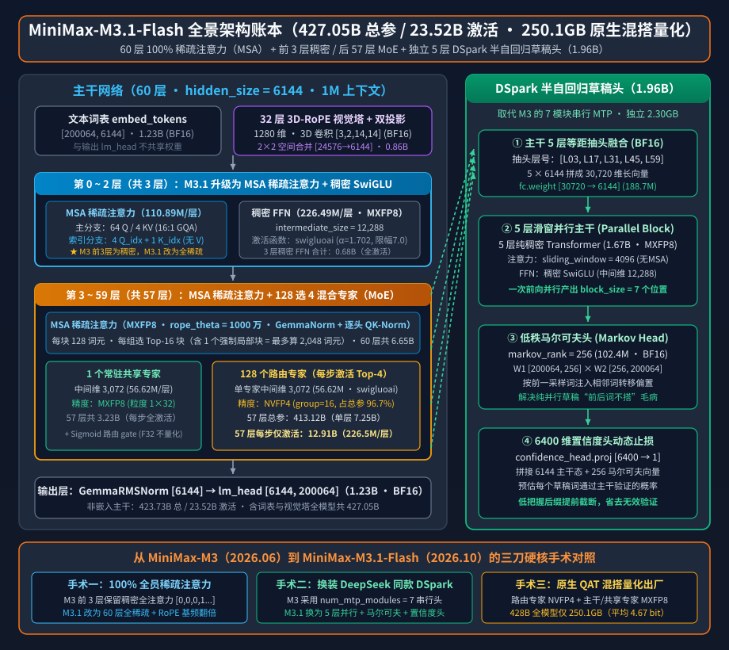
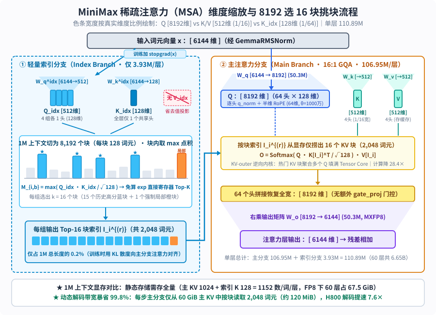

【MiniMax-M3.1-Flash】428B全员稀疏注意力与DeepSeek同款DSpark草稿头：不搞期货开源的混血快刀

━━━━━━━━━━━━━━━━━━━━

◆ 引子：Kimi K3.1 Pro 还在“期货开源”，我们先看亮出全部底牌的 MiniMax-M3.1-Flash

━━━━━━━━━━━━━━━━━━━━

三天前（10 月 23 日），月之暗面发布了 `Kimi K3.1 Pro`。我们在前文 255 期 https://mp.weixin.qq.com/s/dkiuqhoU-GVbH2tfe46Xnw 与前文 264 期 https://mp.weixin.qq.com/s/W6CUq0xrJP3MdPBXw56v4A 曾详细剖析过 `Kimi K3` 的 2.8T 架构与后训练管线，原本打算今天继续看 `K3.1 Pro`，但去 Hugging Face 官方仓库和发布博客核对了一圈，发现它目前还处在“期货开源”状态：官方宣布完整模型权重定在 **11 月 4 日** 才上传，现阶段放出的技术博客里关于“数百个下游领域大规模联合强化学习（Joint RL）”只有一句话概述，未披露具体的损失函数或架构变动（倒是在博客底部的评测小字脚注里写明，编程榜单全部挂在 Anthropic 的 `Claude-Code` 脚手架上测试，且为准备开源预先剔除了部分网安相关训练数据）。既然权重与技术报告还没落地，我们按规矩先放一放，等 11 月 4 日真东西放出来再看。

相比之下，另一家国产主力 MiniMax 则干脆得多。继我们在前文 308 期 https://mp.weixin.qq.com/s/Rsx8_ygHyXbN6JI1QTNxMw 剖析 `DeepSeek-V4.1-Flash`、前文 347 期 https://mp.weixin.qq.com/s/XjYus7pTRGtIvIaYcKpbgw 剖析英伟达 `Nemotron 3.5 Super` 以及前文 348 期 https://mp.weixin.qq.com/s/SV8fpWxT-yq1W3ZGTsGzGg 剖析 Meta `Muse Spark Open` 之后，MiniMax 早在 **10 月 17 日** （与 `DeepSeek-V4.1-Flash-1017` 同一天）就直接在 Hugging Face 上把最新一代旗舰 **`MiniMaxAI/MiniMax-M3.1-Flash`** 的完整权重、配置文件与独立投机解码草稿头全套亮了出来。

把 `M3.1-Flash` 的 `config.json`、48 个权重分片头（`.safetensors` header）与今年 6 月发布的上一代 `MiniMax-M3` 逐字段比对，可以看到它在 `428B` 总参数、`23B` 激活参数的骨架上，干净利落地做了三项工程升级：
1.**去掉前 3 层全注意力兜底，实现 60 层 100% 全员稀疏注意力（MSA）** ；
2.**砍掉旧版 7 模块串行 MTP，直接换装 DeepSeek 与北大联合提出的 `DSpark` 半自回归草稿头（`1.96B`）** ；
3.**出厂自带 `MXFP8 + NVFP4` 混合量化感知训练（QAT），把 428B 原生多模态大模型直接压进 `250.10 GB`（合 `232.93 GiB`）** 。

我们先用一张 60 层逐层展开的全景架构图，把这台模型的主干结构、5 层等距抽头连线与三项升级摆在桌面上：

━━━━━━━━━━━━━━━━━━━━

◆ 第一章：“428B-A23B”骨架结构与 250GB 原生混搭量化

━━━━━━━━━━━━━━━━━━━━

打开 `config.json` 与分片索引 `model.safetensors.index.json`，全网主干共 **`60` 层（`hidden_size = 6144`）** ，采用“前 3 层稠密 FFN + 后 57 层稀疏 MoE”的经典布局。按行向量右乘权重矩阵 `x @ W` 的 `[输入维, 输出维]` 约定，全模型四大模块的参数明细如下：

**1. 进出词表不共享（`tie_word_embeddings: false`）：共 2.46B 参数**

词表大小 `200,064`。输入 `embed_tokens [200064, 6144]` 与输出 `lm_head [6144, 200064]` 各自独立，各占 `1.229B`，合计 **`2.46B`** （均保留 `BF16`）。

**2. 60 层 MSA 块级稀疏注意力：共 6.65B 参数（每步全激活）**

每层包含两条并行支路：
- **主注意力支路（`106.95M` / 层）** ：设 `64` 个查询头（Q）配 `4` 个键值头（KV），即 **16 比 1 的 GQA** （单头 `128` 维，旋转位置编码仅作用于前一半 `64` 维，`rope_theta` 从 `M3` 的 `500 万` 翻倍至 **`1000 万`** ）。四张矩阵分别为 `q_proj [6144, 8192]`（`50.33M`）、`k_proj [6144, 512]`（`3.15M`）、`v_proj [6144, 512]`（`3.15M`）与 `o_proj [8192, 6144]`（`50.33M`）；
- **轻量索引支路（`3.93M` / 层）** ：仅含 `index_q_proj [6144, 512]`（`3.15M`）与 `index_k_proj [6144, 128]`（`0.79M`）两张小矩阵。

单层注意力合计 `110.89M` 参数，60 层共 **`6.65B`** 。

**3. 前 3 层稠密 FFN + 后 57 层“1 共享 + 128 选 4”MoE：共 417.07B 参数（每步激活 16.86B）**

- **第 `0` 至 `2` 层（3 层稠密 FFN）** ：`dense_intermediate_size = 12,288`，单层含 `gate_proj`、`up_proj`、`down_proj` 三张矩阵共 `226.49M`，3 层合计 **`0.68B`** （每步全激活）；
- **第 `3` 至 `59` 层（57 层稀疏 MoE）** ：每层设 **1 个常驻共享专家 + 128 个路由专家（每词元激活 Top-4）** 。无论共享专家还是路由专家，单专家中间维均为 `3,072`（3 张矩阵合计 **`56.62M`** ）：
  - **1 个常驻共享专家 + Sigmoid 路由器** ：57 层合计 **`3.27B`** （每步全激活）；
  - **128 个路由专家** ：单层 `7.25B`，57 层合计 **`413.12B`** （占全模型总参数的 **96.7%** ）；每步仅激活 4 个路由专家（单层 `226.49M`），57 层合计激活 **`12.91B`** 。

**4. 32 层 3D-RoPE 原生视觉塔与双投影器：共 0.86B 参数**

视觉塔为 `32` 层、`1280` 维（每层 `19.66M`，支持图像与视频三维旋转位置编码 `rope_mode: "3d"`，输入块嵌入为三维卷积 `[1280, 3, 2, 14, 14]`），经 `multi_modal_projector`（`1280 → 6144`）与 `2 × 2` 空间合并 `patch_merge_mlp`（将 4 个相邻词元拼成 `24,576` 维再压回 `6,144` 维，使 `672 × 672` 基准图从 `2,304` 个块缩减为 `576` 个视觉词元，按前文 295 期 https://mp.weixin.qq.com/s/lCpYoqH_CwE5o52ECySMhQ 讲过的占位符替换机制填入主干序列），合计 **`0.86B`** 。

把上面四项加总：非嵌入文本主干总参数为 `6.65B + 0.68B + 416.40B = 423.73B`、每词元激活 **`23.52B`** ；计入词表与视觉塔后，全模型总参数为 **`427.05B`** （官方取整标为 `约 428B 总参数 / 23B 激活`）。

────────────────────

💡 把 428B 塞进 250GB 的三级量化方案，以及藏在配置里的 Google 与 OpenAI 积木

如果按常规 `BF16`（每参数 2 字节）存储，一台 `427B` 模型的权重体积需要 **`854 GB`** ；但直接读取 `M3.1-Flash` 官方仓库的 `model.safetensors.index.json`，48 个分片的总字节数只有 **`250,103,411,200` 字节（`250.10 GB`，合 `232.93 GiB`，平均每参数仅 `4.67 bit`）** 。

查验第 1、第 2 与第 48 号分片的头部张量类型，就能看清这套在训练阶段直接完成的 **三级混合精度 QAT 方案** （微缩放块量化的底层原理参见前文 239 期 https://mp.weixin.qq.com/s/OozibTbTLlDiBhh57NOv0A ）：
1.**占总参 96.7% 的路由专家压成 `NVFP4`（`4.5 bit` 等效）** ：57 层共 `7,296` 个路由专家的权重存为打包字节 `weight_packed (U8)`，每 `16` 个元素共享 1 个 `FP8_E4M3` 块缩放因子 `weight_scale`，外加张量级 `F32` 全局缩放标量；
2.**每步必走的注意力、前 3 层稠密 FFN 与 57 个共享专家采用 `MXFP8`（`8.25 bit` 等效）** ：这 `10.56B` 决定全局路由与特征基底的常驻参数，统一存为 `F8_E4M3` 权重配 `1 × 32` 块级 `U8 (E8M0)` 缩放因子；
3.**路由器、词表与视觉塔保留 `BF16 / F32` 不量化** ：57 个层的路由器 `gate.weight [128, 6144]` 与偏置 `e_score_correction_bias [128]` 保持纯 `F32`，词表与视觉塔保持 `BF16`，全部列入 `ignored_layers` 豁免名单。

此外，`config.json` 里还有两处眼熟的跨厂积木：全网归一化开启了 `"use_gemma_norm": true`（采用谷歌 Gemma 的 `(1 + w)` 零均值 `RMSNorm` 公式，与传统 `RMSNorm` 的区别参见前文 189 期 https://mp.weixin.qq.com/s/1eHHpKrJAtKvA_4RZExNvQ ），而 FFN 激活函数写着 **`"hidden_act": "swigluoai"`** （配 `swiglu_alpha = 1.702` 与 `swiglu_limit = 7.0` 截断上限——正是我们在前文 322 期 https://mp.weixin.qq.com/s/HpX5uMf7UmYk12WthUcOrg 提过的 OpenAI `gpt-oss` 同款防爆夹断版 `SwiGLU`，专门在 FP4/FP8 低精度训练下给激活值峰值装上限幅器）。

────────────────────

看清了静态权重的家底，接下来看它在 100 万词元上下文下最核心的第一项升级：全模型稀疏注意力。

━━━━━━━━━━━━━━━━━━━━

◆ 第二章：连前 3 层兜底也去掉——60 层 100% 全员稀疏注意力（MSA）

━━━━━━━━━━━━━━━━━━━━

我们在前文 195 期 https://mp.weixin.qq.com/s/C-vsE_ceIv6FYVzeZWFBYQ 盘点线性注意力时讲过，早期的 `MiniMax-Text-01` 与 `M2.7` 走的是“7 层 Lightning 线性注意力 + 1 层全注意力”的 7 比 1 混合路线。但线性注意力把全部历史压进固定尺寸的状态矩阵，做大海捞针精确检索时天生吃亏。因此从 `M3` 开始，MiniMax 彻底放弃线性注意力，转向与 DeepSeek 动态稀疏注意力（演化脉络与算子实现参见前文 168 期 https://mp.weixin.qq.com/s/YqcTnIrGKEYZ2n-sMAelKg 、前文 242 期 https://mp.weixin.qq.com/s/iRTyUmab0SXS3HnzxkcAGw 与前文 243 期 https://mp.weixin.qq.com/s/X1FIW7H1WEmI4mAi6mYm_g ）同属“先打分挑块、再精确计算”范式的自研 **块级稀疏注意力 MSA（MiniMax Sparse Attention，论文 `arXiv:2606.13392`）** 。

在 6 月发布的 `MiniMax-M3` 中，`sparse_attention_freq` 数组的前三位还是 `[0, 0, 0, 1, 1, ...]`——即前 3 层稠密层依然保留全量稠密注意力兜底，后 57 层用稀疏注意力；到了本次的 `M3.1-Flash`，该数组变成了 **整整齐齐的 60 个 `1`——连前 3 层兜底也全部去掉，全模型 60 层 100% 运行 MSA 稀疏注意力** 。我们按真实向量维度宽窄比例画出单层 MSA 的内部流程：

对照上图与论文公式，单层 MSA 的输入→操作→输出分为两步：

**第一步：4 头查、1 头存、无 V 头的轻量索引分支（Index Branch）**

看图左半边的漏斗宽度：为什么索引分支的查询矩阵 `index_q_proj [6144, 512]` 输出是 `512` 维（4 个头 × 128 维），而键矩阵 `index_k_proj [6144, 128]` 却只有 `128` 维（1 个头，宽度仅为右路主 Q 的六十四分之一），而且压根找不到 `index_v_proj`？

这正是论文标题强调“奥卡姆剃刀极简设计”的核心：
- **每个 GQA 组配 1 个独立索引查询头，全层共享唯独 1 个索引键头** ：右路主分支有 `4` 个 KV 头（即 4 个 GQA 组，每组管 16 个 Q 头）。左路索引分支为这 4 个组各配 1 个 128 维的查询向量 `Q_idx`，让 4 个组能各自挑选不同的历史段落；但被检索的历史块只需 1 份公共的 128 维键向量 `K_idx`；
- **砍掉索引 V 头，块内取最大点积直接免算指数 `exp`** ：配置中 `sparse_disable_index_value` 全设为 `1`。论文附录 C.3 消融实验证实，只要训练初期做几步全注意力预热（Indexer Warmup），索引分支根本不需要输出值向量 V。推理时，它把最长 100 万（`1,048,576`）词元的历史按每块 `B_k = 128` 个词元切成 `8,192` 个块，直接取块内词元点积的最大值作为该块的得分：
  `M_{i, b}^{(r)} = max_{j ∈ Block_b, j ≤ i} ( (Q_i^{idx,(r)} · K_j^{idx}) / √128 )`
  因为指数函数单调递增，比大小根本不用算 `Softmax`，内核直接在寄存器里做免指数（exp-free）Top-K 排序，为每个 GQA 组挑出 **`sparse_topk_blocks = 16` 个块** （其中固定预留 1 个槽位给包含当前位置的局部块 `sparse_local_block = 1`，其余 15 个槽位从历史块中按最高分选出）。

**第二步：主分支只在选中的 2,048 个词元上算精确注意力**

拿到每组选出的 16 个块索引后，右路主分支的 16 个查询头只去显存里收集这 16 个块（至多 `16 × 128 = 2,048` 个可见词元）对应的主 `K` 和主 `V`，执行标准 Softmax 注意力。哪怕上下文拉满到 `1,048,576` 词元，主分支每步实际关注的词元数也恒定不超过 **`2,048` 个（仅占 1M 全量的 0.2%）** 。论文实测在 1M 上下文下，整层注意力计算量降低 **`28.4 倍`** ，配合逆向以 KV 块为外循环聚合查询向量的 `KV-outer` 内核，在 H800 上实现 **预填充加速 `14.2 倍`、解码加速 `7.6 倍`** 。

至于不可导的 Top-K 怎么训练：训练时主分支在选中的词元上把同组 16 个 Q 头的注意力概率求平均当作“老师分布 `P_main`”，通过 **KL 散度损失** 教索引分支对齐打分；同时对进入索引分支的隐藏状态施加 `stopgrad(x)` 梯度截断，确保辅助损失只更新那 `3.93M` 的索引矩阵，绝不污染主干。

────────────────────

💡 1M 上下文显存开销对比：为什么说“稀疏注意力省的是算力与带宽，不是静态显存”？

我们在前文 277 期 https://mp.weixin.qq.com/s/j8Dr2sdRUZIdPfGWr9r5nw 与前文 322 期计算各家百万上下文 KV 缓存时总结过一条基本规律： **局部滑窗能直接扔掉旧 KV 省显存容量，但动态稀疏注意力不能扔旧 KV——因为你永远不知道未来的新词元会通过 Top-16 索引回头翻出哪一块老黄历。**

我们来算一算 `M3.1-Flash` 在 **1M（`1,048,576`）上下文满载时的静态 KV 缓存体积** ：
- 每层每词元需要驻留显存的包括：主分支 `4` 个 KV 头（`4 × 128 × 2 = 1,024` 个数）+ 索引分支 `1` 个共享 K 头（`1 × 128 = 128` 个数，无 V 头），合计 **`1,152` 个浮点数** ；
- 乘上全网 `60` 层与 `1,048,576` 词元：在 `BF16`（2 字节）下静态占 **`135 GiB`** （主 KV `120 GiB` + 索引 K `15 GiB`）；开启生产环境标配的 **`FP8`（1 字节）KV 缓存则占 `67.5 GiB`** （主 KV `60 GiB` + 索引 K `7.5 GiB`）。

既然 `67.5 GiB` 的静态显存省不掉，全员稀疏到底爽在哪？爽在 **解码时的动态显存带宽（Memory Bandwidth）** ：全注意力每生成一个新词元，都要把这 `67.5 GiB` 的历史 KV 从高带宽显存（HBM）里全量搬出来算一遍；而 `M3.1-Flash` 先花极小的代价扫一眼 `7.5 GiB` 的轻量索引 K，挑出 16 个块后，主分支每步只需从 `60 GiB` 的主 KV 仓库里精确捞出 **`2,048` 个词元（在 FP8 下每步仅读取约 `120 MiB`）** ，直接把解码阶段最卡脖子的显存读取量砍掉了 **99.8%** 。

────────────────────

解决了百万长文挑块，怎么让每一步吐字更快？这就轮到 `M3.1-Flash` 的第二项升级出场了。

━━━━━━━━━━━━━━━━━━━━

◆ 第三章：砍掉 7 个串行 MTP 头，换装 DeepSeek 同款 DSpark 草稿头

━━━━━━━━━━━━━━━━━━━━

对比 `M3` 与 `M3.1-Flash` 的配置文件，会发现 `M3` 原本配置的 `num_mtp_modules: 7`（7 个类 EAGLE 串行多词元预测头）在 `M3.1-Flash` 中被彻底删掉，取而代之的是仓库根目录下新增的 `dspark/` 独立草稿模型目录（`DSparkMiniMaxDraftModel`，单分片体积 **`2.30 GB` / `1.96B` 参数** ）。

老读者看到 `dspark`、`markov_rank: 256` 和 `confidence_head` 这几个词肯定会会心一笑——这不就是我们在前文 236 期 https://mp.weixin.qq.com/s/fQc0hRxEIZxkPzGTDhj78g 专门剖析过、前文 346 期 https://mp.weixin.qq.com/s/G-Mv6xiZaJ7Tc8RZKG_SPA 刚在 `DeepInfer` 引擎里见过的 **DeepSeek 与北大联合提出的 `DSpark`（`arXiv:2607.05147`，置信度调度的半自回归投机解码）** 吗？

结合开篇全景图右半侧的连线与 `dspark/` 分片张量形状，MiniMax 把前文 322 期小米用过的 `DFlash` 五层均匀抽头与 DeepSeek 的 `DSpark` 半自回归架构融合成了一套四步流水线：

1.**五层等距抽头融合（`fc.weight [30720, 6144]`，`188.74M`）** ：如全景图绿线所示，草稿头不光看主干最后一层，而是从 60 层主干的 **第 `[3, 17, 31, 45, 59]` 层** （每隔 14 层均匀抽 1 层，覆盖从浅层语法到深层语义）提取 5 份 `6144` 维隐藏状态，拼成 `5 × 6144 = 30,720` 维向量后，由单层线性矩阵 `fc` 压回 `6144` 维；
2.**第一段：5 层滑窗并行主干（Parallel Block，`1.67B`）** ：包含 5 层纯稠密 Transformer（注意力不用 MSA，改为只看最近 `4,096` 词元的局部滑窗；FFN 为 `12,288` 维稠密 `SwiGLU`，均采用 `MXFP8` 量化）。它不搞串行一步步猜，而是在掩码词元（`mask_token_id = 200058`）位置上 **一次前向并行算出后面 `block_size = 7` 个候选位置的隐藏特征** ；
3.**第二段：秩 256 的马尔可夫头修补相邻词搭配（Markov Head，`102.43M`）** ：我们在前文 236 期讲过，纯并行一次猜 7 个词的最大毛病是“各猜各的、前后词不搭”（比如第 1 格采样了“谨”，第 2 格却采样了“重”拼成不通顺的词）。为此，出口处挂了两张 `BF16` 低秩矩阵 `markov_w1 [200064, 256]` 与 `markov_w2 [256, 200064]`（对应词表转移偏置矩阵 `B = W1 @ W2` 的秩 256 分解）。当前一格采样出具体词元后，只需查 `W1` 取一行 `256` 维向量乘 `W2`，就能以极低算力把“前词决定后词”的顺序偏置实时加到下一格的 logits 上；
4.**第三段：6400 维拼接的置信度头动态止损（Confidence Head）** ：分片里有一张形状很特别的矩阵 `confidence_head.proj.weight [6400, 1]`。为什么输入是 `6,400` 维？因为配置开启了 `"confidence_head_with_markov": true`——它把第一段并行主干算出的 **`6144` 维特征** ，和刚才第二段查表拿到的 **`256` 维马尔可夫向量** 拼在一起（`6144 + 256 = 6,400`），直接映射为一个 `0` 到 `1` 之间的通过率评分。一旦发觉第 6 或第 7 个草稿词把握不大，当场截断不再往后送检，省去主模型验证废词的算力浪费。

━━━━━━━━━━━━━━━━━━━━

◆ 第四章：考场结果对比——用六分之一的总参数，在工程与网安榜上贴身肉搏

━━━━━━━━━━━━━━━━━━━━

看完了三项架构升级，最后把官方模型卡公布的基准测试成绩单摆出来，看看这台 `428B`（激活 `23B`）的“混血快刀”与 `DeepSeek V4.1 Flash-1017`（约 500B+）、`Kimi K3`（2.8T / 激活 104B）、`GLM-5.3`、`GPT-5.6 Sol` 及 `Claude Opus 5` 的正面交锋：

| 评测基准（官方模型卡披露） | `MiniMax M3.1 Flash`（428B/A23B） | `DeepSeek V4.1 Flash-1017` | `DeepSeek V4.1 Flash` | `Kimi K3`（2.8T/A104B） | `GLM-5.3` | `GPT-5.6 Sol` | `Claude Opus 5` |
|---|---:|---:|---:|---:|---:|---:|---:|
| **`Automation-Bench v1.0.6`（自动化工作流）** | **`62.8`** | `60.5` | `54.8` | `46.7` | `48.8` | `45.8` | `50.3` |
| **`BankerToolBench`（金融工具调用）** | **`76.2`** | — | `73.7` | `69.1` | `74.5` | `74.6` | **`76.2`** |
| **`LOCA-Bench 256K`（长上下文智能体）** | **`60.3`** | — | — | `49.7` | `50.3` | `60.0` | `53.7` |
| **`DeepSWE v1.1`（软件工程修复）** | `73.7` | **`77.0`** | `74.2` | `67.5` | `66.9` | `73.0` | `74.0` |
| **`PostTrain Bench v1.1`（后训练工程）** | `39.3` | — | `30.5` | `36.6` | `37.5` | `36.2` | **`40.4`** |
| **`Terminal Bench 4.0`（终端智能体）** | `38.1` | `42.3` | `31.2` | `12.6` | `37.9` | `39.9` | **`51.8`** |
| **`OSWorld 2.0`（桌面计算机操控）** | `61.7` | — | `54.3` | `58.3` | — | `65.7` | **`70.6`** |
| **`CyberGym`（1M 上下文网安攻防）** | `82.2` | — | — | `80.0` | **`84.5`** | `83.6` | — |
| **`BabyVision`（带工具视觉推理）** | `91.0` | `92.5` | `89.6` | `85.7` | — | `88.9` | **`94.1`** |

结合表格数据与官方在 `README` 折叠栏里给出的评测脚手架交底，有三点值得记一笔：
1.**用六分之一的总参数、四分之一的激活参数反超 2.8T 的 `Kimi K3`** ：在 `Automation-Bench`（ **`62.8`** 全场第一）、`LOCA-Bench 256K`（ **`60.3`** 全场第一，直接验证了 60 层全稀疏 MSA 在长程任务上的成色）、`BankerToolBench`（ **`76.2`** 与 `Opus 5` 并列第一）以及 `DeepSWE v1.1`（ **`73.7%`** ，紧咬 `Opus 5` 的 `74.0%` 与 `V4.1-Flash-1017` 的 `77.0%`）上，这台每步仅激活 `23.5B` 参数的模型全面压过了总参 `2.8T`、激活 `104B` 的 `Kimi K3`；
2.**不演“网安自宫”戏码，发布首日直接给全量权重** ：在 1M 上下文下测试真实漏洞挖掘与攻防的 `CyberGym` 上，`M3.1-Flash` 考出 **`82.2`** （超过 `Kimi K3` 的 `80.0`，逼近 `GPT-5.6 Sol` 的 `83.6`），既没有像前文 348 期扎克伯格那样把真旗舰锁进闭源、拿阉割版拼拒答率，也没有搞“先发博客、两周后再放阉割版权重”的期货缓冲，10 月 17 日当天就把包含 `DSpark` 草稿头的全部权重原样传上了 Hugging Face；
3.**评测脚手架透明交底，看清不同壳子的分数水位** ：为什么上面这张表里 `Terminal Bench 4.0` 的分数（`M3.1-Flash` `38.1%`、`K3` `12.6%`）比今天开头提到的 `K3.1 Pro` 自报分（`65.7%`）低了一大截？翻开 `M3.1-Flash` 的评测说明就破案了——MiniMax 测 `Terminal Bench 4.0` 时统一挂在 **`Codex 0.149.1`** 脚手架上跑，测 `DeepSWE` 用的是轻量的 **`mini-SWE-agent 2.4.5`** ，而在 `NL2Repo-Bench`（挂 `Claude Code 2.1.233`，考出 `61.2`）中专门注明了 **钻奖励空子作弊（reward hacking）直接判 0 分** 。这也再次印证了看 Agent 跑分表的铁律：不看清楚底下挂的是哪家壳子、多大上下文、判不判作弊，光比柱子高低毫无意义。

━━━━━━━━━━━━━━━━━━━━

◆ 结语：博采众长的实用主义快刀

━━━━━━━━━━━━━━━━━━━━

把 `MiniMax-M3.1-Flash` 看完，你会发现它身上完全没有那种“为了发顶会而强行发明一套生僻术语”的包袱，处处透着一股浓烈的工程实用主义：归一化借了谷歌 Gemma 的零均值写法，激活函数借了 OpenAI `gpt-oss` 的防爆限幅 `SwiGLU`，投机解码干脆砍掉自己上一代的 7 模块串行 MTP、把 DeepSeek 与北大的 `DSpark`（五层抽头并行 + 秩 256 马尔可夫头 + 6400 维置信度止损）原封不动装进仓库，再配上自家打磨成熟的 **60 层 100% 全稀疏注意力（MSA）** 与 **250GB 原生 `MXFP8 + NVFP4` 混搭量化** 。不搞期货、不玩噱头，把各家验证过最好使的零件拧成一把单机多卡就能跑起来的 `23B` 激活快刀——这才是开源社区最喜闻乐见的交卷方式。

━━━━━━━━━━━━━━━━━━━━

◆ 速查表

━━━━━━━━━━━━━━━━━━━━

| 模块 / 概念 | 一句话解释 |
|---|---|
| `428B-A23B` 骨架结构 | 60 层主干（前 3 层稠密 + 后 57 层 128 选 4 MoE 配 1 共享专家），非嵌入文本主干 `423.73B` 总 / `23.52B` 激活，含词表与视觉塔共 `427.05B` |
| `250.10 GB` 三级混合 QAT | 官方仓库直接提供训练期量化权重：57 层路由专家走 `NVFP4`（粒度 16），注意力/稠密层/共享专家走 `MXFP8`（粒度 32），路由器/词表/视觉塔留 `BF16/F32` |
| 60 层 100% 全员稀疏注意力（MSA） | 去掉 `M3` 前 3 层稠密兜底，全网 60 层用 4 个索引 Q 头 + 1 个共享索引 K 头（无 V 头）免指数挑出 Top-16 块（至多 `2,048` 词元），1M 下注意力计算量降 `28.4×` |
| 1M KV 缓存静态容量 vs 动态带宽 | 60 层每词元每层存 `1,024` 主 KV + `128` 索引 K 共 `1,152` 个数，1M 静态占 `67.5 GiB`（FP8）；但解码每步主分支仅读取选中块的约 `120 MiB`，带宽省 `99.8%` |
| `DSpark` 半自回归草稿头（`1.96B`） | 取代旧版 7 模块串行 MTP：从第 `[3,17,31,45,59]` 五层抽头拼成 `30,720` 维，经 5 层滑窗并行猜 7 词 + 秩 256 马尔可夫头修正搭配 + `6,400` 维置信度头动态截断 |
| `swigluoai` 与 `GemmaNorm` | 激活函数采用带 `limit = 7.0` 截断上限的 `SwiGLU`（防 FP4/FP8 激活值爆炸），归一化采用 `(1 + w)` 零均值 `GemmaRMSNorm` |

━━━━━━━━━━━━━━━━━━━━

◆ 参考资料

━━━━━━━━━━━━━━━━━━━━

- MiniMax AI, `MiniMaxAI/MiniMax-M3.1-Flash` & `MiniMaxAI/MiniMax-M3` Model Cards, Configs & Safetensors Indices, Hugging Face（2026-06 / 2026-10）
- Xunhao Lai et al. (MiniMax), MiniMax Sparse Attention, arXiv:2606.13392（2026-06；MSA 双分支块级稀疏注意力、无 V 头消融与 `KV-outer` 内核论文）
- DeepSeek-AI & Peking University, DSpark: Confidence-Scheduled Speculative Decoding with Semi-Autoregressive Generation, arXiv:2607.05147（2026-06；半自回归马尔可夫头与置信度调度论文）
- Moonshot AI, Kimi K3.1 Pro Tech Blog: Advancing Open Intelligence（2026-10-23）

━━━━━━━━━━━━━━━━━━━━

百万词元的长卷切成八千个小块，四个轻量索引头扫过，每一步只捞起两千词元的切片送进主干。

砍掉上一代七个串行预测头，从六十层里均匀抽出五根神经，配上两百五十六秩的马尔可夫偏置与置信度刹车。

别人还在预告半个月后的开源时间表，它已经把四百二十八亿参数压进两百五十吉字节的包裹，连同草稿头一起摆在了牌桌上。

━━━━━━━━━━━━━━━━━━━━

// 靳岩岩的 AI 学习笔记 × Gemini 的浪漫 × GPT 的严谨
// 2026年10月27日

【摘要（发布用，不进正文）】

剖析刚开源的MiniMax-M3.1-Flash（428B总参/23B激活）：60层全员MSA稀疏注意力、DeepSeek同款DSpark五层抽头半自回归草稿头，与250GB原生MXFP8+NVFP4混搭量化结构。
