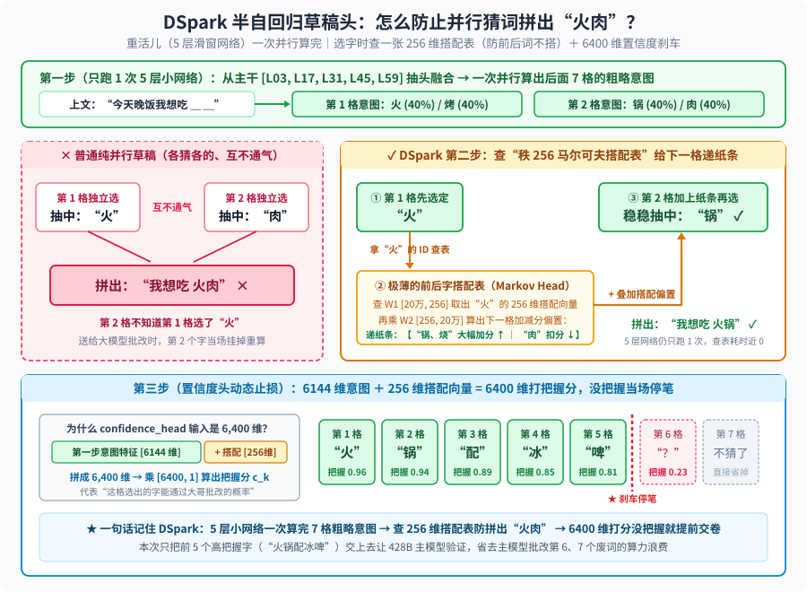

【MiniMax-M3.1-Flash】428B全员稀疏注意力与DeepSeek同款DSpark草稿头：不搞期货开源的混血快刀

━━━━━━━━━━━━━━━━━━━━

◆ 引子：Kimi K3.1 Pro 还在“期货开源”，我们先看亮出全部底牌的 MiniMax-M3.1-Flash

━━━━━━━━━━━━━━━━━━━━

三天前（10 月 23 日），月之暗面发布了 `Kimi K3.1 Pro`。我们在前文 255 期 https://mp.weixin.qq.com/s/dkiuqhoU-GVbH2tfe46Xnw 与前文 264 期 https://mp.weixin.qq.com/s/W6CUq0xrJP3MdPBXw56v4A 曾详细剖析过 `Kimi K3` 的 2.8T 架构与后训练管线，原本打算今天继续看 `K3.1 Pro`，但去 Hugging Face 官方仓库和发布博客核对了一圈，发现它目前还处在“期货开源”状态：官方宣布完整模型权重定在 **11 月 4 日** 才上传，现阶段放出的技术博客里关于“数百个下游领域大规模联合强化学习（Joint RL）”只有一句话概述，未披露具体的损失函数或架构变动（倒是在博客底部的评测小字脚注里写明，编程榜单全部挂在 Anthropic 的 `Claude-Code` 脚手架上测试，且为准备开源预先剔除了部分网安相关训练数据）。既然权重与技术报告还没落地，我们按规矩先放一放，等 11 月 4 日真东西放出来再看。

相比之下，另一家国产主力 MiniMax 则干脆得多。继我们在前文 308 期 https://mp.weixin.qq.com/s/Rsx8_ygHyXbN6JI1QTNxMw 剖析 `DeepSeek-V4.1-Flash`、前文 347 期 https://mp.weixin.qq.com/s/XjYus7pTRGtIvIaYcKpbgw 剖析英伟达 `Nemotron 3.5 Super` 以及前文 348 期 https://mp.weixin.qq.com/s/SV8fpWxT-yq1W3ZGTsGzGg 剖析 Meta `Muse Spark Open` 之后，MiniMax 早在 **10 月 17 日** （与 `DeepSeek-V4.1-Flash-1017` 同一天）就直接在 Hugging Face 上把最新一代旗舰 **`MiniMaxAI/MiniMax-M3.1-Flash`** 的完整权重、配置文件与独立投机解码草稿头全套亮了出来。

把 `M3.1-Flash` 的 `config.json`、48 个权重分片头（`.safetensors` header）与今年 6 月发布的上一代 `MiniMax-M3` 逐字段比对，可以看到它在 `428B` 总参数、`23B` 激活参数的骨架上，干净利落地做了三项工程升级：
1.**去掉前 3 层全注意力兜底，实现 60 层 100% 全员稀疏注意力（MSA）** ；
2.**砍掉旧版 7 模块串行 MTP，直接换装 DeepSeek 与北大联合提出的 `DSpark` 半自回归草稿头（`1.96B`）** ；
3.**出厂自带 `MXFP8 + NVFP4` 混合量化感知训练（QAT），把 428B 原生多模态大模型直接压进 `250.10 GB`（合 `232.93 GiB`）** 。

我们先用一张 60 层逐层展开的全景架构图，把这台模型的主干结构、5 层等距抽头连线与三项升级摆在桌面上：

━━━━━━━━━━━━━━━━━━━━

◆ 第一章：“428B-A23B”骨架结构与 250GB 原生混搭量化

━━━━━━━━━━━━━━━━━━━━

打开 `config.json` 与分片索引 `model.safetensors.index.json`，全网主干共 **`60` 层（`hidden_size = 6144`）** ，采用“前 3 层稠密 FFN + 后 57 层稀疏 MoE”的经典布局。按行向量右乘权重矩阵 `x @ W` 的 `[输入维, 输出维]` 约定，全模型四大模块的参数明细如下：

**1. 进出词表各自独立：共 2.46B 参数**

与如今百亿级以上大模型的通例一致，配置中 `tie_word_embeddings` 设为 `false`。词表大小 `200,064`，输入 `embed_tokens [200064, 6144]` 与输出 `lm_head [6144, 200064]` 各自独立，各占 `1.229B`，合计 **`2.46B`** （均保留 `BF16`）。

────────────────────

💡 顺便聊个通例：为什么现在主流国模都不共享进出词表？谁还在共享？

老读者如果把目前主流国产开源大模型的 `config.json` 翻一遍，会发现无论 `DeepSeek-V4 / V4.1`、`Kimi-K3`、`GLM-5.3`、`Qwen3.8-Flash-Next`（及 `Qwen3-8B` 以上型号），还是 `小米 MiMo-V2.6` 与今天的 `MiniMax-M3.1`， **`tie_word_embeddings` 清一色全是 `false`（不共享进出词表）。**

为什么早期 GPT-2 时代流行的“进出共享一张词表”被如今的大模型集体抛弃了？原因有两条：
1.**输入查表与输出分类的几何职责本来就不对称** ：我们在前文 169 期 https://mp.weixin.qq.com/s/mnbaXhQmQjDAyGD1dDdq5Q 讲过，输入 `embed_tokens` 是把离散词元编号映射成第 0 层初始向量，需要把同义词聚拢在相近区域；而输出 `lm_head` 是拿第 60 层最终隐藏态去做 20 万分类的内积打分，需要拉开近似词的判别边界。强行绑死在一张表上，两头梯度会互相掣肘；
2.**流水线并行（Pipeline Parallelism）的跨机器通信代价** ：训练几百 B 的大模型时，60 层主干会被切分到不同机器组上——输入词表住在第 1 组机器（入口 Stage 0），输出头住在最后 1 组机器（出口 Stage N-1）。一旦共享权重，每跑一步训练，首尾两组机器就得跨网络同步一次数 GB 的词表梯度；拆成两张独立的表，对 428B 模型来说多花 `1.23B` 参数连总量的 **0.3% 都不到** ，却彻底省掉了首尾跨节点同步的通信气泡。

那现在还有谁在开着 `tie_word_embeddings: true`（共享词表）？说到底就一条规律—— **只有对显存斤斤计较的“原生小模型”才会共享** ：
- **端侧与单卡级原生小模型（如阿里的 `Qwen3-0.6B / 1.7B / 4B`、Meta 的 `Llama-3.2-1B / 3B`，以及全系都是中小尺寸的谷歌 `Gemma` 家族）** ：因为如今的多语言词表动辄 15 万至 26 万词（Gemma 词表高达 25.6 万至 26.2 万），单张词表就要占 `0.5B` 至 `1.4B` 参数。对从零原生训练的端侧或单卡小模型来说，要是进出各存一张表，光词表就要吃掉大块显存预算，所以这类原生小模型普遍开启共享（Gemma 为此还在输入查表后硬乘一个 `√hidden_size` 来迁就两头的数值尺度）；一旦到了 `8B` 以上的常规模型或百亿 MoE，就立刻切回不共享；
- **一个极有意思的反例：拿大模型去蒸馏小模型时，哪怕只有 `1.5B` 也会把词表拆开** ——例如原生的 `Qwen2.5-Math-1.5B` 是 `tie_word_embeddings: true`，可 DeepSeek 拿 671B 的 R1 蒸馏它做出 `DeepSeek-R1-Distill-Qwen-1.5B` 时，专门把开关改成了 `false`（将进出词表解绑，避免大模型老师强烈的输出蒸馏梯度直接冲垮小模型脆弱的输入词向量空间）。

────────────────────

**2. 60 层 MSA 块级稀疏注意力：共 6.65B 参数（每步全激活）**

这里先把概念理顺：**它的底盘就是一个最标准的 16 比 1 GQA（分组查询注意力），所谓的“稀疏（MSA）”，其实是在标准 GQA 旁边外挂了一个极小的“挑块索引器（Indexer）”** ——两者不是并列输出特征的两条通道，而是 **“索引器先替每个 GQA 组圈出 16 个块的页码名单，正牌 GQA 再只对着名单上的块算注意力”** 的上下游关系：
- **正牌 16:1 GQA 主注意力（`106.95M` / 层，负责算特征输出）** ：跟普通大模型完全一样，设 `64` 个查询头（Q）配 `4` 个键值头（KV）——也就是把 64 个 Q 头分成 **4 个大组，每组 16 个 Q 头共用同一份 K 和 V** （单头 `128` 维，半维旋转位置编码 `rope_theta` 从 `M3` 的 `500 万` 翻倍至 **`1000 万`** ）。四张常规矩阵分别为 `q_proj [6144, 8192]`（`50.33M`）、`k_proj [6144, 512]`（`3.15M`）、`v_proj [6144, 512]`（`3.15M`）与 `o_proj [8192, 6144]`（`50.33M`）；
- **外挂的轻量挑块索引器（`3.93M` / 层，只输出块编号、不输出特征）** ：如果让上面 64 个 Q 头直接和全部 100 万词元的 K、V 算注意力，那就是全量稠密 GQA，会慢得跑不动。为此，每层额外配了 `index_q_proj [6144, 512]`（`3.15M`）与 `index_k_proj [6144, 128]`（`0.79M`）两张小矩阵，专门负责在正牌 GQA 动手前，从 100 万历史里快速挑出最相关的 16 个块编号递给正牌 GQA。

单层两套矩阵合计 `110.89M` 参数，60 层共 **`6.65B`** 。

**3. 前 3 层稠密 FFN + 后 57 层“1 共享 + 128 选 4”MoE：共 417.07B 参数（每步激活 16.86B）**

- **第 `0` 至 `2` 层（3 层稠密 FFN）** ：`dense_intermediate_size = 12,288`，单层含 `gate_proj`、`up_proj`、`down_proj` 三张矩阵共 `226.49M`，3 层合计 **`0.68B`** （每步全激活）；
- **第 `3` 至 `59` 层（57 层稀疏 MoE）** ：每层设 **1 个常驻共享专家 + 128 个路由专家（每词元激活 Top-4）** 。无论共享专家还是路由专家，单专家中间维均为 `3,072`（3 张矩阵合计 **`56.62M`** ）：
  - **1 个常驻共享专家 + Sigmoid 路由器** ：57 层合计 **`3.27B`** （每步全激活）；
  - **128 个路由专家** ：单层 `7.25B`，57 层合计 **`413.12B`** （占全模型总参数的 **96.7%** ）；每步仅激活 4 个路由专家（单层 `226.49M`），57 层合计激活 **`12.91B`** 。

**4. 32 层 3D-RoPE 原生视觉塔与双投影器：共 0.86B 参数**

视觉塔为 `32` 层、`1280` 维（每层 `19.66M`，支持图像与视频三维旋转位置编码 `rope_mode: "3d"`，输入块嵌入为三维卷积 `[1280, 3, 2, 14, 14]`），经 `multi_modal_projector`（`1280 → 6144`）与 `2 × 2` 空间合并 `patch_merge_mlp`（将 4 个相邻词元拼成 `24,576` 维再压回 `6,144` 维，使 `672 × 672` 基准图从 `2,304` 个块缩减为 `576` 个视觉词元，按前文 295 期 https://mp.weixin.qq.com/s/lCpYoqH_CwE5o52ECySMhQ 讲过的占位符替换机制填入主干序列），合计 **`0.86B`** 。

把上面四项加总：非嵌入文本主干总参数为 `6.65B + 0.68B + 416.40B = 423.73B`、每词元激活 **`23.52B`** ；计入词表与视觉塔后，全模型总参数为 **`427.05B`** （官方取整标为 `约 428B 总参数 / 23B 激活`）。

**5. 把 428B 塞进 250GB 的三级混合 QAT 与跨厂积木**

如果按常规 `BF16`（每参数 2 字节）存储，一台 `427B` 模型的权重体积需要 **`854 GB`** ；但直接读取 `M3.1-Flash` 官方仓库的 `model.safetensors.index.json`，48 个分片的总字节数只有 **`250,103,411,200` 字节（`250.10 GB`，合 `232.93 GiB`，平均每参数仅 `4.67 bit`）** 。查验第 1、第 2 与第 48 号分片的头部张量类型，就能看清这套在训练阶段直接完成的 **三级混合精度 QAT 方案** （微缩放块量化的底层原理参见前文 239 期 https://mp.weixin.qq.com/s/OozibTbTLlDiBhh57NOv0A ）：
1.**占总参 96.7% 的路由专家压成 `NVFP4`（`4.5 bit` 等效）** ：57 层共 `7,296` 个路由专家的权重存为打包字节 `weight_packed (U8)`，每 `16` 个元素共享 1 个 `FP8_E4M3` 块缩放因子 `weight_scale`，外加张量级 `F32` 全局缩放标量；
2.**每步必走的注意力、前 3 层稠密 FFN 与 57 个共享专家采用 `MXFP8`（`8.25 bit` 等效）** ：这 `10.56B` 决定全局路由与特征基底的常驻参数，统一存为 `F8_E4M3` 权重配 `1 × 32` 块级 `U8 (E8M0)` 缩放因子；
3.**路由器、词表与视觉塔保留 `BF16 / F32` 不量化** ：57 个层的路由器 `gate.weight [128, 6144]` 与偏置 `e_score_correction_bias [128]` 保持纯 `F32`，词表与视觉塔保持 `BF16`，全部列入 `ignored_layers` 豁免名单。

此外，`config.json` 里还有两处值得顺手看一眼的细节：
- **`"use_gemma_norm": true`（把 `× w` 改成 `× (1 + w)` 的零均值 `RMSNorm`）** ：我们在前文 189 期 https://mp.weixin.qq.com/s/1eHHpKrJAtKvA_4RZExNvQ 讲过，普通 `RMSNorm` 是把向量拉回单位长度 `x̂` 后乘上缩放参数 `w`（`out = x̂ ⊙ w`），因此初始时 `w` 必须设为全 `1`。这有两个小毛病：一是如果对 `w` 做权重衰减（Weight Decay，把参数往 `0` 拉），等于把信号倍率往 `0` 掐死；二是在 `BF16` 低精度下，`1.0` 附近的微小变动（如 `1.0002`）容易因浮点数有效位不足被舍入吞掉。谷歌 Gemma 的解法极简——把公式改成 **`out = x̂ ⊙ (1 + w)`** ，并将 `w` **初始化为全 `0`** ：这样 `w` 只负责记录“偏离 1 倍的微小增量”，既保住了 `BF16` 在 `0` 附近的最高浮点分辨率，又让权重衰减把 `w → 0` 时恰好回到最安全的 `1` 倍默认状态；
- **`"hidden_act": "swigluoai"`（带 `7.0` 限幅器的防爆 `SwiGLU`）** ：配 `swiglu_alpha = 1.702` 与 `swiglu_limit = 7.0` 截断上限——正是我们在前文 322 期 https://mp.weixin.qq.com/s/HpX5uMf7UmYk12WthUcOrg 提过的 OpenAI `gpt-oss` 同款防爆夹断版 `SwiGLU`，专门在 FP4/FP8 低精度训练下给激活值峰值装上限幅器。

看清了静态权重的家底，接下来看它在 100 万词元上下文下最核心的第一项升级：全模型稀疏注意力。

━━━━━━━━━━━━━━━━━━━━

◆ 第二章：连前 3 层兜底也去掉——60 层 100% 全员稀疏注意力（MSA）

━━━━━━━━━━━━━━━━━━━━

我们在前文 195 期 https://mp.weixin.qq.com/s/C-vsE_ceIv6FYVzeZWFBYQ 盘点线性注意力时讲过，早期的 `MiniMax-Text-01` 与 `M2.7` 走的是“7 层 Lightning 线性注意力 + 1 层全注意力”的 7 比 1 混合路线。但线性注意力把全部历史压进固定尺寸的状态矩阵，做大海捞针精确检索时天生吃亏。因此从 `M3` 开始，MiniMax 彻底放弃线性注意力，转向与 DeepSeek 动态稀疏注意力（演化脉络与算子实现参见前文 168 期 https://mp.weixin.qq.com/s/YqcTnIrGKEYZ2n-sMAelKg 、前文 242 期 https://mp.weixin.qq.com/s/iRTyUmab0SXS3HnzxkcAGw 与前文 243 期 https://mp.weixin.qq.com/s/X1FIW7H1WEmI4mAi6mYm_g ）同属“先打分挑块、再精确计算”范式的自研 **块级稀疏注意力 MSA（MiniMax Sparse Attention，论文 `arXiv:2606.13392`）** 。

在 6 月发布的 `MiniMax-M3` 中，`sparse_attention_freq` 数组的前三位还是 `[0, 0, 0, 1, 1, ...]`——即前 3 层稠密层依然保留全量稠密注意力兜底，后 57 层用稀疏注意力；到了本次的 `M3.1-Flash`，该数组变成了 **整整齐齐的 60 个 `1`——连前 3 层兜底也全部去掉，全模型 60 层 100% 运行 MSA 稀疏注意力** 。我们按真实向量维度宽窄比例，画出“外挂索引器先挑块编号、正牌 GQA 再按名单精读”的两步接力流程：

对照上图与论文公式，单层 MSA 的输入→操作→输出是清晰的上下游两棒交接：

**第一棒：4 头查、1 头存、无 V/O 的外挂挑块索引器（只输出块编号，不输出特征）**

看图左半边的漏斗宽度：为什么外挂索引器的查询矩阵 `index_q_proj [6144, 512]` 输出是 `512` 维（4 个头 × 128 维），而键矩阵 `index_k_proj [6144, 128]` 却只有 `128` 维（1 个头，宽度仅为右路主 Q 的六十四分之一），而且既没有 `V` 也没有输出矩阵 `O`？

这正是论文标题强调“奥卡姆剃刀极简设计”的核心：
- **替右路每个 GQA 组派 1 个代表去挑块，全层共享唯独 1 个索引键头** ：右路正牌 GQA 有 `4` 个 KV 头（即 4 个 GQA 大组，每组 16 个 Q 头共用同一份 KV）。左路索引器顺水推舟，为这 4 个大组各配 1 个 128 维的索引查询向量 `Q_idx`，让 4 个组能各自挑选不同的历史段落；而被检索的历史块只需存 1 份公共的 128 维索引键 `K_idx`；
- **砍掉索引 V 头，块内取最大点积直接免算指数 `exp`** ：配置中 `sparse_disable_index_value` 全设为 `1`。论文附录 C.3 消融实验证实，只要训练初期做几步全注意力预热（Indexer Warmup），索引器根本不需要输出任何特征向量，它的唯一使命就是输出 **块编号名单** 。推理时，它把最长 100 万（`1,048,576`）词元的历史按每块 `B_k = 128` 个词元切成 `8,192` 个块，直接取块内词元点积的最大值作为该块的得分：
  `M_{i, b}^{(r)} = max_{j ∈ Block_b, j ≤ i} ( (Q_i^{idx,(r)} · K_j^{idx}) / √128 )`
  因为指数函数单调递增，比大小根本不用算 `Softmax`，内核直接在寄存器里做免指数（exp-free）Top-K 排序，为每个 GQA 组挑出 **`sparse_topk_blocks = 16` 个块编号** （其中固定预留 1 个槽位给包含当前位置的局部块 `sparse_local_block = 1`，其余 15 个槽位从历史块中按最高分选出）。把这 4 份“16 个块编号名单”递给右路正牌 GQA 后，索引器当场下班。

**第二棒：正牌 16:1 GQA 照着名单捞块算特征（至多 2,048 词元），未满尾块靠掩码对齐**

接过左路递来的 4 份“16 个块编号名单”后，右路正牌 GQA 的 64 个查询头（每组 16 个头共享本组名单）只去显存里把这 16 个块对应的主 `K` 和主 `V` 捞出来，64 个头各自独立执行标准 Softmax 注意力并经 `W_o` 输出特征。这里有个很关键的工程细节： **如果当前词元位置 `i` 不是 128 的整数倍，最后那一组未满 128 个词元的尾块怎么处理？**
- 论文附录 C.2 专门给这最后一组起了个名字叫 **“特殊未满自身块（special incomplete self block）”** ：切块是按固定 128 边界对齐的（如 `1 至 128` 为第 1 块、`129 至 256` 为第 2 块）。假设当前刚生成到第 `130` 个词元，最后这一块里就只有 `129`、`130` 两个可见词元。`sparse_local_block = 1` 强制保送的正是这最后一块（否则当前词元连自己都看不见），而块内尚未生成的剩余 126 个空槽位（`131 至 256`）在送入 GPU 矩阵乘时直接用因果掩码（Causal Mask）置为 `-∞` 屏蔽掉；
- 至于刚跨过 128 边界时紧挨在前面的上一整块（如 `1 至 128`），它不再享受强制保送，但论文附录 C.2 实测表明，训练后的索引器会自动用其余 15 个动态名额把紧邻的前一块挑回来，因此无需像 DeepSeek 那样单独维护一条跨块滚动的 128 词元滑动窗口。

算下来，哪怕上下文拉满到 `1,048,576` 词元，正牌 GQA 每步实际关注的词元数也恒定不超过 **`16 × 128 = 2,048` 个（仅占 1M 全量的 0.2%）** 。论文实测在 1M 上下文下，整层注意力计算量降低 **`28.4 倍`** ，配合逆向以 KV 块为外循环聚合查询向量的 `KV-outer` 内核，在 H800 上实现 **预填充加速 `14.2 倍`、解码加速 `7.6 倍`** 。

至于不可导的 Top-K 怎么训练：训练时正牌 GQA 在选中的词元上把同组 16 个 Q 头的注意力概率求平均当作“老师分布 `P_main`”，通过 **KL 散度损失** 教外挂索引器对齐打分；同时对进入索引器的隐藏状态施加 `stopgrad(x)` 梯度截断，确保辅助损失只更新那 `3.93M` 的索引矩阵，绝不污染主干。

────────────────────

💡 国产四大稀疏注意力方言对号入座：源头都在 DeepSeek，各家改的是切块颗粒度

看到这里，老读者肯定会觉得这套“轻量索引器先打分、KL 散度当老师对齐、外加强制保留眼前局部块”的配方无比眼熟——没错，整套范式的源头正是我们在前文 168 期与前文 242 期讲过的 **DeepSeek `DSA`（V3.2）与 `NSA`（原生稀疏注意力）** 。后面智谱、阿里与 MiniMax 各自命名的稀疏注意力，本质上都是顺着 DeepSeek 趟出来的这条路，在不同底盘上调整“切块颗粒度”：

| 模型与稀疏方言 | 全网层配比与主干底盘 | 索引器怎么挑词（单步精读预算） |
|---|---|---|
| **DeepSeek `DSA` → `CSA / CSA2`**（前文 168、242、308 期） | 全层或半数层 · **MLA 潜空间压缩底盘** | **开山鼻祖** ：`V3.2 DSA` 逐词元挑 **`2,048` 条** （无局部窗）；到了 `V4 CSA` 与 `V4.1 CSA2`（跨层共享 KV 与索引），缩减为挑 **`512` 条压缩历史 ＋ `128` 条眼前滑窗** （共 `640` 条进同一次 Softmax） |
| **智谱 `GLM-5.3-Flash`：`DSA + IndexPool`**（前文 292 期 https://mp.weixin.qq.com/s/qGbCm3qJB6SNumftansUtw ） | 34 层 KDA 线性 ＋ **11 层稀疏 MLA** | 直接照搬 DeepSeek V3.2 的 `DSA`（挑 `2,048` 词元），仅在索引器上自补 **`IndexPool`**：每 **4 个** 索引键池化压成 1 个，给 1M 下索引器减负 |
| **阿里 `Qwen3.8-Flash-Next`：`QSA`**（前文 293 期 https://mp.weixin.qq.com/s/jb-ibVHAG3wKbtoiX5SStA ） | 36 层 GDN 线性 ＋ **12 层稀疏 GQA** | 沿用 V3.2 的 `2,048` 词元总预算与两阶段换装流程，但改为按 **4 词元一小段** 打分，挑出 **512 段**（`512 × 4 = 2,048` 词元） |
| **MiniMax `M3.1-Flash`：`MSA`**（本期） | **60 层 100% 全员稀疏 · 16:1 GQA 底盘** | 同样锚定 **`2,048` 词元** 总预算，用 4 个索引 Q 头配 1 个共享索引 K 头（无 V 头），按 **128 词元一大块** 取最大点积，**4 个 GQA 组各挑 16 块**（15 历史块 ＋ 1 块 `128` 词元局部保底 = `2,048` 词元） |

把时间线排开特别有意思：当年 DeepSeek 在 `V3.2` 的 `DSA` 里定下了 **`2,048` 个词元** 的挑选预算，结果同行们抄作业时全都严丝合缝地卡死在 `2,048` 这个数上（智谱是 `2048 × 1`，阿里是 `512 × 4`，MiniMax 是 `16 × 128`），连 MiniMax 强制预留 1 个 `128` 词元局部块（`sparse_local_block = 1`）防近处漏检的做法，也是沿用了 DeepSeek 在 `NSA / CSA` 里加上的 `128` 滑窗保底设计；反倒是先行一步的 DeepSeek 自己，到了 `V4`（`CSA`）和 `V4.1-Flash`（`CSA2`）已经靠先压缩再挑 + 跨层复用，把每步历史挑选量进一步砍到了 **`512` 条** 。

至于 MiniMax 在这套公共范式上做的三处工程取舍，也很实在：
1.**颗粒度最粗（128 词元整块 vs 1 词元 / 4 词元）** ：逐词或 4 词挑出的片段散落在显存各处，GPU 读取时全是细碎访存；按 `128` 词元整块挑，每次从显存捞出来的都是连续对齐的内存块，直接就能塞进 Tensor Core 矩阵块满速算；
2.**块内用最大点积（Max-Pooling）代替池化求平均** ：128 词元的大块如果取平均，1 个关键线索词容易被块内其余 127 个普通词稀释；取块内最大值，只要块里有 1 个词对上暗号，整块就会被拎出来，而且比大小天然免算指数 `exp`；
3.**4 个 GQA 组各挑各的** ：弥补了大块挑选的粗粒度——允许第 1 组看开头、第 2 组看中间代码、第 3 组看结尾，在硬件对齐与多头视野多样性之间找了个折中点。

────────────────────

对比完四家挑词颗粒度的异同，接下来再算一算 60 层全员稀疏在 100 万上下文下的显存容量与带宽。

────────────────────

💡 1M 上下文显存开销对比：为什么说“稀疏注意力省的是算力与带宽，不是静态显存”？

我们在前文 277 期 https://mp.weixin.qq.com/s/j8Dr2sdRUZIdPfGWr9r5nw 与前文 322 期计算各家百万上下文 KV 缓存时总结过一条基本规律： **局部滑窗能直接扔掉旧 KV 省显存容量，但动态稀疏注意力不能扔旧 KV——因为你永远不知道未来的新词元会通过 Top-16 索引回头翻出哪一块老黄历。**

我们来算一算 `M3.1-Flash` 在 **1M（`1,048,576`）上下文满载时的静态 KV 缓存体积** ：
- 每层每词元需要驻留显存的包括：正牌 GQA 的 `4` 个 KV 头（`4 × 128 × 2 = 1,024` 个数）+ 外挂索引器的 `1` 个共享 K 头（`1 × 128 = 128` 个数，无 V 头），合计 **`1,152` 个浮点数** ；
- 乘上全网 `60` 层与 `1,048,576` 词元：在 `BF16`（2 字节）下静态占 **`135 GiB`** （主 KV `120 GiB` + 索引 K `15 GiB`）；开启生产环境标配的 **`FP8`（1 字节）KV 缓存则占 `67.5 GiB`** （主 KV `60 GiB` + 索引 K `7.5 GiB`）。

既然 `67.5 GiB` 的静态显存省不掉，全员稀疏到底爽在哪？爽在 **解码时的动态显存带宽（Memory Bandwidth）** ：全注意力每生成一个新词元，都要把这 `67.5 GiB` 的历史 KV 从高带宽显存（HBM）里全量搬出来算一遍；而 `M3.1-Flash` 先花极小的代价扫一眼 `7.5 GiB` 的轻量索引 K，挑出 16 个块后，正牌 GQA 每步只需从 `60 GiB` 的主 KV 仓库里精确捞出 **`2,048` 个词元（在 FP8 下每步仅读取约 `120 MiB`）** ，直接把解码阶段最卡脖子的显存读取量砍掉了 **99.8%** 。

────────────────────

解决了百万长文挑块，怎么让每一步吐字更快？这就轮到 `M3.1-Flash` 的第二项升级出场了。

━━━━━━━━━━━━━━━━━━━━

◆ 第三章：砍掉 7 个串行 MTP 头，换装 DeepSeek 同款 DSpark 草稿头

━━━━━━━━━━━━━━━━━━━━

对比 `M3` 与 `M3.1-Flash` 的配置文件，会发现 `M3` 原本配置的 `num_mtp_modules: 7`（7 个类 EAGLE 串行多词元预测头）在 `M3.1-Flash` 中被彻底删掉，取而代之的是仓库根目录下新增的 `dspark/` 独立草稿模型目录（`DSparkMiniMaxDraftModel`，单分片体积 **`2.30 GB` / `1.96B` 参数** ）。

老读者看到 `dspark`、`markov_rank: 256` 和 `confidence_head` 这几个词肯定会会心一笑——这正是我们在前文 236 期 https://mp.weixin.qq.com/s/fQc0hRxEIZxkPzGTDhj78g 专门剖析过、前文 346 期 https://mp.weixin.qq.com/s/G-Mv6xiZaJ7Tc8RZKG_SPA 刚在 `DeepInfer` 引擎里见过的 **DeepSeek 与北大联合提出的 `DSpark`（`arXiv:2607.05147`，置信度调度的半自回归投机解码）** 。

很多读者第一次看 `DSpark` 的论文，容易被“半自回归、秩 256 马尔可夫矩阵、置信度头”这堆名词绕晕。其实只要记住 **“怎么防止把‘火锅’和‘烤肉’拼成‘火肉’”** 这一个例子，就能一眼看懂底下这张图里的三步设计：

对照上图与 `dspark/` 分片里的真实张量形状，这颗 `1.96B` 的外挂小模型每步是这么替主模型探路的：

1.**第一步：主干 5 层抽头 ＋ 5 层滑窗小网络一次并行算出 7 个格子的粗略意图（`1.86B`）** ：
   草稿头从 60 层主干的 **第 `[3, 17, 31, 45, 59]` 层** （每隔 14 层均匀抽 1 层，与前文 322 期小米 `DFlash` 的五层抽头同构）取出 5 份 `6144` 维隐藏状态，拼成 `30,720` 维向量后经 `fc.weight [30720, 6144]`（`188.74M`）压回 `6144` 维；随后只跑 **1 次** 5 层纯稠密滑窗 Transformer（`sliding_window = 4,096`，FFN 中间维 `12,288`，共 `1.67B`、`MXFP8` 量化），在掩码词元（`mask_token_id = 200058`）上 **一口气并行算出后面 `block_size = 7` 个格子的粗略特征** 。
   比如上文是“今天晚饭我想吃 ＿ ＿”，跑完这一步，第 1 格算出的高概率候选是“火（40%）/ 烤（40%）”，第 2 格算出的高概率候选是“锅（40%）/ 肉（40%）”。

2.**第二步：查一张“秩 256 的前后字搭配表（Markov Head，`102.43M`）”给下一格递纸条，防止拼出“火肉”** ：
   - 如果像普通纯并行草稿头（如 `DFlash`）那样，让第 1 格和第 2 格互不通气、同时各自掷骰子选字，极容易出现图左边的翻车现场——第 1 格抽中了 **`“火”`** ，第 2 格不知道前面选了啥、自己抽中了 **`“肉”`** ，两格合起来拼成了不通顺的 **`“火肉”`** ，送给主模型批改时当场被打回重算；
   - 为了不退回慢吞吞的串行重跑 Transformer，`DSpark` 在出口挂了两张极薄的 `BF16` 低秩矩阵 `markov_w1 [200064, 256]` 与 `markov_w2 [256, 200064]`（对应 20 万词表前后字搭配矩阵 `B = W1 @ W2` 的秩 256 分解）。第 1 格先掷骰子选出 **`“火”`** 后，立刻拿“火”的编号去查 `W1` 取出一个 `256` 维小向量，再乘 `W2` 变成一张递给第 2 格的加减分纸条（ **既然前字定了“火”，就把“锅、烧”大幅加分，把“肉”扣分** ），第 2 格加上纸条再选，就稳稳当当落在了 **`“锅”`** 上。重活儿（5 层网络）只跑 1 次，选字时顺着查表通个气，这就叫 **半自回归** 。

3.**第三步：6,400 维拼接的置信度刹车片（Confidence Head），没把握就提前停笔** ：
   哪怕前后字通了气，一次往后连猜 7 个词，猜到第 6、第 7 格时往往也没把握了。分片里那张 `confidence_head.proj.weight [6400, 1]`，正是把第一步算出的 **`6144` 维意图特征** 与第二步查表拿到的 **`256` 维搭配向量** 拼在一起（`6144 + 256 = 6,400`），算出这一格能通过主模型批改的把握分 `c_k`。如图下侧所示，前 5 格（“火锅配冰啤”）把握分都在 `0.8` 以上，到第 6 格跌到了 `0.23`，草稿头当场拉闸停笔，只把前 5 个高把握字交上去，免得 428B 主模型白费算力去批改后面注定被打回的废词。

━━━━━━━━━━━━━━━━━━━━

◆ 第四章：考场结果对比——用六分之一的总参数，在工程与网安榜上贴身肉搏

━━━━━━━━━━━━━━━━━━━━

看完了三项架构升级，最后把官方模型卡公布的基准测试成绩单摆出来，看看这台 `428B`（激活 `23B`）的“混血快刀”与 `DeepSeek V4.1 Flash-1017`（约 500B+）、`Kimi K3`（2.8T / 激活 104B）、`GLM-5.3`、`GPT-5.6 Sol` 及 `Claude Opus 5` 的正面交锋：

| 评测基准（官方模型卡披露） | `MiniMax M3.1 Flash`（428B/A23B） | `DeepSeek V4.1 Flash-1017` | `DeepSeek V4.1 Flash` | `Kimi K3`（2.8T/A104B） | `GLM-5.3` | `GPT-5.6 Sol` | `Claude Opus 5` |
|---|---:|---:|---:|---:|---:|---:|---:|
| **`Automation-Bench v1.0.6`（自动化工作流）** | **`62.8`** | `60.5` | `54.8` | `46.7` | `48.8` | `45.8` | `50.3` |
| **`BankerToolBench`（金融工具调用）** | **`76.2`** | — | `73.7` | `69.1` | `74.5` | `74.6` | **`76.2`** |
| **`LOCA-Bench 256K`（长上下文智能体）** | **`60.3`** | — | — | `49.7` | `50.3` | `60.0` | `53.7` |
| **`DeepSWE v1.1`（软件工程修复）** | `73.7` | **`77.0`** | `74.2` | `67.5` | `66.9` | `73.0` | `74.0` |
| **`PostTrain Bench v1.1`（后训练工程）** | `39.3` | — | `30.5` | `36.6` | `37.5` | `36.2` | **`40.4`** |
| **`Terminal Bench 4.0`（终端智能体）** | `38.1` | `42.3` | `31.2` | `12.6` | `37.9` | `39.9` | **`51.8`** |
| **`OSWorld 2.0`（桌面计算机操控）** | `61.7` | — | `54.3` | `58.3` | — | `65.7` | **`70.6`** |
| **`CyberGym`（1M 上下文网安攻防）** | `82.2` | — | — | `80.0` | **`84.5`** | `83.6` | — |
| **`BabyVision`（带工具视觉推理）** | `91.0` | `92.5` | `89.6` | `85.7` | — | `88.9` | **`94.1`** |

结合表格数据与官方在 `README` 折叠栏里给出的评测脚手架交底，有三点值得记一笔：
1.**用六分之一的总参数、四分之一的激活参数反超 2.8T 的 `Kimi K3`** ：在 `Automation-Bench`（ **`62.8`** 全场第一）、`LOCA-Bench 256K`（ **`60.3`** 全场第一，直接验证了 60 层全稀疏 MSA 在长程任务上的成色）、`BankerToolBench`（ **`76.2`** 与 `Opus 5` 并列第一）以及 `DeepSWE v1.1`（ **`73.7%`** ，紧咬 `Opus 5` 的 `74.0%` 与 `V4.1-Flash-1017` 的 `77.0%`）上，这台每步仅激活 `23.5B` 参数的模型全面压过了总参 `2.8T`、激活 `104B` 的 `Kimi K3`；
2.**不演“网安自宫”戏码，发布首日直接给全量权重** ：在 1M 上下文下测试真实漏洞挖掘与攻防的 `CyberGym` 上，`M3.1-Flash` 考出 **`82.2`** （超过 `Kimi K3` 的 `80.0`，逼近 `GPT-5.6 Sol` 的 `83.6`），既没有像前文 348 期扎克伯格那样把真旗舰锁进闭源、拿阉割版拼拒答率，也没有搞“先发博客、两周后再放阉割版权重”的期货缓冲，10 月 17 日当天就把包含 `DSpark` 草稿头的全部权重原样传上了 Hugging Face；
3.**评测脚手架透明交底，看清不同壳子的分数水位** ：为什么上面这张表里 `Terminal Bench 4.0` 的分数（`M3.1-Flash` `38.1%`、`K3` `12.6%`）比今天开头提到的 `K3.1 Pro` 自报分（`65.7%`）低了一大截？翻开 `M3.1-Flash` 的评测说明就破案了——MiniMax 测 `Terminal Bench 4.0` 时统一挂在 **`Codex 0.149.1`** 脚手架上跑，测 `DeepSWE` 用的是轻量的 **`mini-SWE-agent 2.4.5`** ，而在 `NL2Repo-Bench`（挂 `Claude Code 2.1.233`，考出 `61.2`）中专门注明了 **钻奖励空子作弊（reward hacking）直接判 0 分** 。这也再次印证了看 Agent 跑分表的铁律：不看清楚底下挂的是哪家壳子、多大上下文、判不判作弊，光比柱子高低毫无意义。

━━━━━━━━━━━━━━━━━━━━

◆ 结语：从各显神通到“全行业公版标准件”

━━━━━━━━━━━━━━━━━━━━

把 `MiniMax-M3.1-Flash` 的配置文件看完，最直观的感受其实不是它发明了什么独门绝技，而是 **到了 2026 年秋天，国产开源大模型的底层架构已经彻底收敛成了“公版标准件”** ：
- 要撑起 1M 上下文，大家都在用 DeepSeek 趟出来的“第一棒轻量索引器挑 `2,048` 词元 ＋ 第二棒正牌注意力精读”稀疏范式，无非是按 1 个词、4 个词还是 128 个词切块；
- 要省推理显存，从 `DeepSeek-V4` 开始的训练期混合量化（QAT，路由专家压 4 位、主干与共享专家留 8 位）早已成了各家出厂标配；
- 要加速吐字，大家都砍掉了早期的串行 MTP，纷纷换上 `DFlash` 或 `DSpark` 这套多格并行草稿头；连 `SwiGLU` 限幅和 `RMSNorm` 变体也是公共货架上随手可取的现成积木。

一年前，MiniMax 还在坚持自己独树一帜的“7 比 1 线性注意力”路线；一年后，它干脆利落地把全身零件换成了这套全行业验证过最稳妥的公版配方，并在发布当天把 250GB 权重连同草稿头直接传上 Hugging Face。当架构图纸已经透明成公共基础设施时，少造概念、不搞期货、老老实实把公版零件打磨到 23B 激活就能在工程榜上能打，本身就是最务实的活法。

━━━━━━━━━━━━━━━━━━━━

◆ 速查表

━━━━━━━━━━━━━━━━━━━━

| 模块 / 概念 | 一句话解释 |
|---|---|
| `428B-A23B` 骨架结构 | 60 层主干（前 3 层稠密 + 后 57 层 128 选 4 MoE 配 1 共享专家），非嵌入文本主干 `423.73B` 总 / `23.52B` 激活，含词表与视觉塔共 `427.05B` |
| `250.10 GB` 三级混合 QAT | 官方仓库直接提供训练期量化权重：57 层路由专家走 `NVFP4`（粒度 16），注意力/稠密层/共享专家走 `MXFP8`（粒度 32），路由器/词表/视觉塔留 `BF16/F32` |
| 60 层 100% 全员稀疏注意力（MSA） | 去掉 `M3` 前 3 层稠密兜底，全网 60 层用 4 个索引 Q 头 + 1 个共享索引 K 头（无 V 头）免指数挑出 Top-16 块（至多 `2,048` 词元），1M 下注意力计算量降 `28.4×` |
| 1M KV 缓存静态容量 vs 动态带宽 | 60 层每词元每层存 `1,024` 主 KV + `128` 索引 K 共 `1,152` 个数，1M 静态占 `67.5 GiB`（FP8）；但解码每步正牌 GQA 仅读取选中块的约 `120 MiB`，带宽省 `99.8%` |
| `DSpark` 半自回归草稿头（`1.96B`） | 取代旧版 7 模块串行 MTP：从第 `[3,17,31,45,59]` 五层抽头拼成 `30,720` 维，经 5 层滑窗并行猜 7 词 + 秩 256 马尔可夫头修正搭配 + `6,400` 维置信度头动态截断 |
| `swigluoai` 与 `GemmaNorm` | 激活函数采用带 `limit = 7.0` 截断上限的 `SwiGLU`（防 FP4/FP8 激活值爆炸），归一化采用 `(1 + w)` 零均值 `GemmaRMSNorm` |

━━━━━━━━━━━━━━━━━━━━

◆ 参考资料

━━━━━━━━━━━━━━━━━━━━

- MiniMax AI, `MiniMaxAI/MiniMax-M3.1-Flash` & `MiniMaxAI/MiniMax-M3` Model Cards, Configs & Safetensors Indices, Hugging Face（2026-06 / 2026-10）
- Xunhao Lai et al. (MiniMax), MiniMax Sparse Attention, arXiv:2606.13392（2026-06；MSA 块级稀疏注意力、无 V 头消融与 `KV-outer` 内核论文）
- DeepSeek-AI & Peking University, DSpark: Confidence-Scheduled Speculative Decoding with Semi-Autoregressive Generation, arXiv:2607.05147（2026-06；半自回归马尔可夫头与置信度调度论文）
- Moonshot AI, Kimi K3.1 Pro Tech Blog: Advancing Open Intelligence（2026-10-23）

━━━━━━━━━━━━━━━━━━━━

百万词元的长卷切成八千个小块，第一棒索引器只交出十六个块号，第二棒正牌注意力按名单捞块精读。

砍掉上一代七个串行预测头，五层小网络一次并行算完意图，再查一张两百五十六维的搭配表防止拼出“火肉”。

当稀疏挑块、混合量化与半自回归草稿都成了全行业的公版标准件，不搞期货、首日把全套权重摆上桌面就是最大的诚意。

━━━━━━━━━━━━━━━━━━━━

// 靳岩岩的 AI 学习笔记 × Gemini 的浪漫 × GPT 的严谨
// 2026年10月27日

【摘要（发布用，不进正文）】

剖析刚开源的MiniMax-M3.1-Flash（428B总参/23B激活）：60层全员MSA稀疏注意力、DeepSeek同款DSpark五层抽头半自回归草稿头，与250GB原生MXFP8+NVFP4混搭量化结构。
