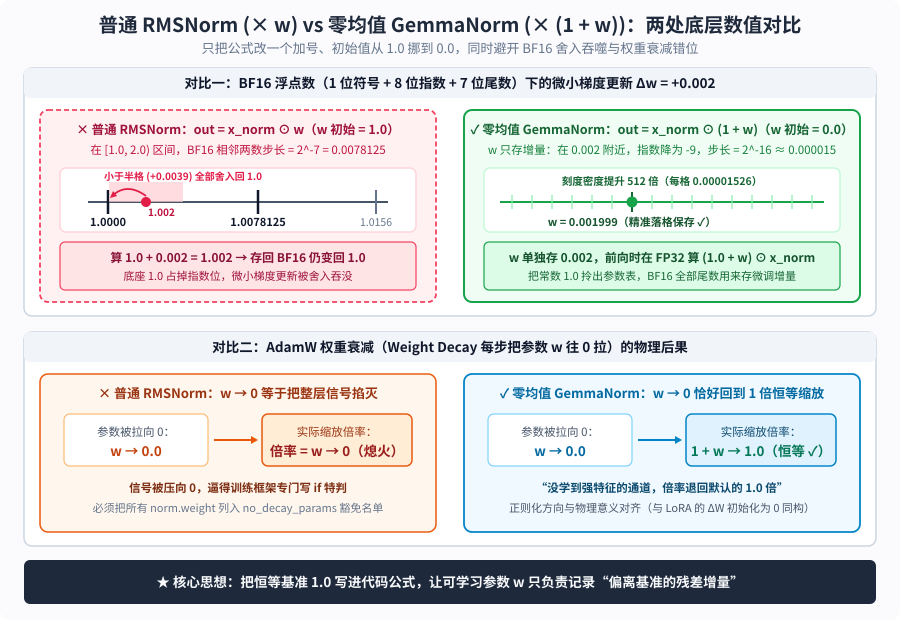

【老靳学算法】从 LayerNorm、RMSNorm 到 Gemma 的 (1+w)：一行只改一个加号的归一化代码，到底在防什么？

━━━━━━━━━━━━━━━━━━━━

◆ 引子：一行 `"use_gemma_norm": true` 勾出来的算法复习课

━━━━━━━━━━━━━━━━━━━━

我们在前文 351 期翻看 `MiniMax-M3.1-Flash` 的 `config.json` 时，注意到了一个不起眼的布尔开关—— **`"use_gemma_norm": true`** 。打开源码一看，它和普通 `RMSNorm` 的全部区别，仅仅是把最后一步逐通道乘缩放权重的 `out = x̂ ⊙ w`，改成了 **`out = x̂ ⊙ (1 + w)`** ，同时把参数 `w` 的初始值从全 `1` 改成了全 `0`。

在数学代数上，令 `w_旧 = 1 + w_新`，两行式子明明完全等价；为什么谷歌的 `Gemma 2 / 3 / 4`、阿里的 `Qwen3.8` 以及如今的 `MiniMax-M3.1` 都要专门多写这一个加号？

刚好距离我们在前文 189 期 https://mp.weixin.qq.com/s/1eHHpKrJAtKvA_4RZExNvQ 聊 `LayerNorm` 与 `RMSNorm` 已经过去了五个月，很多细节平时不碰也容易生疏。今天我们就沿着前文 276 期 https://mp.weixin.qq.com/s/tLQSZbOd9ap4GSEzZZfvyg “拿具体数字手算一遍”的习惯，先把 `LayerNorm` 到 `RMSNorm` 的演进温习一遍，再把今年各家新模型里扎堆出现的 **`(1 + w)` 零均值 `GemmaNorm`** 、 **逐头 `QK-Norm`** 以及 **`Pre-Norm` 与 `Sandwich-Norm`** 串成一张完整图谱。

━━━━━━━━━━━━━━━━━━━━

◆ 第一章：拿 4 个数字手算一遍——为什么要有归一化？为什么 `RMSNorm` 敢扔掉减均值？

━━━━━━━━━━━━━━━━━━━━

先不背任何公式，我们直接看一个词元向量在 60 层神经网络里穿行时会遭遇什么。

假设词元刚进第 0 层时，是一个 `d = 4` 维的小向量 `x = [2, 4, 6, 8]`。每经过一层注意力和前馈网络（FFN）的矩阵乘法，假如数值整体被放大 10 倍，那么穿行两层之后，它就会膨胀成 `[200, 400, 600, 800]`；要是连穿 60 层，数值早就像脱缰野马一样冲破浮点数的表示上限，变成 `Inf`（无穷大）或 `NaN`（非数字）了。

为了不让激活值在深层接力中失控，每进一层计算前，都得设一道“安检门”，把向量的数值尺度重新拉回 `1` 附近。这道安检门就是 **归一化（Normalization）** 。我们直接拿 `x = [2, 4, 6, 8]`，手算对比前后两代安检门的做法：

**1. 第一代标准件：层归一化（Layer Normalization，LayerNorm，2016）**

2016 年 Ba 等人提出的 `LayerNorm` 规矩最全，分三步走：
1.**第一步（算均值并归零 / 中心化）** ：先求 4 个分量的平均值 `μ = (2 + 4 + 6 + 8) / 4 = 5`，然后每个分量都减去均值 `5`，得到：
   `x - μ = [-3, -1, 1, 3]`
   注意看，减完之后，4 个数加起来等于 `-3 - 1 + 1 + 3 = 0`（均值为 0）；
2.**第二步（算标准差并拉回单位方差）** ：对减完均值的 `[-3, -1, 1, 3]` 求平方平均，得到方差 `σ² = ( (-3)² + (-1)² + 1² + 3² ) / 4 = (9 + 1 + 1 + 9) / 4 = 5`，开根号得标准差 `σ = √5 ≈ 2.236`（实际代码里分母会写 `√(σ² + ε)`，加上一个极小常数 `ε = 10^-6` 防止全零向量除零崩溃）。每个分量除以 `2.236`，得到归一化向量：
   `x̂ = [-3 / 2.236, -1 / 2.236, 1 / 2.236, 3 / 2.236] ≈ [-1.342, -0.447, 0.447, 1.342]`
3.**第三步（乘缩放 `w` 加偏置 `b`——给每个维度配独立旋钮）** ：前两步“一刀切”地把整个向量拉回了均值 `0`、标准差 `1` 的标准尺度。但向量的 4 个维度代表不同的语义特征——如果在某一层里，第 4 维特征特别重要（需要放大）、第 1 维特征只是噪音（需要压小），光靠上面两步死板的除法就没法表达这种轻重缓急了。因此，`LayerNorm` 在出口处给 4 个维度各自配了一个**靠梯度下降学出来的独立缩放旋钮** `w = [w_1, w_2, w_3, w_4]`（初始全设为 `1`，即刚起步时不放大也不缩小）和一个平移偏置 `b = [b_1, b_2, b_3, b_4]`（初始全设为 `0`），按位置一一对应相乘再相加：
   `out = x̂ ⊙ w + b = [-1.342 × w_1 + b_1,  -0.447 × w_2 + b_2,  0.447 × w_3 + b_3,  1.342 × w_4 + b_4]`

**2. 第二代标准件：均方根归一化（Root Mean Square Layer Normalization，RMSNorm，2019）**

到了 2019 年，Zhang 与 Sennrich 提出了一个大胆的简化： **既不减均值 `μ`，也不要平移偏置 `b`** ，只保留“拉平总尺度”和“每个维度乘独立缩放旋钮 `w`”这两步：
1.**第一步（直接算均方根 RMS 并除过去——拉平总音量）** ：直接拿原始向量 `x = [2, 4, 6, 8]` 算平方平均再开根号：
   `RMS(x) = √( (2² + 4² + 6² + 8²) / 4 ) = √( (4 + 16 + 36 + 64) / 4 ) = √30 ≈ 5.477`
   然后把原始向量的每个分量直接除以 `5.477`，把 4 个数的平方平均值拉回 `1`：
   `x̂ = [2 / 5.477, 4 / 5.477, 6 / 5.477, 8 / 5.477] ≈ [0.365, 0.730, 1.095, 1.461]`
2.**第二步（只乘可学习缩放向量 `w`——调节单声道音量）** ：不加偏置 `b`，只让每个维度乘上自己专属的可学习缩放权重 `w = [w_1, w_2, w_3, w_4]`（比如训练后模型觉得第 4 维重要，就把 `w_4` 学成 `1.5`；觉得第 1 维没用，就把 `w_1` 学成 `0.3`）：
   `out = x̂ ⊙ w = [0.365 × w_1,  0.730 × w_2,  1.095 × w_3,  1.461 × w_4]`

────────────────────

💡 复习前文 189 期：为什么 `RMSNorm` 敢扔掉“减均值”，速度更快、效果还不掉？

把上面两组手算结果摆在一起，`RMSNorm` 成为 2023 年以来所有主流大模型（`Llama`、`DeepSeek`、`Qwen`、`Gemma`、`Kimi`）一致选择的三个原因就全清楚了：
1.**几何上，只锁长度、不改方向** ：我们在前文 170 期 https://mp.weixin.qq.com/s/ozog4BkollQAc7wzUkME0g 和前文 189 期讲过，高维空间里向量的 **方向** 编码了词元的语义。原始向量 `[2, 4, 6, 8]` 四个分量的比例是 `1 : 2 : 3 : 4`；经过 `RMSNorm` 除以同一个正数 `5.477` 后，得到的 `[0.365, 0.730, 1.095, 1.461]` 比例依然是严格的 `1 : 2 : 3 : 4`， **方向纹丝不动，只是把向量模长拉回了半径为 `√d = 2` 的球面 `S^{d-1}` 上** （验证：`0.365² + 0.730² + 1.095² + 1.461² = 4 = d`）。而 `LayerNorm` 减去均值后变成了 `[-1.342, -0.447, 0.447, 1.342]`，直接消去了沿着全 1 向量 `[1, 1, 1, 1]` 方向的分量，把活动空间压扁到了少一个自由度的 `S^{d-2}` 球面上；
2.**训练动力学上，模型自己就会把均值压到 0** ：正如 Gupta 等人（2024）在 7 个主流大模型上实测发现的那样，哪怕用不减均值的 `RMSNorm` 训练，深层隐藏状态与全 1 向量的夹角也会自发收敛到 `89` 至 `90` 度（即均值天然约等于 `0`）。因为如果大家伙都带着一个巨大的公共均值，注意力算 `Q · K^T` 点积时就会被公共底噪淹没，梯度下降在降低损失函数的过程中，自然会把无用的均值分量压掉，根本不需要 `LayerNorm` 每层替它动手；
3.**芯片执行上，GPU 少跑一趟跨通道归约求和** ：我们在前文 318 期 https://mp.weixin.qq.com/s/bs9VS4jBQ3aF0FdgjyLjMw 讲过，归一化属于典型的访存密集型算子。算 `LayerNorm` 要先跨 `d` 个通道求和算均值 `μ`，再跨通道求和算方差 `σ²`；而 `RMSNorm` 省掉了算均值和加偏置 `b`，在 GPU 寄存器里只需做一次平方求和归约，算子耗时直接省下约 `10%` 至 `40%`。

────────────────────

温习完 `RMSNorm`，我们就能把视角彻底理清楚了：其实整个归一化算子就干两步活，而且 **这两步在数学上是完全正交、八竿子打不着的两个问题** ——
- **第一步（怎么把向量拉平得 `x̂`）** ：是先减均值再除标准差（`LayerNorm`），还是直接除均方根（`RMSNorm`）？
- **第二步（怎么存每个维度的缩放旋钮 `w`）** ：拿到拉平后的 `x̂` 之后，后面的缩放是写成 `x̂ ⊙ w`（参数从 `1.0` 起步），还是写成 `x̂ ⊙ (1 + w)`（参数从 `0.0` 起步）？

哪怕你用的是 2016 年的老式 `LayerNorm`，它的最后一步也完全可以改成 `x̂ ⊙ (1 + w) + b`。把 `1 + w` 和 `RMSNorm` 强行捆在一起起名叫 `GemmaRMSNorm`（或者 `"use_gemma_norm"`），搞得像是在 `LayerNorm`、`RMSNorm` 之后又发明了“第三代归一化算法”，其实挺扯的——这就跟我们在前文 252 期 https://mp.weixin.qq.com/s/c2fkKq6OY-ux9bZsaZDZdA 吐槽过的 **`SwiGLU`** 一模一样：`Swish` 是激活函数，`GLU` 是双路相乘的门控结构，两件正交的事被拼成一个词，害得无数人以为 `SwiGLU` 是一种激活函数。

那么，单看第二步这个工程补丁，为什么写 `× w` 在 `BF16` 和优化器底下会吃亏？改成 `× (1 + w)` 又到底在防什么？

━━━━━━━━━━━━━━━━━━━━

◆ 第二章：核心重头戏——为什么 `× w` 在 `BF16` 和权重衰减下会吃亏？`× (1 + w)` 解决了什么？

━━━━━━━━━━━━━━━━━━━━

把谷歌 `Gemma`、阿里 `Qwen3` 与前文 351 期 `MiniMax-M3.1` 里的 `GemmaRMSNorm` 源码打开，核心实现只有短短两行：

```python
# 普通 RMSNorm：参数 w 初始化为全 1.0
out_standard = x_norm * w

# GemmaNorm：参数 w 初始化为全 0.0，公式里多加一个 1.0
out_gemma = x_norm * (1.0 + w)
```

为了保证神经网络在训练刚起步（第 0 步）时不扭曲归一化后的信号 `x̂`，缩放倍率在初始时刻必须等于 **`1.0`** 。
- 在普通 `RMSNorm`（`x̂ ⊙ w`）里，倍率就是 `w`，所以参数 `w` 必须 **初始化为全 `1.0`** ；
- 在 `GemmaNorm`（`x̂ ⊙ (1 + w)`）里，工程师把基准常数 `1.0` 直接写进了代码公式，让可学习参数 `w` 只代表 **“偏离 1.0 倍的微调增量”** ，因此参数 `w` 被 **初始化为全 `0.0`** 。

别小看这一个加号和初始值从 `1.0` 到 `0.0` 的挪位，它在底层数值计算与优化器更新上同时解决了两件大事：



对照上图，我们一项一项算清里面的具体数字：

**1. 第一件事：避开 `BF16` 浮点数在 `1.0` 附近的“大数吃小数（有效位吞噬）”**

现代大模型在训练和存储权重时，普遍使用 16 位脑浮点数 **`BF16`（BFloat16）** 。`BF16` 的 16 个比特被切分为 **1 位符号位 ＋ 8 位指数位 ＋ 7 位尾数位（Mantissa / Fraction）** 。

因为尾数只有 **7 位** ，这就带来了一个非常现实的刻度尺问题：
- **当参数 `w` 像普通 `RMSNorm` 那样住在 `1.0` 附近（区间 `[1.0, 2.0)`，指数为 `2^0 = 1`）时** ：
  7 位尾数能切出的最小刻度（即相邻两个可表示浮点数之间的步长，Unit in the Last Place，ULP）是固定的：
  `步长(1.0 附近) = 2^0 × 2^-7 = 1 / 128 = 0.0078125`
  也就是说，在 `BF16` 的世界里，`1.0` 右边紧挨着的下一个数字就是 **`1.0078125`** ，两者之间没有任何刻度。按照向偶舍入（Round to Nearest Even）规则，任何小于半格（`0.0078125 / 2 ≈ 0.0039`）的变动，在存回 `BF16` 时都会被无情地四舍五入回 `1.0`。
  现在假设某一步反向传播算完，学习率乘梯度给出的更新量是 **`Δw = +0.002`** 。在普通 `RMSNorm` 里，拿 `1.0 + 0.002 = 1.002`，一旦转回 `BF16` 权重张量，它当场又变回了 **`1.0`** ——底座 `1.0` 霸占了宝贵的指数位，导致微小的训练信号直接掉进舍入死区被吞没了（即便训练框架用 `FP32` 主权重兜底，前向传播转成 `BF16` 参与计算时，小于 `0.0039` 的微调差异依然无法在 `BF16` 权重中体现出来）。

- **当参数 `w` 像 `GemmaNorm` 那样改成 `(1 + w)`、住在 `0.0` 附近时** ：
  因为常数 `1.0` 被拎出了参数表，`w` 只需要单独存放那个微小的增量 **`0.002`** 。
  对于 `0.002` 这个数，它的二进制科学计数法落在区间 `[1/512, 1/256)`（即 `[0.001953125, 0.00390625)`），此时 `BF16` 的 8 位指数会自动下调到 **`2^-9`** 。在 `2^-9` 的指数档位下，7 位尾数切出的最小步长变成了：
  `步长(0.002 附近) = 2^-9 × 2^-7 = 2^-16 = 1 / 65536 ≈ 0.00001526`
  对比一下：**从 `0.0078125` 到 `0.00001526`，浮点数的刻度分辨率直接精细了 `2^9 = 512` 倍** 。如果增量更小（比如 `0.0001`），指数还会继续往下走，分辨率能高出成千上万倍。等真正执行前向计算时，PyTorch 源码会调用 `.float()` 把 16 位 `BF16` 的 `w` 和 `x̂` 先转成 32 位单精度浮点数（`FP32`，有 23 位尾数），在 GPU 的 32 位寄存器里算 `(1.0 + w.float()) * x_norm.float()`，算完再转回 `BF16` 输出，微小的梯度更新一滴都不会漏。

**2. 第二件事：让 `AdamW` 权重衰减（Weight Decay）的方向回到“1 倍恒等缩放”**

除了浮点精度，把 `w` 初始化为 `0` 还顺手理顺了优化器里的正则化逻辑。

训练大模型标配的优化器是 `AdamW`，它每一步都会对参数施加 **权重衰减（Weight Decay）** ——也就是给参数乘上一个略小于 1 的衰减因子 `(1 - η·λ)`，相当于有一根弹簧，每时每刻都在把参数 `w` 往 **`0.0`** 的方向拉，防止参数无限制疯长导致过拟合：
- **在普通 `RMSNorm`（`out = x̂ ⊙ w`）里** ：如果对 `w` 施加权重衰减，把 `w` 往 `0` 拉，就等于 **把整层特征的放大倍率往 `0` 掐死（信号熄火）** 。但归一化的本意是“如果某个通道没学到特殊的缩放偏好，就保持默认的 `1.0` 倍原样通过”。就因为这个冲突，过去几乎所有主流训练框架（如 Megatron-LM、DeepSpeed）都不得不在代码里专门写一段 `if` 字符串匹配特判，把所有名字里带 `norm` 或 `ln` 的权重参数塞进 `no_decay` 豁免名单，禁止对它们做权重衰减；
- **在零均值 `GemmaNorm`（`out = x̂ ⊙ (1 + w)`）里** ：权重衰减把参数 `w` 往 `0.0` 拉时，实际作用在信号上的缩放倍率 `1 + w` 恰好被拉回 **`1.0`（即不放大也不缩小的单位恒等变换）** 。这就意味着：哪个通道有足够的梯度信号，它的 `w` 就偏离 `0` 去放大或缩小；哪个通道没有强信号，权重衰减就会自动把它拉回最安全的 `1.0` 倍默认状态。

────────────────────

💡 融会贯通：从 `ResNet`、`LoRA` 到 `GemmaNorm`，深度学习里到处都是“参数只存增量”

如果跳出归一化算子往回看，你会发现这种 **“把恒等基准 `1`（或原路径 `x`）写死在主干公式里，让可学习参数初始化为 `0`、专门用来存微调增量”** 的做法，其实是整个现代深度学习最底层的一条通用工程哲学：
- **残差连接（`y = x + F(x)`）** ：不让网络层从零去拟合完整输出 `y`，而是把恒等映射 `x` 直接拉过去，让支路 `F(x)` 只学习偏离输入的残差增量；
- **低秩微调 `LoRA`（`W = W_0 + B @ A`）** ：固定预训练底座 `W_0` 不动，把旁路矩阵 `B` 初始化为全 `0`，让 `B @ A` 从 `0` 出发只记录微调变化量；
- **零均值 `GemmaNorm`（`out = x̂ ⊙ (1 + w)`）** ：把默认倍率 `1.0` 拎出来，让 `w` 从 `0` 出发只记录缩放倍率的微调量。

三件事跨了十年，底层的数学直觉完完全全是一回事。

────────────────────

看清了归一化算子内部的公式演进，接下来我们把视角拉高到整层 Transformer，看看除了改这一个加号，现代大模型还在哪些新工位上安插了归一化岗哨。

━━━━━━━━━━━━━━━━━━━━

◆ 第三章：从“主干设卡”到“六道岗哨”——归一化在现代大模型里的三个新工位

━━━━━━━━━━━━━━━━━━━━

如果只看 2017 年的初代 Transformer 或早期的 GPT-2，每层里面只有 **2 个** 归一化层（注意力一套、FFN 一套）。但如果你打开今年我们陆续剖析过的 `DeepSeek-V4`、`Qwen3.8`、`Meta Muse Spark`（前文 348 期 https://mp.weixin.qq.com/s/SV8fpWxT-yq1W3ZGTsGzGg ）和 `MiniMax-M3.1` 的权重分片，会发现单层里面的 `RMSNorm` 已经长到了 **4 至 6 处** 。

我们画一张单层全景对比图，把主干站位的三代演进与层内的 6 道归一化岗哨一次看清：


顺着上图从左到右、从上到下的编号，我们把这三处架构演进理一遍：

**1. 主干站位演进：从 `Post-Norm`（拦路收费）到 `Pre-Norm`（支路体检）再到 `Sandwich-Norm`（进出双保险）**

看图左半边的三个框，这是 Transformer 诞生九年来最重要的一次结构搬家：
1.**后置归一化（Post-Norm，`x_{l+1} = Norm(x_l + F(x_l))`）** ：2017 年初代 Transformer 和 BERT 的写法。它把 `Norm` 直接修在了残差主干高速公路的正中央——每层算完 `x_l + F(x_l)` 合流后，强制除以标准差拉回单位尺度。正向看数值很稳，但 **反向传播算梯度时要命了** ：根据链式法则，梯度从第 60 层往第 0 层回传时，每过一层都要乘一次主干 `Norm` 的雅可比矩阵（等效于每层都被除以当时的标准差削弱一次），层数一过 24 层，浅层梯度就衰减得几乎训不动，训练初期稍不留神就会炸梯度（Xiong 等人在 2020 年论文中专门证明了这一点）；
2.**前置归一化（Pre-Norm，`x_{l+1} = x_l + F(Norm(x_l))`）** ：从 GPT-2 到如今的 `Llama`、`DeepSeek`、`MiniMax-M3.1` 的主流标配。把 `Norm` 从残差主干上挪开，改放到进入注意力或 FFN **支路 `F` 之前** （即图右侧的岗哨 ① `input_layernorm` 和岗哨 ⑤）。这样一来，左侧那条竖直的残差主干 `x_l` 全程没有任何算子阻拦，反向传播时梯度顺着 `+` 号一路恒等为 `1` 直达第 0 层，训上百层也不用担心浅层收不到梯度（代价是因为主干从头加到尾没做过归一化，全网第 60 层跑完、进 `lm_head` 算词表分类前，必须补上一道全局末层 `Final RMSNorm`）；
3.**三明治归一化（Sandwich-Norm / Peri-Norm，`x_{l+1} = x_l + PostNorm(F(PreNorm(x_l)))`）** ：`Pre-Norm` 虽好，但也有个副作用——因为支路输出 `F(.)` 直接加回主干，没有经过幅度约束，60 层一路累加下来，深层残差主干的方差会越滚越大。于是清华 `CogView`（Ding 等人，2021）与谷歌 `Gemma 2 / 3` 在 **支路内部的一头一尾各放一道 `RMSNorm`** ：进支路前做一次 `Pre-Norm` 体检，支路算完、汇回主干加法节点前再做一次 `Post-Norm` 限幅（图右侧岗哨 ④），既不挡主干的梯度高速路，又锁住了支路汇入主干的步长（而在前文 348 期 `Meta Muse Spark` 中，扎克伯格则是用 `α² + β² = 1` 的单位圆残差门在汇合点替代了这道出口 Norm）。

**2. 注意力内部的笼头：逐头 `QK-Norm`（防止深层点积暴涨把 Softmax 逼成非 0 即 1）**

看图右半边橙色高亮的 **岗哨 ② `QK-Norm`（`q_norm` 与 `k_norm`）** 。如果你翻看 `Qwen3 / Qwen3.8`、`Gemma 2 / 3`、`Muse Spark` 或 `MiniMax-M3.1` 的源码，会发现在线性矩阵 `W_q`、`W_k` 算出查询向量 `Q` 和键向量 `K` 之后、送去算注意力点积 `Q · K^T` 之前，几乎家家户户都加了一道 **逐头均方根归一化（Per-Head QK-Norm，Dehghani 等人在 2023 年 ViT-22B 论文中推广的防崩利器）** 。

为什么前面进层时刚做过一次 `input_layernorm`（岗哨 ①），乘完 `W_q`、`W_k` 之后还要对每个注意力头（如 `d_k = 128` 维）单独再做一次 `RMSNorm`？我们拿具体数字算一下：
- 岗哨 ① 只约束了进门向量 `x` 的长度，但没约束矩阵 `W_q` 和 `W_k` 的权重范数。随着训练步数推进，深层 `W_q`、`W_k` 的奇异值往往会越长越大，导致乘出来的 `Q` 和 `K` 单个分量的绝对值冲到 `5` 甚至 `10` 以上；
- 假设在 `d_k = 128` 维的一个注意力头里，`Q` 和 `K` 同方向的各分量涨到了 `5`，那么就算除以标准的缩放因子 `√128 ≈ 11.31`，点积得分依然高达：
  `score = (128 × 5 × 5) / 11.31 = 3200 / 11.31 ≈ 282.9`
- 把 `282.9` 送进指数函数 `Softmax`（`e^282.9` 在 `FP16 / BF16` 下直接溢出，且会让最大项概率变成 `1.0000`、其余所有词元的注意力权重全部坍缩成 `0.0000`）。一旦 `Softmax` 进入这种非 0 即 1 的极端饱和区，它的导数 `p · (1 - p)` 当场归零，注意力分支瞬间梯度消失、彻底卡死；
- 反过来，如果在算点积前加上 **逐头 `QK-Norm`** （在初始参数 `w = 1` 时），`Q` 和 `K` 在单头 `128` 维上的模长都被严格锁死在 `√d_k = √128` 的球面上。根据柯西-施瓦茨不等式（两向量点积绝对值不超过两向量模长的乘积），点积除以 `√d_k` 后的注意力得分就有了 **绝对越不过去的数学上下界** ：
  `|(Q̂ · K̂) / √d_k| ≤ (‖Q̂‖ · ‖K̂‖) / √d_k = (√128 × √128) / √128 = √128 ≈ 11.31`
  无论训练多少万步、无论 `W_q` 和 `W_k` 怎么长，进 `Softmax` 的打分永远温和地待在 `[-11.31, +11.31]` 区间内，从根源上消灭了深层注意力数值爆炸导致的训练崩溃（在 `Muse Spark` 里，甚至在注意力算完乘完 `V` 之后，还给每个头多配了一道无参的岗哨 ③ `o_norm`）。

**3. MoE 专家出口的同尺校准：共享 `post_expert_norm`**

最后看图右下角紫色框标出的 **岗哨 ⑥ `post_expert_norm`** （如前文 348 期 `Muse Spark` 在潜空间 MoE 出口设置的设计）。

在稀疏 MoE 层里，每个词元会同时激活 8 个路由专家 `E_1(x), ..., E_8(x)`，最后按路由器给出的门控概率 `p_1, ..., p_8` 加权求和：`Σ p_k · E_k(x)`。这里藏着一个隐患：如果第 3 号专家的内部权重范数比别的专家大了 10 倍，那么哪怕路由器只给它分配了很小的权重 `p_3 = 0.05`，它乘出来的实际输出也会像“大嗓门”一样盖过 `p_1 = 0.40` 的主力专家，变相架空路由器的打分。在每个激活专家算完 `SwiGLU` 后、乘路由权重 `p_k` 合并之前，先过同一道共享的 `RMSNorm` 把各个专家的输出模长拉到同一把尺子上，路由器的权重分配才能名副其实。

━━━━━━━━━━━━━━━━━━━━

◆ 结语：数学护城河之外，那些把常识藏起来的“打包黑话”

━━━━━━━━━━━━━━━━━━━━

回头看这一路从 `LayerNorm`、`RMSNorm` 到 `(1 + w)` 的演进，其实特别能说明普通人学 AI 时的真实处境。

以前大家读不懂顶会论文和底层源码，总觉得是因为里面的“数学”太难。但真动手扒开就会发现，挡在门口的其实分两半：
- **一半是真数学** ：比如球面投影、柯西-施瓦茨不等式、雅可比矩阵。这在以前确实是真门槛，也是学界强加的护城河；但在今天，只要让 AI 拿 `[2, 4, 6, 8]` 四个具体数字带着手算一遍，这道护城河当场就平了；
- **另一半，也是更折腾人的一半，其实是“把常识隐去的圈内黑话”与“乱打包的命名”** ：
  就像今天这个 `GemmaRMSNorm`。写代码和写论文的人，默认你已经在圈子里——默认你知道归一化算子后面还挂着个音量旋钮 `w`，默认你知道 `BF16` 只有 7 位尾数会在 `1.0` 附近吞掉 `0.002`，默认你知道 `AdamW` 会把参数往 `0` 拉。他们把水下这三件最朴素的程序员防呆常识全省略掉，再把跟 `RMSNorm` 毫无关系的 `1 + w` 强行跟 `RMSNorm` 打包捆成一个新名字甩给你。

外人一听名字觉得深不可测，甚至以为归一化算法又出了什么第三代数学理论；等把水下被省掉的常识捞出来、把打包捆在一起的正交零件逐个分开，底下不过是“半精度刻度不够，所以把常数 `1.0` 拎出参数表”这么一句大白话。把这些故作高深的包装纸一层层撕掉，看到底下最诚实的工程常识，大概就是我们每天看源码学算法最痛快的地方。

━━━━━━━━━━━━━━━━━━━━

◆ 速查表

━━━━━━━━━━━━━━━━━━━━

| 概念 / 算子工位 | 一句话解释 |
|---|---|
| `LayerNorm`（层归一化，2016） | 先减均值 `μ` 归零、再除标准差 `σ`、最后乘 `w` 加 `b`；需两趟跨通道归约，且强行砍掉全 1 方向自由度（投影到 `S^{d-2}`） |
| `RMSNorm`（均方根归一化，2019） | 省掉减均值与偏置 `b`，直接除以均方根 `RMS(x) = √(Σx_i² / d)` 再乘 `w`；保持原向量方向不变（投影到 `S^{d-1}`），GPU 少一趟归约 |
| `GemmaNorm`（`out = x̂ ⊙ (1 + w)`） | 将基准 `1.0` 写进公式、参数 `w` 初始化为 `0`：既让 `BF16` 在 `0.002` 附近的刻度分辨率比 `1.0` 附近提升 `512` 倍，又让权重衰减 `w → 0` 自动退回 `1` 倍恒等缩放 |
| `Post-Norm` vs `Pre-Norm` | `Post-Norm` 把归一化拦在残差主干上，深层反向传播梯度易衰减；`Pre-Norm` 把归一化挪到进支路前，残差主干全程恒等直通（全网末尾需补一道 `Final Norm`） |
| `Sandwich-Norm`（三明治归一化） | 在支路进门前放一道 `Pre-Norm`、支路算完汇回主干前再放一道 `Post-Norm`，既保主干梯度畅通，又防止单层支路输出幅度暴冲污染主干 |
| 逐头 `QK-Norm` 与专家出口 `Norm` | `QK-Norm` 在算 `Q · K^T` 前把单头 Q、K 锁在定长球面上，使点积得分严格有界（`±√d_k`），防 `Softmax` 极端饱和；`post_expert_norm` 在 MoE 加权前拉齐各专家输出模长 |

━━━━━━━━━━━━━━━━━━━━

◆ 参考资料

━━━━━━━━━━━━━━━━━━━━

- Jimmy Lei Ba, Jamie Ryan Kiros & Geoffrey E. Hinton, Layer Normalization, arXiv:1607.06450（2016；初代 `LayerNorm` 论文）
- Biao Zhang & Rico Sennrich, Root Mean Square Layer Normalization, arXiv:1910.07467（NeurIPS 2019；`RMSNorm` 原论文）
- Ruibin Xiong et al., On Layer Normalization in the Transformer Architecture, arXiv:2002.04745（ICML 2020；证明 `Pre-Norm` 梯度恒等直通与 `Post-Norm` 深层退化）
- Ming Ding et al., CogView: Mastering Text-to-Image Generation via Transformers, arXiv:2105.13290（NeurIPS 2021；提出支路进出双保险 `Sandwich-LN`）
- Mostafa Dehghani et al., Scaling Vision Transformers to 22 Billion Parameters, arXiv:2302.05442（ICML 2023；引入逐头 `QK-Norm` 解决深层注意力饱和崩溃）
- Somanshu Gupta, Berkan Ozdemir & Gopala Anumanchipalli, Geometric Interpretation of Layer Normalization and a Comparative Analysis with RMSNorm, arXiv:2409.12951（2024；实测深层表征自发与全 1 向量正交）
- Gemma Team (Google), Gemma / Gemma 2 / Gemma 3 Technical Reports & Hugging Face `modeling_gemma.py`（2024-2025；`(1 + w)` 零均值 `GemmaRMSNorm` 源码出处）

━━━━━━━━━━━━━━━━━━━━

把均值和偏置顺手省掉，不是为了偷工减料，是因为注意力的点积结构自己就会把无用的直流底噪压回零点。

把常数一写进代码公式，把零留给可学习的参数，七位尾数的半精度刻度尺就再也不会吞掉微小的梯度增量。

主干让开道路保梯度畅通，支路进出设卡把点积锁进球面——支撑几百亿参数平稳运转的，往往就是这几处不起眼的护栏。

━━━━━━━━━━━━━━━━━━━━

// 靳岩岩的 AI 学习笔记 × Gemini 的浪漫 × GPT 的严谨
// 2026年10月28日

【摘要（发布用，不进正文）】

从MiniMax-M3.1的use_gemma_norm出发，拿4个数字手算复习LayerNorm与RMSNorm，解析GemmaNorm改成(1+w)防BF16精度吞噬与权重衰减错位的原理，并梳理Pre-Norm与QK-Norm等新工位。
