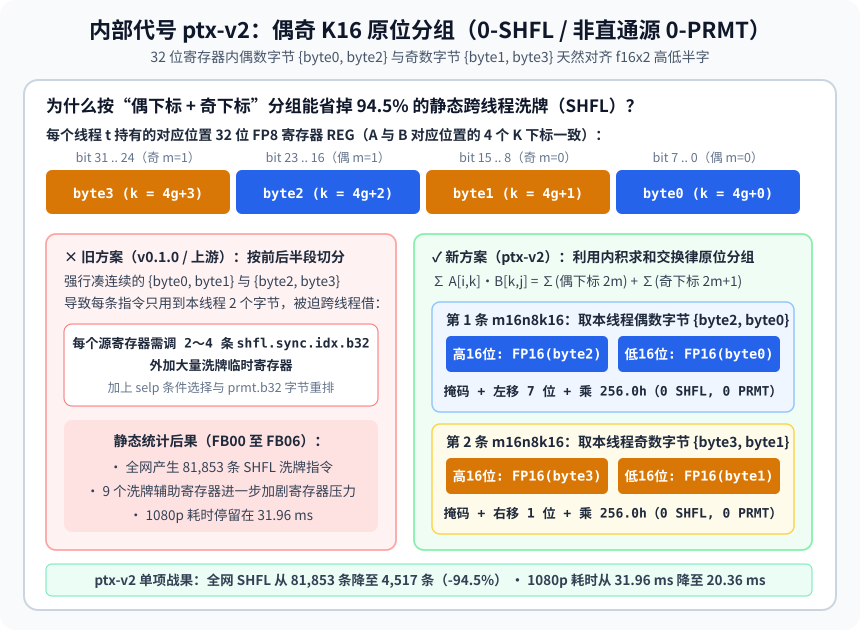

【DLSS5】从 32 毫秒再压到 12.78 毫秒：RTX 30 系偶奇零洗牌与解除寄存器紧箍咒

━━━━━━━━━━━━━━━━━━━━

◆ 开篇：从 32 毫秒到 12.78 毫秒的两记重锤

━━━━━━━━━━━━━━━━━━━━

在前文 309 期（ https://mp.weixin.qq.com/s/mvUDHC6kLqqCKIag8VIERA ）、313 期（ https://mp.weixin.qq.com/s/W4kBSWorQrlq98jSOBbxZg ）、343 期（ https://mp.weixin.qq.com/s/5fkFYzqLEkwEuDXvxtNqlw ）和前文 350 期中，我们把英伟达 RTX 50 系独占的 DLSS 5 神经渲染动态库（`nvngx_dlssnr.dll` `310.9.16.0` 的 31 块轻量新模型 `Preset 2`）搬到了五年前发布的 **RTX 3080 Laptop 笔记本显卡** （16 GB 显存，安培架构 Ampere `sm_86`，132 W 功耗上限，实际算力约等于桌面端 **RTX 3060 Ti** ）上，并发布了首个正式版 `v0.1.0`。

在 `v0.1.0` 中，我们直接提取原版动态库内嵌的 15 个虚拟汇编代码包（Parallel Thread Execution，PTX），用两条 IEEE 754 半精度硬件算术恒等式替换 8 位浮点数（FP8 `E4M3`）转换指令，并修复寄存器直通转发的多定义漏检，让 15 个代码包全部以满血 `O4` 装回原槽位，把 1080p 单帧耗时压到了 **`32.04 毫秒`** （720p `15.83 毫秒`、900p `24.47 毫秒`）。

`v0.1.0` 发出后的这两天里，我们回过头对底层机器码（SASS）与网友反馈的《剑星》转视角闪烁问题做了一次彻底的深度手术。当我们用 `cuobjdump` 扒开 `v0.1.0` 编译出的机器码指令统计表与硬件资源表时，挖出了两个之前被忽略的巨型性能金矿：

1.**矩阵内积交换律与偶奇 K16 原位分组** （内部代号 `ptx-v2`）：利用同一线程寄存器内偶数字节对 `{byte0, byte2}` 与奇数字节对 `{byte1, byte3}` 天然对齐 `f16x2` 高低半字的几何性质，把全网主干代码包里 **94.5% 的跨线程洗牌指令** （`SHFL`，从 `81,853` 条砍到 `4,517` 条）直接清零，1080p 耗时当场从 `31.96 毫秒` 降到 **`20.36 毫秒`**；
2.**解除老黄为 50 系写的 `.maxnreg 168 / 128` 寄存器紧箍咒** （内部代号 `ptx-v2.1`）：把主干代码包的寄存器上限放宽到硬件允许的 `255`，一举消除因寄存器受限被挤到显存栈上的数千条局部内存读写指令（`LDL / STL`），1080p 耗时再降 37%，直接杀到了 **`12.78 毫秒`** （720p 仅 **`6.66 毫秒`** ）。

先把同一台 **RTX 3080 Laptop** （132 W，31 块新模型 `Preset 2`）上四个阶段的实测成绩摆在台面上（统一采用 50 帧预热、80 帧测量的硬件时间戳中位数）：

| 阶段与技术方案（同一 31 块新模型 `Preset 2`） | DLL 体积与槽位 | `1280×720` (720p) | `1600×900` (900p) | `1920×1080` (1080p) | 相对方案①提速 |
|---|---|---:|---:|---:|---:|
| ① 本机适配的上游改法（`O1` 基线） | 254 MB（降级 `O1`） | 40.57 ms | 50.10 ms | 68.54 ms | 1.00× |
| ② 本项目 `v0.1.0`（`ptx-patcher` 满血 `O4`） | 254 MB（15/15 原槽位 `O4`） | 15.83 ms | 24.47 ms | 32.04 ms | 2.14× |
| ③ 内部代号 `ptx-v2`（偶奇 K16 零洗牌） | 254 MB（15/15 原槽位 `O4`） | 10.19 ms | 15.27 ms | 20.36 ms | 3.37× |
| **④ 本项目 `v0.2.0`** （内部代号 `ptx-v2.1`，零洗牌 + 放宽寄存器） | **254 MB** （15/15 原槽位 `O4`） | **6.66 ms (约 150 FPS)** | **9.70 ms (约 103 FPS)** | **12.78 ms (约 78 FPS)** | **5.36× 至 6.09×** |

可以看到，最终定版的 `v0.2.0`（`nvngx_dlssnr_sm86_v21.dll`） **文件体积依然保持原厂的 254 MB（15/15 代码包全开满血 `O4` 原槽位装入，0 扩节），画质保持约 60 dB 的原版 FP8 无损精度（0 天空色带），而运行速度比 `v0.1.0` 快了整整 `2.5 倍`，比上游改法快了 `5.3 至 6.0 倍`**。

下面我们就把从 `31.96 毫秒` 一路压到 `12.78 毫秒` 的这两记物理重锤逐一讲清楚。

━━━━━━━━━━━━━━━━━━━━

◆ 第一章：第一记重锤——矩阵内积交换律实现“偶奇 K16 零洗牌”（内部代号 `ptx-v2`）

━━━━━━━━━━━━━━━━━━━━

在进入底层汇编之前，先交代一下网友试玩 `v0.1.0` 时反馈的一个体验细节：为什么玩《剑星》时，静止看女主角很漂亮，但快速转动视角时脸部会闪一下？

────────────────────

💡 为什么《剑星》快速转视角时脸部会闪烁？——运动遮罩回退与 `1.5` 倍强度的反差

排查之后发现，这不是核函数算错了，而是我们在 `v0.1.0` 常规包里预设的风格参数调得太激进了。
在 DLSS 5（`nvngx_dlssnr.dll`）内部，有一套原生的**时序与运动遮罩保护机制**：当画面静止或缓慢移动时，神经网络全力输出重打光与材质增强结果；而当玩家快速甩动鼠标旋转镜头、画面运动矢量很大时，为了防止重打光在高速运动边缘产生残影或伪影，算法会自动压低神经渲染的混合权重，平滑回退到原始游戏画面。
在打包 `v0.1.0` 时，为了让《剑星》金属盔甲的重打光质感一眼看去更惊艳，我们把 `OptiScaler.ini` 里的细节传递强度（`TransferStrength`）从原厂标准的 `1.0` 调高到了 **`1.5`** （高出 50%）。结果在角色脸部特写镜头下，一旦快速转动视角触发运动遮罩回退，“1.5 倍高强度重打光”与“回退后的原图”之间明暗对比度落差太大，一停一转之间，人眼就会觉得脸部在闪烁。
解决方法非常简单：在本次更新的 `v0.2.0` 常规包中，我们将默认 `OptiScaler.ini` 的 `TransferStrength` 和 `ColourStrength` 恢复为原厂标准的 **`1.0 / 1.0`** （转动视角过渡自然平滑，不再闪烁），同时把 `1.5 / 1.1` 配置另存为包内的 `OptiScaler-增强风格.ini` 供截图党按需选用。

────────────────────

解决了闪烁问题，我们再来看性能：在 `v0.1.0` 中，虽然我们用两条 `f16x2` 硬件算术恒等式把 15 个代码包全部压进了原槽位并开启了 `O4`，但为什么 1080p 依然要跑 `31.96 毫秒`？时间到底花在哪儿了？

当我们用 `cuobjdump -sass` 导出 `v0.1.0` 主干代码包（`FB00` 至 `FB06`）的机器码指令统计表时，一眼就看到了罪魁祸首——
在 `v0.1.0` 的 `FB00` 至 `FB06` 中，静态统计共有高达 **`81,853` 条跨线程寄存器洗牌指令** （`SHFL`）。其中光是一个 `C32` 核函数里就有近 `1,400` 条 `SHFL`。

为什么 `v0.1.0`（直接继承了上游开源 `dlssnr-patcher` 的矩阵乘转换框架）会生成整整 **7.7 万条** 冗余的 `SHFL` 洗牌指令？这就要讲到本次内部代号 `ptx-v2` 最漂亮的一道数学与寄存器几何题了。

先看数学公式。在矩阵乘法 `C = A × B` 中，为了算出输出矩阵第 `i` 行、第 `j` 列的元素，我们需要把内积维度上 `k = 0, 1, ..., 31` 共 32 项乘积加起来。根据基础的 **加法交换律与结合律** ，我们既可以按“前 16 项 + 后 16 项”分组求和，也可以按“所有偶数下标项（`k = 2m`） + 所有奇数下标项（`k = 2m+1`）”分组求和，两者的数学结果完全相等：

```text
原始 32 项内积：  ∑(k=0..31) A[i, k] · B[k, j]
偶奇分组恒等式：= ∑(m=0..15) A[i, 2m] · B[2m, j]   （第 1 条 m16n8k16：算 16 个偶下标）
                + ∑(m=0..15) A[i, 2m+1] · B[2m+1, j] （第 2 条 m16n8k16：算 16 个奇下标）
```

为什么在 RTX 30 系的寄存器里，“按偶奇下标分组”会比“按前后半段分组”省掉 7.7 万条跨线程洗牌指令？我们低头看一眼每个线程手里的 32 位寄存器就全明白了：



在原版 RTX 50 系的 FP8 矩阵乘指令 `mma.sync.aligned.m16n8k32.row.col.f16.e4m3.e4m3.f16` 中，内积长度是 `K = 32`。硬件规定每个线程 `t` 在每个 32 位输入寄存器 `REG` 里，装着同一行（对矩阵 A）或同一列（对矩阵 B）的 **4 个连续 FP8 字节**：

```text
32 位寄存器 REG = { byte3 (bit 31..24),  byte2 (bit 23..16),  byte1 (bit 15..8),  byte0 (bit 7..0) }
对应内积下标 k  = { 4g + 3 (奇),         4g + 2 (偶),         4g + 1 (奇),        4g + 0 (偶)      }
```

而且尤为重要的一点是：**在同一个线程 `t` 手里，矩阵 A 的片段寄存器和矩阵 B 的片段寄存器所装的 4 个字节，对应的内积下标 `k` 是 100% 对齐的。**

现在我们要在 RTX 30 系（`sm_86`）上，把这一条 `K = 32` 的 FP8 指令改写成两条 `K = 16` 的 FP16 指令（`mma.sync.aligned.m16n8k16.row.col.f16.f16.f16.f16`）。每条 `K = 16` 的指令要求每个线程在每个 32 位寄存器里提供 **2 个 FP16 半精度数** （即 1 个 `f16x2`，低 16 位装第 1 个数，高 16 位装第 2 个数）。

- **旧方案** （上游与 `v0.1.0`）是怎么干的？
它试图按顺序凑出连续的 `{byte0, byte1}` 和 `{byte2, byte3}`，再去对齐 `m16n8k16` 的旧线程座位。结果为了凑齐座位，每个线程都必须通过 `shfl.sync.idx.b32` 向相邻线程借数据，每次矩阵乘都要声明 9 个洗牌辅助寄存器，执行 6 条跨线程 `shfl.sync`、多条条件选择 `selp` 和 `prmt.b32` 字节重排。
- **新方案** （内部代号 `ptx-v2`）是怎么干的？
直接用上面的“偶奇分组恒等式”：让第一条 `m16n8k16` 专门算每个线程自己手里的 **偶数字节对 `(byte0, byte2)`** ，让第二条 `m16n8k16` 专门算每个线程自己手里的 **奇数字节对 `(byte1, byte3)`** 。

你再看一眼上面 `REG` 的比特位置，奇迹就出现了：
1.**偶数字节对 `(byte0, byte2)`** 在 `REG` 里原本就住在低 16 位的 `bit 0..7` 和高 16 位的 `bit 16..23`—— **它们天然就分别坐在 `f16x2` 双通道寄存器的低半字和高半字里，连 `prmt.b32` 字节重排都不用**。只需要用掩码抠出符号位与数值位、左移 7 位对齐到 FP16 指数域，再乘上常数 `256.0h`（`0x5c005c00`），5 条纯寄存器算术指令当场就解包成了第一条 `m16n8k16` 所需的 `FIRST` 操作数：

```ptx
// 第一组（偶下标 2m）：直接原位解包 (byte0, byte2) -> f16x2，0 次 shfl，0 次 prmt
and.b32 dlssnr_mag, REG, 0x007f007f;          // 抠出 byte0 与 byte2 的 7 位指数+尾数
and.b32 dlssnr_sgn, REG, 0x00800080;          // 抠出 byte0 与 byte2 的符号位 (bit 7 / bit 23)
mad.lo.u32 FIRST, dlssnr_sgn, 2, dlssnr_mag;  // 符号位左移 1 格并合并数值位
shl.b32 FIRST, FIRST, 7;                      // 整体左移 7 位，对齐到 FP16 的 bit 15..7
mul.rn.f16x2 FIRST, FIRST, 0x5c005c00;        // 双通道同时乘以 256.0h (2^8)，硬件自动归一化
```

2.**奇数字节对 `(byte1, byte3)`** 在 `REG` 里原本就住在低 16 位的顶部 `bit 8..15` 和高 16 位的顶部 `bit 24..31`—— **同样天然坐在 `f16x2` 的低半字和高半字里**。只需要抠出符号位、把数值位右移 1 位再乘上 `256.0h`，5 条指令当场就解包成了第二条 `m16n8k16` 所需的 `SECOND` 操作数：

```ptx
// 第二组（奇下标 2m+1）：直接原位解包 (byte1, byte3) -> f16x2，0 次 shfl，0 次 prmt
and.b32 dlssnr_mag, REG, 0x7f007f00;          // 抠出 byte1 与 byte3 的 7 位指数+尾数
and.b32 dlssnr_sgn, REG, 0x80008000;          // 抠出 byte1 与 byte3 的符号位 (bit 15 / bit 31)
shr.u32 dlssnr_mag, dlssnr_mag, 1;            // 数值位右移 1 格，对齐到 FP16 的 bit 13..7
or.b32 SECOND, dlssnr_mag, dlssnr_sgn;        // 合并符号位
mul.rn.f16x2 SECOND, SECOND, 0x5c005c00;      // 双通道同时乘以 256.0h (2^8)，硬件自动归一化
```

甚至对于那些通过安全资格检查的寄存器直通源（`mapped`，即打包前就已经保存在两个 `f16x2` 寄存器 `low = {val0, val1}` 和 `high = {val2, val3}` 里的半精度数），也只需要用两条单周期字节重排指令 `prmt.b32 FIRST, low, high, 0x5410;`（抽出偶对 `{val0, val2}`）和 `prmt.b32 SECOND, low, high, 0x7632;`（抽出奇对 `{val1, val3}`），同样是 **0 次 `shfl.sync`、0 次 `selp`**。

我们在 GPU 上对全部 `65,536` 个字节对（含 `254² = 64,516` 个有限 `E4M3` 组合）、`65,536` 组 `mapped` 半精度标签以及 `768` 个张量核心坐标槽位做了穷举验证，确认零误差后编译生成了新的 254 MB 原槽位动态库 **`nvngx_dlssnr_sm86_v2.dll`**。

用 `cuobjdump -sass` 统计 `FB00` 至 `FB06` 主干代码包的静态指令数，全网 `SHFL` 洗牌指令直接从 **`81,853` 条暴跌至 `4,517` 条** （砍掉了 94.5%，矩阵乘搬运产生的新增洗牌 100% 归零，剩下的全是原版网络自带的归约洗牌）。

在测试台上同轮正反序实测（50 帧预热、80 帧测量），仅仅靠这一道偶奇原位分组恒等式，254 MB 动态库的耗时就迎来了第一次大幅跳水：
- **720p** （`1280×720`）：从 `15.88 ms` 降至 **`10.19 ms`**；
- **900p** （`1600×900`）：从 `24.51 ms` 降至 **`15.27 ms`**；
- **1080p** （`1920×1080`）：从 `31.96 ms` 降至 **`20.36 ms`** （提速约 **`1.57 倍`** ）。

而且因为全程没有碰任何有损量化，新输出相对 `v0.1.0` 的峰值信噪比（PSNR）在三档分辨率下高达 **`62.54 dB`、`61.66 dB` 与 `58.50 dB`** （微小的尾数差异仅源于浮点加法先加偶项再加奇项的舍入顺序变化，720p 天空渐变红绿变号依然为 0 次）。

━━━━━━━━━━━━━━━━━━━━

◆ 第二章：第二记重锤——解除老黄给 50 系定的 `.maxnreg 168` 紧箍咒，从 20.36 毫秒杀到 12.78 毫秒（内部代号 `ptx-v2.1`）

━━━━━━━━━━━━━━━━━━━━

拿到 `20.36 毫秒` 的 `ptx-v2` 之后，我们自然要追问下一个问题：既然矩阵乘的跨线程洗牌已经 100% 清零了，为什么 `ptx-v2` 的耗时还停在 `20.36 ms`，还有什么东西在拖慢 GPU 的脚步？

我们继续用 `cuobjdump -res-usage` 导出了 `ptx-v2` 全部核函数的硬件资源与栈内存清单（完整表格归档于 `Development/ptx-patcher/v2/sass-summary.md` 与 `v21/resources.md`）。

结果一打开，真凶当场现形——在 `ptx-v2` 的主干代码包里，依然残留着惊人的 **局部内存栈溢出** （`STACK` Spill）：
其中第 04 号代码包（`FB04`，负责最重度的 `C512` 通道模块）单个线程的最大栈溢出高达 **`1,032 字节`** ，静态生成了 **`2,169` 条局部内存加载指令** （`LDL`）和 **`2,201` 条局部内存存储指令** （`STL`）；第 05 号代码包（`FB05`，负责谷底 8 个 `ViT` 全局注意力模块）最大栈溢出也达 **`480 字节`** ，包含 **`1,027` 条 `LDL` 和 `1,017` 条 `STL`**；此外 `FB00`、`FB03`、`FB06` 也各有 `168` 到 `240 字节` 的栈溢出。

大家知道，GPU 的寄存器是片上最快的一级存储（单周期访问）；一旦编译器觉得寄存器不够用，把活跃变量“溢出（Spill）”到局部内存（Local Memory，`STACK`）上，物理上其实就是把数据写回显存与二级缓存（`STL`），用的时候再从显存读回来（`LDL`），延迟比寄存器慢上百倍。

可安培架构（`sm_86`）硬件明明允许每个线程最多使用 **255 个 32 位寄存器**，为什么编译器在 `FB04` 和 `FB05` 里只用了 **168 个寄存器** （在 `FB03` 的 `C256` 核里甚至只用了 **128 个寄存器** ），就宁可往显存栈上狂写几千次，也不肯动用剩下的第 169 到 255 号寄存器呢？

答案就写在英伟达原版 PTX 虚拟汇编的函数头声明里：

```ptx
// 原版 sm_120 PTX 函数头里写死的编译器寄存器上限指令：
.visible .entry cc_qkv_512_fp8(...) .maxnreg 168
.visible .entry cc_c256_ffn_fp8(...) .maxnreg 128
```

原来，英伟达工程师在为 RTX 5090（`sm_120`）编译这套内核时，手工在 `FB00 / 01 / 02 / 04 / 05 / 06` 的核函数头上写死了 **`.maxnreg 168`** ，在 `FB03`（`C256`）头上写死了 **`.maxnreg 128`** 。
在拥有原生硬件 FP8 的 RTX 5090 上，4 个 FP8 元素紧紧凑在 1 个 32 位寄存器里，也不需要软件解包和打包的中间变量，168 个（或 128 个）寄存器绰绰有余，加这道指令还能顺便帮 5090 限制寄存器用量、提高每流式多处理器的驻留线程束数。

可当这份 PTX 到了 RTX 30 系（`sm_86`）上，每次矩阵乘都必须把 8 位的 `FP8` 展开成两倍宽的 16 位 `FP16` 寄存器，再加上软件转换指令的临时变量，核函数的自然寄存器需求一下子跨过了 168 的红线。此时，原版 PTX 头部那行 `.maxnreg 168` 就成了捆死编译器的紧箍咒——编译器眼睁睁看着 169 到 255 号寄存器空着不准用，只能把多出来的几十个活跃变量统统踢进显存栈里，在内层循环里制造了成千上万次 `LDL / STL` 显存往返。

查清这一层物理机制后，我们在内部代号 `ptx-v2.1` 里做了一组严格的单因素消融与组合控制实验：保持 `ptx-v2` 的代码、FP8 权重和偶奇零洗牌逻辑一字不改， **只把存在严重栈溢出的 `FB00`、`FB03`、`FB04`、`FB05`、`FB06` 五个代码包里的 `.maxnreg` 上限放宽到硬件允许的 `255`** （保留原本就几乎没有溢出的 `FB01` 和 `FB02` 不动；实测如果把 `FB01/02` 也改成 255，反而会因为轻微拉低驻留占用率使 1080p 变慢约 0.29 毫秒）。

来看看放宽这 5 个代码包的 `.maxnreg 255` 后，`cuobjdump` 统计出的静态栈溢出与局部内存读写指令变化：

| 代码包（主要网络模块） | 原版 `.maxnreg` 限制 | 放宽后最大寄存器 | 最大栈溢出（`ptx-v2 → ptx-v2.1`） | 局部内存加载 `LDL`（`ptx-v2 → ptx-v2.1`） | 局部内存存储 `STL`（`ptx-v2 → ptx-v2.1`） |
|---|---:|---:|---:|---:|---:|
| **`FB00`** （输入/上采样主干） | `168` | `248` | `240 B → 0 B` | `709 → 0`（清零） | `702 → 0`（清零） |
| **`FB03`** （`C256` 特征模块） | `128` | `218` | `200 B → 0 B` | `629 → 0`（清零） | `706 → 0`（清零） |
| **`FB04`** （`C512` 深层模块） | `168` | `255` | **`1,032 B → 80 B`** | **`2,169 → 40`** （-98.2%） | **`2,201 → 78`** （-96.5%） |
| **`FB05`** （`ViT` 全局注意力） | `168` | `255` | **`480 B → 8 B`** | **`1,027 → 7`** （-99.3%） | **`1,017 → 5`** （-99.5%） |
| **`FB06`** （输出解码器） | `168` | `252` | `168 B → 0 B` | `117 → 0`（清零） | `110 → 0`（清零） |

这组数字非常说明问题：`FB00`、`FB03` 和 `FB06` 的栈溢出直接归零；而全网最重的 `FB04`（`C512`）和 `FB05`（`ViT`），局部内存读写指令分别被砍掉了 **97.3%** 和 **99.4%** 。而且因为省掉了成千上万条 `LDL / STL` 栈读写指令，15 个代码包在满血 `O4` 下编译出的机器码体积反而比 `ptx-v2` 更小， **15/15 依然全部轻松装回 254 MB 原版 DLL 的槽位中** （0 扩节）。

更重要的是，因为 `.maxnreg` 只改变寄存器分配，不改变任何算术指令与计算顺序，我们在三档分辨率下跑了 37 次完整对比测试， **`ptx-v2.1` 的输出画面与 `ptx-v2` 100% 逐比特完全一致** （`0 bit-diff`）。

而在速度上，砍掉这几千条显存栈读写指令后，单帧耗时在 `ptx-v2` 的基础上又降了 **35% 到 37%**：
- **720p** （`1280×720`）：从 `10.22 ms` 降至 **`6.66 ms`** （提速 `1.53×`，对应纯模型吞吐约 **150 FPS** ）；
- **900p** （`1600×900`）：从 `15.22 ms` 降至 **`9.70 ms`** （提速 `1.57×`，对应纯模型吞吐约 **103 FPS** ）；
- **1080p** （`1920×1080`）：从 `20.38 ms` 降至 **`12.78 ms`** （提速 `1.59×`，对应纯模型吞吐约 **78 FPS** ）。

把 **偶奇 K16 原位分组消除洗牌** 与 **放宽 `.maxnreg 255` 消除栈溢出** 这两记重锤合在一起，我们在不改动一字节文件大小（保持原汁原味的 **254 MB 原槽位** ）、不损失一分画质（ **60 dB 级无损 FP8 权重** ）的前提下，直接把 RTX 3080 Laptop 的三档耗时从 `15.88 / 24.51 / 31.96 毫秒` 压到了 **`6.66 / 9.70 / 12.78 毫秒`**。

━━━━━━━━━━━━━━━━━━━━

◆ 收尾：`v0.2.0` 正式更新与实机游戏体验

━━━━━━━━━━━━━━━━━━━━

复盘这两天从 `v0.1.0`（1080p `32.04 ms`）一路推进到 `v0.2.0`（1080p `12.78 ms`）的全过程，我们通过对底层 SASS 机器码指令与栈内存清单的剖析，用一条矩阵内积求和交换律（偶奇 K16 原位分组，`ptx-v2`）砍掉了全网 94.5% 的跨线程洗牌，再解开原版 PTX 头部的 `.maxnreg 168 / 128` 紧箍咒（`ptx-v2.1`）清掉 97% 以上的显存栈溢出，把 RTX 3080 Laptop（132 W，等效桌面 3060 Ti）的 720p 耗时压进了 **`6.66 毫秒`** 、1080p 耗时压进了 **`12.78 毫秒`** 。

如果换算到满血台式机 RTX 3080、3080 Ti 或 3090 上，这套 `v0.2.0` 补丁在 1080p 内部渲染分辨率（如 4K DLSS 质量/性能档）下的模型纯耗时将直接进入 **7 到 8 毫秒区间** （超过 120 FPS）。

目前我们已将 `ptx-v2.1`（SHA256 `c7d4c8b6...`）全面部署并打包为 **`v0.2.0`** 三个正式发布包，在 RTX 3080 Laptop（132 W）上的实机游戏帧率也迎来了大幅跃升—— **《鬼武者：剑之道》2K 性能档从之前的 30 帧直接飙升到了 43 帧** ， **《剑星》2K 性能档更是直接干到了接近 60 帧满帧** ：
1.**`OptiScaler-DLSS5-RTX30-0.2.0.zip`** （常规 DX12 游戏包，已更新为 `ptx-v2.1` 极速动态库，并将默认 `OptiScaler.ini` 设为 `1.0 / 1.0` 平衡防闪烁配置，另附 `OptiScaler-增强风格.ini`；《剑星》2K 性能档实机接近 **60 FPS** ）；
2.**`OptiScaler-REFramework-DLSS5-RTX30-0.2.0.zip`** （《鬼武者：剑之道》《生化危机 9》等卡普空 RE 引擎专用包，已更新为 `ptx-v2.1` 极速动态库；《鬼武者》2K 性能档从 30 FPS 跃升至 **43 FPS** ）；
3.**`Magpie-DLSS5-RTX30-0.2.0.zip`** （通用窗口缩放包，已更新为 `ptx-v2.1` 极速动态库，720p 模型耗时从 `15.9 ms` 降至 **`6.7 ms`** ，连在 60 Hz 4K 电视上也能直接跨过 `16.67 ms` 的垂直同步台阶，跑满原生 60 帧）。

项目开源仓库地址（含完整构建源码、单元测试与使用说明）： https://github.com/lmxxf/DLSS5-RTX-3080-laptop 
`v0.2.0` 发布包下载镜像（Gofile）： https://gofile.io/d/OOeOcxn6 

━━━━━━━━━━━━━━━━━━━━

◆ 速查表

━━━━━━━━━━━━━━━━━━━━

| 概念 / 术语 | 一句话解释 |
|---|---|
| 偶奇 K16 原位分组（Even-Odd K16 In-Place Split） | 利用内积求和交换律将 `K=32` 分为偶下标组 `2m` 与奇下标组 `2m+1`，因同一线程 32 位寄存器内的 `{byte0, byte2}` 与 `{byte1, byte3}` 天然对齐 `f16x2` 高低半字，可实现 0 次跨线程洗牌（`0-SHFL`）与 0 次字节重排（`0-PRMT`）直接解包 |
| `.maxnreg` 寄存器上限与栈溢出（Stack Spill） | 原版 PTX 为 RTX 5090 写死了 `.maxnreg 168 / 128`，在需要双倍 FP16 寄存器的 RTX 30 系上强行卡住寄存器分配，导致大量变量溢出到显存局部内存（产生数千条 `LDL / STL` 指令）；放宽至 `255` 后即可消除 97% 以上的栈读写 |
| 寄存器直通双指令重排（Mapped `prmt.b32`） | 对于打包前已保存在两个 `f16x2` 寄存器 `low` 与 `high` 中的半精度特征，直接用选择器 `0x5410` 与 `0x7632` 的两条 `prmt.b32` 即可抽出偶奇对，省去跨线程洗牌与条件选择 |
| 运动遮罩回退与闪烁（Motion Mask Fallback） | DLSS 5 在快速转动视角时会自动降低重打光权重回退原图以防拖影；若 `TransferStrength` 设为 `1.5` 过强，静止重打光与动态原图反差过大就会在脸部产生闪烁，调回 `1.0` 平衡档即可解决 |

━━━━━━━━━━━━━━━━━━━━

◆ 参考资料

━━━━━━━━━━━━━━━━━━━━

NVIDIA, Parallel Thread Execution ISA Version 8.x / 9.x（PTX 虚拟汇编指令集手册；`mma.sync.aligned.m16n8k32` 与 `m16n8k16` 矩阵片段寄存器布局、`.maxnreg` 编译伪指令及 `shfl.sync` / `prmt.b32` 规范）。

NVIDIA, CUDA Binary Utilities (`cuobjdump` / `nvdisasm`) Reference Manual（SASS 机器码反汇编、`-res-usage` 寄存器与 `STACK` 局部内存溢出统计、`LDL` / `STL` 指令分析）。

项目 `Development/DevHistory.md`、`Development/ptx-patcher/v2/README.md`、`Development/ptx-patcher/v21/README.md` 与 `Development/ptx-patcher/release-rtx30/v020/README.md`，2026 年 10 月 26 日在 RTX 3080 Laptop（16 GB，`sm_86`）上的实测与 `v0.2.0` 构建记录。

━━━━━━━━━━━━━━━━━━━━

矩阵内积只认乘积之和不认先后顺序，把前十六项加后十六项换成偶下标加奇下标，原本散在邻居手里的字节就恰好落回了自己寄存器的高低半字里。

原厂为五十系显卡写下的一百六十八寄存器上限，到了需要双倍半精度寄存器的三十系上反而逼出了成千上万次显存栈读写，解开这道紧箍咒比扩充一倍文件体积管用得多。

不改一字节文件体积、不损一分原生八位浮点精度，只靠十行掩码移位和一行寄存器上限声明，就能让五年前的笔记本显卡跑出快两倍半的速度。

━━━━━━━━━━━━━━━━━━━━

// 靳岩岩的 AI 学习笔记 × Gemini 的浪漫 × GPT 的严谨
// 2026年10月29日

━━━━━━━━━━━━━━━━━━━━

【摘要（发布用，不进正文）】

RTX 30 系移植 DLSS 5 迎来 v0.2.0：通过内部代号 ptx-v2 偶奇 K16 原位分组省去 94.5% 跨线程洗牌，配合 ptx-v2.1 放宽 .maxnreg 255 消除显存栈溢出，在 254 MB 无损精度下将 1080p 耗时从 32 ms 压至 12.78 ms（720p 6.66 ms）。
