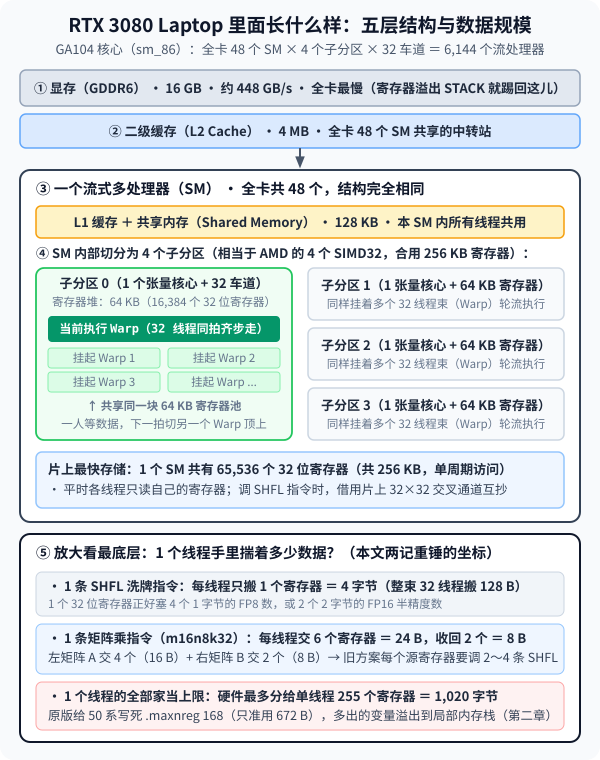
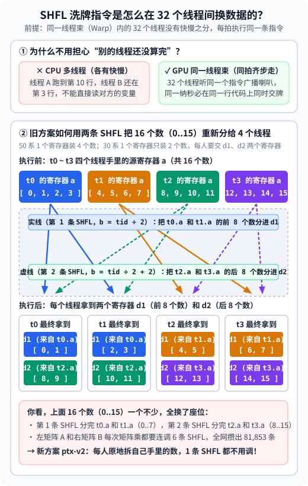

【DLSS5】从 32 毫秒再压到 12.78 毫秒：RTX 30 系偶奇零洗牌与解除寄存器紧箍咒

━━━━━━━━━━━━━━━━━━━━

◆ 开篇：从 32 毫秒到 12.78 毫秒的两记重锤

━━━━━━━━━━━━━━━━━━━━

在前文 309 期（ https://mp.weixin.qq.com/s/mvUDHC6kLqqCKIag8VIERA ）、313 期（ https://mp.weixin.qq.com/s/W4kBSWorQrlq98jSOBbxZg ）、343 期（ https://mp.weixin.qq.com/s/5fkFYzqLEkwEuDXvxtNqlw ）和前文 350 期中，我们把英伟达 RTX 50 系独占的 DLSS 5 神经渲染动态库（`nvngx_dlssnr.dll` `310.9.16.0` 的 31 块轻量新模型 `Preset 2`）搬到了五年前发布的 **RTX 3080 Laptop 笔记本显卡** （16 GB 显存，安培架构 Ampere `sm_86`，132 W 功耗上限，实际算力约等于桌面端 **RTX 3060 Ti** ）上，并发布了首个正式版 `v0.1.0`。

在 `v0.1.0` 中，我们直接提取原版动态库内嵌的 15 个虚拟汇编代码包（Parallel Thread Execution，PTX），用两条 IEEE 754 半精度硬件算术恒等式替换 8 位浮点数（FP8 `E4M3`）转换指令，并修复寄存器直通转发的多定义漏检，让 15 个代码包全部以满血 `O4` 装回原槽位，把 1080p 单帧耗时压到了 **`32.04 毫秒`** （720p `15.83 毫秒`、900p `24.47 毫秒`）。

`v0.1.0` 发出后的这两天里，我们回过头对底层机器码（SASS）做了一次彻底的深度剖析。当我们用 `cuobjdump` 扒开 `v0.1.0` 编译出的机器码指令统计表与硬件资源表时，挖出了两个之前被忽略的巨型性能金矿：

1.**矩阵内积交换律与偶奇 K16 原位分组** （内部代号 `ptx-v2`）：利用同一线程寄存器内偶数字节对 `{byte0, byte2}` 与奇数字节对 `{byte1, byte3}` 天然对齐 `f16x2` 高低半字的几何性质，把全网主干代码包里 **94.5% 的跨线程洗牌指令** （`SHFL`，从 `81,853` 条砍到 `4,517` 条）直接清零，1080p 耗时当场从 `31.96 毫秒` 降到 **`20.36 毫秒`**；
2.**解除老黄为 50 系写的 `.maxnreg 168 / 128` 寄存器紧箍咒** （内部代号 `ptx-v2.1`）：把主干代码包的寄存器上限放宽到硬件允许的 `255`，一举消除因寄存器受限被挤到显存栈上的数千条局部内存读写指令（`LDL / STL`），1080p 耗时再降 37%，直接杀到了 **`12.78 毫秒`** （720p 仅 **`6.66 毫秒`** ）。

先把同一台 **RTX 3080 Laptop** （132 W，31 块新模型 `Preset 2`）上四个阶段的实测成绩摆在台面上（统一采用 50 帧预热、80 帧测量的硬件时间戳中位数）：

| 阶段与技术方案（同一 31 块新模型 `Preset 2`） | DLL 体积与槽位 | `1280×720` (720p) | `1600×900` (900p) | `1920×1080` (1080p) | 相对方案①提速 |
|---|---|---:|---:|---:|---:|
| ① 本机适配的上游改法（`O1` 基线） | 254 MB（降级 `O1`） | 40.57 ms | 50.10 ms | 68.54 ms | 1.00× |
| ② 本项目 `v0.1.0`（`ptx-patcher` 满血 `O4`） | 254 MB（15/15 原槽位 `O4`） | 15.83 ms | 24.47 ms | 32.04 ms | 2.14× |
| ③ 内部代号 `ptx-v2`（偶奇 K16 零洗牌） | 254 MB（15/15 原槽位 `O4`） | 10.19 ms | 15.27 ms | 20.36 ms | 3.37× |
| **④ 本项目 `v0.2.0`** （内部代号 `ptx-v2.1`，零洗牌 + 放宽寄存器） | **254 MB** （15/15 原槽位 `O4`） | **6.66 ms (约 150 FPS)** | **9.70 ms (约 103 FPS)** | **12.78 ms (约 78 FPS)** | **5.36× 至 6.09×** |

可以看到，最终定版的 `v0.2.0`（`nvngx_dlssnr_sm86_v21.dll`） **文件体积依然保持原厂的 254 MB（15/15 代码包全开满血 `O4` 原槽位装入，0 扩节），画质保持约 60 dB 的原版 FP8 无损精度（0 天空色带），而运行速度比 `v0.1.0` 快了整整 `2.5 倍`，比上游改法快了 `5.3 至 6.0 倍`**。

下面我们就把从 `31.96 毫秒` 一路压到 `12.78 毫秒` 的这两记物理重锤逐一讲清楚。

━━━━━━━━━━━━━━━━━━━━

◆ 第一章：第一记重锤——矩阵内积交换律实现“偶奇 K16 零洗牌”（内部代号 `ptx-v2`）

━━━━━━━━━━━━━━━━━━━━

在看具体的汇编指令之前，我们先像前文 318 期（ https://mp.weixin.qq.com/s/bs9VS4jBQ3aF0FdgjyLjMw ）拆解 AMD 9070 XT 那样，把今天的主角 **RTX 3080 Laptop** 从外到里的五层结构、以及每一层到底在搬运多少字节的数据摆在台面上。只要记住这张图里的三个字节数，整篇文章的两记重锤就全串起来了。

────────────────────

💡 RTX 3080 Laptop 里面长什么样：从 16 GB 显存到单线程手里的 24 个字节



从最慢的板载显存一路往下放大到单个线程，这张显卡一共分五层：

1.**第一层（全卡显存 GDDR6，`16 GB`）与第二层（二级缓存 L2，`4 MB`）**：全卡共享。显存最大但也最慢（延迟几百个时钟周期）；一旦最底层的寄存器不够用发生“栈溢出（`STACK` Spill）”，多出来的变量就会被踢回这儿，用的时候再读回来。
2.**第三层（流式多处理器 SM，全卡共 `48 个`）**：相当于 AMD 的计算单元。每个 SM 内部有一块 `128 KB` 的一级缓存兼共享内存（Shared Memory），以及一块总容量 **`256 KB`（共 `65,536 个` 32 位寄存器）** 的超高速寄存器池（单周期访问）。
3.**第四层（SM 内的 `4 个` 子分区与 `Warp` 线程束，怎么数到 `6,144`）**：前文 318 期我们记过 AMD 9070 XT 的流处理器口诀是 `32 个 WGP × 2 个 CU × 2 个 SIMD32 × 32 车道 = 4,096`；而英伟达省掉了两两配对的 WGP 层，直接是三层连乘：**`48 个 SM × 4 个子分区（相当于 4 个 SIMD32） × 32 车道（1 个 Warp） = 6,144 个流处理器`**（其中每个子分区的 32 车道由 16 个纯浮点车道和 16 个浮点/整数双用车道拼成，所以也可记作 `48 × 4 × 2 × 16 = 6,144`）。每个子分区配有 1 个张量核心（Tensor Core）和 `64 KB` 寄存器（`16,384 个` 32 位寄存器），上面挂着多束 32 线程的 **Warp**（AMD 叫 Wave）：当一个 Warp 停下来等显存数据时，下一拍就切到另一个挂起的 Warp 顶上干活。
4.**第五层（放大看 1 个线程手里到底揣着多少数据）** ——这是理解本文两记重锤的标尺：
   - **1 个寄存器有多大？** 固定 `32 比特 = 4 字节`（刚好装 4 个 1 字节的 FP8 数，或者 2 个 2 字节的 FP16 半精度数）。
   - **调 1 条 `SHFL` 洗牌指令搬多少数据？** 每个线程只抄 **1 个寄存器 = `4 字节`**（整束 32 个线程合搬 `128 字节`）。
   - **调 1 条矩阵乘指令（`m16n8k32`）是怎么配合的？** 在神经网络每一层里，都是 **“先用张量核心（Tensor Core）算一大块矩阵乘法，再用普通流处理器车道（CUDA Core）算激活函数收尾”**，两套工具都在同一个子分区里直接读写每个线程手里的同一批寄存器。指令名里的 `m16n8k32` 就是我们在前文 273 期（ https://mp.weixin.qq.com/s/iT0_PbnghTDiVaohrFWLFg ）学过的矩阵乘法三个边长（左矩阵 A 为 `m=16 行, k=32 列`，右矩阵 B 为 `k=32 行, n=8 列`，乘出来的结果矩阵为 `m=16 行, n=8 列`，中间相乘相加的内积长度是 `k=32`）。在 50 系显卡上，张量核心原生认识 8 位的 FP8，直接读取每个线程手里的 **6 个输入寄存器（4 个左矩阵 A + 2 个右矩阵 B，共 `24 字节`）** 就能一口气算完 `k=32` 的矩阵乘，累加进每个线程手里的 **2 个累加结果寄存器（`8 字节`）**。但到了 30 系显卡上，张量核心只认识 16 位的 FP16，且单条指令 `m16n8k16` 的内积长度只有一半（`k=16`）——所以在把 1 条 `k=32` 指令拆成 2 条 `k=16` 指令之前，必须先由 CUDA Core 打前站做两步准备：**第一步是把每个线程手里的 FP8 寄存器转成 FP16 寄存器（前文 350 期干的事），第二步是把转好的寄存器按 30 系张量核心要求的座位排好送进去（旧方案在这步连调了 6 条 `SHFL` 洗牌指令，而今天第一章就是要把这第 2 步的洗牌彻底砍掉）**。
   - **1 个线程最多能揣多少家当？** 安培架构硬件规定，单个线程最多可以使用 **255 个寄存器（`1,020 字节`）**。但在原版代码里，老黄给 50 系写死了 `.maxnreg 168`（只准单线程用 **168 个寄存器 = `672 字节`**），导致多出来的几百字节全部溢出到第一层的慢速显存里——这就是第二章要解开的紧箍咒。

────────────────────

有了上面这张尺子，我们再来看第一个问题：在前文 350 期发布的 `v0.1.0` 中，我们已经解决了第一步“怎么把 FP8 快速转成 FP16”，可为什么在转成 FP16 之后、送进张量核心之前，旧代码还会产生高达 **`81,853` 条跨线程寄存器洗牌指令** （`SHFL`，光是一个 `C32` 核函数里就有近 `1,400` 条），导致 1080p 依然要跑 `31.96 毫秒`？

────────────────────

💡 `SHFL` 指令的运算规则是什么？为什么会攒出八万多次调用？

`SHFL` 是英文 **Shuffle（洗牌、交换座位）** 的缩写，它是英伟达显卡底层机器码里的一条跨线程读取寄存器指令（在 PTX 虚拟汇编里对应写成 `shfl.sync`，根本不经过任何内存地址）。

和 CPU 多线程“各自跑得有快有慢、干完再同步”完全不同，**GPU 同一个线程束（Warp）里的 32 个线程没有快慢之分——它们共用同一个指令广播器，每一拍都在同一纳秒执行同一行代码**。正因为 32 个线程时刻齐步走，硬件专门在片上做了一个 **32×32 的交叉开关（Crossbar）**，允许这 32 个线程通过一条 `SHFL` 指令，在同一拍里按线程工号互相抄写对方寄存器里的 32 位数据（4 个字节）。

以最常用的索引点名模式 `shfl.sync.idx.b32 d, a, b, 0x1f;` 为例，它的运算规则翻译成伪代码只有一句话：**`当前线程的 d = 第 b 号线程的 a`**。
- **输入 `a`（源寄存器）**：32 个线程每个人手里各自拿着的一个 32 位变量（变量名都叫 `a`，但每个线程里装的数值不同）；
- **输入 `b`（目标座位号，0 到 31）**：当前线程想去抄第几号线程手里的 `a`？每个线程可以根据自己的线程编号 `tid` 算出一个座位号 `b`；
- **输出 `d`（目标寄存器）**：硬件在线程束内部搭起交叉开关，32 个线程同时把第 `b` 号线程的 `a` 抄进自己的 `d` 里（除了按座位号点名的 `.idx` 模式，它还有往前/往后平移几格的 `.up / .down` 模式，以及按异或配对互换的 `.bfly` 蝴蝶模式）。

执行 1 条 `SHFL` 指令时，32 个线程（每人 4 个数，全束共 **128 个数**）在硬件上是按每 4 个线程一排、分成 **8 个一模一样的“四人小组”**（`t0~t3` 为第 1 组、`t4~t7` 为第 2 组……每组管矩阵的一行，共 **16 个数**）同时在组内换座位的。我们拿第 1 个四人小组（`t0, t1, t2, t3`）举个最直观的例子：



你可能会问：**“既然每个线程干什么活是确定的，为什么不从一开始就让各个线程只拿自己要用的数，非得在线程之间换来换去？”**

因为我们不是从零重写整个程序，而是在 **“半路拦截”老黄已经写死的 50 系代码**。
在走到矩阵乘指令这一行之前，前面几百行代码算出来的中间状态早就按 50 系的规矩排好了（1 个寄存器装 4 个数，4 个线程一圈发完 16 个数）：**`t0` 拿着 `0~3`，`t1` 拿着 `4~7`，`t2` 拿着 `8~11`，`t3` 拿着 `12~15`**。
可到了 30 系的矩阵乘硬件里，1 个寄存器只能装 2 个数，16 个数必须分两圈（两个寄存器 `d1` 和 `d2`）轮流发给 4 个线程：第一圈 `d1` 每人发 2 个（`t0` 拿 `0/1`、`t1` 拿 `2/3`、`t2` 拿 `4/5`、`t3` 拿 `6/7`），第二圈 `d2` 再从头每人发 2 个（`t0` 拿 `8/9`、`t1` 拿 `10/11`、`t2` 拿 `12/13`、`t3` 拿 `14/15`）。
也就是说，**开始的状态是“`t0` 拿 `0~3`、`t1` 拿 `4~7`”，但 30 系硬件要求的座位却是“`t0` 拿 `0/1/8/9`、`t1` 拿 `2/3/10/11`”**。
为了把开始的状态倒腾成符合要求的新状态，旧方案就得连着调**两条 `SHFL` 指令**：第一条按 `b = tid / 2` 把 `t0.a` 和 `t1.a` 里的前 8 个数（`0..7`）分进各线程的 `d1`，第二条按 `b = tid / 2 + 2` 把 `t2.a` 和 `t3.a` 里的后 8 个数（`8..15`）分进各线程的 `d2`：

```text
执行前（4 个线程共 16 个数）：
t0.a = [0,1,2,3],  t1.a = [4,5,6,7],  t2.a = [8,9,10,11],  t3.a = [12,13,14,15]

第 1 条指令（分 t0.a 和 t1.a 的前 8 个数）：shfl.sync.idx.b32 d1, a, (tid / 2), 0x1f;
- t0 算 b = 0 ──▶ 抄来 t0.a [0,1,2,3] ──▶ 留前半截，d1 拿到 [0, 1]
- t1 算 b = 0 ──▶ 抄来 t0.a [0,1,2,3] ──▶ 留后半截，d1 拿到 [2, 3]
- t2 算 b = 1 ──▶ 抄来 t1.a [4,5,6,7] ──▶ 留前半截，d1 拿到 [4, 5]
- t3 算 b = 1 ──▶ 抄来 t1.a [4,5,6,7] ──▶ 留后半截，d1 拿到 [6, 7]

第 2 条指令（分 t2.a 和 t3.a 的后 8 个数）：shfl.sync.idx.b32 d2, a, (tid / 2 + 2), 0x1f;
- t0 算 b = 2 ──▶ 抄来 t2.a [8,9,10,11]  ──▶ 留前半截，d2 拿到 [8, 9]
- t1 算 b = 2 ──▶ 抄来 t2.a [8,9,10,11]  ──▶ 留后半截，d2 拿到 [10, 11]
- t2 算 b = 3 ──▶ 抄来 t3.a [12,13,14,15] ──▶ 留前半截，d2 拿到 [12, 13]
- t3 算 b = 3 ──▶ 抄来 t3.a [12,13,14,15] ──▶ 留后半截，d2 拿到 [14, 15]
```

你看，每算一次矩阵乘，旧方案为了凑齐座位就要连着写 6 条 `SHFL` 指令；整个 DLSS 5 网络有上万次矩阵乘法，编译展开之后，光 `SHFL` 这一种指令就在主干代码包里重复出现了 **81,853 次**。虽然 `SHFL` 比绕道共享内存快，但它走的是流式多处理器（SM）里专门的跨线程通信通道，吞吐量远不如线程自己在内部做普通算术；八万多条 `SHFL` 挤在循环里，所有线程都在排队等“抄邻居的寄存器”，真正算矩阵的张量核心反而闲着干等。

────────────────────

看懂了旧方案为什么在转成 FP16 时非要用 `SHFL` 换座位，你再看我们的内部代号 `ptx-v2` 是怎么干的，就会拍大腿了——**我们恰恰就是让各个线程管好自己手里的 4 个数，分两次直接喂进张量核心，谁也别找谁换。**

为什么不用换座位也能算出完全相同的矩阵乘结果？先看一行最基础的数学公式。
在矩阵乘法 `C = A × B` 中，为了算出输出矩阵第 `i` 行、第 `j` 列的元素，我们需要把内积维度上 `k = 0, 1, ..., 31` 共 32 项乘积加起来。根据基础的 **加法交换律与结合律** ，我们既可以像旧方案那样按“前 16 项 + 后 16 项”分组求和，也可以按“所有偶数下标项（`k = 2m`） + 所有奇数下标项（`k = 2m+1`）”分组求和，两者的数学总和完全相等：

```text
原始 32 项内积：  ∑(k=0..31) A[i, k] · B[k, j]
偶奇分组恒等式：= ∑(m=0..15) A[i, 2m] · B[2m, j]   （第 1 条 m16n8k16：先喂 16 个偶下标）
                + ∑(m=0..15) A[i, 2m+1] · B[2m+1, j] （第 2 条 m16n8k16：再喂 16 个奇下标）
```

（注意：上面公式里的 `[2m]` 和 `[2m+1]` 只是纸面上的数学记号，并不是在代码里写 `for` 循环去算 `2*m` 的内存地址！在走到这一步时，这 32 个数早就躺在 4 个线程各自的寄存器变量里了；代码里只是把拆出来的“偶数寄存器变量名”传给第一条指令、把“奇数寄存器变量名”传给第二条指令，**没有任何地址计算或内存寻址开销**。）

而在原版代码里，有一个现成的几何性质：**在同一个线程手里，左矩阵 A 的寄存器和右矩阵 B 的寄存器所拿的那 4 个数，对应的内积下标 `k` 本来就是 100% 对齐的**（比如 `t0` 手里的 A 和 B 都拿着 `0, 1, 2, 3` 四个下标，`t1` 手里的 A 和 B 都拿着 `4, 5, 6, 7` 四个下标）。


这样一来，两边的做法就高下立判了：
- **旧方案** （上游与 `v0.1.0`）：死抠“第一条指令必须按顺序算连续的前 16 项”，逼着 `t0` 交 `0/1/8/9`、`t1` 交 `2/3/10/11`。为此每次矩阵乘都要声明 9 个临时寄存器，连调 6 条跨线程 `SHFL` 洗牌指令、多条条件选择 `selp` 和 `prmt.b32` 字节重排。
- **新方案** （内部代号 `ptx-v2`）：直接用上面的“偶奇分组恒等式”，谁也不找邻居换牌——因为张量核心指令 `mma` 本身是一条带累加底数的“乘加指令”（把左矩阵寄存器 `A` 与右矩阵寄存器 `B` 的乘积，直接累加进同一个结果寄存器 `acc` 里，即 `acc = A × B + acc`），我们只需分两步往同一个 `acc` 寄存器上累加：
  1. **第一条 `m16n8k16` 指令（算 16 个偶数项：`acc = 偶数A × 偶数B + acc`）**：每个线程直接交出自己手里的偶数项寄存器（装有 `0, 2` 和 `16, 18` 等偶下标），算出偶数项部分和累加进结果寄存器 `acc`；
  2. **第二条 `m16n8k16` 指令（算 16 个奇数项：`acc = 奇数A × 奇数B + acc`）**：每个线程再交出自己手里的奇数项寄存器（装有 `1, 3` 和 `17, 19` 等奇下标），硬件直接把奇数项乘积继续加在同一个 `acc` 寄存器上——既不会覆盖第一步的偶数项结果，也不用多占额外的输出寄存器，两步跑完 `acc` 里就是全部 32 项的完整总和。

而且更巧的是（见上图右侧）：在原本的 32 位寄存器里，**偶数字节对 `(byte0, byte2)` 原本就一右一左住在低 16 位（`bit 0..7`）和高 16 位（`bit 16..23`）里；奇数字节对 `(byte1, byte3)` 同样一右一左住在低 16 位（`bit 8..15`）和高 16 位（`bit 24..31`）里**。
也就是说，当套用前文 350 期的“乘常数 `256.0h`”方法把它们转成两个 16 位半精度数（`f16x2`）时，它们天然就已经坐在各自的高低 16 位房间里了——**既不用调 `SHFL` 找邻居线程换座位，甚至连在寄存器内部搬动字节位置的 `prmt.b32` 指令都不用调**，原地转成 FP16 就能直接送进张量核心（对于打包前已保存在两个 `f16x2` 寄存器里的直通数据 `mapped`，也只需两条 `prmt.b32` 抽出偶奇对，同样是 **0 次 `SHFL`** ）。

我们在 GPU 上对全部 `65,536` 个字节对（含 `254² = 64,516` 个有限 `E4M3` 组合）、`65,536` 组 `mapped` 半精度标签以及 `768` 个张量核心坐标槽位做了穷举验证，确认零误差后编译生成了新的 254 MB 原槽位动态库 **`nvngx_dlssnr_sm86_v2.dll`**。

用 `cuobjdump -sass` 统计 `FB00` 至 `FB06` 主干代码包的静态指令数，全网 `SHFL` 洗牌指令直接从 **`81,853` 条暴跌至 `4,517` 条** （砍掉了 94.5%，矩阵乘搬运产生的新增洗牌 100% 归零，剩下的全是原版网络自带的归约洗牌）。

在测试台上同轮正反序实测（50 帧预热、80 帧测量），仅仅靠这一道偶奇原位分组恒等式，254 MB 动态库的耗时就迎来了第一次大幅跳水：
- **720p** （`1280×720`）：从 `15.88 ms` 降至 **`10.19 ms`**；
- **900p** （`1600×900`）：从 `24.51 ms` 降至 **`15.27 ms`**；
- **1080p** （`1920×1080`）：从 `31.96 ms` 降至 **`20.36 ms`** （提速约 **`1.57 倍`** ）。

而且因为全程没有碰任何有损量化，新输出相对 `v0.1.0` 的峰值信噪比（PSNR）在三档分辨率下高达 **`62.54 dB`、`61.66 dB` 与 `58.50 dB`** （微小的尾数差异仅源于浮点加法先加偶项再加奇项的舍入顺序变化，720p 天空渐变红绿变号依然为 0 次）。

━━━━━━━━━━━━━━━━━━━━

◆ 第二章：第二记重锤——解除老黄给 50 系定的 `.maxnreg 168` 紧箍咒，从 20.36 毫秒杀到 12.78 毫秒（内部代号 `ptx-v2.1`）

━━━━━━━━━━━━━━━━━━━━

拿到 `20.36 毫秒` 的 `ptx-v2` 之后，我们自然要追问下一个问题：既然矩阵乘的跨线程洗牌已经 100% 清零了，为什么 `ptx-v2` 的耗时还停在 `20.36 ms`，还有什么东西在拖慢 GPU 的脚步？

我们继续用 `cuobjdump -res-usage` 导出了 `ptx-v2` 全部核函数的硬件资源与栈内存清单（完整表格归档于 `Development/ptx-patcher/v2/sass-summary.md` 与 `v21/resources.md`）。

结果一打开，真凶当场现形——在 `ptx-v2` 的主干代码包里，依然残留着惊人的 **局部内存栈溢出** （`STACK` Spill）：
其中第 04 号代码包（`FB04`，负责最重度的 `C512` 通道模块）单个线程的最大栈溢出高达 **`1,032 字节`** ，静态生成了 **`2,169` 条局部内存加载指令** （`LDL`）和 **`2,201` 条局部内存存储指令** （`STL`）；第 05 号代码包（`FB05`，负责谷底 8 个 `ViT` 全局注意力模块）最大栈溢出也达 **`480 字节`** ，包含 **`1,027` 条 `LDL` 和 `1,017` 条 `STL`**；此外 `FB00`、`FB03`、`FB06` 也各有 `168` 到 `240 字节` 的栈溢出。

大家知道，GPU 的寄存器是片上最快的一级存储（单周期访问）；一旦编译器觉得寄存器不够用，把活跃变量“溢出（Spill）”到局部内存（Local Memory，`STACK`）上，物理上其实就是把数据写回显存与二级缓存（`STL`），用的时候再从显存读回来（`LDL`），延迟比寄存器慢上百倍。

可安培架构（`sm_86`）硬件明明允许每个线程最多使用 **255 个 32 位寄存器**，为什么编译器在 `FB04` 和 `FB05` 里只用了 **168 个寄存器** （在 `FB03` 的 `C256` 核里甚至只用了 **128 个寄存器** ），就宁可往显存栈上狂写几千次，也不肯动用剩下的第 169 到 255 号寄存器呢？

答案就写在英伟达原版 PTX 虚拟汇编的函数头声明里：

```ptx
// 原版 sm_120 PTX 函数头里写死的编译器寄存器上限指令：
.visible .entry cc_qkv_512_fp8(...) .maxnreg 168
.visible .entry cc_c256_ffn_fp8(...) .maxnreg 128
```

原来，英伟达工程师在为 RTX 5090（`sm_120`）编译这套内核时，手工在 `FB00 / 01 / 02 / 04 / 05 / 06` 的核函数头上写死了 **`.maxnreg 168`** ，在 `FB03`（`C256`）头上写死了 **`.maxnreg 128`** 。
在拥有原生硬件 FP8 的 RTX 5090 上，4 个 FP8 元素紧紧凑在 1 个 32 位寄存器里，也不需要软件解包和打包的中间变量，168 个（或 128 个）寄存器绰绰有余，加这道指令还能顺便帮 5090 限制寄存器用量、提高每流式多处理器的驻留线程束数。

可当这份 PTX 到了 RTX 30 系（`sm_86`）上，每次矩阵乘都必须把 8 位的 `FP8` 展开成两倍宽的 16 位 `FP16` 寄存器，再加上软件转换指令的临时变量，核函数的自然寄存器需求一下子跨过了 168 的红线。此时，原版 PTX 头部那行 `.maxnreg 168` 就成了捆死编译器的紧箍咒——编译器眼睁睁看着 169 到 255 号寄存器空着不准用，只能把多出来的几十个活跃变量统统踢进显存栈里，在内层循环里制造了成千上万次 `LDL / STL` 显存往返。

查清这一层物理机制后，我们在内部代号 `ptx-v2.1` 里做了一组严格的单因素消融与组合控制实验：保持 `ptx-v2` 的代码、FP8 权重和偶奇零洗牌逻辑一字不改， **只把存在严重栈溢出的 `FB00`、`FB03`、`FB04`、`FB05`、`FB06` 五个代码包里的 `.maxnreg` 上限放宽到硬件允许的 `255`** （保留原本就几乎没有溢出的 `FB01` 和 `FB02` 不动；实测如果把 `FB01/02` 也改成 255，反而会因为轻微拉低驻留占用率使 1080p 变慢约 0.29 毫秒）。

来看看放宽这 5 个代码包的 `.maxnreg 255` 后，`cuobjdump` 统计出的静态栈溢出与局部内存读写指令变化：

| 代码包（主要网络模块） | 原版 `.maxnreg` 限制 | 放宽后最大寄存器 | 最大栈溢出（`ptx-v2 → ptx-v2.1`） | 局部内存加载 `LDL`（`ptx-v2 → ptx-v2.1`） | 局部内存存储 `STL`（`ptx-v2 → ptx-v2.1`） |
|---|---:|---:|---:|---:|---:|
| **`FB00`** （输入/上采样主干） | `168` | `248` | `240 B → 0 B` | `709 → 0`（清零） | `702 → 0`（清零） |
| **`FB03`** （`C256` 特征模块） | `128` | `218` | `200 B → 0 B` | `629 → 0`（清零） | `706 → 0`（清零） |
| **`FB04`** （`C512` 深层模块） | `168` | `255` | **`1,032 B → 80 B`** | **`2,169 → 40`** （-98.2%） | **`2,201 → 78`** （-96.5%） |
| **`FB05`** （`ViT` 全局注意力） | `168` | `255` | **`480 B → 8 B`** | **`1,027 → 7`** （-99.3%） | **`1,017 → 5`** （-99.5%） |
| **`FB06`** （输出解码器） | `168` | `252` | `168 B → 0 B` | `117 → 0`（清零） | `110 → 0`（清零） |

这组数字非常说明问题：`FB00`、`FB03` 和 `FB06` 的栈溢出直接归零；而全网最重的 `FB04`（`C512`）和 `FB05`（`ViT`），局部内存读写指令分别被砍掉了 **97.3%** 和 **99.4%** 。而且因为省掉了成千上万条 `LDL / STL` 栈读写指令，15 个代码包在满血 `O4` 下编译出的机器码体积反而比 `ptx-v2` 更小， **15/15 依然全部轻松装回 254 MB 原版 DLL 的槽位中** （0 扩节）。

更重要的是，因为 `.maxnreg` 只改变寄存器分配，不改变任何算术指令与计算顺序，我们在三档分辨率下跑了 37 次完整对比测试， **`ptx-v2.1` 的输出画面与 `ptx-v2` 100% 逐比特完全一致** （`0 bit-diff`）。

而在速度上，砍掉这几千条显存栈读写指令后，单帧耗时在 `ptx-v2` 的基础上又降了 **35% 到 37%**：
- **720p** （`1280×720`）：从 `10.22 ms` 降至 **`6.66 ms`** （提速 `1.53×`，对应纯模型吞吐约 **150 FPS** ）；
- **900p** （`1600×900`）：从 `15.22 ms` 降至 **`9.70 ms`** （提速 `1.57×`，对应纯模型吞吐约 **103 FPS** ）；
- **1080p** （`1920×1080`）：从 `20.38 ms` 降至 **`12.78 ms`** （提速 `1.59×`，对应纯模型吞吐约 **78 FPS** ）。

把 **偶奇 K16 原位分组消除洗牌** 与 **放宽 `.maxnreg 255` 消除栈溢出** 这两记重锤合在一起，我们在不改动一字节文件大小（保持原汁原味的 **254 MB 原槽位** ）、不损失一分画质（ **60 dB 级无损 FP8 权重** ）的前提下，直接把 RTX 3080 Laptop 的三档耗时从 `15.88 / 24.51 / 31.96 毫秒` 压到了 **`6.66 / 9.70 / 12.78 毫秒`**。

━━━━━━━━━━━━━━━━━━━━

◆ 收尾：`v0.2.0` 正式更新与实机游戏体验

━━━━━━━━━━━━━━━━━━━━

复盘这两天从 `v0.1.0`（1080p `32.04 ms`）一路推进到 `v0.2.0`（1080p `12.78 ms`）的全过程，我们通过对底层 SASS 机器码指令与栈内存清单的剖析，用一条矩阵内积求和交换律（偶奇 K16 原位分组，`ptx-v2`）砍掉了全网 94.5% 的跨线程洗牌，再解开原版 PTX 头部的 `.maxnreg 168 / 128` 紧箍咒（`ptx-v2.1`）清掉 97% 以上的显存栈溢出，把 RTX 3080 Laptop（132 W，等效桌面 3060 Ti）的 720p 耗时压进了 **`6.66 毫秒`** 、1080p 耗时压进了 **`12.78 毫秒`** 。

如果换算到满血台式机 RTX 3080、3080 Ti 或 3090 上，这套 `v0.2.0` 补丁在 1080p 内部渲染分辨率（如 4K DLSS 质量/性能档）下的模型纯耗时将直接进入 **7 到 8 毫秒区间** （超过 120 FPS）。

目前我们已将 `ptx-v2.1`（SHA256 `c7d4c8b6...`）全面部署并打包为 **`v0.2.0`** 三个正式发布包，在 RTX 3080 Laptop（132 W）上的实机游戏帧率也迎来了大幅跃升—— **《鬼武者：剑之道》2K 性能档从之前的 30 帧直接飙升到了 43 帧** ， **《剑星》2K 性能档更是直接干到了接近 60 帧满帧** ：
1.**`OptiScaler-DLSS5-RTX30-0.2.0.zip`** （常规 DX12 游戏包，已更新为 `ptx-v2.1` 极速动态库；《剑星》2K 性能档实机接近 **60 FPS** ）；
2.**`OptiScaler-REFramework-DLSS5-RTX30-0.2.0.zip`** （《鬼武者：剑之道》《生化危机 9》等卡普空 RE 引擎专用包，已更新为 `ptx-v2.1` 极速动态库；《鬼武者》2K 性能档从 30 FPS 跃升至 **43 FPS** ）；
3.**`Magpie-DLSS5-RTX30-0.2.0.zip`** （通用窗口缩放包，已更新为 `ptx-v2.1` 极速动态库，720p 模型耗时从 `15.9 ms` 降至 **`6.7 ms`** ，连在 60 Hz 4K 电视上也能直接跨过 `16.67 ms` 的垂直同步台阶，跑满原生 60 帧）。

项目开源仓库地址（含完整构建源码、单元测试与使用说明）： https://github.com/lmxxf/DLSS5-RTX-3080-laptop 
`v0.2.0` 发布包下载镜像（Gofile）： https://gofile.io/d/OOeOcxn6 

━━━━━━━━━━━━━━━━━━━━

◆ 速查表

━━━━━━━━━━━━━━━━━━━━

| 概念 / 术语 | 一句话解释 |
|---|---|
| `SHFL` 跨线程洗牌指令（Warp Shuffle，`shfl.sync`） | 允许同一 32 线程束（Warp）内的线程直接在片上交换各自寄存器中的数据；旧方案每次矩阵乘需连调 6 条 `SHFL` 向邻居线程借字节，全网累积高达 8.18 万条 |
| 偶奇 K16 原位分组（Even-Odd K16 In-Place Split） | 利用内积求和交换律将 `K=32` 分为偶下标组 `2m` 与奇下标组 `2m+1`，因同一线程 32 位寄存器内的 `{byte0, byte2}` 与 `{byte1, byte3}` 天然对齐 `f16x2` 高低半字，可实现 0 次跨线程洗牌（`0-SHFL`）与 0 次字节重排（`0-PRMT`）直接解包 |
| `.maxnreg` 寄存器上限与栈溢出（Stack Spill） | 原版 PTX 为 RTX 5090 写死了 `.maxnreg 168 / 128`，在需要双倍 FP16 寄存器的 RTX 30 系上强行卡住寄存器分配，导致大量变量溢出到显存局部内存（产生数千条 `LDL / STL` 指令）；放宽至 `255` 后即可消除 97% 以上的栈读写 |
| 寄存器直通双指令重排（Mapped `prmt.b32`） | 对于打包前已保存在两个 `f16x2` 寄存器 `low` 与 `high` 中的半精度特征，直接用选择器 `0x5410` 与 `0x7632` 的两条 `prmt.b32` 即可抽出偶奇对，省去跨线程洗牌与条件选择 |

━━━━━━━━━━━━━━━━━━━━

◆ 参考资料

━━━━━━━━━━━━━━━━━━━━

NVIDIA, Parallel Thread Execution ISA Version 8.x / 9.x（PTX 虚拟汇编指令集手册；`mma.sync.aligned.m16n8k32` 与 `m16n8k16` 矩阵片段寄存器布局、`.maxnreg` 编译伪指令及 `shfl.sync` / `prmt.b32` 规范）。

NVIDIA, CUDA Binary Utilities (`cuobjdump` / `nvdisasm`) Reference Manual（SASS 机器码反汇编、`-res-usage` 寄存器与 `STACK` 局部内存溢出统计、`LDL` / `STL` 指令分析）。

项目 `Development/DevHistory.md`、`Development/ptx-patcher/v2/README.md`、`Development/ptx-patcher/v21/README.md` 与 `Development/ptx-patcher/release-rtx30/v020/README.md`，2026 年 10 月 26 日在 RTX 3080 Laptop（16 GB，`sm_86`）上的实测与 `v0.2.0` 构建记录。

━━━━━━━━━━━━━━━━━━━━

矩阵内积只认乘积之和不认先后顺序，把前十六项加后十六项换成偶下标加奇下标，原本散在邻居手里的字节就恰好落回了自己寄存器的高低半字里。

原厂为五十系显卡写下的一百六十八寄存器上限，到了需要双倍半精度寄存器的三十系上反而逼出了成千上万次显存栈读写，解开这道紧箍咒比扩充一倍文件体积管用得多。

不改一字节文件体积、不损一分原生八位浮点精度，只靠十行掩码移位和一行寄存器上限声明，就能让五年前的笔记本显卡跑出快两倍半的速度。

━━━━━━━━━━━━━━━━━━━━

// 靳岩岩的 AI 学习笔记 × Gemini 的浪漫 × GPT 的严谨
// 2026年10月29日

━━━━━━━━━━━━━━━━━━━━

【摘要（发布用，不进正文）】

RTX 30 系移植 DLSS 5 迎来 v0.2.0：通过内部代号 ptx-v2 偶奇 K16 原位分组省去 94.5% 跨线程洗牌，配合 ptx-v2.1 放宽 .maxnreg 255 消除显存栈溢出，在 254 MB 无损精度下将 1080p 耗时从 32 ms 压至 12.78 ms（720p 6.66 ms）。
