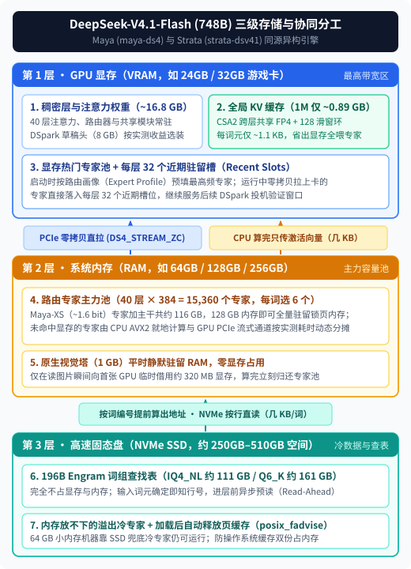
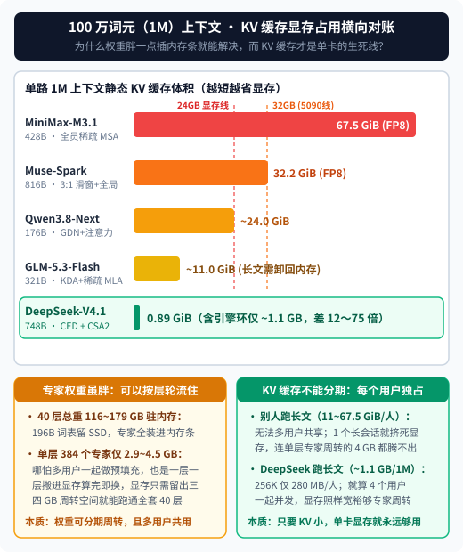

【Maya×Strata】单卡游戏机跑 748B 的 DeepSeek-V4.1-Flash：为什么权重虽大，它却是长上下文最划算的选择？

━━━━━━━━━━━━━━━━━━━━

◆ 第一章：从 Strata 分叉出 Project Maya，再反向回流主线

━━━━━━━━━━━━━━━━━━━━

我们在前文 338 期（ https://mp.weixin.qq.com/s/tsui2k7wIKDnzNW6_p9WnQ ）介绍过 `Niko1221/Strata`（ https://github.com/Niko1221/Strata ）：它利用混合专家模型（Mixture of Experts，MoE）每步只激活少数专家的特性，把热门专家放进显卡显存（Video Random Access Memory，VRAM）、其余专家放进系统内存（Random Access Memory，RAM）由处理器（Central Processing Unit，CPU）与显卡协同计算，再把庞大的词组查找表留在高速固态硬盘（Non-Volatile Memory Express Solid State Drive，NVMe SSD）上按行直读，让一台“48GB 内存＋16GB 显存”的家用电脑跑起了 176B 规模的 `Qwen3.8-Flash-Next`。

不过，最初的 Strata 是专门围绕 `Qwen3.8-Flash-Next` 定做的专用引擎。而今年秋天开源界接连放出了三台体量更大、结构也各不相同的百亿至千亿级混合专家模型：
1.智谱的 **`GLM-5.3-Flash`** （总参数 321B，每词元激活约 18B，见前文 292 期 https://mp.weixin.qq.com/s/qGbCm3qJB6SNumftansUtw ）；
2.MiniMax 的 **`MiniMax-M3.1-Flash`** （总参数 428B，每词元激活约 23B，见前文 351 期 https://mp.weixin.qq.com/s/tQOzsMTl4LA_LBecsZMTmg ）；
3.以及体量最大的 **`DeepSeek-V4.1-Flash-1017`** （主干参数约 552B，加上约 196B 的 Engram 词组嵌入表合计 **748B** ，预填充阶段每词元激活约 8B、解码阶段激活约 16B，见前文 308 期 https://mp.weixin.qq.com/s/Rsx8_ygHyXbN6JI1QTNxMw ）。

为了把这三台架构各异的大模型也搬上普通人的桌面，社区开发者 Peasant Smith（`@mw00`）与联合维护者 `@needmorevram` 基于 MIT 协议的 Strata 分叉并重写出了 **Project Maya** （ https://github.com/mw00/project-maya ）。Maya 没有搞一套通用的慢速框架，而是为上面三款模型分别打造了三套专属底层引擎（跑 GLM 的 `maya`、跑 DeepSeek 的 `maya-ds4`，以及跑 MiniMax 的引擎），并配套发布了自研的低比特量化权重包。

更有意思的一幕发生在最近几天：当 Project Maya 把专门驱动 748B `DeepSeek-V4.1-Flash` 的 `maya-ds4` 引擎打磨成熟后，上游的原版 Strata 在最近的 `0.2.4` 至 `0.2.7` 版本里，又反手把 Maya 的 `maya-ds4` 引擎移植回了 Strata 主仓，命名为 **`strata-dsv41`** （Strata 官方文档 `docs/DEEPSEEK41.md` 中明确注明：移植自 Project Maya 的 `maya-ds4`）。

从 Strata 点火，到 Maya 分叉扩建跑通 748B 巨兽，再到代码反向回流 Strata 主线——这套“显存＋内存＋固态盘”三级协同方案，已经成了当前本地运行超大规模 MoE 模型的事实标准。今天我们就重点看看，它是怎样把 748B 的 `DeepSeek-V4.1-Flash-1017` 塞进单卡家用机和工作站的，不同部署方案各自能跑多快，以及为什么在这几家大模型里，我依然认为 `DeepSeek-V4.1-Flash` 是长上下文场景最值得部署的那一个。

━━━━━━━━━━━━━━━━━━━━

◆ 第二章：748B 模型怎么装进电脑？三级存储分工与六种量化方案

━━━━━━━━━━━━━━━━━━━━

初次看到 `DeepSeek-V4.1-Flash-1017` 的 **748B** 总参数（官方 FP8 与 BF16 混合原始权重约 508 GB），绝大多数人的第一反应都是“这得买一台八卡服务器才能装下”。

但如果把这 748B 参数按“每一步怎么被调用”分开看，会发现它天然由三块冷热完全不同的数据组成：
1.**每一步都必须经过的常驻过道** （稠密层与注意力权重）：40 层网络里的注意力投影、路由器以及共享模块，加起来其实只有约 **16.8 GB** ；
2.**40 层共 15,360 个按需点名的路由专家** ：每层有 384 个路由专家，但每处理一个词元（token）只挑其中 **6 个** （占每层路由专家的 `6 ÷ 384 = 1.56%`）；
3.**196B 参数的 Engram 词组查找表** ：这块体积将近两百 GB（原始约 203 GB，6 比特量化约 161 GB，4 比特量化约 111 GB），但它根本不参与矩阵乘法，只是在每个词元进入网络前，根据相邻词元的编号组合去表里查出寥寥几行向量。

对应这三块数据的冷热特征，`maya-ds4` 与 `strata-dsv41` 把它们安放在了电脑的三层存储设备里：

如上图所示，整套运行时的分工非常清晰：
- **第一层：GPU 显存 VRAM** （先放约 16.8 GB 的注意力与稠密层，多卡部署时按层或张量并行均摊到各卡，例如 4 张卡每张只需分担约 4 GB；再放不到 1 GB 的上下文键值缓存 Key-Value Cache，KV Cache 和可选的 8 GB `DSpark` 投机解码草稿头；剩下的显存空间全部开辟成 **热门专家池** ，启动时按照预先统计好的路由画像 Expert Profile 填满最高频的专家）；
- **第二层：系统内存 RAM** （承载显存装不下的大批路由专家。系统启动时会锁定空闲物理内存，留出约 6 GB 给操作系统，未命中显存的专家既可以由 CPU 利用高级矢量扩展指令集 Advanced Vector Extensions 2，AVX2 就地计算后只把几 KB 的激活向量传回显卡，也可以通过主板高速通道 Peripheral Component Interconnect Express，PCIe 流式拉到显卡上算，两边按实测耗时动态分摊；此外，模型自带的 **1 GB 原生视觉编码塔** 平时也静默躺在系统内存里，不占一分一毫显存，只有当你发送图片时才向第一张显卡临时借用约 **320 MB** 显存，读完图片立刻归还给专家池）；
- **第三层：NVMe 固态盘** （111 GB 至 203 GB 的 Engram 词组查找表全程留在固态盘上，由于输入词元一确定就能算出表内行号，引擎会在进入模型层之前异步预读 Read-Ahead；如果电脑的系统内存连全部路由专家都装不下，比如只有 64 GB 内存，溢出的冷专家也会留在固态盘上按需读取，同时在启动加载完成后调用系统接口 `posix_fadvise` 主动释放操作系统的文件页缓存，防止同一份专家权重在内存和系统缓存里占双份空间）。

为了适配从 64 GB 内存的家用台式机到 512 GB 内存的多卡工作站，Project Maya 与 Strata 一共提供了 **6 套不同精度的部署方案** （磁盘空间均已包含共享的 Engram 词组表与 8 GB 的 `DSpark` 草稿头）：

| 部署引擎与量化方案 | 专家位宽与格式 | 总磁盘占用 | 主干＋专家体积（不含词表） | 质量保持率（对比原版 FP8） | 适用机器配置 |
| :--- | :--- | ---: | ---: | :--- | :--- |
| **Strata · `ist-das-1.75bpw`** | `IQ1_M`（1.75 bit） | 239 GB | 121 GB（另配 111 GB 4-bit 词表） | Top-1 重合率 82.5%，三大基准保 98.7% | 64 GB 至 128 GB 内存紧凑机型 |
| **Strata · `ist-das-2.00bpw`** | `IQ2_XXS`（2.00 bit） | 257 GB | 138 GB（另配 111 GB 4-bit 词表） | 困惑度（PPL）+15.5%（代码仅 +8.6%） | 128 GB 内存主力单卡或核显机型 |
| **Strata · `ist-das-2.25bpw`** | `IQ2_XS`（2.25 bit） | 274 GB | 155 GB（另配 111 GB 4-bit 词表） | 困惑度（PPL）+7.3%（代码仅 +3.2%） | 192 GB 以上内存高质量档 |
| **Maya · `deepseek-maya-xs`** | 自研约 1.6 bit | 277 GB | **约 116 GB** （另配 161 GB `Q6_K` 词表） | 自带 2-bit 草稿器，专为 128 GB 内存定制 | **128 GB 内存整模全驻 RAM 首选** |
| **Maya · `deepseek-maya-s`** | 自研 2 至 3 bit（默认） | 340 GB | **约 179 GB** （另配 161 GB `Q6_K` 词表） | **下一词元 Top-1 重合率高达 92.6%** | 192 GB 至 256 GB 内存，或大内存多卡 |
| **Maya · `EXL3` 与 `UD-Q8_K_XL`** | 2.9 bit / 3.5 bit / 原始 `MXFP4` | 414 至 508 GB | 约 250 至 305 GB | 无限逼近原版满血精度 | 256 GB 至 512 GB 内存、多卡工作站 |

可以看到，Maya 专门打磨的 **`Maya-XS`** 档位非常讨巧：它把那张 161 GB 的高精度 `Q6_K` 词组表留在 NVMe 固态盘上，而把需要进内存的主干与 15,360 个路由专家压到了约 **116 GB** ——正好能完整塞进一台插了 4 根 32 GB 内存条（共 **128 GB RAM** ）的家用台式机里，推理时完全不需要从磁盘倒腾专家权重。而到了 **192 GB 至 256 GB 内存** 的机器上，默认的 **`Maya-S`** 档位能做到 **92.6% 的时间选出与 508 GB 原版一模一样的下一个词元** 。

────────────────────

💡 两项专为 DeepSeek 架构定制的提速技巧：零拷贝直拉与后 20 层跳算

在 `maya-ds4` 最近的迭代（v1.1.25 至 v1.1.30）中，开发者还针对 `DeepSeek-V4.1-Flash` 的架构特性加进了两项直接让速度翻倍的底层优化：

1.**锁页内存零拷贝直拉与每层 32 个近期驻留槽** （`DS4_STREAM_ZC` ＋ `DS4_LAND`）：
   早期版本里，显卡要想借用系统内存里的专家，需要先由 CPU 把专家读进锁页中转区（staging buffer），再走 PCIe 拷上显卡，等于在系统内存里倒手了三次。新版在 Linux 单卡环境下，直接把内存里的专家副本锁定并映射进显卡地址空间， **由 GPU 绕过 CPU 直接从原位置一把拉走，只跨一次内存总线且不占一个 CPU 核心** ；更关键的是，拉上显卡的专家算完后不会立刻扔掉，而是直接落入该层预留的 **32 个近期槽位** （Recent Slots，从显存里最冷的静态槽位划拨），继续服务接下来几个 `DSpark` 投机解码验证窗口。仅靠这一项改动，在一台 **RTX 3090 24 GB ＋ Ryzen 5 5600X** 上跑 `Maya-XS`，基准解码速度直接从 **`12.9 token/s` 暴涨到了 `27.8 token/s`** （256K 超长提示词后也从 `15.9` 涨到了 `26.1 token/s`）。

2.**长提示词预填充直接跳过后 20 层前段计算** （`MAYA_DS4_PROMPT_SKIP`）：
   我们在前文 308 期与前文 346 期（ https://mp.weixin.qq.com/s/G-Mv6xiZaJ7Tc8RZKG_SPA ）讲过，`DeepSeek-V4.1-Flash` 的 40 层被切成了前 20 层因果编码器（Causal Encoder-Decoder，CED）和后 20 层解码器——后 20 层看早期历史词元时，只读取第 20 层压缩好的共享 KV 缓存，而它们自己的局部注意力只往回看 **128 个词元的滑动窗口** （Sliding Window Attention，SWA）。
   利用这个几何性质，当输入超过 3,700 个词元的长提示词时，在倒数约 2,700 个词元（20 层乘 128 窗口的安全感受野上界）之前的所有历史位置上， **第 20 层只需算出供后半段读取的压缩 KV，第 21 至 39 层干脆什么都不用算** ，最终生成的回答与跑满 40 层逐字相同（若开启 `MAYA_DS4_PROMPT_SKIP=2` 对齐 DeepSeek 官方的“有界回放”，后 20 层更是只算最后 128 个词元），大幅砍掉了长文预填充的等待时间。

────────────────────

有了三级存储分工和这两项针对性优化，这套引擎在真实机器上到底能跑多快？接下来我们就看社区实测数据。

━━━━━━━━━━━━━━━━━━━━

◆ 第三章：不同硬件与部署方式能跑多快？真机实测速度对账

━━━━━━━━━━━━━━━━━━━━

把原理和档位理清后，我们把 Project Maya（v1.1.22 至 v1.1.30）与 Strata（0.2.5 至 0.2.7）社区用户提交的 `DeepSeek-V4.1-Flash-1017` 实测成绩单按硬件档次排列出来（测试均采用贪婪解码或标准基准脚本，包含预填充阅读速度与解码吐字速度）：

| 硬件梯队 | 具体机器配置（显卡 / 处理器 / 系统内存） | 引擎与量化方案（上下文配置） | 解码速度（出字） | 预填充速度（读输入） |
| :--- | :--- | :--- | ---: | ---: |
| **12GB 入门单卡** | **1× RTX 5070 (12 GB)** ＋ 64 GB RAM ＋ NVMe | Strata `2.00 bpw`（部分专家读盘） | **4.7 至 6.0 tok/s** | 110 至 231 tok/s (4K–8K) |
| **12GB 入门单卡** | **1× RTX 3060 (12 GB)** ＋ 46 GB RAM ＋ NVMe | Strata `2.00 bpw` | **8.0 至 11.0 tok/s** | 149 至 155 tok/s (4K–8K) |
| **核显统一内存** | **Ryzen AI Max+ 395 (Strix Halo)** ，128 GB 统一内存 | Strata `2.00 bpw`（109 GB 驻内存） | **19 至 21 tok/s** (代码) / 11 (闲聊) | 87 (4K) / 125 (8K) / 177 tok/s (32K) |
| **20GB 工作站单卡** | **1× RTX 4000 Ada (20 GB)** ＋ Xeon w7-3455 ＋ 255 GB DDR5 | Maya `Maya-XS` (256K 上下文) | **21.1 tok/s** | 518 tok/s (20K) |
| **24GB 游戏单卡** | **1× RTX 3090 (24 GB)** ＋ Ryzen 5 5600X ＋ 128 GB RAM | Maya `Maya-XS`（开零拷贝直拉，256K） | **26.1 至 27.8 tok/s** | — |
| **32GB 旗舰单卡** | **1× Radeon AI PRO R9700 (32 GB)** ＋ 251 GB RAM | Strata `2.00 bpw` | **21 至 25 tok/s** | 320 至 360 tok/s (8K) |
| **32GB 旗舰单卡** | **1× RTX 5090 (32 GB)** ＋ 大内存主机 | Maya `Maya-S` (v1.1.26) | **约 31.6 tok/s** | — |
| **24GB/48GB 旗舰单卡** | **1× RTX 4090 (48 GB 魔改)** ＋ 128 GB RAM | Strata `2.00 bpw`（开 DSpark） | **40.2 tok/s** | 141 (1.2K) / 615 tok/s (4.6K) |
| **24GB 旗舰单卡** | **1× RTX 4090 (24 GB)** ＋ Ryzen 9 9950X3D ＋ 192 GB DDR5 | Maya `Maya-XS` (64K 上下文) | **44.1 tok/s** | 539 tok/s (8K) |
| **双卡至四卡旧卡群** | **4× Tesla V100 (32 GB×4)** ＋ 双路 E5-2630 v4 ＋ 504 GB RAM | Maya `Maya-S` / `UD-Q8_K_XL` (64K) | **41.4 tok/s** (`Maya-S`) / 26.7 (`Q8`) | 556 tok/s (`Maya-S`) / 178 (`Q8`) |
| **双卡 AMD 组合** | **2× RX 7900 XTX (24 GB×2)** ＋ Radeon 8060S (128 GB) | Maya `Maya-S` (512K，含 130K 缓存) | **41.3 至 46.1 tok/s** | 482 (8K) / 1,291 tok/s (130K) |
| **四卡消费级工作站** | **4× RTX 3090 (24 GB×4)** ＋ Threadripper 1950X ＋ 126 GB RAM | Maya `Maya-S` (256K 上下文) | **50 至 53 tok/s** (代码) / 40 (散文) | 947 (10K) / 1,954 tok/s (90K) |
| **四卡 Radeon 工作站** | **4× Radeon AI PRO R9700 (32 GB×4)** ＋ 251 GB RAM | Strata `2.00` / `2.25 bpw` / `UD-Q8` | **74 至 80 tok/s** | 400 至 450 tok/s (8K) |
| **双卡 Blackwell 工作站** | **2× RTX PRO 5000 (72 GB×2)** ＋ 9950X3D ＋ 249 GB DDR5 | Maya `Maya-S` (512K 上下文) | **68 至 71 tok/s** (散文) / **162** (代码) | 约 3,700 tok/s (42K) |
| **单卡大显存专业卡** | **1× RTX 6000D (85 GB)** ＋ 9965WX ＋ 251 GB RAM | Maya `EXL3 2.9 bpw` (512K 上下文) | **89.3 tok/s** | 1,687 (8K) / 2,836 tok/s (33K) |
| **十卡矿卡阵列** | **10× RTX 3090 (24 GB×10)** ＋ 64 GB RAM（全驻显存） | Maya `EXL3 2.9 bpw` (1M 上下文) | **97.0 tok/s** | 2,390 tok/s (128K) |

从这张实测表里，可以摸出三条非常实在的规律：
1.**单张 24GB 至 32GB 游戏卡配 128GB 至 192GB 内存，是性价比最高的甜点区** ：无论是单张 RTX 3090（`27.8 tok/s`）、单张 RTX 5090（`31.6 tok/s`）还是单张 RTX 4090 配高频 DDR5 内存（`44.1 tok/s`），只要内存够把 116 GB 至 179 GB 的专家全量锁住、不频繁去读固态盘，吐字速度就已经完全达到了流畅驱动本地代码智能体（Coding Agent）的水平；
2.**写代码比写散文快出一大截** ：注意看表里多处标注了“代码（code）vs 散文/闲聊（prose/chat）”的巨大分差（例如双卡 RTX PRO 5000 上散文 `70 tok/s`、代码高达 `162 tok/s`；Strix Halo 上闲聊 `11 tok/s`、代码 `21 tok/s`）。这是因为代码语法结构高度可预测，`DSpark` 半自回归草稿头（以及 Maya 新增的 `--suffix-draft` 上下文后缀匹配草稿）在改代码时一次能猜中十几个词元，相当于用一次主模型验证白赚了好几步输出；
3.**老卡与矿卡重新焕发第二春** ：四张二手的 Tesla V100（32 GB）或者四张 RTX 3090 插在支持大内存的老主板上，跑 340 GB 的 `Maya-S` 依然能跑出 **`41 至 53 tok/s`** 的高速，甚至三张 2016 年的 Pascal 架构 Tesla P100（16 GB×3）都能跑出近 `18 tok/s`。

━━━━━━━━━━━━━━━━━━━━

◆ 第四章：为什么我最看好 DeepSeek-V4.1-Flash？权重胖只是内存条的事，KV 缓存小才是单卡的命门

━━━━━━━━━━━━━━━━━━━━

聊到这里，很多读者可能会问一个问题：既然 Project Maya 和 Strata 同时支持 `Qwen3.8-Flash-Next`（主干 125B，量化包约 66 GB）、`GLM-5.3-Flash`（321B，量化包约 96 GB）、`MiniMax-M3.1-Flash`（428B，量化包约 93 至 122 GB）和 `DeepSeek-V4.1-Flash-1017`（748B，量化包 239 至 340 GB），在同样一张 RTX 5090 上跑体积更小的 Qwen 或 GLM，短对话吐字速度甚至能冲到 100 token/s 以上—— **为什么我偏偏觉得体重最胖的 `DeepSeek-V4.1-Flash` 才是最好的那个？**

答案很简单：**在本地部署大模型时，静态权重胖一点，只是多插两根内存条、多占一点固态盘的事；而上下文拉长之后的动态 KV 缓存占多少显存，才是决定这台模型能不能真正干活的生死线。**

我们把今年在架的这五款主流开源百亿至千亿级 MoE 模型拉出来，按我们在前文 308 期、前文 322 期（ https://mp.weixin.qq.com/s/HpX5uMf7UmYk12WthUcOrg ）、前文 348 期（ https://mp.weixin.qq.com/s/SV8fpWxT-yq1W3ZGTsGzGg ）与前文 351 期逐一核算过的公式，对比一下它们在 **100 万词元（1M）满长上下文** 下的静态 KV 缓存显存占用：

看一眼上图里的比例尺，账目就一目了然了：
- **`MiniMax-M3.1-Flash`** （428B）：虽然 60 层全换成了块级稀疏注意力（MSA），但正如我们在前文 322 期与前文 351 期反复强调的， **稀疏注意力只省计算带宽，不省静态存储容量** ——60 层历史 KV 一个词都不能少存，1M 上下文在 8 比特（FP8）下依然高达 **`67.5 GiB`** （16 比特下更是 `135 GiB`）。别说单张 24GB 或 32GB 的家用显卡，就算插两张 RTX 5090（64 GB），光装这一条对话的 KV 缓存就当场爆显存了；
- **`Muse-Spark-Open` 与 `Qwen3.8-Flash-Next`** （816B 与 176B）：靠“四分之三滑窗层或线性注意力层＋四分之一全局层”砍掉了大半缓存，但剩下的全局注意力层在 1M 上下文下依然要吃掉 **`32.2 GiB`** 与 **`24.0 GiB`** 显存——正好把整张 RTX 5090（32 GB）或 RTX 4090（24 GB）吃干抹净，连放稠密层和热门专家的地方都没了；
- **`GLM-5.3-Flash`** （321B）：靠 34 层线性注意力配 11 层稀疏多头潜在注意力（MLA），把 1M 缓存压到了约 **`11.0 GiB`** 。这已经很省了，但在一张 24 GB 显存的显卡上，扣掉稠密层之后一旦再塞进 11 GB 的 KV 缓存，原本留在显存里的热门专家就会被大批挤出去。正因如此，Project Maya 为了让单张 RTX 3090 能跑起 `GLM-5.3-Flash` 的长上下文，不得不专门开发了一个 `--kv-streaming on`（KV 流式卸载）功能，把注意力层的 KV 缓存挪回系统内存里，只在显存留一个小窗口——代价就是每算一步注意力都得走 PCIe 总线去内存里倒腾缓存；
- **`DeepSeek-V4.1-Flash-1017`** （748B）：靠前 20 层因果编码器（CED）与第二代压缩稀疏注意力（CSA2）跨层共享并压成 4 比特浮点（FP4）， **整整 100 万词元上下文的全局主 KV 缓存加索引器键，总共只有约 `0.89 GiB`** （约 890 MB）。哪怕算上 `maya-ds4` 引擎在显存里额外维护的滑动窗口环与会话检查点，官方文档给出的实测开销也仅仅是 **每词元约 `1.1 KB`，即 1M 上下文约 `1.1 GB`，常见的 256K 长代码上下文更是只有区区 `280 MB`** ，比其它几家小了整整 **10 到 75 倍** 。

把这两件事放在一起对比，再结合 Strata 与 Maya 在 **预填充与多用户并发** （Prefill 与 `--parallel N`）时的真实调度方式，就能看清本地部署最核心的一笔空间成本：

很多人担心“748B 模型一旦遇到长文预填充，或者好几个用户同时发请求，每层 384 个专家全被点名，单张显卡怎么可能装得下？”

其实完全装得下——因为哪怕多个用户一起做预填充，引擎也是 **按层推进（layer-major）、一层一层把当前层的专家加载进显存** 的：
1.**注意力层权重本来就常驻在显存里** （40 层总共约 16.8 GB，且所有用户共用同一份权重）；
2.**当前这一层的全部专家，加起来其实只有 3 到 4.5 GB** ：整台模型 40 层的 15,360 个路由专家合起来是 116 GB（`Maya-XS`）到 179 GB（`Maya-S`），但除以 40 层之后， **平均每一层全部 384 个专家加起来只有 `2.9 GB` 到 `4.5 GB`** 。算第 1 层时，引擎临时从显存的专家池里借出三四 GB 缓冲区，把第 1 层的专家从系统内存搬进显存，用 GPU 张量核把所有用户的词元一口气算完；进第 2 层时，直接覆盖刚才那块缓冲区、换第 2 层的专家进来。也就是说， **权重虽大，但它是可以“按层分期付款、轮流进显存住”的，而且所有并发用户共用同一份权重** ；
3.**唯独 KV 缓存没法分期付款，也没法在用户之间共享** ：每个并发会话、每个长上下文窗口都必须在显存里实打实地独占一整套历史 KV 缓存。

想通了这三点，高下立判：
- 其他模型“静态权重小、KV 缓存大”的特点，正好撞上了单卡机器最疼的软肋——一旦把模型挂进 `Claude Code`、`Codex` 或 `OpenCode` 跑长代码上下文，或者开 `--parallel 4` 让主智能体和子代理多路并发，暴涨的独占 KV 缓存瞬间就把显存塞死了，不仅把显存里的热门专家全挤回慢吞吞的内存里，甚至连给当前层专家做按层周转的那三四 GB 落脚地儿都腾不出来；
- 反过来，`DeepSeek-V4.1-Flash` “静态权重胖、KV 缓存极小”的特征，恰恰完美契合了 Maya 与 Strata 的异构架构——系统内存和固态盘是整台电脑里最便宜、最好插满的资源，116 GB 至 179 GB 的静态专家装进内存条里，预填充时每次只搬单层三四 GB 进显存周转；而在显存里，单路 256K 上下文的 KV 缓存只有 **`280 MB`** （就算开满 100 万词元 1M 上下文也才 **`1.1 GB`** ，4 个用户同时开 256K 并发合起来也才 **`1.1 GB`** ）。只要 KV 缓存占得少，单张显卡的显存就永远宽裕，既能常驻注意力层和热门专家，又能轻松留出单层周转空间。

**静态权重胖一点，插满内存条、按层轮流搬进显存就能解决；只有把百万上下文的 KV 缓存压到 1 GB 以内，单卡本地部署才真正从“能跑个短句子演示”变成了“长上下文与多并发真能干活”。** 这也是为什么在这么多开源大模型里，我最看好的依然是 `DeepSeek-V4.1-Flash`。

━━━━━━━━━━━━━━━━━━━━

◆ 速查表

━━━━━━━━━━━━━━━━━━━━

| 模块 / 概念 | 一句话解释 |
|---|---|
| `Strata` 与 `Project Maya` 的渊源 | `Niko1221/Strata` 首创异构三级推理跑起 Qwen3.8；`@mw00` 分叉重写成 `Project Maya` 攻克 GLM-5.3、MiniMax-M3.1 与 748B 的 DeepSeek-V4.1（`maya-ds4`）；近期 Strata 0.2.4 至 0.2.7 又将 `maya-ds4` 反向移植回主仓成为 `strata-dsv41` |
| `748B` 权重的三级安放 | 约 `16.8 GB` 稠密与注意力层＋不到 `1 GB` 的 KV 缓存＋热门专家驻 **GPU 显存** ；其余 `15,360` 个路由专家驻 **系统内存** （CPU AVX2 与 GPU 协同）；`196B` Engram 词组表（111 至 161 GB）驻 **NVMe 固态盘** 按行直读 |
| `Maya-XS`（277 GB）与 `Maya-S`（340 GB） | Maya 自研量化档位：`Maya-XS` 将主干与专家压至约 `116 GB`（不含留在 SSD 的 161 GB 词表），刚好全量装进 `128 GB` 内存主机；`Maya-S`（2–3 bit）与原版 FP8 下一词元 Top-1 重合率达 `92.6%` |
| 零拷贝直拉（`DS4_STREAM_ZC`）与近期槽 | Linux 单卡下 GPU 绕过 CPU 中转直接从锁页内存拉取专家（仅跨一次内存总线），算完后落入每层 `32` 个近期槽位（`DS4_LAND`）服务后续投机窗口，使单张 RTX 3090 解码从 `12.9` 跃升至 `27.8 tok/s` |
| 后 20 层预填充跳算（`MAYA_DS4_PROMPT_SKIP`） | 利用后 20 层只读第 20 层压缩 KV 与 128 词元滑窗的架构性质，长提示词在尾部感受野之前的位置上第 21 至 39 层完全免算，输出逐字不变而预填充大幅提速 |
| 按层周转（`2.9–4.5 GB/层`）vs 独占 KV 缓存 | 预填充与多用户并发时，单层全部 384 个专家仅 `2.9–4.5 GB`，可一层一层轮流搬进显存周转且多用户共用；唯独 KV 缓存无法分期或共享，DeepSeek 1M 仅约 `0.89 GiB` 守住了单卡显存命门 |

━━━━━━━━━━━━━━━━━━━━

◆ 参考资料

━━━━━━━━━━━━━━━━━━━━

- Peasant Smith (`@mw00`) & `@needmorevram` et al., `mw00/project-maya`: Run GLM-5.3-Flash (321B MoE), DeepSeek-V4.1-Flash-1017 (748B MoE) and MiniMax-M3.1-Flash (428B MoE) privately on your own GPU(s), GitHub Repository, `README.md`, `docs/MODELS.md` & `docs/SETTINGS.md`（v1.1.22–v1.1.30，2026-10）
- Niko Veit (`@Niko1221`) et al., `Niko1221/Strata`: Local AI Inference Engine & `docs/DEEPSEEK41.md` (`strata-dsv41` ported from Project Maya's `maya-ds4`), GitHub Repository（v0.2.4–v0.2.7，2026-10）
- ISTA-DASLab, `ISTA-DASLab/DeepSeek-V4.1-Flash-1017-GSQ-RCO-GGUF` (`1.75 bpw` / `2.00 bpw` / `2.25 bpw` Quantization Sets & Benchmarks), Hugging Face（2026-10）
- DeepSeek-AI, DeepSeek-V4.1-Flash: Pushing the Limits of KV Cache Compression, Technical Report & `DeepSeek-V4.1-Flash-1017` Release Note（2026-09 / 2026-10）

━━━━━━━━━━━━━━━━━━━━

从 Strata 点火分叉出 Project Maya，再由 Maya 造出七百四十八亿参数的引擎反哺回主线，开源社区用两周时间走完了一轮双向奔赴。

一百九十六亿参数的词组表留在固态盘按行直读，一万五千个路由专家锁进百吉字节系统内存，零拷贝通道与后半程跳算让单张游戏卡跑出每秒三四十词。

静态权重胖一点只要多插两根内存条就能兜底，而把百万词元的上下文缓存压进一吉字节以内，才是守住单卡显存命门的真功夫。

━━━━━━━━━━━━━━━━━━━━

// 靳岩岩的 AI 学习笔记 × Gemini 的浪漫 × GPT 的严谨
// 2026年10月29日

【摘要（发布用，不进正文）】

解析Project Maya与Strata双向演进下的DeepSeek-V4.1-Flash（748B）本地部署方案与实测速度：为什么权重胖点插内存就能解决，而1M上下文不到1GB的KV缓存才是单卡命门？
