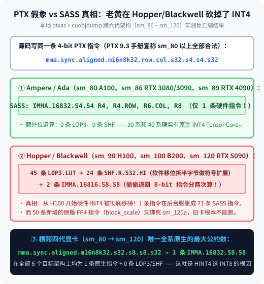
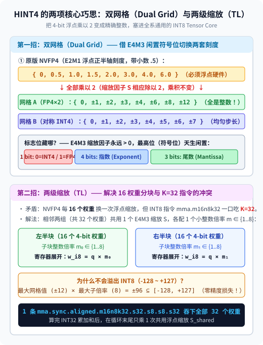
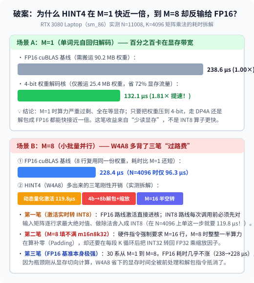

【AI量化】老显卡没有 FP4 怎么办？把浮点乘以 2 塞进 INT8：复现并实测 secemp 的 HINT4 方案

━━━━━━━━━━━━━━━━━━━━

◆ 引子：没有 50 系显卡，怎么跑老黄的 NVFP4？

━━━━━━━━━━━━━━━━━━━━

我们在前文 351 期 https://mp.weixin.qq.com/s/tQOzsMTl4LA_LBecsZMTmg 剖析 `MiniMax-M3.1` 权重布局时，聊过英伟达主推的 **`NVFP4`** 量化格式：每个权重是 4 比特浮点数 `E2M1`（1 位符号、2 位指数、1 位尾数，能表示的正数集合只有 `{0, 0.5, 1, 1.5, 2, 3, 4, 6}` 这 8 个刻度）；每 16 个权重共用一个 8 比特 `E4M3` 浮点缩放因子（Scale），整个张量再配一个 `FP32` 全局缩放，平均每个权重占 `4 + 8/16 = 4.5 bit`。

这套格式省显存、精度高，但有一个痛点：原生执行 `NVFP4` 乘加的张量核心（Tensor Core）指令，只存在于 RTX 50 系（Blackwell `sm_120a`）和数据中心 B200（`sm_100a`，以及我们在前文 185 期 https://mp.weixin.qq.com/s/dEc-wD0JcM5WhKicOUR1pQ 测过的 DGX Spark `sm_121`）。而保有量巨大的 30 系（Ampere `sm_86`）、40 系（Ada `sm_89`）甚至 H100（Hopper `sm_90`），全都没有原生 `FP4` 芯片单元。

目前开源界（如 `vLLM` 的 Marlin 核，见前文 224 期 https://mp.weixin.qq.com/s/X1b7H4565_WFn6CSTzoAQg ）在旧卡上跑 `NVFP4`，走的都是 **`NVFP4A16`（即 `W4A16`）** 路线：显存里存 4-bit，读进寄存器后先解包还原成 16 位浮点数 `FP16`，再喂给 `FP16 Tensor Core` 计算。

最近有读者推荐了独立研究者 `secemp`（Prime Intellect 驻留研究员）在 10 月 13 日发表的技术长文《Towards a hardware-invariant NVFP4 for GPUs without FP4: progress report 1》（国内也有公众号翻译了全文）。作者想走另一条路：能不能不退回 `FP16`，而是找一条 **从 30 系（`sm_80/86`）到 50 系（`sm_120`）所有 N 卡全都原生支持的矩阵乘指令** ，写一份“架构无关（Hardware-Invariant）”的通用内核？这就是 **`HINT4`** 的由来。

不过光看翻译没意思——作者自己的 3090 全模型评测还没跑完，代码仓还锁在 Private（要等 Report 2 才公开），而且他在文末留了一个自己没想通的悬念： **“为什么在 3090 上单算子测试时，`M=1`（单词元解码）比 FP16 快约 2 倍，到了 `M=8`（小批量并行）反而比 FP16 还慢？我还不清楚原因。”**

我们手里正好有同属 Ampere `sm_86` 架构的 **RTX 3080 Laptop GPU** （前文 350 期和前文 353 期刚把 50 系的 DLSS 5 PTX 移植到这张卡上）。于是我们干脆自己动手，在 `wechat/assets/357/` 下写了两个实验脚本（`exp1_numerics_and_census.py` 和 `exp2_speed_paradox.py`），在 RTX 3080 Laptop 上把他的算法完整复现并跑了一遍真数据——既验证他那几个漂亮的数学巧思，也顺手用实测账本帮他解开“`M=8` 为什么反输给 FP16”的悬念。

━━━━━━━━━━━━━━━━━━━━

◆ 第一章：PTX 手册的“善意谎言”——为什么横跨四代显卡，最后只能选 INT8？

━━━━━━━━━━━━━━━━━━━━

既然想避开 `FP16`，第一反应自然是用 4-bit 整数张量核心（`mma.s4`）。作者起初也以为 Ampere 有原生 `INT4 Tensor Core`，而且英伟达 PTX 手册明确写着 `sm_80` 以上全都合法支持 `.s4`，于是他第一版直接写了 `mma.sync.aligned.m16n8k32.row.col.s32.s4.s4.s32`。

为什么这条路走不通？我们在本地用 `ptxas` 配合 `cuobjdump -sass`，对 `sm_80`、`sm_86`、`sm_89`、`sm_90`、`sm_100`、`sm_120` 六代目标架构实测跑了一次机器码反汇编普查（脚本见 `wechat/assets/357/exp1_numerics_and_census.py`），结果直接印证了作者踩的大坑：

```text
# 1 条 PTX 矩阵乘指令在六代 GPU 架构上编译出的真实 SASS 机器码统计：
架构代号          | PTX .s4 (4-bit 整数) 编译结果            | PTX .s8 (8-bit 整数) 编译结果
─────────────────────────────────────────────────────────────────────────────────────
sm_80 (A100)     | 1 条 IMMA.16832.S4.S4 (0 LOP3, 0 SHF)   | 1 条 IMMA.16832.S8.S8 (0 LOP3, 0 SHF)
sm_86 (RTX 30系) | 1 条 IMMA.16832.S4.S4 (0 LOP3, 0 SHF)   | 1 条 IMMA.16832.S8.S8 (0 LOP3, 0 SHF)
sm_89 (RTX 40系) | 1 条 IMMA.16832.S4.S4 (0 LOP3, 0 SHF)   | 1 条 IMMA.16832.S8.S8 (0 LOP3, 0 SHF)
sm_90 (H100)     | 2 条 IMMA.16816.S8.S8 + 45 LOP3 + 24 SHF| 1 条 IMMA.16832.S8.S8 (0 LOP3, 0 SHF)
sm_100 (B200)    | 2 条 IMMA.16816.S8.S8 + 45 LOP3 + 24 SHF| 1 条 IMMA.16832.S8.S8 (0 LOP3, 0 SHF)
sm_120 (RTX 50系)| 2 条 IMMA.16816.S8.S8 + 45 LOP3 + 24 SHF| 1 条 IMMA.16832.S8.S8 (0 LOP3, 0 SHF)
```

看上面这张实测表，PTX 虚拟指令集维持的“向后兼容假象”一目了然：
1.**在 `sm_80 / sm_86 / sm_89`（30 系与 40 系）上** ：1 条 PTX `.s4` 指令确实编译成了 **1 条机器码指令 `IMMA.16832.S4.S4`** ，0 条额外位运算；
2.**但一到 `sm_90 / sm_100 / sm_120`（H100、B200 与 RTX 50 系）** ：老黄在硅片电路里彻底删掉了 `INT4 Tensor Core`。为了保证旧代码能跑，编译器 `ptxas` 不报任何警告，悄悄在后台把这 1 条 `.s4` 指令分开成了 **2 条 8-bit 的 `IMMA.16816.S8.S8`** ，前面还塞进了 **45 条 `LOP3.LUT`（三输入逻辑查找表）和 24 条 `SHF.R.S32.HI`（漏斗移位）** 来把 4-bit 半字节做符号扩展变成 8-bit 字节—— **1 条 PTX 指令当场膨胀成了 71 条 SASS 机器指令** ；
3.**反过来，如果直接写 8-bit 整数指令 `mma.sync.aligned.m16n8k32.row.col.s32.s8.s8.s32`** ：在从 `sm_80` 到 `sm_120` 的全部六代架构上，统统编译为 **1 条原生的 `IMMA.16832.S8.S8`（0 条 LOP3、0 条 SHF）** 。



顺带补一个 `sm_86` 的架构代差细节：40 系（`sm_89`）有单条转换指令直接解开 `E4M3` 缩放因子（`cvt.rn.f16x2.e4m3x2`），而 30 系（`sm_86`）没有，在核函数主循环里解码一个 `E4M3` 字节会被编译器内联展开成约 40 条指令。因此作者设计了 **Prepared DQ（预解码缩放）** ：在模型加载进显存时一次性把缩放因子解开存好，算矩阵乘法时彻底不碰 `FP8` 字节。

────────────────────

💡 为什么英伟达从 Hopper（`sm_90`）开始悄悄删掉了 `INT4 Tensor Core`？

回看 GPU 芯片演进史，安培（`sm_80/86`）和艾达（`sm_89`）保留 `IMMA.S4` 与 `IMMA.B1`（1-bit 异或），主要是当年为了应付传统视觉模型的低比特整数推理竞赛。但到大模型时代，工业界发现纯均匀网格的 `INT4` 很难扛住深层网络的激活值分布，于是从 H100（`sm_90`）开始，老黄把芯片面积全面转向了带指数位的微缩放浮点（先是 `FP8 E4M3/E5M2`，接着在 B200 与 50 系 `sm_100/120` 上推出原生 `NVFP4/MXFP4`）。物理电路虽然撤了，但 PTX 作为跨代虚拟汇编不能报错断兼容，于是 `ptxas` 只能用 69 条移位和掩码指令在寄存器里把 `.s4` 软件模拟成 `.s8`——这也提醒我们：写跨代底层算子时，绝不能只看 PTX 能不能编译通过，需要用 `cuobjdump -sass` 验看真机指令。

────────────────────

━━━━━━━━━━━━━━━━━━━━

◆ 第二章：把 FP4 乘以 2 塞进 INT8——“双网格（Dual Grid）”与“两级缩放（TL）”手算剖析 + 我们的 `Qwen3-0.6B` 实测

━━━━━━━━━━━━━━━━━━━━

既然底层路线定死了走 `INT8 Tensor Core`（`mma.s8`），那怎么把浮点数的 `NVFP4` 塞进只认整数的 `IMMA.S8` 里？作者在这里拿出了全篇最漂亮的两招数学设计：

**第一招：双网格（Dual Grid）—— `E2M1 × 2` 全是整数，借 `E4M3` 符号位存开关**

先看一眼 `NVFP4 (E2M1)` 的正数刻度：`{0, 0.5, 1.0, 1.5, 2.0, 3.0, 4.0, 6.0}`，里面只有 `0.5` 和 `1.5` 带半格小数。

只要把整套刻度 **全部乘以 2** （同时把该块的缩放因子 `S` 除以 2，乘积不变），刻度就变成了 **`{0, ±1, ±2, ±3, ±4, ±6, ±8, ±12}`** —— **全都是精确的整数，而且全都装得进一个有符号字节（INT8，`-128` 至 `+127`）里** 。

我们直接拿 4 个假想权重 `w = [0.24, 0.48, 0.76, 2.95]` 手算一遍，看看为什么这一招能零损耗复用 `INT8` 张量核心：
1.**按原版 `NVFP4` 量化** ：假设该块 `E4M3` 缩放因子选为 `S = 0.5`，除以 `0.5` 后得到 `[0.48, 0.96, 1.52, 5.90]`，就近落入 `E2M1` 浮点刻度 **`q_fp4 = [0.5, 1.0, 1.5, 6.0]`** ，还原值为 `q_fp4 × 0.5 = [0.25, 0.50, 0.75, 3.00]`；
2.**按 `HINT4` 乘以 2 整数化** ：我们把刻度整体乘以 `2` 变成整数 **`q_int8 = [1, 2, 3, 12]`** ，同时把块缩放因子除以 `2` 记为 `S_new = 0.25`。送进 `IMMA.S8` 算完整数点积后，出口乘上 `0.25`，还原出来的数值依然是 `[1, 2, 3, 12] × 0.25 = [0.25, 0.50, 0.75, 3.00]`， **与原版 `NVFP4` 逐比特完全等价** ；
3.**双网格择优与符号位借用** ：既然最终都是转成 `INT8` 整数送进张量核心，那每个 16 权重的小块（Block）在离线量化时，就可以同时对比两把尺子——一把是均匀步长的 **对称 INT4 网格 `{-7 至 +7}`** （适合数值分布均匀的块），一把是非均匀的 **FP4×2 整数网格 `{-12 至 +12}`** （适合带尖峰离群值的块），哪把尺子均方误差小就选哪把。至于选了哪把尺子记在哪？每 16 个权重配的那个 8-bit `E4M3` 缩放因子永远是正数，它的 **最高位（符号位）永远闲置为 0** 。作者直接拿这 1 个免费比特当标记（`0` 代表 INT4 块，`1` 代表 FP4×2 块），在寄存器里把 4-bit 扩成 8-bit 时按标记查表， **零额外精度损失、零额外存储开销** 地让 INT4 和 FP4 跑在同一条 `INT8` 机器指令上。

**第二招：两级缩放（TL, Two-Level）—— 解决 16 权重分块与 `K=32` 指令的冲突**

解决了浮点刻度整数化之后，马上会撞上第二个架构矛盾：`NVFP4` 每 **16 个权重** 换一个 `E4M3` 缩放因子，但 `mma.m16n8k32.s8` 一口要吞下 **`K=32` 个权重** 。如果每 16 个权重换一次浮点缩放，一条 `mma` 指令就得劈成两半算。

作者的解法是：让相邻两组（共 32 个权重） **共用 1 个 `E4M3` 浮点缩放因子 `S_shared`** ，同时给左、右两个 16 权重子块各自配一个 **`1 至 8` 的小整数倍率 `m_0, m_1 ∈ {1..8}`** 。

为了看清它是怎么消除指令冲突的，我们把一条 `mma.m16n8k32.s8` 沿着 `K=32` 的计算过程写成两步代数式：
- **第一步（进张量核心前，在寄存器里乘整数子倍率）** ：左半边 16 个权重 `q_左[0..15]` 乘上整数 `m_0`，右半边 16 个权重 `q_右[16..31]` 乘上整数 `m_1`。算一下边界：哪怕用最大的 FP4×2 网格（最大刻度 `±12`），在寄存器里乘上最大子倍率 `8`，得到的也是 **`±12 × 8 = ±96`** ，依然稳稳装在有符号字节 `INT8`（`[-128, +127]`）内部，绝对不会溢出；
- **第二步（喂给 1 条 `K=32` 整数矩阵乘，出累加器后再乘 1 次浮点缩放）** ：把拼好的 32 个 `INT8` 权重 `[m_0 · q_左, m_1 · q_右]` 与 32 个 `INT8` 激活值 `x[0..31]` 一次性塞进 **1 条 `mma.m16n8k32.s8` 指令** ，底层单元一口气算出 32 维整数内积，最后只需在循环外乘一次共用的浮点缩放 `S_shared` 与激活缩放 `S_x`：
  `Output = ( Σ_{i=0..15} x_i · (m_0 · q_i) + Σ_{i=16..31} x_i · (m_1 · q_i) ) × S_shared × S_x`
  等效下来，左半边 16 个权重的实际缩放因子是 `m_0 × S_shared`，右半边 16 个权重的实际缩放因子是 `m_1 × S_shared`——既保住了每 16 个权重独立调节量纲的颗粒度，又不用把 `K=32` 的指令切碎。



为了检验这套设计在真模型上的成色，我们在 RTX 3080 Laptop 上加载 `Qwen/Qwen3-0.6B`（28 层），抽取 5 个代表层共 35 个线性层权重矩阵跑了完整对比（数据见 `exp1_numerics_and_census.json`）：

```text
# 1. RTX 3080 Laptop 实测 Qwen3-0.6B (28层) 各线性层权重峰度 (Kurtosis，高斯基准 = 3.0)：
线性层名称  | q_proj | k_proj | v_proj | o_proj | gate_proj | up_proj | down_proj
────────────────────────────────────────────────────────────────────────────────
28层平均峰度|  7.73  |  6.05  |  3.80  |  4.26  |   5.31    |  4.09   |   4.05

# 2. 合成张量对照实验：高斯分布 (Kurtosis = 3.0) vs 12倍通道离群值 (Kurtosis = 94.16)：
测试张量分布          | NVFP4 (未旋/旋转) | INT4 (未旋 -> 旋转)       | HINT4 双网格 | FP4网格胜率
──────────────────────────────────────────────────────────────────────────────────────────
标准高斯 (峰度 3.00)  | 20.44 / 20.44 dB  | 21.28 -> 21.28 dB (+0.00) |   22.50 dB   |   40.3%
通道离群 (峰度 94.16) | 20.61 / 20.04 dB  | 17.59 -> 22.97 dB (+5.38) |   21.09 dB   |   52.0%

# 3. RTX 3080 Laptop 实测 Qwen3-0.6B 量化重构信噪比 (SNR) 与端到端困惑度 (PPL)：
量化方案                      | 35层平均 SNR (dB) | 全模型KL散度 (↓) | 全模型困惑度 PPL (↓)
─────────────────────────────────────────────────────────────────────────────────────
BF16 原始基准                 |       ∞           |      0.00        |      56.55
NVFP4 单网格 (W4A16)          |     20.46 dB      |     26.05        |      68.09
INT4 对称单网格 (W4A16)       |     21.14 dB      |     30.64        |      65.24
INT4 + Hadamard 旋转 (W4A16)  |     21.29 dB      |     34.92        |      71.47 (反升恶化)
HINT4 双网格 (R2N直转)        |     21.41 dB      |       —          |        —
HINT4 双网格 + 缩放搜索       |     22.44 dB      |     21.73 (W4A16)|      69.56 (W4A16)
HINT4 双网格 (W4A8 单级缩放)  |     22.44 dB      |     25.64        |      72.56
HINT4 TL 两级缩放 (W4A8)      |     21.73 dB      |     29.69        |      65.34
HINT4 TL (W4A8) + o_proj 保W8 |     21.73 dB      |     27.18        |      64.46 (全场最佳)
```

从我们跑出的实测账本里，可以清楚验证三件事：
1.**双网格与两级缩放确实有效** ：在 35 个真实权重矩阵上，单网格 `NVFP4` 平均重构信噪比（SNR）为 **`20.46 dB`** ，单网格 `INT4` 为 **`21.14 dB`** ；开启 **双网格（Dual Grid + 缩放搜索）** 后 SNR 跃升至 **`22.44 dB`** （其中 **`42.3%`** 的 16 权重块由 FP4 网格胜出， **`57.7%`** 由 INT4 网格胜出，跟作者在 Llama-3.2-1B 上测出的“约 40% 块 FP4 胜出”高度吻合）；即便加上 `K=32` 的 **TL 两级缩放** ，SNR 依然高达 **`21.73 dB`** ，全面压过原版 `NVFP4`。
2.**为什么不加 Hadamard 旋转反而更好？** 之前 Chen 等人的 `NVINT4` 论文声称“4-bit 整数需要配合随机 Hadamard 旋转才能赢过 FP4”，但作者在 `Kimi-Linear 48B` 上发现不加旋转的裸 INT4 就赢了 NVFP4，加了旋转反而变差。我们在 `Qwen3-0.6B` 上完全复现了这一现象，并补充了一组合成张量对照实验：

────────────────────

💡 为什么 Hadamard 旋转在合成离群值上大赚 `+5.38 dB`，放到 `Qwen3-0.6B` 真权重上反而帮倒忙？

看我们在 `exp1_numerics_and_census.py` 里跑出的两组对照数字就全明白了：
- **合成重尾离群张量（12 倍通道离群值，峰度 Kurtosis 高达 `94.16`）** ：未旋转时，个别离群大数把整块的均匀步长撑大，`INT4` 的 SNR 暴跌到 **`17.59 dB`** （明显输给 `NVFP4` 的 `20.61 dB`）；一旦乘上随机 Hadamard 矩阵把尖峰能量均摊到所有通道，`INT4` 的 SNR 立刻飙升 `+5.38 dB` 达到 **`22.97 dB`** ；
- **标准高斯张量（峰度为 `3.0`）与 `Qwen3-0.6B` 真权重** ：数学上“正交旋转一个标准高斯分布，得到的依然是标准高斯分布”，因此在峰度 `3.0` 的高斯张量上，旋转前后 `INT4` 的 SNR 纹丝不动（均为 **`21.28 dB`** ）。而我们实测 `Qwen3-0.6B` 全模型 28 层权重的平均峰度，在主力层 `v_proj / o_proj / up_proj / down_proj` 上只有 **`3.80 至 4.26`** （`q_proj / k_proj / gate_proj` 也仅在 `5.31 至 7.73` 之间，整体接近高斯分布的 `3.0`），本来就没有极端的重尾离群值。在这种近高斯权重上强行加块旋转，不仅挣不到打散离群值的红利，反而把某些通道的量化误差搅拌到了对输出更敏感的维度上，导致 `Qwen3-0.6B` 全模型困惑度（PPL）从不旋转的 `65.24` 恶化到了 **`71.47`** （KL 散度从 `30.64` 涨到 `34.92`）。

────────────────────

3.**`o_proj` 单独保 8-bit 的救援效果** ：在 `Qwen3-0.6B` 端到端前向测试中，开启实时 `INT8` 激活量化的 `HINT4 TL (W4A8)` 困惑度为 **`65.34`** （优于 `NVFP4 W4A16` 的 **`68.09`** ）；按照作者的配方，仅仅把注意力出口的 **`o_proj` 一层单独留成 8-bit（W8）** ，KL 散度立刻从 `29.69` 降回 **`27.18`** ，困惑度进一步压低到全场最佳的 **`64.46`** 。

━━━━━━━━━━━━━━━━━━━━

◆ 第三章：替作者破案——为什么 `M=1` 比 FP16 快近一倍，到 `M=8` 却反输给 FP16？

━━━━━━━━━━━━━━━━━━━━

验证完精度，我们来看作者在博客末尾留下的那个速度悬念：他在 3090 上测了 144 组孤立矩阵乘法，发现 `M=1`（单词元解码）时 `TL-DQ` 比 `FP16` 快约 2 倍，但一到 `M=8` 在所有形状上都比 `FP16` 慢，他写下：“*Why would M=8 be slower everywhere when M=1 is twice as fast? I don't know yet.*”

为了解开这个悬念，我们在同为 `sm_86` 的 RTX 3080 Laptop 上编写了 `wechat/assets/357/exp2_speed_paradox.py`，对标准大模型层形状（`N=4096, K=4096` 与 `N=11008, K=4096`）在 `M = 1, 8, 16, 32, 64, 256, 1024` 下分别计时了 **`FP16 cuBLAS`** 、 **`4-bit 解码 GEMV`** 、 **`W4A16（激活不量化）`** 以及 **`W4A8（含动态激活量化）`** 的分项耗时（数据见 `exp2_speed_paradox.json`）：

```text
# RTX 3080 Laptop (sm_86) 实测分项耗时对比（单位：微秒 μs）：
矩阵形状 & M 维度 | FP16 cuBLAS | 4-bit GEMV | ActQuant动态量化税 | W4A8 纯内核 | W4A8 含税总耗时 (加速比)
─────────────────────────────────────────────────────────────────────────────────────────────────────
[N=4096, K=4096]
  M = 1 (单字解码)|    84.99    |   83.97    |      (无需)        |   105.47    |   83.97 (GEMV 1.01×)
  M = 8 (小批并行)|    96.26    |     —      |      119.81        |   102.40    |  321.54 (反慢 0.30×)
  M = 16          |   111.62    |     —      |      113.66        |   102.40    |  435.20 (反慢 0.26×)
  M = 32          |    93.18    |     —      |      116.74        |   110.59    |  168.96 (反慢 0.55×)
[N=11008, K=4096]
  M = 1 (单字解码)|   238.59    |  132.10    |      (无需)        |   160.77    |  132.10 (GEMV 1.81×)
  M = 8 (小批并行)|   228.35    |     —      |      139.26        |   154.62    |  189.44 (仅快 1.21×)
  M = 32          |   223.23    |     —      |      111.62        |   177.15    |  226.30 (反慢 0.99×)
```



把上面这张分项计时表与配图摊开，三个真凶就全都浮出水面了：

1.**`M=1` 快近一倍（在 `N=11008, K=4096` 上从 `238.6 μs` 压到 `132.1 μs`，提速 `1.81×`），赚的是“显存带宽钱”，不是 INT8 算子的钱** ：
   当 `M=1` 时，GPU 算力严重过剩，时间全花在从显存搬运权重矩阵上。`FP16` 要搬 `90.2 MB` 权重，而 `4.5-bit` 只需搬 `25.4 MB`（省掉 `72%` 显存流量）。而且作者自己在文末也提了一嘴：当 `M=1` 时，他压根没调 Tensor Core，走的是普通 CUDA Core 的 `DP4A` 向量点积指令。所以 `M=1` 的提速纯粹来自 4-bit 权重省下的显存带宽，跟走 `W4A8` 还是 `W4A16` 没关系。

2.**一到 `M=8`，`FP16 cuBLAS` 的耗时几乎不涨，但 `W4A8` 多背了一笔昂贵的“动态激活量化税”** ：
   看一眼我们在 3080 Laptop 上的实测数字——在 `N=11008, K=4096` 上，从 `M=1` 变到 `M=8`，`FP16 cuBLAS` 因为 8 行输入完美复用了刚刚从显存读进来的同一份权重，耗时非但没涨，反而从 `238.6 μs` 微降到了 **`228.4 μs`** （在 `N=4096, K=4096` 上也仅从 `85.0 μs` 变为 **`96.3 μs`** ）。
   而在 `W4A8` 路线下，由于 `mma.s8` 要求左右两个操作数都得是 `INT8`，每次矩阵乘法开始前，都需要先把 `FP16` 激活矩阵 `[M, K]` 逐行扫描求最大绝对值（`absmax`）、做除法并四舍五入量化成 `INT8`——实测光这一步动态激活量化（ActQuant）就要花掉 **`119.8 至 139.3 μs`** ，单这一项前处理开销就已经吃掉了 `N=4096` 下整个 `FP16 cuBLAS` 耗时（`96.3 μs`）的 **`124%`** 。相比之下，传统的 `W4A16（Marlin）` 路线激活值本来就是 `FP16`，根本不需要这一步。

3.**`M=8` 撞上了 `m16n8k32` 的半空转尴尬期，还得在循环里做 `INT32 -> FP32` 缩放** ：
   底层指令 `mma.m16n8k32.s8` 的左矩阵高度固定是 **16 行** 。当 `M=8` 时，核函数不得不补 8 行零（Padding）进去陪跑，整整 **50% 的张量核心算力在算零** ；不仅如此，在寄存器里把 4-bit 权重查表扩成 `INT8`、乘子块整数倍率，以及每算完一段 `K` 把 `INT32` 累加器转成 `FP32` 乘缩放因子的指令开销，在 `M=8` 时既享受不到 `M=1` 的纯带宽红利，又还没攒够大 Batch 的算力吞吐优势，两头不讨好（在 `N=4096, M=8` 下，不含激活量化的纯内核耗时 `102.4 μs`，一旦加上动态激活量化总耗时跳到 `321.5 μs`，速度只有 `FP16` 的 **`0.30×`** ）。

────────────────────

💡 既然小批量下 `W4A8` 会被动态激活量化拖累，那什么时候 `INT8 Tensor Core` 才能真正回本？

顺着 `exp2_speed_paradox.json` 里的 `M = 64, 256, 1024` 往后看就能找到分水岭：
- **纯看底层算力上限（`cuBLAS INT8` vs `FP16 cuBLAS`）** ：当 `M` 增大到 `256` 和 `1024`、进入算力密集区（Compute-Bound）时，在 `N=11008, K=4096` 上，`FP16 cuBLAS` 耗时分别涨到了 **`643.1 μs`** 和 **`2595.8 μs`** ，而原生 `cuBLAS INT8` 只需要 **`242.7 μs`** 和 **`904.2 μs`** （速度是 `FP16` 的 **`2.65× 至 2.87×`** ），这时 `118.8 至 246.8 μs` 的激活量化开销占比已经降到了 `10%` 左右；
- **换句话说，`M=1` 拼的是权重显存带宽，`M ≥ 256`（长上下文预填充 Prefill 或大并发批处理）拼的才是 `INT8 Tensor Core` 的算力吞吐** ，唯独夹在中间的 `M=8 至 32` 是两边红利都沾不上、却要全额缴纳动态激活量化税与寄存器解包税的“死亡谷”。

────────────────────

━━━━━━━━━━━━━━━━━━━━

◆ 尾声：这项技术到底值不值得用？（附一页纸速查表）

━━━━━━━━━━━━━━━━━━━━

跑完这一整套复现与剖析实验，我们对 `HINT4` 的结论非常清晰，可以分成两半来看：
- **它的数学巧思（`FP4×2` 整数化双网格 + `E4M3` 符号位借用 + `TL` 两级整数倍率）非常漂亮且扎实** ：在不改模型结构、不需要校准集（Calibration Data）、不做旋转的前提下，靠纯权重直转就能在近高斯分布的现代大模型上拿到比原版 `NVFP4` 更高的重构信噪比（`22.44 dB` vs `20.46 dB`）。我们的完整复现与评测脚本已开源在公开仓 `ai-theorys-study/tree/main/wechat/assets/357`，感兴趣的读者可以直接拉下来跑；
- **但它的执行路径（为了“四代显卡共用一份指令”而绑定 `W4A8 INT8 Tensor Core`）是一把双刃剑** ：在 `M=1` 本地单用户问答解码时，它跟传统的 `W4A16` 一样能吃满 4-bit 省带宽的 `1.8× 至 2.0×` 提速；但在 `M=8 至 32` 的小批量场景下，实时量化激活值与寄存器解包缩放的开销会让它算不赢成熟的 `W4A16（Marlin）` 甚至原生 `FP16`。对于纯粹想在 30/40 系老卡上跑 `NVFP4` 权重的玩家来说，“ **存双网格 4-bit 权重，但在核函数里用几条指令解包成 `FP16` 走 `W4A16`** ”，或许才是避开动态激活量化税的更优组合。

━━━━━━━━━━━━━━━━━━━━

◆ 速查表

━━━━━━━━━━━━━━━━━━━━

| 概念 / 机制 | 一句话人话解释 |
|---|---|
| `NVFP4`（英伟达 4-bit 浮点微缩放） | 每个权重为 `E2M1` 浮点（正数刻度 `{0, 0.5, 1, 1.5, 2, 3, 4, 6}`），每 16 个权重配 1 个 `E4M3` 缩放因子，均摊 `4.5 bit`，仅 50 系与 B200 有原生指令 |
| PTX `mma.s4` 的向后兼容假象 | 在 30/40 系（`sm_80/86/89`）编译为 1 条 `IMMA.S4`，但在 H100/B200/50 系（`sm_90/100/120`）已删去 INT4 单元，会被静默展开为 2 条 `IMMA.S8` 加 69 条位运算（共 71 条 SASS） |
| `HINT4` 双网格（Dual Grid） | 把 `E2M1` 刻度乘以 2 变成精确整数 `{0..±12}`（缩放因子除以 2），每 16 权重块在 `INT4` 与 `FP4×2` 间择优，并用永远为正的 `E4M3` 缩放因子的闲置符号位记录所选网格 |
| `TL` 两级缩放（Two-Level Scaling） | 为适配 `mma.m16n8k32.s8` 的 `K=32` 跨度，让两个 16 权重子块共用 1 个 `E4M3` 缩放，子块各自乘 `1 至 8` 的整数倍率（最大 `±12×8=±96` 不溢出 `INT8`） |
| 近高斯权重不加 Hadamard 旋转 | `Qwen3-0.6B` 主力层峰度仅 `3.80 至 4.26`（接近高斯分布的 `3.0`），旋转高斯分布不改变分布形状，反而把误差搅入敏感维度导致 PPL 从 `65.24` 恶化至 `71.47` |
| `M=8` 反输给 `FP16` 的三大原因 | ① `M=1` 提速靠省 72% 显存带宽而非 INT8 算力；② `M=8` 时 `FP16` 复用权重耗时不涨，而 `W4A8` 动态量化激活耗掉 `119.8 至 139.3 μs`；③ `m16n8k32` 在 `M=8` 下半空转算零 |

━━━━━━━━━━━━━━━━━━━━

◆ 参考资料

━━━━━━━━━━━━━━━━━━━━

- secemp, Towards a hardware-invariant NVFP4 for GPUs without FP4: progress report 1（secemp Blog, 2026-10-13；提出 HINT4 双网格与两级整数缩放方案）
- Chen et al., NVINT4: Narrowing the Accuracy Gap between INT4 and FP4 Microscaling Formats（2025/2026；对比 4-bit 整数与浮点微缩放格式及 Hadamard 旋转影响）

━━━━━━━━━━━━━━━━━━━━

把带半格小数的四比特浮点刻度整体乘以二，原本专属于新架构的浮点分布就装进了每一代显卡都有的八比特整数指令里。

虚拟指令集手册上的向后兼容只是不报错的承诺，唯有翻开底层的反汇编机器码，才能看见一条指令在后台膨胀成七十一条的代价。

单字解码靠省显存带宽就能轻松赢下一倍速度，可一旦进到小批量并行，动态量化激活值的前处理账单就会把算子省下的时间吃干抹净。

━━━━━━━━━━━━━━━━━━━━

// 靳岩岩的 AI 学习笔记 × Gemini 的浪漫 × GPT 的严谨
// 2026 年 11 月 2 日

【摘要（发布用，不进正文）】

在RTX 3080 Laptop上完整复现secemp的HINT4方案：用反汇编揭开PTX mma.s4在H100/50系上膨胀为71条SASS指令的真相，在Qwen3-0.6B上实测验证FP4×2双网格与两级整数缩放的精度优势，并用分项计时解开作者留下的“为何M=1比FP16快近一倍、M=8却反输给FP16”的速度悬念。
