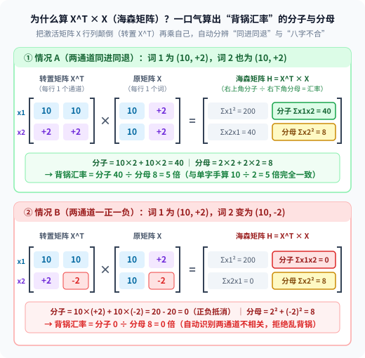

【AI量化】不训练模型，喂 128 句话进去到底干了啥？手算并实测 AWQ 与 GPTQ 的“校准集”秘密

━━━━━━━━━━━━━━━━━━━━

◆ 引子：为什么 `HINT4` 敢直接转换，而压 `AWQ / GPTQ` 却非要喂 128 句话进去？

━━━━━━━━━━━━━━━━━━━━

我们在前文 357 期 https://mp.weixin.qq.com/s/FoJKBWBykSGOpN-KyKkVpg 剖析并实测 `secemp` 的 `HINT4`（以及英伟达 `NVFP4`）量化方案时，干了一件非常省事的事：把 `Qwen3-0.6B` 的 16 位浮点权重（`BF16`）直接按每 16 个数（或 32 个数）一组算出缩放因子，就近四舍五入塞进 4-bit 格子里—— **全程只对静态权重做纯数学转换，连一句文本都没往模型里喂** ，压出来的模型困惑度（PPL）也仅仅从 `56.55` 微升到了 `65.24 至 68.09`（152 个测试词元总 KL 散度 `21.26 至 30.64`，即每词元平均 KL `0.1399 至 0.2016`）。

但这立刻引出了一个问题：平时大家去 HuggingFace 下载最主流的 4-bit 量化权重，文件名尾巴上挂的往往是 **`AWQ`** （Activation-aware Weight Quantization，激活感知权重量化）或 **`GPTQ`** （Post-Training Quantization for Generative Pre-trained Transformers）。我们在前文 139 期 https://mp.weixin.qq.com/s/-es--FXQmi8Vw6sUjUsgSw 梳理量化演进路线时讲过，它们同样属于 **训后量化（Post-Training Quantization, PTQ）** ，全程不跑反向传播（Backpropagation），也不通过梯度下降训练模型。

可只要你亲手用 `AutoAWQ` 或 `GPTQModel` 压过一次模型，就会发现一个绕不开的步骤：**明明也是 4-bit 训后量化、也不做梯度下降训练，为什么它们不像 `HINT4` 那样直接转换，而是通常要先准备 128 段话（行业惯例常从 WikiText 或 C4 语料库里随机抽 128 段文本，叫作校准集 Calibration Set）喂进模型跑上几分钟？**

为了在严格控制单一变量的前提下看清差距，我们在同一个对称整数四舍五入（ **就近四舍五入 Round-to-Nearest, RTN** ）函数下对比了两种分块尺寸：如果像微缩放那样 **每 16 个权重共用一把尺子（`g=16`）** ，免校准直转的 4-bit 困惑度是 **`66.81`** （152 个测试词元总 KL 散度为 `28.97`）；可一旦换成主流 `AWQ / GPTQ` 默认的 **每 128 个权重共用一把尺子（`g=128`）** 并跳过校准集直接四舍五入，4-bit 困惑度会当场从 `66.81` 恶化到 **`85.10`** （152 词元总 KL 散度从 `28.97` 翻倍暴涨到 **`67.94`** ，即每词元平均 KL 从 `0.1906` 涨到 **`0.4470`** ）；要是再往 3-bit 压，免校准直转的困惑度更是直接飙到 **`1876.29`** ，当场崩成乱码。

这就把三个平时大多数程序员没细想过的底层问题摆在了桌面上：
1.**为什么每 16 个数一组（`g=16`）敢不看数据直接转，换成每 128 个数一组（`g=128`）不喂校准集就翻车？**
2.**既然不跑反向传播训练，喂校准集句子进去到底干了啥？**
3.**同样拿校准集照了一遍，`AWQ` 和 `GPTQ` 各自算出了什么东西，又是怎么在不跑梯度下降的前提下保住模型智商的？**

为了把这件事彻底摸透，我们继续在本地 **RTX 3080 Laptop GPU** 上加载同一台 `Qwen/Qwen3-0.6B`（28 层），用 Python 从零编写了 `RTN`、`AWQ` 通道缩放原型与 `GPTQ` 海森矩阵逐列补偿原型（采用 `BF16` 模拟量化评估数值特性，实验脚本与完整结果已放在本仓库 `wechat/assets/358/` 目录下）。

━━━━━━━━━━━━━━━━━━━━

◆ 第一章：为什么不能“众生平等”直接四舍五入（RTN）？—— 校准集是一张“抓出大激活值的 X 光片”

━━━━━━━━━━━━━━━━━━━━

不用管任何公式，先把为什么需要喂校准句子进去浓缩成三句大白话大纲：
- **① 单看模型的静态权重文件（`W`），各通道的平均幅度非常平缓** ：我们在 `Qwen3-0.6B` 全网 28 层实测发现，静态权重矩阵各通道的平均幅度与中位数几乎拉不开差距（最大通道也仅比中位数高 `15% 至 61%`）。如果你只盯着磁盘里的静态权重文件看，根本看不出实际运行时哪个通道重要、哪个通道次要；
- **② 但模型真正干活算的是“激活值乘权重（`Y = X × W`）”，而实时流过的输入激活值（`X`）里藏着约 1% 的“大激活值通道”** ：在每一层算出来的中间激活值里，有极少数（约 1%）通道的数值常年比普通通道大十几倍到几十倍；
- **③ 如果“众生平等”直接四舍五入（RTN），那 1% 大激活值通道上的微小舍入误差，乘上对面巨大的激活值，就会把整层输出炸歪** ：所以喂校准句子进去跑一遍前向传播， **根本不是为了训练，而是为了给激活值照一张 X 光片，看清几千个通道里到底哪几个是碰不得的“大激活值通道”** 。

我们看一行最简单的算式，就能明白为什么“不看激活值 `x`、只看权重 `w` 直接四舍五入”会闯大祸：

```text
神经元算输出，是把各个通道的“输入激活值 x × 权重 w”加起来：
y = (x1 × w1) + (x2 × w2)

1. 假如你不喂句子进去，只看磁盘里的权重文件：
   你看到两个通道的权重一模一样大：w1 = 0.4，w2 = 0.4。
   你觉得它俩平起平坐，按整数四舍五入（RTN），顺手把两个 0.4 全抹成了 0。

2. 但当你喂一句话进去，看到流过来的真实激活值时：
   第 1 个是普通通道（x1 = 1），第 2 个却是大了一百倍的大激活值通道（x2 = 100）。
   代进算式一看：
   原本正确的输出 y = ( 1 × 0.4 )  +  ( 100 × 0.4 )
                    =     0.4      +      40.0       = 40.4 分
                          ↑               ↑
               抹成 0 只丢 0.4 分      抹成 0 当场丢掉 40 分（整道题直接报废）
```

你看：单看权重文件，`w1` 和 `w2` 都是 `0.4`，四舍五入抹成 `0` 好像都只丢了 `0.4`；可一旦乘上对面的激活值，普通通道只歪了 `0.4` 分，而 `x2 = 100` 的大激活值通道会把这 `0.4` 的舍入误差**放大一百倍**，让输出当场丢掉 `40` 分。

真模型里的激活值通道真的有这么悬殊吗？我们在 RTX 3080 Laptop 上加载**原始未量化的 `BF16` 版 `Qwen3-0.6B`**，在动手量化前先把校准句子喂进去跑一遍前向传播，在全部 28 层的四类输入端——注意力输入 `attn_in`（喂给 `q/k/v_proj`）、注意力出口输入 `o_in`（喂给 `o_proj`）、前馈网输入 `mlp_in`（喂给 `gate/up_proj`）与前馈网下降输入 `down_in`（喂给 `down_proj`）——挂上探针，实测了原版模型各通道的激活值幅度与对应的 `BF16` 权重幅度：

**1. `Qwen3-0.6B`（28 层平均）权重通道 vs 激活值通道幅度悬殊度实测**

| 线性层输入位置 | 权重最大通道 / 中位数 | 权重前 1% 通道 / 中位数 | 激活最大通道 / 中位数（峰值层） | 激活前 1% 通道 / 中位数 | 前 1% 通道占单通道平方误差和比例 |
|---|---:|---:|---:|---:|---:|
| `attn_in`（`q/k/v`） | `1.24×` | `1.17×` | **`34.03×`** （峰值 `49.48×`） | **`14.73×`** | **`50.6%`** |
| `o_in`（`o_proj`） | `1.47×` | `1.37×` | **`13.83×`** （峰值 `29.88×`） | **`7.61×`** | `15.5%` |
| `mlp_in`（`gate/up`） | **`1.15×`** | **`1.08×`** | **`35.86×`** （峰值 `60.93×`） | **`10.72×`** | **`51.0%`** |
| `down_in`（`down`） | `1.61×` | `1.39×` | **`41.01×`** （峰值 **`334.91×`** ） | **`11.99×`** | `21.2%` |

**2. 抽查第 14 层 `mlp_in`（共 1024 个通道，激活中位数 `0.544`、权重中位数 `0.0198`）前三大激活值通道**

| 排名与通道号 | 激活值平均幅度 `\|X\|` | 相对普通通道中位数倍数 | 二阶能量 `mean(X²)` 倍数 | 该通道权重平均幅度 `\|W\|` | 权重相对中位数倍数 |
|---|---:|---:|---:|---:|---:|
| 第 1 名： **`277` 号通道** | **`18.1735`** | **`33.42×`** | **`744.7×`** | `0.00655` | **`0.33×`（反而更小）** |
| 第 2 名：`62` 号通道 | `6.0539` | `11.13×` | `105.3×` | `0.01060` | `0.53×` |
| 第 3 名：`5` 号通道 | `4.1441` | `7.62×` | `41.5×` | `0.01066` | `0.54×` |


看上面这两张从 `Qwen3-0.6B` 里抓出来的真数据表，两个事实加上分块账本瞬间一目了然：
1.**仅占 1% 的大激活值通道，在免校准 RTN 下占了单通道误差平方和的一半以上** ：在 `attn_in` 和 `mlp_in` 里，1024 个通道中排名前 1% 的 **10 个大激活值通道** ，平均激活幅度是普通通道的 `10.72× 至 14.73×`（最大的 `277` 号通道达 **`33.42×`** ，二阶平方均值 `mean(X²)` 达中位数的 **`744.7×`** ）。如果直接做 4-bit 四舍五入（RTN），按各通道独立平方误差 `mean(x_j²) × mean(Δw_j²)` 统计（暂未计入跨通道交叉抵消），这区区 **1% 的通道** 就占了整层 **`50.6% 至 51.0%`（超过一半）** 的单通道误差能量。
2.**更反直觉的是，不跑校准集只看权重，你甚至会把“大激活值通道”当成“小透明”给优先抹掉** ：看第 2 张表里的 **`277` 号通道** ——它的输入激活值平均高达 `18.17`（中位数的 `33.42×`），但对应的整列权重平均幅度却只有 `0.00655`， **仅为普通通道权重中位数的 `0.33×`（三分之一）** 。原因很简单：正因为第 `277` 号通道平时的输入 `X` 动辄十几二十，为了防止乘出来的输出过大，模型在预训练时把这一列的权重压得很小。
3.**这就彻底解释了引子里的第 1 个问题：为什么 `g=128` 直转会翻车，而 `g=16` 微缩放却敢免校准直转？**
   - 在主流 `AWQ / GPTQ` 的 **`g=128`（每 128 个权重共用一把尺子）** 下：第 `277` 号通道那些只有普通权重三分之一大小的权重，必须和同行周围 **127 个邻居权重** 合穿一条大裤子。只要这 127 个邻居里混进一两个稍大的普通权重，整组的量化步长就会被撑大，导致第 `277` 号通道的微小权重在粗格子里被粗暴归零或严重舍入，再乘上对面 `33.42×` 的巨型激活值当场炸穿（`Qwen3-0.6B` 免校准 `g=128` 的 4-bit 困惑度飙到 `85.10`）；
   - 而在 **`g=16`（每 16 个权重就换一把独立尺子）** 下：合穿一条裤子的邻居从 127 个骤减到了 **15 个** ，局部最大值的波动范围大幅收窄，尺子刻度天然更贴身（代价是每 16 个权重都要额外存 1 个缩放因子），所以在同一 RTN 函数下，免校准把 `g=128` 换成 `g=16`，4-bit 困惑度直接从 `85.10` 回落到了 **`66.81`** 。

────────────────────

💡 顺带聊个线性代数的彩蛋：大模型里为什么会长出大几千倍的“巨型激活值”？——同二维图片借 `3×3` 矩阵做仿射变换一样，模型自己在残差流里腾出了“常数项”

熟悉本号的老读者一定记得，我们在前文 273 期 https://mp.weixin.qq.com/s/iT0_PbnghTDiVaohrFWLFg 复习线性变换与仿射变换（Affine Transformation）时专门算过一笔几何账：

真正的 **线性变换** （纯矩阵乘法 `x · W`）有一条铁律：**零向量乘任何矩阵永远等于零向量（`0 · W = 0`），也就是说原点永远锁死不动**。不管矩阵怎么旋转、缩放、斜切，都只能绕着原点折腾；而中学课本里的 `y = ax + b` 多了一个 **平移项 `+ b`** （把所有点连同原点一起挪个位置，学名叫 **仿射变换** ），这在同维度的纯矩阵乘法里是死活写不出来的。

那计算机图形学（做 UI 或 2D 游戏）是怎么把二维图片的平移 `+ (3, 5)` 塞进纯矩阵乘法里的？答案是 **多挂一个恒定不变的常数维度 `1`（齐次坐标）** ——把二维点 `(x, y)` 升维写成三维向量 `(x, y, 1)`，去乘一张 `3×3` 矩阵：

```text
(x, y, 1) · [ 1   0   0 ]
            [ 0   1   0 ]  =  (x + 3,  y + 5,  1)
            [ 3   5   1 ]
```

你看，靠着第 3 个维度上那个 **永远不变的常数 `1`** ，矩阵第 3 行里的平移偏置 `(3, 5)` 就被纯乘法原封不动地“点”出来了（在几何上，二维的平移其实就是三维空间里的斜切）。

现在回头看今天的大模型：从 `RMSNorm` 砍掉平移项 `+ β`，到 Llama、Qwen 干脆把许多线性层的 `bias` 设成 `False`，工程师把 `Y = X × W + b` 里的 **`+ b` 裁掉了** ，让网络主要靠纯矩阵乘法运算。可“裁得掉编制，裁不掉需求”——卡内基梅隆大学（CMU）与 Meta 团队在《Massive Activations in Large Language Models》（`arXiv:2402.17762`）里发现，大模型干脆在残差流里（尤其是句首第 0 个词元等锚点位置的高幅通道上，我们在 `Qwen3-0.6B` 第 14 层残差流第 0 个词元的第 `35` 号通道上实测抓到了高达 **`6,176.0`** 的数值）自己养出了几乎不随输入词义变化的“巨型激活值”，在注意力机制的配合下充当全网共享的 **“野生常数偏置项 `+ b`”** 。

可以用下面这两行对齐的算式，直观理解“用大常数激活乘小权重”是怎么顶替被砍掉的 `+ 0.18` 偏置的：

```text
假设某个神经元每次算完，都需要在末尾固定加上 + 0.18（即 y = ax + b 里的 + b）：

• 以前有偏置项时：y = (x_1 × w_1) + (x_2 × w_2) + (x_常 × w_常) + 0.18
                                                  └── 原本闲着 0 ──┘   └── 官方偏置 b

• 现在偏置被砍了：y = (x_1 × w_1) + (x_2 × w_2) + (x_常 × w_常) + [被砍掉]
                                                  └ 18 × 0.01 = 0.18 ┘ ↑
                                                   用大常数 18 乘小权重 0.01 凑出 +0.18
```

注意区分两类亲戚：CMU 论文里专门充当固定常数偏置的 `Massive Activations` 主要集中在句首等特定词元上（动辄几千）；而我们在上面表格里统计的 `277` 号通道（在各类词元上平均幅度 `18.17`），则是 Dettmers 等人在 `LLM.int8()` 论文中报告的 **跨词元普遍偏大的“离群特征通道（Outlier Feature）”** 。虽然 `277` 号通道在不同词元上有起伏、并非严格恒定不变的常数，但它面临的量化困境和上面的算式完全同源：**正因为对面的输入 `x` 平时动辄高达十几二十，对应的权重 `w` 被训练得只有普通通道的三分之一（`0.33×`），一旦在 `g=128` 粗格子里被免校准 `RTN` 四舍五入抹成 `0`，乘上大激活后就会酿成整层最大的输出误差。**

────────────────────

可如果我们既不想多花显存存密集的 `g=16` 缩放因子（坚持用最通用的 `g=128` 分块），甚至还想往 `3-bit` 压，拿到这张照出“大激活值通道”的 X 光片后，`AWQ` 和 `GPTQ` 各自怎么抢救它们？

━━━━━━━━━━━━━━━━━━━━

◆ 第二章：AWQ 的绝活——“给大激活值通道穿防弹衣（先乘 2 放大，再四舍五入）”

━━━━━━━━━━━━━━━━━━━━

先用三句话概括麻省理工学院（MIT）韩松团队在 `AWQ`（MLSys 2024 最佳论文）里拿出的解法（注：`AWQ` 与下一章的 `GPTQ` 在推理运行时，走的都是前文 357 期讲过的 **`W4A16` 路线，如 `Marlin` 内核** ——注意， **`W4A16` 不是汇编指令的 `W4A16`（GPU 芯片上压根没有“4-bit 乘 16-bit”的矩阵汇编指令），而是外层融合算子的 `W4A16`，底层最终是用 `FP16 / BF16` 的 `W16A16` 汇编指令算的** ，正如前文 357 期的 `HINT4` 外层叫 `W4A8`、底层最终是用 `INT8` 的 `W8A8` 汇编指令算的一样；算子从显存读入 `4-bit` 权重省带宽，进了寄存器先用位移指令转成 `FP16 / BF16`，再调 `W16A16` 汇编跟激活值相乘，所以精度丢失全部发生在 **“打包存盘压成 4-bit 的那一瞬间”** ——一旦存盘时被四舍五入砍歪了，运行时在算子里再怎么转回 16 位浮点也救不回来）：
- **① 核心思路** ：既然那 1% 大激活值通道的权重本来偏小、打包压进 4-bit 时直接四舍五入误差太大，那就在进 4-bit 格子存盘之前， **先把这列权重乘以一个放大系数 `s`（比如乘以 `2`）** ；同时为了保证运行时算出来的总乘积不变， **把对面乘过来的激活值除以同样的 `s`（除以 `2`）** ；
- **② 为什么乘以 2 再存进 4-bit，精度就高了？** 因为权重被放大 2 倍后，只要还没超过同组最大权重，整组尺子的步长就不变，四舍五入存盘时的最大半格误差上界在除以 2 还原后直接 **缩小了一半** ；
- **③ 放大系数 `s` 怎么定？** 不用人工瞎猜，直接根据刚才校准集算出来的激活值各通道平均幅度 `|X|`，设 `s = |X|^α`，在 `0 到 1` 之间试 21 个不同的指数 `α`（网格搜索），看哪个 `α` 让校准集乘出来的层输出误差最小，就选哪个（我们在 `Qwen3-0.6B` 上实测搜出来的平均最优指数是 `α = 0.378`，大致相当于对激活幅度开两到三次方根）。

我们直接把一整组 **128 个通道** 的权重和激活值全都摆出来（其中 126 个普通邻居设成一模一样的数字），手算一遍“不缩放”、“乘以 2”和“贪心乘以 16”三种情况下的总输出得分：

```text
题目：某组 128 个通道共用一把 4-bit 尺子（只有 0 到 7 共七个正数格点），各通道的激活值与权重如下：
• 1 个大激活值通道  ：激活 x_1 = 100，权重 w_1 = 0.35    -->  理想得分 = 100 × 0.35       = 35.00 分
• 1 个大权重通道    ：激活 x_2 = 1  ，权重 w_2 = 1.75    -->  理想得分 = 1 × 1.75         =  1.75 分
• 126 个普通邻居通道：每个都是激活 x_普 = 1，权重 w_普 = 0.30
                                                        -->  理想得分 = 126 × (1 × 0.30) = 37.80 分
• 未量化前的理想真实总输出 y = 35.00 + 1.75 + 37.80 = 74.55 分

1. 普通直接四舍五入（RTN，不缩放）：
   • 全组最大权重是 1.75  -->  尺子步长 = 1.75 ÷ 7 = 0.25（格点：0, 0.25, 0.50, 0.75 ... 1.75）
   • 大激活通道 (w=0.35) 落到格点 0.25     -->  100 × 0.25       = 25.00 分（单这一项就亏了 10.00 分）
   • 大权重通道 (w=1.75) 落到格点 1.75     -->  1 × 1.75         =  1.75 分
   • 126 个普通通道 (w=0.30) 落到格点 0.25 -->  126 × (1 × 0.25) = 31.50 分（合计亏了 6.30 分）
   • RTN 总输出 = 25.00 + 1.75 + 31.50 = 58.25 分（跟理想总分 74.55 相比，整整歪了 16.30 分）

2. AWQ 穿防弹衣（先把大激活通道权重 w_1 乘以 2 存进 4-bit，算乘法时再除以 2 抵消回来）：
   • 第一步（乘 2 存盘）：w_1 先乘以 2 变成 0.35 × 2 = 0.70。
     因为 0.70 依然没超过同组最大权重 1.75，整组尺子步长【还是 0.25 完全不变】，0.70 在尺子上四舍五入存成 0.75
   • 第二步（除以 2 还原相乘——工程上直接把“÷ 2”挪给对面的激活值 x_1 抵消，即 (x_1 ÷ 2) × 0.75）：
     • 大激活通道：100 × (0.75 ÷ 2) = (100 ÷ 2) × 0.75 = 50 × 0.75 = 37.50 分（只歪了 2.50 分，误差缩小 4 倍）
     • 大权重与 126 个普通通道（尺子没变）                         = 33.25 分（1.75 + 31.50，邻居毫发无伤）
   • AWQ（乘 2）总输出 = 37.50 + 33.25 = 70.75 分（跟理想总分 74.55 相比，只歪了 3.80 分）

3. 追问：既然乘以 2 这么赚，为什么不干脆把大激活通道权重乘以 16（存盘前乘 16 变 5.60，相乘时再除以 16）？
   • 灾难发生：全组最大权重变成了 0.35 × 16 = 5.60，整组尺子步长被迫撑大到 5.60 ÷ 7 = 0.80（格点：0, 0.80, 1.60 ... 5.60）
   • 大激活通道自己 (w=5.60) 落到格点 5.60 -->  100 × (5.60 ÷ 16) = 35.00 分（它自己倒是零误差了）
   • 大权重通道 (w=1.75) 落到格点 1.60     -->  1 × 1.60          =  1.60 分
   • 126 个普通通道 (w=0.30)：在步长 0.80 的粗尺子上连半格 (0.40) 都不到，126 个权重全部被四舍五入抹成了 0：
                                          -->  126 × (1 × 0)     =  0.00 分（37.80 分全军覆没）
   • 乘 16 后的总输出 = 35.00 + 1.60 + 0 = 36.60 分（比不缩放的 RTN 58.25 分还要惨得多）
```

────────────────────

💡 为什么前文 357 期的缩放可以“等累加器出锅再除”，而 `AWQ` 的乘以 2 却必须在进累加器之前先抵消掉？

对照前文 357 期和今天的算式，很容易冒出一个疑问：前文 357 期的 `HINT4` 同样是把权重乘了 2，人家为什么能先进累加器大锅连加完、等出锅后再统一除以 2，而今天 `AWQ` 却非要在进锅相加之前先把这 2 倍抵消掉？

1.**“全组共享缩放” vs “单通道独立缩放”** ：
   前文 357 期的 `HINT4` 是 **全组共享缩放** ，同组 32 个权重进锅前 **人人都乘了 2** ，满足 `(a × 2) + (b × 2) = (a + b) × 2`，自然可以在累加器里先加成一个总分、出锅再统一除以 2。而今天 `AWQ` 是 **单通道独立缩放** ——128 个通道里 **只有第 1 个大激活通道单独乘了 2，另外 127 个普通邻居根本没乘 2（还是 1 倍）** 。如果进锅前不把第 1 个通道的 2 倍抵消掉，直接送进累加器跟另外 127 个邻居加在一起，就会煮成一锅分不开的糊涂粥：

```text
• 第 1 个通道（乘了 2 没除） ：100 × 0.75 = 75.00 分（被放大了 2 倍）
• 另外 127 个通道（根本没乘 2）：合计       = 33.25 分（原汁原味 1 倍）
  ──(进累加器大锅混加在一起)──> 锅里总分 = 75.00 + 33.25 = 108.25 分

出锅后你除还是不除？
• 不除以 2：总分是 108.25 分（第 1 个通道多算了一倍，错的）
• 除以 2  ：总分变成 108.25 ÷ 2 = 54.125 分（那 127 个没乘过 2 的无辜邻居 33.25 分也被砍了一半，还是错的）
```

2.**既然必须在进累加器前除掉，为什么不在寄存器解压成 `FP16` 时直接除权重，而是改上一层的 `RMSNorm`？** ：
   在数学上，把 4-bit 权重读进寄存器解压成 `FP16` 后，当场把第 1 列权重除以 2（`0.75 ÷ 2 = 0.375`）再送进累加器，完全可行；但如果每次运行时都让矩阵乘法算子单独给某几列做除法，算子就得多读一排系数、多跑一条指令。而我们在前文 352 期手算过，每个线性层前面站着的归一化层（`RMSNorm`），最后一步本来就是让 1024 个通道 **同时乘上各自独立的缩放权重数组 `γ = [γ_1, γ_2, ..., γ_1024]`** 。所以在 **打包模型存盘那天（离线只改一次静态文件）** ，直接把上一层 `RMSNorm` 权重数组里第 1 个位置的数字提前除以 2 存盘（比如把原本的 `γ = [1.0, 1.0, ...]` 改成 `γ = [0.5, 1.0, ...]`）——这样推理运行时，`RMSNorm` 照常做它原本就要做的 1024 通道并行乘法，任何维度都不用等，流过来的激活值 `x_1` 就天然从 `100` 变成了 `50`，当前层的矩阵乘法算子一行代码都不用改。
3.**说穿了，`AWQ` 就是个 2023 年的老办法，效果其实挺一般的** ：
   看到这儿你也能直觉感受到，`AWQ` 这套“既要保大激活通道、又怕乘多了撑爆尺子害死 126 个邻居、还得借上一层归一化绕弯抵消”的设计相当拧巴——它就是 2023 年年中（当时还普遍用 `g=128` 粗分块、还没普及 `g=16` 微缩放与旋转量化）的一个早期折中方案，图的是算法简单、压模型只需几秒钟，至于精度上限其实很有限（第四章实测表一看便知）。

────────────────────

看懂了 `AWQ` 的“给大激活值通道穿防弹衣”，我们再看另一大流派 `GPTQ` 是怎么拿同一批 128 句话玩出完全不同的花样的。

━━━━━━━━━━━━━━━━━━━━

◆ 第三章：GPTQ 的绝活——“前面砍歪了的账，让后面的兄弟替他找补（木工找平法）”

━━━━━━━━━━━━━━━━━━━━

如果说 `AWQ` 是“重点保护少数派”，那 `GPTQ`（Frantar et al., ICLR 2023）干的就是 **“全员连坐、逐列找平”** 。同样先给三句话大纲：
- **① 核心目标不同** ：`GPTQ` 根本不在乎单个权重量化后跟原来像不像（哪怕把某个次要权重从 `1.0` 改成 `3.0` 也无所谓），它唯一在乎的是 **“整行权重乘上那 128 句话的激活值之后，算出来的总和 `Y = X × W` 跟原来一不一样”** ；
- **② 怎么找平（木工找平法）？** 它按列从左往右挨个把权重压成 4-bit：当第 1 列权重四舍五入被砍矮了一截（比如少算了 `4.0` 分），它立刻趁着第 2、3、4 列权重 **还没量化** （还是高精度的浮点数），把后面的权重往上悄悄垫高一点，让后面多算出来的分数刚好补上第 1 列亏掉的 `4.0` 分；
- **③ 凭什么知道后面每一列该替第 1 列调整多少？** 靠的就是用校准集算出来的 **通道二阶矩阵 `X^T × X`** （即对层输出平方误差 `L = (1/T) ||X W_hat - X W||²` 求关于权重的二阶导数——这个 `(2/T) X^T × X` 在高等数学课本里叫作 **海森矩阵 Hessian Matrix** ，统计的就是第 1 个通道和第 2 个通道平时是不是同向出现、谁大谁小，相当于一张“谁跟谁绑在一起、谁该替谁背锅”的汇率表）。

我们同样用一道只有 2 个权重、连小数点都不用算的极简算术题，手算一遍 `GPTQ` 的“木工找平”全过程：

```text
题目：有一层只有 2 个输入通道，在校准集上激活值分别是 x1 = 10（大激活通道），x2 = 2（次要通道）。
原始浮点权重是：w1 = 0.4，w2 = 1.0。
那么未量化前的理想真实输出是：
y_真实 = (x1 × w1) + (x2 × w2) = (10 × 0.4) + (2 × 1.0) = 4.0 + 2.0 = 6.0

假设现在的量化尺子粗到只许取整数 { 0, 1, 2, 3, ... }：

1. 普通直接四舍五入（RTN，各管各的，互不通气）：
   • 第 1 列：w1 = 0.4 ──(四舍五入)──> 变成整数 0
   • 第 2 列：w2 = 1.0 ──(四舍五入)──> 变成整数 1
   • 量化后输出 = (10 × 0) + (2 × 1) = 0 + 2.0 = 2.0  --> 比真实值 6.0 整整亏了 4.0 分

2. GPTQ 逐列找平（从左到右，前人砍歪、后人垫高）：
   • 第一步（先量化第 1 列，记下亏空）：
     把 w1 = 0.4 四舍五入变成整数 q1 = 0。
     算一算亏了多少：w1 少了 δ1 = 0.4 - 0 = +0.4，乘上 x1 = 10，导致总输出亏了 10 × 0.4 = 4.0 分。

   • 第二步（趁第 2 列还没量化，按激活值比例把亏空垫到 w2 头上）：
     看一眼激活值汇率：x1 = 10，x2 = 2（x1 的影响力是 x2 的 10 ÷ 2 = 5 倍）。
     既然第 1 列少算了 0.4，要想让第 2 列把这 4.0 分补回来，第 2 列的权重 w2 就得往上垫高：
     Δw2 = +0.4 × (x1 ÷ x2) = +0.4 × (10 ÷ 2) = +2.0
     于是，把还没量化的浮点权重 w2 从原来的 1.0 直接改成：w2_新 = 1.0 + 2.0 = 3.0

   • 第三步（量化改过之后的第 2 列）：
     把改好的 w2_新 = 3.0 四舍五入成整数 q2 = 3。
     现在算总输出 = (10 × 0) + (2 × 3) = 0 + 6.0 = 6.0  --> 跟真实值 6.0 分毫不差（零误差还原）
```


看到这里，你可能会问最后一个问题：**既然在上面的手算题里，直接拿 `x1 ÷ x2`（`10 ÷ 2 = 5 倍`）就能算出第 2 列该垫高多少，那为什么 `GPTQ` 非要喂 128 句话进去算一个叫 `X^T × X`（课本里叫海森矩阵 Hessian Matrix）的东西呢？**

原因特别简单：上面手算题里只有 **1 个词**，而真实校准集里有 **128 句话（几万个词）**。在几万个词里，第 2 列只有跟第 1 列 **“同进同退”** 时才能替它背锅；万一第 2 列在不同词上一会儿是 `+2`、一会儿是 `-2` 乱跳呢？我们拿 **2 个词** 的例子一算就明白了：

```text
情况 A（两个通道同进同退——好兄弟，能替你背锅）：
• 词 1：x1 = 10， x2 = +2
• 词 2：x1 = 10， x2 = +2
  第 1 列砍矮亏了 4 分，把第 2 列权重垫高 +2.0，在词 1 和词 2 上都能稳稳补回 +4 分。

情况 B（两个通道一正一负——八字不合，替你背锅反而帮倒忙）：
• 词 1：x1 = 10， x2 = +2
• 词 2：x1 = 10， x2 = -2  （注意：到了词 2，x2 变成负数了）
  如果你还把第 2 列权重垫高 +2.0：在词 1 上倒是补回了 (+2)×2.0 = +4 分，
  可在词 2 上却算出了 (-2)×2.0 = -4 分（不仅没补上，反而往反方向又多亏了 4 分）。

怎么用一条公式同时算准这两种情况？
我们要让所有词上的总平方误差 Σ(x1 × δ1 - x2 × Δw2)² 最小（最小二乘法），算出来的最优补偿倍率就是所有词的“(x1 × x2) 总和 ÷ (x2 × x2) 总和”：

• 代入【情况 A】（同进同退）：
  分子 Σ(x1 × x2) = (10 × 2) + (10 × 2) = 40
  分母 Σ(x2 × x2) = (2 × 2)  + (2 × 2)  = 8
  背锅汇率 = 40 ÷ 8 = 5 倍  --> 约掉一个 x2，跟前面单字手算的 10 ÷ 2 = 5 倍一模一样

• 代入【情况 B】（一正一负，毫不相关）：
  分子 Σ(x1 × x2) = (10 × 2) + (10 × -2) = 20 - 20 = 0 （正负刚好抵消）
  分母 Σ(x2 × x2) = (2 × 2)  + (-2 × -2) = 8
  背锅汇率 = 0 ÷ 8 = 0 倍   --> 自动算出“它俩八字不合，千万别让第 2 列替第 1 列背锅”
```

而在代码里，怎么一口气把上面这个分子 `40`（或 `0`）和分母 `8` 算出来？答案就是拿激活矩阵 `X` 的转置（`X^T`，把表格的行和列颠倒过来）去乘 `X` 自己——也就是 **`X^T × X`（乘上 `2/T` 即层输出平方误差的海森矩阵 `H`）** ，右上角算出来的格子天然就是分子 `Σ(x1 × x2)`，右下角天然就是分母 `Σ(x2 × x2)`：



你看，所谓的“用校准集算海森矩阵 `X^T × X` 求逆”，剥掉高等数学的外衣，干的就是上面这件小学生都能看懂的事：**统计哪两个通道平时同进同退（单列最小二乘补偿比就是 `40 ÷ 8 = 5 倍`），哪两个通道正负抵消（补偿比变成 `0`）；而在真实模型的 1024 个通道里，因为第 1 列后面站着 1023 个兄弟可以一起帮它分摊亏空，算法会对整张 `H = (2/T) X^T × X`（在对角线上加一点阻尼常数 `damp` 保证矩阵满秩稳定可逆）求一次逆矩阵 `H^-1`，并在开启按对角线能量排序（`actorder=True`）时按从大激活通道到次要通道的顺序，把前面四舍五入的误差逐列调整分摊给后面所有未量化的兄弟通道**。

注意看上面这个过程里最精彩的一个反直觉推论： **在刚才的手算题里，第 2 个权重原本是 `1.0`，为了替第 1 列背锅，被 `GPTQ` 直接改成了 `3.0`——如果你只拿量化后的权重去跟原始权重比（算“权重本身的信噪比”），`GPTQ` 改出来的权重反而比傻瓜四舍五入（`RTN`）偏得更远；可一旦乘上输入激活值 `X`，它算出来的层输出却准得惊人。**

这个推论在真实大模型上成立吗？我们直接看 RTX 3080 Laptop 上的实测数据。

━━━━━━━━━━━━━━━━━━━━

◆ 第四章：`Qwen3-0.6B` 真刀真枪实测：RTN vs AWQ 缩放原型 vs GPTQ（4-bit 与 3-bit 全套对账）

━━━━━━━━━━━━━━━━━━━━

我们在 RTX 3080 Laptop 上对 `Qwen3-0.6B` 的全部 28 层（共 196 个线性投影矩阵；词表嵌入、归一化与输出头保持原精度）分别运行了 **`RTN`（免校准直转，含 `g=16` 与 `g=128`）** 、 **`AWQ 缩放原型（极简版：仅将前 1% 通道乘以 2）`** 、 **`AWQ 缩放原型（21 档网格搜索 `s = |X|^α`）`** 以及 **`GPTQ（海森矩阵 Cholesky 逆逐列误差补偿，`actorder=True`）`** ，并将量化后的权重重构回 `BF16`（模拟量化 Fake-Quant）测量数值影响。

我们将校准文本（16 段共 399 个词元）与完全不重合的留出测试文本（3 段共 152 个词元）严格分开，测量了 5 个抽样层共 35 个矩阵的 **权重本身平均信噪比（Weight SNR）** 、 **校准集层输出平均信噪比（Calib Output SNR）** 、 **留出集层输出平均信噪比（Eval Output SNR）** ，以及全模型在留出集上的 **152 词元总 KL 散度** 与 **端到端困惑度（Perplexity, PPL）** ：

**`Qwen3-0.6B` 在 4-bit 与 3-bit 下的模拟量化实测总表（脚本见 `assets/358/exp_rtn_awq_gptq.py`）**

| 位宽与分块 | 量化方案（196 个线性层模拟量化） | 35 矩阵权重 SNR (↑) | 校准输出 SNR (↑) | 留出输出 SNR (↑) | 152 词元总 KL (↓) | 端到端困惑度 PPL (↓) | 脚本运行耗时 |
|---|---|---:|---:|---:|---:|---:|---:|
| `BF16` 基准 | 原始未量化模型 | `∞` | `∞` | `∞` | `0.00` | **`56.55`** | — |
| **4-bit (`g=16`)** | ⓪ `RTN`（细粒度免校准对照） | `21.25 dB` | `22.24 dB` | `22.33 dB` | `28.97` | `66.81` | `0.44 s` |
| **4-bit (`g=128`)** | ① `RTN`（粗粒度免校准直转） | **`18.28 dB`** | `19.09 dB` | `19.17 dB` | `67.94` | `85.10` | `0.39 s` |
| **4-bit (`g=128`)** | ② `AWQ` 原型（仅前 1% 通道 `×2`） | `18.11 dB` | `20.09 dB` | `20.24 dB` | `50.13` | `80.53` | `0.44 s` |
| **4-bit (`g=128`)** | ③ `AWQ` 原型（网格搜索 `α`） | `17.82 dB` | `20.95 dB` | `21.09 dB` | `36.05` | `70.76` | **`3.55 s`** |
| **4-bit (`g=128`)** | ④ **`GPTQ`（逐列误差找平）** | **`15.03 dB`（最低）** | **`35.47 dB`** | **`22.85 dB`** | **`28.70`** | **`66.30`（量化组最低）** | `40.64 s` |
| **3-bit (`g=128`)** | ① `RTN`（粗粒度免校准直转） | **`10.96 dB`** | `12.00 dB` | `12.12 dB` | `621.20` | **`1876.29`（崩盘）** | `0.42 s` |
| **3-bit (`g=128`)** | ② `AWQ` 原型（仅前 1% 通道 `×2`） | `10.79 dB` | `12.83 dB` | `12.99 dB` | `382.41` | `616.35` | `0.46 s` |
| **3-bit (`g=128`)** | ③ `AWQ` 原型（网格搜索 `α`） | `10.54 dB` | `13.64 dB` | `13.77 dB` | `322.98` | `426.69` | **`3.57 s`** |
| **3-bit (`g=128`)** | ④ **`GPTQ`（逐列误差找平）** | **`7.75 dB`（最低）** | **`28.15 dB`** | **`15.64 dB`** | **`226.26`** | **`235.78`（较 RTN 降 87%）** | `39.98 s` |


对照上面这张我们亲手跑出来的实测数据表，三个平时在二手科普文里看不到的底层规律清清楚楚：

1.**“权重本身 SNR”与“层输出 SNR”的显著倒挂，验证了第三章的手算推论** ：
   看 4-bit（`g=128`）那四行——免校准的 `RTN` 因为让每个权重都就近落格， **权重本身的平均信噪比最高（`18.28 dB`）** ；而 `GPTQ` 为了保住大激活通道，故意把后面次要通道的权重改歪去替前排背锅，导致 **权重本身的平均信噪比降到了最低的 `15.03 dB`（比 RTN 低了 `3.25 dB`）** 。
   然而一旦乘上输入激活值 `X`，局势瞬间反转：`GPTQ` 在校准集上的层输出平均信噪比跃升到了 **`35.47 dB`** （比 RTN 高出 `+16.38 dB`，按平均分贝换算相当于单层输出均方误差缩小了约 **43 倍** ），在不重合的留出测试集上输出信噪比也达到最高的 **`22.85 dB`** ，全模型 152 词元总 KL 散度从 `67.94` 压到 **`28.70`** （每词元平均 KL 仅 `0.1888`，以 `g=128` 粗分块追平了第 ⓪ 行 `g=16` 细粒度免校准的 `28.97`），端到端困惑度降到了 **`66.30`** 。

2.**哪怕只给前 1% 的大激活值通道“乘以 2”，也能显著改善输出** ：
   看表里的第 ② 行 `AWQ 原型（仅前 1% 通道 ×2）`——1024 个通道里整整 99% 的通道连碰都没碰，仅仅把校准集找出来的前 1%（10 个）大激活值通道在量化前乘以 `2`，在 4-bit 下就把总 KL 散度从 `67.94` 压到了 **`50.13`** （开启 21 档 `α` 网格搜索后进一步降到 **`36.05`** ，困惑度降到 **`70.76`** ）；到了 3-bit 极限压缩下，仅把前 1% 通道乘以 `2` 就把 `RTN` 崩盘的 `1876.29` 困惑度拉回了 **`616.35`** ，搜索 `α` 后降到 **`426.69`** ，而做二阶逐列找平的 `GPTQ` 则进一步压到了 **`235.78`** （注：本脚本 `AWQ` 原型仅测试了核心通道缩放 `s = |X|^α`，官方完整版 `AutoAWQ` 还会叠加权重裁剪搜索 `auto_clip` 进一步缩小差距）。

3.**两派方法的工程取舍：单通道缩放 vs 跨通道二阶找平** ：
   对比表格里的 **“校准输出 SNR”** 、 **“留出输出 SNR”** 和 **“脚本耗时”** 三列，也能看清两派方案各自的脾气：
   - **`GPTQ` 上限高，但求解耗时慢 11 倍，且依赖校准集的相关性分布** ：`GPTQ` 在 399 词元小校准集上的层输出 SNR 高达 `35.47 dB`，换到留出集上则回落到 `22.85 dB`（依然领先各组）。这是因为 `GPTQ` 靠 `X^T × X` 让后面的通道替前面的通道凑数（正文中提到官方通常需抽样 128 段 2048 词元长文以保证海森矩阵充分满秩），如果校准样本太少或语料领域单一，跨通道凑出的补偿系数在新语料上会打点折扣；
   - **`AWQ` 通道缩放受制于同组邻居跷跷板，但校准与留出表现几乎一致（`20.95` vs `21.09 dB`），且速度快 11 倍（`3.55 s` vs `40.64 s`）** ：因为它只给单通道调放大倍率、不搞跨通道凑数，也无需对几千维矩阵做 Cholesky 求逆与逐列循环。

━━━━━━━━━━━━━━━━━━━━

◆ 尾声：场景边界与总结——到底哪些计算能用 `AWQ` 和 `GPTQ`？

━━━━━━━━━━━━━━━━━━━━

最后我们用两条最简单的判据，把 `AWQ` 和 `GPTQ` 的使用场景边界收个尾：

1.**判据一：只有“静态权重投影矩阵”能直接用，所有“激活值与 `KV` 之间互乘”的注意力核心计算都不能直接套用** ：
   - **能用的地方** ：无论是 `AWQ` 还是 `GPTQ`，干的都是“在存盘前修饰静态权重矩阵 `W`”。因此只要是做 **`激活 × 静态权重`** 的线性投影层——包括前馈网（FFN / MoE 专家）的全部矩阵，以及注意力模块进出门的 `q, k, v, o` 投影矩阵——都能使用；
   - **不能直接套用的地方** ：一旦进入真正的 **Attention 注意力核心计算（拿实时算出的 `Q` 去和 `KV 缓存` 相乘算分数、再乘 `V`）** ，乘号两边全都是动态生成的激活值，没有常驻的静态权重矩阵 `W`，所以属于动态 `KV 缓存` 量化的范畴（如前文 138 期 https://mp.weixin.qq.com/s/XyeUrO8FH0xVt1CXU_qg7A 的旋转量化；同理，像前文 354 期 https://mp.weixin.qq.com/s/FCWjLi0-fieM3-2WT7fPeA 里只按哈希抽行查表、不做矩阵内积求和的 `Engram` 词表，也无法使用 `GPTQ` 的跨列误差找补）。

2.**判据二：`AWQ` 零开销融合挑“前门邻居”，但从最终省显存的实际效果看，你根本不会觉得有什么“不能用的地方”** ：
   - **`AWQ` 的融合条件** ：`q, k, v` 投影和 FFN 入口（`gate / up`）前面正好紧挨着 `RMSNorm`，`AWQ` 可以把 `÷ s` 直接塞进 `RMSNorm` 权重里白嫖（`SwiGLU` 的 `down_proj` 也可塞进前面的 `up_proj`）；但如果遇到前面既没有归一化层、又隔着无法齐次穿透的普通激活函数（如单矩阵配 `GELU / SiLU`），想要保持缩放就只能在运行时额外插入缩放操作。而 `GPTQ` 只改自己的权重列、不碰激活值，只要是静态投影矩阵都能直接用；
   - **为什么实际用起来感觉不到限制？** 因为权重量化本来就只针对静态权重 `W`，而在主流大模型里，这些静态投影矩阵（尤其是占了全模型绝大部分权重的 FFN / MoE 专家矩阵）本来就是显存的大头。哪怕在 `DeepSeek-V4 / V4.1`（见前文 168 期 https://mp.weixin.qq.com/s/YqcTnIrGKEYZ2n-sMAelKg ）或 `MiniMax-M3.1`（见前文 351 期 https://mp.weixin.qq.com/s/tQOzsMTl4LA_LBecsZMTmg ）里，为了兼顾 `MLA` 矩阵吸收或注意力精度而把注意力层与路由器保留为 `FP8 / BF16`，只要把占参数大头的 FFN / MoE 专家压成 4-bit，显存大头就已经被实打实地省下来了。

━━━━━━━━━━━━━━━━━━━━

◆ 速查表

━━━━━━━━━━━━━━━━━━━━

| 概念 / 机制 | 一句话人话解释 |
|---|---|
| 校准集（Calibration Set，常见 128 段） | 不参与反向传播训练，仅跑一遍前向传播给各层输入激活值 `X` 照 X 光，找出幅度大几十倍的 1% 大激活值通道与通道间二阶相关性 |
| 巨型激活值与大激活通道（如 `277` 号） | 现代模型裁掉显式 `+ b` 后，会在残差流首词长出充当野生偏置的巨型激活（如 `6,176`），并在各层输入端留下跨词元偏大的离群通道（如 `277` 号均值 `18.17`，权重压至 `0.33×`） |
| `W4A16` 融合算子 vs `W16A16` 汇编指令 | GPU 没有“4-bit 乘 16-bit”的汇编指令；`AWQ / GPTQ` 显存存 4-bit，读进寄存器先还原成 `FP16 / BF16`，底层最终调 `W16A16` 汇编计算 |
| `AWQ`（激活感知权重量化） | 存盘前把大激活通道权重乘 `s`（并借前一层 `RMSNorm` 等把激活除以 `s` 进锅前抵消）；单通道缩放速度快，但放大倍率受同组邻居尺子制约 |
| `GPTQ` 与海森矩阵 `H = (2/T) X^T × X` | 用转置乘自己统计哪些通道同向出现，从左到右逐列量化，把前排四舍五入的误差调整分摊到后排未量化权重列上（木工找平），本轮 4-bit 模拟 PPL 达最低的 `66.30` |
| 权重 SNR 与输出 SNR 倒挂现象 | `GPTQ` 故意改歪次要权重替前排背锅，导致权重本身 SNR 最低（`15.03 dB`），但乘上激活值 `X` 后层输出 SNR 最高（`35.47 / 22.85 dB`） |
| 场景边界（哪些计算能用） | 凡是“激活 × 静态权重”的投影矩阵（FFN 与 `q,k,v,o`）都能用（FFN 占全模型绝大部分权重，省显存大头全覆盖）；动态 `Q × K^T` 与纯查表层不能直接套用 |

━━━━━━━━━━━━━━━━━━━━

◆ 参考资料

━━━━━━━━━━━━━━━━━━━━

- Lin et al., AWQ: Activation-aware Weight Quantization for On-Device LLM Compression and Acceleration, arXiv:2306.00978（MIT, MLSys 2024 Best Paper；提出基于激活幅度的通道缩放量化方案）
- Frantar et al., GPTQ: Accurate Post-Training Quantization for Generative Pre-trained Transformers, arXiv:2210.17323（IST Austria & ETH Zurich, ICLR 2023；提出基于二阶海森矩阵逆的逐列误差补偿量化算法）
- Hassibi et al., Optimal Brain Surgeon and general network pruning, IEEE ICNN 1993（提出利用海森矩阵逆修正其余权重以补偿单参数删减误差的数学框架）
- Dettmers et al., LLM.int8(): 8-bit Matrix Multiplication for Transformers at Scale, arXiv:2208.07339（NeurIPS 2022；系统性报告大模型激活值中的固定通道离群值现象）
- Sun et al., Massive Activations in Large Language Models, arXiv:2402.17762（CMU & Meta, COLM 2024；实证大模型残差流中恒定不变的巨型激活充当隐式偏置项）

━━━━━━━━━━━━━━━━━━━━

把校准集喂进模型并不是为了重新训练，而是为了在平缓的静态权重背后，照出那百分之一动辄大上几十倍的激活值通道。

给大激活通道先乘二再四舍五入是受同组尺子制约的单通道防弹衣，拿二阶矩阵把前排砍歪的缺口垫到后排头上则是木工手里的找平刨。

单看静态权重越是寸步不让的傻瓜舍入，乘上真实输入后反而偏得最远；唯有甘心让次要参数替主干背锅，整层的输出才能在低比特的窄门里严丝合缝。

━━━━━━━━━━━━━━━━━━━━

// 靳岩岩的 AI 学习笔记 × Gemini 的浪漫 × GPT 的严谨
// 2026 年 11 月 3 日

【摘要】为什么微缩放敢直接转换，而压AWQ与GPTQ却要先喂校准集？我们在RTX 3080 Laptop上用Qwen3-0.6B手算并实测：权重虽平，激活值却有1%大几十倍的离群通道。本文剖析AWQ通道缩放与GPTQ海森矩阵逐列找平，展示权重信噪比越低、层输出信噪比反而越高的规律。
