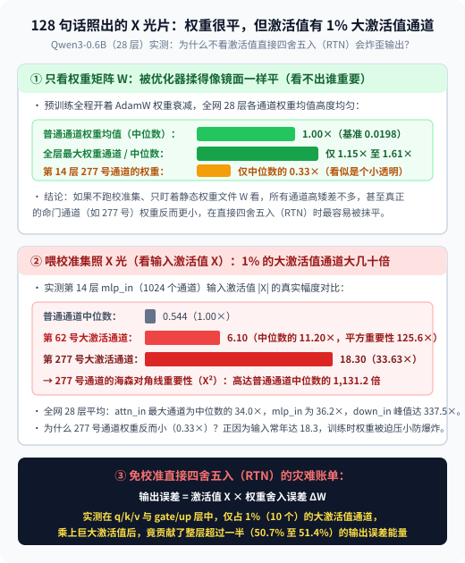
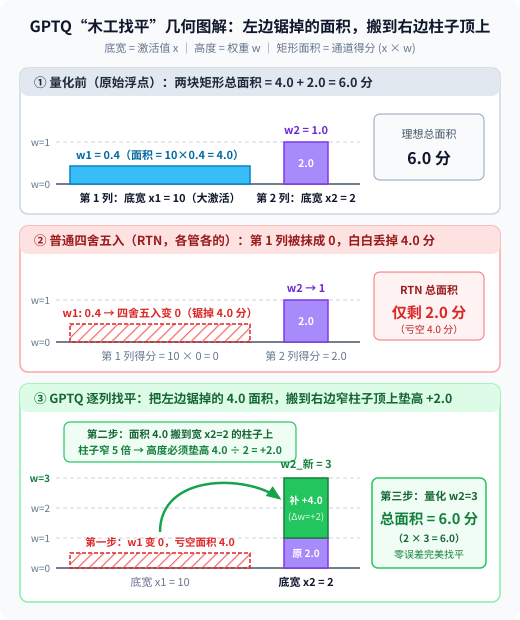
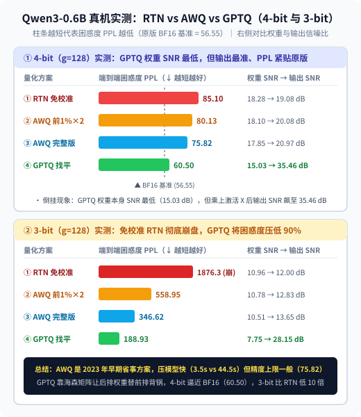

【AI量化】不训练模型，喂 128 句话进去到底干了啥？手算并实测 AWQ 与 GPTQ 的“校准集”秘密

━━━━━━━━━━━━━━━━━━━━

◆ 引子：为什么 `HINT4` 敢直接转换，而压 `AWQ / GPTQ` 却非要喂 128 句话进去？

━━━━━━━━━━━━━━━━━━━━

我们在前文 357 期 https://mp.weixin.qq.com/s/FoJKBWBykSGOpN-KyKkVpg 剖析并实测 `secemp` 的 `HINT4`（以及英伟达 `NVFP4`）量化方案时，干了一件非常省事的事：把 `Qwen3-0.6B` 的 16 位浮点权重（`BF16`）直接按每 16 个数（或 32 个数）一组算出缩放因子，就近四舍五入塞进 4-bit 格子里—— **全程只对静态权重做纯数学转换，连一句文本都没往模型里喂** ，压出来的模型困惑度（PPL）也仅仅从 `56.55` 微升到了 `65.24 至 67.59`。

但这立刻引出了一个问题：平时大家去 HuggingFace 下载最主流的 4-bit 量化权重，文件名尾巴上挂的往往是 **`AWQ`** （Activation-aware Weight Quantization，激活感知权重量化）或 **`GPTQ`** （Generalized Post-Training Quantization，广义训后量化）。我们在前文 139 期 https://mp.weixin.qq.com/s/-es--FXQmi8Vw6sUjUsgSw 梳理量化演进路线时讲过，它们同样属于 **训后量化（Post-Training Quantization, PTQ）** ，全程不跑反向传播（Backpropagation），也不更新梯度。

可只要你亲手用 `AutoAWQ` 或 `GPTQModel` 压过一次模型，就会发现一个绕不开的步骤：**明明也是 4-bit 训后量化、也不训练模型，为什么它们不能像 `HINT4 / NVFP4` 那样直接转换，而是非要你先准备 128 段话（通常从 WikiText 或 C4 语料库里随机抽 128 条长句，行业里叫作校准集 Calibration Set）喂进模型跑上几分钟？**

如果在主流的 `AWQ / GPTQ` 分块规格（每 **128 个权重** 共用一把尺子，`g=128`）下跳过这 128 句话，直接对权重做免校准的 **就近四舍五入（Round-to-Nearest, RTN）** ，刚才在 16 权重微缩放下好端端的 `Qwen3-0.6B`，4-bit 困惑度会当场从 `65.24` 恶化到 **`85.10`** （KL 散度翻倍）；一旦压到 3-bit，免校准直转的困惑度更是直接飙到 **`1876.29`** ，当场崩成乱码。

这就把三个平时大多数程序员没细想过的底层问题摆在了桌面上：
1.**为什么每 16 个数一组（`HINT4 / NVFP4`）敢不看数据直接转，换成每 128 个数一组（主流 `INT4`）不喂校准集就翻车？**
2.**既然不跑反向传播修改梯度，喂那 128 句话进去到底干了啥？**
3.**同样拿这 128 句话照了一遍，`AWQ` 和 `GPTQ` 各自算出了什么东西，又是怎么在不动梯度的前提下保住模型智商的？**

为了把这件事彻底摸透，我们继续在本地 **RTX 3080 Laptop GPU** 上加载同一台 `Qwen/Qwen3-0.6B`（28 层），用 Python 从零实现了 `RTN`、`AWQ` 与 `GPTQ` 的全套核心算法，把那张由校准集照出来的“X 光片”和三种量化方案的实测数据完整跑了一遍（实验脚本与完整结果已放在本仓库 `wechat/assets/358/` 目录下）。

━━━━━━━━━━━━━━━━━━━━

◆ 第一章：为什么不能“众生平等”直接四舍五入（RTN）？—— 128 句话是一张“抓出皇亲国戚的 X 光片”

━━━━━━━━━━━━━━━━━━━━

不用管任何公式，先把为什么需要那 128 句话浓缩成三句大白话大纲：
- **① 单看模型的静态权重文件（`W`），所有通道长得像双胞胎一样平** ：因为模型公司在预训练时全程开着 `AdamW` 优化器的权重衰减（Weight Decay，专门按平方惩罚过大的参数，见前文 352 期 https://mp.weixin.qq.com/s/FHmykM-flk8OuniCPM3Wlg ），哪个权重敢冒头就会被锤平。如果你只盯着磁盘里的权重文件看，根本分不出哪个通道重要、哪个通道次要；
- **② 但模型真正干活算的是“激活值乘权重（`Y = X × W`）”，而实时流过的输入激活值（`X`）里藏着约 1% 的“皇亲国戚”** ：在每一层算出来的中间激活值里，有极少数（约 1%）通道的数值常年比普通通道大几十倍；
- **③ 如果“众生平等”直接四舍五入（RTN），那 1% 皇亲国戚通道上的微小舍入误差，乘上对面巨大的激活值，就会把整层输出炸歪** ：所以喂 128 句话进去跑一遍前向传播， **根本不是为了训练，而是为了给激活值照一张 X 光片，看清几千个通道里到底哪几个是碰不得的“皇亲国戚”** 。

用两道一眼能心算的整数乘法，就能看清“众生平等四舍五入”是怎么闯祸的：

```text
假设量化尺子只许取整数（0, 1, 2...），现在有两个大小完全一样的权重：
• 普通通道 1：权重 w1 = 0.4  ──(直接四舍五入 RTN)──> 变成 0 （权重本身丢了 0.4）
• 显眼包通道 2：权重 w2 = 0.4  ──(直接四舍五入 RTN)──> 变成 0 （权重本身也丢了 0.4）

单看权重文件，两个通道丢掉的精度一模一样（都是 0.4）。
但现在喂一句话进去，看它们乘上真实激活值 x 之后闯下的祸：
• 普通通道 1（平时激活值 x1 = 1）：
  原本输出 = 1 × 0.4 = 0.4  │  量化后输出 = 1 × 0 = 0    -->  输出只歪了 0.4（无关痛痒）

• 显眼包通道 2（平时激活值 x2 = 100，大了一百倍的皇亲国戚）：
  原本输出 = 100 × 0.4 = 40 │  量化后输出 = 100 × 0 = 0  -->  输出当场歪了 40（差出一百倍）
```

真模型里的激活值通道真的有这么悬殊吗？我们在 RTX 3080 Laptop 上把校准句子喂给 `Qwen3-0.6B`，在全部 28 层的四类输入端——注意力输入 `attn_in`（喂给 `q/k/v_proj`）、注意力出口输入 `o_in`（喂给 `o_proj`）、前馈网输入 `mlp_in`（喂给 `gate/up_proj`）与前馈网下降输入 `down_in`（喂给 `down_proj`）——挂上探针，实测了各通道的激活值幅度与对应的权重幅度：

**1. `Qwen3-0.6B`（28 层平均）权重通道 vs 激活值通道幅度悬殊度实测**

| 线性层输入位置 | 权重最大通道 / 中位数 | 权重前 1% 通道 / 中位数 | 激活最大通道 / 中位数（峰值层） | 激活前 1% 通道 / 中位数 | 前 1% 通道占 RTN 输出误差能量 |
|---|---:|---:|---:|---:|---:|
| `attn_in`（`q/k/v`） | `1.24×` | `1.17×` | **`34.00×`** （峰值 `49.86×`） | **`14.68×`** | **`50.7%`** |
| `o_in`（`o_proj`） | `1.47×` | `1.37×` | **`13.68×`** （峰值 `29.69×`） | **`7.52×`** | `15.4%` |
| `mlp_in`（`gate/up`） | **`1.15×`** | **`1.08×`** | **`36.18×`** （峰值 `61.57×`） | **`10.79×`** | **`51.4%`** |
| `down_in`（`down`） | `1.61×` | `1.39×` | **`40.31×`** （峰值 **`337.49×`** ） | **`11.91×`** | `21.0%` |

**2. 抽查第 14 层 `mlp_in`（共 1024 个通道，激活中位数 `0.544`、权重中位数 `0.0198`）前三大显眼包通道**

| 排名与通道号 | 激活值平均幅度 `\|X\|` | 相对普通通道中位数倍数 | 平方重要性（`X²` 倍数） | 该通道权重平均幅度 `\|W\|` | 权重相对中位数倍数 |
|---|---:|---:|---:|---:|---:|
| 第 1 名： **`277` 号通道** | **`18.2959`** | **`33.63×`** | **`1,131.2×`** | `0.00655` | **`0.33×`（反而更小）** |
| 第 2 名：`62` 号通道 | `6.0953` | `11.20×` | `125.6×` | `0.01060` | `0.53×` |
| 第 3 名：`5` 号通道 | `4.2005` | `7.72×` | `59.6×` | `0.01066` | `0.54×` |



看上面这两张从 `Qwen3-0.6B` 里抓出来的真数据表，两个事实加上前文 357 期的分块账本瞬间严丝合缝：
1.**仅占 1% 的显眼包通道，在免校准 RTN 下闯下了超过一半的祸** ：在 `attn_in` 和 `mlp_in` 里，1024 个通道中排名前 1% 的 **10 个显眼包通道** ，平均激活幅度是普通通道的 `10.79× 至 14.68×`（最大的 `277` 号通道达 **`33.63×`** ，能量平方达 **`1,131.2×`** ）。如果直接做 4-bit 四舍五入（RTN），这区区 **1% 的通道** 乘上巨大激活值后，竟然贡献了整层 **`50.7% 至 51.4%`（超过一半）** 的输出误差能量。
2.**更反直觉的是，不跑校准集只看权重，你甚至会把“皇亲国戚”当成“小透明”给优先抹掉** ：看第 2 张表里的 **`277` 号通道** ——它的输入激活值常年高达 `18.30`（中位数的 `33.63×`），但对应的权重平均幅度却只有 `0.00655`， **仅为普通通道权重中位数的 `0.33×`（三分之一）** 。原因很简单：正因为输入 `X` 常年大得吓人，为了防止乘出来的输出爆炸，模型在预训练时被迫把第 `277` 号通道的权重压得很小。
3.**这就彻底解释了引子里的第 1 个问题：为什么 `g=128` 直转会翻车，而前文 357 期的 `HINT4 / NVFP4`（`g=16`）却敢免校准直转？**
   - 在主流 `AWQ / GPTQ` 的 **`g=128`（每 128 个权重共用一把尺子）** 下：第 `277` 号通道那个只有普通权重三分之一大小（`0.00655`）的命门权重，必须和周围 **127 个邻居权重** 合穿一条大裤子。只要这 127 个邻居里混进一两个稍大的普通权重，整组的量化步长就会被撑大，导致第 `277` 号通道的微小权重在粗格子里被粗暴归零或严重舍入，再乘上对面 `33.63×` 的巨型激活值当场炸穿（`Qwen3-0.6B` 免校准 `g=128` 的 4-bit 困惑度飙到 `85.10`）；
   - 而在前文 357 期 **`NVFP4 / HINT4` 的 `g=16`（每 16 个权重就换一把独立尺子，或 32 个权重配两级子块倍率）** 下：合穿一条裤子的邻居从 127 个骤减到了 **15 个** ，局部最大值的波动范围大幅收窄，尺子刻度天然更贴身（且每 16 个权重额外付出了 1 个 8-bit 缩放因子的显存代价，均摊位宽从 `4.125 bit` 升至 `4.5 至 5.5 bit`），所以哪怕不跑校准集直转，4-bit 困惑度也能稳在 `65.24 至 67.59`。

────────────────────

💡 为什么大模型里总有这 1% 常年大几十倍的“皇亲国戚”通道？——同二维图片借 `3×3` 矩阵做仿射变换一样，模型自己腾出了一个“常数维度”

熟悉本号的老读者一定记得，我们在前文 273 期 https://mp.weixin.qq.com/s/iT0_PbnghTDiVaohrFWLFg 复习线性变换与仿射变换（Affine Transformation）时专门算过这笔几何账：

真正的 **线性变换** （纯矩阵乘法 `x · W`）有一条铁律：**零向量乘任何矩阵永远等于零向量（`0 · W = 0`），也就是说原点永远锁死不动**。不管矩阵怎么旋转、缩放、斜切，都只能绕着原点折腾；而中学课本里的 `y = ax + b` 多了一个 **平移项 `+ b`** （把所有点连同原点一起挪个位置，学名叫 **仿射变换** ），这在同维度的纯矩阵乘法里是死活写不出来的。

那计算机图形学（做 UI 或 2D 游戏）是怎么把二维图片的平移 `+ (3, 5)` 塞进纯矩阵乘法里的？答案是 **多挂一个恒定不变的常数维度 `1`（齐次坐标）** ——把二维点 `(x, y)` 升维写成三维向量 `(x, y, 1)`，去乘一张 `3×3` 矩阵：

```text
(x, y, 1) · [ 1   0   0 ]
            [ 0   1   0 ]  =  (x + 3,  y + 5,  1)
            [ 3   5   1 ]
```

你看，靠着第 3 个维度上那个 **永远不变的常数 `1`** ，矩阵第 3 行里的平移偏置 `(3, 5)` 就被纯乘法原封不动地“点”出来了（在几何上，二维的平移其实就是三维空间里的斜切）。

现在回头看今天的大模型：从 `RMSNorm` 砍掉平移项 `+ β`，到 Llama、Qwen 干脆把所有线性层的 `bias` 全设成 `False`，工程师把 `Y = X × W + b` 里的 **`+ b` 整个裁掉了** ，逼着模型只能算纯矩阵乘法 `Y = X × W`。可“裁得掉编制，裁不掉需求”——模型不能自己把 `1024` 维扩成 `1025` 维，怎么办？卡内基梅隆大学（CMU）与 Meta 团队在《Massive Activations in Large Language Models》（`arXiv:2402.17762`）里发现， **模型干脆在现有的 `1024` 个通道里“征用”了极少数几个固定通道（比如上面抓出来的第 `277` 号通道），不管你喂进去的是唐诗、新闻还是 Python 代码，这几个通道的数值都稳如泰山、常年保持一个极大常数，专门用来充当 `(x, y, 1)` 里最后那个恒定不变的常数维度** （把它们强行置零，模型当场崩盘；把它们替换成固定常数均值，模型几乎无损）。

一旦看穿了“第 `277` 号通道就是模型为了做仿射平移而自己腾出来的常数维度”，整张表里最诡异的两个现象瞬间就通了：
1.**为什么 `277` 号通道激活值大 `33.63×`，对应的权重 `w_277` 反而只有普通权重的 `0.33×`？** 因为它和权重相乘算出来的 `x_277 × w_277`，本质上就是在凑下一层需要的平移偏置项 **`+ b`** 。既然第 `277` 号通道常年顶着 `18.30` 的巨型常数，而实际需要的平移量 `+ b` 只是个零点几的小数，那对应的那行权重 `w_277` 就必须被压得极小。如果免校准 `RTN` 在粗格子里把这个小权重四舍五入抹成了 `0`，就等于把这一层的平移偏置 `+ b` 当场归零，整层输出坐标直接塌方；
2.**为什么校准集随便抽 128 句话就够了？** 因为这几个“皇亲国戚”通道压根不是在编码某句话的具体词义，而是模型借用高一维斜切来实现仿射平移的“固定常数维”——哪怕只喂几十句不相干的闲话进去跑一遍前向，第 `277` 号通道照样亮得像探照灯一样，一抓一个准。

────────────────────

可如果我们既不想多花显存存密集的 16 权重缩放因子（坚持用最省显存、最通用的 `g=128` 分块），甚至还想往 `3-bit` 压，拿到这张照出“野生偏置通道”的 X 光片后，`AWQ` 和 `GPTQ` 各自怎么抢救它们？

━━━━━━━━━━━━━━━━━━━━

◆ 第二章：AWQ 的绝活——“给皇亲国戚穿防弹衣（先乘 2 放大，再四舍五入）”

━━━━━━━━━━━━━━━━━━━━

先用三句话概括麻省理工学院（MIT）韩松团队在 `AWQ`（MLSys 2024 最佳论文）里拿出的解法：
- **① 核心思路** ：既然那 1% 皇亲国戚通道的权重本来偏小、直接四舍五入误差太大，那就在进 4-bit 格子之前， **先把这列权重乘以一个放大系数 `s`（比如乘以 `2`）** ；同时为了保证算出来的总乘积不变， **把对面乘过来的激活值除以同样的 `s`（除以 `2`）** ；
- **② 为什么乘以 2 再四舍五入，精度就高了？** 因为权重被放大 2 倍后，在 4-bit 尺子上占的格数变多了，四舍五入时的最大半格误差在除以 2 还原后直接**缩小了一半**；
- **③ 放大系数 `s` 怎么定？** 不用人工瞎猜，直接根据刚才 128 句话算出来的激活值各通道平均幅度 `|X|`，设 `s = |X|^α`，在 `0 到 1` 之间试 20 个不同的指数 `α`（网格搜索），看哪个 `α` 让这 128 句话乘出来的层输出误差最小，就选哪个（我们在 `Qwen3-0.6B` 上实测搜出来的平均最优指数是 `α = 0.383`，大致相当于对激活幅度开两到三次方根）。

我们拿一道只有两个数的算术题，手算一遍“先乘 2 再四舍五入”是怎么把误差砍掉四分之三的：

```text
题目：某皇亲国戚通道的激活值 x = 100，权重 w = 0.35（理想真实输出 x × w = 35.0）。
假设当前的 4-bit 量化尺子步长是 0.25，可用的刻度格点为：{ 0, 0.25, 0.50, 0.75, 1.00 ... }

1. 普通直接四舍五入（RTN，不缩放）：
   • 权重 w = 0.35 卡在 0.25 和 0.50 之间，就近四舍五入落到格点 0.25（权重丢了 0.10）
   • 算出来的输出 = 100 × 0.25 = 25.0  -->  跟真实值 35.0 相比，整整歪了 10.0 分

2. AWQ 穿防弹衣（量化前先把权重乘以 s = 2，把激活值除以 s = 2）：
   • 第一步（放大权重再四舍五入）：w_scaled = 0.35 × 2 = 0.70
     在同一个尺子 { 0, 0.25, 0.50, 0.75, 1.00 } 上，0.70 离格点 0.75 极近，四舍五入变成 0.75
   • 第二步（缩小激活值相乘）：x_scaled = 100 ÷ 2 = 50
     算出来的输出 = 50 × 0.75 = 37.5   -->  跟真实值 35.0 相比，只歪了 2.5 分（误差缩小了 4 倍）
```

────────────────────

💡 既然只有 1% 的皇亲国戚通道要保护，为什么 AWQ 不干脆把这 1% 的权重留成 FP16，非要绕弯子“乘 2 塞进 4-bit”？

看到这里，几乎所有程序员都会冒出一个极其自然的念头：1024 个通道里既然只有 10 个通道是皇亲国戚，像早期的 `LLM.int8()` 那样把这 1% 的列单独拎出来用 `FP16` 原样存着、剩下 99% 压成 `INT4`，不就零误差了吗？

答案藏在 GPU 的芯片脾气里（我们在前文 350 期 https://mp.weixin.qq.com/s/7pNQT6wtfOFo8hbTEF2_oA 移植核函数时反复打过交道）： **GPU 的张量核心（Tensor Core）是个极度强迫症的流水线，最恨“队伍里有人高矮不一”** 。
1.**混合精度会破坏显存连续读取与张量核心指令** ：一条 `mma` 指令要求一个线程束（32 个线程）步伐一致地从显存里捞出整整齐齐的 4-bit 数据块。如果每 100 列 `INT4` 权重里随机夹杂着 1 列 `FP16`，计算管道就得先用分支判断或掩码把这 1% 的列挑出来走一套稀疏乘法，算完再跟大部队的 4-bit 结果相加——这 1% 的特权阶层消耗的调度与搬运时间，比算剩下 99% 的权重还要慢；
2.**乘以缩放因子 `s` 后，全员依然是 100% 整齐划一的 4-bit，且“激活值除以 `s`”可以免费白嫖** ：用 `AWQ` 把重要权重乘以 `s` 再四舍五入，存下来的权重矩阵依然是纯纯粹粹、没有任何特殊分支的 4-bit 矩阵；至于对面“把输入激活值 `X` 除以 `s`”这一步，因为每个线性层前面正好站着一个本身就要逐通道乘权重的归一化层（`RMSNorm`），打包模型时直接把 `÷ s` 提前除进上一层 `RMSNorm` 的缩放参数里， **推理时连一次额外的除法都不用做，速度跟普通 4-bit 完全一样** 。

────────────────────

看懂了 `AWQ` 的“给皇亲国戚穿防弹衣”，我们再看另一大流派 `GPTQ` 是怎么拿同一批 128 句话玩出完全不同的花样的。

━━━━━━━━━━━━━━━━━━━━

◆ 第三章：GPTQ 的绝活——“前面砍歪了的账，让后面的兄弟替他找补（木工找平法）”

━━━━━━━━━━━━━━━━━━━━

如果说 `AWQ` 是“重点保护少数派”，那 `GPTQ`（Frantar et al., ICLR 2023）干的就是 **“全员连坐、逐列找平”** 。同样先给三句话大纲：
- **① 核心目标不同** ：`GPTQ` 根本不在乎单个权重量化后跟原来像不像（哪怕把某个次要权重从 `1.0` 改成 `3.0` 也无所谓），它唯一在乎的是 **“整行权重乘上那 128 句话的激活值之后，算出来的总和 `Y = X × W` 跟原来一不一样”** ；
- **② 怎么找平（木工找平法）？** 它按列从左往右挨个把权重压成 4-bit：当第 1 列权重四舍五入被砍矮了一截（比如少算了 `4.0` 分），它立刻趁着第 2、3、4 列权重 **还没量化** （还是高精度的浮点数），把后面的权重往上悄悄垫高一点，让后面多算出来的分数刚好补上第 1 列亏掉的 `4.0` 分；
- **③ 凭什么知道后面每一列该替第 1 列垫高多少？** 靠的就是用那 128 句话算出来的 **通道相关性矩阵 `X^T × X`** （即统计第 1 个通道和第 2 个通道平时是不是一起出现、谁大谁小——这个 `X^T × X` 在高等数学课本里有个吓人的名字叫 **海森矩阵 Hessian Matrix** ，其实就是一张“谁跟谁绑在一起、谁该替谁背锅”的汇率表）。

我们同样用一道只有 2 个权重、连小数点都不用算的极简算术题，手算一遍 `GPTQ` 的“木工找平”全过程：

```text
题目：有一层只有 2 个输入通道，在校准集上激活值分别是 x1 = 10（重要通道），x2 = 2（次要通道）。
原始浮点权重是：w1 = 0.4，w2 = 1.0。
那么未量化前的理想真实输出是：
y_真实 = (x1 × w1) + (x2 × w2) = (10 × 0.4) + (2 × 1.0) = 4.0 + 2.0 = 6.0

假设现在的量化尺子粗到只许取整数 { 0, 1, 2, 3, ... }：

1. 普通直接四舍五入（RTN，各管各的，互不通气）：
   • 第 1 列：w1 = 0.4 ──(四舍五入)──> 变成整数 0
   • 第 2 列：w2 = 1.0 ──(四舍五入)──> 变成整数 1
   • 量化后输出 = (10 × 0) + (2 × 1) = 0 + 2.0 = 2.0  --> 比真实值 6.0 整整亏了 4.0 分

2. GPTQ 逐列找平（从左到右，前人砍歪、后人垫高）：
   • 第一步（先量化第 1 列，记下亏空）：
     把 w1 = 0.4 四舍五入变成整数 q1 = 0。
     算一算亏了多少：w1 少了 δ1 = 0.4 - 0 = +0.4，乘上 x1 = 10，导致总输出亏了 10 × 0.4 = 4.0 分。

   • 第二步（趁第 2 列还没量化，按激活值比例把亏空垫到 w2 头上）：
     看一眼激活值汇率：x1 = 10，x2 = 2（x1 的影响力是 x2 的 10 ÷ 2 = 5 倍）。
     既然第 1 列少算了 0.4，要想让第 2 列把这 4.0 分补回来，第 2 列的权重 w2 就得往上垫高：
     Δw2 = +0.4 × (x1 ÷ x2) = +0.4 × (10 ÷ 2) = +2.0
     于是，把还没量化的浮点权重 w2 从原来的 1.0 直接改成：w2_新 = 1.0 + 2.0 = 3.0

   • 第三步（量化改过之后的第 2 列）：
     把改好的 w2_新 = 3.0 四舍五入成整数 q2 = 3。
     现在算总输出 = (10 × 0) + (2 × 3) = 0 + 6.0 = 6.0  --> 跟真实值 6.0 分毫不差（零误差还原）
```



对照上面这三步手算，再看 `GPTQ` 论文里那条让很多初学者望而生畏的核心更新公式，瞬间就变成大白话了：

```python
# 1. 喂入校准集激活矩阵 X（形状 [词元数 T, 通道数 K]），一行乘法算出相关性矩阵（海森矩阵 H）：
H = (2.0 / T) * (X.T @ X) + damp * I      # H[i, j] 统计第 i 列与第 j 列激活值平时的乘积均值
H_inv = cholesky_inverse(H)               # 求逆矩阵（把“激活值之比”转成现成的“背锅汇率表”）

# 2. 按对角线重要性 H[i, i] 从大到小排个序（actorder：让最重要的皇亲国戚排在最左边先量化，
#    把最不重要的通道排在最右边专门当“背锅侠”），然后从左往右逐列循环 q = 0 .. K-1：
q_col = round_to_int4(W[:, q])            # ① 量化当前第 q 列权重
delta = W[:, q] - q_col                   # ② 算出第 q 列四舍五入砍掉了多少（即上面的 δ1 = +0.4）
W[:, q+1:] += delta * (-H_inv[q, q+1:] / H_inv[q, q])  # ③ 立刻按背锅汇率，把误差加到右边还没量化的所有列上
```

注意看上面这个过程里最精彩的一个反直觉推论： **在刚才的手算题里，第 2 个权重原本是 `1.0`，为了替第 1 列背锅，被 `GPTQ` 直接改成了 `3.0`——如果你只拿量化后的权重去跟原始权重比（算“权重本身的信噪比”），`GPTQ` 改出来的权重反而比傻瓜四舍五入（`RTN`）偏得更远；可一旦乘上输入激活值 `X`，它算出来的层输出却准得惊人。**

这个推论在真实大模型上成立吗？我们直接看 RTX 3080 Laptop 上的实测数据。

━━━━━━━━━━━━━━━━━━━━

◆ 第四章：`Qwen3-0.6B` 真刀真枪实测：RTN vs AWQ vs GPTQ（4-bit 与 3-bit 全套对账）

━━━━━━━━━━━━━━━━━━━━

我们在 RTX 3080 Laptop 上对 `Qwen3-0.6B` 的全部 28 层（共 196 个线性投影矩阵）分别运行了 **`RTN`（免校准直转）** 、 **`AWQ（极简版：仅将前 1% 通道乘以 2）`** 、 **`AWQ（完整版：网格搜索最优缩放 `s = |X|^α`）`** 以及 **`GPTQ（海森矩阵 Cholesky 逆逐列误差补偿）`** 。

为了防止有人质疑“在校准集上输出准，是不是过拟合了那几句校准文本”，我们把校准集（398 个词元）和留出测试集（Held-out Eval Set，完全没参与校准的另外 152 个词元）严格分开，同时测量了 **权重本身的信噪比（Weight SNR）** 、 **校准集上的层输出信噪比（Calib Output SNR）** 、 **留出测试集上的层输出信噪比（Eval Output SNR）** ，以及全模型端到端的 **KL 散度（KL Divergence，衡量输出概率分布偏离原版 `BF16` 的程度，越小越好）** 与 **困惑度（Perplexity, PPL，越小越好）** ：

**`Qwen3-0.6B` 在 4-bit（`g=128`）与 3-bit（`g=128`）下的全流程实测总表（脚本见 `assets/358/exp_rtn_awq_gptq.py`）**

| 位宽与分块 | 量化方案 | 权重本身 SNR (↑) | 校准集输出 SNR (↑) | 留出集输出 SNR (↑) | 全模型 KL 散度 (↓) | 端到端困惑度 PPL (↓) | 3080L 量化耗时 |
|---|---|---:|---:|---:|---:|---:|---:|
| `BF16` 基准 | 原始未量化模型 | `∞` | `∞` | `∞` | `0.00` | **`56.55`** | — |
| **4-bit (`g=128`)** | ① `RTN`（免校准傻瓜直转） | **`18.28 dB`** | `19.08 dB` | `19.17 dB` | `67.94` | `85.10` | `0.47 s` |
| **4-bit (`g=128`)** | ② `AWQ`（仅前 1% 通道 `×2`） | `18.10 dB` | `20.08 dB` | `20.22 dB` | `50.66` | `80.13` | `0.48 s` |
| **4-bit (`g=128`)** | ③ `AWQ`（完整网格搜索 `α`） | `17.85 dB` | `20.97 dB` | `21.12 dB` | `38.33` | `75.82` | **`3.51 s`** |
| **4-bit (`g=128`)** | ④ **`GPTQ`（逐列误差找平）** | **`15.03 dB`（最低）** | **`35.46 dB`** | **`23.85 dB`** | **`22.45`** | **`60.50`（全场最佳）** | `44.45 s` |
| **3-bit (`g=128`)** | ① `RTN`（免校准傻瓜直转） | **`10.96 dB`** | `12.00 dB` | `12.12 dB` | `621.20` | **`1876.29`（崩盘）** | `0.49 s` |
| **3-bit (`g=128`)** | ② `AWQ`（仅前 1% 通道 `×2`） | `10.78 dB` | `12.83 dB` | `12.98 dB` | `370.99` | `558.95` | `0.45 s` |
| **3-bit (`g=128`)** | ③ `AWQ`（完整网格搜索 `α`） | `10.51 dB` | `13.65 dB` | `13.79 dB` | `304.51` | `346.62` | **`3.55 s`** |
| **3-bit (`g=128`)** | ④ **`GPTQ`（逐列误差找平）** | **`7.75 dB`（最低）** | **`28.15 dB`** | **`16.64 dB`** | **`176.06`** | **`188.93`（比 RTN 低 10 倍）** | `43.22 s` |



对照上面这张我们亲手跑出来的实测账本，三个平时在二手科普文里绝对看不到的底层规律清清楚楚：

1.**“权重本身 SNR”与“层输出 SNR”的完美倒挂，验证了第三章的手算推论** ：
   看 4-bit 那四行——免校准的 `RTN` 因为让每个权重都就近落格， **权重本身的信噪比最高（`18.28 dB`）** ；而 `GPTQ` 为了保住重要通道，故意把后面不重要的权重改歪去替前排背锅，导致 **权重本身的信噪比暴跌到了全场最低的 `15.03 dB`（比 RTN 低了整整 `3.25 dB`）** 。
   然而一旦乘上输入激活值 `X`，局势瞬间反转：`GPTQ` 在校准集上的层输出信噪比飙升到了惊人的 **`35.46 dB`** （比 RTN 高出 `+16.38 dB`，相当于输出误差能量缩小了 **43 倍** ），在完全没见过的留出测试集上输出信噪比也达到全场最高的 **`23.85 dB`** ，全模型 KL 散度从 `67.94` 一路压到 **`22.45`** ，端到端困惑度追到了 **`60.50`** ，紧贴原版 `BF16` 的 `56.55`。

2.**哪怕只给前 1% 的通道“乘以 2”，也能救回大半条命** ：
   看表里的第 ② 行 `AWQ（仅前 1% 通道 ×2）`——1024 个通道里整整 99% 的通道连碰都没碰，仅仅把校准集找出来的前 1%（10 个）显眼包通道在量化前乘以 `2`，在 4-bit 下就把 KL 散度从 `67.94` 砍到了 **`50.66`** ；到了 3-bit 极限压缩下，更是直接把 `RTN` 崩盘的 `1876.29` 困惑度拉回了 **`558.95`** （开启完整 `α` 网格搜索后进一步降到 **`346.62`** ，而 `GPTQ` 则压到了 **`188.93`** ，不到 `RTN` 的十分之一）。

3.**为什么工业界平时发 4-bit 权重时，很多人反而更爱用 `AWQ` 而不是精度更高的 `GPTQ`？**
   仔细对比表格里的 **“校准集输出 SNR”** 和 **“留出集输出 SNR”** 两列，就能看懂韩松团队在 `AWQ` 论文里指出的那个工程痛点：
   - **`GPTQ` 会一定程度“背诵（过拟合）”校准集** ：`GPTQ` 在校准集上的层输出 SNR 高达 `35.46 dB`，但换到没见过的留出集上就回落到了 `23.85 dB`（虽然依然赢过所有对手）。这是因为 `GPTQ` 利用 `X^T × X` 让后面的通道去替前面的通道凑数，如果校准集只有短短几十句话、或者全是英文维基百科，而你实际拿它去跑中文代码，通道之间的伴随关系一变，凑好的数就会打点折扣；
   - **`AWQ` 绝对不会过拟合校准集，而且打包速度快 12 倍** ：看 `AWQ（完整搜索）` 那一行——它在校准集上的输出 SNR 是 `20.97 dB`，到了没见过的留出集上居然是 **`21.12 dB`** ，一分钱都没掉。正如第一章灯泡块所说，“哪 1% 的通道是皇亲国戚”本质上是模型自己养出来的野生常数偏置项 `+ b`，不管喂什么文本，永远是第 `277` 号、`62` 号那几个通道最大；`AWQ` 只给单通道调放大倍率、不搞跨通道凑数，而且无需对几千维矩阵做耗时的 Cholesky 求逆与逐列循环（在 3080 Laptop 上压完整个模型仅需 **`3.51 秒`** ，比 `GPTQ` 的 `44.45 秒` 快了 **12.6 倍** ）。

━━━━━━━━━━━━━━━━━━━━

◆ 尾声：三句话选型指南（附一页纸速查表）

━━━━━━━━━━━━━━━━━━━━

把这趟从原理手算到 RTX 3080 Laptop 真机实测的结论收个尾，以后无论是自己动手压模型还是去社区下权重，按这三条抓就行：

1.**只要分块不算极细（如主流的每 128 个权重一组 `g=128`），千万别用免校准的 `RTN` 直转** ：因为权重虽平，激活值里那 1% 的皇亲国戚通道却大几十倍，一刀切四舍五入会让这 1% 的通道闯下超过 50% 的输出误差祸端；唯有像每 16 个权重就配一个独立浮点缩放的微缩放格式（`NVFP4`），靠着极窄的 16 权重窗口变相隔离了通道差异，才敢跳过校准集；
2.**日常用 `4-bit` 部署通用对话或跨领域任务，优先选 `AWQ`** ：压缩速度快十倍以上，只缩放通道不破坏权重内部相关性，完全不怕校准集分布偏移；
3.**往 `3-bit` 甚至 `2-bit` 极限位宽压榨显存（或者校准集跟你的真实业务场景高度一致），果断选 `GPTQ`（或结合旋转的 `QuIP#/SpinQuant`）** ：当格点少到只剩寥寥几个时，光靠放大重要通道已经不够用了，必须动用 `X^T × X` 海森矩阵让次要权重替重要权重逐列背锅找平，才能保住模型的语言能力底线。

━━━━━━━━━━━━━━━━━━━━

◆ 速查表

━━━━━━━━━━━━━━━━━━━━

| 概念 / 机制 | 一句话人话解释 |
|---|---|
| 校准集（Calibration Set，通常 128 句话） | 不参与反向传播训练，仅跑一遍前向传播给各层输入激活值 `X` 照 X 光，找出幅度大几十倍的 1% 显眼包通道与通道间相关性 |
| `RTN`（Round-to-Nearest，免校准直转） | 不看激活值，对所有权重一视同仁就近四舍五入；权重本身 SNR 最高（`18.28 dB`），但 1% 显眼包通道乘大激活后贡献了过半输出误差 |
| 为什么命门通道权重反而更小（如 `277` 号） | 第 14 层 `277` 号通道激活幅度达中位数 `33.63×`，预训练时为防止乘积爆炸被迫将其权重压至中位数的 `0.33×`，盲目 RTN 最易将其抹平 |
| `AWQ`（激活感知权重量化） | 给重要通道的权重先乘放大系数 `s = \|X\|^α` 再四舍五入（激活值除以 `s` 融进前一层 `RMSNorm`），全员保持整齐 4-bit 且绝不过拟合校准集 |
| `GPTQ` 与海森矩阵 `H = (2/T) X^T × X` | 从左到右逐列量化，每列四舍五入亏掉的误差立刻按 `H^-1` 相关性汇率垫高到右边未量化的权重列上（木工找平），以牺牲次要权重换取层输出严丝合缝 |
| 权重 SNR 与输出 SNR 倒挂现象 | `Qwen3-0.6B` 4-bit 实测 `GPTQ` 权重 SNR 最低（`15.03 dB`），但校准/留出输出 SNR 最高（`35.46 / 23.85 dB`），端到端 PPL 达最佳的 `60.50` |

━━━━━━━━━━━━━━━━━━━━

◆ 参考资料

━━━━━━━━━━━━━━━━━━━━

- Lin et al., AWQ: Activation-aware Weight Quantization for On-Device LLM Compression and Acceleration, arXiv:2306.00978（MIT, MLSys 2024 Best Paper；提出基于激活幅度的通道缩放量化方案）
- Frantar et al., GPTQ: Accurate Post-Training Quantization for Generative Pre-trained Transformers, arXiv:2210.17323（IST Austria & ETH Zurich, ICLR 2023；提出基于二阶海森矩阵逆的逐列误差补偿量化算法）
- Hassibi et al., Optimal Brain Surgeon and general network pruning, IEEE ICNN 1993（提出利用海森矩阵逆修正其余权重以补偿单参数删减误差的数学框架）
- Dettmers et al., LLM.int8(): 8-bit Matrix Multiplication for Transformers at Scale, arXiv:2208.07339（NeurIPS 2022；系统性报告大模型激活值中的固定通道离群值现象）
- Sun et al., Massive Activations in Large Language Models, arXiv:2402.17762（CMU & Meta, COLM 2024；实证大模型残差流中恒定不变的巨型激活通道充当隐式偏置项）

━━━━━━━━━━━━━━━━━━━━

把一百二十八句话喂进模型并不是为了重新训练，而是为了在平滑如镜的权重背后，照出那百分之一动辄大上几十倍的激活值通道。

给重要通道先乘二再四舍五入是替关键少数穿上防弹衣，拿相关性矩阵把前排砍歪的缺口垫到后排头上则是木工手里的找平刨。

单看静态权重越是寸步不让的傻瓜舍入，乘上真实输入后反而偏得最远；唯有甘心让次要参数替主干背锅，整层的输出才能在低比特的窄门里严丝合缝。

━━━━━━━━━━━━━━━━━━━━

// 靳岩岩的 AI 学习笔记 × Gemini 的浪漫 × GPT 的严谨
// 2026 年 11 月 3 日

【摘要】为什么压 AWQ 和 GPTQ 模型时不用重新训练，却非要喂 128 句校准集进去？我们在 RTX 3080 Laptop 上用 Qwen3-0.6B 实测揭秘：权重虽平，激活值里却藏着 1% 大几十倍的显眼包通道。本文手算并实测 AWQ（给重要通道乘 2 穿防弹衣）与 GPTQ（用海森矩阵逐列木工找平），展示权重信噪比越低、层输出信噪比反而越高的规律。
