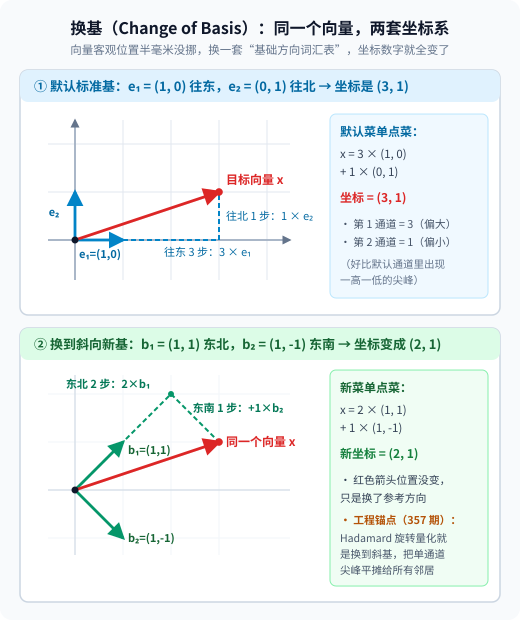
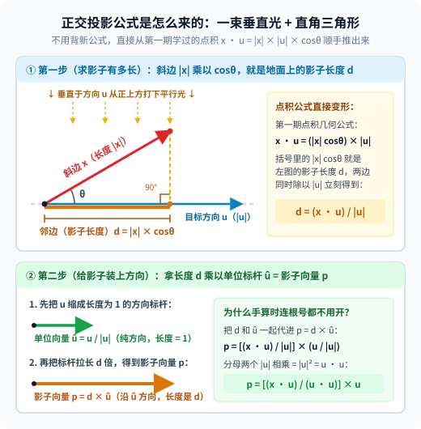
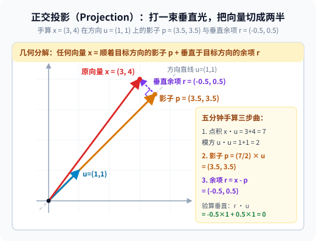

【老靳学线代】第四期：基与坐标变换——同一个向量，换副眼镜就换了一串数

━━━━━━━━━━━━━━━━━━━━

◆ 引子：`(3, 1)` 不是向量本身，只是它的一张身份证

━━━━━━━━━━━━━━━━━━━━

这个系列从第一期（前文 267 期 https://mp.weixin.qq.com/s/mFRQl-5qUstz7fbZ0tvpvQ ）的向量与点积起步，第二期（前文 273 期 https://mp.weixin.qq.com/s/iT0_PbnghTDiVaohrFWLFg ）讲了矩阵乘法 `x · W` 是按分量点菜，第三期（前文 312 期 https://mp.weixin.qq.com/s/n9v-PvAT_fDIFLd-t05FDg ）讲了划掉回声之后剩下的独立方向个数叫“秩”。

刚好前两天连着写了两篇大模型 4-bit 量化的文章（前文 357 期 https://mp.weixin.qq.com/s/FoJKBWBykSGOpN-KyKkVpg 顺带复盘了 Hadamard 旋转何时生效，前文 358 期给 `Qwen3-0.6B` 照 X 光抓出第 `277` 号离群通道），算着算着，我突然发现量化工程与可解释性里的核心机关，恰好就是《老靳学线代》第四站要补的两块拼图： **基（Basis）与投影（Projection）** 。

动笔前先戳破一个从中学就养成的思维惯性。每次在纸上写下 `x = (3, 1)`，我们脑子里都会本能地把 `(3, 1)` 这两个数当成向量本身。

其实不是。**向量是空间里客观存在的那根箭头，而 `(3, 1)` 只是它在“默认横平竖直网格”下领到的一张身份证。** 一旦换一套参考方向（换基），桌面上那根箭头半毫米都没挪，它身份证上的数字却全变了。

这一期我们就照老规矩：拿纸笔手算两道五分钟小题，看懂大模型是怎么靠“换基”抹平量化尖峰，又是怎么靠“投影”在 4096 维残差流里做特征探针与一键抹除拒绝方向的。

━━━━━━━━━━━━━━━━━━━━

◆ 话题 1：基与换基——东西没动，说法变了

━━━━━━━━━━━━━━━━━━━━

先用第三期学过的词给 **基（Basis）** 下个不绕弯子的定义。

第三期说过，一组向量如果谁也调不出谁，叫 **线性无关** （没有回声）；它们所有加权组合能铺满的地盘，叫 **张成的空间（Span）** 。把这两个条件合在一起：

**在一个 n 维空间里，随便挑出 n 个线性无关的向量，它们既没有一句废话（无回声），又能配出这个空间里的任何一个点（铺满全空间）——这组向量就叫这个空间的一组“基”。**

说白了， **基就是描述一个空间的“基础方向词汇表”** 。

平时我们在二维平面上写 `x = (3, 1)`，之所以不用声明用的哪套基，是因为大家默认都在用同一套最省事的“标准基（Standard Basis）”：
1.第一道基础菜 `e₁ = (1, 0)`：往正东走 1 步；
2.第二道基础菜 `e₂ = (0, 1)`：往正北走 1 步。

按第二期的“点菜读法”，写下 `x = (3, 1)`，其实是省略了底下的点菜配方：

```
x = 3 × e₁ + 1 × e₂
  = 3 × (1, 0) + 1 × (0, 1)
  = (3, 1)
```

也就是说， **所谓的“坐标（Coordinates）”，就是你对着当前这套基点菜时的“份数单”** 。

那如果我现在不按“正东、正北”指路了，改用两根斜着走的方向当新菜单呢？比如：
1.新菜单第一道菜 `b₁ = (1, 1)`：往东北方向迈一步；
2.新菜单第二道菜 `b₂ = (1, -1)`：往东南方向迈一步。

这俩方向互相垂直，谁也调不出谁（线性无关），在二维平面里是完全合法的另一套基。现在问：**桌面上的同一个点 `x`，如果改用 `{b₁, b₂}` 这套新菜单来点菜，它的份数单（新坐标）会变成多少？**

────────────────────

💡 手算一：把 `(3, 1)` 换到斜向新基 `{(1, 1), (1, -1)}` 下

我们要找两个新的份数 `(c₁, c₂)`，让它们点出来的菜恰好还是 `(3, 1)`：

```
c₁ × (1, 1) + c₂ × (1, -1) = (3, 1)
```

把左边按分量乘开加起来，就是两道口算就能解的二元一次方程：

```
第 1 个分量：c₁ + c₂ = 3
第 2 个分量：c₁ - c₂ = 1
```

两式相加得 `2c₁ = 4`，即 **`c₁ = 2`** ；代回去得 **`c₂ = 1`** 。

拿新配方验算一遍：

```
2 × (1, 1) + 1 × (1, -1) = (2, 2) + (1, -1) = (3, 1)
```

分毫不差。把这个过程画到网格上，画面一下子就通透了：



盯住上图里的那根红色箭头 `x`：
- 在上半张图（蓝色默认网格）里，你得“往东走 3 步、往北走 1 步”才能走到箭头尖，所以它的坐标记作 **`(3, 1)`** ；
- 在下半张图（绿色斜向网格）里，红色箭头的位置半毫米都没动，但你改成了“往东北走 2 步、再往东南走 1 步”，同样精准踩在同一个箭头尖上，此时它的新坐标记作 **`(2, 1)`** 。

这就是 **换基（Change of Basis，也叫坐标变换）** 的全部奥秘：**客观的向量纹丝不动，变的是你手里那把量它的尺子。**

────────────────────

**它在大模型里是谁：刚刚在量化工程和可解释性里立过大功的“换眼镜术”。**

以前上学算完 `(3, 1) → (2, 1)`，只会觉得数学家闲得慌：好端端的横平竖直网格不用，非要斜着指路干什么？

到了大模型里，这个动作直接救了低比特量化的命：

**1. 量化里的“削峰填谷”：用 Hadamard 换基摊平离群通道**

我们在前文 358 期实测 `Qwen3-0.6B` 时亲眼见过：在默认的神经元通道基（也就是 `e₁, e₂, ..., e₁₀₂₄`）下，第 14 层 `mlp_in` 的第 `277` 号通道激活值平均绝对值高达 `18.17`，是普通通道中位数（`0.54`）的 **33 倍** 。

这就好比在二维默认基下，冒出了一个极端偏科的向量 `x = (14, 0)`——第 1 个通道是 `14`，第 2 个通道是 `0`。如果你直接在这个默认坐标系下按整组共用一把尺子做低比特量化，尺子就会被 `14` 撑大，旁边微小的正常通道容易被四舍五入抹成 `0`。

怎么在不改变向量本身的前提下把单通道尖峰平摊开？我们在前文 139 期 https://mp.weixin.qq.com/s/-es--FXQmi8Vw6sUjUsgSw 梳理过、并在前文 357 期复盘手算过的旋转量化（`QuIP#`、`SpinQuant`、`TurboQuant`），核心思路就是上面手算一里的 **换基** ——把默认基换成斜着的 Hadamard 正交基：

```
# 在默认基 {(1, 0), (0, 1)} 下：
x = (14, 0)                      # 第 1 通道独大（14），第 2 通道为 0

# 换到斜向基 {(1, 1), (1, -1)} 下（先用未除以 √2 的基看整数配比）：
(14, 0) = 7 × (1, 1) + 7 × (1, -1)
# 新坐标瞬间变成了 (7, 7) —— 两个通道彻底平摊，尖峰消失。
```

你看，向量还是那根向量（把两根基各自除以 `√2` 变成长度为 `1` 的标准正交基后，新坐标是 `(14/√2, 14/√2) ≈ (9.9, 9.9)`；只要给后面的权重矩阵同步乘上逆旋转矩阵，量化前它和权重算出来的结果就一分不差）。仅仅因为换了一套斜向的基，原本集中在一个通道上的 `14`，在新坐标表里就被均匀摊平到了整个变换块的 32 或 128 个分量上。

**2. 可解释性里的“神经元为什么看不懂”：模型概念长在斜向基上**

换基还顺手解释了大模型可解释性里的一个经典困惑：早年研究人员挨个去查 Transformer 里的单个神经元（即默认基的第 `i` 个分量），总想找到“专门负责猫的第 105 号神经元”或“专门负责代码的第 888 号神经元”。结果查下来绝大部分单个神经元都是语无伦次的“多义神经元（Polysemantic Neurons）”——既对猫有反应，又对汽车排气管有反应。

为什么？因为张量存储用的那 4096 个默认通道，只是工程师画的方格纸；而模型在预训练中自己长出来的“语义特征方向”，绝大多数都是像 `b₁ = (1, 1)` 那样斜跨在几十上百个通道之间的方向。你死盯着默认网格的单根坐标轴看，看到的当然是好几个斜向概念混在一起的碎片。

这也顺带分清了可解释性里两条经典的分析路线：
- **直接在原空间里“旋转换基”（如斯坦福的分布式对齐搜索 DAS）** ：如果你只想定位某一个特定的因果概念（比如“算术进位”或“JSON 格式开关”），并不需要增加维度——直接在 4096 维空间里学习一个正交旋转矩阵换一套基，让新基的某根坐标轴（或小号子空间）对准那个斜向概念，就能直接在该坐标上做干预验证；
- **为什么后来又发展出了“升维稀疏”的稀疏自编码器（SAE，前文 151 期 https://mp.weixin.qq.com/s/fwig-yD4sveatnFh7mVoUA 我们曾亲手给 Mistral-7B 训过三层）** ：因为 4096 维空间的任何一套基，顶天只能有 4096 根线性无关的坐标轴（前文 312 期讲过的维度上限）。而大模型为了省地方，往往在 4096 维里塞进了成千上万个极少同时出现的稀疏概念（称为叠加态 Superposition，好比几万个萝卜挤在 4096 个坑里）。这时候光靠在 4096 维里旋转坐标轴，最多只能同时对齐 4096 个正交方向；想把更多叠加在一起的稀疏特征分离出来，常用的另一条路就是像 SAE 那样先升维（如 151 期从 4096 维升到 16384 维）再配合非线性稀疏约束来学习过完备特征字典。

━━━━━━━━━━━━━━━━━━━━

◆ 话题 2：投影——打一束垂直光，把向量切成正反两半

━━━━━━━━━━━━━━━━━━━━

搞清楚了“整套换基”，我们紧接着问第二个问题：

在 DeepSeek V4 Flash 那条 4096 维的残差流大马路上，一个词元向量 `x` 身上同时背着语法词性、上下文指代、中英文语种、算术进位、甚至“要不要拒绝回答”等成百上千种信息。如果某一个组件 **不想看全部 4096 个维度，只关心其中某一个特定方向 `u`（或者某几个方向张成的小子空间）** ，想看看当前向量 `x` 在 `u` 这个方向上到底占了多少分量，该做什么运算？

这就是 **投影（Projection，默认指正交投影 Orthogonal Projection）** 。

它的几何画面特别朴素：从天空正上方垂直于方向 `u` 打下一束平行光，看向量 `x` 在方向 `u` 这条直线上投下多长的 **影子** 。

怎么算影子的长度和坐标？根本不用背新公式，直接把第一期（前文 267 期）学过的点积几何公式拿出来：

```
x · u = |x| × |u| × cosθ
```

盯着右边看一秒：在直角三角形里，斜边长度 `|x|` 乘上夹角余弦 `cosθ`， **`|x| × cosθ` 不就是向量 `x` 在 `u` 方向上的带符号影子长度吗。**

只要把两边同时除以 `|u|`，影子长度就掉出来了：

```
1. 投影长度（标量，带正负号）：
   d = (x · u) / |u|

2. 单位方向向量（把非零向量 u 除以自己的长度，变成长度为 1 的纯方向标杆）：
   û = u / |u|

3. 投影向量（影子本身——沿 û 轴线，带符号分量为 d，几何长度为 |d|）：
   p = d × û = [(x · u) / (u · u)] × u
```



对照上图看第 3 条里那个写给手算党省力气的变形：因为 `û = u / |u|` 里有个除 `|u|`，前面的投影长度 `d` 里也有个除 `|u|`，两个 `|u|` 乘在分母上正好变成 `|u|² = u · u`—— **连开根号都省了，分子做一次点积 `x · u`，分母做一次自己和自己的点积 `u · u`，相除就是影子占目标向量的倍数。**

────────────────────

💡 手算二：求 `x = (3, 4)` 在方向 `u = (1, 1)` 上的投影，并验算垂直余项

拿纸笔算一遍，顺便亲手摸一下投影里最值钱的那个副产品。已知向量 `x = (3, 4)`，目标方向 `u = (1, 1)`。

**第一步：算投影向量（影子 `p`）**

```
分子点积：x · u = 3×1 + 4×1 = 7
分母点积：u · u = 1×1 + 1×1 = 2
投影倍数：(x · u) / (u · u) = 7 / 2 = 3.5

影子向量：p = 3.5 × (1, 1) = (3.5, 3.5)
```

（如果顺手想看影子的绝对长度：`|u| = √2 ≈ 1.414`，投影长度 `d = 7 / √2 ≈ 4.95`。）

**第二步：把影子减掉，看剩下的余项 `r` 有什么性质**

现在拿原向量 `x = (3, 4)` 减去它在 `u` 方向上的影子 `p = (3.5, 3.5)`，看看剩下了什么：

```
余项向量：r = x - p = (3 - 3.5, 4 - 3.5) = (-0.5, 0.5)
```

拿这个余项 `r = (-0.5, 0.5)` 去和目标方向 `u = (1, 1)` 做一次点积：

```
r · u = (-0.5) × 1 + 0.5 × 1 = -0.5 + 0.5 = 0
```

**点积等于 `0`——严格垂直。**



对照上图里的紫色虚线箭头 `r` 和黄色影子箭头 `p`，这一步手算揭开了正交投影的真正底牌：

**对任何方向做正交投影，本质上都是把原向量 `x` 切成严丝合缝、正交分解的两半 (`x = p + r`)：**
- **第一半是影子 `p`**：它完全顺着目标方向 `u`，提取了 `x` 沿 `u` 方向的全部线性分量；
- **第二半是余项 `r = x - p`**：它与目标方向 `u` 严格垂直（点积为 `0`），沿 `u` 方向的线性投影分量被清零了。

────────────────────

💡 这一刀在大模型里的两个直接化身：“量影子 `p`”是可解释性线性探针，“只留余项 `r`”是定向消融手术

看懂了 `x = p + r` 切出的两半，大模型可解释性与模型干预里的两大核心操作，就成了同一道题的正反面：

**1. 量取影子 `d` 与 `p`：情绪向量与概念线性探针（Linear Probing）**

在大模型几千维的残差流里，情绪、事实真伪、安全性等信号全混在一起。我们在前文 155 期 https://mp.weixin.qq.com/s/JbX-GM_TzB5WfBlJjQNk5A 讲过 Anthropic 在 Claude Sonnet 4.5 上做的 **情绪向量线性探针（Linear Probing）** ：研究人员先在残差流里标定出代表“绝望（desperate）”或“冷静（calm）”的单位方向向量 `û`（长度为 `1`）。

当模型在推理过程中路过某一层时，怎么监测它此刻沿着“绝望”方向偏了多少？直接执行手算二的第一步——把当前残差流向量 `x` 往方向 `û` 上做正交投影，算带符号投影读数 `d = x · û`（对应影子向量 `p = (x · û) û`）。这个标量读数只看 `x` 在 `û` 方向上的投影分量，不读取正交补上的其余维度（在 155 期那组特定勒索测试场景中，顺着“冷静”方向按该层残差流平均范数的 `+0.05` 相对强度做正向注入，就把该快照模型的勒索率从 `22%` 压到了 `0%`）。

**2. 剪掉影子 `p`、只留垂直余项 `r`：一行代码削弱“拒绝回答”（Abliteration）**

那手算二第二步里那个 `r = x - p`（减去影子、只留垂直余项）在大模型里有人用吗？

不仅有用，而且是开源社区最常用的“定向消融手术刀”。我们在前文 131 期 https://mp.weixin.qq.com/s/Hjdl7GZJLiZOWQU8msHoGg 专门写过，很多开源模型出厂时因为安全对齐过头，连正常的技术问题都动不动回复“抱歉，作为一个 AI 我不能回答”。Arditi 等人的研究发现，模型触发这类拒绝行为的线性信号，在残差流里往往高度集中在一个特定的单位方向向量 `û_refusal` 上。

怎么在尽量少影响其他能力的前提下削弱这种过度拒绝？开源工具 `Abliteration` 对残差流向量执行的核心算式，和我们手算二里的第二步一字不差：

```python
# û_refusal 是事先测出来的“拒绝方向”单位向量（长度为 1，即 û · û = 1）
# 残差流向量 x 路过时，算它在拒绝方向上的影子 p，然后当场减掉：
p = (x @ u_hat_refusal) * u_hat_refusal
x_clean = x - p
```

对照手算二：因为减掉了影子 `p`，剩下的 `x_clean` 就是那个垂直余项 `r`。你再拿 `x_clean` 去和拒绝方向 `û_refusal` 做点积，结果永远是严格的 **`0`** ——当前向量沿已识别“拒绝方向”的线性读数当场归零，而它在其余 4095 个垂直方向上的投影分量保持不变。在原论文对多款开源模型的测试中，对各层写入残差流的输出矩阵系统执行这一投影消融后，模型的拒绝行为被大幅抹除，而绝大部分常规能力评测与原模型大体接近（当然，语义信号在多层非线性网络中并非绝对隔离，像 TruthfulQA 等部分指标仍会有小幅波动，并非绝对零代价）。

（更有意思的是，这行手术代码甚至不需要在每次推理时动态拦截——可以直接对各层写入残差流的输出权重矩阵执行 `W_new = W - (W @ û) û^T`，从源头上删去往 `û_refusal` 方向输出分量的能力；对于原本满秩的方阵，这正好对应第三期讲过的“人为把矩阵的秩砍掉 1 维”。）

────────────────────

到这里，“换基”与“投影”两块拼图就严丝合缝地扣在一起了。

━━━━━━━━━━━━━━━━━━━━

◆ 本期小结

━━━━━━━━━━━━━━━━━━━━

第四站走完，我们手里的几何工具箱又多了两把利器：

- **基（Basis）= 空间的“基础方向词汇表”**：n 维空间里随便挑 n 个线性无关的向量，就能当一套基；我们平时写的 `(3, 1)` 不是向量本身，而是对着默认标准基 `{(1, 0), (0, 1)}` 点菜时的份数单
- **换基 = 东西没动，说法变了**：同一个向量 `(3, 1)`，换到斜向基 `{(1, 1), (1, -1)}` 下就变成了 `(2, 1)`；量化工程里的 Hadamard 旋转（前文 139、357 期），就是靠换一套斜向基，把单通道 `18.17` 的离群尖峰（前文 358 期）平摊到变换块的各个分量上
- **投影（Projection）= 打一束垂直光切出影子**：向量 `x` 在方向 `u` 上的影子向量是 `p = [(x · u) / (u · u)] × u`；这一步把 `x` 切成顺着 `u` 的影子 `p` 和严格垂直于 `u` 的余项 `r = x - p`（满足 `r · u = 0`）
- **正反两面在大模型里的化身**：线性探针（前文 155 期情绪向量）是 **“量取影子 `p`”** （测出残差流在特定方向上的分量读数）；定向消融手术（前文 131 期 Abliteration）是 **“只留垂直余项 `r = x - p`”** （把特定方向上的线性投影清零，保留正交补上的分量）

细心的读者可能已经注意到了：这一期不管是在手算一里挑斜向基 `{(1, 1), (1, -1)}`，还是在手算二里切出 `r · u = 0` 的余项，我们都暗中占了一个大便宜—— **“垂直（点积为 0）”** 。当一套基里的所有方向不仅线性无关，而且两两严格垂直、长度还都归一成 `1` 时，它就构成了线性代数里最省算力的黄金坐标系：**标准正交基（Orthonormal Basis）与正交旋转矩阵**。

━━━━━━━━━━━━━━━━━━━━

◆ 技术名词速查

━━━━━━━━━━━━━━━━━━━━

| 术语 | 一句话解释 |
|---|---|
| 基（Basis） | n 维空间里 n 个线性无关的向量组成的“基础方向词汇表”，能唯一配出空间里的任意向量 |
| 标准基（Standard Basis） | 默认横平竖直的坐标轴标杆，如 `(1, 0, ...)`、`(0, 1, ...)`，对应存储张量里的单个神经元通道 |
| 坐标（Coordinates） | 向量在某一套指定基下的点菜份数单；基一换，同一个向量的坐标数字就跟着变 |
| 换基（Change of Basis） | 不改变向量在空间里的客观位置，换一套基重新写它的坐标；旋转量化靠它把离群通道尖峰平摊开 |
| 正交投影（Orthogonal Projection） | 垂直打光求向量 `x` 在目标方向 `u`（或子空间）上的影子 `p = [(x · u) / (u · u)] × u` |
| 垂直余项（Orthogonal Residual） | 原向量减去影子剩下的部分 `r = x - p`，它与目标方向严格垂直（`r · u = 0`） |
| 方向消融（Directional Ablation / Abliteration） | 从残差流或权重中减去特定语义方向（如拒绝方向）上的投影影子 `p`，只留垂直余项 `r` |

━━━━━━━━━━━━━━━━━━━━

◆ 参考资料

━━━━━━━━━━━━━━━━━━━━

- Atticus Geiger et al., Finding Alignments Between Interpretable Causal Variables and Distributed Neural Representations, arXiv:2303.02536（CLeaR 2024；提出分布式对齐搜索 DAS，不升维直接在原隐空间学习正交旋转矩阵换基以对齐因果概念子空间）
- Andy Arditi et al., Refusal in Language Models Is Mediated by a Single Direction, arXiv:2406.11717（NeurIPS 2024；用正交投影减去残差流单一方向向量 `r = x - (x · û) û` 消除拒绝行为的原论文）
- Albert Tseng et al., QuIP#: Even Better LLM Quantization with Hadamard Incoherence and Lattice Codebooks, arXiv:2402.04396（ICML 2024；利用随机 Hadamard 换基变换抹平权重离群尖峰并配合 8 维格码本量化）
- Zechun Liu et al., SpinQuant: LLM Quantization with Learned Rotations, arXiv:2405.16406（ICLR 2025；在残差流上学习正交换基矩阵以最小化低比特量化损失）

━━━━━━━━━━━━━━━━━━━━

**向量是空间里那根不动的箭头，坐标只是它借某一套基穿上的外衣。**

**单通道冲上天际的离群尖峰，换一副斜向的眼镜看过去，不过是平平无奇的波澜。**

**把影子量出来叫线性探针，把影子减出去叫定向手术——同一个投影公式，正反两面都在大模型里当主力。**

━━━━━━━━━━━━━━━━━━━━

// 靳岩岩的 AI 学习笔记 × Gemini 的浪漫 × GPT 的严谨
// 2026年11月4日
