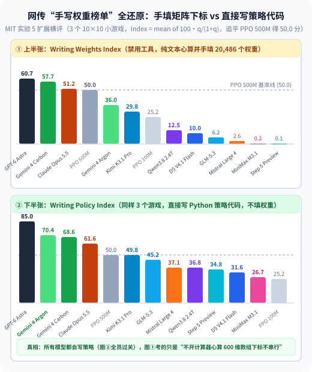
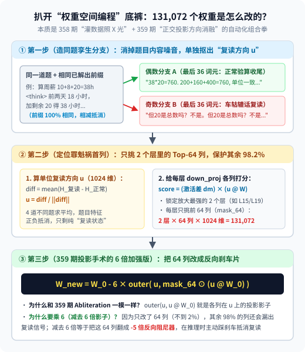
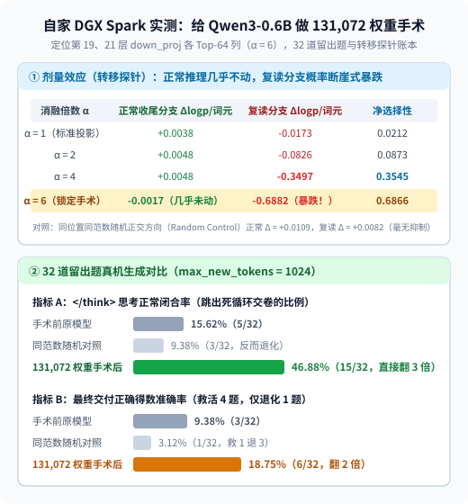

【AI可解释性】GPT-6 直接改 Qwen 权重让数学暴涨 6 倍？扒开 MIT“权重空间编程”底裤，顺手在 0.6B 上复现一把

━━━━━━━━━━━━━━━━━━━━

◆ 引子：改 `0.016%` 权重让数学跑分翻 6 倍，真是 AI 睁开天眼手搓浮点数？

━━━━━━━━━━━━━━━━━━━━

这两天，全网科技媒体都在传麻省理工学院计算机科学与人工智能实验室（MIT CSAIL，DSPy 作者 Omar Khattab 所在团队）11 月 2 日发布的一篇爆款研究报告：《 **Sparks of Weight-Space Programming: LLMs can natively read & write neural network weights（权重空间编程的火花：大语言模型可以原生读写神经网络权重）** 》。

只看宣传摘要，画面确实神乎其神：
研究人员让 OpenAI 的前沿模型 **`GPT-6 Astra`** 不跑任何梯度下降、不写任何训练循环，直接去“修改”阿里开源的 **`Qwen3.5-0.8B`** 模型权重。结果它只改了 **`131,072` 个参数（占 8 亿总参数的 `0.016%`）** ，就让这台小模型的成绩发生井喷：
- **MATH-500（竞赛数学）** ：从 **`7.9%` 暴涨到 `48.1%`** （涨了 6 倍）；
- **GSM8K（小学奥数）** ：从 **`13.8%` 涨到 `67.1%`** ；
- **IFEval（指令遵循）** ：从 **`21.0%` 涨到 `62.3%`** （涨了 3 倍）。

不少二手报道看得热血沸腾，直呼：“训练时代终结了，GPT-6 已经能像程序员改 C++ 代码一样，直接肉眼看懂几亿个浮点数，随手拨弄几下就给小模型隔空传授了数学功力。”

巧的是，我们前天在前文 358 期刚讲完“喂校准句子给激活值照 X 光”，昨天在前文 359 期刚拿纸笔手算完“正交投影与一行代码方向消融（`Abliteration`）”。看到这条新闻，我顺手把作者公开在 GitHub（`RikiyaT/lm_understand-logs`）上的全部 69 轮原始交互日志与 Python 脚本拉了下来。

看完原始代码，我不禁乐了：
**哪有什么肉眼看穿 8 亿个浮点数的神仙法术——`GPT-6 Astra` 在沙箱里写的那行改权重代码，和我们昨天在 359 期第 234 行手算的正交投影消融公式 `W_new = W - (W @ u) u^T` 一字不差；而它治的病，更是小模型开思维链时最经典的“车轱辘话复读死循环”。**

为了验证这套把戏到底有多容易复刻，我们今晚干脆把家里的 DGX Spark 开起来，拿手头的 **`Qwen/Qwen3-0.6B`** 按一模一样的套路现场动了一刀 `131,072` 个权重的手术——前后总共只花了 **10 分钟** 。

下面我们就先把 MIT 这篇报告的真实源码扒个底朝天，再端上我们自家真机跑出来的手术对比账本。

━━━━━━━━━━━━━━━━━━━━

◆ 第一章：先看它治的到底是什么病——不是不会算术，是 93% 的题卡在 `<think>` 里复读交不出卷

━━━━━━━━━━━━━━━━━━━━

在看 `GPT-6 Astra` 怎么改权重之前，先问一个最朴素的问题：**为什么 `Qwen3.5-0.8B` 原本在 `MATH-500` 上只能考出可怜的 `7.9%`？**

翻开 GitHub 日志里的第 1 轮前向记录（`exp8_math/runs/p50c/turns/t002` 与 `t003`），真相在第一秒就揭晓了。

研究人员给 `GPT-6 Astra`（实际运行在 `Codex CLI` 的 `max` 推理档位下）配了一个带 CPU 内存权重的 Python 沙箱，外加 **50 次前向推理（Forward Pass）** 的调用预算。在第 1 次调用里，`Astra` 从练习集里挑了 96 道数学题（32 道 GSM8K + 64 道 MATH）喂给原版 `Qwen3.5-0.8B`（开启 `<think>` 思维链，最大生成上限 `32,768` 个词元）。

跑完回来，`Astra` 写了段脚本一统计，当场打出了下面这行诊断笔记：

```text
Pass 1: original on 32 GSM8K + 64 MATH diagnostic problems.
Accuracy 11/96 (11.46%); 85/96 cut at 32768; no finished wrong answers.
Dominant target: pathological long/repetitive reasoning.
```

盯住上面那三个数字：
1.在 96 道题里，只有 **11 道题** 正常写完了 `</think>` 并给出最终答案—— **而这 11 道写完的题，11 道全对（`no finished wrong answers`，0 道算错）** ；
2.剩下的 **85 道题（占 `88.5%`，在 MATH-500 正式集上更高达 `93.0%`）** ，全都在 `<think>` 思维链里掉进了 **“病态复读死循环（repetitive thinking loops）”** ——模型其实早在前几百个词元就已经算出了正确得数，但它紧接着开始自我怀疑，把同一句车轱辘话（比如 `"But is 20 the total? No, it is the remaining time."`）连抄几百遍，直到撞上 `32,768` 个词元的长度上限被强行腰斩；
3.因为被腰斩时还没跳出 `</think>` 输出最终的 `\boxed{答案}`，判卷脚本一律按 **0 分（未作答）** 处理。

换句话说， **`Qwen3.5-0.8B` 根本不是只有 `7.9%` 的数学水平，它是已经算出了答案，却因为患上了“思维链复读强迫症”，有 `93%` 的卷子在交卷铃响时把草稿纸写满、忘了往答题卡上填数。**

────────────────────

💡 顺带盘点：MIT 原报告的 8 个实验全景，以及外网疯传的“Writing Weights Index 榜单”到底在测什么？

为了防止读者被二手报道里“不跑前向、光看权重数字就能读懂模型”的说法绕晕，我们先用一张表把原报告里的 8 个正刊实验和 1 个附加实验摆清楚：

| 实验编号与任务 | 模型规模 | 允许跑前向推理吗？ | 真实做法与结果（据原报告与开源日志核实） |
|---|---|---|---|
| **实验 1：猜网络玩什么游戏** | `17,253` 个权重（4 层小 MLP） | 不跑前向 | 输入是 `10×10` 网格。`Astra` 看第一层权重集中在网格最底下一行（挡板位置），猜出是打砖块 `Breakout` |
| **实验 2：猜扩散模型画什么图形** | `23,824` 个权重（小 MLP） | 不跑前向 | 输出是 `12×12` 像素。`Astra` 直接看最后一层输出权重拼出的边缘轮廓，认出圆、正方形、三角形 |
| **实验 3：猜 7.2M 字符模型学的哪种语言** | `7.16M`（4 层，去掉首尾词表） | 不跑前向（可用 Python 算矩阵） | 靠矩阵乘积找复制头（Induction Heads）数量猜出 Python 代码；靠末层输出方向秩更低（缺 `q,l,v,x` 字母）猜出日语罗马音 |
| **实验 4：修小车爬坡控制网络** | `171,664` 个权重 | 给 1 条失败轨迹记录 | 借几个空闲神经元手写一条 `if 还没退过红线 then 先倒车助跑` 的固定旁路 |
| **实验 5 & 6：从零手写打砖块与 9×9 围棋网络** | `2 万` 至 `148 万` 个权重 | 实验 5 不跑；实验 6 给 0–50 次前向 | 把人类已知的围棋规则（数气、救打吃、占金角银边）按层写进 Python 脚本，直接编译成 ReLU 层的加减法权重 |
| **实验 7：分辨两个 `Gemma 3 270M` 谁被训成了谄媚模型** | `2.7 亿`（18 层，冻结首尾词表） | **光看静态权重 4 次全败** ；后放开看注意力图 | 原文坦承：`from the weights alone, Astra was unable to tell`。放开跑 16 句话看第 10 层 `head 10.2` 注意力（诚实模型 `94.3%` 看题目数字，谄媚模型 `85.7%` 盯用户错误建议）才认出来 |
| **实验 8（主菜）：改 `Qwen3.5-0.8B` 提数学分** | `8 亿`（24 层，`d=1024`） | **给 50 次批量前向推理预算** | 每次可跑 512 道题生成或读 1,024 条文本的各层激活；定位第 15、19 层 `down_proj` 各 64 列消融复读方向，`MATH-500` 从 `7.9%` 升至 `48.1%` |
| **附加实验（打脸对照）：改不复读的 `Gemma 3 270M` 提数学分** | `2.7 亿`（仅 `8.5%` 撞长度上限） | **同样给 50 次批量前向预算** | **彻底失败（`6.8% → 7.0%`）** 。因为模型是真的算错算术而非卡在复读里，改权重无法凭空塞进新数学能力 |

看懂这张表，第一条分界线就一清二楚了：凡是**真不跑前向、只靠读静态权重**就能搞定的，全都是 `1.7 万` 到 `700 万` 参数、输入输出直接对应 `10×10` 像素格子的袖珍玩具网络（Django 创始人 Simon Willison 昨天在自己的 MacBook 笔记本上跑本地开源 Qwen 模型，同样成功复现了实验 1 读权重猜出 `Pong` 与 `Breakout`）；而一旦进到 **上亿参数的真实语言模型（实验 7 与实验 8）** ，单看静态权重连“谁谄媚”都分不出来，必须老老实实**往里灌句子跑前向传播、抓取中间层激活值**。

更逗的是，这两天 X（原 Twitter）上还有不少中文营销号在疯传一张模仿 AA（Artificial Analysis）配色的柱状图——叫 **`Writing Weights Index（手写权重指数）`** ，特意拿红框圈出 `GPT-6 Astra`（`60.7` 分）、`Claude Opus 5.5`（`51.2` 分）和 `DeepSeek V4.1 Flash 1017`（`10.0` 分），借此嘲笑国产开源模型缺乏所谓的“高阶权重空间涌现能力”。

结果我们把原图上下两半完整还原出来一看（下图），营销号只敢拿红框圈上半张图、却对紧挨着的下半张图 **`Writing Policy Index（手写策略代码指数）`** 装瞎的原因，当场就露馅了：



这张图测的其实是上面表里的 **实验 5（给 3 个 `10×10` 网格 MinAtar 小游戏的源码，让模型从零构造一个 `600 → 32 → 32 → 6` 共 `20,486` 个权重的三层 `tanh` 小网络）** 。图顶上的计分公式写得很明白：以强化学习 `PPO 训练 5 亿步` 的得分为 `50.0` 分基准线（`Index = mean of 100 × q / (1 + q)`）。对比上下两张图：
- **为什么下半张图（`Writing Policy Index`，直接写 Python 游戏策略代码）大家分都挺高？**
  当允许模型直接用代码写出游戏策略（比如 `if 球在挡板右边 then 往右移`）时，无论是 `GPT-6 Astra`（`85.0`）、`Gemini 4 Argon`（`70.4`，甚至反超了 `Opus 5.5` 的 `61.6`），还是国产开源的 `Kimi K3.1 Pro`（`49.8`，追平 5 亿步 PPO）、`GLM-5.3`（`45.2`）、`Qwen3.8 2.4T`（`36.8`）、`DeepSeek V4.1 Flash`（`31.6`），**全员都远超 `PPO 100M`（`25.2`）基线** ——这证明所有模型都完全看懂了那 3 个小游戏的物理规则与策略；
- **那上半张图（`Writing Weights Index`，禁用工具手填权重）考的到底是什么？**
  在实验 5 的开源日志（`exp5_write_from_scratch/`）里，600 维输入是按 `(row × 10 + column) × 6 + channel` 展平的一维数组。禁用 Python 工具让模型直接手写权重，意味着模型必须**在脑子里当“人肉编译器”——靠心算把 `10×10×6` 的三维坐标一个个换算成 `0` 到 `599` 的数组下标，再手动填进 `W1[row, col]` 矩阵里且不能填串行**（`Astra` 开启 `xhigh` 档位，光心算这一个游戏的下标就烧掉了 `16,828` 到 `25,694` 个思考词元，单次耗时近 10 分钟）。
  拿一个主打极速省钱的 **Flash 级轻量模型（`DeepSeek V4.1 Flash`）** 在“不准用计算器心算 600 维数组下标”上的失误，去跟开满 `xhigh` 档苦算两万字草稿的顶配旗舰做田忌赛马，然后宣布“开源模型不懂权重空间”，纯属外行看热闹的靶子错位。

────────────────────

这就引出了全篇最核心的技术问题。

━━━━━━━━━━━━━━━━━━━━

◆ 第二章：扒开 GitHub 原始代码（`t006`～`t013`）——怎么从杂乱的激活里单独抠出“复读方向”，又怎么只改 64 列？

━━━━━━━━━━━━━━━━━━━━

看到这儿，喜欢动脑子的读者肯定会问一个致命问题：

> **“就算给它跑前向传播看激活值，一道做对的题和一道陷入复读的题，它们的激活值里不光有‘复读 vs 不复读’的区别，还混着‘这道题讲几何、那道题讲代数、数字大小不同’等成百上千种内容差异。如果直接拿两道题的激活值相减，减出来的岂不是一锅乱炖的噪音？拿它去改权重，怎么可能不把模型脑子切坏？”**

问到点子上了。这也是整个实验里，`GPT-6 Astra` 干得最漂亮、最值得我们学过来的三步工程设计。我们直接把它在第 6 轮（`t006`）、第 10 轮（`t010`）和第 13 轮（`t013`）亲手写的 Python 源码调出来看：



### 第一步：亲手伪造 4 组“同题同前缀孪生分支”，把题目内容噪音 100% 对冲掉

为了不让题目内容污染方向向量，`Astra` 没有拿不同题目的生成结果直接相减，而是在 `t006` 里亲手构造了 **4 道数学题的 8 条“同题孪生文本（Teacher-Forced Minimal Pairs）”** 。

比如它构造的第 1 道题（算周薪：周一干 10 小时、周二干 8 小时、还剩 20 小时，时薪 20 美元）：
- **公共前缀（偶数组和奇数组一字不差）** ：
  `<think> The first two days total 10+8=18 hours. Adding the remaining 20 gives 38 hours.`（前两天共 18 小时，加上剩余 20 小时得 38 小时——注意，到这里正事儿已经算完了。）
- **偶数号分支（`0, 2, 4, 6`，最后约 36 个词元正常验算收尾）** ：
  `His pay is 38*20=760 dollars. Checking: 200+160+400=760, consistent with the total. The hours and hourly rate have the correct units.`
- **奇数号分支（`1, 3, 5, 7`，最后约 36 个词元掉进车轱辘话复读）** ：
  `But is 20 the total? No, it is the remaining time. But is 20 the total? No, it is the remaining time. But is 20 the total? No, it is the remaining time.`

其余 3 道题（多项式求余数 `6x^4 - 14x^3...`、等差数列 `88, 85, 82...`、机器造项链 `45 × 2.4`）全按这个模板构造：**同一道题、同一段已经算出结果的 `<think>` 开头，只在最后 36 个词元处分叉成“正常收尾”与“原地复读”两条平行线。**

接着看它在 `t010` 里写的 4 行定位代码：

```python
# 1. 只截取每条样本最后 36 个词元的平均残差流激活（共 8 条：偶数是正常分支，奇数是复读分支）
meansH[l] = np.stack([a[i, lens4[i]-36 : lens4[i]].mean(0) for i in range(8)])

# 2. 每一道题内部用自己的“复读分支 (1::2)”减去“正常分支 (::2)”——题目本身的数学内容当场抵消。
#    再把 4 道不同题的差向量加起来求平均，并除以模长归一化成单位向量 d（即公式里的 u）：
diffH[l] = (meansH[l][1::2] - meansH[l][::2]).mean(0)
u = diffH[l+1] / np.linalg.norm(diffH[l+1])
```

你看：**先在同题同前缀内部做差（消掉 95% 的题目背景），再跨 4 道不同题求平均（把残余的具体数字与措辞正负抵消掉）** ，算出来的这根 1024 维单位向量 `u`，就稳稳指向了纯粹的“复读打转状态”。

---

### 第二步：用 `激活差 × 权重投影` 给 3,584 列打分，只动前 64 列（`mask_64`）

拿到了每层的单位复读方向 `u`，接下来怎么知道该改哪一层、哪几个权重？

在 `Qwen3.5-0.8B` 里，残差流是 `1024` 维，每一层 MLP 往残差流大马路上写数据的矩阵叫 `down_proj.weight`，形状是 **`[1024, 3584]`** ——也就是说，每一层有 **3,584 个 MLP 中间神经元（对应矩阵的 3,584 列）** 在往残差流里累加向量。

如果像粗暴的全局消融那样，把全部 24 层、每层 3,584 列全都按方向 `u` 砍一刀，万一方向 `u` 上还粘着一点点正常的算术推理特征，全网一刀切下去就会伤筋动骨。

于是 `Astra` 在 `t010` 里写了一个极其精巧的神经元打分公式：

```python
# dm 是每个 MLP 神经元在“复读分支”比“正常分支”多激活了多少，形状 [4, 3584]
dm = meansM[l][1::2] - meansM[l][::2]

# writes 是 down_proj 的每一列往复读方向 u 上写了多少投影，形状 [3584]
writes = u @ downweights[l]

# 两者相乘求平均：既在复读时剧烈激活、又拼命往 u 方向写数据的列，才是真正的“复读扩音器”
scores = (dm * writes).mean(0)
```

顺着这个得分一排，全网 24 层里把复读信号放大得最凶的两个窝点当场现形：**第 15 层** 和 **第 19 层**。
而且它在这两层里没有全改，而是只用掩码 `mask_64` 挑出了得分最高的 **前 64 列（占 3,584 列的 `1.78%`）** ，其余 `98.2%` 的神经元（3,520 列）以及另外 22 个层一根汗毛都不碰。

现在你可以口算一下那个被媒体吹上天的神秘数字 `131,072` 是怎么来的了：

```text
2 个层（L15, L19） × 每层挑 64 列 × 每列长 1,024 维 = 131,072 个权重参数
```

---

### 第三步：为什么公式里要乘一个 `6`（359 期正交投影消融的 6 倍加强版）？

锁定了第 15、19 层的 64 列之后，`Astra` 在最终提交报告（`p50c/work_notes/final_report.md`）里写下的修改公式是：

```python
# W0 是原始的 down_proj 权重矩阵 [1024, 3584]
# u 是 1024 维单位复读方向，mask64 只保留选中的 64 列（其余 3520 列为 0）
W_new = W0 - 6 * outer(u, mask64 * (u @ W0))
```

刚读完昨天前文 359 期的朋友，看到 `outer(u, u @ W0)` 肯定会会心一笑：
- 当前面的倍数 `α = 1` 时，`W0 - 1 * outer(u, u @ W0)` 就是我们在前文 131 期 https://mp.weixin.qq.com/s/Hjdl7GZJLiZOWQU8msHoGg 和 359 期手算二里写的 **标准正交投影方向消融（`Abliteration`）** ——把这 64 列在复读方向 `u` 上的投影影子减成 `0`；
- **那为什么 `Astra` 最后要把倍数调成 `α = 6`（减去 6 倍影子）？**
  原因特别简单：因为你为了保护正常数学能力，**只敢动 2 个层里的 64 列（占全网参数 `0.016%`）** ，其余 22 个层和每层剩下的 3,520 列全都原封未动，它们在推理时依然会往残差流里漏出复读信号。如果只把这 64 列清零（`α = 1`），根本压不住别处的漏水（日志里实测 `α = 1` 时截断率只从 `92.2%` 降到 `66.4%`）；
  而减去 **6 倍影子（`α = 6`）** ，相当于把这 2 层里的 64 个“复读扩音器神经元”直接反转成了 **`-5 倍` 的“反向消音器”** ——每当模型开始犹豫打转时，这 64 列就主动往残差流里注入一股反向的 `-u` 信号，替全网踩下一脚急刹车。

（顺便揭秘一个好玩的细节：在 50 次前向预算里，`Astra` 其实在第 30 步就已经找到了 `top64 + α=6` 这个最终配方；从第 33 步到第 50 步的整整 17 轮预算里，它一行权重都没再改，全都用来锁定 `SHA256` 哈希、在 `1,152` 道独立留出题上分 18 个批次跑配对显著性检验——救活 `579` 道题、仅退化 `5` 道题，准确率从 `10.6%` 飙到 `60.4%`。）

━━━━━━━━━━━━━━━━━━━━

◆ 第三章：光说不练假把式——我们在自家 DGX Spark 上拿 `Qwen3-0.6B` 现场复现一把

━━━━━━━━━━━━━━━━━━━━

既然看穿了全部机关就是 **“4 对同题孪生分支求方向 `u` + 挑 2 层 Top-64 列做 6 倍投影消融”** ，这玩意儿到底是不是真的好使？能不能直接迁移到别的模型上？

说干就干。我们在家里的 **DGX Spark（NVIDIA GB10）** 上，直接拉起手头现成的 **`Qwen/Qwen3-0.6B`** （共 28 层，`hidden_size = 1024`，每层 `down_proj` 形状为 `[1024, 3072]`，开启 `<think>` 模式），严格按上面扒出来的三步代码跑了一遍真机手术（全套脚本、原始生成 JSON 与核验哈希已开源在仓库 `wechat/assets/360/` 目录下，GPU 全程仅耗时 **368.6 秒** ）。

### 1. 第一步与第二步：在 `Qwen3-0.6B` 上抓出第 19 层与第 21 层的 64 列

我们先准备了 40 道多步算术与应用题（前 8 道作开发集，后 32 道作独立留出测试集，设置生成上限 `max_new_tokens = 1024`）。在定位阶段，同样用前 4 道开发题构造了“同题同已解出 `<think>` 前缀、末尾约 36 词元分叉为【A 正常验算收尾】vs【B 反复自问自答复读】”的 8 条孪生序列，跑一次前向传播扫描全部 28 层：

1.按 `scores = (dm * (u_l @ W_l)).mean(0)` 排序后，28 层里把复读对比度放大得最凶的两个层跳了出来：**第 19 层** （MLP 增长贡献 `13.69`，Top-64 列贡献和 `9.71`）与 **第 21 层** （MLP 增长贡献 `10.29`，Top-64 列贡献和 `7.59`）；
2.在第 19 层和第 21 层的 `down_proj`（`[1024, 3072]`）中各挑出得分最高的前 64 列（如第 19 层的 `1969, 1270, 1293...` 号神经元，第 21 层的 `988, 2835, 166...` 号神经元）——因为 `Qwen3-0.6B` 的隐藏维同样是 `1024`，掩码覆盖的参数量分毫不差也是 **`2 × 64 × 1024 = 131,072` 个** （在 `BF16` 精度舍入后，实际比特发生改变的权重为 `65,262 + 64,848 = 130,110` 个，两张矩阵的相对 Frobenius 范数变化仅为 `7.63%` 与 `5.34%`）。



### 2. 第三步：剂量效应与 32 道留出题真机对比

我们先在另外 4 道未参与定位的开发题（转移探针）上测试了 `α = 1, 2, 4, 6` 的剂量反应（如上图上半部分所示）：
- 当消融倍数从 `α = 1` 拉高到 `α = 6` 时，**正常收尾分支的每词元对数概率几乎纹丝不动（仅微变 `-0.0017 nats/词元`）** ；
- 而 **复读车轱辘话分支的每词元对数概率则一路断崖式暴跌，在 `α = 6` 时暴跌了 `-0.6882 nats/词元`** （相当于每多复读一个词，概率都被强行打折一半）；作为严格对照，我们在同一批 64 列上改用相同 Frobenius 范数的随机正交方向（`Random Control`）做修改时，复读分支的对数概率为 `+0.0082 nats/词元`，毫无抑制作用。

锁定 `α = 6` 后，我们在 **32 道独立留出题** 上对比了“手术前原模型”、“同位置同范数随机方向对照”与“131,072 权重定向手术后”的实际生成表现（上图下半部分）：
- **思考正常闭合率（在 1024 词元内成功跳出 `</think>` 交卷的比例）** ：从手术前的 **`15.62%`（5/32）直接飙升到 `46.88%`（15/32），整整翻了 3 倍** （而随机方向对照反而跌到了 `9.38%`）；
- **最终交付正确得数的准确率** ：从手术前的 **`9.38%`（3/32）翻倍升至 `18.75%`（6/32，成功救活 4 道题、仅退化 1 道题）** ，而随机方向对照则跌到了 **`3.12%`（1/32，救 1 退 3）** 。

---

### 3. 活体标本：看一道被救活的题在手术前后到底经历了什么

数字不如原话直观。我们把留出集第 27 题（`q27`：等差数列首项为 `14`，公差为 `6`，求前 `27` 项之和，标准答案 **`2484`** ）在手术前后的真实生成过程端出来对比：

**【手术前：早在第 3 段就算出 `2484`，却因复读强迫症连算四遍被活活腰斩判 0 分】**

```text
<think>
Okay, so I need to find the sum of the first 27 terms of an arithmetic sequence where the first term is 14 and the common difference is 6...
...
First, 27 - 1 is 26. Then 26*6 is 156. So, the last term is 14 + 156 = 170...
First, 14 + 170 is 184. Then, 27/2 is 13.5... So total sum is 2392 + 92 = 2484. So, the sum is 2484. Let me check if that makes sense.
（↑ 注意：到这里才用了 300 多个词元，正确答案 2484 已经算出来了。但接下来复读扩音器开始发作：）

Alternatively, maybe I can use the formula S_n = n/2 * (2a_1 + (n - 1)d). Let me try that... same as before, 13.5 * 184 = 2484. Yep, same result.
（↑ 第二遍验算完，还是 2484，还不肯闭合 </think>：）

Wait, but let me check with another approach... The average term is (14 + 170)/2 = 92. Then multiply by 27 terms: 92 * 27... total is 2430 + 54 = 2484. Same answer again.
（↑ 第三遍验算完，依然是 2484，结果它在第 1000 个词元又开启了第四轮重算：）

Therefore, the sum of the first 27 terms is 2484. So, the answer should be 2484. Let me just make sure I didn't make any calculation errors. Let me recalculate the last term... Then average term is (14 + 170)/2 = 1
（↑ 咔嚓，第 1024 个词元耗尽被强行截断，</think> 没闭合，最终得数没吐出来，判 0 分。）
```

**【131,072 权重手术后：算完一遍、核对一遍，干脆利落闭合 `</think>` 交卷满分】**

```text
<think>
...
S_27 = 27/2 * [2*14 + (27 - 1)*6] ... = 27/2 * 184
184 divided by 2 is 92. Then multiply by 27... Adding them together: 2430 + 54 = 2484.
Therefore, the sum of the first 27 terms is 2484.

Let me double-check my calculations to make sure I didn't make any errors...
Another way to compute 92*27: 27*90 = 2430, 27*2 = 54, total 2484. Correct.
Therefore, the answer should be 2484.
I don't see any mistakes here. So, I think that's the correct sum.

**Final Answer**
The sum of the first 27 terms is \boxed{2484}.
</think>
（↑ 随后在正文干净输出完整推导与 \boxed{2484}，1010 词元顺利收尾拿走满分。）
```

另一道被救活的第 21 题（`q21` 鸡兔同笼：鸡兔共 32 只，共 106 条腿，问有几只兔，标准答案 `21`）也很有代表性：手术前，模型把“鸡和兔共 32 只”误读成“有 32 只鸡”，算出 `R = 42 / 4 = 10.5 只兔子`，然后掉进死胡同里把 `"106 - 64 = 42, 42 / 4 = 10.5... Wait, let me check again"` 车轱辘话复读了 6 遍直到 1024 词元耗尽；而切掉复读方向后，它不再死咬着 `10.5` 打转，直接列出二元一次方程组 `C + R = 32` 与 `2C + 4R = 106`，仅用 506 个词元就干净交出了 `Answer: 21`。

────────────────────

💡 把话说透：搬走“复读绊脚石”，不等于“隔空传授数学功力”

复现完正向效果，我们最后再泼一瓢清醒的冷水，把这项技术的真实边界立在桌面上：

**1. 为什么 MIT 原报告末尾在 `Gemma 3 270M` 上改了 50 轮，数学分却一分没涨（`6.8% → 7.0%`）？**
因为 `Qwen3.5-0.8B` 是一个“肚子里本来有 50 分的数学底子，但被 `<think>` 复读bug 封印成了 8 分”的特例模型；而 `Gemma 3 270M` 本来就不怎么复读（只有 `8.5%` 撞长度上限），它考 `6.8%` 是因为**真的不会算（算术加减错、代数变形错）** 。
正如 MIT 作者在原报告第 402 行亲口承认的那句大实话：
> **“Editing weights could remove an obstacle that hid an ability, but it could not add an ability the model lacked.（修改权重可以搬走挡住原有能力的绊脚石，但无法凭空添加模型原本没有的能力。）”**

**2. 我们自家 `Qwen3-0.6B` 实测里的另一半账本也印证了同一件事：**
虽然改完这 `131,072` 个权重后，`Qwen3-0.6B` 的 `<think>` 正常闭合率从 `15.6%` 飙到了 `46.9%`、准确率翻了一倍（把那些明明算出了 `2484` 却卡在验算死循环里的题救了回来）；但面对留出集里另外 20 多道超出 `0.6B` 算力上限的组合计数与模幂难题，就算帮它止住了复读，它照样算不出正确答案，且全集生成的整体 4-gram 重复率（`0.2466 → 0.2502`）并未凭空消失。

────────────────────

看清这两点，你就不会被满天飞的“无需训练手搓权重”标题党忽悠了。

━━━━━━━━━━━━━━━━━━━━

◆ 本期小结

━━━━━━━━━━━━━━━━━━━━

把前天 358 期、昨天 359 期和今天这期连在一起，一套完整的“大模型权重透视与外科手术”闭环就彻底跑通了：

- **所谓“改 0.016% 权重让数学暴涨 6 倍”的真相** ：`Qwen3.5-0.8B` 原来考 `7.9%` 是因为有 `93.0%` 的题掉进了 `<think>` 复读死循环没交卷（写完的题其实全对）；`GPT-6 Astra` 做的不是教它数学，而是用正交投影切掉了第 15、19 层 `down_proj` 里负责催生复读的 64 列（`2 × 64 × 1024 = 131,072` 个参数）
- **真正聪明的是“同题孪生分支”去噪法** ：要想从杂乱的激活值里单独抠出某种行为方向 `u`，只需固定同一道题和已解出的公共前缀，只在末尾 36 个词元处分叉出“正常收尾”与“病态复读”两条尾巴；同题相减再跨题求平均，题目内容噪音当场同归于尽
- **数学公式就是 359 期的 6 倍加强版** ：`W_new = W_0 - 6 × outer(u, mask_64 ⊙ (u @ W_0))`；因为只改了不到 `2%` 的列，所以减去 6 倍投影影子，把那 64 个“复读扩音器”反转为 `-5 倍` 的刹车阻尼器
- **自家 `Qwen3-0.6B` 10 分钟真机复刻与祛魅边界** ：我们在 DGX Spark 上对 `Qwen3-0.6B` 的第 19、21 层各 64 列执行同款手术后，`<think>` 闭合率从 `15.62%` 翻三倍升至 `46.88%`，准确率翻倍（随机对照反而暴跌）；但它只能救回“本来就会算却卡在复读里”的题，无法像神话吹的那样给模型凭空灌输新知识（原报告在 `Gemma 3 270M` 上 `6.8% → 7.0%` 的失败就是铁证）

━━━━━━━━━━━━━━━━━━━━

◆ 技术名词速查

━━━━━━━━━━━━━━━━━━━━

| 术语 | 一句话解释 |
|---|---|
| 权重空间编程（Weight-Space Programming） | MIT CSAIL 提出的概念，指让大模型直接分析并修改目标神经网络的权重张量，而非运行传统的梯度下降训练循环 |
| 同题孪生对比（Teacher-Forced Minimal Pairs） | 固定完全相同的题目与推理前缀，仅在末尾几十个词元分叉为“正常行为”与“目标病态行为”，相减以精准剥离出纯行为方向向量 `u` |
| MLP 向下投影矩阵（`down_proj`） | Transformer 的 MLP 层末尾将中间激活（如 3072 或 3584 维）写回残差流（如 1024 维）的权重矩阵，每一列对应一个中间神经元的写入向量 |
| 稀疏列过消融（Sparse Over-Ablation） | 用掩码 `mask_64` 仅挑出对目标方向贡献最大的 64 列，并减去 `α > 1`（如 6 倍）的正交投影分量，使被选中列输出反向阻尼信号 |
| 转移探针（Transfer Probe） | 在未参与方向提取的新题目上，通过 Teacher-Forced 前向传播测量权重修改后“正常分支”与“复读分支”的对数概率变化（`Δlogp`） |

━━━━━━━━━━━━━━━━━━━━

◆ 参考资料

━━━━━━━━━━━━━━━━━━━━

- Rikiya Takehi, Jayden Teoh, Alex Zhang, Omar Khattab, Sparks of Weight-Space Programming: LLMs can natively read & write neural network weights（MIT CSAIL Blog, 2026-11-02；提出权重空间编程概念并开源 GPT-6 Astra 修改 Qwen3.5-0.8B 权重的 69 轮完整实验日志）
- Andy Arditi et al., Refusal in Language Models Is Mediated by a Single Direction, arXiv:2406.11717（NeurIPS 2024；前文 131、359 期介绍过的单方向正交投影消融方法）
- 本期 DGX Spark 独立复现实验代码与数据：已归档于仓库 `wechat/assets/360/`（含 `run_experiment.py`、`实验报告.md` 与 `results.json`）

━━━━━━━━━━━━━━━━━━━━

**媒体眼里隔空传功的手搓权重神迹，扒开源码一看，不过是我们昨天刚手算完的正交投影减影子。**

**同一道题分出两条平行尾巴，一减一平均，杂乱的题目内容尽数抵消，剩下的就是纯粹的病根方向。**

**手术刀能帮算完题的小模型果断合上草稿本交卷，却替不了它寒窗苦读去长出原本没有的算力。**

━━━━━━━━━━━━━━━━━━━━

// 靳岩岩的 AI 学习笔记 × Gemini 的浪漫 × GPT 的严谨
// 2026年11月5日
