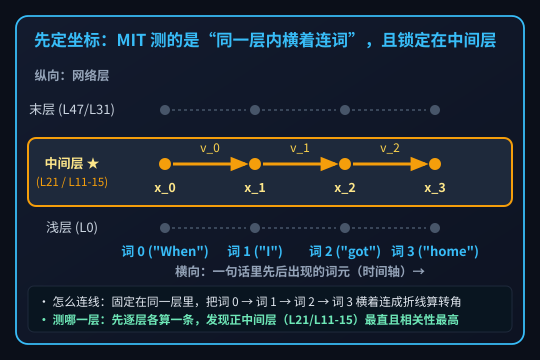
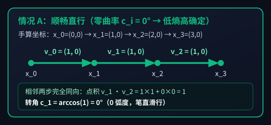
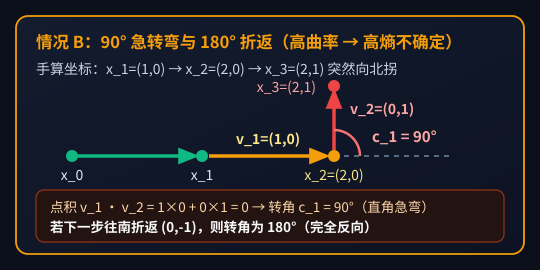
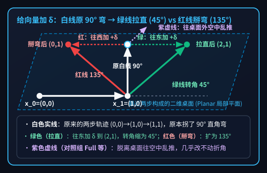
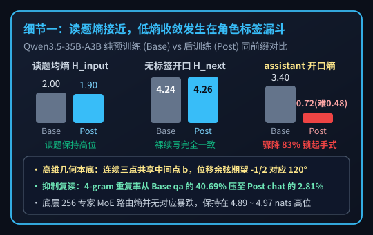
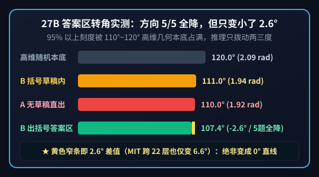
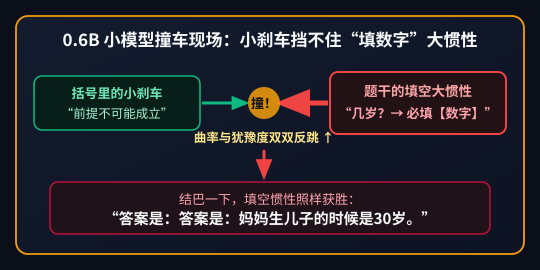

【AI可解释性】大模型犹豫时残差流在“急转弯”？我们在 DGX Spark 上复现了 MIT 这篇 ICML 论文

━━━━━━━━━━━━━━━━━━━━

◆ 引子：大模型“拿不准主意”的时候，它脑子里的向量到底长什么样？

━━━━━━━━━━━━━━━━━━━━

平时用大模型写代码或者答逻辑题，大家都有过这种直观感受：
碰到熟门熟路的套路题，模型吐字如飞、干脆利落；可一旦碰上带陷阱的绕弯题，它要么在那里翻来覆去兜圈子，要么憋了半天吐出一句莫名其妙的胡话。

如果把大模型每一层的激活值（残差流向量）看作高维空间里的一个点，那么模型顺着句子一个词一个词往下读、往下写的过程，就是在高维空间里走出的一条 **几何轨迹（Trajectory）** 。

今年入选机器学习顶会 **ICML 2026** 的一篇麻省理工学院（MIT 脑与认知科学系 Evelina Fedorenko 团队）论文《 **Representational Curvature Modulates Behavioral Uncertainty in Large Language Models（表征曲率调制大语言模型的行为不确定性）** 》（`arXiv:2604.23985`），就围绕这条几何轨迹提出了一个非常吸引眼球的结论：

> **当大模型顺着上下文推进时，它内部残差流的时间轨迹在网络中间层会明显变直（曲率跌入低谷）；而且在中层，当模型对下一个词犹豫不决（输出分布的信息熵升高）时，残差流轨迹的转角曲率也会随之升高。如果顺着局部轨迹平面去推拉这条轨迹，还能方向选择性地调制模型下一步输出的犹豫度。**

听起来是不是既有几何美感，又像一把能窥探模型内部犹豫度的精密尺子？

不过，经历过前文 360 期 https://mp.weixin.qq.com/s/w2vEv2fITplhDNp9kHcwUw （扒开 MIT 权重空间编程源码）的读者肯定已经养成了条件反射：**凡是顶会论文画出来的漂亮曲线，先看它拿什么模型跑的，再拉到自家机器上复现一把。**

打开这篇 ICML 2026 论文的实验章节一看，我们不禁乐了——堂堂 2026 年的顶会论文，标题挂着《Large Language Models》，正文里跑的主力模型居然是 2019 年发布的 **`GPT-2 XL`（1.5B，15 亿参数）** 和 2023 年初的 **`Pythia-2.8B`（28 亿参数）** ，连个 7B 模型或者现代对话模型都没上。

为了搞清楚这套“轨迹曲率调制不确定性”的结论到底有几分扎实、几分局限，我们在家里的 **DGX Spark（128GB 统一内存）** 上连跑了两轮实测：
1.**第一轮（原版 `1.5B / 2.8B` 模型对齐复现）** ：我们把论文原版的 **`GPT-2 XL (1.5B)`** 和 **`Pythia-2.8B`** 拉下来，对齐论文公式与主要控制条件，跑了近 8 万个词元位置和十多万次扰动样本。结果发现：论文里说的“中层轨迹相对变直”和“中层弱正相关”确实存在，但曲率对预测熵的线性解释方差 **只有 `0.83%` 至 `1.16%`** ；而在论文主打的“人为推拉向量改变弯度”干预实验中， **顺着整句话主方向推拉在两模型上均未复现出正效应，顺着最近两步局部拐弯平面推拉则非常挑样本位置（在 `GPT-2 XL` 首批 32 位置上接近零、换 128 新位置为 `0.092`，在 `Pythia` 首批为 `0.306`、换 128 新位置跌至 `0.062` 且失去统计显著性）** 。
2.**第二轮（放到现代 `Qwen3` 系列模型上做补充检验）** ：为什么跨句子粗算转角只能解释不到 `1.2%` 的熵起伏？把同一套几何与信息论探针挂到现代模型 **`Qwen3.5-35B-A3B`（纯预训练 Base vs 后训练 Post）** 、 **`Qwen3.8-27B`** 与 **`Qwen3-0.6B`** 上做补充测试后，我们看清了三个在 `1.5B` 老模型单句续写里看不到的工程细节：高维位移自带的 `120°` 几何本底、`<|im_start|>assistant` 角色标签处的首词熵漏斗，以及同题配对下走完括号推演前缀对后续答案区轨迹的拉直效应。

今天这篇笔记，我们就先用五分钟手算带大家看懂什么叫“残差流轨迹曲率”，再把这两轮真机复现与补充测试的账单一并摊开。

━━━━━━━━━━━━━━━━━━━━

◆ 第一章：五分钟手算——什么是残差流里的“轨迹曲率”与“行为不确定性（预测熵）”？

━━━━━━━━━━━━━━━━━━━━

别被论文里的几何术语吓住。我们在前文 267 期 https://mp.weixin.qq.com/s/mFRQl-5qUstz7fbZ0tvpvQ 学过向量点积与夹角，在前文 359 期 https://mp.weixin.qq.com/s/8HNeuklsntzzh5EbgNRjdw 学过正交投影，算懂这篇 ICML 论文的核心公式只需要初中平面几何。

在动手算角度之前，必须先把两个最容易搞混的坐标问题说清楚：**第一，向量是横着连还是竖着连？第二，一个模型有几十层，到底测的是哪一层？**

看下面这张“层 × 词”二维坐标图，一眼就能对上号：



对照上图，记住两条铁规则：
1.**不是同一个词竖着跨层连，而是固定在同一层里、把一句话里先后出现的词“横着连”** ：
  假设输入一句话 `When I got home`。如果盯着同一个词 `home` 看它从第 0 层升到第 47 层怎么变，那叫纵向跨层轨迹（MIT 没测这个）；MIT 测的是 **先死死钉在某一层不动（比如只看第 21 层）** ，把这句话里的第 0 个词 `When` 在第 21 层的向量 `x0`、第 1 个词 `I` 在第 21 层的向量 `x1`、第 2 个词 `got` 在第 21 层的向量 `x2`、第 3 个词 `home` 在第 21 层的向量 `x3` **横着连成一条折线** ，看它顺着句子往后读的时候拐弯有多急。
2.**几十层里到底测哪一层？（先每一层都单独横着算一遍，最后锁定“正中间层”）** ：
  - 在观测实验里，作者把模型的每一层（`GPT-2 XL` 共 48 层，层号 0–47；`Pythia-2.8B` 共 32 层，层号 0–31） **每一层都单独拉出一条横向折线算曲率** ，然后拿每一层的曲率去跟模型最顶部输出头的“下一步预测熵 `H`”算相关性；
  - 算完一比发现：浅层（刚进模型）和末层（快出模型）的横向折线拐弯都很急，跟预测熵也没啥关系；**唯独到了网络正中间那几层（`GPT-2 XL` 的第 21、22 层，`Pythia-2.8B` 的第 11 至 15 层），横向折线变得最直，而且跟最终预测熵的相关性达到全网最高峰** ；
  - 所以到了后面的因果干预实验，作者就专门钉死在 **正中间这一层（`GPT-2 XL` 的第 21 层、`Pythia-2.8B` 的第 11 层）** 下手去推拉向量。

弄清楚了“固定在中间某1层、横着连连续的词”，我们拿平面上的 4 个词坐标 `x0, x1, x2, x3` 手算一次，五秒钟就能看明白：

- **情况 A（顺畅直行）** ：`x0 = (0, 0)`，`x1 = (1, 0)`，`x2 = (2, 0)`，`x3 = (3, 0)`。
  第一步走的位移向量是 `v0 = x1 - x0 = (1, 0)`（往东走 1 米）；
  第二步走的位移向量是 `v1 = x2 - x1 = (1, 0)`（继续往东走 1 米）。
  两步方向完全一致，夹角 `c0 = 0°`（0 弧度）——这就是 **零曲率（走直线）** 。



- **情况 B（90 度急转弯与 180 度折返）** ：到了第三步，坐标突然拐到了 `x3 = (2, 1)`。
  第三步的位移向量变成了 `v2 = x3 - x2 = (0, 1)`（突然改成往北走 1 米）。
  拿第二步的 `v1 = (1, 0)` 和第三步的 `v2 = (0, 1)` 算点积：`1×0 + 0×1 = 0`，夹角 `c1 = 90°`（即 `π/2 ≈ 1.57 弧度`）；如果下一步从 `(2, 1)` 直接折返往南走回 `(2, 0)`（位移 `(0, -1)` 与上一步 `(0, 1)` 完全反向），夹角就是 `180°`（`π ≈ 3.14 弧度`）——这就是 **高曲率（急转弯）** 。



看到这儿，很多读者肯定会犯嘀咕： **“前面算的 `0°`、`90°`、`180°` 叫‘转弯角度（转角）’，这我能理解；可论文标题里那个听起来像科幻片《三体》曲率飞船一样的‘表征曲率（Curvature）’，又是个什么高深概念？难道是去算球面半径有多小吗？”**

哈哈，这正是学术界最爱玩的“包装术”（就像我们在前文 352 期 https://mp.weixin.qq.com/s/FHmykM-flk8OuniCPM3Wlg 聊过的把简单加一打包成新名词）。
在正经微积分和物理里，“曲率”确实指的是弯道贴合圆的半径倒数（`1/R`，圆半径越小、弯越急，曲率越大，需要除以走过的路程弧长）。
**但你扒开 MIT 这篇论文的公式一看，它根本没算什么圆半径，甚至连每一步走多远的距离都没除——它所谓的“曲率 `C_j`”，就是站在当前第 `j` 个词的位置，把最近连续 3 次拐弯的角度加起来除以 3（求个平均转角）：**

```text
# 1. 第 i 步到第 i+1 步的位移向量：
v_i = x_(i+1) - x_i

# 2. 相邻两步位移向量之间的转弯角度（0 代表直线同向，π ≈ 3.14 代表 180° 折返）：
c_i = arccos( (v_i · v_(i+1)) / (||v_i|| * ||v_(i+1)||) )

# 3. 论文所谓的“表征曲率 C_j” = 把最近 3 次转弯的角度加起来除以 3。
# （例如连续三次拐了 60°、90°、120°，那 C_j 就是 (60°+90°+120°)/3 = 90°）
C_j = (c_(j-4) + c_(j-3) + c_(j-2)) / 3
```

没错，就这么个 **“最近 3 次拐弯的平均角度”** ，要是老老实实叫“三步平均转角”，看着像初中几何作业；换个微分几何里的词叫 **“表征曲率”** ，瞬间就有了顶会论文的科幻感。所以读下文时，你只要在脑子里把“曲率”自动翻译成 **“连续几步的平均拐弯角度”** 就行了。

那论文标题后半截说的 **“行为不确定性（Behavioral Uncertainty）”** ，又是个什么新指标呢？

哈哈，跟前面把“平均转角”包装成“曲率”完全是一个套路—— **所谓的“行为不确定性”，扒开公式一看，跟我们在前文 315 期 https://mp.weixin.qq.com/s/8jC7pwKN0RFd5O70Dh4Lrw 学过的“预测信息熵（Shannon Entropy，记作 `H`）”没有半毛钱区别，100% 就是同一个数。** 数学上叫“信息熵”，论文标题为了装深沉叫“行为不确定性”，说人话就是模型猜下一个词时 **“有多拿不准（有多犹豫）”** 。

当模型读到第 `j` 个词、准备猜第 `j+1` 个词是什么的时候，最顶部的输出头会给词表里所有候选词算出一串概率 `p_1, p_2, ...`（加起来等于 100%）。我们拿只有 4 个候选词的袖珍词表手算一下信息熵 `H`：

```text
# 论文所谓的“行为不确定性” = 标准香农信息熵 H（以 2 为底单位叫 bits）：
H = - ( p_1 * log2(p_1) + p_2 * log2(p_2) + ... )

# 例子 1（十拿九稳，毫不犹豫）：模型 100% 笃定下一个词是“苹果”
# p = [1.0, 0, 0, 0]
H = - ( 1.0 * log2(1.0) ) = 0 bits   --> 预测熵为 0（绝对确定）

# 例子 2（两个词拿不准，五五开犹豫）：模型觉得“苹果”和“香蕉”各占 50%（1/2）
# p = [0.5, 0.5, 0, 0]，因为 log2(0.5) = -1：
H = - ( 0.5 * (-1) + 0.5 * (-1) ) = 1 bit  --> 预测熵升到 1

# 例子 3（四个词全拿不准，彻底抓瞎）：四个词概率平摊，各占 25%（1/4）
# p = [0.25, 0.25, 0.25, 0.25]，因为 log2(0.25) = -2：
H = - ( 4 * 0.25 * (-2) ) = 2 bits         --> 预测熵飙升到 2
```

你看，这个公式脾气特别直白：
- **模型心里越笃定（概率全押在某一个词上），算出来的预测熵 `H` 就越接近 `0`** ；
- **模型越拿不准主意（几百个候选词的概率平摊开来，选谁都差不多），算出来的预测熵 `H` 就越大** 。
（顺便说一句：MIT 论文算 `log` 时以 `2` 为底，单位叫 `bits`；第三章我们跑 `Qwen3` 时按深度学习惯例以自然常数 `e` 为底，单位叫 `nats`，`1 nat ≈ 1.443 bits`，换个底数就像“米”和“英尺”换算一样，只改变刻度大小，完全不改变高低趋势和相关系数。）

搞懂了“平均拐弯角度 `C_j`（曲率）”和“预测熵 `H`（不确定性/犹豫度）”这两个基本零件，MIT 整篇论文想说的其实就是下面这两件事：

**第一件事（只看不动）：在模型正中间层，前几步拐弯越急，下一步预测熵 `H` 就越高**
作者先不改模型，只往 `GPT-2 XL` 和 `Pythia-2.8B` 里喂文章。结果发现：
- 在刚进模型的浅层和快出模型的末层，词元轨迹平均每步要拐 `119°` 左右；而到了 **正中间那几层** ，平均拐弯角度降到了约 `112.8°`（轨迹在中间层变得相对最直）；
- 而且就在正中间这一层，**前几步的平均拐弯角度 `C_j` 越大（拐弯越急），模型猜下一个词时的预测熵 `H` 就越高（越犹豫）；前几步走得越直，下一步预测熵 `H` 就越低（越笃定）** 。如果用统计上的相关系数 `r` 来打分（`0` 代表毫无关系，`1` 代表 100% 绑定），作者报出来的联动最高分是 **`r ≈ 0.15`** 。

**第二件事（动手去推）：给中间层的向量直接“加上一个小向量 `δ`”把折角拉直，真能把预测熵 `H` 降下来吗？**
光看还不算完，作者想亲手去改一下正中间层（比如第 21 层）当前第 `k` 个词的激活向量 `x_k`，看看能不能人工把弯路“拉直”，从而直接操控模型下一步的预测熵 `H`。

怎么“推”呢？在代码里其实极其简单—— **根本不改模型权重，就是在前向传播走到第 21 层时，往当前词的向量 `x_k` 上直接加上一个小向量 `δ`（长度固定为下一步位移的 20%），然后拿着加完后的新向量继续往第 22、23……层传到顶部算预测熵：**

```text
# 在中间层拦截第 k 个词的向量 x_k，直接加上一个小推力向量 δ：
x_k_new = x_k + δ
```

为什么加一个小向量 `δ` 就能改变拐弯角度？对照下面这张图的 **白、绿、红、紫四色箭头** 手算一下就全明白了：



1.**白色实线（原来的 `90°` 弯路）** ：
  前三个词本来在桌面上走出了一个直角弯：`x0 = (0, 0)` → `x1 = (1, 0)`（第一步往东）→ `x2 = (1, 1)`（第二步突然往北拐，跟第一步夹角 **`90°`** ）。
2.**绿色箭头与绿线（贴着桌面往东加 `δ = (1, 0)` → 拉直成 `45°`）** ：
  给 `x2 = (1, 1)` 加上往东的绿色推力 `(1, 0)`，新终点移到了 `(2, 1)`。你看图上的 **绿色实线** ，第二步变成了斜向东北的 `(1, 1)`，跟第一步的转弯夹角当场从 **`90°` 缩小成了 `45°`** （折线被拉直了）。
3.**红色箭头与红线（贴着桌面往西加 `δ = (-1, 0)` → 掰弯成 `135°`）** ：
  给 `x2 = (1, 1)` 加上往西的红色推力 `(-1, 0)`，新终点移到了 `(0, 1)`。你看图上的 **红色实线** ，第二步变成了斜向西北的 `(-1, 1)`，跟第一步的转弯夹角当场从 **`90°` 扩大成了 `135°`** （折线被掰得更弯了）。
4.**紫色虚线箭头（脱离桌面往空中乱推）** ：
  如果不贴着这张桌面，而是往桌面外的空中乱加推力，在几千维空间里几乎都跟当前桌面垂直，根本没法有效拉直或掰弯这个折角。

正是基于这个加减法原理，论文对比了“顺着拐弯平面加 `δ`（绿/红）”和“往平面外乱加 `δ`（紫）”两大类情况：
- **顺着轨迹所在的平面推拉（有效组）** ：
  第一种叫 **局部拐弯平面（`Planar`）** ，就是紧贴着最近两根火柴棍铺成的桌面使劲——往外拉一把，折角当场变直；往里挤一把，折角当场更弯。第二种叫 **整句主方向平面（`Trajectory PCA`）** ，是顺着整句话所有步子摆动最大的两个主方向推拉。
  **论文宣称：只要顺着这两个平面把轨迹拉直，模型下一步就真的变得更确定；把它掰弯，模型下一步就真的更犹豫** （论文柱状图上报出的联动相关系数达到了 **`0.19` 至 `0.28`** ）。
- **脱离当前拐弯平面瞎推（无效对照组）** ：
  作者另外试了三种不看当前拐弯的推法：① 在几千维空间里完全随机乱推（`Full`）；② 随便切一个随机平面推（`Random2`）；③ 按整个语料库最常见的激活方向推（`Activation PCA`）。因为在几千维空间里，随便乱推的方向几乎都跟当前那张桌面垂直，根本没法有效拉直或掰弯当前的折角，所以论文说这三种推法都没法稳定操控模型的犹豫度（联动系数接近 **`0`** ）。

你看，这就是 MIT 论文讲的全部故事：**中间层最直、拐弯急就犹豫、顺着桌面拉直就能让模型变笃定** 。故事非常漂亮，但真把代码跑起来，每一项都能稳稳复现吗？

━━━━━━━━━━━━━━━━━━━━

◆ 第二章：原版模型真机对账——用 `GPT-2 XL` 与 `Pythia-2.8B` 独立复现，核出四处关键差异

━━━━━━━━━━━━━━━━━━━━

我们在 DGX Spark 上从 Hugging Face 官方仓库拉取了原版的 **`openai-community/gpt2-xl`** （48 层，1600 维）与 **`EleutherAI/pythia-2.8b`** （32 层，2560 维），全程使用 `float32` 精度做了对齐公式与主要控制条件的独立复现（主复现脚本与复现报告已公开在 https://github.com/lmxxf/ai-theorys-study/tree/main/wechat/assets/361 ）。

先看两边完全吻合的地方：**模型中间层轨迹相对变直（曲率低谷）的现象确实稳稳复现了。**
在 1,024 篇 `LAMBADA` 英文长语料（`GPT-2 XL` 共 `79,398` 个有效预测位置，`Pythia-2.8B` 共 `77,130` 个有效预测位置）上，浅层转角均值从 `119.4° / 119.6°` 一路下降，到了中间层（`GPT-2 XL` 的第 22 层、`Pythia-2.8B` 的第 12 层，0 起算）双双跌入全网最低谷（`112.75°` 与 `112.80°`），且曲率与下一步预测熵的正相关峰值也确实落在中层附近（`GPT-2 XL` 第 21 层，`Pythia` 第 15 层）。

然而，往深里核对具体相关性量级、下标对齐和因果干预实验，四处值得深究的差异接二连三浮现了出来：

────────────────────

### 差异一：中层正相关虽存在，但只能解释约 `1%` 的预测熵起伏

在 1,024 篇 `LAMBADA` 长语料上，我们实测了每一层的平均转角和它与下一步预测熵的相关系数 `r`（见下图，左列为 `GPT-2 XL`，右列为 `Pythia-2.8B`）：


看上图可以发现两个关键事实：
1.**`r = 0.091` 到 `0.108` 的真实解释力只有 `1%` 左右** ：
  论文正文报告的相关系数峰值约为 `0.15`，而我们在近 8 万个词元位置上实测的峰值在 `GPT-2 XL`（第 21 层）为 **`0.1076`** ，在 `Pythia-2.8B`（第 15 层）为 **`0.0909`** （到了短句补充集上更是掉到了 `0.0786` 和 `0.0460`）。
  在统计学里，相关系数的平方 `R² = r²` 才代表“A 能解释 B 多少比例的变化”。把 `0.091` 和 `0.108` 平方一下，分别是 **`0.83%` 和 `1.16%`** （就算按论文报的 `0.15` 算也只有 `2.25%`）——也就是说，模型下一步的预测熵 `H` 里，约 `99%` 的起伏跟这三步平均转角压根没关系。
2.**边缘层的“负相关翻正”现象** ：
  看上图右列 `Pythia-2.8B` 下半图的第 30、31 层：代表原始相关系数的蓝色实线其实已经掉到了零线以下（变成负相关了），但论文所采用的“线性回归预测值相关系数”（橙色虚线）因为乘上了负数斜率，在图上反而往上翘起了一条正尾巴。这也提醒我们不能光看回归预测相关性，必须对照原始正负号。

────────────────────

### 差异二：论文公式下标前后打架，错位一个词元相关性就会全盘变负

在写代码核对论文方法章节时，我们还发现原文的下标约定存在一处明显的前后不一致：
- 论文定义平均转角 `C_k` 时，公式里用到了第 `k` 个词的隐藏状态 `x_k`；
- 可紧接着定义预测熵时，公式却写成了预测第 `k` 个词本身的熵 `H(w_k)`；到了后面的干预实验章节，又改口写成了预测第 `k+1` 个词的熵 `H(w_(k+1))`。

如果谁照着前面两处的字面下标写代码，拿包含 `x_j` 的转角去配预测当前词 `w_j` 的概率分布，整条逐层相关曲线就会 **全盘变号成负数** （在主干预层上，`GPT-2 XL` 会从 `+0.1076` 直接翻负成 **`-0.1712`** ，`Pythia-2.8B` 会翻负成 **`-0.1384`** ）。只有严格按因果顺序对齐（用截至 `x_j` 的转角去配预测下一个词 `j+1` 的犹豫度），才能测出中层的正相关峰。

────────────────────

### 差异三：在“动手推拉向量”的因果干预中，`Trajectory PCA` 未复现正效应，`Planar` 效应非常挑位置

最关键的核验在论文主打的 **中层推拉干预实验** 。
我们在两个模型的正中间层（`GPT-2 XL` 第 21 层，`Pythia-2.8B` 第 11 层），对首批 32 个文本位置各跑了 300 次推力测试（结果见下图），随后又在预先固定的另外 **128 个新位置** 上跑了一轮独立确认：


| 模型与推力方向 | 论文原图目测值 | 首批 32 位置实测 `r` | 新增 128 位置确认 `r` | 我们的核验结论 |
|---|---|---|---|---|
| **`gpt2-xl` / `Trajectory PCA`（整句主方向）** | `约 0.04` | **`-0.0680`** | — | 点估计为负，未见正效应 |
| **`gpt2-xl` / `Planar`（局部拐弯桌面）** | **`约 0.28`** | **`-0.0086`** | **`0.0924`** | **首批 32 位置为 0，换 128 位置仅 `0.092`（远弱于原图）** |
| **`pythia-2.8b` / `Trajectory PCA`（整句主方向）** | **`约 0.19`** | **`-0.1048`** | — | **未复现正效应（点估计为负，误差条跨零）** |
| **`pythia-2.8b` / `Planar`（局部拐弯桌面）** | **`约 0.23`** | **`0.3059`** | **`0.0616`** | **首批 32 位置为正，换 128 新位置跌至 `0.062` 且跨零** |

对照上图和简表，三点结论一目了然：
1.**`Trajectory PCA`（整句主方向平面）在两个模型上均未复现出正效应** ：论文柱状图里 `Pythia-2.8B` 的这一项高达 `+0.19`，而我们实测两个模型算出来都是负数（`-0.0680` 与 `-0.1048`）。
2.**`Planar`（局部拐弯桌面）虽然有效，但极其挑文本位置** ：在第一批 32 个位置上，`Pythia` 跑出了 `0.3059`，但 **`GPT-2 XL` 算出来却是 `-0.0086`（几乎等于零，而论文图上是 `0.28`）** ；等换到第二批 128 个新位置时，两边又反过来了——`GPT-2 XL` 只有微弱的 `0.0924`，而刚才表现很强的 **`Pythia-2.8B` 直接掉到了 `0.0616`（连统计显著性都没过）** 。
3.**直接“拉直”一下试试，有一半位置预测熵 `H` 没降** ：
我们还额外做了一个最直接的测试——在局部拐弯桌面上，直接把折角往直里拉一步（平均拉直约 `4°`）。结果在 `GPT-2 XL` 的 32 个位置里， **只有 13 个位置（不到一半）的预测熵 `H` 下降** ，中位数反而微升了一点点；在 `Pythia-2.8B` 上虽然有 21/32 的位置预测熵下降，但平均值也微升了 `+0.035 bits`。这说明“一拉直就变确定”绝不是每个词元位置都百试百灵的铁律。

────────────────────

### 差异四：论文给出的单句示例，仅凭图示可见短句无法还原出 `5.614 bits` 基线熵

在论文的干预示例里，作者给出了一个展示干预效果的具体短句 `When I got home, the`，标明干预前的基线预测熵是 **`H = 5.614 bits`** （拉直后降到 `5.543`，掰弯后升到 `5.725`）。
由于论文没有公开代码和该示例对应的完整前缀 Token ID，我们拿可见字符串 `When I got home, the` 在两台原版模型上测试了“末尾不带空格”和“末尾带空格”两种分词输入：
- **末尾不带空格（`When I got home, the`）** ：`Pythia-2.8B` 预测熵是 **`9.3205 bits`** （比标称值高 `3.71 bits`），`GPT-2 XL` 是 **`9.6460 bits`** （比标称值高 `4.03 bits`，最高概率词均为 `' first'`）；
- **末尾带空格（`When I got home, the `）** ：`Pythia-2.8B` 掉到 **`3.5018 bits`** （比标称值低 `2.11 bits`，最高概率词 `'icing'`），`GPT-2 XL` 掉到 **`4.3875 bits`** （比标称值低 `1.23 bits`，`'iced'`）。

可见，论文里的这个示例要么省略了前文段落或特殊起始符，要么采用了别的分词截断方式，仅凭展示出来的这五个英文单词是无法直接复现出 `5.614 bits` 的。

━━━━━━━━━━━━━━━━━━━━

◆ 第三章：放到现代 `Qwen3` 模型上看一看——我们测出了哪三个有趣现象？

━━━━━━━━━━━━━━━━━━━━

复现完 `GPT-2 XL` 与 `Pythia-2.8B` 这两个老模型，我们还想顺手弄明白三个更接地气的问题：
第一，为什么不管是哪个模型，相邻两步的平均拐弯角度总在 `110° 至 120°` 附近打转，导致跨着句子直接算相关性这么弱？
第二，现在的聊天大模型（经过后训练）跟纯粹只会续写文章的基座模型（Base）相比，到底在哪个具体位置把“犹豫度”给压下去了？
第三，如果同一道题，允许模型先在括号 `（……）` 里把弯路绕完，等它最后写 `答案是：` 的时候，轨迹会不会真的变直？

为此，我们在 DGX Spark 上拿阿里的 **`Qwen3.5-35B-A3B`** （对比纯预训练版与聊天后训练版）、 **`Qwen3.8-27B`** 以及最小的 **`Qwen3-0.6B`** 做了三组测试。

────────────────────

### 现象一：为什么平均拐弯角度总在 `120°` 附近？以及聊天模型的“首词漏斗”

先解开第一个谜团：为什么在高维空间里，随便喂一句话进去，模型每一步的平均拐弯角度总在 `110° 至 120°` 附近，而不是大家直觉以为的 `90°`？

用我们在前文 267 期学过的向量点积手算一下就豁然开朗了：
假设模型依次走过三个点 `a → b → c`。前一步走的向量是 `v0 = b - a`，后一步走的向量是 `v1 = c - b`。
你仔细看这两个式子：前一步是 **`+b`** ，后一步是 **`-b`** —— **因为两步共享了中间那个落脚点 `b`，而且符号刚好一正一负** ，把它们乘起来算点积时，中间那个 `b` 自己乘自己就会凑出一个固定的负数项（`-||b||²`），而每一步的长度平方则是两项相加（`2 ||b||²`）。
分子是 `-1`，分母是 `2`，除出来的余弦值天然就是 **`-1/2`** ——查一下三角函数表，余弦等于 `-1/2` 的角度，分毫不差正好是 **`120°`** 。
也就是说，在几千维空间里，哪怕三个点完全是随机独立的，连起来走两步的平均转角天然就是 `120°`。正是这个自带的 `120°` 底色加上不同句子的标点词性变化，把跨句粗算的微弱信号给淹没了。

那么，现代聊天大模型真正发生剧烈变化的地方在哪儿？
不在读题目的过程里，而在 **`assistant`（AI 助手）准备张嘴吐第一个字的那道“首词漏斗”** （见下图）：



我们拿同一道题喂给 `Qwen3.5-35B-A3B` 的纯预训练基座版（Base）和聊天后训练版（Post），发现了一个特别好玩的反差：
1.**在读题和普通续写时，两台模型一样宽** ：模型在肚子里读题的时候，或者不加聊天标签直接让它往下续写文章的时候，后训练版和纯基座版的预测熵几乎一模一样（开口处都高達 `4.26` 左右，相当于脑子里同时有上百种接话的思路）；
2.**唯独套上 `assistant` 客服工装的那一瞬间，突然收窄 83%** ：一旦在末尾加上聊天模板里的 `assistant` 角色标签，后训练模型开口第一个字的预测熵当场从 `4.26` **暴跌 83% 到 `0.72`** （遇到逻辑难题更是跌到 **`0.48`** ，单道题甚至以 **`99.3%`** 的概率死死锁在 `“我们可以通过……”`、`“这是一个……”` 这种标准客服开场白上）。
3.**这道漏斗有什么用？（防止模型当复读机）** ：为什么后训练非要在开口处装这么一道窄漏斗？我们在测试中发现，没有这道漏斗约束的纯基座模型（Base），在做问答时有超过一半的回答会掉进车轱辘话死循环（平均重复率高达 `40.7%`）；而套上 `assistant` 角色漏斗后，先把开头几个字稳在答题轨道上，整段回答的重复率立刻被压到了 **`2.8%`** 。

────────────────────

### 现象二：把小括号推导 `（……）` 塞进回复开头做预填充，后面写答案时转角降了多少？（只降了 `2.6°`）

在前文 360 期里我们刚看到，模型自带的 `<think>` 思维链动不动就写上千字甚至陷入复读。那如果我们 **直接关掉模型自带的 `<think>` 标签（设 `enable_thinking=False`），改用预填充（Prefill）的方式，直接在 `assistant` 回复的第一行硬塞进一句写好推导过程的中文小括号 `（……）\n答案是：`** ，然后再放手让模型接着往下写最终答案，轨迹转角会变直很多吗？

我们只盯住模型在 `答案是：` 后面自己写出来的那几个字，对比下面两种方式：
- **方式 A（无草稿直出）** ：关掉 `<think>`，只在回复开头预填充 `答案是：` 三个字，逼模型直接往后写最终得数；
- **方式 B（预填充小括号草稿）** ：同样关掉 `<think>`，但直接在回复开头预填充一整句 `（这里写明正确的推导过程）\n答案是：` ，跨出右括号之后，再放手让它接着写 `答案是：` 后面的结论。



我们在 5 道需要转弯的逻辑算术题（母子年龄、鸡兔同笼、球拍与球、吹蜡烛、星期推算）上实测了 `Qwen3.8-27B`（如上图），结果非常耐人寻味：
- **看变化方向（确实 5 题一致往下走）** ：在全部 5 道题（5/5）上，方式 B 跨出右括号进入 `答案是：` 区域后的平均转角，无一例外全都比方式 A 低；
- **但看变化幅度（只降了 `0.045 弧度`，也就是区区 `2.6°`）** ：方式 A 的平均转角是 **`1.920 弧度（110.0°）`** ，方式 B 的括号内部是 **`1.937 弧度（111.0°）`** ，而出括号后的答案区是 **`1.875 弧度（107.4°）`** ——你没看错，从 `110.0°` 降到 `107.4°`，虽然方向整齐划一，但绝对幅度其实只变小了 **`2.6°`** （回顾第二章，MIT 在 `GPT-2 XL` 上跨了整整 22 层，从最弯的浅层 `119.4°` 到最直的中层 `112.8°`，总共也就变了 `6.6°`）。

这组数据反过来把现象一的结论钉得更死了：**在高维残差流里，“步进转角”这把尺子超过九成的刻度都被 `110° 至 120°` 的几何本底死死占住了；哪怕你做严格的同题配对、把整段推导塞进前缀里，留给推理状态去拨动的转角余量也只有两三度，绝不会出现从 `90°` 大折角突然变成 `0°` 笔直大马路的戏剧性画面。**

────────────────────

### 现象三：`0.6B` 小模型的撞车现场——哪怕把“前提不成立”预填充进它自己嘴里，一松手还是照填“30岁”

同样是上面这个“把小括号推导直接预填充（Prefill）进回复开头、再让模型接着写 `答案是：`”的测试，放到只有 6 亿参数的 `Qwen3-0.6B` 小模型上，我们抓到了一个让人忍俊不禁的活体撞车现场（见下图）：



在鸡兔同笼、球拍与球、吹蜡烛、星期推算那 4 道正经算术题上，只要我们在预填充的小括号里写明了推演得数（比如 `5元`、`2根`），一松手让 `0.6B` 接着写，它就能顺顺当当地把数字抄进 `答案是：` 后面，从全错变成 4 道全对，预测熵 `H` 也大幅下降。

**唯独在“妈妈今年 30 岁，亲生儿子今年 35 岁，请问妈妈生儿子的时候几岁？”这道脑筋急转弯上** ，我们直接把下面这行字作为 `assistant` 回复的开头硬塞进了 `0.6B` 自己的嘴里：
`（母亲30岁而亲生儿子35岁，意味着母亲出生前5年就生子，前提不可能成立。）\n答案是：`

按常理说，“前提不可能成立”这七个大字都已经作为它自己说出的前半句话印在那里了；结果当我们一松手让 `0.6B` 顺着 `答案是：` 往后续写时，两股力量在这个路口迎头撞上了：
- 左边是括号里刚读到的 **`“前提不可能成立”`** （要求它紧急刹车，别填数字）；
- 右边是小模型看到题干问 `“请问……几岁？”` 形成的强大肌肉记忆—— **“不管三七二十一，后面必须填一个【数字 + 岁】”** 。

这一撞不要紧，`0.6B` 在答案区的轨迹转角当场从 `1.88` 反跳到 `1.92`，预测熵 `H` 更是从 `0.31` 暴涨到 `0.51`，甚至被撞得在原地结巴复读了一遍 `答案是：`——可结巴完之后，“填数字”的肌肉惯性还是把括号里的小刹车撞飞了，它面不改色地抓起题干里现成的数字吐出了一句：
**`“答案是：答案是：妈妈生儿子的时候是30岁。”`**

而在另一组让 `0.6B` 自己列算式的测试里，它明明已经算出了 `30 - 35 = -5 岁，这显然不可能`，却根本不敢怀疑题目有问题，反而乖巧地向用户认错：**`“这说明我的理解有误，可能需要重新考虑。”`** （相比之下，`27B` 大模型则一口咬定题目本身的前提不成立）。

你看，在小模型脑子里，遇到矛盾时向量确实也在“急转弯”、预测熵 `H` 也在飙升，但就像一辆刹不住车的玩具车一样，哪怕方向盘在打滑，车身还是顺着表层填空的惯性冲了出去。

────────────────────

💡 顺带一提：为什么可解释性圈今年都在反思“拿直尺量弯路”？

把今天聊的“残差流弯曲轨迹”跟我们在前文 151 期 https://mp.weixin.qq.com/s/fwig-yD4sveatnFh7mVoUA 、前文 359 期讲过的 **稀疏自编码器（SAE）** 放在一起看，你会发现今年可解释性顶会正在经历一场集体反思：
- 以前大家总想用一维的直线特征（SAE）去给大模型做“脑部切片”，以为一个概念就是一根笔直的针；
- 结果哈佛与 Goodfire 团队今年在 **COLM 2026** （`arXiv:2604.28119`）上实测 `Llama-3.1-8B` 发现，当模型内部的概念长在 **连续弯曲的几何流形** 上时，标准的一维 SAE 往往会把一个完整的弯曲流形打散成几十个碎片特征（论文称为“稀释态 Dilution”），单看哪一根针都看不出原来的形状，必须把一块儿亮起来的特征组重新拼起来才行；
- 紧接着 CMU 与斯坦福团队在 **ACL 2026** （`arXiv:2505.20254`）上又发现，如果不加严格的架构约束，同一个模型仅仅换个随机种子重训一遍 SAE，训出来的两本“特征词典”居然有很大一部分对不上号。

说到底，大模型的思考本来就是在几千维空间里不断拐弯、收束与碰撞的动态轨迹。不控制住句式底色和上下文位置，光靠跨句子混算一个平均转角，或者拿一把孤立的直尺去切弯路，看到的往往只是冰山一角的碎影。

────────────────────

━━━━━━━━━━━━━━━━━━━━

◆ 本期小结

━━━━━━━━━━━━━━━━━━━━

把 MIT 这篇 ICML 2026 论文的原版复现与我们在 `Qwen3` 系列模型上的补充实测合在一起，关于残差流“几何曲率与预测不确定性”的账本就清楚了：

- **公式其实很简单** ：所谓横向时间曲率 `C_j`，就是固定在同一层里，算最近 5 个词状态走出的 4 段位移向量 `v_i = x_(i+1) - x_i` 之间的 3 个转角平均值；所谓行为不确定性 `H`，就是下一步预测全词表分布的香农信息熵
- **MIT 原版 `1.5B / 2.8B` 独立复现的四处核验结果** ：在 `GPT-2 XL` 和 `Pythia-2.8B` 上，中层轨迹相对变直（约 `112.8°`）与弱正相关确实存在，但曲率对熵的线性解释方差仅有 **`0.83%` 至 `1.16%`** （`r = 0.091 / 0.108`）；若按原文字面下标错位一词元，相关性会全盘翻负（主干预层 `-0.171 / -0.138`）；因果干预实验中的 `Trajectory PCA` 在两模型上均未复现正效应，`Planar` 局部平面干预明显依赖样本位置（32 位置下 `GPT-2 XL` 为 `-0.0086`，换 128 新位置下 `Pythia` 跌至 `0.0616` 跨零），直接沿梯度拉直在 `GPT-2 XL` 上仅 `13/32` 位置降熵，且单句示例仅凭可见短句无法还原出 `5.614 bits` 基线
- **现代 `Qwen3` 系列模型上的三项工程细节** ：① 连续三点共享中间点使高维随机位移天然带有 `arccos(-0.5) = 120°` 的转角本底，而现代后训练模型真正剧烈的熵变发生在 `<|im_start|>assistant` 开口处的 **首词熵漏斗** （首词起点熵从 `raw` 的 `4.26` 骤降至 `0.72 nats`、难题 `0.48 nats`，并将 4-gram 重复率从 `qa` 下的 `40.69%` 压至 `chat` 下的 `2.81%`）；② 在同题配对下，给定中文括号 `（……）` 推演说明前缀后，`27B` 随后的答案区窗口时间曲率实现 **`5/5` 全降（均值 `-0.0450 rad`）** ；③ 面对母子年龄矛盾题，`0.6B` 小模型哪怕在括号里读到“前提不可能成立”，答案区曲率与熵双双反跳并结巴吐出 `“答案是：妈妈生儿子的时候是30岁”` ，直观展示了小模型在冲突检测与输出控制之间的断层

━━━━━━━━━━━━━━━━━━━━

◆ 技术名词速查

━━━━━━━━━━━━━━━━━━━━

| 术语 | 一句话解释 |
|---|---|
| 表征时间曲率（Temporal Representational Curvature） | 固定在神经网络同一层内，沿着词元序列时间轴测量相邻步位移向量 `x_(i+1) - x_i` 之间的转角大小（`0` 为直线同向，`π` 为折返） |
| 跨层深度曲率（Layerwise Curvature） | 固定在同一个词元位置上，测量从第 `l` 层到第 `l+1` 层残差增量向量之间的方向夹角余弦差 `1 - cos` |
| 预测分布信息熵（Next-Token Predictive Entropy） | 模型输出头对下一个词元给出的全词表概率分布的香农熵 `H = -Σ p log p`；值越低代表模型越确定，值越高代表候选词越分散（犹豫） |
| 局部轨迹平面扰动（Planar Intervention） | 在最近两步位移向量 `v_(k-2)` 与 `v_(k-1)` 张成的二维平面内对当前隐藏状态施加小推力，专门改变局部转角大小 |
| 角色标签首词漏斗（Role-Tag Onset Funnel） | 后训练模型在读题阶段保持高熵（约 `2.0 nats`），仅在 `<\|im_start\|>assistant` 标签后将首词起点熵压低至 `0.48 至 0.72 nats` 的现象 |

━━━━━━━━━━━━━━━━━━━━

◆ 参考资料

━━━━━━━━━━━━━━━━━━━━

- Jack King, Evelina Fedorenko, Eghbal A. Hosseini, Representational Curvature Modulates Behavioral Uncertainty in Large Language Models, arXiv:2604.23985（ICML 2026；在 GPT-2 XL 与 Pythia-2.8B 上提出词元时间轨迹曲率与下一步预测熵的相关性及局部平面干预实验）
- Usha Bhalla et al., Do Sparse Autoencoders Capture Concept Manifolds?, arXiv:2604.28119（COLM 2026；分析 SAE 捕获连续概念流形的全局子空间与局部贴砖机制，指出标准 SAE 常落入特征稀释态 Dilution，需借特征组共激活恢复流形）
- Xiangchen Song et al., Mechanistic Interpretability Should Prioritize Feature Consistency in Sparse Autoencoders, arXiv:2505.20254（ACL 2026；提出 PW-MCC 词典一致性指标，评估并提升不同随机种子下 SAE 特征词典的可复现性）

━━━━━━━━━━━━━━━━━━━━

**顶会论文里那条看似优美的曲率相关曲线，拉到真机上一算，线性解释方差还不到百分之一点二。**

**不在同一个上下文拐点上把变量控制住，跨着句子混算出来的转角，九成以上只是高维空间自带的几何本底。**

**小模型的向量急转弯好比无人玩具车在冰面上打滑，只有当冲突检测压过表层填空惯性时，高熵犹豫才会化作踩下刹车的果断一脚。**

━━━━━━━━━━━━━━━━━━━━

// 靳岩岩的 AI 学习笔记 × Gemini 的浪漫 × GPT 的严谨
// 2026年11月6日

大模型犹豫时脑子里的向量在急转弯？我们在DGX Spark上用GPT-2 XL和Pythia-2.8B复现了这篇MIT的ICML 2026论文，发现曲率对熵的线性解释方差不足1.2%、干预效应挑位置；进而在Qwen3系列模型上补充实测了120°几何本底、角色标签首词漏斗与答案区曲率拉直效应。
