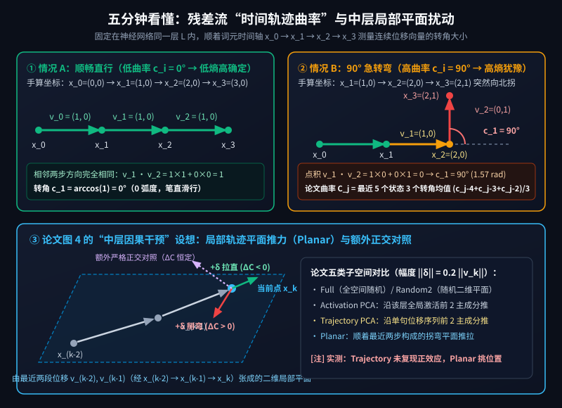
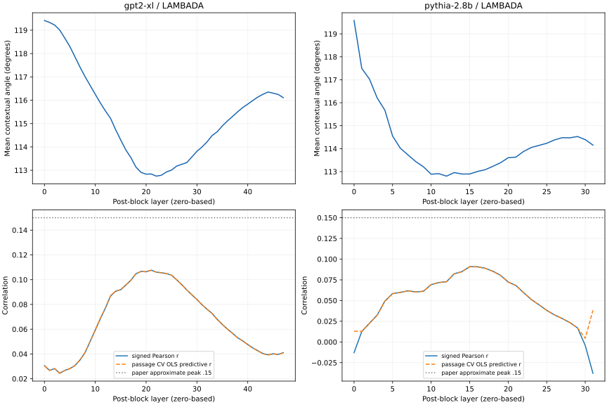
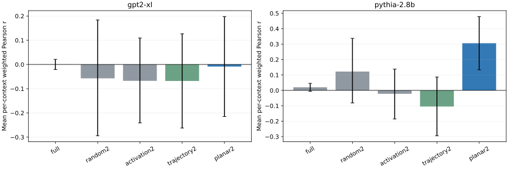
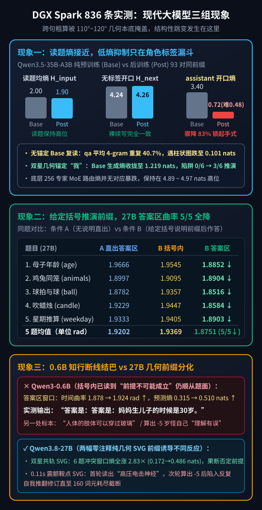

【AI可解释性】大模型犹豫时残差流在“急转弯”？我们在 DGX Spark 上复现了 MIT 这篇 ICML 论文

━━━━━━━━━━━━━━━━━━━━

◆ 引子：大模型“拿不准主意”的时候，它脑子里的向量到底长什么样？

━━━━━━━━━━━━━━━━━━━━

平时用大模型写代码或者答逻辑题，大家都有过这种直观感受：
碰到熟门熟路的套路题，模型吐字如飞、干脆利落；可一旦碰上带陷阱的绕弯题，它要么在那里翻来覆去兜圈子，要么憋了半天吐出一句莫名其妙的胡话。

如果把大模型每一层的激活值（残差流向量）看作高维空间里的一个点，那么模型顺着句子一个词一个词往下读、往下写的过程，就是在高维空间里走出的一条 **几何轨迹（Trajectory）** 。

今年入选机器学习顶会 **ICML 2026** 的一篇麻省理工学院（MIT 脑与认知科学系 Evelina Fedorenko 团队）论文《 **Representational Curvature Modulates Behavioral Uncertainty in Large Language Models（表征曲率调制大语言模型的行为不确定性）** 》（`arXiv:2604.23985`），就围绕这条几何轨迹提出了一个非常吸引眼球的结论：

> **当大模型顺着上下文推进时，它内部残差流的时间轨迹在网络中间层会明显变直（曲率跌入低谷）；而且在中层，当模型对下一个词犹豫不决（输出分布的信息熵升高）时，残差流轨迹的转角曲率也会随之升高。如果顺着局部轨迹平面去推拉这条轨迹，还能方向选择性地调制模型下一步输出的犹豫度。**

听起来是不是既有几何美感，又像一把能窥探模型内部犹豫度的精密尺子？

不过，经历过前文 360 期（扒开 MIT 权重空间编程源码）的读者肯定已经养成了条件反射：**凡是顶会论文画出来的漂亮曲线，先看它拿什么模型跑的，再拉到自家机器上复现一把。**

打开这篇 ICML 2026 论文的实验章节一看，我们不禁乐了——堂堂 2026 年的顶会论文，标题挂着《Large Language Models》，正文里跑的主力模型居然是 2019 年发布的 **`GPT-2 XL`（1.5B，15 亿参数）** 和 2023 年初的 **`Pythia-2.8B`（28 亿参数）** ，连个 7B 模型或者现代对话模型都没上。

为了搞清楚这套“轨迹曲率调制不确定性”的结论到底有几分扎实、几分局限，我们在家里的 **DGX Spark（128GB 统一内存）** 上连跑了两轮实测：
1.**第一轮（原版 `1.5B / 2.8B` 模型对齐复现）** ：我们把论文原版的 **`GPT-2 XL (1.5B)`** 和 **`Pythia-2.8B`** 拉下来，对齐论文公式与主要控制条件，跑了近 8 万个词元位置和十多万次扰动样本。结果发现：论文里说的“中层轨迹相对变直”和“中层弱正相关”确实存在，但曲率对预测熵的线性解释方差 **只有 `0.83%` 至 `1.16%`** ；而在论文图 4 的五类子空间因果干预实验中， **`Trajectory PCA` 子空间在两模型上均未复现出正效应，主打的 `Planar` 局部平面干预则明显依赖样本位置（在 `GPT-2 XL` 首批 32 位置上接近零、换 128 新位置为 `0.092`，在 `Pythia` 首批为 `0.306`、换 128 新位置跌至 `0.062` 且置信区间跨零）** 。
2.**第二轮（放到现代 `Qwen3` 系列模型上做补充检验）** ：为什么跨句子粗算转角只能解释不到 `1.2%` 的熵起伏？把同一套几何与信息论探针挂到现代模型 **`Qwen3.5-35B-A3B`（纯预训练 Base vs 后训练 Post）** 、 **`Qwen3.8-27B`** 与 **`Qwen3-0.6B`** 上做补充测试后，我们看清了三个在 `1.5B` 老模型单句续写里看不到的工程细节：高维位移自带的 `120°` 几何本底、`<|im_start|>assistant` 角色标签处的首词熵漏斗，以及同题配对下走完括号推演前缀对后续答案区轨迹的拉直效应。

今天这篇笔记，我们就先用五分钟手算带大家看懂什么叫“残差流轨迹曲率”，再把这两轮真机复现与补充测试的账单一并摊开。

━━━━━━━━━━━━━━━━━━━━

◆ 第一章：五分钟手算——什么是残差流里的“轨迹曲率”与“预测熵”？

━━━━━━━━━━━━━━━━━━━━

别被论文里的几何术语吓住。我们在前文 267 期 https://mp.weixin.qq.com/s/mFRQl-5qUstz7fbZ0tvpvQ 学过向量点积与夹角，在前文 359 期 https://mp.weixin.qq.com/s/8HNeuklsntzzh5EbgNRjdw 学过正交投影，算懂这篇 ICML 论文的核心公式只需要初中平面几何。

注意区分两个方向：大模型内部既有从第 1 层传到第 32 层的 **“纵向跨层轨迹”** ，也有固定在同一层（比如第 15 层）里、顺着句子从第 1 个词走到第 10 个词的 **“横向时间轨迹”** 。MIT 这篇论文测的是后者—— **固定在同一层里，看连续几个词元一步步往前走时拐弯有多急** 。

我们拿平面上的 4 个点手算一次，五秒钟就能看明白：

假设在某一层里，模型依次读了 4 个词，它们在残差流里的坐标分别是 `x0, x1, x2, x3`：
- **情况 A（顺畅直行）** ：`x0 = (0, 0)`，`x1 = (1, 0)`，`x2 = (2, 0)`，`x3 = (3, 0)`。
  第一步走的位移向量是 `v0 = x1 - x0 = (1, 0)`（往东走 1 米）；
  第二步走的位移向量是 `v1 = x2 - x1 = (1, 0)`（继续往东走 1 米）。
  两步方向完全一致，夹角 `c0 = 0°`（0 弧度）——这就是 **零曲率（走直线）** 。
- **情况 B（90 度急转弯与 180 度折返）** ：到了第三步，坐标突然拐到了 `x3 = (2, 1)`。
  第三步的位移向量变成了 `v2 = x3 - x2 = (0, 1)`（突然改成往北走 1 米）。
  拿第二步的 `v1 = (1, 0)` 和第三步的 `v2 = (0, 1)` 算点积：`1×0 + 0×1 = 0`，夹角 `c1 = 90°`（即 `π/2 ≈ 1.57 弧度`）；如果下一步从 `(2, 1)` 直接折返往南走回 `(2, 0)`（位移 `(0, -1)` 与上一步 `(0, 1)` 完全反向），夹角就是 `180°`（`π ≈ 3.14 弧度`）——这就是 **高曲率（急转弯）** 。

MIT 论文里的 **表征曲率 `C_j`** ，就是站在当前第 `j` 个词的位置，回头看最近 5 个词状态（`x_(j-4)` 到 `x_j`）走出的 4 段位移、形成 **3 个连续转角** ，把这 3 个转角加起来求个平均：

```text
# 1. 第 i 步到第 i+1 步的位移向量：
v_i = x_(i+1) - x_i

# 2. 相邻两步位移向量之间的转角（0 代表直线同向，π ≈ 3.14 代表 180° 折返）：
c_i = arccos( (v_i · v_(i+1)) / (||v_i|| * ||v_(i+1)||) )

# 3. 论文定义的上下文表征曲率（最近 5 个状态、3 个连续转角的平均值）：
C_j = (c_(j-4) + c_(j-3) + c_(j-2)) / 3
```

那什么是论文里说的 **“行为不确定性（Behavioral Uncertainty）”** 呢？
其实就是我们在前文 315 期 https://mp.weixin.qq.com/s/8jC7pwKN0RFd5O70Dh4Lrw 聊过的 **下一步预测分布的香农信息熵（Shannon Entropy，`H`）** ：模型读到第 `j` 个词时，输出头会给词表里所有词算出一串概率 `p`。如果模型十拿九稳（比如 `99%` 概率押某一个词），熵 `H` 就接近 `0`（高确定性、低不确定性）；如果模型拿不准主意，几百个候选词的概率平摊开来，熵 `H` 就会飙高（高不确定性、非常犹豫）。（注：MIT 论文以 2 为底用 `bits` 作单位，第三章我们的补充实验以自然常数 `e` 为底用 `nats` 作单位，换算关系为 `1 nat ≈ 1.443 bits`，换底只改变标尺刻度，不改变相关系数。）



MIT 论文声称发现了两条核心规律（对照上图）：
1.**观测规律** ：在 `GPT-2 XL` 和 `Pythia-2.8B` 里，词元轨迹在浅层和深层的平均转角较大（约 `118° 至 119.6°`），到了 **网络中间层会相对变直（转角跌入约 `112.8°` 的低谷）** ；而且在中间层，曲率 `C_j` 与下一步预测熵 `H` 呈正相关（论文报出的峰值相关系数约 **`r ≈ 0.15`** ）。
2.**因果干预规律（论文图 4）** ：既然中层曲率跟熵有关，那如果我们在中层人工给当前词的向量 `x_k` 加一个长度为下一步位移 20% 的小推力 `δ`（`||δ|| = 0.2 ||x_(k+1) - x_k||`），会发生什么？论文对比了 5 种推力子空间（外加我们额外补测的第 6 种严格正交控制）：
  - **全空间随机方向（`Full`）** 、 **随机二维子空间（`Random2`）** 、 **全局激活前 2 主成分平面（`Activation PCA`）** ：论文说这三种随机或全局方向上，曲率变化 `ΔC` 与熵变化 `ΔH` 没有稳定的正耦合（相关性接近 `0`）；
  - **单句轨迹位移前 2 主成分平面（`Trajectory PCA`）** 与 **最近两步位移 `v_(k-2), v_(k-1)` 张成的局部平面（`Planar`）** ：论文图 4 显示这两种贴合当前轨迹的推法能使 `ΔC` 与 `ΔH` 显著正耦合（原图目测 `Planar` 在 `GPT-2 XL` 上相关系数达 **`约 0.28`** 、在 `Pythia-2.8B` 上达 **`约 0.23`** ；`Trajectory PCA` 在 `Pythia` 上也达 **`约 0.19`** ）。

公式清爽、故事直观。但真把代码跑起来，每一项都能稳稳复现吗？

━━━━━━━━━━━━━━━━━━━━

◆ 第二章：原版模型真机对账——用 `GPT-2 XL` 与 `Pythia-2.8B` 独立复现，核出四处关键差异

━━━━━━━━━━━━━━━━━━━━

我们在 DGX Spark 上从 Hugging Face 官方仓库拉取了原版的 **`openai-community/gpt2-xl`** （48 层，1600 维）与 **`EleutherAI/pythia-2.8b`** （32 层，2560 维），全程使用 `float32` 精度做了对齐公式与主要控制条件的独立复现（主复现脚本与复现报告已公开在 https://github.com/lmxxf/ai-theorys-study/tree/main/wechat/assets/361 ）。

先看两边完全吻合的地方：**模型中间层轨迹相对变直（曲率低谷）的现象确实稳稳复现了。**
在 1,024 篇 `LAMBADA` 英文长语料（`GPT-2 XL` 共 `79,398` 个有效预测位置，`Pythia-2.8B` 共 `77,130` 个有效预测位置）上，浅层转角均值从 `119.4° / 119.6°` 一路下降，到了中间层（`GPT-2 XL` 的第 22 层、`Pythia-2.8B` 的第 12 层，0 起算）双双跌入全网最低谷（`112.75°` 与 `112.80°`），且曲率与下一步预测熵的正相关峰值也确实落在中层附近（`GPT-2 XL` 第 21 层，`Pythia` 第 15 层）。

然而，往深里核对具体相关性量级、下标对齐和因果干预实验，四处值得深究的差异接二连三浮现了出来：

────────────────────

### 差异一：中层正相关虽存在，但线性解释方差仅有 `0.83%` 至 `1.16%`，且交叉验证预测 `r` 需配合斜率符号一起读

先看观测实验的实测量级对比表：

| 模型与测试语料 | 有效预测词元位置数 | 轨迹最直层（0 起算） | 最大正相关层 | 原始带符号相关 `signed r` | 10 折跨篇章交叉验证 `r` | 线性解释方差 `R² = r²` | 论文正文报告峰值 |
|---|---|---|---|---|---|---|---|
| **`gpt2-xl` / LAMBADA 长文** | `79,398` | 第 22 层 | 第 21 层 | **`0.1076`** | `0.1076 [0.096, 0.119]` | **`1.16%`** | 约 `0.15` |
| **`pythia-2.8b` / LAMBADA 长文** | `77,130` | 第 12 层 | 第 15 层 | **`0.0909`** | `0.0908 [0.083, 0.098]` | **`0.83%`** | 约 `0.15` |
| **`gpt2-xl` / UD 短句补充集** | `8,346` | 第 22 层 | 第 0 层 | **`0.0786`** | `0.0818 [0.052, 0.112]` | **`0.62%`** | 中层明显正峰 |
| **`pythia-2.8b` / UD 短句补充集** | `8,492` | 第 12 层 | 第 4 层 | **`0.0460`** | `0.0491 [0.014, 0.084]` | **`0.21%`** | 中层明显正峰 |

这里有两个读图时必须留心的地方：
1.**`r = 0.091` 到 `0.108` 的真实解释力有多大？** 把相关系数平方算成线性决定系数 `R²`，分别是 **`0.83%` 和 `1.16%`** （就算按论文报告的 `r ≈ 0.15` 计算，线性 `R²` 也只有 `2.25%`）。这说明单靠这一个三转角标量，在线性层面只能解释下一步预测熵约百分之一的起伏，远不足以充当通用的“犹豫度温度计”。
2.**为什么要把原始带符号的 `signed r` 和交叉验证 `CV r` 同图画出来？**
论文 §2.5 采用的指标是：先在训练折拟合单变量线性回归 `H_hat = β * C + b`，再去测试折算 **预测值 `H_hat` 与真实值 `H` 的相关系数** 。在中层正相关区，斜率 `β > 0`，两者基本重合；但在边缘层（比如 `Pythia-2.8B` 的第 30、31 层），原始曲率与熵其实是 **负相关（`signed r < 0`）** ，此时线性回归只要学出一个负斜率 `β < 0`，算出来的预测相关系数 `corr(H_hat, H) = sign(β) * corr(C, H)` 就会翻成正数。



看上图我们的实测曲线（左列为 `GPT-2 XL`，右列为 `Pythia-2.8B` 在 `LAMBADA` 上的逐层结果）：在 `Pythia-2.8B` 下半图的第 30、31 层，代表原始相关性的蓝色实线（`signed Pearson r`）已经掉到了零线以下的负值区，而代表交叉验证预测相关的橙色虚线（`passage CV OLS predictive r`）却因为负斜率乘负号往上翘起了正尾巴。因此，看这类回归预测相关性时，必须连同原始符号一起核对。

────────────────────

### 差异二：论文公式下标前后不一致，错位一个词元相关性就会全部变号为负

在写代码核对论文第 2 节时，我们还发现原文的下标约定存在一处明显的前后打架：
- 论文 §2.3 定义曲率 `C_k` 时，公式里用到了第 `k` 个词的隐藏状态 `x_k`；
- 可紧接着到了 §2.4 定义预测熵时，公式却写成了 `H(w_k | w_<k)`（预测第 `k` 个词本身的熵）；到了 §2.6 干预实验时，又改口写成了 `H(w_(k+1))`（预测第 `k+1` 个词的熵）。

如果谁照着 §2.3 和 §2.4 的字面下标直接写代码，拿包含 `x_j` 的曲率 `C_j` 去配预测当前词 `w_j` 的 `logits[j-1]`，整条逐层相关曲线就会 **全盘变号成负数** ——在主干预层上，`GPT-2 XL`（第 21 层）会从 `+0.1076` 直接翻负成 **`-0.1712`** （全层范围 `-0.1834` 至 `-0.0097`），`Pythia-2.8B`（第 11 层）则会翻负成 **`-0.1384`** （全层范围 `-0.1526` 至 `-0.0053`）。只有严格按无泄露的因果口径对齐（用截至 `x_j` 的曲率配预测下一个词 `j+1` 的 `logits[j]`），才能得到中层的正相关峰。

────────────────────

### 差异三：论文图 4 的“因果干预”中，`Trajectory PCA` 未复现正效应，`Planar` 效应显著依赖样本位置

最关键的核验在论文图 4 的 **中层因果干预实验** 。
我们在两个模型的中层（主实验取 0 起算的第 21/11 层，6 类条件 × 32 个位置 × 300 次方向 = 每模型 `57,600` 个扰动样本，其中论文 5 类占 `48,000` 个；另在 1 起算对应的第 20/10 层跑了 3 类共 `28,800` 个样本的相邻层检查），并进一步在预先冻结的 **128 个全新位置** 上补跑了 `Full` 与 `Planar` 两类共 `76,800` 个扰动样本的独立确认。

把论文原图 4 的目测值与我们主实验（32 位置，见下图）及独立确认（128 新位置）的数据放在一起对比：



| 模型 | 干预条件 | 论文图 4 目测值 | 主实验（32 位置）加权 `r` | 主实验（32 位置）原始 `raw r` | 相邻层（1 起算）原始 `raw r` | 独立确认（128 新位置）加权 `r` | 独立复现核验结果 |
|---|---|---|---|---|---|---|---|
| **`gpt2-xl`** | `Full`（全空间随机） | `约 0.00` | `0.0003` | `0.0003` | `0.0009` | `0.0069 [-0.006, 0.019]` | 零基线一致 |
| **`gpt2-xl`** | `Trajectory PCA` | `约 0.04` | **`-0.0680`** | **`-0.0572`** | **`-0.0621`** | — | **点估计为负，95%CI `[-0.262, 0.126]` 跨零** |
| **`gpt2-xl`** | **`Planar`（局部轨迹平面）** | **`约 0.28`** | **`-0.0086`** | **`-0.0230`** | **`-0.0341`** | **`0.0924 [0.004, 0.189]`** | **32 位置近零；128 位置配对差 `+0.085` 为正但弱于原图** |
| **`pythia-2.8b`** | `Full`（全空间随机） | `约 0.02` | `0.0202` | `0.0202` | `0.0065` | `0.0064 [-0.004, 0.016]` | 零基线一致 |
| **`pythia-2.8b`** | **`Trajectory PCA`** | **`约 0.19`** | **`-0.1048`** | **`-0.1345`** | **`-0.0604`** | — | **未复现正效应（点估计为负，95%CI `[-0.294, 0.087]` 跨零）** |
| **`pythia-2.8b`** | **`Planar`（局部轨迹平面）** | **`约 0.23`** | **`0.3059`** | **`0.3470`** | **`0.4039`** | **`0.0616 [-0.021, 0.144]`** | **32 位置显著为正；换 128 新位置跌至 `0.062` 且区间跨零** |

从上表可以清楚地看到三点事实：
1.**`Trajectory PCA`（单句轨迹主成分子空间）在两个模型上均未复现出正效应** ：论文图 4 里 `Pythia-2.8B` 的 `Trajectory PCA` 柱子约为 `+0.19`，而在我们的实现下，两个模型的点估计均为负值（`-0.0680` 与 `-0.1048`），95% 置信区间均跨过零线。
2.**`Planar`（局部轨迹平面）的正耦合确实存在，但效应强弱高度依赖所选的文本位置** ：在第一批 32 个位置（取自篇章中点附近）上，`Pythia` 跑出了很强的 `0.3059`（配对 `Planar - Full` 差值 `+0.2858`），但 **`GPT-2 XL` 却接近零（`-0.0086`）** ；而在预先冻结的第二批 128 个新位置（在新篇章前段均匀随机抽取）上，`GPT-2 XL` 出现了微弱但统计显著的正效应（加权 `r = 0.0924`，配对差 `+0.0854 [0.002, 0.167]`），反倒是刚才表现很强的 **`Pythia-2.8B` 掉到了 `0.0616`（配对差 `+0.0552 [-0.028, 0.138]` 跨零）** 。这说明局部平面干预并不是在任意上下文位置都具有稳定的统一量级。
3.**我们额外设计的“沿角度梯度直接拉直 vs 掰弯”确定性测试** ：
如果在局部平面里不搞 300 次随机方向采样，而是直接沿转角减小的负梯度方向推一步（强行拉直 `straighten`），在 32 个位置上两模型的转角确实一致变小了（`-0.0675` 与 `-0.0717 rad`），但 **`GPT-2 XL` 只有 13/32 的位置熵下降（中位数反而微升 `+0.0132 bits`），`Pythia-2.8B` 虽有 21/32 的位置熵下降但均值微升 `+0.0348 bits`** ——说明“一拉直熵就降”并非每个词元位置都单调成立的定律。此外，按单层 `Full` 分布做 100 桶直方图重要性重加权时，因 `Planar` 的 `|ΔC|` 变化范围比 `Full` 宽得多，有 `83.94%`（`GPT-2 XL`）和 `90.55%`（`Pythia`）的样本落在了单层 `Full` 参考范围之外（改用超界赋最小权重 `0.1` 的替代处理后，两模型 `Planar` 加权 `r` 分别为 `-0.0046` 与 `0.2422`，定性结论不变）。

────────────────────

### 差异四：论文图 4B 的单句示例，仅凭图示可见短句无法还原出 `5.614 bits` 基线熵

在论文图 4B 里，作者画了一个展示干预效果的示例短句 `When I got home, the`，图上标明干预前的基线预测熵是 **`H = 5.614 bits`** （拉直后降到 `5.543`，掰弯后升到 `5.725`）。
由于论文没有公开代码和该图对应的完整前缀 Token ID，我们拿可见字符串 `When I got home, the` 在两台原版模型上测试了“末尾不带空格”和“末尾带空格”两种分词输入：
- **末尾不带空格（`When I got home, the`）** ：`Pythia-2.8B` 预测熵是 **`9.3205 bits`** （比图示值高 `3.71 bits`），`GPT-2 XL` 是 **`9.6460 bits`** （比图示值高 `4.03 bits`，最高概率词均为 `' first'`）；
- **末尾带空格（`When I got home, the `）** ：`Pythia-2.8B` 掉到 **`3.5018 bits`** （比图示值低 `2.11 bits`，最高概率词 `'icing'`），`GPT-2 XL` 掉到 **`4.3875 bits`** （比图示值低 `1.23 bits`，`'iced'`）。

可见，图 4B 的示例要么省略了前文段落或特殊起始符，要么采用了别的分词截断方式，仅凭图上印出的这五个英文单词是无法直接复现出 `5.614 bits` 的。

━━━━━━━━━━━━━━━━━━━━

◆ 第三章：现代模型补充检验——在 `Qwen3` 系列上，我们看到了哪三个工程细节？

━━━━━━━━━━━━━━━━━━━━

复现完 `GPT-2 XL` 与 `Pythia-2.8B`，我们还想顺手弄明白三个实际的工程问题：
第一，为什么不管是哪个模型，相邻词元位移的平均转角总在 `110° 至 120°` 附近打转，导致跨句粗算的相关性这么弱？
第二，现代经过指令微调与强化学习（后训练）的对话模型，其输出信息熵跟纯预训练基座（Base）相比，到底在哪个具体位置发生了分化？
第三，如果严格控制同一道题的输出前缀，先走完一段推演说明能不能让后续答案区的轨迹变直？

为此，我们在 DGX Spark 上对同架构原生 `BF16` 的 **`Qwen3.5-35B-A3B-Base`（纯预训练）vs `Qwen3.5-35B-A3B`（后训练版，40 层，256 选 8 MoE）** 、 **`Qwen3.8-27B`** 以及 **`Qwen3-0.6B`** 做了补充测试（下图汇总了三项核心对比）：



────────────────────

### 细节一：为什么跨句转角总在 `110° 至 120°` 附近？以及 `<|im_start|>assistant` 角色标签处的首词熵漏斗

我们先在 `Qwen3-0.6B`、`Qwen3.8-27B` 和 `Qwen3.5-35B-A3B` 上测了 8 道日常顺口溜与 8 道烧脑逻辑题在中后层（`50% 至 85%` 深度）的跨句时间曲率 `κ_temp`。结果同样显示：跨句混算的时间曲率与预测熵相关系数在 `0.6B` 上为 **`-0.023`** 、在 `27B` 上为 **`-0.044`** 、在 `35B-A3B` 各格式下约为 **`-0.097` 至 `-0.161`** ，所有句子的平均转角都停在 **`1.93 至 2.03 弧度（约 110° 至 116°）`** 的窄带里（正如第二章看到的，`GPT-2 XL` 和 `Pythia` 也在 `112.8° 至 119.6°` 之间）。

为什么在几千维的高维空间里，相邻两步位移向量的转角本底总在 `120°` 附近，而不是大家直觉以为的 `90°`？
用我们在前文 267 期学过的向量点积手算一下就豁然开朗了：
假设高维空间里连续三个词的残差状态 `a, b, c` 是独立同分布、零均值、方差为 `σ²` 的随机向量。那么：
- 前一步位移是 `v0 = b - a`，它的长度平方期望是 `E[||v0||²] = E[||b||²] + E[||a||²] = 2 d σ²`；
- 后一步位移是 `v1 = c - b`，它的长度平方期望也是 `E[||v1||²] = 2 d σ²`；
- 但因为两步位移 **共享了中间那个点 `b`** （前一步是 `+b`，后一步是 `-b`），把它们做点积时，`E[v0 · v1] = E[(b - a) · (c - b)] = -E[||b||²] = -d σ²`。

把分子 `-d σ²` 除以分母 `2 d σ²`，高维空间里连续两步随机位移的余弦值期望天然就是 **`-1/2`** ，对应的夹角恰好是 **`arccos(-0.5) = 120°`（约 `2.09 弧度`）** 。正是这个 `120°` 的高维几何本底加上不同句子的词性语法起伏，把跨句粗算的相关性给淹没了。

而当我们把 `35B-A3B-Base` 与后训练版 `35B-A3B (Post)` 在完全相同的输入前缀下逐区对表时，现代对话模型真正发生剧烈熵变的位置非常清晰——就在 **`<|im_start|>assistant\n` 角色标签开口吐第一个字的那道“首词漏斗”** （见上图面板 1）：
- **在读题阶段（`H_input`）** ：无论是纯预训练的 `35B-A3B-Base` 还是后训练的 `35B-A3B (Post)`，读题全过程的输出词表预测均熵非常接近，稳稳停在 **`1.90 至 2.06 nats`** ，说明后训练并没有压平读题阶段的表征分布；
- **在不加聊天角色标签裸续写时（`raw / qa` 起点熵 `H_next`）** ：不加 `<|im_start|>assistant` 标签时，后训练版的开口首词熵高达 **`4.26 至 4.42 nats`** ，与纯 Base 模型（`4.24 至 4.83 nats`）完全处于同一水平；
- **唯独套上 `<|im_start|>assistant\n` 的那一刻（`chat` 起点熵 `H_next`）** ：后训练版的开口首词熵从 `raw` 下的 `4.26 nats` **骤降 83% 至 `0.717 nats`** （相比 Base 在 `chat` 下的 `3.402 nats` 下降 **79%** ；在 8 道逻辑难题上更是从 Base 的 `3.324 nats` **暴跌 85% 至 `0.484 nats`** ，其中单题首词甚至以 `99.26%` 的概率指向 `“我们可以通过”` 这类固定起手词，而底层 256 专家 MoE 路由熵并无对应幅度的下降，仍保持在 `4.89 至 4.97 nats`）。

与此同时，在 160 词元的实际生成对比中，纯 Base 模型虽然开口前享有 `4.8 nats` 的高熵自由度，但在 `qa` 问答格式下其 **平均 4-gram 词元组重复比例高达 `40.69%`（其中 `14/27` 条样本的 4-gram 重复率达到或超过 `50%`）** ，而在 `chat` 角色框架下后训练模型的 4-gram 重复率则被压低到了 **`2.81%`** 。这说明后训练在 `<|im_start|>assistant` 处建立的低熵收敛，客观上也起到了把散漫续写收拢进稳定答题轨道、抑制表面复读的作用。

────────────────────

### 细节二：在同题配对下，给定括号推演前缀 `（……）` 后，`27B` 随后的答案区时间曲率实现 `5/5` 全降

既然跨句粗算容易被几何本底与句法差异掩盖，如果我们针对同一道题，对比 **条件 A（不给推演过程，直接让模型在 `答案是：` 后面生成结论）** 与 **条件 B（先在 `答案是：` 前面拼入一段放在中文括号 `（……）` 里的正确解题说明，再让模型生成 `答案是：` 之后的结论）** ，答案区的轨迹曲率会发生什么变化？（见上图面板 2）

我们在 5 道逻辑算术陷阱题（母子年龄、鸡兔同笼、球拍与球、吹蜡烛、星期推算）上测量了 `Qwen3.8-27B`：
- 在条件 B 预先给定的中文括号 `（……）` 说明段内部，轨迹时间曲率处于较高水平（5 题均值 **`1.9369 rad`** ）；
- 而一旦跨过右括号 `）` 进入 `答案是：` 之后的正式结论生成区， **`27B` 在全部 5 道题（`5/5`）上的答案区窗口时间曲率无一例外全部低于直接作答的条件 A（均值从 `1.9202 rad` 降至 `1.8751 rad`，平均下降 `-0.0450 rad`）** 。

也就是说，当上下文中已经通过括号说明走完了中间的逻辑转折之后，大模型在随后交付最终答案时的残差流时间轨迹确实变得更加平直了（注：由于条件 B 采用的是给定正确说明的教师强制前缀，同时改变了序列长度与语义信息，这验证的是“上下文里已完成推演转折对后续答案区轨迹的拉直效应”）。

────────────────────

### 细节三：同样喂入括号否定说明，为什么 `0.6B` 小模型在母子年龄题上曲率与熵反跳并结巴？

在上面同一个括号前缀实验里，`Qwen3-0.6B` 小模型的表现提供了一个非常直观的对比标本（见上图面板 3）：

- 在其余 4 道常规算术题（鸡兔同笼、球拍与球、吹蜡烛、星期推算）上，不给括号直出时（条件 A），`0.6B` 四题全错（`0/4`）；而在括号里喂入正确推演说明后（条件 B），这 4 道常规题全部翻盘答对（`4/4`），且答案区预测熵显著下降（例如鸡兔题从 `0.403` 降至 `0.111 nats`，蜡烛题从 `0.567` 降至 `0.172 nats`）。
- **唯独在“妈妈今年 30 岁，亲生儿子今年 35 岁，请问妈妈生儿子时几岁？”这道前提矛盾题上** ，哪怕我们在条件 B 的括号里已经白纸黑字把否定前提的结论喂到了它嘴边：
  `（母亲30岁而亲生儿子35岁，意味着母亲出生前5年就生子，前提不可能成立。）\n答案是：`
  结果轮到 `0.6B` 在 `答案是：` 后面续写时，括号里的“前提不可能成立”与小模型表层期待填入 `【数字】+ 岁` 的填空惯性迎头相撞—— **它在答案区窗口的平均时间曲率非但没降，反而从条件 A 的 `1.8779 rad` 升至 `1.9240 rad`，预测熵从 `0.3150 nats` 飙升至 `0.5097 nats`，甚至在开头被憋得结巴复读了一遍 `答案是：`** ；可结巴完之后，表层填空惯性依然压倒了括号里的明确否定，它照样顺着题面数字吐出了：
  **`“答案是：答案是：妈妈生儿子的时候是30岁。”`**
- 而在另一组多轮测试里，当 `0.6B` 自己列出算式算出 `30 - 35 = -5 岁，这显然不可能` 时，它也没有去否定题目前提，而是调出客服认错模板自责道：**`“这说明我的理解有误，可能需要重新考虑。”`** （相比之下，`Qwen3.8-27B` 则在 A、B 两组下均直接指出了“30 岁母亲不可能有 35 岁亲生儿子”的前提矛盾）。

这组对比清楚地说明：在 `0.6B` 这样的小模型里，遇到“既定填空模板”与“否定前提信号”正面冲突时，虽然内部残差流确实出现了曲率升高和预测熵飙升（好比车轮在冰面上打滑），但它的冲突信号还不足以刹住表层的数字填空惯性；只有到了 `27B` 规模的模型上，冲突检测才能稳定转化为推翻错误前提的输出动作。

────────────────────

💡 顺带串起 COLM 2026 与 ACL 2026 两篇新论文：当概念长在弯曲流形上时，SAE 会遇到什么麻烦？

把今天聊的“残差流弯曲轨迹”跟我们在前文 151 期 https://mp.weixin.qq.com/s/fwig-yD4sveatnFh7mVoUA 、前文 359 期讲过的 **稀疏自编码器（SAE）** 连起来，正好可以看看今年顶会上对 SAE 的两项最新检验：
1.**哈佛大学与 Goodfire 团队发表在 COLM 2026 的《Do Sparse Autoencoders Capture Concept Manifolds?》（`arXiv:2604.28119`）** ：
  作者在合成流形与 `Llama-3.1-8B`（第 19 层）上检验了一个核心问题——当模型内部的概念组织在 **低维连续弯曲流形（Continuous Manifolds）** 上时，一维线性的 SAE 字典是怎么表达它的？论文指出，理想情况下 SAE 可以通过一小撮原子的联合张成做“全局子空间捕获（Global Subspace Capture）”，或者用多块原子做“局部贴砖（Local Tiling）”；但在实际训练中，标准 SAE 经常掉进一种被称为 **“稀释态（Dilution）”** 的中间状态——把一个连续流形打散到了许多特征上，单看其中任何一个孤立的 SAE 特征都看不出完整的流形几何，必须把共激活的特征组重新聚类（如拟合伊辛模型 Ising Model）才能把流形拼回来。
2.**CMU、斯坦福与 MBZUAI 团队发表在 ACL 2026 的《Mechanistic Interpretability Should Prioritize Feature Consistency in Sparse Autoencoders》（`arXiv:2505.20254`）** ：
  作者提出了 **`PW-MCC`（成对词典平均相关系数）** ，指出如果不做严格的架构与超参约束，同一个模型换个随机种子重训一遍标准 SAE，两本特征词典之间会出现显著的跨轮次不一致（而经过调优的 TopK SAE 等架构才能把 `PW-MCC` 提升到约 `0.80` 的较高一致性水平）。

这两篇工作从另一个侧面提醒我们：大模型内部的表征与轨迹既不是互不相干的孤立直线，也不是随便量一个单标量就能一眼看穿的简单刻度；把控制变量做严、把模型规模与前因后果对准，才不会在几十亿维的迷宫里被表象晃花眼。

────────────────────

━━━━━━━━━━━━━━━━━━━━

◆ 本期小结

━━━━━━━━━━━━━━━━━━━━

把 MIT 这篇 ICML 2026 论文的原版复现与我们在 `Qwen3` 系列模型上的补充实测合在一起，关于残差流“几何曲率与预测不确定性”的账本就清楚了：

- **公式其实很简单** ：所谓横向时间曲率 `C_j`，就是固定在同一层里，算最近 5 个词状态走出的 4 段位移向量 `v_i = x_(i+1) - x_i` 之间的 3 个转角平均值；所谓行为不确定性 `H`，就是下一步预测全词表分布的香农信息熵
- **MIT 原版 `1.5B / 2.8B` 独立复现的四处核验结果** ：在 `GPT-2 XL` 和 `Pythia-2.8B` 上，中层轨迹相对变直（约 `112.8°`）与弱正相关确实存在，但曲率对熵的线性解释方差仅有 **`0.83%` 至 `1.16%`** （`r = 0.091 / 0.108`）；若按原文 §2.3/§2.4 字面下标错位一词元，相关性会全盘翻负（主干预层 `-0.171 / -0.138`）；图 4 的 `Trajectory PCA` 干预在两模型上均未复现正效应，`Planar` 局部平面干预明显依赖样本位置（32 位置下 `GPT-2 XL` 为 `-0.0086`，换 128 新位置下 `Pythia` 跌至 `0.0616` 跨零），直接沿梯度拉直在 `GPT-2 XL` 上仅 `13/32` 位置降熵，且图 4B 示例句仅凭可见短句无法还原出 `5.614 bits` 基线
- **现代 `Qwen3` 系列模型上的三项工程细节** ：① 连续三点共享中间点使高维随机位移天然带有 `arccos(-0.5) = 120°` 的转角本底，而现代后训练模型真正剧烈的熵变发生在 `<|im_start|>assistant` 开口处的 **首词熵漏斗** （首词起点熵从 `raw` 的 `4.26` 骤降至 `0.72 nats`、难题 `0.48 nats`，并将 4-gram 重复率从 `qa` 下的 `40.69%` 压至 `chat` 下的 `2.81%`）；② 在同题配对下，给定中文括号 `（……）` 推演说明前缀后，`27B` 随后的答案区窗口时间曲率实现 **`5/5` 全降（均值 `-0.0450 rad`）** ；③ 面对母子年龄矛盾题，`0.6B` 小模型哪怕在括号里读到“前提不可能成立”，答案区曲率与熵双双反跳并结巴吐出 `“答案是：妈妈生儿子的时候是30岁”` ，直观展示了小模型在冲突检测与输出控制之间的断层

━━━━━━━━━━━━━━━━━━━━

◆ 技术名词速查

━━━━━━━━━━━━━━━━━━━━

| 术语 | 一句话解释 |
|---|---|
| 表征时间曲率（Temporal Representational Curvature） | 固定在神经网络同一层内，沿着词元序列时间轴测量相邻步位移向量 `x_(i+1) - x_i` 之间的转角大小（`0` 为直线同向，`π` 为折返） |
| 跨层深度曲率（Layerwise Curvature） | 固定在同一个词元位置上，测量从第 `l` 层到第 `l+1` 层残差增量向量之间的方向夹角余弦差 `1 - cos` |
| 预测分布信息熵（Next-Token Predictive Entropy） | 模型输出头对下一个词元给出的全词表概率分布的香农熵 `H = -Σ p log p`；值越低代表模型越确定，值越高代表候选词越分散（犹豫） |
| 局部轨迹平面扰动（Planar Intervention） | 在最近两步位移向量 `v_(k-2)` 与 `v_(k-1)` 张成的二维平面内对当前隐藏状态施加小推力，专门改变局部转角大小 |
| 角色标签首词漏斗（Role-Tag Onset Funnel） | 后训练模型在读题阶段保持高熵（约 `2.0 nats`），仅在 `<\|im_start\|>assistant` 标签后将首词起点熵压低至 `0.48 至 0.72 nats` 的现象 |

━━━━━━━━━━━━━━━━━━━━

◆ 参考资料

━━━━━━━━━━━━━━━━━━━━

- Jack King, Evelina Fedorenko, Eghbal A. Hosseini, Representational Curvature Modulates Behavioral Uncertainty in Large Language Models, arXiv:2604.23985（ICML 2026；在 GPT-2 XL 与 Pythia-2.8B 上提出词元时间轨迹曲率与下一步预测熵的相关性及局部平面干预实验）
- Usha Bhalla et al., Do Sparse Autoencoders Capture Concept Manifolds?, arXiv:2604.28119（COLM 2026；分析 SAE 捕获连续概念流形的全局子空间与局部贴砖机制，指出标准 SAE 常落入特征稀释态 Dilution，需借特征组共激活恢复流形）
- Xiangchen Song et al., Mechanistic Interpretability Should Prioritize Feature Consistency in Sparse Autoencoders, arXiv:2505.20254（ACL 2026；提出 PW-MCC 词典一致性指标，评估并提升不同随机种子下 SAE 特征词典的可复现性）

━━━━━━━━━━━━━━━━━━━━

**顶会论文里那条看似优美的曲率相关曲线，拉到真机上一算，线性解释方差还不到百分之一点二。**

**不在同一个上下文拐点上把变量控制住，跨着句子混算出来的转角，九成以上只是高维空间自带的几何本底。**

**小模型的向量急转弯好比无人玩具车在冰面上打滑，只有当冲突检测压过表层填空惯性时，高熵犹豫才会化作踩下刹车的果断一脚。**

━━━━━━━━━━━━━━━━━━━━

// 靳岩岩的 AI 学习笔记 × Gemini 的浪漫 × GPT 的严谨
// 2026年11月6日

大模型犹豫时脑子里的向量在急转弯？我们在DGX Spark上用GPT-2 XL和Pythia-2.8B复现了这篇MIT的ICML 2026论文，发现曲率对熵的线性解释方差不足1.2%、干预效应挑位置；进而在Qwen3系列模型上补充实测了120°几何本底、角色标签首词漏斗与答案区曲率拉直效应。
