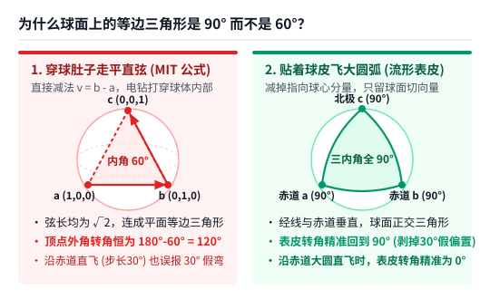
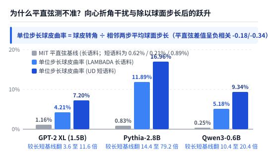
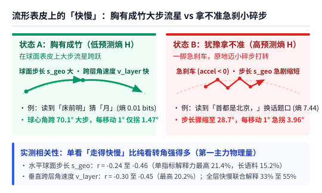
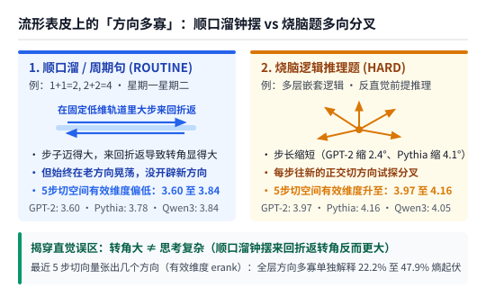
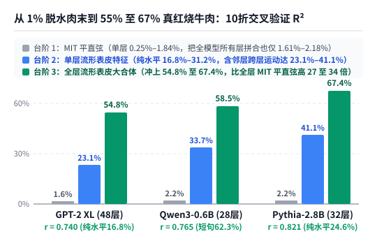

【AI可解释性】为什么前文 MIT 的残差流曲率只测出 1%？别拿穿球肚子的直尺量球面，顺着流形表皮走才看得见快慢与分叉

━━━━━━━━━━━━━━━━━━━━

◆ 引子：作者在角落里承认“写了个寂寞”，可真是因为模型太小吗？

━━━━━━━━━━━━━━━━━━━━

在前文 361 期 https://mp.weixin.qq.com/s/-OiYXA99DdbyV3YUa9BtoA 里，我们刚在 **DGX Spark** 上复现完麻省理工学院（MIT）入选顶会 **ICML 2026** 的那篇残差流曲率论文（`arXiv:2604.23985`）。

那篇论文最逗的地方在于：作者在标题和摘要里信誓旦旦地宣称“内部轨迹曲率调制大语言模型的预测不确定性”，结果真跑完数据一看，曲率对下一步预测信息熵 `H` 的线性解释力只有可怜的 **`1%` 左右** （我们实测 `GPT-2 XL` 上 `1.16%`、`Pythia-2.8B` 上 `0.83%`；作者自己在第 6 页小字里报的峰值 `r ≈ 0.15`，平方算下来也只有 **`2.25%`** ）。甚至到了论文第 10 页角落的局限性（`Limitations`）小段里，作者自己也心虚认怂，承认 **“这些效果都很小（`These effects were small`）”** ，还替自己找补说“可能是因为测试的模型和训练数据规模太小了”——活脱脱自己承认写了个寂寞。

那篇稿子写完那天半夜一点半，我躺在床上睡不着，脑子里一直转着稿子第三章算过的那个“随机模型 `120°` 基线”：三个两两互相垂直的单位向量 `a=(1,0,0)`、`b=(0,1,0)`、`c=(0,0,1)`，用勾股定理一算，两两之间的直线距离全都是 `√2`，连成了一个内角为 `60°` 的平面等边三角形，所以走过顶点的转弯外角正好是 `180° - 60° = 120°`。

可盯着这个 `60°` 和 `120°` 想了五分钟，突然看出不对劲了：
我们在前文 352 期 https://mp.weixin.qq.com/s/FHmykM-flk8OuniCPM3Wlg 讲过，Transformer 在进入每一个注意力层和前馈层之前，都会先过一道归一化——在 `GPT-2 XL` 和 `Pythia-2.8B` 这两个老模型里是 **`LayerNorm`** ，在现代阿里 `Qwen3` 系列里是 **`RMSNorm`** 。归一化的作用是把向量长度拉回固定刻度、只看方向，这意味着向量的方向实质上生活在一个 **弯曲的高维单位球面（流形表皮）** 上。

你站在弯曲的地球表面上想一想：从北极点 `c` 顺着经线走到赤道东经 `0°` 的点 `a`，左拐 `90°` 顺着赤道走到东经 `90°` 的点 `b`，再左拐 `90°` 顺着经线走回北极点 `c`—— **这三条两两垂直的单位向量在球面上围出来的等边三角形，三个内角明明全都是 `90°`，怎么会是 `60°` 和 `120°`？**



顺着这个问号往下深想一层，我们一下子看清了为什么 MIT 作者只测出 `1% 至 2%` 的寂寞：
**根本不是作者找补说的“模型太小”，也不是内部几何轨迹跟预测不确定性没关系，而是 MIT 作者从头到尾拿错了尺子、还漏掉了真正的主力。** 他拿着平直空间的向量减法去量球面上的运动，相当于拿一把电钻直接穿破地球肚子走平直弦，把“球皮本身的向心折角”混进了转弯角度里；而且除了拐弯角度，他还漏掉了球面表皮上真正决定不确定性的两大主力—— **“走得有多快（步长与跨层快慢）”** 与 **“往几个方向分叉（局部有效维度）”** 。

想到这里哪还睡得着，我们连夜连回家里的 **DGX Spark** ，在完全相同的 **`GPT-2 XL`（1.5B）** 、 **`Pythia-2.8B`** 以及 **`Qwen3`** 系列（`0.6B` / `27B` / `35B-A3B`）上，换上贴着球面表皮的软尺重跑了一轮实验（完整代码与数据已开源在 https://github.com/lmxxf/ai-theorys-study/tree/main/wechat/assets/363 ）。结果就在同一批被 MIT 作者嫌小的模型和数据上，对预测熵的 10 折交叉验证解释力当场从 MIT 的 **`1% 至 2%` 跃升到了单层 `17% 至 41%`、全层 `55% 至 67%`** ，连前文 361 期留下的 `Qwen3.8-27B` 括号思考草稿悬念也一并破案了。

━━━━━━━━━━━━━━━━━━━━

◆ 第一章：换掉穿球肚子的错尺子——剥离向心折角，再除以步长

━━━━━━━━━━━━━━━━━━━━

要看懂 MIT 的平直弦尺子错在哪儿，只需要用到我们在前文 267 期 https://mp.weixin.qq.com/s/mFRQl-5qUstz7fbZ0tvpvQ 学过的向量点积，以及前文 359 期 https://mp.weixin.qq.com/s/8HNeuklsntzzh5EbgNRjdw 学过的 **正交投影（减去垂直影子，留下表面余项）** 。

────────────────────

### 1. 手算对比：拿电钻穿地球肚子（`120°`）vs 贴着地球表皮飞（`90°` 与 `0°`）

我们先把每一层的残差流向量除以它自己的长度，投到单位球面上看纯方向的变化（把向量长度本身单独留作一个特征）。
假设飞机在单位球面上依次飞过三个点 `a → b → c`。MIT 论文直接用平直空间的向量减法 `v0 = b - a`、`v1 = c - b` 算位移。你看问题出在哪儿：`a` 和 `b` 都在球皮上，但 `b - a` 这条直线段根本不在球皮上，而是 **一头扎进地球肚子里穿过去的平直弦** 。

那怎么才能“顺着球面表皮走”？
站在中转站 `b` 点上，从球心指向 `b` 的方向就是脚底下的“地心垂直方向”。根据前文 359 期的正交投影公式，我们只需要把位移里 **顺着 `b` 指向球心的垂直分量（影子 `(a · b) * b`）减掉** ，剩下的就是紧紧贴着 `b` 点球面表皮的 **切向量** ：

```text
# 站在球面中转点 b 上（a, b, c 均为单位向量，即 b · b = 1）：
# 1. 算出从 a 飞向 b、到达 b 点时的球皮切方向 u_in（减掉指向球心的分量并单位化）：
u_in  = normalize( (a · b) * b - a )

# 2. 算出从 b 飞向 c、离开 b 点时的球皮切方向 u_out：
u_out = normalize( c - (c · b) * b )

# 3. 贴着球面表皮的真实转弯角度：
球皮转角 = arccos( u_in · u_out )
```

我们拿刚才那两道小学几何题手算验证一下：
- **测试一（两两垂直的三个单位向量 `a=(1,0,0) → b=(0,1,0) → c=(0,0,1)`）** ：
  用 MIT 的平直弦公式算，夹角余弦是 `-1/2`，报出 **`120.00°`** ；
  换用上面的球面表皮公式，到达 `b` 的球皮方向 `u_in = (-1, 0, 0)`，离开 `b` 的球皮方向 `u_out = (0, 0, 1)`，两者点积为 `0`，球皮转角精准回到 **`90.00°`** ——那平白多出来的 `30°` 向心折角当场消失。
- **测试二（飞机沿着地球赤道大圆笔直往前飞，每步跨 `30°`）** ：
  明明方向盘纹丝未动、一直在赤道上直飞，可 MIT 的平直弦因为把地球表面的弧度当成了转弯，每一步都报出 **`30.00°`** 的折角；而用球面表皮公式一算，`u_in` 与 `u_out` 完全同向，球皮转角精准等于 **`0.0000°`** 。

────────────────────

### 2. 把向心折角剥掉、再除以球面步长，单指标解释力翻 4 至 79 倍

当我们把 `LAMBADA` 近 8 万个词位置上的 **“MIT 平直弦转角”** 与 **“球皮转角”** 放在一起对比时，立刻看清了两件事：



1.**平直弦里混进了反向干扰的“向心折角差”** ：剥离球心分量后，三个模型的平均球皮转角从平直弦的 `114.2° 至 115.3°` 降到了 `105.5° 至 109.6°`（在带偏置的 `LayerNorm` 老模型 `GPT-2 XL` 和 `Pythia-2.8B` 上，若再减掉该层的平均方向中心，平均转角直接落回 **`97.7°` 与 `98.6°`** ，贴近 `90°` 正交基准）。更重要的是，平直弦比球皮转角多出来的那块差值（平均约 `4.6° 至 9.0°`），在 `Pythia-2.8B` 和现代 `Qwen3-0.6B` 上竟然与预测熵呈显著的 **负相关（`r = -0.178` 与 `-0.341`）** ——直接把 `Qwen3-0.6B` 上的平直弦相关性拖成了负数（`-0.050`）。
2.**把“球皮转角”除以“球面步长”算出单位步长曲率，解释力当场翻 4 至 79 倍** ：
  在前文 361 期里我们就吐槽过，MIT 嘴上叫“曲率”，公式里却连步长距离都没除——同样拐 `90°` 的弯，在高速公路上滑行 1 公里拐完，和在原地 1 米内急打方向盘拐完，弯曲程度完全是两码事。
  如上图所示，只要把球皮转角除以相邻两步的平均球面步长，算出 **“单位步长内的球皮转角（离散测地曲率）”** ，单指标对预测熵的解释力 `R²` 立刻从 MIT 平直弦的 `0.2% 至 1.2%`，跃升到了 **`GPT-2 XL` 的 `4.21%`（短句 `7.20%`）、`Qwen3-0.6B` 的 `5.18%`（短句 `9.34%`）和 `Pythia-2.8B` 的 `11.89%`（短句 `16.96%`）** ，比各自对应的平直弦基线翻了 **3.6 至 79.2 倍** 。

━━━━━━━━━━━━━━━━━━━━

◆ 第二章：真正的大头不是纯角度，而是球皮上的“走得快慢”与“分叉方向数”

━━━━━━━━━━━━━━━━━━━━

把角度尺子修准之后，解释力虽然涨到了 `5% 至 17%`，但离过半还差得远。
这是因为当一个点在球面表皮上运动时，除了“拐多大的弯”，还有两个最核心的几何量：**它走得有多快（快慢），以及最近几步张开了几个方向（方向多寡）。**

────────────────────

### 1. 第一主力：球面表皮上的“快慢”（水平步长与跨层推进速度）

在单位球面上，从上一步走到当前步跨过的球心夹角，就是 **水平球皮步长** ；固定同一个词，从上一层传到当前层跨过的球心夹角，就是 **垂直跨层角速度** 。

把这两个衡量“走得快慢”的指标放进近 8 万个词位置里一测，我们发现 **“快慢与向量长度”才是预测不确定性的头号主力，远远强于单纯看转弯角度** ：



看上图的实测数字与几何画面：
- **水平球皮步长与预测熵呈强负相关** ：三个模型上相关系数达 **`r = -0.24 至 -0.46`** （在 `Pythia-2.8B` 短句语料上单这一项就能解释 **`21.39%`** 的预测熵起伏），步长的加减速也一致呈负相关（`-0.19 至 -0.28`）。
- **垂直跨层角速度同样呈强负相关** ：三个模型上相关系数达 **`r = -0.30 至 -0.45`** （单指标最高解释 **`20.16%`** ）；如果把全模型各层的“球皮快慢与向量长度”合起来，光靠这一族特征就能解释 **`32.9% 至 55.0%`** 的预测熵方差。

这背后的物理图像非常直观：
**当模型对下一个词胸有成竹（低预测熵 `H`）时，残差流方向在球面表皮上大步流星地往前跨跃（水平步长大、跨层推进快、单位步长转角小）；而当模型遇到歧义路口拿不准（高预测熵 `H`）时，残差流在球面表皮上突然踩刹车减速，步子缩成小碎步，单位步长内的转角随之飙升。**

────────────────────

### 2. 第二主力：球面切平面上的“分叉方向数”（有效维度与 `27B` 括号草稿破案）

除了看快慢，我们在前文 312 期 https://mp.weixin.qq.com/s/n9v-PvAT_fDIFLd-t05FDg 学过矩阵的“秩（代表独立方向的个数）”。
如果我们把最近连续 `5` 步在单位球面上的位移，统统投影到当前词的球面切平面上摆成 5 行，算一下这 5 步的能量到底铺开了几个方向（即 **5 步切平面有效维度 / 有效秩** ，范围在 `1` 到 `5` 之间）：如果 5 步始终顺着同一条大圆弧线直走或原路折返，有效维度就是 `1.0`；如果 5 步往 5 个互相垂直的新方向铺开，有效维度就逼近 `5.0`。

把“快慢”和“方向数”这两把新尺子架上去，我们不仅在 8 万词宏观回归里看到全层方向特征单独就能解释 **`22.2% 至 47.9%`** 的预测熵起伏，更是一举揭开了三个在平直弦下看不见的微观真相：



**真相一：读顺口溜（`1+1=2`）转弯角反而大，读烧脑逻辑题分叉方向才更多**
你可能会以为“烧脑题的转弯角度一定比顺口溜大”。我们在 `GPT-2 XL`、`Pythia-2.8B`（英文）和 `Qwen3-0.6B`（中文）上对比了 6 条周期顺口溜（如 `1+1=2, 2+2=4`、`星期一星期二`）与 6 条烧脑逻辑题的前向读题轨迹，结果恰恰相反：
念顺口溜时，向量在 `数字 → 加号 → 数字 → 等号` 的固定轨道里大步来回折返，所以相邻两步的转弯角反而显得很大（球皮转角 `111° 至 116°`），但 5 步切平面有效维度偏低（ **`3.60`、`3.78`、`3.84`** ）；而读烧脑逻辑题时（预测熵大涨 `0.90 至 1.35 bits`），每一步都在吸收新条件向不同切方向铺开，三个模型的 5 步有效维度一致升到了 **`3.97`、`4.16`、`4.05`** 。

**真相二（解开 361 期悬案）：为什么给 `Qwen3.8-27B` 塞了括号思考草稿，平直弦转角只变小了 `2.6°`？**
在前文 361 期里，我们给 64 层的 **`Qwen3.8-27B`** 回复开头塞了一段写好推导过程的括号草稿 `（……）\n答案是：`，当时用 MIT 的平直弦量 `答案是：` 后面的答案区，发现转角只从 `110.0°` 微降到了 `107.4°`（只动了 `2.6°`）。
这次我们换上流形表皮软尺重放这 5 道题，才看到了真正发生的事：
- 无括号直接作答时，模型直到吐 `答案是：5元` 的那一刻还在做跨概念的长途跳跃，所以在答案区的球皮步长迈得很大（平均 **`41.1°`** ）；
- 而加了括号草稿后，模型 **在括号 `（……）` 内部就已经用 `40.8°` 的大步长走完了全部推理、提前抵达了正确答案的终点谷底** 。等它跨出右括号写 `答案是：5元` 时，人已经在终点站台上了，只需要在谷底迈小碎步收尾驻留—— **全部 `5/5` 道题在答案区的球皮步长一致缩短了 `4.6°`（降到 `36.5°`），5 步切平面有效维度也 `5/5` 全升（从 `4.19` 升至 `4.33`）** 。
- 破案了：因为出括号后步子收小了 `4.6°`，穿球肚子的平直弦扎得没那么深，向心折角才跟着变小—— **原来 361 期看到的平直弦变小 `2.6°`，根本不是轨迹变直了，而是模型在括号里已经提前到站、出括号后步幅收小了。**

**真相三：母子年龄矛盾题上，`0.6B` 偏离纠错方向 `59.8°` 急刹结巴 vs `27B` 惊人的 `0.4°` 精准入轨**
还是前文 361 期那道“妈妈今年 30 岁，亲生儿子今年 35 岁，妈妈生儿子时几岁？”的前提矛盾题。我们在球面切平面上标定出“指出题目前提荒谬”的标准纠错方向后，对比了塞入括号提示后的开口方向：
- **`Qwen3-0.6B` 小模型** ：虽然括号里写明了“前提不可能成立”，但它真正开口时的切平面移动方向依然偏离纠错方向高达 **`59.8°`** ，在重复吐出第二个 `答案是：` 时发生剧烈的球皮急刹车（步长骤降），随后滑回了 `“妈妈生儿子的时候是 30 岁”` 的顺从填空轨道；
- **`Qwen3.8-27B` 大模型** ：真正开口吐出 `“前提不成立”` 时，它在中层球面切平面上的移动方向，与标准纠错方向的夹角只有惊人的 **`0.40°`（不到半度，余弦相似度 `> 0.9999`）** 。
- 此外在 40 层 **`Qwen3.5-35B-A3B`** 的纯预训练基座版与聊天后训练版同序列对比中，我们也看到聊天模板的 `assistant` 标签其实是一组 **“两级变速齿轮”** ：在 `assistant` 标签末端先大幅收拢方向（5 步有效维度降 `0.30`、单位步长曲率升 `0.32` 勒马入轨），等走过空思考框到达真正吐第一个字的决策点时，单位步长曲率反过来骤降 `0.62`、步长加大，顺滑地把首词弹射出去。

━━━━━━━━━━━━━━━━━━━━

◆ 第三章：终极成绩单——从 `1%` 的脱水肉末到 `55% 至 67%` 的真红烧牛肉

━━━━━━━━━━━━━━━━━━━━

最后，我们回到 `LAMBADA` 近 8 万个词位置与 `UD EWT` 短句语料上，用跟前文 361 期相同的 **按整篇文章分组的 10 折交叉验证（在位置 `t` 只用当前词及之前的历史状态去预测下一步预测熵 `H(t)`）** ，把 MIT 的平直弦与我们的流形表皮特征族拉出最终的对决总表：



看上图的三级台阶，MIT 作者在局限性里找补的“可能是模型和数据太小”当场就不攻自破了：
1.**第一级台阶（MIT 平直弦，灰色柱）** ：单层单指标只有 `0.25% 至 1.16%`（哪怕把单步与 3 步平直弦组合做回归也只有 `0.85% 至 1.84%`）；更打脸的是，就算你怀疑“是不是因为 MIT 只看了一层才这么弱”，把全模型 48 层、32 层或 28 层的 MIT 平直弦 `C_flat_3` 全都拼在一起做回归，长语料 10 折交叉验证的解释力也依然卡死在 **`1.61%`（`GPT-2 XL`）、`2.18%`（`Qwen3-0.6B`）与 `2.18%`（`Pythia-2.8B`）** 。
2.**第二级台阶（单层流形表皮特征，蓝色柱）** ：只看单层内部的水平表皮特征（球皮转角 + 单位步长曲率 + 球皮步长与范数 + 5 步分叉方向数），解释力就升到了 **`16.84%`（`GPT-2 XL`）、`24.63%`（`Pythia-2.8B`）和 `31.24%`（`Qwen3-0.6B`，短句达 `35.43%`）** ；再把当前层与上一层的跨层表皮运动加上，单层入口解释力直接跃升至 **`23.13%`、`33.74%`（短句 `37.07%`）和 `41.05%`** 。
3.**第三级台阶（全层流形表皮大合体，绿色柱）** ：当把各层的流形表皮几何特征联合起来时，10 折跨篇章交叉验证的解释力直接冲上了 **`54.78%`（`GPT-2 XL`，相关系数 `r = 0.740`）、`58.49%`（`Qwen3-0.6B`，`r = 0.765`，短句语料达 `62.33%`）和 `67.35%`（`Pythia-2.8B`，`r = 0.821`）** ——比全层 MIT 平直弦高出了 **27 至 34 倍** 。

────────────────────

💡 为什么分析残差流几何时，要把“球面方向”和“向量长度”分开量？

很多刚接触可解释性的同学，习惯把 `d = 4096` 维的残差流直接扔进平直空间减法 `x_t - x_(t-1)` 里算夹角。
但在 Transformer 架构里，每一层加完残差后的向量 `x_t`，在送进下一层的注意力头和前馈网之前，都会先被一道归一化（老模型 `GPT-2 / Pythia` 用 `LayerNorm`，现代模型 `Qwen3` 用 `RMSNorm`）把长度拉回固定刻度。
因此，最干净的几何分析方式是：**先把残差状态除以自身长度投影到 `d - 1` 维单位球面表皮上，在球面切平面里量它的方向走得有多快（球皮步长）、拐了多大的弯（单位步长曲率）、张开了几个方向（切平面有效秩），同时把向量的模长（范数）作为独立特征保留下来。** 把方向和长度从一锅粥里分开、贴着球面表皮去量，原本被淹没的信号就全浮出来了。

────────────────────

所以你看，大模型内部的几何轨迹里本来就藏着一碗结结实实的红烧大牛肉——MIT 作者之所以只捞出 `1% 至 2%` 的脱水肉末、最后只能在角落里写免责声明怪模型太小，纯粹是因为他们拿错了尺子，还把真正的牛肉（走得快慢与分叉方向数）全漏在了锅里。

━━━━━━━━━━━━━━━━━━━━

◆ 本期小结：量弯曲的世界，先换一把贴着表皮的尺子

━━━━━━━━━━━━━━━━━━━━

从前文 361 期看到 MIT 作者只跑出 `1% 至 2%` 并在角落里承认“效果很小”，到半夜盯着“球面正交三角形为什么是 `90°` 而不是 `60°`”起疑，再到连夜上机把解释力干到 `55% 至 67%`，这场接力实验给我们留下了三条实实在在的收获：

- **为什么 MIT 作者自己跑出了个 `1% 至 2%` 的寂寞** ：残差流的方向受每层 `LayerNorm`（`GPT-2 / Pythia`）或 `RMSNorm`（`Qwen3`）约束在球面表皮上活动。MIT 直接用平直空间减法算出的穿球弦夹角，混入了与预测熵呈负相关的向心折角差（在 `Pythia` 和 `Qwen3-0.6B` 上达 `-0.178` 与 `-0.341`），且没有除以步长；哪怕把全模型所有层的 MIT 平直弦全拼起来，长语料解释力也只有 `1.6% 至 2.2%`。而只要剥掉球心分量、再除以相邻步长算出 **单位步长曲率** ，单指标解释力立刻翻 **3.6 至 79.2 倍**
- **球面表皮上的真正主力是“走得快慢”与“分叉方向数”，顺手破案 361 期 `27B` 悬念** ：① **快慢（第一主力）** ——模型胸有成竹时在球皮上大步流星跨跃，拿不准时减速迈小碎步，全层快慢与长度单独即可解释 `32.9% 至 55.0%` 的预测熵；② **分叉方向数（第二主力）** ——顺口溜（`1+1=2`）在固定轨道里来回折返（转角大但 5 步有效维度低 `3.60 至 3.84`），烧脑题则向新方向铺开（有效维度升至 `3.97 至 4.16`）；③ **`27B` 与 `35B` 新发现** ——给 `Qwen3.8-27B` 塞入括号思考草稿后，模型在括号内已大步走完推理、提前到站，出括号写答案时 `5/5` 题球皮步长一致缩短 `4.6°`（揭穿了 361 期平直弦变小 `2.6°` 的真身）；在母子年龄矛盾题上，`0.6B` 开口方向偏离纠错方向 `59.8°` 并急刹结巴，而 `27B` 与纠错方向夹角仅 **`0.40°`**
- **同一批模型上从 `1%` 到 `55% 至 67%` 的终极成绩单** ：根本不是 MIT 作者找补的“模型太小”，就在同一批模型和近 8 万个词位置的 10 折跨篇章交叉验证下，顺着流形表皮提取的特征在 **单层（纯水平 / 含跨层）即可解释 `16.8% 至 41.1%`** ， **全层联合更是冲上 `54.8%`（`GPT-2 XL`）、`58.5%`（`Qwen3-0.6B`，短句 `62.3%`）与 `67.4%`（`Pythia-2.8B`，`r = 0.821`）**

━━━━━━━━━━━━━━━━━━━━

◆ 参考资料

━━━━━━━━━━━━━━━━━━━━

- Jack King, Evelina Fedorenko, Eghbal A. Hosseini, Representational Curvature Modulates Behavioral Uncertainty in Large Language Models, arXiv:2604.23985（ICML 2026；平直空间欧氏弦夹角基线及第 6、10 页弱效应局限性说明）
- Olivier Roy, Martin Vetterli, The Effective Rank: A Measure of Effective Dimensionality, EUSIPCO 2007（基于谱分布香农熵的有效秩与有效维度定义）

━━━━━━━━━━━━━━━━━━━━

**MIT 作者在论文角落里承认只测出百分之一二的弱效应并归咎于模型太小，殊不知是那把穿破地球肚子的平直直尺量走了样。**

**大模型胸有成竹时在球面表皮上大步流星地跨跃，一旦在括号里提前走完推理到站，跨出括号写答案时反而收起大步、在终点谷底从容驻留。**

**科研里最过瘾的时刻，莫过于半夜一点半对一个六十度三角形起疑，天亮时在同一口被嫌小的锅里盛出六成五的真红烧牛肉。**

━━━━━━━━━━━━━━━━━━━━

// 靳岩岩的 AI 学习笔记 × Gemini 的浪漫 × GPT 的严谨
// 2026年11月9日

为什么前文MIT的残差流曲率只测出1%至2%，逼得作者在角落承认效应很小？半夜从球面正交三角形是90°而非60°起疑，我们换用球面表皮软尺量出单位步长曲率、步长快慢与分叉方向数，在同一批模型上把解释力干到55%至67%，并解开了27B括号草稿的到站驻留真相。
