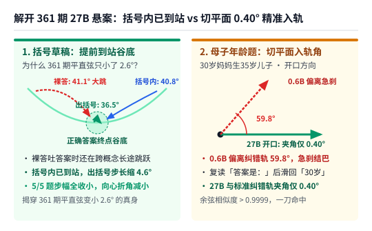

【AI可解释性】为什么前文 MIT 的残差流曲率只测出 1%？别拿穿球肚子的直尺量球面，顺着流形表皮走才看得见快慢与分叉

━━━━━━━━━━━━━━━━━━━━

◆ 引子：大模型“心里拿不准”的时候，它在高维空间里走出的轨迹到底长什么样？

━━━━━━━━━━━━━━━━━━━━

我们一直对一个问题特别着迷：
当大模型顺着一句话一个词一个词往后想的时候，它的内部状态就像一架在几千维空间里飞行的飞机。
举个最直观的例子：
- 当模型读到古诗 **`“床前明”`** 准备接下一个字时，它心里 99.9% 笃定下面是 **`“月”`** （候选词高度集中，预测信息熵 `H` 接近 `0`）；
- 而当它刚读完 **`“中国的首都是北京，”`** 那个逗号，或者读到悬念句 **`“当推开门走进去的时候，”`** 时，后面可能接天气、历史、人物等成百上千种走向，它心里一下子拿不准了（候选词平摊抓瞎，预测信息熵 `H` 瞬间飙升）。

**那么，无论是麻省理工学院（MIT）的原论文作者，还是我们自己，最想证明的到底是什么？**
我们都想证明：**大模型在输出端这种“胸有成竹（低熵）”与“犹豫拿不准（高熵）”的心理起伏，可以直接从它在高维空间里飞出的几何轨迹上看出来——比如背熟了顺风顺水时是不是“大步流星直着走”，到了逗号换话题或悬念分岔口时是不是“急刹车拐大弯”？**

在前文 361 期 https://mp.weixin.qq.com/s/-OiYXA99DdbyV3YUa9BtoA 里，我们正是奔着这个迷人的猜想，兴冲冲地在 **DGX Spark** 上复现了 MIT 入选顶会 **ICML 2026** 的那篇论文（`arXiv:2604.23985`）。结果当时跑完数据，给我们泼了一盆冷水：MIT 算出来的“轨迹转弯角度（曲率）”跟“下一步预测熵 `H`”之间几乎不相关，线性解释力只有可怜的 **`1%` 左右** （我们实测 `GPT-2 XL` 上 `1.16%`、`Pythia-2.8B` 上 `0.83%`；作者自己在第 6 页小字里报的峰值 `r ≈ 0.15`，平方算下来也只有 **`2.25%`** ）。到了第 10 页角落的局限性（`Limitations`）小段里，MIT 作者自己也承认 **“这些效果都很小（`These effects were small`）”** ，还推测可能是因为测试的模型和训练数据太小了——等于作者自己做完实验，也觉得高维轨迹跟输出熵分布之间没测出什么关系，写了个寂寞。

难道大模型输出时的“熵分布 / 不确定性”，真的跟它在高维空间里飞行的几何轨迹没什么关系吗？

写完 361 期那天半夜一点半，我躺在床上怎么想怎么不甘心，脑子里一直转着那篇稿子第三章算过的“随机模型 `120°` 转弯基线”：三个两两互相垂直的单位向量 `a=(1,0,0)`、`b=(0,1,0)`、`c=(0,0,1)`，用勾股定理一算，两两之间的直线距离全都是 `√2`，连成了一个内角为 `60°` 的平面等边三角形，所以走过顶点的转弯外角正好是 `180° - 60° = 120°`。

可盯着这个 `60°` 和 `120°` 想了五分钟，突然看出不对劲了：
早在十个月前（今年 1 月初）的前文 36 期 https://mp.weixin.qq.com/s/DIOLo0r1oAnmknWriGAsew 里我们就讲过，高维球体的体积几乎 100% 集中在表面那层薄薄的“大气层”里（中心是空的）；再加上我们在前文 352 期 https://mp.weixin.qq.com/s/FHmykM-flk8OuniCPM3Wlg 讲过，Transformer 在进入每一个注意力层和前馈层之前，都会先过一道归一化——在 `GPT-2 XL` 和 `Pythia-2.8B` 这两个老模型里是 **`LayerNorm`** ，在现代阿里 `Qwen3` 系列里是 **`RMSNorm`** 。归一化的作用是把向量长度拉回固定刻度、只看方向，这意味着向量的方向实质上生活在一个 **弯曲的高维单位球面（流形表皮 / 大气层表面）** 上。

你站在弯曲的地球表面上想一想：从北极点 `c` 顺着经线走到赤道东经 `0°` 的点 `a`，左拐 `90°` 顺着赤道走到东经 `90°` 的点 `b`，再左拐 `90°` 顺着经线走回北极点 `c`—— **这三条两两垂直的单位向量在球面上围出来的等边三角形，三个内角明明全都是 `90°`，怎么会是 `60°` 和 `120°`？**


顺着这个问号往下深想一层，我们一下子顿悟了：**高维空间里的几何轨迹跟输出熵分布之间，绝对不是没有关系，而是 MIT 作者拿错了尺子、还看漏了维度。** 他拿着平直空间的向量减法去量弯曲球面上的运动，相当于拿一把电钻直接穿破地球肚子走直线弦，把“球皮本身的向心折角”混进了转弯角度里；而且一架飞机在球面上怎么飞，除了看“拐多大的弯（真曲率）”，更关键的是看它 **“飞得有多快（球皮步长与跨层速度）”** 以及 **“在往几个方向试探分叉（局部有效维度）”** 。

想到这里哪还睡得着，我们连夜连回家里的 **DGX Spark** ，在完全相同的 **`GPT-2 XL`（1.5B）** 、 **`Pythia-2.8B`** 以及 **`Qwen3`** 系列（`0.6B` / `27B` / `35B-A3B`）上，换上贴着球面表皮的软尺重跑了一轮实验（完整代码与数据已开源在 https://github.com/lmxxf/ai-theorys-study/tree/main/wechat/assets/363 ）。结果就在同一批被 MIT 作者嫌小的模型上，高维流形表皮轨迹对下一步预测熵分布的解释力，当场从 MIT 的 **`1% 至 2%` 飙升到了单层 `17% 至 41%`、全层 `55% 至 67%`** ——大模型在胸有成竹与犹豫拿不准时的全套高维飞行姿态，终于清清楚楚地显影出来了。

━━━━━━━━━━━━━━━━━━━━

◆ 第一章：换掉穿球肚子的错尺子——剥离向心折角，再除以步长

━━━━━━━━━━━━━━━━━━━━

要看懂 MIT 的平直弦尺子错在哪儿，只需要用到我们在前文 267 期 https://mp.weixin.qq.com/s/mFRQl-5qUstz7fbZ0tvpvQ 学过的向量点积，以及前文 359 期 https://mp.weixin.qq.com/s/8HNeuklsntzzh5EbgNRjdw 学过的 **正交投影（减去垂直影子，留下表面余项）** 。

────────────────────

### 1. 手算对比：拿电钻穿地球肚子（`120°`）vs 贴着地球表皮飞（`90°` 与 `0°`）

先把坐标定清楚：在实验里，我们把模型从第 0 层到最后一层的 **每一层** （`GPT-2 XL` 全 48 层、`Pythia-2.8B` 全 32 层、`Qwen3-0.6B` 全 28 层）都挨个算了一遍。
为了看清公式怎么算，我们先拿 **同一层** （比如以其中某一层为例）来看：单独 1 个词（token）除以它自己的长度后，只是单位球面上的 **1 个点** ——1 个孤立的点是没法移动也没法拐弯的。
只有当模型顺着句子在这一层里依次读过 **连续 3 个词 `a → b → c`** （比如依次读过 `“床” → “前” → “明”`）时：
- 从第 1 个词 `a` 跳到第 2 个词 `b`，才算 **走了第一步** （两点之间的球心夹角，就是这一步移动了多少度）；
- 从第 2 个词 `b` 跳到第 3 个词 `c`，算 **走了第二步** ；
- 有了这前后两步，站在中间的第 2 个词 `b` 上，才能量出 **“第二步比第一步拐了多少度弯”** 。

MIT 论文直接用平直空间的向量减法 `v0 = b - a`、`v1 = c - b` 算这两步。你看问题出在哪儿：`a` 和 `b` 都在球皮上，但 `b - a` 这条直线段根本不在球皮上，而是 **一头扎进地球肚子里穿过去的平直弦** 。

那怎么才能“顺着球面表皮走”？
这就回到了我们在前文 36 期里打过的那个比方—— **“给 AI 装上重力靴，把垂直于地面的法向量干掉，只留沿着大气层表面滑行的切向量。”**
站在中转站 `b` 点上，从球心指向 `b` 的方向就是垂直于球皮的“法向量”。根据前文 359 期的正交投影公式，我们只需要把位移里 **顺着 `b` 指向球心的垂直分量（影子 `(a · b) * b`）减掉** ，剩下的就是紧紧贴着 `b` 点球面表皮的切向量，再按前文 267 期的余弦公式算这两个切向量的夹角即可：

```text
# 站在球面中转点 b 上（a, b, c 长度均为 1，即 b · b = 1）：
# 1. 从 a 飞到 b 时，贴着 b 点球皮的进入切向量 t_in（减掉指向球心的垂直影子）：
t_in  = (a · b) * b - a

# 2. 从 b 飞向 c 时，贴着 b 点球皮的离开切向量 t_out：
t_out = c - (c · b) * b

# 3. 用点积除以各自长度，算出两个球皮切向量之间的真实转弯角度：
cos(球皮转角) = (t_in · t_out) / ( ||t_in|| * ||t_out|| )
```

我们拿刚才那两个典型例子手算验证一下：
- **例子一（两两垂直的三个单位向量 `a=(1,0,0) → b=(0,1,0) → c=(0,0,1)`）** ——
  用 MIT 的平直弦公式算，夹角余弦是 `-1/2`，报出 **`120.00°`** ；
  换用上面的球面表皮公式，因为 `a · b = 0` 且 `c · b = 0`，到达 `b` 的球皮切向量 `t_in = (-1, 0, 0)`，离开 `b` 的球皮切向量 `t_out = (0, 0, 1)`，两者点积为 `0`，球皮转角精准回到 **`90.00°`** ——那平白多出来的 `30°` 向心折角当场消失。
- **例子二（飞机沿着地球赤道大圆笔直往前飞，每步跨 `30°`）** ——
  明明方向盘纹丝未动、一直在赤道上直飞，可 MIT 的平直弦因为把地球表面的弧度当成了转弯，每一步都报出 **`30.00°`** 的折角；而用球面表皮公式一算，`t_in` 与 `t_out` 方向完全一致，球皮转角精准等于 **`0.0000°`** 。

────────────────────

### 2. 为什么平直弦会测出 1% 的乌龙？把“球心移动角度”除回去，解释力当场翻 4 至 79 倍

顺着上面“赤道直飞”的例子往下想一步，你就能看穿 MIT 平直弦为什么只测出 `1%` 的乌龙了：

1.**平直弦多算出来的“假弯”，完全取决于这一步球心角跨了多大** ——
  假设飞机一直在赤道上笔直往前飞（真实的球皮转角是 `0°`）：
  - 如果它走小碎步，每步球心角只移动 **`5°`** ，那 MIT 穿球肚子的平直弦就会多报出 **`5°`** 的假弯；
  - 如果它大步流星，每步球心角一口气移动 **`60°`** ，那平直弦扎进地球肚子更深，就会多报出 **`60°`** 的假弯。
  放进大模型里一看就坏菜了：当模型读到“床前明[月]”这种 **胸有成竹（低熵）** 的地方时，它本来没怎么拐弯，但它 **步子迈得极大（球心角跨了 `70°`）** ，结果平直弦因为步子大，反而给它多算了一大块假弯；而当模型读到“北京，[？]”这种 **犹豫拿不准（高熵）** 的地方时，它虽然真拐弯了，但因为 **步子缩成了小碎步（`28°`）** ，平直弦多算出来的假弯反而变小了。一正一负搅在同一个角度里互相抵消（在 `Qwen3-0.6B` 上甚至被拖成了负相关 `-0.05`），最后自然只剩下 `1%` 的残渣。
2.**把“球皮转角”除以“球心移动角度”算出真曲率，单指标解释力当场翻 4 至 79 倍** ——
  要治好这个毛病特别简单：不仅要把指向球心的分量减掉，还要把 **“从前一个词跳到后一个词，球心角实际移动了多少度”** 除回去。
  再看一个具体数字特例：假设在同一层里依次读过 `a → b → c` 三个词，方向盘在球皮上同样拐了 **`100°`** 的弯：
  - **情况 A（大步直冲）** ——如果从前一个词跳到下一个词时步子迈得很大，平均每步球心角跨出了 **`50°`** ，那平均 **球心角每移动 `1°`，方向盘在球皮上只拐了 `100° ÷ 50° = 2.0°`** ，轨迹其实很平缓；
  - **情况 B（原地急拐）** ——如果从前一个词跳到下一个词时缩成了小碎步，平均每步球心角只挪了 **`25°`** ，却同样拐了 `100°` 的弯，那平均 **球心角每移动 `1°`，方向盘就急拐了 `100° ÷ 25° = 4.0°`** ，弯曲程度是前者的两倍。


  从这个特例就能看出通则：在单位球面上，真正的 **球皮曲率 = 球皮转弯角度 ÷ 相邻两步球心角移动的平均度数（即球心角每移动 `1°` 在球皮上拐了多少度弯）** 。如上图所示，仅仅把球心移动角度除回去之后，单指标对预测熵的解释力 `R²` 立刻从 MIT 平直弦的 `0.2% 至 1.2%`，跃升到了 **`GPT-2 XL` 的 `4.21%`（短句 `7.20%`）、`Qwen3-0.6B` 的 `5.18%`（短句 `9.34%`）和 `Pythia-2.8B` 的 `11.89%`（短句 `16.96%`）** ，比各自对应的平直弦基线翻了 **3.6 至 79.2 倍** 。

━━━━━━━━━━━━━━━━━━━━

◆ 第二章：真正的大头不是纯角度，而是球皮上的“走得快慢”与“分叉方向数”

━━━━━━━━━━━━━━━━━━━━

把角度尺子修准之后，解释力虽然涨到了 `5% 至 17%`，但离过半还差得远。
这是因为当一个点在球面表皮上运动时，除了“拐多大的弯”，还有两个最核心的几何量：**它走得有多快（快慢），以及最近几步张开了几个方向（方向多寡）。**

────────────────────

### 1. 第一主力：球面表皮上的“快慢”（横向看最终移动了多远，纵向看移动的方式）

早在今年元旦（1 月 1 日）的前文 35 期 https://mp.weixin.qq.com/s/5AWLWwAbU0f40ZBgyhWcwQ （《Transformer 的真相：你输入的 token 在球面上滑行》）里，我们就专门指出过：很多学术论文只盯着 `Token A → Token B → Token C` 的横向车轮印，却忽略了同一个词从第 1 层到最后一层（`Layer 1 → Layer L`）在球面上的 **纵向滑行** 。
如果再把前文 36 期里说的 **“每个词都是球面大气层里的一座城市”** 合在一起，那么大模型顺着句子每读一个词（token），本质上就是 **在不同的城市之间做一次移动** ——如果两城之间修通了高铁，单位时间内就能跨出很远；如果路不好走，从一个乡到另一个乡走乡间小路，折腾半天也走不远。

在模型的“层 × 词”网格上，我们正好可以从横向和纵向两个维度去量这次跨城移动的“快慢”（拿任意第 `l` 层来举例）：
- **横向看的是“最终的移动”（同一层里，词跳词）** ——在同一层 `l` 内部，看从上一个词（如 `“前”`）跳到当前词（如 `“明”`），最终在球面上跨出了多少度的球心夹角（即 **水平球皮步长** ）；
- **纵向看的是“移动的方式”（同一个词，层传层）** ——固定在当前这一个词（如 `“明”`）上，看它在模型内部从上一层 `l - 1` 传到当前层 `l` 是怎么被一步步滑行搬运过去的（即 **垂直跨层角速度** ：坐高铁时层与层之间推得又快又顺，走乡道小路时层与层之间也在走走停停、颠簸探路）。

把这两个衡量“走得快慢”的指标放进近 8 万个词位置里一测，我们发现 **“快慢与向量长度”才是预测不确定性的头号主力，远远强于单纯看转弯角度** 。


看上图的实测数字与几何画面：
- **水平球皮步长与预测熵呈强负相关** ——三个模型上相关系数达 **`r = -0.24 至 -0.46`** （在 `Pythia-2.8B` 短句语料上单这一项就能解释 **`21.39%`** 的预测熵起伏），步长的加减速也一致呈负相关（`-0.19 至 -0.28`）。
- **垂直跨层角速度同样呈强负相关** ——三个模型上相关系数达 **`r = -0.30 至 -0.45`** （单指标最高解释 **`20.16%`** ）；如果把全模型各层的“球皮快慢与向量长度”合起来，光靠这一族特征就能解释 **`32.9% 至 55.0%`** 的预测熵方差。

这背后的物理图像非常直观，而且刚好打破了一个很多熟悉大模型的读者容易产生的直觉误区：
平时做向量检索（Embedding）时，大家的第一常识是 **“两个向量的球心角越小（余弦相似度越高），代表它俩意思越相近”** 。那为什么在残差流轨迹里，前后两个字之间的球心角越大（离得越远），模型反而越笃定；球心角越小（离得越近），模型反而越犹豫拿不准呢？
这要是用我们在前文 36 期里讲过的 **“每个词都是一座漂浮在球面大气层里的城市”** 来想，画面一下子就活了：
你想想 **`“天地君亲师”`** 或者 **`“床前明月光”`** ——“天、地、君、亲、师”或者“床、前、明、月、光”这五座城市，单看字面意思彼此哪有什么相关性？根本是八竿子打不着的五个概念，在球面地图上隔得十万八千里；**可为什么模型一背就是一句话？因为这几座遥远的城市之间，在训练时早就修通了笔直的“跨城高铁”** 。前一个字刚到“明”城，高铁瞬间发车，一步跨过 `70.1°` 的遥远距离直达十万八千里外的“月”城，中间连方向盘都不用打。
反过来，有些地方只有泥泞的乡道甚至到了没有路标的十字路口：
- **修通了跨城高铁的路段（低预测熵 `H`，如背“天地君亲师”、“床前明月光”）** ——哪怕下一座城市在地图上隔得再远（球心角跨度高达 `55° 至 70°`），列车也会沿着球面大圆弧线高速直达，每移动 `1°` 球心角拐的弯极小；
- **修到乡道尽头的十字路口（高预测熵 `H`，如刚读完逗号“首都是北京，”）** ——前面突然冒出几十条坑坑洼洼的乡间小岔路，根本不知道下一站该往哪座城市开，车子只能一脚急刹车停在“北京”城门口原地打转探路（跟上一步的距离缩到 `25° 至 28°`，每移动 `1°` 球心角拐的弯随之飙升）。

为了让大家不是光看枯燥的相关系数，而是亲眼看见 **“什么样的句子在哪个字上大步直走、在哪个字上急刹拐弯”** ，我们直接把实验里 `Qwen3-0.6B`（第 23 层）读两句中文时逐个词的轨迹拉出来看：
- **什么地方“大步流星直着走”？（背熟的古诗与固定搭配收官处）**
  当模型读到 **`“床 → 前 → 明”`** 准备接 **`“月”`** 字时，因为背得滚瓜烂熟，此时的预测熵跌到了接近零的 **`0.01 bits`（99.9% 笃定下一个字是“月”）** ——就在这一个字上，向量在球面表皮上一步跨出了 **`70.1°` 的超大球心角步长** ，球皮转角压低到 **`93.3°`** ，球皮曲率（球心角每移动 `1°` 拐的度数）更是降到了全句最低的 **`1.47`** （顺着球皮大圆弧线丝滑直冲）；同样在读到 **`“疑 → 是 → 地上”`** 猜 **`“霜”`** 字时（预测熵 **`0.06 bits`** ），球皮步长也保持在 **`55.1°`** 的大步幅，球皮曲率低至 **`1.81`** 。
- **什么地方“急刹车、高曲率拐大弯”？（句逗换气口、开放式悬念与跨概念转折处）**
  反过来，在同一段话里刚读完 **`“中国的首都是北京，”`** 那个逗号 **`“，”`** 时——逗号后面到底要聊北京的天气、历史，还是要换一个国家？候选方向一下子全散开了，预测熵当场飙升到 **`7.44 bits`** 。此时向量在球面表皮上一脚急刹车，球皮步长从前面的 `46.9°` 骤缩到 **`28.7°`** （缩水近四成），球皮转角扩大到 `114.1°`，导致 **球皮曲率（球心角每移动 `1°` 拐的度数）瞬间飙升到 `3.96`（比背“床前明月”时弯了 `2.7 倍`）** ；再比如读悬念句 **`“当警察推开那扇门走进去的时候，他”`** ，在逗号转折接 **`“他”`** 字的路口（预测熵高达 **`9.27 bits`** ），球皮步长同样急刹缩到 **`25.5°`** ，球皮曲率冲上 **`3.83`** 。

看，不需要任何抽象的数学黑话—— **背古诗顺风顺水的地方（如“床前明[月]”），步长 `70.1°`、曲率 `1.47`，又快又直；到了逗号换话题或悬念分岔口（如“北京，[？]”、“走进去的时候，[他]”），步长 `25° 至 28°`、曲率 `3.8 至 4.0`，当场急刹拐弯。** 这就是“预测熵分布 `<-->` 流形表皮轨迹”在每一个具体汉字上的真实对应。

────────────────────

### 2. 第二主力：球面切平面上的“分叉方向数”（有效维度与 `27B` 括号草稿破案）

除了看快慢，我们在前文 312 期 https://mp.weixin.qq.com/s/n9v-PvAT_fDIFLd-t05FDg 学过矩阵的“秩（代表独立方向的个数）”。
如果我们把最近连续 `5` 步在单位球面上的位移，统统投影到当前词的球面切平面上摆成 5 行，算一下这 5 步的能量到底铺开了几个方向（即 **5 步切平面有效维度 / 有效秩** ，范围在 `1` 到 `5` 之间）：如果 5 步始终顺着同一条大圆弧线直走或原路折返，有效维度就是 `1.0`；如果 5 步往 5 个互相垂直的新方向铺开，有效维度就逼近 `5.0`。

把“快慢”和“方向数”这两把新尺子架上去，我们不仅在 8 万词宏观回归里看到全层方向特征单独就能解释 **`22.2% 至 47.9%`** 的预测熵起伏，更是一举揭开了三个在平直弦下看不见的微观真相：


**真相一：读顺口溜（`1+1=2`）转弯角反而大，读烧脑逻辑题分叉方向才更多**
你可能会以为“烧脑题的转弯角度一定比顺口溜大”。我们在 `GPT-2 XL`、`Pythia-2.8B`（英文）和 `Qwen3-0.6B`（中文）上对比了 6 条周期顺口溜（如 `1+1=2, 2+2=4`、`星期一星期二`）与 6 条烧脑逻辑题的前向读题轨迹，结果恰恰相反：
念顺口溜时，向量在 `数字 → 加号 → 数字 → 等号` 的固定轨道里大步来回折返，所以相邻两步的转弯角反而显得很大（球皮转角 `111° 至 116°`），但 5 步切平面有效维度偏低（ **`3.60`、`3.78`、`3.84`** ）；而读烧脑逻辑题时（预测熵大涨 `0.90 至 1.35 bits`），每一步都在吸收新条件向不同切方向铺开，三个模型的 5 步有效维度一致升到了 **`3.97`、`4.16`、`4.05`** 。



**真相二（解开 361 期悬案）：为什么给 `Qwen3.8-27B` 塞了括号思考草稿，平直弦转角只变小了 `2.6°`？**
在前文 361 期里，我们给 64 层的 **`Qwen3.8-27B`** 回复开头塞了一段写好推导过程的括号草稿 `（……）\n答案是：`，当时用 MIT 的平直弦量 `答案是：` 后面的答案区，发现转角只从 `110.0°` 微降到了 `107.4°`（只动了 `2.6°`）。
这次我们换上流形表皮软尺重放这 5 道题，才看到了真正发生的事：
- 无括号直接作答时，模型直到吐 `答案是：5元` 的那一刻还在做跨概念的长途跳跃，所以在答案区的球皮步长迈得很大（平均 **`41.1°`** ）；
- 而加了括号草稿后，模型 **在括号 `（……）` 内部就已经用 `40.8°` 的大步长走完了全部推理、提前抵达了正确答案的终点谷底** 。等它跨出右括号写 `答案是：5元` 时，人已经在终点站台上了，只需要在谷底迈小碎步收尾驻留—— **全部 `5/5` 道题在答案区的球皮步长一致缩短了 `4.6°`（降到 `36.5°`），5 步切平面有效维度也 `5/5` 全升（从 `4.19` 升至 `4.33`）** 。
- 破案了：因为出括号后步子收小了 `4.6°`，穿球肚子的平直弦扎得没那么深，向心折角才跟着变小—— **原来 361 期看到的平直弦变小 `2.6°`，根本不是轨迹变直了，而是模型在括号里已经提前到站、出括号后步幅收小了。**

**真相三：母子年龄矛盾题上，`0.6B` 偏离纠错方向 `59.8°` 急刹结巴 vs `27B` 惊人的 `0.4°` 精准入轨**
还是前文 361 期那道“妈妈今年 30 岁，亲生儿子今年 35 岁，妈妈生儿子时几岁？”的前提矛盾题。我们在球面切平面上标定出“指出题目前提荒谬”的标准纠错方向后，对比了塞入括号提示后的开口方向：
- **`Qwen3-0.6B` 小模型** ——虽然括号里写明了“前提不可能成立”，但它真正开口时的切平面移动方向依然偏离纠错方向高达 **`59.8°`** ，在重复吐出第二个 `答案是：` 时发生剧烈的球皮急刹车（步长骤降），随后滑回了 `“妈妈生儿子的时候是 30 岁”` 的顺从填空轨道；
- **`Qwen3.8-27B` 大模型** ——真正开口吐出 `“前提不成立”` 时，它在中层球面切平面上的移动方向，与标准纠错方向的夹角只有惊人的 **`0.40°`（不到半度，余弦相似度 `> 0.9999`）** 。
- 此外在 40 层 **`Qwen3.5-35B-A3B`** 的纯预训练基座版与聊天后训练版同序列对比中，我们也看到聊天模板的 `assistant` 标签其实是一组 **“两级变速齿轮”** ——在 `assistant` 标签末端先大幅收拢方向（5 步有效维度降 `0.30`、球皮曲率升 `0.32` 勒马入轨），等走过空思考框到达真正吐第一个字的决策点时，球皮曲率反过来骤降 `0.62`、步长加大，顺滑地把首词弹射出去。

━━━━━━━━━━━━━━━━━━━━

◆ 第三章：终极成绩单——从 `1%` 的脱水肉末到 `55% 至 67%` 的真红烧牛肉

━━━━━━━━━━━━━━━━━━━━

最后，我们回到 `LAMBADA` 近 8 万个词位置与 `UD EWT` 短句语料上，用跟前文 361 期相同的 **按整篇文章分组的 10 折交叉验证（在位置 `t` 只用当前词及之前的历史状态去预测下一步预测熵 `H(t)`）** ，把 MIT 的平直弦与我们的流形表皮特征族拉出最终的对决总表：


看上图的三级台阶，MIT 作者在局限性里找补的“可能是模型和数据太小”当场就不攻自破了：
1.**第一级台阶（MIT 平直弦，灰色柱）** ——单层单指标只有 `0.25% 至 1.16%`（哪怕把单步与 3 步平直弦组合做回归也只有 `0.85% 至 1.84%`）；更打脸的是，就算你怀疑“是不是因为 MIT 只看了一层才这么弱”，把全模型 48 层、32 层或 28 层的 MIT 平直弦 `C_flat_3` 全都拼在一起做回归，长语料 10 折交叉验证的解释力也依然卡死在 **`1.61%`（`GPT-2 XL`）、`2.18%`（`Qwen3-0.6B`）与 `2.18%`（`Pythia-2.8B`）** 。
2.**第二级台阶（单层流形表皮特征，蓝色柱）** ——只看单层内部的水平表皮特征（球皮转角 + 球皮曲率 + 球皮步长与范数 + 5 步分叉方向数），解释力就升到了 **`16.84%`（`GPT-2 XL`）、`24.63%`（`Pythia-2.8B`）和 `31.24%`（`Qwen3-0.6B`，短句达 `35.43%`）** ；再把当前层与上一层的跨层表皮运动加上，单层入口解释力直接跃升至 **`23.13%`、`33.74%`（短句 `37.07%`）和 `41.05%`** 。
3.**第三级台阶（全层流形表皮大合体，绿色柱）** ——当把各层的流形表皮几何特征联合起来时，10 折跨篇章交叉验证的解释力直接冲上了 **`54.78%`（`GPT-2 XL`，相关系数 `r = 0.740`）、`58.49%`（`Qwen3-0.6B`，`r = 0.765`，短句语料达 `62.33%`）和 `67.35%`（`Pythia-2.8B`，`r = 0.821`）** ——比全层 MIT 平直弦高出了 **27 至 34 倍** 。

────────────────────

💡 为什么分析残差流几何时，要把“球面方向”和“向量长度”分开量？

很多刚接触可解释性的同学，习惯把 `d = 4096` 维的残差流直接扔进平直空间减法 `x_t - x_(t-1)` 里算夹角。
但在 Transformer 架构里，每一层加完残差后的向量 `x_t`，在送进下一层的注意力头和前馈网之前，都会先被一道归一化（老模型 `GPT-2 / Pythia` 用 `LayerNorm`，现代模型 `Qwen3` 用 `RMSNorm`）把长度拉回固定刻度。
因此，最干净的几何分析方式是：**先把残差状态除以自身长度投影到 `d - 1` 维单位球面表皮上，在球面切平面里量它的方向走得有多快（球心角移动度数，即球皮步长）、拐了多大的弯（球皮转角 ÷ 球心移动角度，即球皮曲率）、张开了几个方向（切平面有效秩），同时把向量的模长（范数）作为独立特征保留下来。** 把方向和长度从一锅粥里分开、贴着球面表皮去量，原本被淹没的信号就全浮出来了。

────────────────────

所以你看，大模型内部的几何轨迹里本来就藏着一碗结结实实的红烧大牛肉——MIT 作者之所以只捞出 `1% 至 2%` 的脱水肉末、最后只能在角落里写免责声明怪模型太小，纯粹是因为他们拿错了尺子，还把真正的牛肉（走得快慢与分叉方向数）全漏在了锅里。

━━━━━━━━━━━━━━━━━━━━

◆ 本期小结：量弯曲的世界，先换一把贴着表皮的尺子

━━━━━━━━━━━━━━━━━━━━

从前文 361 期看到 MIT 作者只跑出 `1% 至 2%` 并在角落里承认“效果很小”，到半夜盯着“球面正交三角形为什么是 `90°` 而不是 `60°`”起疑，再到连夜上机把解释力干到 `55% 至 67%`，这场接力实验给我们留下了三条实实在在的收获：

- **为什么 MIT 作者自己跑出了个 `1% 至 2%` 的寂寞** ——残差流的方向受每层 `LayerNorm`（`GPT-2 / Pythia`）或 `RMSNorm`（`Qwen3`）约束在球面表皮上活动。MIT 直接用平直空间减法算穿球弦夹角，这一步球心角跨得越大（越胸有成竹），平直弦扎进球肚子越深、多算出来的假弯就越大，反而把犹豫拿不准时的真拐弯给抵消了（哪怕把全模型所有层的 MIT 平直弦全拼起来，长语料解释力也只有 `1.6% 至 2.2%`）。而只要剥掉球心分量、再除以球心角移动度数算出 **球皮曲率（球心角每移动 `1°` 拐了多少度弯）** ，单指标解释力立刻翻 **3.6 至 79.2 倍**
- **球面表皮上的真正主力是“走得快慢”与“分叉方向数”，顺手破案 361 期 `27B` 悬念** ——① **快慢（第一主力）** ，模型胸有成竹时在球皮上大步流星跨跃（如读“床前明”猜“月”时球心角步长 `70.1°`、曲率 `1.47`），拿不准时减速迈小碎步（如读“首都是北京，”时步长缩至 `28.7°`、曲率飙至 `3.96`），全层快慢与长度单独即可解释 `32.9% 至 55.0%` 的预测熵；② **分叉方向数（第二主力）** ，顺口溜（`1+1=2`）在固定轨道里来回折返（转角大但 5 步有效维度低 `3.60 至 3.84`），烧脑题则向新方向铺开（有效维度升至 `3.97 至 4.16`）；③ **`27B` 与 `35B` 新发现** ，给 `Qwen3.8-27B` 塞入括号思考草稿后，模型在括号内已大步走完推理、提前到站，出括号写答案时 `5/5` 题球皮步长一致缩短 `4.6°`（揭穿了 361 期平直弦变小 `2.6°` 的真身）；在母子年龄矛盾题上，`0.6B` 开口方向偏离纠错方向 `59.8°` 并急刹结巴，而 `27B` 与纠错方向夹角仅 **`0.40°`**
- **同一批模型上从 `1%` 到 `55% 至 67%` 的终极成绩单** ——根本不是 MIT 作者找补的“模型太小”，就在同一批模型和近 8 万个词位置的 10 折跨篇章交叉验证下，顺着流形表皮提取的特征在 **单层（纯水平 / 含跨层）即可解释 `16.8% 至 41.1%`** ， **全层联合更是冲上 `54.8%`（`GPT-2 XL`）、`58.5%`（`Qwen3-0.6B`，短句 `62.3%`）与 `67.4%`（`Pythia-2.8B`，`r = 0.821`）**

━━━━━━━━━━━━━━━━━━━━

◆ 参考资料

━━━━━━━━━━━━━━━━━━━━

- Jack King, Evelina Fedorenko, Eghbal A. Hosseini, Representational Curvature Modulates Behavioral Uncertainty in Large Language Models, arXiv:2604.23985（ICML 2026；平直空间欧氏弦夹角基线及第 6、10 页弱效应局限性说明）
- Olivier Roy, Martin Vetterli, The Effective Rank: A Measure of Effective Dimensionality, EUSIPCO 2007（基于谱分布香农熵的有效秩与有效维度定义）

━━━━━━━━━━━━━━━━━━━━

**MIT 作者在论文角落里承认只测出百分之一二的弱效应并归咎于模型太小，殊不知是那把穿破地球肚子的平直直尺量走了样。**

**大模型胸有成竹时在球面表皮上大步流星地跨跃，一旦在括号里提前走完推理到站，跨出括号写答案时反而收起大步、在终点谷底从容驻留。**

**科研里最过瘾的时刻，莫过于半夜一点半对一个六十度三角形起疑，天亮时在同一口被嫌小的锅里盛出六成五的真红烧牛肉。**

━━━━━━━━━━━━━━━━━━━━

// 靳岩岩的 AI 学习笔记 × Gemini 的浪漫 × GPT 的严谨
// 2026年11月9日

为什么前文MIT的残差流曲率只测出1%至2%，逼得作者在角落承认效应很小？半夜从球面正交三角形是90°而非60°起疑，我们换用球面表皮软尺量出球皮曲率、步长快慢与分叉方向数，在同一批模型上把解释力干到55%至67%，并解开了27B括号草稿的到站驻留真相。
