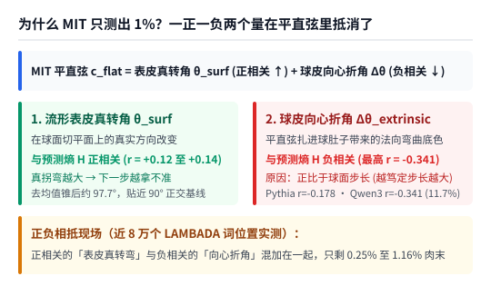

【AI可解释性】为什么前文 MIT 的残差流曲率只测出 1%？别拿穿球肚子的弦量球面，顺着流形表皮走才看得见快慢与分叉

━━━━━━━━━━━━━━━━━━━━

◆ 引子：半夜一点半盯着“等边三角形 60°”起疑——球面上的正交三角形明明是 90°

━━━━━━━━━━━━━━━━━━━━

在前文 361 期 https://mp.weixin.qq.com/s/-OiYXA99DdbyV3YUa9BtoA 里，我们刚在 **DGX Spark** 上复现完麻省理工学院（MIT）入选 **ICML 2026** 的那篇残差流曲率论文（`arXiv:2604.23985`）。当时跑出来的数字让我们哭笑不得：作者在标题里宣称“表征曲率调制大语言模型的行为不确定性”，结果真到近 8 万个词位置上一算，它对下一步预测信息熵 `H` 的线性解释力只有约 **`1%`** （`GPT-2 XL` 上 `1.16%`，`Pythia-2.8B` 上 `0.83%`），就像泡开一桶红烧牛肉面只捞出两粒指甲盖大小的脱水肉末。

稿子发出去后，半夜一点半躺在床上睡不着，脑子里一直转着那篇稿子第三章算过的“随机模型 `120°` 基线”：三个两两互相垂直的单位向量 `a=(1,0,0)`、`b=(0,1,0)`、`c=(0,0,1)`，用勾股定理一算，两两之间的直线距离全都是 `√2`，连成了一个内角为 `60°` 的平面等边三角形，所以走过顶点的转弯外角正好是 `180° - 60° = 120°`。

可盯着这个 `60°` 和 `120°` 想了五分钟，突然看出不对劲了：
我们在前文 352 期 https://mp.weixin.qq.com/s/FHmykM-flk8OuniCPM3Wlg 讲过，大模型每一层都夹着 `LayerNorm` 或 `RMSNorm` 归一化，残差流向量实质上生活在一个 **弯曲的高维球面（流形表皮）** 上，而不是平直空间。你站在弯曲的地球表面上想一想：从北极点 `c` 顺着经线走到赤道东经 `0°` 的点 `a`，左拐 `90°` 顺着赤道走到东经 `90°` 的点 `b`，再左拐 `90°` 顺着经线走回北极点 `c`—— **这三条两两垂直的弧线围出来的球面等边三角形，三个内角明明全都是 `90°`，怎么会是 `60°` 和 `120°`？**


顺着这个问号往下深想一层，我们突然看穿了 MIT 那篇论文只测出 `1%` 的真正病根：**不是大模型思考时的几何轨迹跟预测不确定性（预测熵 `H`）没关系，而是 MIT 拿着平直空间的直尺去量弯曲球面上的运动，相当于拿一把电钻直接穿破地球肚子走直线弦，把“球皮本身的弧度”当成了“飞机的转弯”。如果顺着流形表皮走，不仅能剥掉 `120°` 的假底色，还能看到真正决定不确定性的“走得快慢”与“方向多寡”。**

想到这里哪还睡得着，我们连夜远程连回家里的 **DGX Spark** ，在完全相同的 **`GPT-2 XL`（1.5B）** 、 **`Pythia-2.8B`** 和现代阿里 **`Qwen3-0.6B`** 、同样的 `LAMBADA` 近 8 万个词位置与 `UD EWT` 短句语料上，顺着流形表皮重跑了一轮实验（完整代码与报告已开源在 https://github.com/lmxxf/ai-theorys-study/tree/main/wechat/assets/363 ）。结果只换了一把贴着球皮量的尺子，对预测熵的解释力当场从 MIT 的 **`1%` 跃升到了单层 `23% 至 41%`、全层 `55% 至 67%`** 。

━━━━━━━━━━━━━━━━━━━━

◆ 第一章：破案——“穿球肚子的平直弦”把一正一负两个物理量混在一起抵消了

━━━━━━━━━━━━━━━━━━━━

要看懂 MIT 的公式错在哪儿，只需要用到我们在前文 267 期 https://mp.weixin.qq.com/s/mFRQl-5qUstz7fbZ0tvpvQ 学过的向量点积，以及前文 359 期 https://mp.weixin.qq.com/s/8HNeuklsntzzh5EbgNRjdw 学过的 **正交投影（减去影子，留下垂直余项）** 。

────────────────────

### 1. 手算对比：拿电钻穿地球肚子（`120°`）vs 贴着地球表皮飞（`90°` 与 `0°`）

假设飞机在单位球面上依次飞过三个点 `a → b → c`（先把向量除以自身长度变成球面上的单位向量）。
MIT 论文直接用平直空间的向量减法 `v0 = b - a`、`v1 = c - b` 算位移。你看这有多荒唐：`a` 和 `b` 都在球皮上，但 `b - a` 这条直线段根本不在球皮上，而是 **一头扎进地球肚子里穿过去的平直弦（Chord）** 。

那怎么才能“顺着流形表皮走”？
站在中转站 `b` 点上，从球心指向 `b` 的方向就是脚底下的“地心垂直方向”。根据前文 359 期的正交投影公式，我们只需要把位移里 **顺着 `b` 指向球心的垂直分量（影子 `(a · b) * b`）减掉** ，剩下的就是紧紧贴着 `b` 点球面表皮的 **切向量（Tangent Vector）** ：

```text
# 站在球面中转点 b 上（a, b, c 均为单位向量，即 b · b = 1）：
# 1. 算出从 a 飞向 b、到达 b 点时的表皮切方向 u_in（减掉指向球心的分量并归一化）：
u_in  = normalize( (a · b) * b - a )

# 2. 算出从 b 飞向 c、离开 b 点时的表皮切方向 u_out：
u_out = normalize( c - (c · b) * b )

# 3. 贴着流形表皮的真实转弯角度 theta_surf：
theta_surf = arccos( u_in · u_out )
```

我们拿刚才那两道小学几何题手算验证一下：
- **测试一（两两垂直的三个点 `a=(1,0,0) → b=(0,1,0) → c=(0,0,1)`）** ：
  用 MIT 的平直弦公式算，`v0 = (-1, 1, 0)`，`v1 = (0, -1, 1)`，夹角余弦是 `-1/2`，报出 **`120.00°`** ；
  换用上面的流形表皮公式，因为 `a · b = 0` 且 `c · b = 0`，到达 `b` 的表皮方向 `u_in = (-1, 0, 0)`，离开 `b` 的表皮方向 `u_out = (0, 0, 1)`，两者点积为 `0`，表皮转角精准回到 **`90.00°`** ——那平白多出来的 `30°` 假偏置当场消失。
- **测试二（飞机沿着地球赤道大圆笔直往前飞，每步跨 `30°`）** ：
  明明方向盘纹丝未动、一直在赤道上直飞，可 MIT 的平直弦因为把地球表面的弧度当成了转弯，每一步都误报出 **`30.00°`** 的假转角；而用流形表皮公式一算，`u_in` 与 `u_out` 完全同向，表皮转角精准等于 **`0.0000°`** 。

────────────────────

### 2. 近 8 万个词位置上的“正负抵消”现场

把这个几何关系放回大模型里，我们就得到了下面这条分解等式：

**`MIT 平直弦转角 c_flat  =  流形表皮真转角 θ_surf  +  球皮向心折角 Δθ_extrinsic`**

当我们在 `LAMBADA` 近 8 万个词位置上把这两部分分开，各自单独跟下一步预测熵 `H` 算相关性时，直接抓到了 MIT 只测出 `1%` 的罪魁祸首：



1.**流形表皮真转角 `θ_surf` 与预测熵 `H` 是正相关的** ：剥离球心分量后，三个模型的平均表皮转角从平直弦的 `114.2° 至 115.3°` 降到了 `105.5° 至 109.6°`（若进一步减掉该层的平均向量锥中心，平均转角直接落回 **`97.7°`** ，贴近 `90°` 正交基准）。它与预测熵保持正相关（`r = +0.12 至 +0.14`），代表 **在表皮上真拐弯越大，下一步越拿不准** 。
2.**被混进去的“球皮向心折角 `Δθ_extrinsic`”与预测熵 `H` 却是强负相关的** ：如上图右半边所示，平直弦比表皮转角多出来的那块向心折角（平均约 `4.6° 至 9.0°`），在 `Pythia-2.8B` 上与预测熵呈显著负相关（ **`r = -0.1782`** ），在现代 `Qwen3-0.6B` 上负相关更是高达 **`r = -0.3414`（单向心折角就占了 `11.66%` 的反向方差）** 。

为什么向心折角会跟预测熵呈强负相关？
道理很简单：在球面上，你这一步迈出的步子越大，穿球肚子的平直弦扎得就越深，带来的向心折角也就越大；而我们马上就会在第二章看到， **模型心里越笃定（预测熵 `H` 越低），在球面上迈出的步长反而越大** 。
结果 MIT 的平直弦公式把 **正相关的“表皮真转弯”** 和 **负相关的“步长向心折角”** 混加在同一个角度里，一正一负当场互相抵消，最后自然只剩下 `0.25% 至 1.16%` 的脱水肉末（在 `Qwen3-0.6B` 上甚至被向心折角拖成了负值 `r = -0.0504`）。

────────────────────

### 3. 把“表皮转角”除以“球面步长”还原真测地曲率 `κ_geo`，解释力翻 4 至 80 倍

在前文 361 期里我们就吐槽过：MIT 嘴上叫“曲率（Curvature）”，公式里却连步长距离都没除。
在几何学里，曲率的严格定义是 **“单位弧长内的转弯角度”** ——同样拐 `90°` 的弯，你在高速公路上滑行 1 公里拐完，和在原地 1 米之内急打方向盘拐完，曲率完全是两码事。

现在我们有了球面表皮上的真实转角 `θ_surf`，再除以这一步在球面表皮上走过的弧长（步长 `s_geo`），就还原出了微分几何里真正的 **球面测地曲率（Geodesic Curvature，记作 `κ_geo = θ_surf / s_geo`）** 。看看仅仅把步长除回去之后，单指标对预测熵的线性解释力 `R²` 发生了什么变化：


- **`GPT-2 XL`（1.5B）** ：从 MIT 平直弦的 `1.16%`（长语料）/ `0.62%`（短语料），升至 **`4.21%`（`r = +0.2052`）/ `7.20%`（`r = +0.2683`）** ，解释力翻了 **3.6 至 11.6 倍** ；
- **`Pythia-2.8B`** ：从 MIT 平直弦的 `0.83%` / `0.21%`，直接飙升至 **`11.89%`（`r = +0.3448`）/ `16.96%`（`r = +0.4118`）** ，解释力翻了 **14.3 至 80.8 倍** ；
- **`Qwen3-0.6B`** ：从 MIT 平直弦的 `0.25%` / `0.89%`，升至 **`5.18%`（`r = +0.2277`）/ `9.34%`（`r = +0.3055`）** ，解释力翻了 **10.5 至 20.7 倍** 。

━━━━━━━━━━━━━━━━━━━━

◆ 第二章：顺着流形表皮看，真正的主力是“走得快慢”与“方向多寡”

━━━━━━━━━━━━━━━━━━━━

顺着球面表皮剥掉了 `120°` 假底色、还原了真曲率之后，我们进一步问：当一个点在流形表面上运动时，除了“拐多大的弯”，还有哪两个最基本的几何量被 MIT 完全忽略了？
答案是：**它走得有多快（快慢），以及它在往几个方向分叉（方向多寡）。**

────────────────────

### 1. 流形表皮上的“快慢”（水平步长 `s_geo` 与跨层角速度 `v_layer`）

在单位球面上，从上一步 `u_(t-1)` 走到当前步 `u_t`，顺着球皮走过的弧长（即球心夹角）就是 **水平球面步长 `s_geo = arccos(u_t · u_(t-1))`** ；而固定同一个词，从第 `l-1` 层传到第 `l` 层在球皮上跨过的角度，就是 **垂直跨层角速度 `v_layer`** 。

把这两个衡量“表皮快慢”的指标放进近 8 万个词位置里一测，我们发现 **“走得快慢”才是预测不确定性的第一主力，单指标相关性比纯看转角强得多** ：


看上图总结的实测数据与物理画面：
- **水平球面步长 `s_geo` 与预测熵呈强负相关** ：`GPT-2 XL` 上达 `r = -0.2385`（短语料 `-0.3205`，解释力 `10.27%`），`Qwen3-0.6B` 上达 `r = -0.3046`（短语料 `-0.3422`，解释力 `11.71%`），`Pythia-2.8B` 上更是高达 **`r = -0.3901`（长语料解释力 `15.22%`，短语料达 `r = -0.4625`，单指标解释力 `21.39%`）** ；同时步长加减速 `accel_geo = s_t - s_(t-1)` 也一致呈负相关（`r = -0.19 至 -0.28`）。
- **垂直跨层角速度 `v_layer` 同样呈强负相关** ：三个模型上 `r` 均在 **`-0.30 至 -0.45`** 之间（单指标解释力最高达 **`20.16%`** ）；若把全模型各层的表皮快慢与向量长度（范数）联合起来，单靠“快慢与大小”就能解释 **`32.9% 至 55.0%`** 的预测熵方差。

这背后的几何图像非常符合直觉：
**当模型对下一个词胸有成竹（低预测熵 `H`）时，残差流在球面表皮上大步流星地往前跨跃（水平步长 `s_geo` 大、跨层推进角速度 `v_layer` 快、单位弧长转角 `κ_geo` 小）；而当模型遇到歧义路口拿不准（高预测熵 `H`）时，残差流在球面表皮上一脚急刹车（`accel_geo < 0`），步子突然缩成小碎步，在原地高频打转踌躇（单位弧长内的测地曲率 `κ_geo` 随之飙升）。**

────────────────────

### 2. 流形表皮上的“方向多寡”（局部切平面上的分叉有效维度 `erank`）

除了看走得快慢，我们在前文 312 期 https://mp.weixin.qq.com/s/n9v-PvAT_fDIFLd-t05FDg 学过矩阵的“秩（Rank，代表独立方向的个数）”。
如果我们把最近连续 `5` 步在球面表皮上走出的切向量，统统平行移动到当前词的球面切平面上，摆成一个 `5 行` 的小矩阵，算一下这 `5` 步到底张开了几个独立方向（用奇异值分布的香农熵算出连续的 **有效维度 / 有效秩 Effective Rank，记作 `erank_dir`，范围在 `1` 到 `5` 之间** ）：
- 如果 `5` 步始终顺着同一条大圆弧线往前走（或者在同一条线上来回折返），那它们只占了 **`1` 个方向** ，有效维度 `erank_dir = 1.0`；
- 如果遇到复杂推理，每一步都在往全新的垂直切方向试探分叉，那 `5` 步就会铺满 **`5` 个独立方向** ，有效维度 `erank_dir` 就会逼近 `5.0`。

为了验证这个指标，我们把 **顺口溜与周期句（`ROUTINE`，如 `1+1=2, 2+2=4`、`星期一星期二`）** 和 **烧脑逻辑推理题（`HARD`，如多层嵌套逻辑与反直觉前提）** 放在三个模型的中后层做了一组正面对照，结果揭穿了一个非常容易踩坑的直觉误区：


你可能会以为“烧脑题的转弯角度一定比顺口溜大”。实测恰恰相反：
1.**顺口溜（`ROUTINE`）是“低维钟摆”——转角虽大，但方向少、步子大** ：在念 `1+1=2, 2+2=4` 这种周期顺口溜时，残差流就像钟摆一样，在 `数字 → 加号 → 数字 → 等号` 这两三个固定方向组成的低维轨道里大步来回晃荡。因为来回折返且步长很大（`GPT-2 XL` 球面步长 `52.8°`、`Pythia` `37.2°`），所以单看相邻两步的转弯角反而很大（平直弦接近 `120°`，表皮转角 `110° 至 116°`）；但因为始终在老方向里来回跳，它的 **切空间方向有效维度 `erank_dir` 明显偏低（三个模型分别为 `3.60`、`3.78`、`3.84`）** 。
2.**烧脑逻辑题（`HARD`）是“多向探路”——步长缩短，往新方向正交分叉** ：一旦进入烧脑逻辑题（预测熵 `H` 大涨 `0.63 至 1.35 bits`），残差流不再顺着老轨道来回摆，而是每一步都在吸收新条件、往新的正交切方向试探分叉（去均值表皮转角回到 `98° 至 100°` 的正交基准附近），同时步子明显放缓（`GPT-2 XL` 步长缩短 `2.4°`、`Pythia` 缩短 `4.1°`），三个模型的 **切空间方向有效维度 `erank_dir` 一致飙升到了 `3.97 至 4.16`** 。

而在近 8 万个词位置的宏观回归里，仅仅把全模型各层的“方向多寡（水平与跨层切空间有效维度）”合起来，就能独立解释 **`22.2%`（`GPT-2 XL`）、`28.6%`（`Qwen3-0.6B`）至 `47.9%`（`Pythia-2.8B`）** 的下一步预测熵起伏。

━━━━━━━━━━━━━━━━━━━━

◆ 第三章：终极成绩单——从 `1%` 的脱水肉末到 `55% 至 67%` 的真红烧牛肉

━━━━━━━━━━━━━━━━━━━━

现在，我们把顺着流形表皮量出来的三大类几何特征—— **① 表皮转角与真测地曲率（`θ_surf`、`κ_geo`）、② 流形表皮快慢与范数（`s_geo`、`v_layer`、`norm`）、③ 切空间方向多寡（`erank`）** 汇总到一起，在 `LAMBADA` 近 8 万个词位置与 `UD EWT` 短句语料上，用跟前文 361 期完全相同的 **10 折跨篇章分组交叉验证（严格按整篇文章分折防止泄露，且在位置 `t` 严格只用当前词及之前的向量去预测下一步预测熵 `H(t)`）** ，拉出最终的对决总表：

- **`GPT-2 XL`（1.5B，长语料）** ：MIT 平直弦 `1.84%` → 单层表皮特征 **`23.13%`** → 全层流形表皮合体 **`54.78%`（10 折交叉验证相关系数 `r = 0.7403`，短语料 `53.55%`）** ；
- **`Qwen3-0.6B`（长语料）** ：MIT 平直弦 `1.53%` → 单层表皮特征 **`33.74%`** → 全层流形表皮合体 **`58.49%`（`r = 0.7650`，短语料更是达到 `62.33%`）** ；
- **`Pythia-2.8B`（长语料）** ：MIT 平直弦 `0.85%` → 单层表皮特征 **`41.05%`** → 全层流形表皮合体 **`67.35%`（`r = 0.8210`，短语料 `60.82%`）** 。

把这三级跃升画成柱状图，视觉反差一目了然：


1.**第一级台阶（MIT 平直弦，灰色柱）** ：单看一层只有 `0.85% 至 1.84%`；哪怕你怀疑“是不是因为 MIT 只看了一层才这么弱”，把全模型 48 层、32 层或 28 层的平直弦转角 `C_flat_3` 全都拼在一起做回归，10 折交叉验证的解释力也依然卡死在 **`1.61% 至 2.18%`** ——这证明 MIT 测不出东西根本不是因为“少看了几层”，而是“穿球肚子的平直弦”从根子上把正负信号抵消在了球皮弧度里。
2.**第二级台阶（单层流形表皮特征，蓝色柱）** ：同样只看模型正中间的 **单独一层** ，一旦换成流形表皮上的真转角、真曲率、表皮快慢与方向多寡，10 折交叉验证解释力当场跃升至 **`23.13%`（`GPT-2 XL`）、`33.74%`（`Qwen3-0.6B`，短句语料达 `37.07%`）和 `41.05%`（`Pythia-2.8B`）** ，比 MIT 单层基线高出 **20 至 48 倍** 。
3.**第三级台阶（全层流形表皮大合体，绿色柱）** ：当把各层的流形表皮几何特征联合起来时，10 折跨篇章交叉验证的解释力直接冲上了 **`54.78%`（`GPT-2 XL`，相关系数 `r = 0.7403`）、`58.49%`（`Qwen3-0.6B`，`r = 0.7650`，短句语料达 `62.33%`）和 `67.35%`（`Pythia-2.8B`，`r = 0.8210`）** 。

────────────────────

💡 为什么大模型内部的残差流轨迹应该用球面非欧几何来量？

很多刚接触机械可解释性的同学，习惯把 `d = 4096` 维的残差流当成一个可以随便做加减法的平直大房间。
但别忘了，Transformer 在进入每一个注意力层和前馈层之前，都会先过一道 `LayerNorm` 或 `RMSNorm`，把向量的均方根长度拉回固定刻度。这意味着残差流向量在每一层实际活动的地方，是一个弯曲的 `d - 1` 维超球面表皮。
在弯曲的球面上：
- 两个点之间的最短路径不是穿破球肚子的平直弦，而是贴着球皮走的大圆弧线（测地线）；
- 衡量一步走了多远，应该看球心夹角（弧长 `s_geo`），而不是平直距离；
- 衡量走了几步有没有拐弯、往几个方向分叉，应该先把位移投影到当前点的球面切平面（Tangent Space）上，剥掉指向球心的法向弯曲底色，再算切向量的夹角与矩阵有效维度。
把平直空间的直尺换成贴着球面表皮的软尺，原本被球皮弧度淹没的信号立刻就显露出来了。

────────────────────

原来大模型内部的几何轨迹里，真藏着一碗结结实实的红烧大牛肉——只不过你得扔掉那把穿破地球肚子的平直空间直尺，顺着弯曲的流形表皮去量才盛得出来。

━━━━━━━━━━━━━━━━━━━━

◆ 本期小结：量弯曲的世界，先换一把贴着表皮的尺子

━━━━━━━━━━━━━━━━━━━━

从前文 361 期复现出 `1%` 的失落，到半夜盯着“球面等边三角形为什么不是 `90°`”顿悟，再到连夜上机把解释力干到 `55% 至 67%`，这场跨越两期的实验给我们留下了三条非常扎实的方法论收获：

- **为什么 MIT 的平直弦公式只测出 `1%`（一正一负互相抵消）** ：残差流受归一化约束生活在高维球面（流形表皮）上。MIT 直接用平直空间减法 `v = b - a` 算出的穿球弦夹角 `c_flat`，等于 **“流形表皮真转角 `θ_surf`（与预测熵正相关）”** 加上 **“球皮向心折角 `Δθ_extrinsic`（正比于步长，与预测熵呈强负相关，在 `Qwen3-0.6B` 上达 `r = -0.341`）”** 。把一正一负混加在一起，两边当场抵消，连全模型所有层拼起来也只有 `1.6% 至 2.2%`；而只需把指向球心的垂直分量减掉、再除以球面步长还原 **真测地曲率 `κ_geo = θ_surf / s_geo`** ，单指标解释力立刻暴涨 **4 至 80 倍**
- **流形表皮上的真正主力是“走得快慢”与“方向多寡”** ：① **快慢（第一主力）** ——模型胸有成竹（低熵）时在球皮上大步流星跨跃（水平球面步长 `s_geo` 大、垂直跨层角速度 `v_layer` 快，单指标负相关达 `-0.24 至 -0.46`），犹豫拿不准（高熵）时在球皮上一脚急刹车、原地迈小碎步打转；② **方向多寡（第二主力）** ——顺口溜（`1+1=2`）像钟摆一样在固定低维轨道里大步来回折返（转角虽大但 5 步切空间有效维度偏低 `3.60 至 3.84`），烧脑逻辑题则每步缩短步长、往新的正交切方向试探分叉（有效维度一致升至 `3.97 至 4.16`），全层方向多寡可独立解释 `22.2% 至 47.9%` 的预测熵
- **从 `1%` 到 `55% 至 67%` 的总成绩单** ：在近 8 万个词位置的严格 10 折跨篇章交叉验证（零未来词泄露）下，顺着流形表皮提取的几何特征在 **单层内即可解释 `23.1% 至 41.1%`** 的下一步预测熵方差， **全层联合更是高达 `54.8%`（`GPT-2 XL`）、`58.5%`（`Qwen3-0.6B`，短句 `62.3%`）与 `67.4%`（`Pythia-2.8B`，`r = 0.821`）**

━━━━━━━━━━━━━━━━━━━━

◆ 参考资料

━━━━━━━━━━━━━━━━━━━━

- Jack King, Evelina Fedorenko, Eghbal A. Hosseini, Representational Curvature Modulates Behavioral Uncertainty in Large Language Models, arXiv:2604.23985（ICML 2026；平直空间欧氏弦曲率基线对照）
- Olivier Roy, Martin Vetterli, The Effective Rank: A Measure of Effective Dimensionality, EUSIPCO 2007（基于奇异值分布香农熵的有效秩与有效维度定义）

━━━━━━━━━━━━━━━━━━━━

**拿着平直空间的直尺去量弯曲球面上的运动，就像拿电钻穿破地球肚子走直线弦，把大地本身的弧度错当成了飞机的转弯。**

**大模型胸有成竹时在流形表皮上大步流星地跨跃，拿不准主意时则一脚急刹车，在原地迈着小碎步向四周新的切方向试探分叉。**

**科研里最让人着迷的时刻，莫过于半夜一点半对一个六十度三角形起疑，天亮时亲手从百分之一的残渣里盛出六成五的真牛肉。**

━━━━━━━━━━━━━━━━━━━━

// 靳岩岩的 AI 学习笔记 × Gemini 的浪漫 × GPT 的严谨
// 2026年11月8日

为什么前文MIT的残差流曲率只测出1%？半夜盯着球面正交三角形是90°而非60°起疑，我们发现MIT用穿球肚子的平直弦把正相关的表皮转角与负相关的向心折角混加抵消了。顺着流形表皮重算真测地曲率、步长快慢与切空间有效维度，10折交叉验证解释力从1%跃升至55%至67%。
