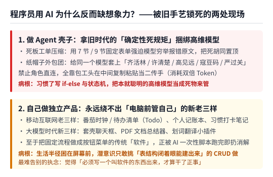
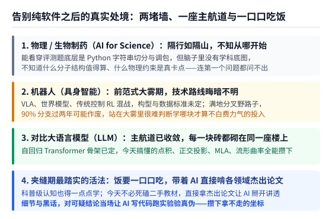

【周末杂谈】使用 AI，相当程度是和旧技能的告别

━━━━━━━━━━━━━━━━━━━━

◆ 开篇：为什么程序员用 AI，反而比外行更缺想象力？

━━━━━━━━━━━━━━━━━━━━

这两年只要聊起大模型，大家常听到的口号是“AI 赋能百业”。但如果诚实地往自己身上看一眼，会发现一句不太中听的大实话：**使用 AI，相当程度是和旧技能的告别。**

程序员肯定会迎头撞上这个问题。按理说，程序员离代码最近、天天跟终端和接口打交道，应该最懂得怎么把 AI 玩出花来。可这段时间我观察下来，发现一个挺有意思的现象：**程序员在使用 AI 的时候，往往比很多外行更缺少想象力——毕竟程序员太习惯以自己的旧能力去思考 AI 了。**

为什么苦练了十来年编程手艺的人，到了 AI 面前反而容易被捆住手脚？

因为传统程序员最核心的基本功，是**确定性控制**：写严丝合缝的分支判断（`if-else`）、画状态机、定义死板的接口字段，确保我敲下什么输入，机器就得一丝不苟地吐出什么输出。

当你带着这套引以为傲的旧手艺去面对一个注意力比人宽几千倍、该懂的道理基本都懂的高维模型时，脑子里冒出来的第一反应，往往不是放手让它发挥，而是拿旧时代软件工程的绳子去捆它。

这毛病在两个地方表现得淋漓尽致：

**第一个现场，是程序员写出来的那些 AI 智能体（Agent）壳子。**

我们在前文 362 期刚把中美四款主流 Agent 的安装包与二进制文件全部扒开（完整提取原件已开源在 https://github.com/lmxxf/ai-theorys-study/tree/main/wechat/assets/362 ），也顺手把前文 345 期 https://mp.weixin.qq.com/s/9ZyALUh3RM90-0y1o15Apg 聊过的腾讯 `WorkBuddyAI` 整个提示词管线翻了个底朝天。你会看到，写壳子的程序员因为不相信模型自己的理解力，发明了一堆让人哭笑不得的死规矩：

有的在做上下文压缩（`/compact`）时，非要用死板的 7 节、9 节工单模板逼着模型“穷举会话里遇到的所有报错原文”，结果把前面 80% 试错死胡同里的脏数据高浓度提纯置顶到了新窗口第一屏；有的在二次总结模板开头写死一句“以下所有任务均已完成，严禁重新执行”，活儿才干到一半就把接班窗口的 AI 催眠成了甩手掌柜。

更好玩的是腾讯 `WorkBuddy` 对外主推的“多角色专家团”。为了显得系统很专业，写壳子的程序员居然拿同一个底座模型，在提示词里给它套上了六顶谐音梗纸帽子： **交付总监齐活林、产品经理许清楚、架构师高见远、项目经理毕达成、程序员寇豆码、测试严过关** 。

而且这套系统明令禁止团员之间直接说话，必须全靠包工头“齐活林”在中间用标签复制粘贴当二传手传话，平白无故消耗双倍的词元（Token）。最逗的是，腾讯程序员自己在写内部核心的文档编排器说明时，却诚实地留了一行注释： **“子智能体模式上下文隔离，效果不稳定，非必要不使用，推荐在单上下文喊角色切换。”**

你看，程序员一思考 AI，想出来的全是人类软件外包公司那套层层汇报、禁止越级沟通的传话筒官僚制。

**第二个现场，是程序员自己出来做独立产品时的“创业老三样”。**

以前移动互联网时代有个流传很广的段子（不是“创业、自媒体、送外卖”那个铁人三项），说程序员一旦失业或者自己搞独立开发，在创业期十个人里有九个半做出来的软件永远是老三样：**番茄时钟 / 待办清单（Todo）、个人记账本、极简笔记 / 习惯打卡**。

到了今天的大模型时代，这老三样又齐刷刷变成了新三样：**套壳聊天框、PDF 文档总结器、划词翻译小插件**。

为什么全世界的程序员一说“我要自己做个产品”，脑子里就只剩这几样东西？

因为大多数程序员的生活半径，就困在电脑屏幕前“管理自己日程和文档”的那点事里；而且当他想点子的时候，潜意识里总在拿自己的旧技能当尺子—— **只敢挑那些“数据库表结构我闭着眼都能建出来、增删改查（CRUD）逻辑我完全能掌控”的软柿子捏** 。旧手艺越熟练，视野就越容易被锁死在自己会写的那几张数据表里。

━━━━━━━━━━━━━━━━━━━━

◆ 第一章：反求诸己——看着还剩 60% 的周额度，我也想不出造什么软件

━━━━━━━━━━━━━━━━━━━━

当然了，这话绝不是在居高临下笑话别人，因为这事儿放到我自己身上也一模一样。

周五下午，我盯着手头每月 200 美元订阅套餐的后台面板发呆：距离每周额度刷新只剩十几个小时了，可这一周的算力额度居然还静静躺着 **60%** 没用完。

看着这白白富余出来的 60% 额度，我本来想趁着刷新前找个“有趣的软件”拿来试水。结果除了顺手把刚剖析完的腾讯 `WorkBuddy` 核心管线剥离出来——去掉 181MB 的桌面端外壳与开局垫底的 3.2 万个词元，修掉那个“假完工催眠”的压缩补丁，改造成自己平时在终端调 `DeepSeek-V4.1-Flash` 用的轻量命令行工具 `workbuddy-cli`（已开源在 https://github.com/lmxxf/workbuddy-cli ）之外，我对着黑乎乎的屏幕想了半天，脑子里居然一片空白。

**我现在连“想出个有趣的软件拿来试水”都想不出来。**

仔细盘点一下自己知道的这点东西：我最多懂一点大模型推理；之前之所以能想到去折腾英伟达 DLSS 5 的跨显卡移植与汇编优化（见前文 350 期 https://mp.weixin.qq.com/s/7pNQT6wtfOFo8hbTEF2_oA 、353 期 https://mp.weixin.qq.com/s/yr0CR4Duo01xrKlo2Sq04w ），纯粹是因为我自己真在拿 `RX 9070 XT` 台式机和 `RTX 3080` 笔记本玩《剑星》和《鬼武者》，老黄锁代差卡帧率真硌到了我的眼睛。

一旦离开了这种肉身正在挨揍、画面正在掉帧的具体痛点，让我端坐在键盘前凭空想“造个什么新软件”，脑子里真的一点水花都没有。

────────────────────

💡 为什么现在连“想出一个软件”都变得这么难？

顺着这片空白往深了想一层，为什么我们现在越来越难想出一个值得专门立项去写的“软件”？

因为传统意义上的 **“软件”** ，本质上是一件工业时代的预制商品：程序员提前猜好一万个用户可能会遇到的同一种需求，把一套固定死的操作流程做成一堆按钮、菜单和弹窗，打包发给不会写代码的人反复点击。

可今天大模型的底座能力上来之后，大量原本需要做成一个独立软件的需求，直接被 **“一句话生成一次性脚本，跑完出结果就扔”** 的能力消解掉了。你想批量改一批图片尺寸、想从几百份表格里核对数据、想把一段录音按说话人切开，根本不需要去下载一个带图形界面的软件，对命令行里的 AI 说句话，它当场写三十行 Python 跑完交差，那个脚本连保存成文件的必要都没有。

所以，程序员和旧技能告别，最深的一层其实是 **告别“我必须写一个叫『软件』的东西出来，才算干了正事”的职业执念** 。

────────────────────

既然纯软件的池塘肉眼可见地变浅了，那按照网上很多文章指的路，程序员带着 AI 往纯软件外面的广阔天地走，是不是就能一路平推了呢？

━━━━━━━━━━━━━━━━━━━━

◆ 第二章：走出纯软件之后的真门槛与大雾——隔行如隔山的物理生物，与路线不明的机器人

━━━━━━━━━━━━━━━━━━━━

网上的文章最喜欢讲“超级个体”的故事：说有了大模型，一个程序员坐在家里就能跨界做物理研究、做生物制药（AI for Science）、造智能机器人。

可真当你放下纯软件的执念，抬头往这几个方向看过去时，迎面撞上的根本不是什么遍地黄金的坦途，而是一堵实打实的专业高墙，外加一团看不清方向的大雾。

**第一堵墙，是实打实的专业门槛：作为程序员，并不懂物理、不懂生物制药；而且更重要的是，隔行如隔山，根本不知道从哪儿开始。**

这两天我刚好看到一篇宣传用大模型做科学计算的评测文章，里面列了三道挺唬人的跨学科考题：生物信息学的 DNA 序列质量审计、计算材料学的铝晶界结构构建、还有核聚变仿星器的线圈与等离子体参数优化。

作为写了多年代码的程序员，我们扫一眼题面和源码，确实能一眼看穿它在工程层面的底牌：
- 所谓 DNA 序列审计，考的其实是写一段 Python 脚本，按滑动窗口统计碱基字母 `A/T/C/G` 的比例（GC 含量）和重复片段；
- 所谓材料铝晶界构建，考的是写一个双层 `for` 循环，调现成的材料科学库（`pymatgen`）尝试几组旋转角度与晶面指数，挑一个原子间距不冲突的模型；
- 所谓核聚变仿星器优化，考的是把现成的物理仿真器当成一个黑盒打分函数，调现成的无梯度优化库（`Nevergrad`）去搜一组得分更高的输入数组。

但看穿了这三道题的代码套路，一点也帮不了你真正进入那个行业。

因为一旦关掉别人喂到嘴边的评测考题，真让你自己面对生物制药或材料物理，你脑子里根本没有那张学科的认知底图——你不知道什么样的分子构型在化学上是有意义的，不知道靶点结合能的物理约束到底卡在哪一步，甚至**连门朝哪儿开、第一个有价值的问题该问什么都不知道**。AI 确实能帮你填平“把想法写成代码跑起来”的沟，但填不平“隔行如隔山、完全不知道该干什么”的墙。将军自己看不懂作战地图的时候，手里握着再多百发百中的 AI 施工队，也下不出第一道指令。

**第二团大雾，是技术路线晦暗不明：甚至连离程序员最近的机器人（具身智能），现在都让人不知道怎么才能高效学习。**

有人可能会说，生物制药离代码太远，那去学离程序员最近的机器人总行了吧？我们在前文 146-150 期合集 https://mp.weixin.qq.com/s/jFWX0y8aL5FHMADdNIR2RA 里也专门动手跑过机器人的仿真入门。可真要往深了投精力，迎面而来的却是另一种无力感：**技术路线晦暗不明，根本不知道怎么才能高效学习。**

为什么这两年我们花时间去学大语言模型（LLM）、学线性代数（如前文 267 期 https://mp.weixin.qq.com/s/mFRQl-5qUstz7fbZ0tvpvQ 的向量点积、359 期 https://mp.weixin.qq.com/s/8HNeuklsntzzh5EbgNRjdw 的基变换与正交投影）和量化技术（如前文 358 期 https://mp.weixin.qq.com/s/0a8QbYDwJa6uuEvSd2Jlgw 的校准集与海森矩阵补偿），心里会觉得特别踏实？

因为大语言模型的 **自回归 Transformer 主航道已经彻底收敛了** 。在这条主航道上，地基是稳的，大厦的骨架是清楚的。你今天花一天时间搞懂的每一个机制——无论是词元嵌入、多头潜在注意力（MLA）、稀疏专家路由，还是流形表皮上的切空间转角——全都是实打实砌在同一座大厦上的砖头。今天学一块，明天就能跟下一块咬合在一起，没有一块砖是白搬的。

可现在的机器人领域，还处在热闹但混乱的 **“前范式混战期”** ：搞视觉语言动作模型（Vision-Language-Action，VLA）的、搞物理世界模型（World Model）的、搞传统控制理论加强化学习（Reinforcement Learning，RL）的，三四拨人各吹各的山头；底下的机械构型、灵巧手自由度和传感器数据标准更是五花八门，谁也没法说服谁。

满地都是分叉的野路子，你今天费尽心血啃下来的某套动作接口或模型方案，有九成可能在两年后就像我们在前文 357 期 https://mp.weixin.qq.com/s/FoJKBWBykSGOpN-KyKkVpg 实测过的 `HINT4` 方案那样，被证明只是一段走不通的弯路。站在这样的大雾里，普通人连哪块知识是值得攒下的真地基都判断不出来，自然不知道该从哪儿下嘴才算高效。

━━━━━━━━━━━━━━━━━━━━

◆ 第三章：在夹缝期里最朴素的活法——饭要一口一口吃，带着 AI 直接去啃杰出论文与实验

━━━━━━━━━━━━━━━━━━━━

剥掉外面那些“三天速成、一人颠覆一个行业”的爽文泡沫，你会发现：旧的软件手艺正在退场，想造个新软件脑子一片空白，往外看物理生物隔着大山，看机器人又笼罩在大雾里—— **这种夹在新旧交替中间的迷茫感，才是今天绝大多数技术人最诚实的处境。**

那站在这个夹缝里，到底该怎么办？

琢磨了一圈，答案其实朴素得不能再朴素：**归根到底，还是要学习。饭要一口一口吃，哪怕是我们在前文 321 期 https://mp.weixin.qq.com/s/ssRDw10XiitxIdg53qROaQ 和 349 期里聊过的“科普水平”的学习，也不是天上掉下来的，也是一点一点学出来的。**

说“学到科普水平就够用”，意思是我们可以省掉死背底层语法边角料和配环境报错的苦力，把脑子里有限的几个工作记忆槽位留给每个领域的 **因果骨架与概念地图** 。但那张概念地图本身，依然得靠你花时间、一勺饭一口菜地装进自己脑子里。你不去学，脑子里连最基础的坐标都没有，AI 就算把全人类的图书馆都装在权重里，也跟你没关系。

只不过，今天的一口口吃饭，跟五年前、十年前相比，手里的餐具已经彻底换代了：

以前为什么“隔行如隔山”那么让人绝望？因为没有 AI 的时候，一个外行想跨进一个陌生领域，只能去翻枯燥的二手教材或培训讲义。教材往往比前沿慢五到十年，而且动不动就甩出一堆不讲人话的学术黑话和省略了中间八步的公式，卡住一步就没人替你解答，更没有实验室让你动手验证真假。

**现在有了 AI，我们可以直接跨过二手教材，去学习各个领域的杰出论文——细节和黑话不懂的，让 AI 用大白话和基础数学帮忙解释清楚；甚至觉得论文结论可疑的，直接让 AI 写代码上机跑实验验证。**

就拿这几天我们自己干的事来说：
1.**拿基础数学扒掉顶会黑话**：看到麻省理工学院（MIT）关于“权重空间编程”和 ICML 2026“表征曲率调制行为不确定性”的论文，标题看着一个比一个玄乎。但把源码和公式拉下来，让 AI 配合着我们刚学过的初中几何与正交投影一核对，五分钟就能看明白：所谓“权重空间编程”核心就是找一个复读方向做正交消融，而所谓“表征曲率”不过是同一层连续三次位移的夹角平均值。
2.**怀疑哪句结论，当场写代码跑实验验真伪**：我们在前文 360 期 https://mp.weixin.qq.com/s/w2vEv2fITplhDNp9kHcwUw 里不信“不训练就能凭空灌入数学能力”的宣传，直接动手只改了 `Qwen3-0.6B` 输出头 `</think>` 一行的 `1,024` 个权重位置（仅为原论文修改量的 `1/128`），就把准确率从 `9.38%` 拉到了 `68.75%`，当场看清它切掉的只是复读气泡；接着在前文 361 期 https://mp.weixin.qq.com/s/-OiYXA99DdbyV3YUa9BtoA 复现出 MIT 平直弦曲率对预测熵只有 `1%` 的解释力后，半夜想起球面等边三角形内角是 `90°` 而不是 `60°`，连夜在 363 期（实验代码开源在 https://github.com/lmxxf/ai-theorys-study/tree/main/wechat/assets/363 ）顺着流形表皮重算切空间转角、步长快慢与有效秩，亲手把解释力从 `1%` 推到了 `55% 至 67%`。

你看，在这个过程里，我们并没有发明什么能卖钱的“新软件”，但每啃透一篇杰出论文、每跑通一次证伪或证真的实验，我们对高维几何与模型机理的认知底图就往外扩了一寸。

和旧技能告别，本来就不是一件轻松愉快的事。承认自己以前熟练的那套 CRUD 和固定软件套路正在贬值，坦然面对看着 60% 剩余算力却想不出做什么软件的空白，也坦然承认自己在跨学科高墙与前范式大雾面前的无知——然后收起焦虑，每天老老实实吃透一篇好论文、做通一个小实验。

饭一口一口吃，地图一格一格画。等哪天远方的大雾散开、新大陆的主航道真正浮出水面的时候，你脑子里攒下的那些坐标，自然会告诉你下一步该往哪儿走。

━━━━━━━━━━━━━━━━━━━━

◆ 速查表

━━━━━━━━━━━━━━━━━━━━

| 现象 / 处境 | 底层原因与应对思路 |
|---|---|
| 程序员用 AI 反比外行缺想象力 | 习惯了 `if-else` 与状态机等确定性控制，习惯拿自己的旧手艺丈量 AI（如在 Agent 壳子里塞死板工单与纸帽子传话筒，做产品绕不出番茄钟/记账本/套壳聊天新老三样） |
| 对着剩余算力想不出做什么“新软件” | 把固定流程做成按钮菜单供人点击的传统“软件”，正被大模型一句话现场生成一次性脚本（跑完即扔）的能力消解；需要告别“必须写个软件才算干正事”的执念 |
| 物理 / 生物制药（AI for Science）的真门槛 | 评测题底层虽是 Python 切字符串与调包，但外行脑子里缺学科认知底图，不知道什么分子结构值得算、什么物理约束是真卡点，连第一个问题都问不出来 |
| 机器人（具身智能）vs 大语言模型（LLM） | LLM 自回归 Transformer 主航道已收敛，学的每块砖都砌在同一座楼上；机器人尚处 VLA / 世界模型 / 传统控制混战的前范式大雾期，难判哪块是真地基 |
| 夹缝期最踏实的学习活法 | 饭要一口一口吃，科普级认知也得一点点攒；借 AI 跨过二手教材，直接啃各领域杰出论文（让 AI 解释黑话与细节，对可疑结论直接写代码上机跑实验验证） |

━━━━━━━━━━━━━━━━━━━━

◆ 参考资料

━━━━━━━━━━━━━━━━━━━━

- Hiebert & Lefevre, Conceptual and Procedural Knowledge in Mathematics: An Introductory Analysis（Lawrence Erlbaum Associates，1986；区分理解原理与关系网络的概念性知识，以及按规则语法分步操作的程序性知识）
- Rikiya Takehi et al., Sparks of Weight-Space Programming（MIT CSAIL，2026；权重空间直接编辑实验与同题孪生分支正交投影消融）
- Representational Curvature Modulates Behavioral Uncertainty in Large Language Models, arXiv:2604.23985（MIT，ICML 2026；残差流轨迹转角与下一步预测信息熵相关性分析）
- Google Antigravity CLI（`agy` v1.5.1）、Anthropic Claude Code（v2.1.311）、OpenAI Codex CLI（v0.166.0）与腾讯 WorkBuddyAI（v5.9.4）本地安装包内置提示词与多角色编排模板静态分析（2026-11）

━━━━━━━━━━━━━━━━━━━━

**程序员用 AI 之所以常常比外行更缺想象力，是因为太习惯拿自己熟练的确定性控制和数据库表结构去丈量一个高维模型。**

**把固定流程做成一堆按钮供人点击的传统软件，正在被一句话现场写一次性脚本跑完即扔的能力消解；和旧技能告别，最深的一层是放下必须写个软件才算干正事的执念。**

**面对隔行如隔山的专业高墙与路线不明的大雾，没有一步登天的捷径；饭要一口一口吃，带着 AI 直接去啃各领域的杰出论文、把可疑的结论亲手跑一遍实验，才是攒下认知坐标的笨办法。**

━━━━━━━━━━━━━━━━━━━━

// 靳岩岩的 AI 学习笔记 × Gemini 的浪漫 × GPT 的严谨
// 2026年11月8日

使用 AI 相当程度是和旧技能的告别。程序员常因以旧手艺思考 AI 而困在死板工单与“番茄钟、记账本”里；当传统软件被一次性脚本消解，面对物理生物的专业高墙与机器人的路线大雾，最踏实的活法仍是饭一口口吃，带着 AI 直接啃透各领域的杰出论文与实验。
