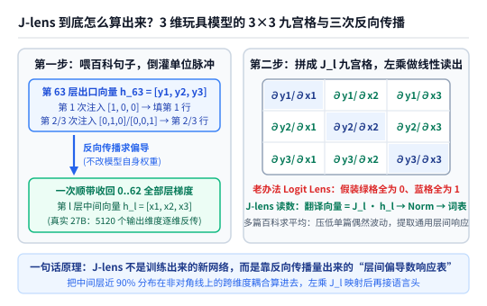
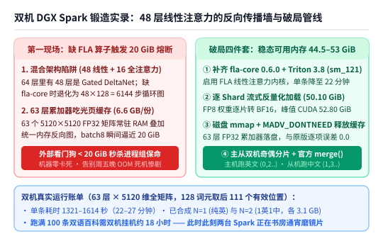
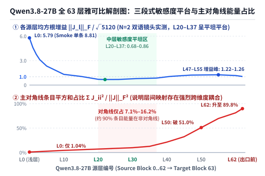
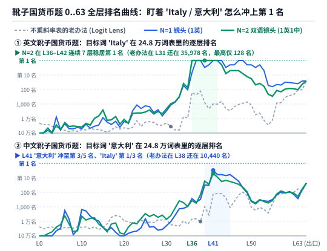

【AI可解释性】手把手给 Qwen3.8-27B 磨一副“读心眼镜”：雅可比透镜（J-lens）到底怎么算出来的？附双机 DGX Spark 锻造实录

━━━━━━━━━━━━━━━━━━━━

◆ 引子：当题面里一个字都没提“意大利”时，怎么看见大模型在第 37 层脑子里闪过的念头？

━━━━━━━━━━━━━━━━━━━━

先看一道最简单的两步推理题：
如果你问大模型 **`“常识：形状像一只靴子的欧洲国家使用的法定货币是____”`** （或者英文版 **`“Fact: The currency used in the country shaped like a boot is”`** ），题面里既没有出现“意大利”，也没有出现“欧元”。
但常识告诉我们，无论是人还是大模型，要想答出最后的“欧元”，中间某一层脑子里必然要先拐个弯，把 **“形状像靴子的国家 ＝ 意大利（Italy）”** 这个隐含的中间概念想出来，然后才能顺着“意大利”查出“欧元”。

我们在前文 245 期 https://mp.weixin.qq.com/s/PleyNOp7zvV3x-j3DVqq9Q 里介绍过 Anthropic 团队今年发表的那篇重磅可解释性论文（《大模型内部类似全局工作空间的表征》，`arXiv:2607.01850`）。那篇论文之所以能看清大模型中间层在想什么，靠的就是他们发明的一副叫作 **雅可比透镜（Jacobian Lens，简称 J-lens）** 的新眼镜。

最近我们去翻了 Anthropic 官方开源的代码仓库（GitHub `anthropics/jacobian-lens`）以及挂在社区平台 Neuronpedia 上的预计算镜头库（HuggingFace `neuronpedia/jacobian-lens`），结果发现了两件特别有意思的事：
1.**全网可解释性社区已经把主流开源模型测了个遍，唯独缺了最新的 `Qwen3.8-27B`** ——
  在官方仓库和 Neel Nanda 团队的扩展榜单里，不仅有 Llama、Gemma 和 Qwen3.5/3.6，甚至连国产旗舰 **`DeepSeek-V4-Flash`** 都被他们训出了专属 J-lens，而且跑出了 **61.4%** 的全场最高中间概念召回率；唯独刚发布不久、采用“48 层线性注意力 + 16 层全注意力”混合架构的 **`Qwen3.8-27B`** ，全世界还没有人给它训过 J-lens。
2.**官方开源库里现成的所有镜头，清一色全是用纯英文语料（WikiText）训出来的** ——
  还没有任何一副镜头是用 **1:1 中英双语百科语料** 锻造的。

既然全网没人做过，今天下午我们就干脆在自家的两台 **DGX Spark（GB10 128GB 统一内存）** 上，亲手给 `Qwen3.8-27B` 磨一副专属的中英双语 J-lens。
更重要的是，借着这次自己动手从头算矩阵的机会，我们终于把以前看论文时一知半解的核心问题彻底抠明白了：**J-lens 那个神秘的投影矩阵到底在乘什么？为什么它不需要任何标准答案、光靠喂几篇毫不相干的维基百科文章求偏导数，就能把大模型中间层的脑内弹幕照出来？**

━━━━━━━━━━━━━━━━━━━━

◆ 一、先算个 3×3 九宫格：J-lens 到底在乘什么，又是怎么不靠训练“求导”出来的？

━━━━━━━━━━━━━━━━━━━━

很多朋友第一次听说“给大模型装个透镜看中间层”，脑子里冒出的第一个问题往往是：
**“这东西是不是把每一层的残差流向量，直接乘一个投影矩阵送到最后语言头（`lm_head`）的前面，再经过词表输出？”**

说得一点没错！在推理使用的时候，J-lens 干的事情简单到只有一行矩阵乘法。
拿我们今天的主角 **`Qwen3.8-27B`** 来说，它一共有 **64 层**（编号第 `0` 层到第 `63` 层），每一层流淌的残差流向量维度都是 **`5120` 维**，最后接一个 **`248,320` 词表** 的语言头：
- **老办法（Logit Lens，直译透镜）怎么读第 30 层？**
  它直接把第 30 层的 `5120` 维向量 $h_{30}$ 拎出来，原封不动地捅进第 63 层出口处的最终归一化层（Final RMSNorm）和语言头 `lm_head` 里，看 24.8 万个词里哪个词得分最高。
  用线性代数的话说，老办法等于默认假设 **“从第 30 层传到第 63 层，坐标系连 1 度都没转过”** ——也就是默认中间乘的是一个主对角线全是 `1`、其余格子全是 `0` 的 **单位矩阵 $I$** 。
- **新办法（J-lens，雅可比透镜）怎么读第 30 层？**
  在把 $h_{30}$ 送进最后的 Final RMSNorm 和语言头之前，**先左乘一个专门为第 30 层定制的 $5120 \times 5120$ 投影矩阵 $J_{30}$** ，算出翻译后的向量 $\hat{h}_{63} = J_{30} \cdot h_{30}$，然后再经过 Final RMSNorm 和语言头输出词表排名。

那么问题来了：**这个 $5120 \times 5120$ 的投影矩阵 $J_\ell$ 到底是怎么算出来的？需要准备多少道带标准答案的题目去“训练”它吗？**

答案反直觉却极其精妙：**一道题都不用训，也根本不改大模型的任何权重，纯粹是拿普通的维基百科文章“通电求偏导数”量出来的。**

为了避免被 `5120` 维吓住，我们先把它缩小成一个只有 **3 个维度** 的玩具模型，手把手算一遍它的 **3×3 九宫格** ：

1.**第一步：随便抓一篇毫不相干的百科散文，给大模型“通上电”** ——
  比如在我们今天真实的双机拟合语料库（`prompts_100.json`）里：
  - **第 0 条英文语料**（选自 `WikiText-103` 第 9 行）是一段介绍世嘉 PSP 老游戏《战场女武神 3》的百科散文：*`"As with previous Valkyria Chronicles games , Valkyria Chronicles III is a tactical role-playing game where players take control of a military unit..."`* ；
  - **第 1 条中文语料**（选自中文维基百科第 0 行）是一段介绍《数学》词条的科普长文：*`“数学，是研究数量、结构以及空间等概念及其变化的一门学科，属于形式科学的一种……”`* 。
  注意，这些文章里既没有“靴子国意大利”，也没有任何问答标签。我们为什么要把这样一篇 128 个词元的普通文章喂进大模型跑一遍前向传播（跳过开头前 16 个还在热身的词元，保留后面 `111` 个有效词元位置）？
  因为大模型中间有 RMSNorm 归一化、有 SiLU 激活函数、有注意力门控，这些都是 **非线性开关**。只有先喂一篇真实的自然语言句子进去，各层的注意力门控和激活开关才会张开到“正常阅读人类语言时的工作角度”。
2.**第二步：在最后一层依次倒灌 `[1,0,0]`、`[0,1,0]`、`[0,0,1]`，连跑 3 次反向传播填满九宫格** ——
  假设玩具模型的向量只有 3 维：第 30 层的中间向量是 $h_{30} = [x_1, x_2, x_3]$，第 63 层的出口向量是 $h_{63} = [y_1, y_2, y_3]$。
  我们想知道的“翻译表” $J_{30}$，其实就是当第 30 层的 $x_1, x_2, x_3$ 轻轻抖动一下时，第 63 层的 $y_1, y_2, y_3$ 会跟着抖动多少（即微积分里的偏导数九宫格 $\partial y_i / \partial x_j$）。
  在 PyTorch 里怎么把这 9 个格子一次性量出来？如上图所示，我们从第 63 层出口往回倒灌梯度：
  - **第 1 次反向传播** ——往第 63 层的 `[y1, y2, y3]` 上注入单位脉冲 **`[1, 0, 0]`** （只盯住最终输出的第 1 维 $y_1$），调一次 `.backward(retain_graph=True)`。信号顺着刚才打开的开关一路倒着传回第 0 层到第 62 层，直接吐出 $\partial y_1 / \partial x_1$、$\partial y_1 / \partial x_2$、$\partial y_1 / \partial x_3$ 三个数，**填满九宫格的第 1 行**；
  - **第 2 次反向传播** ——往第 63 层注入 **`[0, 1, 0]`** ，再跑一次反向传播，**填满九宫格的第 2 行**；
  - **第 3 次反向传播** ——往第 63 层注入 **`[0, 0, 1]`** ，再跑一次反向传播，**填满九宫格的第 3 行**。
  （注：在官方代码中，每次注入单位脉冲时会在一句话的全部 `111` 个有效词元位置同时注入，从而把当前位置 $p$ 对所有后续词元位置 $q \ge p$ 的跨位置注意力贡献也一并加总进来。）
  现在把这个 3 维玩具还原回真实的 **`Qwen3.8-27B`** ：因为它的隐藏层是 **`5120` 维**，所以每喂进 **1 条** 128 词元的百科文章，机器就必须从第 63 层往回 **连跑 `5120` 维的反向传播** （如果每次打包 2 个维度一起反传，即 `dim_batch=2`，就要整整反传 **`2560` 次**），才能把这一篇文章对应的 63 张 $5120 \times 5120$ 偏导数表格全部填满！
3.**第三步：为什么要拿 100 篇风马牛不相及的文章求平均？** ——
  如果只拿第 0 篇《战场女武神 3》算出一张表，那张表里除了记录了“大模型通用的层间升降机”，还会夹带一些跟“军事、游戏”相关的特定句子私货；如果只拿第 1 篇《数学》词条算，又会夹带数学词条里的排版换行私货。
  当我们把 **50 篇英文百科 + 50 篇中文百科（共 100 篇不同领域的文章）** 分别算出的 100 张偏导数表加起来求平均（$\bar{J}_\ell = \frac{1}{100}\sum J_\ell^{(k)}$）时，具体某句话的题材私货就会在加总中正负抵消，最后沉淀下来的，就是大模型与具体题目无关的 **“通用层间坐标翻译主干道”** 。

━━━━━━━━━━━━━━━━━━━━

◆ 二、在双机 DGX Spark 上真刀真枪磨镜片：撞上 48 层线性注意力的反向传播墙与 20 GiB 熔断保命

━━━━━━━━━━━━━━━━━━━━

原理听起来干净漂亮，但当我们今天下午真正把 Anthropic 的官方仓库拉到两台 **DGX Spark（GB10，128GB LPDDR5x 统一内存）** 上，准备给 `Qwen3.8-27B` 开炉磨镜片时，第一脚油门踩下去就撞上了一堵硬墙：

1.**第一现场惊魂：缺 `fla-core` 算子叠加统一内存反向图，当场触发 20 GiB 看门狗熔断** ——
  用过 DGX Spark 的朋友都知道，GB10 的 128GB 是 CPU 与 GPU 共用的统一内存（Unified Memory），一旦内存被吃干抹净触发系统级 OOM，整台机器就会瞬间卡死失联（上周五晚上我们跑曲率实验时就因为没设熔断，把两台机器跑死机重启过一回）。
  所以今天动手前，我们先上了三道硬护栏：**① 逐片（Shard）流式把官方 FP8 权重反量化成 BF16 上卡（实测模型权重稳稳占 `50.10 GiB`）；② 进程内每 0.25 秒检查 `MemAvailable`，低于 `22 GiB` 立即自退；③ 独立父进程看门狗每 0.25 秒巡检，低于 `20 GiB` 立即秒杀整个进程组保命**。
  结果第一轮用 `dim_batch=8` 试跑 Smoke Test 时，反向传播刚一启动，**外部看门狗立刻在 `20 GiB` 红线处果断触发熔断，一刀杀掉进程组，机器毫发无损！**
  为什么 50GB 的模型跑个 128 词元的反向传播，会瞬间吃掉五六十 GB 内存？
  一查日志才发现 **`Qwen3.8-27B` 的混合架构暗坑** ：它的 64 层里只有 16 层是标准全注意力（Full Attention），其余 **48 层全是 `Gated DeltaNet` 线性注意力**。在没装专用算子库时，Transformers 默认走 PyTorch 参考循环，48 层乘以 128 个词元，相当于在反向传播图里硬生生展开了 **$48 \times 128 = 6144$ 步串行状态循环图**；再加上 63 层 $5120 \times 5120$ 的 FP32 累加矩阵和 Linux 页缓存（Page Cache）全挤在同一个 128GB 水池里，`dim_batch=8` 一建图直接把内存池顶穿了。
2.**破局四件套与实事求是的“18 小时账单”** ——
  找到病根后，我们当场做了三项手术：
  - **补齐内核** ——在两台 Spark 上编译安装 `flash-linear-attention`（`fla-core 0.6.0`）与 `Triton 3.8.0`（完美识别 GB10 的 `sm_121` 架构），让 48 层 DeltaNet 走高速融合内核；
  - **磁盘 `mmap` 零拷贝落盘** ——把 63 个 $5120 \times 5120$ 的 FP32 累加矩阵（每套约 `6.6 GB`）改为磁盘 `np.memmap` 映射，每反传 10 步调用一次 `MADV_DONTNEED` 主动释放操作系统页缓存（经 CPU 微型模型核验，与官方原版内存累加的逐项最大绝对误差为 **`0.0`**）；
  - **退回 `dim_batch=2` + 主从双机奇偶分片** ——主机（`spark-3a10`）专跑偶数号英文维基语料（`0, 2, 4...`），从机（`spark-slave`）专跑奇数号中文维基语料（`1, 3, 5...`），最后用官方 `JacobianLens.merge()` 合并成严格 1:1 的中英双语镜头。

  手术完成后，内存稳如泰山：**峰值 CUDA 显存仅 `52.80 GiB`，全程最低可用系统内存保持在 `44.55 GiB ～ 53.2 GiB` 之间**。
  但我们也算清楚了一笔极其真实的物理时间账：因为我们坚持 **“不砍层数、不降维，63 层 × 5120 维满血精确计算”**，每算完 **1 条** 128 词元的语料，需要精确执行 5120 维反向传播，在单台 GB10 上耗时 **1321 秒至 1614 秒（约 22 至 27 分钟）**。
  这意味着，就算两台 DGX Spark 并行全速运转（每台分担 50 条），**把 100 条双语语料全部跑完也整整需要约 18 个小时（要到明天上午才能彻底炼成 `N=100` 终极版）**！
  实事求是地说，截至今天下午发稿时，我们的双机刚刚跑完了完整预检与前两批正式样本，合出了 **`N=1`（单篇英文镜头，3.1 GB）** 和 **`N=2`（1 英 + 1 中合成的首个双语镜头，3.1 GB）**，而两台 Spark 此时此刻正在书房里呼呼地挂机通宵跑剩下的 98 条。
  那么，仅仅靠刚刚出炉的 `N=1` 和 `N=2` 早期镜头，我们已经能从 `Qwen3.8-27B` 脑子里看到什么了？

━━━━━━━━━━━━━━━━━━━━

◆ 三、新鲜出炉的 Qwen3.8-27B 63 层解剖图：为什么老办法在中间层“90% 能量全读歪了”？

━━━━━━━━━━━━━━━━━━━━

把刚刚合出来的 `N=2` 双语镜头（以及 `smoke_b1` 单条镜头）的 63 张 $5120 \times 5120$ 雅可比矩阵拆开做体检，两组铁打的数字当场把 `Qwen3.8-27B` 的内部构造照得一清二楚：

1.**第一组数字（上图上侧蓝线）：各层信号传导放大倍数 $\|J_\ell\|_F / \sqrt{5120}$，活生生画出“三段式工作空间高原”** ——
  如果第 $\ell$ 层往第 63 层传信号既不放大也不缩小，归一化 Frobenius 范数 $\|J_\ell\|_F / \sqrt{5120}$ 就应该在 **`1.0`** 左右。看我们在 `Qwen3.8-27B` 上实测出的曲线：
  - **第 0～19 层（浅层感觉区，剧烈压缩）** ——在 `N=2` 镜头下，范数从第 0 层的 **`5.79`** （单条英文 Smoke 下更是高达 **`8.81`** ）一路陡峭下滑到第 10 层的 **`1.32`** 、第 19 层的 **`0.74`** ，把原始词元特征快速收敛进内部轨道；
  - **第 20～37 层（全局工作空间核心高原，连续 18 层稳在 `0.68 ～ 0.86`）** ——从第 20 层（`0.708`）一直到第 37 层（`0.856`），曲线突然变成了一条极其平坦的高原（在单条 Smoke 镜头下更是死死钉在 **`0.89 ～ 1.02`** 之间）！整整 18 层里，信号往上传递既不爆炸也不衰减，构成了一条极度稳定的 **等距广播总线**；
  - **第 38～62 层（深层整合与运动区，先放大决断再平滑出站）** ——从第 38 层（`0.885`）开始二次爬升，在第 47～55 层达到 **`1.22 ～ 1.26`** 的放大峰值，最后在第 62 层平滑回落到 **`1.054`** ，严丝合缝地对接第 63 层出口。
2.**第二组数字（上图下侧红线）：主对角线能量占比 $\sum J_{ii}^2 / \|J_\ell\|_F^2$，用数学铁证揭穿“为什么老办法 Logit Lens 在中间层必瞎”** ——
  前面我们讲过，老办法 Logit Lens 不乘 $J_\ell$ 直接裸接语言头，等于假装 $J_\ell$ 是单位矩阵 $I$（即假装 **100% 的能量都在主对角线 $i=j$ 上**，第 $\ell$ 层的第 $i$ 维直通第 63 层的第 $i$ 维）。
  那真实 `Qwen3.8-27B` 的雅可比矩阵里，主对角线上的能量到底占百分之几？
  - **在第 0 层** ——主对角线能量占比只有可怜的 **`1.04%`** （单条中文样本下仅 **`0.80%`** ），也就是说 **99% 的信号在往后传时全拐弯串到别的维度（非对角线）上去了**；
  - **在第 20～35 层（全局工作空间黄金带）** ——主对角线能量占比依然只有 **`7.13% ～ 12.69%`** （离单位矩阵的距离 $\|J_\ell - I\|_F / \sqrt{d}$ 高达 **`1.11 ～ 1.16`** ）！
    这句话是全篇最核心的物理洞察：**大模型在中间层的工作空间里思考时，用的是一套跟最终词表输出层有近 90% 正交旋转的“内部工作坐标系”**。你在第 30 层用老办法 Logit Lens 硬读，就好比偏振片角度歪了八十度，90% 的非对角线信号全被你丢掉了；
  - **在第 48～62 层（临近出口）** ——主对角线能量占比才像坐火箭一样从第 48 层的 **`41.48%`** 飙升到第 50 层的 **`51.01%`** 、第 60 层的 **`81.17%`** ，直到第 62 层达到 **`89.79%`** ——只有到了最后这十几层，模型才把内部坐标系转回跟语言头词表对齐的方向。

━━━━━━━━━━━━━━━━━━━━

◆ 四、早期镜头（N=1 / N=2）实测成绩单：既看到了“跃升第 1 名”的惊喜，也抓到了“单篇排版私货”的活体毛刺

━━━━━━━━━━━━━━━━━━━━

那么，拿刚刚出炉的 **`N=1`（仅用第 0 条《战场女武神 3》英文拟合）** 和 **`N=2`（第 0 条英文 + 第 1 条《数学》中文合并）** 两副早期镜头，去照一照真实的推理题和官方基准题集，效果到底怎么样？
为了保证绝对不在同机叠加两份 27B 模型冲爆内存，我们在主机刚算完 `N=1` 落盘的断点处暂停了几十秒，腾出显卡跑完了 **`Vanilla（老办法 Logit Lens） vs N=1 vs N=2`** 的全层对比评测（随后主机已从断点无缝恢复继续跑 `N=100`）：

1.**惊喜切面：在中英文多跳代表题上，第 36～41 层的目标中间词直接从几百上千名冲进前五乃至第 1 名！** ——
  我们只读取题面最后一个词元（绝不偷看后面的答案），去查中间层 24.8 万个词元里的排名（Rank）：
  - **英文靴子国货币题（`Fact: The currency used in the country shaped like a boot is`）** ——
    看英文目标词 **`'Italy'`** 的排名：在 **老办法 Vanilla** 下，第 31 层排在第 **`35,978` 名**，第 38 层排在第 **`128` 名**，第 40 层排在第 **`2,123` 名**（注：有趣的是，老办法在第 37 层虽然英文 `'Italy'` 排第 236 名，但中文词元 `'意大利'` 曾短暂冒到第 1 名，说明底层概念已在，只是英文词元坐标没对齐）；
    而换上 **`N=1` 和 `N=2` 雅可比透镜** 后，在第 **36、37、38、39、40、41 整整六层** 里，英文 **`' Italy'`** 的排名被齐刷刷地拽到了 **`第 1 名`（或第 2 名）**！比如第 38 层的前三名直接变成了清清楚楚的 **`[' Italy', '意大利', ' Italian']`** 。
  - **中文靴子国货币题（`常识：形状像一只靴子的欧洲国家使用的法定货币是`）** ——
    在第 41 层，**老办法 Vanilla** 读出的前几名是 `' gì'`, `'____'`, `'...'`，目标词 **`'意大利'`** 排在第 **`131` 名**、**`'Italy'`** 排在第 **`104` 名**；
    换上 **`N=1` 透镜**，第 41 层的 **`' Italy'`** 直接冲上 **第 `1` 名**，中文 **`'意大利'`** 冲上 **第 `3` 名**（`N=2` 透镜下也分别排在第 `3` 名和第 `5` 名）！
  - **中文东京货币题（`常识：首都为东京的国家使用的货币是`）与吉萨金字塔题** ——
    在第 41 层，老办法下 `'日本'` 排第 **`40` 名**、`'Japan'` 排第 **`32` 名**；换上 `N=1 / N=2` 透镜后，**`' Japan'`** 直接冲到 **第 `2` 名**，**`'日本'`** 冲到 **第 `4～5` 名**！吉萨金字塔题里的 `'Egypt'` 在第 41 层也从老办法的第 **`40` 名**（第 31 层更是远在第 `18,806` 名）跃升到了 **第 `8～9` 名**（第 56 层冲到 **第 `5` 名**）。
2.**最诚实的“半成品毛刺”切面：为什么 `N=1` 在多语言大盘涨了 10.8%，合入第 1 条中文变成 `N=2` 后 `pass@1` 反而回落了？** ——
  我们再看一眼官方两个标准题集（84 道可单 token 评分的 `Multihop` 多跳题、107 道 `Multilingual` 多语言题）的大盘成绩单：
  - 当从 **老办法 Vanilla** 切到 **`N=1`（单条英文镜头）** 时：多跳题 `pass@5` 从 **`53.97%`** 提升到 **`56.35%`** ，多语言题 `pass@1` 更是从 **`21.26%`** 直接暴涨 **10.83 个百分点** 冲到 **`32.09%`** （`pass@10` 从 `46.88%` 升至 `50.62%`）！
  - **但怪事发生了** ——当我们把从机算完的第 1 条中文（维基百科《数学》长文）合并进来变成 **`N=2`** 时，多跳题的 `pass@1` 反而从 `33.93%` 掉到了 **`23.81%`** ，多语言题的 `pass@1` 也从 `32.09%` 回落到了 **`22.74%`** ！
  为什么多加了一条语料，第一名命中率（`pass@1`）反而退步了？
  我们把 `N=2` 镜头在第 36～41 层吐出来的 Top-5 词表打印出来一看，当场笑出声来——
  比如在刚才那道中文靴子国题的第 41 层，`N=2` 镜头排出的前五名依次是：**`['\n\n', '…', ' Italy', '\n', '意大利']`** ！
  原来，从机喂进去的第 1 条中文语料（维基百科《数学》词条，见前文）是一篇带有大量小标题、双换行符 **`\n\n`** 和省略号 **`…`** 的百科目录体长文。当全局只有 **2 篇文章（1 英 1 中）** 求平均时，这篇中文《数学》词条里强烈的 **“分段换行与标点排版私货”** 根本没有被其他文章抵消掉，结果在 `N=2` 镜头的中间层里，换行符 `\n\n` 和省略号 `…` 长期霸占了第 1、第 2 名的宝座，把原本排第 1 的 `' Italy'` 和 `'意大利'` 硬生生挤到了第 3 名和第 5 名（所以严格卡第 1 名的 `pass@1` 掉了，但前五名和前十名依然稳稳命中）！

**这个“半成品毛刺”反而成了今天这次实验最珍贵的收获：**
如果我们不看 `N=1` 和 `N=2` 的中间过程，直接等明天早上拿 `N=100` 的成品看结果，我们永远只能在嘴上背诵一句“多篇语料求平均可以消除噪声”；而今天亲眼看到 **第 1 篇中文《数学》词条里的 `\n\n` 换行符怎么在 `N=2` 镜头里抢占榜首、把正确概念挤到第 3 名**，才真正从物理底层看懂了：**为什么求导数磨镜片不能只喂一两篇文章，为什么此时此刻我们书房里的两台 DGX Spark 必须老老实实挂机跑满 18 个小时，用 100 篇不同文章把每一篇的排版私货彻底磨平！**

━━━━━━━━━━━━━━━━━━━━

◆ 小结与后续计划：等明早 N=100 满血出炉，我们去干两件大事

━━━━━━━━━━━━━━━━━━━━

回顾今天下午在双机 DGX Spark 上的这趟折腾，我们把以前觉得高深莫测的“雅可比透镜（J-lens）”彻底祛魅成了三句人话：
1.**它是什么** ——它就是给每一层配的一张 $5120 \times 5120$ 的“层间偏导数翻译表”，在中间层向量进最后的语言头之前先左乘一下，把中间层那 **90% 旋转在非对角线上的内部工作坐标系** 给拧正回来；
2.**它怎么算** ——不需要任何标注答案，随便喂几十上百篇中英百科文章把模型内部开关通上电，从最后一层依次往回倒灌 5120 个维度的单位脉冲跑反向传播，求平均磨平单篇私货就成了；
3.**我们跑到了哪一步** ——我们已经解决了 `Qwen3.8-27B` 48 层线性注意力的反向传播建图爆炸问题（靠 `fla-core` 内核 + 磁盘 `mmap` + 20 GiB 看门狗护栏），拿到了完整 63 层的结构解剖图与 `N=1 / N=2` 初步显影结果；现在两台 Spark 正在后台安静地通宵跑满 100 条。

等明天一早这套 3.15 GB 的 **`Qwen3.8-27B` 满血版 `N=100` 双语 J-lens** 彻底炼成之后，我们接下来准备干两件更好玩的事：
- 一是按 `neuronpedia/jacobian-lens` 的官方规范打包 `.pt` 权重与 `config.yaml`，把它上传到 **HuggingFace** 并给官方仓库提一个 Pull Request，把这副全网首创的 `Qwen3.8-27B` 双语镜头贡献给全球可解释性社区；
- 二是戴上这副彻底磨平了毛刺的满血眼镜，去照一照我们最关心的那些高阶谜题——比如当大模型看到一段抽象的 **几何图形代码（SVG）** 时，它第 20～37 层的工作空间里到底浮现出了什么意象词？如果我们直接在第 30 层把“意大利”替换成“日本”再乘 $J_{30}^{-1}$ 塞回去，能不能完成一次精准的“脑内换心手术”？

我们等两台 Spark 通宵把镜片磨亮，下期接着拿真数据说话！
