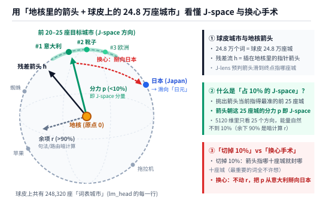
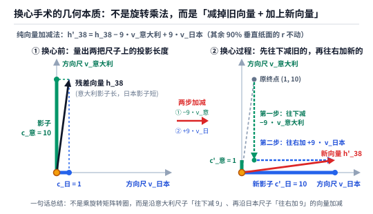

【J-Lens实测】用刚磨好的 N=100 透镜给 Qwen3.8-27B 做“换心手术”，顺手破案网友说的“2*3+2 中间层出 6”

━━━━━━━━━━━━━━━━━━━━

◆ 开篇：通宵 18 小时磨完 N=100 之后，昨晚那根 `\n\n` 标点毛刺真的消失了

━━━━━━━━━━━━━━━━━━━━

在前文 365 期 https://mp.weixin.qq.com/s/I1puPtcgynImhOqHlRmwDg 里，我们在家里的两台 **DGX Spark（GB10 128GB 统一内存）** 上，给社区里还没有现成镜头的 **`Qwen3.8-27B`** 开炉锻造一副 **1:1 中英双语雅可比透镜（Jacobian Lens，简称 J-lens，即每层一张 `5120 × 5120` 的多维斜率表）** 。

昨天下午发稿时，两台机器才刚刚跑完第 0 篇英文和第 1 篇中文（合出早期的 `N=1` 与 `N=2` 镜头）。当时我们在中文靴子国货币题（`常识：形状像一只靴子的欧洲国家使用的法定货币是`）的第 41 层看到了一根很有意思的“少样本毛刺”——只拿 1 句英文 ＋ 1 句中文合成 `N=2` 镜头时，第 41 层排出的前五名是 **`[‘\n\n’, ‘…’, ‘ Italy’, ‘\n’, ‘ Italian’]`** ，头两名被双换行符 `\n\n` 和省略号 `…` 霸占了。当时我们留下了一个悬念：等两台 Spark 通宵挂机跑满 18 个小时、把 **50 篇英文百科 ＋ 50 篇中文百科（`N=100`）** 全部算完求平均之后，能不能把这些偶然的标点毛刺彻底磨平？

今天早上 9 点 14 分，两台机器终于跑完了全部 **`256,000` 次** 27B 全网络的反向传播（主机 50 篇英文单篇耗时 `1231` 至 `1264 秒`，从机 50 篇中文单篇耗时 `1303` 至 `1322 秒`），合并落盘了最终 `3.30 GB`（`3.08 GiB`）的 **`Qwen3.8-27B` `N=100` 双语镜头** （目前已开源上传至 HuggingFace： *https://huggingface.co/lmxxf/Qwen3.8-27B-jacobian-lens* ）。

我们第一时间把刚才那道中文靴子国题在第 41 层的排行榜打出来看了一眼，这处读数变得相当干净：
- **昨天 `N=2`（1 英 1 中）第 41 层前五名** —— **`[‘\n\n’, ‘…’, ‘ Italy’, ‘\n’, ‘ Italian’]`** （`‘意大利’` 排第 5 名，榜首全是换行和省略号）；
- **今天 `N=10` 与 `N=100`（50 英 50 中）第 41 层前五名** —— **`[‘意大利’, ‘ Italy’, ‘ Italian’, ‘Italy’, ‘ Italia’]`** （`N=50` 前四名相同，第 5 名为 `'...'`）。
  可以看到，在第 41 层这个关键中层窗口上，原先霸占榜首的 `\n\n` 和 `…` 被求平均压了下去，**中文 `‘意大利’` 稳稳冲上了第 `1` 名，英文 `‘ Italy’` 排第 `2` 名** ，`N=100` 下前五名全是“意大利”在各语种里的写法；在官方 84 道多跳推理题集（`Multihop`）上，中间概念排到第 1 名的命中率（`pass@1`）也从昨天 `N=2` 的 `23.81%` 回升到了 **`36.31%`** （超过了不乘斜率表的老办法 `33.93%` 和纯英文 `N=1`）。

既然这副 `N=100` 的眼镜已经磨好了，今天我们就拿着它干三件比“光看排行榜”更好玩的事：

1.**破案一位网友留言提的疑问** ——Anthropic 论文里说“模型算 `2*3+2` 时，中间层会先算出 `6`、最后才变成 `8`”，为什么有位网友自己动手试却没能复现出来？

2.**把放大镜变成手术刀（换心手术 Swap）** ——趁模型思考到第 34 至 44 层时，直接伸手把脑子里的“意大利”偷换成“日本”、把“蜘蛛”偷换成“蚂蚁”，看它最后会不会改口回答“日元”和“6 条腿”？为什么换心时非得上 **2 倍强度（`α=2.0`）** 才能顶住后续注意力层的回拉？

3.**复刻“往脑子里塞个面包”的内省实验** ——顺手抓包一个让人笑出声的“量子纠缠”假阳性陷阱。

━━━━━━━━━━━━━━━━━━━━

◆ 第一章：验证一条读者留言——“2*3+2 中间层会先出 6”，为什么自己测的时候没复现出来？

━━━━━━━━━━━━━━━━━━━━

昨天有位网友给我们留言提了一个问题：看到论文里讲大模型在计算像 **`2*3+2=`** 这样的两步算术题时，中间层会先浮现出乘法第一步的结果 **`6`** ，到了最后几层才加上 `2` 变成最终答案 **`8`** ；结果他自己试着跑了一下，却发现没能复现出“中间层先出 `6`”的现象。

其实第一次听说这个实验时，我们觉得“先算出 `6` 再算出 `8`”平平无奇；反倒是 **“为什么自己动手测的时候没复现出来”** 这件事挺值得查一查。

于是今天上午，我们在 `Qwen3.8-27B` 上把 **`2*3+2=` 的 6 种不同题面写法** （紧凑无空格、带空格、带英文前缀、纯英文单词、中文数字、中文汉字）以及 **3 道两位数乘加题** （`7*8+3=`、`6*7+5=`、`3*4+5=`），在 **每一个词元位置 × 全部 0 至 63 层** 扫了个底朝天，找出了容易导致复现失败的 **三道暗坎** ——

1.**第一道坎（看错层了）：算术题的中间结果不在中段层，而是挤在极晚的第 55 至 58 层** ——
  我们在前文 245 期 https://mp.weixin.qq.com/s/PleyNOp7zvV3x-j3DVqq9Q 和 365 期里看过，“靴子国→意大利”这类常识多跳题，在第 36 至 42 层（约 60% 深度，名副其实的“中间层”）就已经把 `‘Italy / 意大利’` 顶上第 1 名了。
  如果测 `2*3+2=` 时，也按看常识题的习惯去第 25 至 45 层看前五名——那里根本没有 `'6'` 的踪影（第 40 层 `'6'` 在 `N=100` 和老办法下分别排在第 `316` 名和第 `729` 名）。
  如上图上半部分所示，在紧凑写法 **`2*3+2=`** 的末尾 `=` 号位置上：
  - **前 52 层始终没进前十** ——第 50 层时，不乘斜率表的老办法下 `'6'` 还排在第 `1,595` 名，`'8'` 排在第 `23,887` 名（第 53、54 层 `'6'` 升至第 `48`、`43` 名）；
  - **第 55 至 56 层，`'6'` 突然冲上第 1 名** ——到了接近尾声的第 55、56 两层（总 64 层里的 **86% 深度** ），老办法下中间积 **`'6'`** 直接冲上了 **第 `1` 名** （此时最终答案 `'8'` 还在第 `2,327` 名和第 `1,191` 名；`N=100` 镜头下 `'6'` 从第 50 层的第 `71` 名提前拉升，在第 56 层冲到 **第 `2` 名** ，排第 1 的是换行符 `\n\n`）；
  - **第 59 至 63 层，`'8'` 接棒夺走第 1 名** ——仅仅隔了 4 层，到了第 59 层，老办法下最终答案 **`'8'`** 一举反超冲上 **第 `1` 名** （`N=100` 下 `'8'` 在第 58 至 60 层排第 `2` 名，第 61 至 63 层排第 `1` 名），而刚当了两层榜首的 `'6'` 则退到了第 `391` 名。
  也就是说，这道算术题在末尾等号处的“先出 `6` 后出 `8`”确实存在，但整个接力过程全部压缩在 **第 55 层到第 59 层这短短几层（最后 15% 的极晚层）** 里，只盯中段层看前五名自然就错过了。

2.**第二道坎（多敲了空格）：从 `2*3+2=` 变成 `2 * 3 + 2 =`，在 J-lens 下中间数 `'6'` 掉出了末尾前十名** ——
  更隐蔽的一道坎在上图的下半部分：平时程序员写算式，习惯在数字和乘号、加号之间顺手敲上空格，写成 **`2 * 3 + 2 =`** 。
  谁能想到，仅仅因为多敲了这几个空格（分词器切出了独立的空格词元 `' '` 以及带前导空格的运算符 `' *'`、`' +'`、`' ='`，改变了序列长度与上下文），末尾位置中间数 `'6'` 在 J-lens 下的显影名次明显下滑：
  - 在紧凑无空格的 **`2*3+2=`** 里，`N=100` 镜头在第 56 层把 `'6'` 顶到了 **第 `2` 名** （老办法第 `1` 名）；
  - 可一旦加上空格变成 **`2 * 3 + 2 =`** ，在 `N=100` 镜头下末尾位置 `'6'`（含 `' six'`、`'六'` 等所有单 token 别名取最优）跨全层最好的名次直接掉到了 **第 `11` 名** ，在昨天单篇 `N=1` 镜头下更是掉到了 **第 `77` 名** （带前缀的 `Fact: 2 * 3 + 2 =` 在 `N=100` 下最好也只有第 `12` 名，纯英文单词版 `The result of two times three plus two is` 最好是第 `5` 名，中文 `计算：2*3+2=` 最好是第 `9` 名；反倒是不乘斜率表的老办法在空格题第 56 层仍能把 `'6'` 排到第 `2` 名）。
  如果复现的人顺手敲了空格，又只看 J-lens 在末尾位置打印出的前五名（Top-5），就会在榜单上漏掉 `'6'`。

3.**第三道坎（分词器切字）：换两位数算式（如 `7*8+3=`）去测时，词表里压根没有 `'56'` 这一个词元** ——
  有的朋友担心 `2*3+2=8` 太简单被模型背下来了，于是换成稍大一点的两位数算式（比如 `3*4+5=`，中间积是 `12`、终值是 `17`；或者 `7*8+3=`，中间积是 `56`、终值是 `59`）。
  这时候如果直接拿 J-lens 的单 token 字典去查 `'56'` 或 `'12'`，会发现永远查不出结果——因为 **在这台 Qwen 模型的分词器（Tokenizer）里，`12`、`56`、`42` 这些两位数都被切成了两个独立的单字数字词元** （`'56'` 被切成 `'5'` 和 `'6'`，词表里根本不存在 `'56'` 这一行；而且 `56` 和 `59` 的第一个字符都是 `'5'`，只跑 1 次 `“7*8+3=”` 只能看见它猜第一个字是 `'5'`，根本分不清它想的是 `56` 还是 `59`）。
  所以要想在这套分词器下比较两位数的读出顺序，就得把 **`“7*8+3=”` 和 `“7*8+3=5”` 分成两次前向推理来算** （因为大模型写数字是从左往右一个字符一个字符蹦出来的，先写左边的十位，再接着写右边的个位）：
  - **第 1 次前向推理（看第 1 个字符 / 十位）** ——把题面 `“7*8+3=”` 喂进去，在末尾 `“=”` 号位置戴上第 `l` 层的 J-lens，先算它紧跟着等号蹦出第 1 个数字是 `'5'` 的概率 `P('5' | '7*8+3=')`；
  - **第 2 次前向推理（看第 2 个字符 / 个位）** ——把 `'5'` 拼到等号后面变成 `“7*8+3=5”` 再跑一次前向，在末尾 `“5”` 的位置戴上同一层的 J-lens，算它紧跟着 `'5'` 蹦出第 2 个数字是 `'6'` 的概率 `P('6' | '7*8+3=5')`（或者蹦出 `'9'` 的概率 `P('9' | '7*8+3=5')`）；
  - **两次推理的概率相乘排总榜** ——把这两步概率乘起来（为了不偷看标准答案，我们把 `'0'` 到 `'9'` 十个数字全都分别拼到等号后面各跑了一次前向），就能算出这一层在 `'00'` 到 `'99'` 共 100 个两位数候选串里的联合概率排行榜。
  把分词器这层窗户纸捅破之后，就能看到两位数候选串在晚层的变化：
  - 在 **`3*4+5=`** 上（`N=100` 镜头）：第 56、57 两层里，中间积 **`'12'`** 在 100 个两位数候选串里稳居 **第 `1` 名** （此时终值 `'17'` 排第 3、第 2 名）；到了第 59 至 63 层，终值 **`'17'`** 反超冲上 **第 `1` 名** （`'12'` 退居第 2 名），走出了完整的接力；
  - 而在更难的 **`7*8+3=`** 与 **`6*7+5=`** 上：中间积 **`'56'`** （第 57 层起）和 **`'42'`** （第 60 层起）同样冲上了 100 个两位数候选串里的 **第 `1` 名** ，终值 `'59'` 与 `'47'` 升至 **第 `2` 名** （但直到第 63 层，单步线性读出仍把中间积 `'56'` 和 `'42'` 留在第 1、终值排第 2，说明不同算式的晚层显影程度并不一概相同）。

这三道坎摆在一起，就把“为什么网友复现不出算术中间值”彻底交代清楚了：**算术中间值不像常识推理那样住在网络中段，而是贴着第 55 至 58 层的出口晚层一闪而过，且极度挑剔空格格式与数字分词方式。**

━━━━━━━━━━━━━━━━━━━━

◆ 第二章：扒掉“占 10% 的神秘意识区域 J-space”的底裤——怎么在上面给 Qwen3.8-27B 做“换心手术”？

━━━━━━━━━━━━━━━━━━━━

聊到这里，我们正好顺手把网上吹得最神的另一个词—— **“J-space（雅可比空间 / 全局工作空间）”** ——也给彻底说明白。

如果你去搜国内外的自媒体报道，十篇里有八篇都在用同一种惊悚的标题党话术： **“Anthropic 科学家在大模型大脑深处，意外发现了一块占比不到 10% 的神秘区域（J-space），里面竟然蕴藏着 AI 的意识。一旦切掉这 10% 的区域，AI 的推理和自我意识当场归零。”**

不知道底细的读者听完，还以为大模型的 `5120` 个维度像切蛋糕一样，真在脑壳里固定圈出了 10% 的物理地盘（比如前 512 个神经元）当“意识特区”。其实只要结合我们在前文 359 期 https://mp.weixin.qq.com/s/8HNeuklsntzzh5EbgNRjdw （基与正交投影 `h = p + r`）、前文 312 期 https://mp.weixin.qq.com/s/n9v-PvAT_fDIFLd-t05FDg （线性无关与秩）以及前文 363 期 https://mp.weixin.qq.com/s/X6QCkvz3WdQujhLfWEREXg 的球面模型，把大模型想象成一颗 **“表面建着 24.8 万座城市、地核里插着一根指针箭头的地球”** ，三步就能看穿那个 **“占 10% 的神秘 J-space”** 到底是个啥：

1.**球皮上的 24.8 万座“词表城市”与地核里的箭头（把 `lm_head` 反过来乘）** ——
  如上图左侧所示，你可以把 `5120` 维的语义空间想象成一颗地球：词表里的 `248,320` 个词，就是分布在球皮表面上的 **24.8 万座城市** ；而模型的残差流向量 `h`，就是一根 **屁股插在地核（原点 `0`）、尖头指着球皮某处的指针箭头** 。
  平时我们只见过语言头 `lm_head`（形状为 `[248320 × 5120]` 的大矩阵 `W`）正着用：拿 `[1 × 5120]` 的残差箭头（经过最终归一化层 `FinalRMSNorm` 后）去乘转置后的 `[5120 × 248320]`，消掉中间的 `5120`，算出箭头在全部 `248,320` 座城市方向上的点积得分。
  其实这张表完全可以 **反过来用（从某座城市变回 `5120` 维方向向量）** ——比如中文词元 `“意大利”` 在词表里是第 `108936` 号城市，你拿一个只有第 `108936` 位是 `1`、其余全是 `0` 的 `[1 × 248320]` 向量去乘 `[248320 × 5120]` 的 `W`（消掉中间的 `248320`，也就是直接把 `W` 的第 `108936` 行抽出来，再按位乘上最终归一化层的权重 `FinalRMSNorm.weight`），最后乘上第 38 层的 `[5120 × 5120]` 斜率表 `J_38`：
  `[1 × 248320] × [248320 × 5120] × [5120 × 5120] = [1 × 5120]`
  这样算出来的 `[1 × 5120]` 向量，就是第 38 层的地核箭头要想滑向 `“意大利”` 这座城应该对准的方向 `v_意大利`（同理可以算出 `v_日本`、`v_蜘蛛`、`v_蚂蚁`）；

2.**为什么不是 100% 而是“不到 10%”？因为人为限制每次只许挑约 20 至 25 个正向词方向做稀疏拟合** ——
  稍微懂点线性代数的朋友肯定会问：**残差流总共才 `5120` 维，如果把球皮上 24.8 万座城市的 `5120` 维方向全拿过来随便加减，早就满秩把整个 `5120` 维空间 100% 占满了，怎么可能只占 10%？**
  问到死穴上了。如果允许拿五千座毫不相干的城市（比如 `0.01×苹果 - 0.02×拖拉机 + ...`）去生凑数字，数学上确实能占满 100%，但那根本不是模型真正在想的概念。所以 Anthropic 在原论文里分解这根地核箭头 `h = p + r` 时定下了明确规矩：
  - **每次只允许用梯度追踪（Gradient Pursuit）挑出不超过 20 到 25 个正向激活（`c_i > 0`）的词方向来做稀疏非负逼近** （而且每换一道题，挑出来的这二十来座城市都不同：问靴子国时挑出的是上图顶部的“意大利、靴子、欧洲”，问蜘蛛时挑出的是“蜘蛛、八、昆虫”，**根本不是一块固定不动的物理脑区** ）；
  - Anthropic 在自家模型上实测发现，用这二十来座目标城市方向拼出来的分力 **`p = c_1·v_1 + c_2·v_2 + ... + c_k·v_k`** ，只占整个残差流激活总方差的 **不到 10%** ，而剩下 **90% 以上** 的激活方差都落在不能被这二十来个词方向解释的余项 `r = h - p` 里；
  - **这股由当前前排二十来座城市方向拼出来、在论文里占方差不到 10% 的分力 `p`，就被起名叫“J-space（可言语化子空间）”** ；而剩下的余项 `r` 就叫“非 J-space”。
  - 看明白这幅图，你再回头看自媒体吹得神乎其神的 **“一旦切掉这 10% 的 J-space 区域，AI 的多步推理和自我意识表达当场归零”** ，就会明白它到底在干什么——因为根本没有一块固定的 10% 区域可切，论文里所谓的“切掉 J-space（消融实验 `h' = h - p`）”，其实就是 **每到一层先看地核箭头当前挑出了哪十来座最强、最相关的中间概念城市（排除最终要直接说出口的词后），然后一锤子把朝向这十来座中间城市的分力全砸平（无论模型正在想什么题，它半道上最想经过的那十来座核心跳板城市全部封路“不许去”）** 。把每一步最核心的中间跳板词全给实时抹掉了，它的多跳推理能不崩盘吗？

3.**相比之下，更精巧的是“换心手术（Swap）”——词表只给方向尺子，具体数值看投影，按 `h' = h - α·c·v_旧 + α·c·v_新` 对调影子长度** ——
  那“换心手术”在代码里到底是怎么加减向量的？我们先看 **两把方向尺子恰好互相垂直（正交单位向量）时的最简情况** ，它就是一行最朴素的向量加减法：
  **`h'_38 = h_38 - α · c · v_意大利 + α · c · v_日本`**

  如上图所示，这行简化式子里只有三个零件：
  - **方向向量 `v_意大利` 与 `v_日本`（固定不动的两把方向尺子）** ——注意，这里不能直接拿 `lm_head` 里的原始行向量去加减（直接拿 `lm_head` 加减就是不乘斜率表的老办法，下面实测会看到它在这道题上拧不动），而是用第 `1.` 步里 **`lm_head` 那一行乘上归一化权重与第 38 层斜率表 `J_38`** 算出来的方向；
  - **投影系数 `c`（看残差流在两把尺子上的影子有多长）** ——词表和 `J_38` 只提供尺子的方向，而模型此刻到底想得有多强，看的是当前残差流 `h_38` 往这两把尺子上投下的垂直影子长度（点积）：比如换心前在 `v_意大利` 尺子上的影子长度是 **`c_意 = 10`** ，而在 `v_日本` 尺子上的影子长度只有 **`c_日 = 1`** （两者的差值就是 `c = 10 - 1 = 9`）；
  - **强度旋钮 `α`（不是乘旋转矩阵，而是“先往下减、再往右加”的纯向量加减）** ——如上图右侧所示，当 **`α = 1.0`（1 倍强度）** 时，我们在垂直于这两把尺子的其余五千多个正交维度上一根汗毛不动，第一步先沿着纵轴 `v_意大利` **竖直往下减去 `9 · v_意大利`** （把绿色影子从 `10` 缩到 `1`），第二步再沿着横轴 `v_日本` **水平往右加上 `9 · v_日本`** （把蓝色影子从 `1` 拉长到 `10`），这样经过一减一加两步平移，新的终点自然就落到了 `(10, 1)`，连出来的新向量 `h'_38` 就指向了日本（注：在实际代码 `interventions.py` 里，因为高维空间里两个词方向未必严格垂直，为了防止减旧方向时误伤新方向，代码里用这几个方向组成的小 Gram 矩阵 `V(V^T V + λI)^(-1)` 求解最小范数修正量，把两把尺子上的点积精确对调，并限制每位置总改动不超过原残差长度的 25%）。
  如果我们只在这两把词方向尺子张成的局部平面里做这一减一加，模型在最后第 63 层出口就把答案从“欧元”改成了“日元”，那就证明：**J-lens 读出来的方向在这道题上确实能因果影响模型下游的输出** 。

我们在 `Qwen3.8-27B` 的第 34 至 44 层（`L34–L44`）挂上这套换心钩子，跑出了两组非常有意思的实测结果：

1.**第一组发现（题面没写“欧洲国家”的靴子国题）：因为“像靴子”说是日本也不算错，`α = 1.0` 一倍强度就直接把生成输出从“欧元”改成了“日元”** ——
  先看第一道题（`Fact: The currency used in the country shaped like a boot is`，注意这道题里只说了 **“形状像靴子的国家”** ，并没有写“欧洲国家”）：
  - **不干预基线与随机方向对照** ——模型默认把靴子国当成意大利，正常生成输出 **`‘ the euro.’`** （欧元排前四，而 `' yen'` 排在遥远的第 `331` 名）；加入同等长度的随机正交方向扰动后，生成输出依然是稳稳的 `‘ the euro.’`（至于用不乘斜率表的老办法或昨天只算了 1 句话的 `N=1` 镜头在同一设定下去换心，生成出来的依然是欧元）；
  - **换上今天磨好的 `N=100` 镜头字典** ——仅仅用 **`α = 1.0`（一倍强度）** 把 `Italy/意大利` 换成 `Japan/日本`，模型开口第一句就直接从 `‘ the euro.’` 改口生成了 **`‘ the yen.’`（日元，`' yen'` 的 logit 暴涨 `+9.19` 冲进前四，而 `' euro'` 从第 4 名暴跌到第 `390` 名）** 。
  - **更有意思的是跨语言换心** ——题面是纯英文，我们在 `L34–L44` **完全不动英文词元 `' Italy'` 和 `' Japan'`，只把中文词元 `'意大利'` 的方向减掉、加上中文 `'日本'`** ，结果模型不仅把第一个英文回答词改成了 **`‘ the yen.’`** ，紧接着在下一句英文解释里还自己生成了：**`‘Based on the fact provided, the country in question is Japan.’`** （说明在这道题上，单独编辑中文 `'意大利' → '日本'` 方向就能直接改写英文生成结果）。

2.**第二组发现（当题面写上“欧洲国家 / 会结网 / 首都东京”时，`α = 1.0` 生成未翻盘，`α = 2.0` 两倍强度才把出口排行榜翻过来）** ——
  紧接着我们测了另外三道题：加上了“欧洲国家”四个字的靴子国题（`常识：形状像一只靴子的欧洲国家使用的法定货币是`，把 `意大利` 换成 `日本`）、蜘蛛腿题（`常识：会结网捕食飞虫的那种动物有几条腿？答案：`，把 `蜘蛛` 换成 `蚂蚁`）以及东京首都题（`常识：首都为东京的国家使用的货币是`，把 `日本` 换成 `意大利`）。
  结果发现，在这三道题上如果只用 **`α = 1.0`（一倍强度）** ，模型生成的回答全都被拉回旧答案去了（比如蜘蛛题在第 63 层出口排出的前三名依然是 **`[‘八’, ‘8’, ‘蜘蛛’]`** ，`'6'` 只排第 `15` 至 `18` 名）。
  为什么第一组题在 `α = 1.0` 一推就直接生成了日元，而第二组这三道题在 `α = 1.0` 时没能翻过来？从题面约束与 Transformer 架构来看，一个很自然的推演是：
  - **第一组题只写了“形状像靴子的国家”，没有写“欧洲”** ——虽然靴子国通常指意大利，但日本列岛弯弯长长的一条，说它像只靴子在逻辑上也不算错；
  - **第二组这三道题在题面里写着明确冲突词，后面 19 层网络（含第 47、51、55、59、63 共 5 层全局全注意力）仍可读取原题面** ——第二组的靴子国题写着 **`“欧洲国家”`** （日本不在欧洲），蜘蛛题写着 **`“会结网捕食飞虫”`** （蚂蚁不会结网），东京题写着 **`“首都为东京”`** （意大利首都不叫东京）。我们的换心手术只发生在中间的 **第 34 至 44 层** ，后续 19 层里的全注意力头依然能回头读取原题面里的这些词，从而产生把表征拉回原答案的阻力。
  顺着这个思路，我们在 `L34–L44` 把换心剂量上调到 **`α = 2.0`（两倍强度）** 去观察第 63 层出口的词表排行榜（注：脚本对 `α = 2.0` 仅评测了第 63 层出口的词表排名与 logit，未调用多步文本生成），结果出口排行榜上的目标词名次大幅跃升：
  - **蜘蛛腿题（双语方向 `蜘蛛/spider → 蚂蚁/ant`，`α=2.0`）** ——第 63 层出口前三名从基线的 `[‘八’, ‘蜘蛛’, ‘8’]` 直接翻成了 **`[‘6’, ‘昆虫’, ‘蚂蚁’]`** ，新目标 **`‘6’` 从第 45 名一举冲上全场第 `1` 名** （logit 暴涨 `+5.69`，旧目标 `'8'` 掉到第 6 名，而匹配随机方向对照在 `α=2.0` 下前三名仍为 `[‘八’, ‘蜘蛛’, ‘8’]`；英文蜘蛛题在中文方向 `α=2.0` 换心下也把英文单词 **`‘ six’`** 顶进了前三名）；
  - **带“欧洲国家”的靴子国题（双语方向 `意大利 → 日本`，`α=2.0`）** ——第 63 层出口前三名变成 **`[‘？’, ‘日元’, ‘____’]`** ，**`‘日元’`** 从基线的第 `116` 名冲上 **第 `2` 名** （仅次于问号 `‘？’`，logit 暴涨 `+7.13`），而旧目标 `'欧元'` 从第 4 名跌到第 `79` 名；
  - **东京首都货币题（中文与双语方向 `日本 → 意大利`，`α=2.0`）** ——第 63 层出口前三名变成 **`[‘？’, ‘欧元’, ‘（’]`** ，**`‘欧元’`** 从基线的第 `56` 名冲上 **第 `2` 名** （仅次于问号 `‘？’`，logit 暴涨 `+6.00` 至 `+6.06`），而原本排第 1 的 `'日元'` 跌到第 `65` 至 `123` 名（注：唯一在出口排行榜上纹丝不动的是 `2*3+2=`，哪怕在晚层把 `'6'` 换成 `'4'`，第 63 层首词依然是 `'8'` 排第 1 名）。

━━━━━━━━━━━━━━━━━━━━

◆ 第三章：复刻“往脑子里塞个面包”内省测试——什么都没塞，它自己编出了“量子纠缠”

━━━━━━━━━━━━━━━━━━━━

做完换心手术，我们顺手测了最后一个实验：Anthropic 在去年 10 月那篇著名的内省博客（我们在前文 66 期 https://mp.weixin.qq.com/s/leDW3d_8dTXcQQzxVENRdg 和 245 期第一节讲过的《大语言模型中涌现的内省意识》）里做过的 **“概念注入（Concept Injection / 往脑子里塞个面包）”** 。

当时的做法是：在一段日常对话的中间层残差流里，偷偷加上一个“面包（bread）”的概念向量，然后问模型“你刚才有没有注意到脑子里冒出什么跟任务无关的念头？”。

老实说，动手之前我们就没指望 `Qwen3.8-27B` 能测出这种内省能力——要知道，在 Anthropic 去年的报告里，**连他们自家最顶配的 Claude Opus 4.1 精调到最优强度，成功率也才只有 20% 左右（五次里要失败四次），往下降一档到 Sonnet 就更低了；再落到 `Qwen3.8-27B` 这么一个只有 27B 规模的模型上，这项能力直接低到不存在，是再正常不过的事** 。

但真正把实验跑起来之后，让我们当场笑出声的不是“它没报出面包”，而是 **0 剂量空白对照抓出来的一幕** ——

我们给模型的日常提示词是：
> *“今天下午我想先散步，再整理书桌。请给个简短安排。如果回答时察觉某个与任务无关、突然冒出的具体概念，可以顺带说出来；没有就不用补充。请在 80 字以内回答。”*

结果在 **完全不注入任何向量的 0 剂量空白基线** 下，`Qwen3.8-27B` 一本正经地给出了这样的回答：
> **`“建议14:00-15:00散步，15:10-16:00整理书桌。顺带一提，刚才突然想到‘量子纠缠’这个概念，虽与任务无关，但挺有意思。”`**

紧接着，我们在第 38 层题面末尾往它的残差流里分别注入 `α = 0.05`、`0.10`、`0.20` 的 **`面包 / bread`** 、**`火锅`** 与 **`大象`** 方向，并对 **`面包 / bread`** 进一步补测了 `α = 0.50` 与 `1.00`（后台数值核验确认 Hook 100% 生效：`α=1.0` 时传到第 39 层的残差变化量已达第 38 层原残差范数的 `103.8%`，下一词最大 logit 变化达 `10.91`）。结果在 1 倍强度以内，它 **一次都没有提过被塞进去的词，而是雷打不动地继续跟我们说：“顺带一提，刚才突然想到‘量子纠缠’这个概念，虽与任务无关，但挺有趣。”**

看到这儿你肯定会问：**会不会是因为只在第 38 层题面末尾扎了一针，等写到后面时信号不够强了？如果继续往上加到几倍强度，或者像刚才换心手术那样连改 `L34–L44` 十一层、甚至在生成每个新字时持续注入呢？**

我们紧接着补跑了 40 组高强度与多层注入测试，跑出来的“三档阶梯”让人当场笑喷：

1.**第一档（0 剂量至 1 倍单层脉冲）：顺从提示词自述“量子纠缠”** ——在单层 1 倍强度以内，模型丝毫没提被注入的目标词，而是按无注入基线的习惯继续输出“突然想到量子纠缠”；

2.**第二档（单层拉到 `α = 2.0` 至 `16.0` 倍强脉冲，或 `L34–L44` 十一层只改题面末尾 `α = 0.2` 至 `2.0`）：在句首像打嗝一样蹦出那个词，然后直接排日程** ——一旦把题面末尾的强度加到 2 倍以上（或连改 11 层），模型开口生成的第 1 个词直接被顶成了我们塞进去的词，但打完句号之后就不再做任何内省解释，直接排起了日程：
  - 塞面包（`α = 2.0`）—— **`“面包屑。建议14:00-15:00散步，15:10-16:00整理书桌。”`** （`α = 4.0` 时为 **`“面包。建议14:00-15:00散步，15:10-16:00整理书桌。”`** ）；
  - 塞火锅（`α = 2.0`）—— **`“火锅。建议14:00-15:00散步，15:10-16:00整理书桌。”`** ；
  - 塞大象（`α = 2.0`）—— **`“大象。\n\n14:00-15:00 散步；15:00-16:00 整理书桌。”`** ；

3.**第三档（在 `L34–L44` 十一层连生成步一起持续注入，哪怕只给 `α = 0.2`）：直接变成复读机** ——如果在它生成新字的时候也一直按着方向不撒手，它连日程都不排了，张嘴就是：
  - 塞面包 —— **`“面包面包，面包面包，面包面包，面包面包，面包面包……”`**
  - 塞火锅 —— **`“火锅火锅火锅火锅火锅火锅火锅火锅火锅火锅火锅火锅……”`**

你看，在这套测试网格里，从 `α = 0` 一路扫到 `α = 16.0`，中间 **始终没有出现那个“察觉到脑子里被塞了目标词、并用一句话汇报出来”的内省甜点区** ——推轻了它顺着提示词自述“量子纠缠”，推重了它在句首打个嗝喊一声“火锅。”，按着不放它就直接复读“火锅火锅火锅”。

这一幕简直是给所有做“AI 意识/内省测试”的人上了一堂生动的对照实验课：
- 在这套测试下，`Qwen3.8-27B` 并没有表现出可检出的目标概念内省报告能力；
- 它在 0 剂量基线里张口就来一句“刚才突然想到量子纠缠”，说明只要提示词里暗示了一句“如果察觉突然冒出的具体概念可以顺带说出来”，模型即便没有受到任何外部向量注入，也会顺着指令生成一句看似在报告突发念头的句子。
- 试想一下，如果有人做实验时不跑“0 剂量空白基线”，看到模型主动说出了“我刚才脑子里突然闪过量子纠缠”（或者把句首打嗝蹦出的“火锅。”当成内省成功），怕不是当场就要发篇帖子惊呼“我的 27B 开源模型涌现出自我意识了”。

────────────────────

💡 算完一副新模型的 J-lens 之后，怎么把它贡献到官方社区库留个名？

很多朋友可能不知道，Anthropic 联合 Neuronpedia 维护的官方预计算镜头总库（HuggingFace `neuronpedia/jacobian-lens`）其实并不是全部由官方自己算的——里面像 `DeepSeek-V4-Flash`、以及三天前（11 月 7 日）刚合入的 `Qwen3-14B`，全都是社区开发者自己算完提交 Pull Request（合并请求，简称 PR）收进去的，合入后官方总表的 `Fitted by` 一栏会白纸黑字挂上贡献者的名字和源仓库链接。

虽然大家平时没少吐槽 Anthropic 的封号作风，但既然我们已经把 `Qwen3.8-27B` 的 `N=100` 双语镜头算出来了，顺手按官方社区规范交一份 PR 留个记录也挺好玩（至于对方收不收纯属随缘，但流程值得记下来供大家参考）：

1.**第一步：先把镜头上传到自己的 HuggingFace 公开仓库** ——
  官方要求外部贡献的镜头需要先有一个公开的源仓库（Source Repository），用来做溯源和 SHA256 校验。我们直接建好了公开仓库 `lmxxf/Qwen3.8-27B-jacobian-lens`（链接见开篇），把 `3.30 GB` 的 `Qwen3.8-27B_jacobian_lens.pt`（含 `0..62` 全层 `5120 × 5120` FP16 矩阵与 `n_prompts / source_layers / d_model` 字典键，模型源为官方 FP8 权重按 128×128 分块反量化为 BF16 运行）、100 条中英双语校准语料 `prompts_100.json` 以及含完整溯源的 `README.md` 模型卡传了上去，记下该次提交的 Git 版本哈希（Revision Hash）和权重文件的 SHA256 校验值；

2.**第二步：向官方 `neuronpedia/jacobian-lens` 仓库发起 Community PR** ——
  在 HuggingFace 的 `neuronpedia/jacobian-lens` 仓库里开启一个 Pull Request，按照他们今年 11 月最新的目录规范，在仓库下新建模型专属目录（如 `qwen3.8-27b/jlens/bilingual-wikitext-zhwiki/`），放进三个规定文件并更新首页总表：
  - **镜头权重文件** ——`Qwen3.8-27B_jacobian_lens.pt`；
  - **署名与溯源说明 `CREDIT.md`** ——按官方模板写明作者（Author）、计算方法（Method）、源仓库链接与版本哈希（Source Revision & SHA256）以及开源协议（Apache-2.0）；
  - **推理配置说明 `config.yaml`** ——填好模型标识 `np_model_id: 'qwen3.8-27b'`、HuggingFace 原模型名 `hf_model_name: 'Qwen/Qwen3.8-27B'`、目标层 `target_layer: 63`、隐藏维度 `d_model: 5120`、源层范围 `0..62`、采样点 `capture_point: 'block_output'` 以及样本数 `n_prompts: 100`；
  - **更新根目录 `README.md` 表格** ——在预计算模型列表里加上 `Qwen/Qwen3.8-27B` 这一行，标明文件路径、贡献者名字与样本数。

整套流程不需要审批权限，只要有 HuggingFace 账号就能直接用 `huggingface_hub` 的 `create_commit(..., create_pr=True)` 一行脚本提交上去（我们刚刚提交的 PR 已经挂在官方仓库第 6 号讨论帖： *https://huggingface.co/neuronpedia/jacobian-lens/discussions/6* ；另外，前文 365 期的双机拟合脚本与本期全部实验脚本及汇总数据也已一并开源在 GitHub： *https://github.com/lmxxf/grocery-haven/tree/master/wechat-365-jlens-fit* 与 *https://github.com/lmxxf/grocery-haven/tree/master/wechat-366-jlens-experiments* ）。

────────────────────

这样一来，从自家双机计算、实验验真到开源归档的每一步就都齐全了。

━━━━━━━━━━━━━━━━━━━━

◆ 结语：从“磨镜片”到“动手术”

━━━━━━━━━━━━━━━━━━━━

把昨天和今天这两期实验连起来看，我们围绕 **`Qwen3.8-27B` 的双语 J-lens** 走完了一个完整的工程闭环：

1.**磨镜片（365 期 + 今早 `N=100` 收官）** ——用两台 DGX Spark 连跑 18 小时、25.6 万次反向传播，把 100 篇中英百科的层间偏导数求平均，亲眼看到了中文靴子题第 41 层在 `N=2` 时的 `\n\n` 标点毛刺是如何在 `N=100` 下被压下去、让中文 `'意大利'` 稳居第 1 名的；

2.**查算术（验证读者 `2*3+2=` 留言）** ——摸清了算术中间值与常识推理的分布差异：这道题的中间积 `'6'` 并不在中段层，而是缩在极晚的第 55 至 58 层一闪而过，且多敲几个空格就会在 J-lens 末尾榜上掉出前十名；

3.**动手术（`L34–L44` 换心干预与内省空白对照）** ——验证了在没写“欧洲国家”的靴子国题上，用 `N=100` 镜头在 `α=1.0` 下就能把生成结果从“欧元”改成“日元”（连只换中文方向都能跨语言生效）；而在题面写有“欧洲国家 / 会结网 / 首都东京”冲突词的题目上，上调到 `α=2.0` 两倍强度后也成功把第 63 层出口排行榜翻成了 `['6', '昆虫', '蚂蚁']` 与 `日元 / 欧元` 前排。

工具握在自己手里、数据跑在自家机器上，哪些是实打实的线性代数因果传导，哪些是模型顺着提示词演出来的“量子纠缠”，一验便知。

━━━━━━━━━━━━━━━━━━━━

◆ 速查表

━━━━━━━━━━━━━━━━━━━━

| 实验项目 | 核心现象与 Qwen3.8-27B 实测读数 |
|---|---|
| 什么是神秘的“J-space” | 原论文用梯度追踪挑出不超过 20 至 25 个正向词方向做稀疏非负分解 `h = p + r`：由这二十来座“球皮城市”方向拼出的分力 `p` 即 **J-space** （论文测得占激活总方差不到 10%），余项 `r` 为非 J-space；并非固定切出前 10% 的神经元 |
| `N=100` 双语镜头收官（50 英 ＋ 50 中） | 双机累计 25.6 万次反向传播（权重文件 `3.30 GB`）；中文靴子题 L41 前五名从 `N=2` 的 `['\n\n', '…', ' Italy', '\n', ' Italian']` 变为 `N=100` 的 `['意大利', ' Italy', ' Italian', 'Italy', ' Italia']`；多跳题 `pass@1` 从 `N=2` 的 `23.81%` 升至 `36.31%` |
| 读者疑问：`2*3+2=` 为什么不易复现出 `6` | ① 层位极晚：紧凑版 `2*3+2=` 的 `'6'` 在 L55–L56 才冲上第 1 名（`N=100` 下 L56 排第 2），L59 交棒给 `'8'`；② 空格敏感：写成 `2 * 3 + 2 =` 后，`N=100` 下末尾 `'6'` 最好仅第 `11` 名（`N=1` 第 `77` 名）；③ 多位数切词：`12/56/42` 被分词器切成两个单字，按 `00..99` 两步条件概率排榜后 `3*4+5=` 在 L56–L57 先出 `'12'` 第 1 名、L59 出 `'17'` 第 1 名 |
| 第一组换心（无“欧洲国家”的靴子国题） | 在 `L34–L44`（`α=1.0`）将 `Italy/意大利` 换为 `Japan/日本`：不乘斜率表的老办法与 `N=1` 均仍生成 `euro`；`N=100` 将生成输出改为 `‘ the yen.’`（logit `+9.19`），且纯英文题仅换中文 `意大利→日本` 方向同样生成 `yen` 与 `Japan` |
| 第二组换心（带“欧洲国家 / 会结网 / 东京”冲突词） | `α=1.0` 生成未翻盘（后续 19 层仍可读原题面冲突词）；上调至 `α=2.0` 后，双语方向将中文蜘蛛题 L63 出口 Top-3 翻为 `['6', '昆虫', '蚂蚁']`（`'6'` 从 45 名冲第 1），带“欧洲国家”的靴子题 `'日元'` 与东京题 `'欧元'` 均升至出口第 2 名（仅次于 `'？'`） |
| “往脑子里塞面包”内省测试与三档表现 | ① 0 剂量至 1 倍单层脉冲：模型顺从提示词自述 `“刚才突然想到‘量子纠缠’这个概念”`；② 题末 `α=2.0..16.0` 或 11 层仅改题末：句首打嗝蹦出 `“面包屑。” / “火锅。” / “大象。”` 后继续排日程；③ 11 层含生成步持续注入（`α=0.2`）：直接复读 `“面包面包……” / “火锅火锅……”` |

━━━━━━━━━━━━━━━━━━━━

◆ 参考资料

━━━━━━━━━━━━━━━━━━━━

- Wes Gurnee, Nicholas Sofroniew, Jack Lindsey et al., Verbalizable Representations Form a Global Workspace in Language Models（Anthropic Transformer Circuits Thread，2026-07-06；提出 J-lens 读出与 lens-coordinate swap 换心干预实验）
- Anthropic Research, Emergent Introspective Awareness in Large Language Models（Anthropic Research Blog，2025-10；提出往残差流注入“面包”等概念向量的内省报告测试）
- Anthropic & Neuronpedia, jacobian-lens Open-Source Library（GitHub `anthropics/jacobian-lens` 提交 `581d3986`，2026；本文基于该估计器完成 `Qwen3.8-27B` `N=100` 双语镜头拟合与干预实测）

━━━━━━━━━━━━━━━━━━━━

**算术题的中间积并不住在网络中段，而是在第 55 至 58 层的出口前夕一闪而过；哪怕只是在算式里多敲几个空格，也会让它在排行榜前十名里销声匿迹。**

**在中间层把“蜘蛛”换成“蚂蚁”之后，后面十九层的注意力头还会回头盯着题面里的“会结网”往回拽；只有给足两倍的换心强度，才能顶住拉扯，在出口把答案改写成六条腿。**

**哪怕一根汗毛都不碰它的残差流，只要提示词里问一句“有没有冒出无关概念”，讨好型的小模型也会一本正经地编出“突然想到了量子纠缠”——没有空白对照的内省测试，测出的只是顺从。**

━━━━━━━━━━━━━━━━━━━━

// 靳岩岩的 AI 学习笔记 × Gemini 的浪漫 × GPT 的严谨
// 2026年11月11日

用 Qwen3.8-27B 双语 J-lens 实测：破案“2*3+2 中间层出 6”为何难复现（晚层显影与空格敏感），揭开“10% 神秘 J-space”做换心手术将欧元改口日元、蜘蛛腿翻为 6，并抓包 0 剂量自述“量子纠缠”假象。
