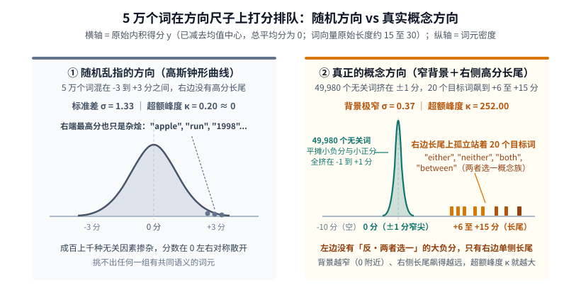
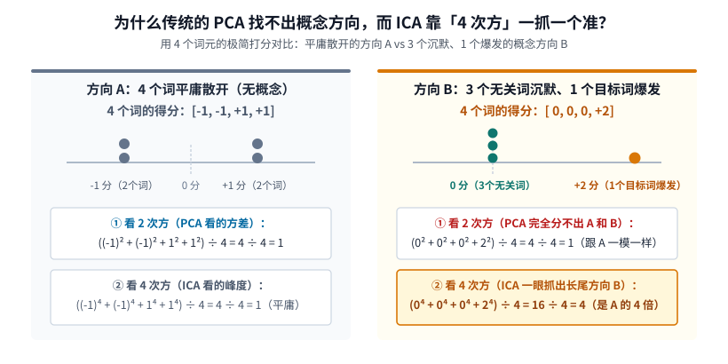
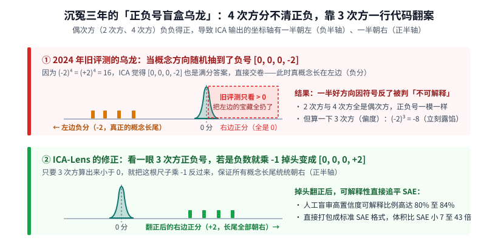

【ICA-Lens】不用训练几万维的稀疏字典，旋转一下坐标轴就能看清大模型在想什么？

━━━━━━━━━━━━━━━━━━━━

◆ 开篇：在 HuggingFace 交完 PR 之后，我们在官方仓库隔壁撞见了一个新家伙

━━━━━━━━━━━━━━━━━━━━

在前文 365 期 https://mp.weixin.qq.com/s/I1puPtcgynImhOqHlRmwDg 和 366 期里，我们在家里的两台 **DGX Spark（GB10 128GB 统一内存）** 上连夜跑了 18 个小时，给 **`Qwen3.8-27B`** 磨出了一副 **`N=100` 的双语雅可比透镜（Jacobian Lens，简称 J-lens）** ，并向可解释性社区大本营 `neuronpedia/jacobian-lens` 提交了开源合并请求（PR #6，*https://huggingface.co/neuronpedia/jacobian-lens/discussions/6* ）。

交完 PR 顺手翻看 `neuronpedia` 的官方主页时，我们突然发现他们最近除了维护 J-lens 之外，还悄悄挂出了一排名字叫 **`icalens-*`** 的新仓库（包括 `icalens-gpt2-small`、`icalens-gemma-2-2b`、`icalens-qwen3.5-9b-pt` 以及 `icalens-qwen3.6-27b`）。点开一看，底下对应着一篇非常有意思的新论文 —— **《ICA Lens: Interpreting Language Models Without Training Another Dictionary（不需要再训练字典就能解释语言模型）》** （初版题为《非高斯性揭示语言模型中的可解释方向》，`arXiv:2606.11722`）。

无论是之前的 **稀疏自编码器（Sparse Autoencoder，简称 SAE，见前文 151 期 https://mp.weixin.qq.com/s/fwig-yD4sveatnFh7mVoUA ）** ，还是这篇新冒出来的 **独立成分分析透镜（Independent Component Analysis Lens，简称 ICA-Lens）** ，它们最想解决的终极问题其实只有一个——

当大模型读到一句话（比如 `“Maya stopped at the bank to deposit a check”` 里的 `bank`）时，中间层那个 `5120` 维的残差流向量是一团成百上千个概念揉在一起的浮点数；**我们怎样才能在这 5120 维的空间里找出一根根干净的“方向尺子”，使得每一根尺子恰好只对应一个人类能看懂的概念（比如“金融机构”、“1970 年代美国历史”或者“中英文语言开关”）？**

以前全行业的标准做法是去训 **SAE** ——把 `4096` 维或 `5120` 维的向量大幅升维到 `32,768` 甚至 `65,536` 维，加上稀疏惩罚，拿几亿个词元跑几十个小时的梯度下降，训练出一张硕大无比的特征字典。

而这篇 `ICA-Lens` 论文却抛出了一句相当叛逆的话：**根本不需要升维去训什么几万维的神经网络字典，只要直接把原有的坐标轴旋转一下，几分钟就能在一层里拧出上千个跟 SAE 一样好使的可解释方向，而且每层参数体积比 SAE 小 7 至 43 倍。**

更让人好奇的是，独立成分分析（ICA）明明是几十年前信号处理课本里的老古董，而且在 2024 年的 SAE 奠基论文里曾经被拉出来跟 SAE 比过一次，当时得出的结论是“ICA 找出来的方向可解释性远不如 SAE”——怎么到了今天，它突然又能和 SAE 平起平坐、甚至在精准干预上反超了？

今天我们就顺着前文 359 期 https://mp.weixin.qq.com/s/8HNeuklsntzzh5EbgNRjdw （老靳学线代④：基与坐标变换）打下的底子，用几个最简单的数字手算一遍 **`ICA-Lens`** 的原理，顺手破案当年那桩沉冤三年的“正负号盲盒乌龙”。

━━━━━━━━━━━━━━━━━━━━

◆ 第一章：什么叫“有意义的概念方向”？先看中心极限定理留下的指纹

━━━━━━━━━━━━━━━━━━━━

如果不训练任何字典，直接去大模型的残差流空间里找方向，我们怎么知道哪根方向是“瞎指的杂音”，哪根方向是“真正有意义的人类概念”？

我们先拿论文在 `GPT-2 Small` 第 0 层上做的一个具体实验来看。`GPT-2` 的词表里一共有 **50,256 个非特殊词元** ，每个词元进入模型时都有一个 `768` 维的向量。

现在我们在 `768` 维空间里挑一根长度为 `1` 的单位方向向量 `v` 当作一把“打分尺子”，让全部 50,256 个词元的激活向量（已减去均值中心，因此在任何方向上的总平均分都为 `0` 分；注意词元向量本身保留原始长度约 `15` 至 `30`，未缩成单位长度，所以点积得分可以超过 `1`）挨个上来跟这把尺子做内积，算出每个词元的得分 `y`。

如果把 **横轴设为“考了多少分（原始投影得分 `y`）”** ，**纵轴设为“考这个分数的词元有多少个”** ，把 5 万多个词的分布画出来，两种方向会呈现出截然不同的长相——

1.**随机乱指的方向（大家混在 `-3` 到 `+3` 分之间，变成高斯钟形曲线）** ——
  如果你在空间里随便抓一根随机方向 `w_rand`，这根方向跟“金融”、“编程”、“动物”等成百上千个底层概念都沾一点边，谁也不挨着谁。
  大学概率论里的 **中心极限定理（Central Limit Theorem）** 告诉我们：把大量互不相干的因素掺杂加在一起，最终的分数分布一定会变成一条平庸、左右对称的 **高斯钟形曲线（正态分布）** 。
  如上图左侧所示，5 万个词元不高不低地散在 **`-3` 分到 `+3` 分** 之间（标准差 `σ = 1.33`），无论是左边还是右边，都没有远远甩开大部队的极端分数。哪怕你去挑这根方向上得分最高的几个词，捞出来的也是 `“apple”`、`“run”`、`“1998”` 这种毫无共同主题的大杂烩。

2.**真正代表某个概念的方向（49,980 个无关词挤在 `±1` 分窄尖里，20 个目标词在右边飙到 `+10` 分）** ——
  反过来，什么叫“这根方向代表『两者选一（either / neither / both / between）』这个概念族”？
  如上图右侧所示，5 万个词里只有 `“either”`、`“neither”`、`“both”`、`“between”` 这 **20 个真正相关的同族词元** 跟尺子方向一致，孤零零地飙到了右边 **`+6` 分到 `+15` 分** 的高分区，形成了一条贴着地面的 **右侧高分长尾** ；而剩下的 **49,980 个无关词** （`“桌子”`、`“微积分”`、`“西红柿”`）全都乌泱泱地挤在 **`-1` 分到 `+1` 分** 的极窄小针尖里（背景标准差只有 `σ = 0.37`），往左过了 `-1` 分就再也没有词了。

在统计学里，我们把这种“绝大多数无关词缩在 `0` 分窄尖里、极少数目标词在单侧飙出高分长尾”的分布叫做 **非高斯分布（Non-Gaussianity）** ，并用一个专门的指标 —— **超额峰度（Excess Kurtosis，记作 `κ`）** 来衡量 **旁边那串高分长尾相对于中间背景到底飙出去有多远** （标准高斯钟形曲线的 `κ = 0`；上图左侧随机方向的 `κ` 只有 **`0.20`** ，而右侧那根 ICA 概念方向因为背景极窄、目标词又远远甩在右端 `+6` 至 `+15` 分的长尾上，`κ` 直接飙到了 **`252.00`** ）。

────────────────────

💡 为什么左边 `-10` 分是空的？词表的离散孤岛与概念的统计捷径

看到上图右侧，你可能会好奇：**既然总平均分是 `0` 分，右边有 20 个目标词考了 `+10` 分（合起来 `+200` 分），为什么左边 `-10` 分的位置空空如也，没有一条对称的负长尾呢？**

这恰恰揭示了人类词表在高维空间里的真实长相：
- **第一，词表是离散的孤岛，不是均匀涂满球面的泥巴** ——人类造词是“现实里有什么概念才造什么词”，我们造了代表“两者/选择关系”的 20 个样本词，但从来不会为了每个概念，专门在它 `180°` 正背面造出 20 个叫“反·两者”或“反·桌子”的词。所以那根尺子的 `180°` 正背面（`-10` 分处）天然就是一片没人住的真空地带，没有词就是真没有词；
- **第二，无关的词在 `90°` 垂直的地方（考 `0` 分），不在 `180°` 相反的地方** ——跟这组词无关的其余约 5 万个词（`50,236` 个），在高维空间里全都站在跟这根尺子近乎 **`90°` 垂直** 的赤道圈上（内积在 `0` 分附近）；它们 5 万个词一起平摊那 `-200` 分，平均每个词只需要往左偏 **`-0.004` 分** （散在 `-1` 到 `+1` 分的小窄尖里，全词表标准差仅 `σ = 0.37`）就把总平均分拉回 `0` 分了。

这就引出了 `ICA-Lens` 最核心的洞察：既然 **“无关词全缩在 0 分、目标词单侧飙出高分长尾（即超额峰度 `κ` 极高）”** 是所有可解释概念方向共有的天然指纹，那我们何必费劲去训一个几万维的稀疏自编码器？只要在每一层的激活空间里，直接旋转坐标轴，把 **`κ` 最大（单侧长尾最突出）** 的那些方向找出来，不就直接把概念方向抓出来了吗？

────────────────────

那具体该怎么在 5120 维的空间里把这些方向拧出来呢？下面我们就动手算一遍。

━━━━━━━━━━━━━━━━━━━━

◆ 第二章：只算 4 个数——为什么传统的 PCA 瞎了，而 ICA 靠“4 次方”一抓一个准？

━━━━━━━━━━━━━━━━━━━━

在前文 359 期里我们讲过，所谓“基与坐标变换”，就是保持数据点本身不动，给空间旋转一副更容易读懂的坐标轴眼镜。

注意一件事：第一章拿第 0 层举例时，看的是字典里 5 万个孤立的死词表；而真正给大模型中间层（比如第 20 层、第 38 层）磨 `ICA-Lens` 时，我们收集的 **100 万个激活向量** ，不再是死词表，而是模型读了几千篇真实文章、**结合了前文句子上下文之后的 100 万个“活语境位置”** （比如同样是中文词 `“苹果”`，在“洗了两个红富士苹果”的句子里是一个向量，在“发布新款苹果手机”的句子里就已经变成另一个向量了）。

但问题是，5120 维的空间有无数种转法，算法怎么知道转到哪个角度才算是抓到了某种语境概念？为什么大家平时最熟悉的降维工具 **主成分分析（Principal Component Analysis，简称 PCA）** 找不出这些概念，而非得用 **独立成分分析（ICA）** 不可？

我们不需要看复杂的矩阵公式，直接拿 **4 个词元的极简打分** 算一笔小学生算术，你一眼就能看明白——

假设在把数据做完常规的标准化（让各个方向的平均波动幅度对齐为 `1`）之后，我们面前有两根候选方向 **A** 和 **B** ，4 个词元在这两根尺子上的得分分别是：
- **方向 A（平庸散开，没有概念）** —— **`[-1, -1, +1, +1]`** （2 个词考 `-1` 分，2 个词考 `+1` 分，稀稀拉拉平摊在两边）；
- **方向 B（3 个无关词沉默、1 个目标词爆发）** —— **`[0, 0, 0, +2]`** （前 3 个无关词老老实实考 `0` 分，第 4 个目标词突然飙到 `+2` 分，就是第一章说的“长尾概念方向”）。

现在我们分别用 **PCA 的尺子（看 2 次方）** 和 **ICA 的尺子（看 4 次方）** 去量这两个方向：

1.**先看 2 次方（平方的平均值）—— 两个方向得分一模一样，二阶尺子分不出来**
  - **方向 A 的平方平均值** —— `((-1)² + (-1)² + 1² + 1²) ÷ 4 = 4 ÷ 4 = 1`；
  - **方向 B 的平方平均值** —— `(0² + 0² + 0² + 2²) ÷ 4 = 4 ÷ 4 = 1`（注：这里是简化为 4 个数的未中心化二阶矩示意；在 5 万个词的真实空间里，因其余 5 万个无关词平摊了 `-0.004` 分，中心化后的均值就是 `0`、二阶方差严格为 `1`）。
  看到了吗？在只看 **2 次方（平方）** 的尺子眼里，平庸散开的 `[-1, -1, +1, +1]` 和精准抓出目标词的 `[0, 0, 0, +2]` 算出来全都是 **`1`** ，毫无区别。所以在做完二阶白化（把所有方向的方差都对齐为 `1`）之后，你怎么旋转坐标轴，只看 2 次方的 PCA 都完全是个瞎子，根本分不出好坏。

2.**再看 4 次方（ICA 衡量的“峰度”）—— 高下立判，一眼抓出长尾方向**
  既然 2 次方分不出，我们就把幂次升到 **4 次方** （第一章提到的超额峰度 `κ`，就是用标准化后的 4 次方均值减去高斯基准 `3`）：
  - **方向 A 的 4 次方平均值** —— `((-1)⁴ + (-1)⁴ + 1⁴ + 1⁴) ÷ 4 = 4 ÷ 4 = 1`（平平无奇）；
  - **方向 B 的 4 次方平均值** —— `(0⁴ + 0⁴ + 0⁴ + 2⁴) ÷ 4 = 16 ÷ 4 = 4`（一下暴涨到方向 A 的 **4 倍** ；要是有 `999` 个无关词考 `0` 分、1 个目标词考 `+10` 分，4 次方更是会放大一万倍）。

这就是 `ICA-Lens` 的核心直觉：**4 次方天生就是一台专门抓“平时沉默为 0、遇到目标语境突然飙高分”的放大镜。** （那为什么不上 8 次方、16 次方让差距拉得更大呢？因为一个真正的概念在 100 万词的语料里会反复出现几百次；如果幂次高到 16 次方，算法就会被 100 万词里某 `1` 个偶然考极高分的孤立错别字噪点彻底绑架，变成“单点探雷器”而不是抓几百个同族词例的概念放大镜——事实上，为了防止单个极端离群点把梯度顶爆，`icalens` 在实际旋转的 50 步固定点迭代中用了比 4 次方更平滑稳健的 `logcosh` 非高斯对比度，转完之后再用 4 次方超额峰度来给这些方向验光。）

`ICA-Lens` 不需要训练任何神经网络，它只是把某层收集到的 100 万个词元激活放进 GPU，让 `5120` 根在白化空间里互相垂直的坐标轴自动旋转 **50 步** ，专门往非高斯性最强的方向拧过去。转完之后退回原空间，直接输出一套对偶的 **“读取尺子”** （用来给每个词元打分，看含有多少该概念）和 **“写入尺子”** （用来把该概念加进残差流干预模型输出）。

━━━━━━━━━━━━━━━━━━━━

◆ 第三章：破案三年前的“正负号盲盒乌龙”——4 次方分不清正负，靠 3 次方一行代码翻案

━━━━━━━━━━━━━━━━━━━━

看到这儿，一个最大的疑问浮上来了：既然“靠 4 次方旋转坐标轴”这么简单直接，为什么在三年前的 SAE 奠基论文（Cunningham & Huben et al.，2023 年 9 月发布预印本、2024 年发表于 ICLR）里，当年的作者把 ICA 拉出来跟 SAE 做对比，测出来却说 ICA 的可解释性比 SAE 差一大截呢？

直到今年（2026 年），这篇 `ICA-Lens` 论文的作者把三年前那套开源对比代码拉下来重新复现了一遍，才替 ICA 翻了案，揪出了当年一个让人哭笑不得的 **“正负号盲盒乌龙”** ——原因居然还是出在刚才那个小学生算术上。

**一、为什么一半的好特征被冤枉成了“不可解释”？**

我们再看一眼刚才的方向 B（`[0, 0, 0, +2]`）：
因为 **2 次方和 4 次方全都是偶次方，负负得正** ——`(+2)⁴ = 16`，而 **`(-2)⁴` 也等于 `16`** 。

这意味着，当 ICA 算法在空间里旋转坐标轴时，它根本分不清这根尺子是朝左指还是朝右指。如果一根好方向在随机初始化时恰好掉了个头，把 4 个词的分数算成了 **`[0, 0, 0, -2]`** （也就是那串目标概念词长在了左边的 **负半轴 `< 0`** 上），它的 4 次方得分依然是满分，算法觉得棒极了，直接就交卷了。

结果 2024 年那篇对比实验是怎么评测 ICA 的呢？他们照搬了评测 ReLU 神经元的习惯，**不管三七二十一，一律只截取每根坐标轴右边正半轴（`> 0`）的最高分样本送去给打分器看** （如上图上半部分的红色虚线框）。
你看 `[0, 0, 0, -2]` 的右边正半轴有什么？只有一堆考 `0` 分的无关背景词，而真正考 `-2` 分的宝藏目标词全在左边负半轴，被一刀切掉了。就这么一个疏忽，导致大约一半抽到负号的好方向白白被判了“不可解释”。

────────────────────

**二、一行代码翻案：看一眼 3 次方，把负尾巴掉头翻正**

怎么知道那条高分长尾巴到底长在右边（`+2`）还是左边（`-2`）？
2 次方和 4 次方分不出正负，但 **3 次方（统计学里叫“偏度 Skewness”，记作 `γ`）是奇次方，正负号一算便知** ——
- 如果长尾在右边（`[0, 0, 0, +2]`），3 次方是 **`(+2)³ = +8 > 0`（正数）** ；
- 如果长尾在左边（`[0, 0, 0, -2]`），3 次方立刻变成 **`(-2)³ = -8 < 0`（负数）** 。

于是 `ICA-Lens` 只加了一条极其简单的修正：**算一下每根轴的 3 次方，只要发现是负数（说明长尾朝左了），就把这根尺子乘个 `-1` 掉个头变成 `[0, 0, 0, +2]`，保证所有概念长尾统统朝向正半轴。**

就靠这一行代码，ICA 在 `Pythia-70M` 和 `Qwen3.5-9B Base` 上的自动可解释性得分原地起飞，直接追平了公开的 SAE。

────────────────────

**三、一共能拧出多少根轴？每一根都能认出意义吗？**

因为 `ICA-Lens` 不做升维，只是把原有的坐标轴整体旋转一下，所以 **模型的残差流有几维，它每一层就恰好找到多少根轴** （比如 `GPT-2 Small` 每层 `768` 根，`Qwen 3.5 9B` 每层 `4096` 根，我们的 `Qwen 3.8 27B` 每层 `5120` 根），并按 4 次方超额峰度 `κ` 从大到小排好座次。

那这几千根轴是不是根根都有非高斯长尾、根根都能认出意义呢？并不是：
- 因为算法必须凑够 `d` 根互相垂直的轴，当排在前面的主力部队把明显的概念瓜分完之后，排在队伍末尾的那一小撮轴其实只剩下背景底噪（接近高斯分布）。
- 论文从全部轴里完全随机盲抽了 150 根轴做人工审计，发现整体有 **`82%`（GPT-2 Small）、`84%`（Gemma 2 2B）和 `80%`（Qwen 3.5 9B Base）** 的轴能被清清楚楚认出高置信度含义，剩下约 `16%` 至 `20%` 是凑数的杂音；
- 而且你根本不用挨个去瞎翻——论文给出了两条极好使的 **“峰度水位线”** ，即凡是末尾 **`κ < 1`** 的轴（接近高斯分布）基本认不出意义，**`κ > 1`** 开始能看出端倪，而绝大多数 ICA 轴都落在 **`κ > 10`（主力在 `10` 至 `100` 之间）** 的强非高斯区间，这一档里的轴几乎一抓一个准。

把长尾翻到正半轴、切掉左边 `0` 分附近的背景之后，这几千根尺子就能 **直接存成跟 `SAELens` 一模一样的标准权重格式** ，所有现成的 SAE 分析工具拿过来就能直接读。论文作者在一台跟我们家里同款的 **NVIDIA GB10（单台 DGX Spark）** 上实测了它的开销对比：
- **`GPT-2 Small`（第 6 层，`768` 维 ICA vs `32,768` 维 SAE）** —— 拟合 100 万词元仅耗时 **`0.92 分钟`** ，单层权重体积从 `192.25 MiB` 降到 **`4.50 MiB`（小了 `42.7 倍`）** ，编码速度快 **`56.4 倍`** ；
- **`Gemma 2 2B`（第 13 层，`2304` 维 ICA vs `16,384` 维 SAE）** —— 拟合耗时 **`5.5 分钟`** ，单层体积从 `288.20 MiB` 降到 **`40.51 MiB`（小了 `7.1 倍`）** ；
- **`Qwen 3.5 9B Base`（第 16 层，`4096` 维 ICA vs `65,536` 维 SAE）** —— 拟合耗时 **`12.2 至 13.1 分钟`** ，单层体积从 `2048.52 MiB`（`2 GiB`）降到 **`128.02 MiB`（小了 `16.0 倍`）** ，编码速度快 **`15.4 倍`** 。

━━━━━━━━━━━━━━━━━━━━

◆ 第四章：拧出来的坐标轴能干嘛？看一词多义、看词表、拨一根轴直接切语种

━━━━━━━━━━━━━━━━━━━━

不训字典拧出来的这几千根非高斯坐标轴，除了省显存、算得快之外，真拿到实战里好不好使？论文展示了三个非常漂亮的用法——

**一、给每个方向贴身份证：结合语境与词表读出**

拿出一根翻正后的 ICA 方向 `j`，一边看它在哪几句语料里得分 `y_j` 最高（看它 **什么时候亮** ），一边把它的写入方向 `d_j` 投影到词表上（看它 **想往外写什么词** ），就能直接看清它的职能。例如论文表 1 里随手拎出的三个分量：
- **`GPT-2 Small` 第 8 层 `C396`** —— 最高激活语境全是 `“Java interface that returns class”`、`“ending in .spec”`、`“not an array, but object”`，词表读出前几名是 **`JSON`、`syntax`、`tuple`** ——一眼看出这是一根专门管 **“编程 API 与数据结构规范”** 的轴；
- **`Gemma 2 2B` 第 20 层 `C1154`** —— 最高激活在 `“President Gerald Ford”`、`“The Summer of Love”`，词表读出是 **`Vietnam`、`hippie`、`seventies`** ——专门管 **“1960 至 1970 年代美国历史文化”** ；
- **`Qwen 3.5 9B Base` 第 20 层 `C352`** —— 专门在英文单词 `Both / both` 上飙高，而它的词表读出不仅有英文的 **`sides`、`sexes`** ，第 3 名直接蹦出了中文的 **`“这两种”`** ——跨语种的“成对/两者皆是”概念已经绑在同一根轴上了。

────────────────────

**二、看清一词多义是怎么随层数分家的（英文 `bank` 的“银行”与“河岸”两重意思）**

英文单词 **`bank`** 是个典型的一词多义词——既可以表示“银行”，也可以表示“河岸”。论文在同一段英文故事里先后放了 4 次 `bank`：第 1 次（F1）和第 3 次（F2）写去 **`bank`（银行）** 存支票取钱，第 2 次（R1）和第 4 次（R2）写坐在长满青草的 **`bank`（河岸）** 边看水：
- 在刚进模型的 **第 0 层（静态词嵌入层）** ，因为还没看上下文，4 个 `bank` 分解出来的前五名 ICA 成分一模一样，混着 `Bank, Mortgage（银行按揭）`、`A Room or Place（场所）` 和 `Letter B（首字母 B）`；
- 随着层数加深，仅凭该词元之前已输入的前文（如 F1 前面的 `“Maya stopped at the”` 办事语境，以及 F2 前面已出现的金融存取背景），金融语境下的 `bank` 迅速分解出 **金融、商业机构、投资** 等方向；而前面已经有 `“village by the river”` 和 `“sitting on the grassy（坐在草地上）”` 的 R1 则切换成了 **水体、户外空间、身体坐姿** 等方向——同一个词在自回归上下文里是怎么一步步分化出不同混合表征的，被这几根坐标轴刻画得明明白白。
- 甚至直接拿 `ICA-Lens` 去看 `Qwen3.5-2B` 的静态词表矩阵，也能看到 `king`（国王）和 `queen`（女王）共同拥有一根极强的 **`Royal`（皇室）** 轴，而 `queen` 额外多出一根 **`Woman, Female`（女性）** 轴——把教科书里经典的 `king - man + woman ≈ queen` 向量加减法，还原成了肉眼可见的共享零件表。

────────────────────

**三、单轴干预（Steering & Clamping）：只拨动 1 根坐标轴，让英文提问直接飙中文**

最有说服力的检验是因果干预。作者在 1,000 对中英/法英平行句对上，找出了均值分差 `|Δ(c)|` 最大的 **单根语言坐标轴** （比如 `Gemma 2 2B` 第 20 层的 `C105` 号轴，`Qwen 3.5 9B Base` 第 26 层的 `C9` 号轴）：
- **正向推一把（Additive Steering，`x' = x + α * d_j`）** —— 给 `Gemma 2 2B` 喂纯英文提示词 `“Hangzhou is a historic city known for”`，原本它老老实实续写英文 `“its beautiful scenery and rich culture.”`；现在只在最后一个词元上沿着 `C105` 的写入方向加上 `+35 * d_105`，模型当场无缝切成了中文续写：**`“其历史悠久的文化和美丽的风景。”`** （对 `Qwen 3.5 9B` 拨动 `C9` 号轴，同样把英文 `“Deep learning is a machine learning technique that”` 直接掰成了标准法语续写）；
- **把这根轴归零（Clamping）** —— 反过来喂中文提示词 `“杭州是一座历史悠久的城市，它以”`，在生成时把 `C105` 这一根坐标轴的得分强行按死为 `0`，模型居然直接改用英文接上了后半句：**`“its rich history and culture as well as its beautiful scenery.”`** 。

而且在 `SAEBench` 标准的 **目标探针微扰（Targeted Probe Perturbation，简称 TPP，测消融掉几个特征后能不能精准抹除目标概念而不误伤其他概念）** 测试中，`ICA-Lens` 在全部三个模型上的选择性打击得分一致压过了公开的 SAE。

────────────────────

💡 三副“读心眼镜”怎么选？

读完这篇论文，再回头看我们手里的工具箱，大模型可解释性的三件套分工就彻底清晰了：
- **J-lens（雅可比透镜，前文 365、366 期）** —— **纵向往后看词表** ，算每层对最终输出层的 `5120 × 5120` 偏导数斜率表，专门看当前残差流正在把哪几座“球皮输出词城市”往第 1 名顶；
- **ICA-Lens（独立成分分析透镜，本期）** —— **横向在当前层解混** ，不训神经网络，几分钟一层直接靠四阶非高斯长尾拧出 `5120` 根互相独立的语义/语法坐标轴，体积小、速度快，最适合当探路的 **“第一副透镜（First Lens）”** ；
- **SAE（稀疏自编码器，前文 151 期）** —— **重装超完备大字典** ，当 `5120` 个紧凑方向不够细分、需要分出几万个极细粒度特征且算力充裕时，再上 SAE 重锤。

巧的是，论文作者跑实验用的机器刚好也是单台 **DGX Spark（GB10）** ，而目前 `neuronpedia` 上只有 `Qwen3.6-27B` 的 ICA-Lens，还没有 **`Qwen3.8-27B`** 的版本；而且论文在给 ICA 写入方向 `d_j` 做词表读出时，用的是 `Logit Lens` 和 `R-Lens`——正好我们已经磨好了 `Qwen3.8-27B` `N=100` 双语 J-lens，完全可以把 J-lens 作为第三种读出方式叠上去一起玩。

────────────────────

最后，我们把整套 `ICA-Lens` 的数学步骤与核心结论汇总成一张速查表。

━━━━━━━━━━━━━━━━━━━━

◆ 速查表

━━━━━━━━━━━━━━━━━━━━

| 核心概念 / 问题 | 机制解释与论文实测读数 |
|---|---|
| 为什么概念方向一定“非高斯” | **中心极限定理** 决定随机混合方向呈对称高斯钟形分布（`GPT-2` L0 随机方向 `κ = 0.20`）；而真实概念方向平时 99% 无关词挤在 `±1` 分窄尖里、仅在目标词上单侧飙出长尾（ICA 概念轴背景 `σ = 0.37`，超额峰度 `κ = 252.00`） |
| 为什么 PCA 瞎了而 ICA 能抓出来 | 平摊的 `[-1, -1, +1, +1]` 与突刺的 `[0, 0, 0, +2]` 算 **2 次方（方差）** 均值同为 `1`，只看平方的 PCA 完全分不出；升到 **4 次方（峰度）** 后，`[0, 0, 0, +2]` 的 4 次方均值暴涨为 `4`（是前者的 4 倍），ICA 在 GPU 上旋转 50 步即可拧出读取与写入尺子 |
| 2024 年 SAE 论文为何误判 ICA | 2 次方与 4 次方全是偶次方，负负得正（`(+2)⁴ = (-2)⁴ = 16`），导致 ICA 输出有一半方向长尾朝左（`[0, 0, 0, -2]`）；旧评测只看 `> 0` 正半轴把左边的宝藏全漏了 |
| 一行代码翻案与体积优势 | 算一下 **3 次方（偏度）** —— `(-2)³ = -8 < 0`，一旦为负就乘 `-1` 掉头翻回正半轴，可解释性直接追平 SAE（人工高置信标签达 `80%–84%`）；直接存成标准 `SAELens` 格式后，在单台 GB10 上 `Qwen3.5-9B` 单层拟合仅 `12–13 分钟`，体积比 64k SAE 小 **`16.0 倍`** ，编码快 **`15.4 倍`** |
| 单根 ICA 坐标轴能干什么 | ① 剖析一词多义（`bank` 在不同上下文中随层数分化为金融轴与河岸轴）与静态词表（`king/queen` 共享 `Royal` 轴、靠 `Woman` 轴区分）；② 生成干预（拨动 `Gemma 2 2B` L20 `C105` 单轴即可让英文提示词直接续写中文，或按零中文提示词改续写英文） |

━━━━━━━━━━━━━━━━━━━━

◆ 参考资料

━━━━━━━━━━━━━━━━━━━━

- Si-Da Liu, Feijiang Han et al., ICA Lens: Interpreting Language Models Without Training Another Dictionary / Non-Gaussianity Reveals Interpretable Directions in Language Models, arXiv:2606.11722（2026；提出基于非高斯性与偏度翻正的 GPU FastICA 透镜工作流 `icalens`）
- Hoagy Cunningham, Aidan Ewart, Logan Riggs, Robert Huben, Lee Sharkey, Sparse Autoencoders Find Highly Interpretable Features in Language Models, ICLR 2024, arXiv:2309.08600（早期将任意符号 ICA 与 SAE 进行可解释性对比的基线论文）
- Aapo Hyvärinen, Fast and Robust Fixed-Point Algorithms for Independent Component Analysis, IEEE Transactions on Neural Networks, 1999（经典对称 FastICA 与 `logcosh` 非高斯对比度固定点算法）
- Neuronpedia & Si-Da Liu, icalens Open-Source Package & SAELens Checkpoints（PyPI `icalens 0.4.0` 与 HuggingFace `neuronpedia/icalens-qwen3.6-27b`，2026）

━━━━━━━━━━━━━━━━━━━━

**根据中心极限定理，把成百上千个互不相干的概念掺杂在一起，投出来的必定是平庸对称的高斯钟形曲线；反过来，凡是平时沉默在零点附近、只在特定语境下突然拉出一条非高斯长尾的方向，十有八九藏着一个纯粹的概念。**

**把残差流椭球拍成所有方向方差全等于 1 的正圆球之后，只看平方的 PCA 就彻底成了瞎子；只有升到四次方去看超额峰度，才能在圆球表面摸出那些平时按兵不动、一遇目标词就骤然刺出来的概念方向。**

**独立成分分析并不是找不出好特征，而是它算出来的坐标轴正负号像抽签一样随机——当年人们只盯着正半轴看，才把刚好朝向负半轴的那一半宝藏当成了杂音；一行三阶偏度把尾巴翻正，老算法当场洗刷了三年的冤屈。**

━━━━━━━━━━━━━━━━━━━━

// 靳岩岩的 AI 学习笔记 × Gemini 的浪漫 × GPT 的严谨
// 2026年11月12日

为什么找大模型概念方向非得训几万维的 SAE？剖析 ICA-Lens（arXiv:2606.11722）：用中心极限定理与四阶超额峰度在白化圆球上旋转坐标轴，靠三阶偏度翻正洗刷三年前“正负号盲盒乌龙”，几分钟一层省下 16 倍显存。
