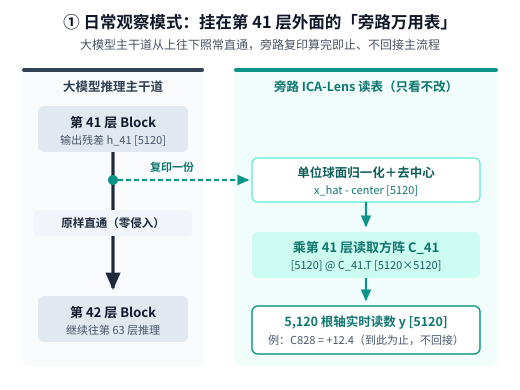
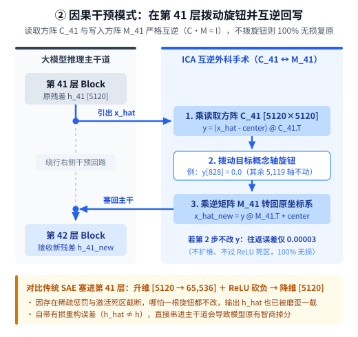
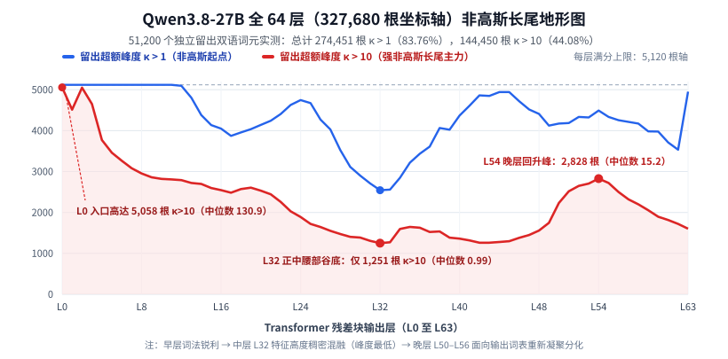
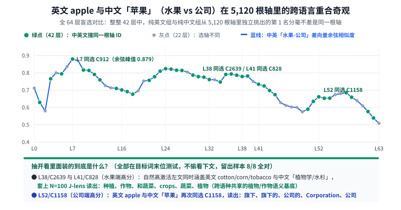
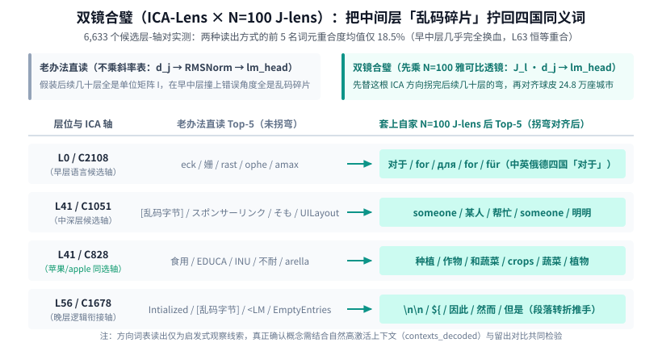

【ICA-Lens 实测】双机 133 分钟跑通 Qwen3.8-27B 全 64 层，中英“苹果”盲选撞上同一根轴

━━━━━━━━━━━━━━━━━━━━

◆ 开篇：理论算得再漂亮，不如拉上双机把 32.7 万根坐标轴全磨出来验验成色

━━━━━━━━━━━━━━━━━━━━

在前文 367 期里，我们用手算理清了可解释性社区的新宠 **独立成分分析透镜（Independent Component Analysis Lens，简称 ICA-Lens）** ——不用像 **稀疏自编码器（Sparse Autoencoder，简称 SAE，见前文 151 期 https://mp.weixin.qq.com/s/fwig-yD4sveatnFh7mVoUA ）** 那样升维去训几万维的大字典，只在每一层把原有的坐标轴旋转 50 步，靠 **4 次方超额峰度（Excess Kurtosis，记作 `κ`）** 抓出单侧非高斯长尾，再用 **3 次方偏度（Skewness）** 把朝左的负尾巴掉头翻正，就能拧出一整套互相独立的候选概念尺子。

在 367 期的末尾，我们看着手里的家当留了一个念想：
- 一方面，目前社区里只有 `2B / 9B` 规模的原生 `ICA-Lens` 和老款 `Qwen3.6-27B` 的转制包，还没有最新旗舰 **`Qwen3.8-27B`（64 层，残差流维度 `5,120`，48 层线性注意力 ＋ 16 层全注意力）** 的版本；
- 另一方面，我们在前文 365 期 https://mp.weixin.qq.com/s/I1puPtcgynImhOqHlRmwDg 和 366 期 https://mp.weixin.qq.com/s/i5GoJq5R7g4aMYofZRDqxg 里，刚刚花 18 个小时给同一台 **`Qwen3.8-27B`** 磨好并开源了一副 **`N=100` 的中英双语雅可比透镜（Jacobian Lens，简称 J-lens，*https://huggingface.co/lmxxf/Qwen3.8-27B-jacobian-lens* ）** 。

如果我们在家里的两台 **DGX Spark（GB10 128GB 统一内存）** 上，把 `Qwen3.8-27B` 全部 **64 层 × 5,120 维 = 327,680 根坐标轴** 实打实地拧出来，再把刚磨好的 `N=100 J-lens` 叠上去一起验光，会看到什么？
- 英文的 `“apple”`（水果 vs 科技公司）和中文的 `“苹果”`（水果 vs 科技公司）明明连一个字母都不挨着，它们在 5,120 根无监督旋转出来的坐标轴里，是各走各的独木桥，还是会撞上同一根轴？
- 原论文在 `2B` 和 `9B` 模型上展示过“只拨动 1 根语言轴，就能让英文提问直接飙中文”的酷炫绝活，放到 `27B` 规模的指令模型上还能一招鲜吗？

昨晚我们让两台 DGX Spark 分工接力，只用了 **133 分钟（约 2.2 小时）** 就跑完了全部 64 层拟合与 710 个产物文件的哈希对账。今天就把这份热乎的实测报告端上桌——既有让人拍案叫绝的跨语种同轴奇观与双镜合璧，也有老老实实摆出来的翻车反例。

━━━━━━━━━━━━━━━━━━━━

◆ 第一章：133 分钟拧出 32.7 万根轴——全模型呈现出一座清晰的“双峰沙漏”

━━━━━━━━━━━━━━━━━━━━

先交代一下双机车间是怎么在 128GB 统一内存里把这 64 层稳稳跑下来的。

我们严格按 **1:1 中英词元配平** 准备了两份完全按文档隔离的双语维基语料：拟合集 **200,704 个词元** （中英文各半），外加一份模型和 ICA 拟合全程没见过的独立留出检验集 **51,200 个词元** 。两台 DGX Spark 各领 32 层任务，先把 `Qwen3.8-27B-FP8` 按 `128 × 128` 块流式还原为 `BF16` 抽完当前层激活并彻底释放模型进程，再单独拉起 `icalens 0.4.0`（对称 `FastICA`、`logcosh` 对比度、固定 50 步迭代、行向量先做单位长度归一化，协方差用 `FP64` 双精度累加防漂移），全程挂着 `20 GiB` 可用内存看门狗护栏。

相比训一套 64 层 6.5 万维 SAE 动辄要烧掉几百个 GPU 小时、攒下上百 GB 字典，双机跑完全部 64 层 `ICA-Lens` 从头到尾只花了 **132.9 分钟** ，每层导出的有符号精确透镜各占 **`200.04 MiB`** （整套 64 层原生权重约 `12.5 GiB`，我们已同步开源至 HuggingFace *https://huggingface.co/lmxxf/Qwen3.8-27B-ica-lens* ，支持按需单层下载，并已向 `ICALens` 官方仓库提交社区收录 Issue #4： *https://github.com/liusida/ica-lens-paper/issues/4* ）。

────────────────────

**动手用之前先摆清连接图：ICA-Lens 到底接在模型哪儿？需要插进主干道吗？**

很多朋友习惯了看 SAE“先升维到几万维、过一道激活函数、再降维塞回主干”的示意图，第一次用 `ICA-Lens` 容易犯迷糊：这每层 `200 MiB` 的权重到底装在哪儿？我们拿模型中间的**第 41 层**举例，把“只看不改”和“动手干预”两种接法分开画出来就清楚了——

1.**日常观察（旁路读表，零侵入）** ——平时用它看模型在想什么时，它根本不碰大模型的主流程，纯粹是挂在第 41 层残差流电线外面的一个**旁路万用表**——大模型照常从第 41 层往第 42 层直通推理；路过时把残差向量复印一份缩到单位球面上（记作 `x_hat`，形状 `[5120]`），减去中心 `center` 后直接乘上第 41 层的**读取方阵 `C_41`**（形状 `[5120, 5120]`），算出来的 `5,120` 个数就是每根独立轴的实时读数，算完即止、不回接主干：



```python
# 只看不改：复印残差流到旁路乘读取矩阵 C_41
# x_hat: [5120], C_41: [5120, 5120] -> y: [5120]
y = (x_hat - center) @ C_41.T
```

2.**因果干预（互逆回写，零重构损耗）** ——只有当你想在第 41 层做“外科手术”拨动某根概念轴（比如把第 828 号轴清零或加 5）时，才需要用到文件里存的第二张互逆方阵——**写入矩阵 `M_41`**（`C_41` 的严格逆矩阵，`C_41 @ M_41 = I`），把改完的读数转回原坐标系塞回第 42 层入口：



```python
# 动手干预：拨动单根旋钮后，乘逆矩阵 M_41 转回原坐标系
y[828] = 0.0
# y: [5120], M_41: [5120, 5120] -> x_hat_new: [5120]
x_hat_new = y @ M_41.T + center
```

这里也顺带露出了 `ICA-Lens` 比 SAE 干净得多的第二个工程优势：**SAE 升维再过 `ReLU` 砍掉负数是有损的**——哪怕你一根旋钮都不改，进一趟 SAE 出来塞回主干，残差向量就已经被磨歪了一截（自带重构误差，模型智商会掉）；而 `ICA-Lens` 不扩维、不过死区，`C` 和 `M` 严格互逆——只要不改读数，转出去再转回来就是 `100%` 原样复原（实测 `FP32` 往返最大误差仅 `0.00005`）。

────────────────────

拿到全部 **`327,680` 个“层-坐标轴”对** 之后，我们没有看拟合集自吹自擂，而是直接拿那 **51,200 个独立留出词元** 给每一根轴重新算了一遍 4 次方超额峰度 `κ`，画出了整台模型的跨层非高斯地形图——



看上图里的两条实测曲线，整台 `Qwen3.8-27B` 的 327,680 根坐标轴呈现出三个非常醒目的特征：

1.**超八成坐标轴跨过非高斯门槛，不仅有高层人类概念，还藏着海量底层语法螺丝钉** ——
  在全部 `327,680` 根轴里，留出集上跨过非高斯门槛 **`κ > 1`** 的一共有 **`274,451` 根（占 `83.76%`）** ；跨过强长尾门槛 **`κ > 10`** 的高达 **`144,450` 根（占 `44.08%`，全模型中位数 `κ = 6.20`，前 1% 轴超过 `815.97`）** 。
  人工抽检时我们发现，这些高 `κ` 轴除了后面要讲的“植物/企业”等高层人类概念外，还有很大一部分专门盯着标点、单字搭配或分词位置突刺——比如第 16 层的 `C246` 专门盯着左方括号 `[` 亮（`κ = 1,176`），第 63 层的 `C10` 盯着单字 `“不”` 亮（`κ = 1,360`），`C522` 盯着窗口开头的孤立首字母 `A` 亮（`κ = 1,763`）。因此不能拿 `14.4 万` 直接冒充“14 万个高层抽象概念”；但这绝不意味着那些标点与单字位置轴是没用的噪声——待会儿到第三章套上双镜一看，你会发现跨过非高斯门槛的轴几乎根根都有精准无比的职责。

2.**从第 0 层到第 63 层，走出了一条漂亮的“双峰沙漏（U 型深谷＋晚层回升）”** ——
  顺着横轴从左往右看：
  - **早层入口（`L0–L11`）** ——刚进模型时，词元还带着鲜明的字面孤岛烙印，`5,120` 根轴全部 `100%` 满足 `κ > 1`，`L0` 更是有 **`5,058` 根轴** 跨过 `κ > 10`（层内中位数高达 **`130.87`** ）；
  - **正中腰部深谷（`L32–L33`）** ——随着注意力不断把上下文揉进残差流，特征越来越稠密地混融在一起，强长尾轴数量一路下滑，在正中间的 **第 32 层（`L32`）跌到全模型最低谷** ，`κ > 10` 的轴只剩 **`1,251` 根** ，整层 5,120 根轴的峰度中位数跌到了 **`0.99`** ；
  - **晚层重聚高峰（`L50–L56`）** ——过了第 48 层之后，模型开始为最终预测下一个词做准备，原本混在一起的稠密表征重新分化凝聚成鲜明的输出特征，强长尾轴数量在 **第 54 层（`L54`）显著回升到 `2,828` 根** （中位数重回 **`15.24`** ），随后在最后几层完成收束。

3.**这套固定坐标轴下的“非高斯区域”，其实才是真正站得住脚的“J-space”** ——
  回头想想前文 245 期 https://mp.weixin.qq.com/s/PleyNOp7zvV3x-j3DVqq9Q 和 366 期里 Anthropic 宣传的那个“只占 10% 方差的 J-space（可言语化全局工作空间）”，为什么细抠算法会觉得它在偷换概念？因为原版 J-space 根本没有一块固定不变的坐标轴——它是每换一句话进来，就现场去 24.8 万个词表里临时挑 20 来个最顺着当前向量的不同方向去拼凑投影，尺子每次都在跟着输入变，固定凑出约 10% 只是稀疏拟合的算术结果；
  反观今天 `ICA-Lens` 在每一层拧出来的 `5,120` 根坐标轴，**尺子是一次性固定死的** 。在这套不偷换尺子的真坐标系里，跨过非高斯门槛的重尾轴装的是离散可解释的词汇与语法，掉在 `κ ≈ 0` 钟形曲线里的高斯轴则是上下文揉成一团的连续暗箱计算——而且它根本不是什么恒定的 10%，而是实打实从 `L0` 的 **`98.8%`** 一路潜入 `L32` 腰部深水区的 **`24.4%`** ，再到 `L54` 重新浮出水面结晶回 **`55.2%`** 。

这条“早层锐利 → 腰部混融 → 晚层重聚”的曲线，跟我们在前文 363 期 https://mp.weixin.qq.com/s/X6QCkvz3WdQujhLfWEREXg 测过的残差流球面曲率以及前文 365 期测过的雅可比斜率平台，在物理层位上严丝合缝地咬合在了一起。

━━━━━━━━━━━━━━━━━━━━

◆ 第二章：中英“苹果”盲选奇观——5,120 根轴里，42 层分毫不差撞上同一根轴

━━━━━━━━━━━━━━━━━━━━

摸清了全局地形，接下来看最好玩的重头戏：**一词多义与中英文跨语种概念对齐。**

在 367 期里我们看到，原论文只测了纯英文里的 `bank`（银行 vs 河岸）。这一次既然我们喂的是 1:1 中英双语语料，我们就设计了一套更苛刻的三组对照探针（共 72 条句子，全部把目标词放在句子 **最末尾** ——因为自回归模型没有未来视野，目标词位置只看得到前面的左文，绝不会偷看后半句来作弊；每组词义用 8 条句子选轴并标定阈值，用另外 4 条完全没见过的留出句检验）：
1.**英文 `bank`** ——金融银行（如讨论储蓄账户与利率的文章提到 `bank`） vs 自然河岸（如讨论河道水流与泥泞岸边的文章提到 `bank`）；
2.**英文小写 `apple`** ——水果（果园与成熟果实提到 `apple`） vs 科技公司（`iPhone` 设计与手机销量提到 `apple`，故意统一写成小写 `apple`，不让模型靠首字母大写偷懒）；
3.**中文 `苹果`** ——水果（果园与甜果汁提到 `苹果`） vs 科技公司（无线耳机与手机销量提到 `苹果`）。

按常理猜：英文 `apple` 是拉丁字母词元，中文 `苹果` 是方块汉字词元，我们在每一层的 `5,120` 根无监督 ICA 坐标轴里，先只拿纯英文句子挑出一根最能区分“水果 apple vs 公司 apple”的第 1 名坐标轴，再只拿纯中文句子独立挑出一根最能区分“水果苹果 vs 公司苹果”的第 1 名坐标轴——在五千多根轴里大海捞针，两边各自挑出来的第 1 名怎么可能撞到一起去？

结果跑完 64 层数据一看，我们直接看呆了——



看上图里的绿色圆点与蓝色余弦曲线：
- **单轴消歧准确率拉满** ——仅凭选出来的 **1 根** ICA 坐标轴画一条分界线，英文 `bank` 在 64 层里有 **44 层** 拿到留出集 `8/8` 全对，英文 `apple` 有 **55 层** 拿到 `8/8` 全对，中文 `苹果` 更是有 **56 层** 拿到 `8/8` 全对；
- **64 层里有整整 42 层，中英文盲选在 5,120 根轴里挑中了完全同一根坐标轴** ——从早中层的第 7 层（英文组挑出 **`C912`** ，中文组也挑出 **`C912`** ，两国语言的“水果减公司”差向量余弦相似度冲到全模型最高峰 **`0.879`** ），一路贯穿到中深层的第 23 至 39 层、第 41 至 44 层，再到晚层的第 50 至 54 层、第 57 至 58 层，两边在互不通气的情况下，从 5,120 根轴里指认出了**同一个门牌号** 。

我们把其中几个撞车的同号坐标轴拎出来细看，看看它们在自然维基语料里平时到底对什么亮、往词表里写什么词：
- **第 38 层的 `C2639` 与第 41 层的 `C828`（水果端得高分，留出均 `8/8` 全对）** ——去翻这两根轴在 20 万自然维基语料里的最高激活段落，排在前列的既有纯英文的农作物语境（`cotton, corn, tobacco...`），也有纯中文的植物学语境（`植物学`、`水杉`、`主食`）；套上我们的 `J-lens` 往词表读出，蹦出来的全都是中英双语的 **`种植`、`作物`、`和蔬菜`、`crops`、`蔬菜`、`植物`** ；
- **第 52 层的 `C1158`（科技公司端得高分，留出均 `8/8` 全对）** ——英文 `apple` 与中文 `苹果` 再次同时选中 `C1158`，往词表读出排在前列的是中英混排的企业归属词：**`旗下`、`旗下的`、`公司的`、`Corporation`、`公司`、`出品的`** 。

（这里同样把边界说透：`C2639` 和 `C828` 并不是一根只认识“红富士苹果”的专属窄轴，而是中英文共享的“植物/农作物”广义语义轴，模型正是借着这根广义植物轴把“水果苹果”和“电子公司”干净利落地分开了；而且第 38 层与第 41 层这两根轴很可能是同一个跨层延续特征在相邻层的投影，不能重复算成两个独立新概念。）

即便带着这份审慎，42 个层在 5,120 根无监督坐标轴里盲选撞号，依然直观地印证了一件事：**在大模型的中深层残差流里，ICA 拧出来的方向早已褪掉了中文或英文的表层文字外壳，直接对齐到了跨语言共享的语义底座上。**

━━━━━━━━━━━━━━━━━━━━

◆ 第三章：双镜合璧（ICA-Lens × J-lens）——为什么老办法读出乱码，套上 J-lens 秒变四国同义词？

━━━━━━━━━━━━━━━━━━━━

拿到一根 ICA 坐标轴的写入方向向量 `d_j` 之后，怎么知道这根方向想让模型输出什么词？

最朴素的老办法（`Logit Lens`），是假装后面几十层神经网络什么都没干（当成单位矩阵 `I`），直接把第 `l` 层的方向 `d_j` 送进模型最末尾的归一化层（`Final RMSNorm`）和语言头（`lm_head`）给 24.8 万个词元打分。

但我们在前文 365 期里刚刚亲手算过：`Qwen3.8-27B` 早中层的雅可比斜率表里，近 `90%` 的能量全在非对角线的“跨维串门与球面拐弯”上——不替它把后面几十层的弯拐完就直接塞进语言头，无异于刻舟求剑。

翻看 `icalens 0.4.0` 的源码，原作者显然也遇到了同一个痛点，在代码里专门预留了接入雅可比类透镜（源码里接入的是基于半线性传播的改进变体 `R-Lens`，底层读取的同样是层间映射字典 `J`）的接口，只是官方目前只给英文小模型算过 25 段样本的轻量版，还没有做 `Qwen3.8-27B` 和中英双语版。于是我们正好把前天花 18 小时磨好的 **`Qwen3.8-27B` `N=100` 双语 J-lens** 装上去，给全模型选出的 **6,633 个候选“层-轴”对** 做了一次“双镜合璧”对比：左边用老办法直读，右边先乘上该层的雅可比矩阵 `J_l` 替它拐完剩下的弯，再送进 `Final RMSNorm` 和 `lm_head`（注：在最后一层 `L63` 处 `J_63` 是恒等映射，两边结果理应 `100%` 重合，我们的验收脚本已核验分毫不差）。

一算重合度：**全部 6,633 个层-轴对里，老办法与 `J-lens` 读出的前 5 名词元集合平均重合度只有 `18.5%`（在早层 `L0` 更是只有 `0.19%`，几乎彻底换血）。** 具体换成了什么？挑四根代表轴摆出来一看便知——



看上图里的四组真刀真枪对比：
1.**`L0 / C2108`（第 0 层中英语言对比选出的轴）** ——
  用老办法直读，前五名蹦出来的是 **`eck / 姗 / rast / ophe / amax`** ，完全是一堆不知所云的英文词根与生僻汉字碎片；
  而一旦先乘上第 0 层的 `J_0` 雅可比透镜，前五名瞬间整整齐齐地变成了 **`对于 / for / для / for / für`** ——中文、英文、俄文、德文四种语言里的同一个介词 **“对于”** 全聚齐了。
2.**`L41 / C1051`（第 41 层候选轴）** ——
  老办法直读出来是破碎的 UTF-8 乱码字节配日文广告词 **`スポンサーリンク（赞助商链接） / そも / UILayout`** ；套上 `J_41` 之后，当场显影为清晰的中英双语人称指代：**`someone / 某人 / 帮忙 / someone / 明明`** 。
3.**`L41 / C828`（刚才第二章里中英“苹果”同选的那根水果轴）** ——
  老办法直读混着 **`食用 / EDUCA / INU / 不耐 / arella`** ；套上 `J_41` 后，英文碎片全部褪去，变成清一色的 **`种植 / 作物 / 和蔬菜 / crops / 蔬菜 / 植物`** （第 41 层识别英文 `bank` 河岸的 `C2673` 轴同样从含乱码与 `第一财经` 的杂音，经 `J_41` 显影为整齐的 **`海岸 / coastal / 沿海 / 海边 / coastline / 海滩`** ）。
4.**`L56 / C1678`（第 56 层晚层候选轴）** ——
  老办法直读是代码残片 **`Intialized / <LM / EmptyEntries`** ；套上 `J_56` 后变成了双换行符与中文逻辑转折词：**`\n\n`、`因此 / 然而 / 但是`** 。

────────────────────

💡 回头用双镜验那三根“怪轴”：只要跨过非高斯门槛，哪怕不是高层概念，根根都在干实事

还记得第一章抽检时碰到的那三根盯着标点、单字和首字母飙出上千峰度的“怪轴”吗？把它们塞进 `ICA-Lens × J-lens` 里一照，原本看着像废料的读数当场全对上了——
- **第 16 层 `C246`（左方括号 `[` 轴，`κ = 1,176`）** ——老办法直读出来是莫名其妙的 **`ium / cześ / стил / 天成`** ；套上 `J_16` 后，前十名瞬间变成清一色的 **`[ / [... / ] / [. / ［ / …`** ——它就是一根专门管全半角方括号配对与引文省略的语法标点轴；
- **第 63 层 `C10`（单字 `“不”` 轴，`κ = 1,360`）** ——它在出口读出来的前八名是 **`確定 / 願 / 平等 / 约而同 / 完全是 / 利的 / 具 / 寻常`** ；乍看东一榔头西一棒子，可只要在前面补上触发它的那个 **`“不”`** 字，瞬间连成一串常用搭配：**`不确定 / 不愿 / 不平等 / 不约而同 / 不完全是 / 不寻常`** ；
- **第 63 层 `C522`（窗口首字母 `A` 轴，`κ = 1,763`）** ——这根西文轴跟上面的汉字 `“不”` 异曲同工：它读出来的前十几名全是不带首字母的奇怪半截词根 **`gor / vec / ujourd / yer / unque / compan / ção / eroporto / gricult`** ；可只要把前面那个孤零零的大写首字母 **`A`** 拼到它们脑门上，当场秒变成各国常用词：**`Agora`、`Avec`（法语“和”）、`Aujourd'hui`（法语“今天”）、`Ayer`（西语“昨天”）、`Accompany`、`Aeroporto`（意/葡语“机场”）、`Agriculture`（英语“农业”）** 。原来当分词器把句首大写 `A` 单独切成一个词元时，这根轴是个专职的“拼词胶水工”，提醒输出头赶紧把所有能跟在 `A` 后面的下半截词根顶上来。

可见只要跨过了非高斯长尾门槛，拧出来的方向基本没有白转的废轴——大模型要正常说话，既需要“植物/公司”这种高层语义轴，同样离不开这些严丝合缝咬合在一起的底层语法螺丝钉。

────────────────────

💡 顺着论文提交日期扒出的因果链：为什么 ICA 遇上 J-lens 之后才真正“开眼”，又比单用 J-lens 强在哪儿？

顺着代码里的 `R-Lens` 接口，我们特意去翻了一下 `ICA-Lens` 这篇论文在 arXiv 上的两次提交记录，结果扒出了一条严丝合缝的时间线——
1.**没有 J-lens 之前，早中层的 ICA 在输出端其实是“半瞎”的** ——`ICA-Lens` 的 `v1` 初版提交于 **2026 年 6 月 10 日** ，那时候 `J-lens` 还没问世，搜遍 `v1` 全文，雅可比类透镜与三阶偏度翻正的出现次数全都是 **`0 次`** 。当时作者在早中层只能拿老 `Logit Lens` 直接读，读出来的词表自然一塌糊涂（只能靠往回翻哪些输入句子点亮了这根轴来盲猜含义）；直到 **7 月 6 日** `J-lens` 发表、紧接着改进早层读数的 `R-Lens` 问世，作者在 **8 月 20 日** 把它接进 `icalens 0.3.4`，中间层的乱码一下子全显影成了人话，这才有了 **10 月 19 日** 篇幅翻了三倍、补齐偏度翻正与 `9B` 实测的 `v2` 完全体。
2.**反过来，叠上 ICA 也治好了单用 J-lens“只听见大嗓门、看不见暗线”的短板** ——如果只用前两期的 `J-lens` 直接去照某一层的残差向量 `h`，因为 `h` 是模型此刻所有念头叠在一起的**总合力**，排在前五名的往往全被当前嗓门最大的那件事（比如“准备敲个空格或换行符”）给霸榜盖住了，底下同时在想的另外四五条暗线根本挤不进前排；而现在先用 `ICA-Lens` 把总合力**横向分家**成几十根各自独立的分力（相当于给交响乐团每件乐器单独别上一支麦克风），再拿 `J-lens` 一根一根**纵向翻译**成输出词表——哪怕某个念头此刻音量只有五分之一，也不会再被大嗓门的标点符号淹没。

不用烧几百卡时训几万维有损字典，不把好端端的词表剁成碎渣，两张 `5,120 × 5,120` 的方阵一横一纵拼在一起，在理解模型每层并行想什么这件事上，确实把传统的 SAE 远远甩在了身后。

────────────────────

光说“能分出被大嗓门淹没的暗线”还不够过瘾，我们当场拿前两期留下的两个熟面孔做了真刀真枪的验证——
- **破案 366 期里敲了空格就“失踪”的中间结果 `6`** ——在前文 366 期里，紧凑算式 `2*3+2=` 能在第 55 至 56 层看到乘法中间结果 `'6'`，可一旦敲上空格写成 **`2 * 3 + 2 =`** ，单用 `J-lens` 照整团残差向量时，前十名瞬间被 `"\n\n"`、`" ?"`、`"<|im_end|>"` 等换行问号霸榜，`'6'` 在第 55、56、57 层分别掉到了第 **18、11、43 名** 。这次我们用 `ICA-Lens` 把这三个层的残差向量横向分开前十强独立轴，再逐根套上 `J-lens` 读词表——失踪的 `'6'` 当场现形：第 55 层排第 3 强的 **`C1577` 轴（`y = 10.23`）** ，读出前八名清一色是 **`6 / six / 六 / sixth / 六个`** （**`'6'` 稳居第 1 名** ）；第 56 层的第 1 强轴 **`C1784`** 与第 57 层的第 4 强轴 **`C3359`** ，同样把 `'6'` 顶在第 1 名（注：到了这么晚的层位，单轴分开后即便不乘 `J-lens` 也能在榜首看到 `'6'`，说明之前看不见纯粹是因为被整团合力里的大嗓门标点盖住了）。
- **多跳推理里的“国家与货币”同层双声道同框** ——再去照前两期的中文多跳题 `“常识：形状像一只靴子的欧洲国家使用的法定货币是”` 末尾的 `“是”` 字：在第 53 层（此时整团 `J-lens` 前十名还全是换行和问号）以及第 58、59 层的前十强独立轴里，一边有一根轴（`L53/C859`、`L58/C1285`、`L59/C2881`）把 **`意大利 / Italian / Italy`** 顶在第 1 名，同一层另一根并列前十强的独立轴（`L53/C3604`、`L58/C2713`、`L59/C4471`）已经在同步激活 **`英镑 / 汇率 / 美元 / 欧元`** 这簇主流货币通道了（实话实说：它是一根混着英镑、美元和欧元的泛货币换算轴，还不能叫“纯欧元专属轴”）。

这两副刚在家里双机上磨出来的透镜一横一纵 —— **`ICA-Lens` 负责在当前层横向拧开混在一起的坐标轴，`J-lens` 负责纵向替这根坐标轴走完通往输出球皮的弯路** —— 终于在 `Qwen3.8-27B` 上严丝合缝地拼成了一套完整的显微镜。

━━━━━━━━━━━━━━━━━━━━

◆ 第四章：诚实的反例——为什么在 2B/9B 上一拨就切语种的“单轴开关”，在 27B 上掰不动了？

━━━━━━━━━━━━━━━━━━━━

讲完了漂亮的结果，最后一章我们专门来记一笔 **没有成功复现原论文奇观的反例** 。

在 367 期第四章里我们介绍过，`ICA-Lens` 原论文在 `Gemma 2 2B` 和 `Qwen 3.5 9B Base` 上展示了一个极抓眼球的实验：用中英平行句对挑出分差 `|Δ|` 最大的 **1 根语言轴** ，生成时只要沿着这 1 根轴推一把或者按死为 `0`，就能让英文提问当场改用中文续写，或者让中文提问改用英文回答。

我们在 `Qwen3.8-27B` 上严格照着做了一遍：
- 先用 48 组中英平行句对（句尾统一加同一个换行符，排除中英文句号不同的干扰），在全部 64 层各自选出了中英分差最大的那 1 根“语言候选轴”；放到另外 16 组留出平行句对上检验，**`64/64` 层全部 100% 保持同号显著分差** （比如 `L2/C1383` 留出分差高达 `+18.12`，`L53/C48` 达 `+14.60`，`L62/C872` 达 `-15.24`），说明作为“探针读取器”，这根轴确实能稳稳区分当前读的是中文还是英文；
- 接着，我们在 `L0、L16、L38、L41、L56、L63` 六个代表层上，分别喂入英文 `“Hangzhou is known for”` 与中文 `“杭州以什么闻名？”`，对每层选出的那 1 根语言轴做坐标 **`+5`、`−5` 推移以及归零（Clamp 0）** 共 **36 次单轴生成干预** （每条贪心续写 32 个词元，保持残差向量原有长度）。

结果怎么样？ **36 次单轴干预里，有 8 次改变了生成的具体措辞，但把整段输出的主导语种从英文掰成中文、或从中文掰成英文的次数，是结结实实的 `0 次`（`0 / 36`）** ——

- 比如在第 38 层对 `“杭州以什么闻名？”` 把 `C2484` 轴压低 `-5` 或按零时，模型原本慢吞吞写 `“杭州作为旅游城市，知名度很高，但具体……”`，干预后跳过了铺垫，直接切入主题写出了 **`“首先想到的肯定是西湖，毕竟‘上有天堂，下有……”`** ——你看，因为 `C2484` 在 `J-lens` 下对应的主要是双换行与结束符节奏（`\n\n`、`<|im_end|>`），拨动它确实改变了行文切入的节奏，但它根本掰不动整个 27B 模型的输出语种；
- 同样在第 41 层和第 56 层对英文 `“Hangzhou is known for”` 拨动单轴时，模型从写 `“famous West Lake, a UNESCO World Heritage Site”` 改成了写 `“capital of Zhejiang Province”` 或 `“famous for its tea, silk”`，内容侧重点变了，却依然稳稳当当地在说英文。

────────────────────

💡 为什么 2B 模型拨 1 根轴就能切语种，到了 27B 却纹丝不动？

看到这个 `0 / 36`，恰恰能帮我们祛除可解释性领域最容易让人上头的“单旋钮神话”：
1.**模型越大、层数越深，“用什么语言说话”就越不是一根独苗电线管的事** ——在 `2B` 小模型或纯预训练基座里，语种特征可能还集中挤在少数一两根主干通道上，一按就断；而在 **64 层、`5,120` 维、且经过重度后训练与思考链打磨的 `Qwen3.8-27B`** 里，中文还是英文早已被几十个注意力头与上百根词法、句法、标点轴共同锁定（就像我们在 366 期“换心手术”里看到的：单改一层而不压住后续全注意力层对原题面的回看，后半程就会把跑偏的轨道拉回来）；
2.**两句平行话之间的最大分差轴，未必是“纯粹语种开关”** ——中文和英文不仅字形不同，连句子长短、换行习惯、转折词密度都不同；单靠均值分差挑出来的第 1 名（如 `L38/C2484` 抓到的是段落换行节奏），在分类检测时百发百中，可真拿去当方向盘强掰语种，自然使不上劲（当然，我们这轮只按固定 `±5` 测了单层单轴，没有去扫更大剂量或多层联排干预，所以只实事求是记下“单层单轴此剂量未翻转语种”的观察事实）。

────────────────────

把两台 DGX Spark 这趟 133 分钟的全模型普查收个尾：全套 64 层双语 `ICA-Lens` 权重已上线 HuggingFace（见第一章开头链接），配套的复现脚本、全层验收报告与全部 48 条干预原始输出也已同步开源至 GitHub *https://github.com/lmxxf/grocery-haven/tree/master/wechat-369-icalens* 。下面把核心实测数字汇总进速查表。

━━━━━━━━━━━━━━━━━━━━

◆ 速查表

━━━━━━━━━━━━━━━━━━━━

| 实测维度 | Qwen3.8-27B 全 64 层双语 ICA-Lens 核心读数与结论 |
|---|---|
| 双机拟合规模与开源权重 | 双 DGX Spark（GB10）流式提取 `Qwen3.8-27B` 全 **64 层 × 5,120 维 = 327,680 根轴** （50 步对称 FastICA，拟合 `200,704` 双语词元，独立留出 `51,200` 词元），总耗时 **`132.9 分钟`** ，单层权重 `200.04 MiB`（全套 `12.5 GiB` 已开源至 HuggingFace `lmxxf/Qwen3.8-27B-ica-lens`）；日常观察仅作旁路读表不碰主干，互逆回写重构误差仅 `3×10⁻⁵` |
| 全模型非高斯“双峰沙漏” | 留出集上 **`274,451` 根轴（`83.76%`）** 满足 `κ > 1`，**`144,450` 根轴（`44.08%`）** 满足 `κ > 10`；早层 `L0` 高达 `5,058` 根（中位数 `130.87`）→ 正中腰部 **`L32` 跌至谷底 `1,251` 根（中位数 `0.99`）** → 晚层 **`L54` 回升至 `2,828` 根（中位数 `15.24`）** 。注：高 `κ` 亦含标点、格式与首词位置特征，不可直接等同于抽象语义概念总数 |
| 中英“苹果”跨语言同轴奇观 | 在句末目标词无下文泄漏条件下，单根 ICA 轴对 `bank / apple / 苹果` 分别在 `44 / 55 / 56` 个层取得留出 `8/8` 全对；**全 64 层中有整整 `42` 层，纯英文 `apple` 与纯中文 `苹果`（水果 vs 公司）在 5,120 根轴中盲选撞上完全同一根坐标轴 ID** （`L7` 余弦峰值 **`0.879`** ；`L38/C2639` 与 `L41/C828` 共享中英植物作物基底，`L52/C1158` 共享企业归属基底） |
| `ICA-Lens × J-lens` 双镜合璧 | 6,633 个候选层-轴对上老办法与乘 `N=100 J-lens` 前 5 词重合度仅 **`18.5%`** （`L0` 仅 `0.19%`），把早中层乱码拧回四国同义词 **`对于 / for / для / für`** ；横向分声道成功在敲空格算式 `2 * 3 + 2 =` 的 `L55–L57` 前排独立轴里抓回被整团换行问号挤出前十的 **`'6'`（排第 1）** ，并在靴子国题 `L53/L58/L59` 拍到 **`意大利` 轴与混合货币轴同框** |
| 27B 单轴语种干预的诚实边界 | 中英平行句选出的单根语言候选轴在 **`64/64` 层** 留出集同号泛化；但在 6 个代表层做 `±5` 与归零共 `36` 次单轴生成干预（32 词元预算）时，**`8` 次改变了行文措辞与切入节奏，`0` 次翻转主导输出语种** ——说明 27B 模型的输出语种由多层多通道冗余锁定，并非单根坐标轴开关所能强掰 |

━━━━━━━━━━━━━━━━━━━━

◆ 参考资料

━━━━━━━━━━━━━━━━━━━━

- Si-Da Liu, Feijiang Han et al., Non-Gaussianity Reveals Interpretable Directions in Language Models（初版题为 ICA Lens: Interpreting Language Models Without Training Another Dictionary）, arXiv:2606.11722v1–v2（2026-06 / 2026-10；非高斯独立成分透镜方法与 `icalens 0.4.0` 核心实现）
- Wes Gurnee, Nicholas Sofroniew, Jack Lindsey et al., Verbalizable Representations Form a Global Workspace in Language Models（Anthropic，2026-07；雅可比透镜 J-lens）及 C. Blank, A. Bhatia, N. Nanda, R-Lens: making J-Lens more faithful on early layers（AI Alignment Forum，2026）
- 靳岩岩项目组内部实验归档，《Qwen3.8-27B 中英双语全 64 层 ICA-Lens 与 N=100 J-lens 联合实测报告》（2026-11-11；双机 DGX Spark 全 64 层 `327,680` 轴统计、72 条跨语种多义词探针与 48 条生成干预记录）

━━━━━━━━━━━━━━━━━━━━

**早层还带着孤立字面的锋芒，走到第 32 层腰部时万千上下文揉成一团稠密的星云，到了第 54 层又重新凝结出指向答案的棱角——32.7 万根坐标轴的峰度起伏，就是大模型消化一句话的呼吸节律。**

**英文的小写 apple 和中文的方块字“苹果”连一笔一画都不相通，可在五千多根无监督旋转出来的坐标轴里，它们却在四十二个层里不约而同地指认了同一个门牌号——文字只是浮在球皮上的方言，语义才是沉在球心里的通货。**

**ICA 负责在当前层横向解开纠缠的线团，J-lens 负责纵向替它走完剩下几十层的弯路；既看见双镜合璧时四国同义词显影的惊喜，也如实记下单根坐标轴掰不动 27B 语种的边界，这才是动手解剖模型的乐趣。**

━━━━━━━━━━━━━━━━━━━━

// 靳岩岩的 AI 学习笔记 × Gemini 的浪漫 × GPT 的严谨
// 2026年11月14日

双机 DGX Spark 耗时 133 分钟跑通 Qwen3.8-27B 全 64 层（32.7 万根轴）ICA-Lens：测出 L32 谷底与 L54 回升的双峰地形，撞见英文 apple 与中文“苹果”在 42 层盲选同一根坐标轴的奇观，并用 N=100 J-lens 把中间层乱码拧回四国同义词。