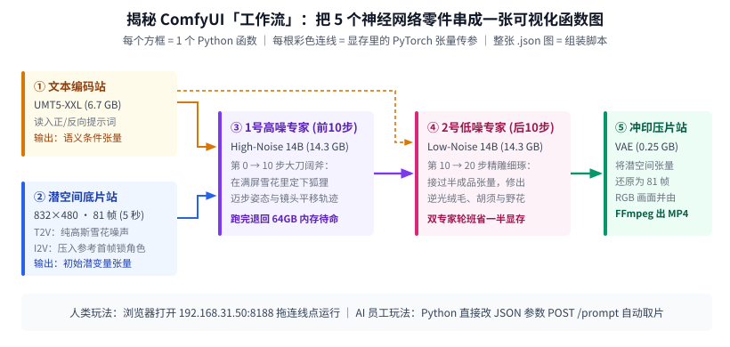
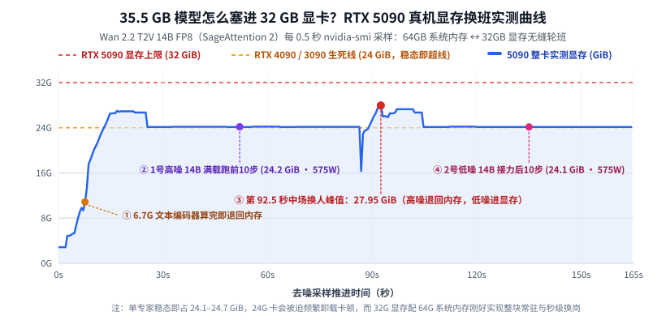
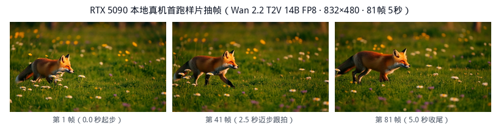

【视频生成初体验】让 AI 员工半夜在 RTX 5090 上装好阿里 Wan 2.2：一个大模型老玩家的“工作流”扫盲记

━━━━━━━━━━━━━━━━━━━━

◆ 开篇：听说 Sora 2 连网线都拔了，折腾了一年大语言模型的我终于决定摸一回视频生成

━━━━━━━━━━━━━━━━━━━━

虽然平时每天都在折腾大语言模型（Large Language Model，简称 LLM）、研究残差流和底层算子，但在视频生成这个领域，我一直是个彻头彻尾的门外汉——上一次认真看新闻，好像还是两年前 OpenAI 把初代 Sora 捧上“物理世界模拟器”神坛的时候。

直到昨晚睡前跟 AI 闲聊盘点现状，我才后知后觉地发现视频赛道早就换了人间：当年风光无限的 `Sora 2`，已经在今年 3 月宣布弃坑、4 月关停网页与客户端，到 **2026 年 9 月 24 日更是连 API 网线都拔得干干净净（直接返回 `410 Gone`）** ，连继任型号都没留。原因一点也不玄学——视频生成拼的不是长链条逻辑推理，而是高审美视频语料清洗、锁脸锁运镜的工程控制，以及实打实的推理电费成本；在这些维度上，手握短视频富矿与深厚工程底座的字节（即梦 `Seedance`）、快手（可灵 `Kling`）、Google（`Veo 3`）、MiniMax（海螺）早就把闭源商业服务卷穿了，而开源社区更是几乎被中国军团包了场——阿里的通义万相 **`Wan 2.2`** 、腾讯的 **`HunyuanVideo`** ，再加上以色列团队主打原生音画同出的 **`LTX-2`** ，全都放出了权重供大家抱回家跑。

聊到兴头上，我的第一反应是顺嘴问了一句：“要不拿家里的 **DGX Spark（128GB 统一内存）** 跑个视频模型试试？”

话刚出口我自己先乐了——习惯了大语言模型，脑子里总觉得内存大就是王道。可大语言模型每吐一个词元（Token）只激活一行向量，卡脖子的是容量与读取；而 **扩散变换器（Diffusion Transformer，简称 DiT）** 生一段 5 秒视频，哪怕经过三维因果变分自编码器压缩，潜空间里依然有几万个时空方块同时做全注意力稠密矩阵乘法，还得连滚 20 步。拿只有 `273 GB/s` 内存带宽的 Spark 去跑，非慢死不可；反倒是家里平时放在 Windows 11 迷你主机上专门打 3A 游戏的 **`NVIDIA RTX 5090`（32GB GDDR7 独显，带宽高达 `1.79 TB/s`，是 Spark 的 6.5 倍）** ，简直就是为本地视频生成量身定做的甜点卡。

看了一眼时间已经凌晨一点半，我干脆钻进被窝，在手机上给终端里的两个 AI 留了一句话：“我去睡觉了，你们顺着局域网 SSH 登进 5090 那台 Windows 电脑，在上面把阿里的 `Wan 2.2` 部署跑通，记得留好命令行接口。”

结果一觉睡醒，不仅环境、权重、开机后台服务和命令行接口全套验收通关，连生成的夕阳小狐狸视频都自己审完了放在那儿等我。更让我觉得有意思的是，早上点开浏览器里那个跑在 `8188` 端口上的流程图界面时，我终于第一次直观搞明白了：美术圈天天挂在嘴边的所谓 **“工作流（Workflow）”** ，到底是个什么东西。

今天这篇就不聊深奥的模型内部架构（那些留给后面慢慢学），纯粹站在一个 **刚摸视频生成第一天的新手视角** ，把这趟 Windows 原生部署流程、模型显存轮班机制，以及我对 ComfyUI 工作流的初体验记下来。

━━━━━━━━━━━━━━━━━━━━

◆ 第一章：睡一觉收工——在裸机 Windows 11 + RTX 5090 上从零装好 Wan 2.2

━━━━━━━━━━━━━━━━━━━━

家里这台插着 `RTX 5090`（消费级 Blackwell 架构，计算能力代号 `sm_120`，配 `64 GB` 系统物理内存）的 Windows 11 主机平时只用来打游戏，系统里干干净净，既没装 WSL 子系统，也没装全局 Python、Git 或 FFmpeg。

为了让整套环境随时能搬走、清理时删一个文件夹就干干净净，AI 员工直接在空间充裕的 C 盘建了一个完全自包含的独立目录 **`C:\AI\Wan22-ComfyUI\`** ，用 1 小时 50 分钟完成了四步搭建——

**一、底座与 Blackwell（`sm_120`）加速环境对齐**

直接采用官方免安装的 **`ComfyUI_windows_portable`（v0.44.0）** 便携包作为底座，不碰系统环境变量。但 `RTX 5090` 有一个新手极易踩的坑：老版本的 PyTorch 不认识最新的 `sm_120` 架构，一跑就会报找不到核函数镜像。

因此第一步就是把便携包内置的独立 Python（`3.13.14`）环境升级到了原生支持 `sm_120` 的 **`PyTorch 2.15.0+cu132`（CUDA 13.2）** ，并配齐了两件提速与压片利器：
1.**Windows 版 Triton 与 `SageAttention 2` 注意力加速算子** ——装入 `triton-windows`（`3.9.0.post30`）与预编译的 `sageattention`（`2.2.0`），专门加速视频模型里最吃算力的几万方块全注意力计算；同时保留原生 **缩放点积注意力（Scaled Dot-Product Attention，简称 SDPA）** 启动脚本作为稳妥的回退路径；
2.**独立 `FFmpeg`（v9.0.2）** ——放在 `tools\ffmpeg\` 下，负责把模型吐出来的连续图片压制成通用的 H.264 `.mp4` 视频。

────────────────────

**二、拉取哪几个权重文件？（总计 64.17 GB，一次备齐文生视频与图生视频）**

大语言模型玩家第一次下视频模型，最容易懵的就是“怎么不是下 1 个权重文件，而是下好几个”。

以目前开源综合画质最能打的阿里 **`Wan 2.2`（14B 旗舰版）** 为例，官方重打包仓库（ *https://huggingface.co/Comfy-Org/Wan-2.2* ）把整套系统按职责切成了互相配合的独立文件，采用针对 32GB 显卡极友好的 **8 位浮点缩放量化（`fp8_scaled`）** 格式。我们一口气把 **文生视频（Text-to-Video，简称 T2V）** 和 **图生视频（Image-to-Video，简称 I2V）** 全套共 6 个文件拉齐并逐一核对了 SHA256 哈希，分别放进 `ComfyUI\models\` 下的三个子文件夹：

1.**`vae\` 子目录（负责像素与潜空间的压缩冲印）** ——放入 `wan_2.1_vae.safetensors`（仅 **`0.254 GB`** ，`Wan 2.2` 的 14B 版本直接沿用 2.1 的三维变分自编码器）；
2.**`text_encoders\` 子目录（负责读懂提示词）** ——放入多语言文本编码器 `umt5_xxl_fp8_e4m3fn_scaled.safetensors`（ **`6.736 GB`** ）；
3.**`diffusion_models\` 子目录（核心视频去噪双专家）** ——
  - 文生视频一组两个文件：`wan2.2_t2v_high_noise_14B_fp8_scaled.safetensors`（ **`14.294 GB`** ）与 `wan2.2_t2v_low_noise_14B_fp8_scaled.safetensors`（ **`14.294 GB`** ）；
  - 图生视频一组两个文件：`wan2.2_i2v_high_noise_14B_fp8_scaled.safetensors`（ **`14.295 GB`** ）与 `wan2.2_i2v_low_noise_14B_fp8_scaled.safetensors`（ **`14.295 GB`** ；注：这版原生图生视频工作流直接通过 `VAE` 把首帧参考图编码进潜空间，不需要额外下载 `CLIP Vision` 视觉编码器权重）。

────────────────────

**三、开机后台自启与“不耽误打游戏”的空闲释放**

环境装好后，在 Windows 计划任务里注册了一个开机后台服务，监听局域网 `0.0.0.0:8188`（防火墙仅对家里 `192.168.31.x` 内网放行）。根目录放好了六个一键批处理脚本：可以随时切 `SageAttention` 或 `SDPA` 后端，更贴心的是配了一个“释放显存保留接口”机制——生成完视频后自动清空显存里的模型缓存，平时待机整张 5090 只占约 `3.1 GiB`（含 Windows 桌面本身），随时双击打开 3A 游戏也互不打架。

━━━━━━━━━━━━━━━━━━━━

◆ 第二章：打开 8188 端口恍然大悟——原来这就是人们常说的“工作流”

━━━━━━━━━━━━━━━━━━━━

早上醒来，我在手机浏览器里输入局域网地址点开页面，屏幕上跳出了一张由十几个方框和五颜六色连线拼成的流程图。看着这张图，困扰我很久的一个疑惑当场解开了—— **原来设计师和自媒体口中神乎其神的“ComfyUI 工作流”，对程序员来说就是一张“可视化的 Python 函数调用图（有向无环图，简称 DAG）”。**



为什么我们平时玩大语言模型从来没人搞这种连线图，一到画图、做视频就人手一份工作流？

因为大语言模型是一台高度集成的“一体机”——分词、几十层 Transformer、输出词表头全焊死在同一个模型里，接口永远是“输入一串字，吐出一串字”，装个聊天框就够用了；而图像和视频生成从诞生第一天起就是 **“散装攒机”** 。

对照着上面这张图，我们顺着连线走一遍，看看生一段 5 秒钟（`832 × 480` 分辨率，每秒 16 帧，共 `81` 帧）的小狐狸视频，底下这 5 个零件是怎么接力传球的：

1.**第一站（文本编码盒 `CLIPLoader` + `CLIPTextEncode`）** ——相当于调用函数读取 `6.7 GB` 的 `UMT5-XXL` 语言模型，把你写的正向提示词（“一只橙色小狐狸漫步在阳光草地……”）和反向提示词（“模糊、多条腿、倒着走……”）分别算成两团语义条件张量，顺着橙色电线往后传；
2.**第二站（潜空间底片盒）** ——文生视频用 `EmptyHunyuanLatentVideo` 捏造一块对应 `832 × 480 × 81 帧` 的纯高斯雪花噪声张量；如果是图生视频，则多接一个 `LoadImage` 读入首帧定妆照，经 `WanImageToVideo` 把首帧画面压进潜空间锁死主角长相，顺着蓝色电线往后传；
3.**第三站（1 号高噪专家采样盒 `KSamplerAdvanced`，跑第 `0 → 10` 步）** ——加载第一个 `14.3 GB` 的高噪声模型，总共设 20 步去噪，但规定它只负责 **前半程第 0 到第 10 步** ，在满屏雪花噪点里大刀阔斧地定下小狐狸的体型、四肢迈步节奏与镜头平移轨迹，把跑了一半的半成品张量顺着紫色电线传给下一棒；
4.**第四站（2 号低噪专家采样盒 `KSamplerAdvanced`，跑第 `10 → 20` 步）** ——加载第二个 `14.3 GB` 的低噪声模型，接过刚才第 10 步的半成品，不再加新噪声，专心干完 **后半程第 10 到第 20 步** ，把逆光下的狐狸绒毛、胡须和草地野花细节修得根根分明；
5.**第五站（冲印压片盒 `VAEDecode` + `CreateVideo` + `SaveVideo`）** ——最后请出 `0.25 GB` 的 `VAE` 解码器，把修好的潜空间张量还原成 81 张真彩色图片，按 16 帧每秒打包压成 `.mp4` 文件落盘。

你看，每一个方框就是一个独立的函数，每一根连线就是显存里传递的张量变量；如果以后还要往上加“先用生图模型画主角定妆照”、“加骨骼控制插件”、“加配音口型同步”，无非就是在图里多串几个方框。不会写代码的美术同学拖拖电线就能自由组装，调通后导出一个几 KB 的 `.json` 文件发给别人，别人往浏览器里一拖就能原样跑起来——这就是“工作流”风靡整个视觉生成圈的全部秘密。

━━━━━━━━━━━━━━━━━━━━

◆ 第三章：显存到底怎么调度的——35.5 GB 的散装模型，怎么塞进 32 GB 的 RTX 5090？

━━━━━━━━━━━━━━━━━━━━

看懂了上面的五个站点，一个很自然的算术问题马上就冒出来了——

把一条文生视频流水线要用到的模型体积加起来，总共是 **`6.7 GB（文本编码器） + 14.3 GB（高噪专家） + 14.3 GB（低噪专家） + 0.25 GB（VAE） = 35.55 GB`** ，这还没算几万个视频时空方块在计算时占用的好几 GB 激活显存。可 `RTX 5090` 一共只有 **`32 GB` 显存** ，难道跑一条视频要反反复复去慢吞吞地读写固态硬盘吗？

为了看清底层到底发生了什么，我把昨晚跑小狐狸视频时每 `0.5` 秒记录一次的 `nvidia-smi` 真机显存与功耗日志画成了下面这张实测曲线——



盯着上面那条蓝色实线，真相一目了然—— **ComfyUI 根本不用反复去读固态硬盘，而是利用这台主机自带的 `64 GB` 系统物理内存（RAM）当候场休息室，顺着高速通道在【64GB 内存 ↔ 32GB 显存】之间做“轮班换岗”。**

整场 3 分钟的接力赛分四个节拍严丝合缝地推进：
- **第 0 至 8 秒（编剧上岗即退场）** ——显存从待机底噪 `2.85 GiB` 升到 `10.86 GiB`，`6.7 GB` 的文本编码器进显存瞬间算完提示词向量，随即便被请回 `64 GB` 系统内存歇着，把显存腾空；
- **第 15 至 88 秒（1 号高噪 14B 专家满血狂奔）** ——第一个 `14.3 GB` 高噪专家连同潜空间工作区全量住进显存，稳态占用死死钉在 **`24.14 至 24.20 GiB`** ，GPU 利用率拉满 `100%`，整卡功耗飙到 **`575 W`** ，一口气无卡顿跑完前 10 步；
- **第 92.5 秒（中场两秒钟极速换人）** ——前 10 步刚收尾，引擎把 1 号高噪专家挪回 `64 GB` 系统内存，同时把 2 号低噪专家推进 `32 GB` 显存。交接瞬间冲出整场最高显存读数 **`27.95 GiB`** （图生视频模式下峰值为 **`28.70 GiB`** ），短短两三秒完成交接棒；
- **第 105 秒至收尾（2 号低噪 14B 专家接棒冲线）** ——显存重新回落稳在 **`24.14 GiB`** ，功耗继续顶满 **`575 W`** 跑完后 10 步，最后换上小巧的 `VAE` 解码出片。

────────────────────

💡 为什么说 32GB 的 RTX 5090 刚好卡在本地跑视频模型的生死分水岭上？

再回头看一眼图里那根橙色的 **`24 GiB` 虚线（也就是上一代旗舰 `RTX 4090 / 3090` 的显存上限）** ，你就明白硬件刀法有多精准了：

哪怕两个 14B 专家已经分开轮流上岗，**单个 14B FP8 专家加上 81 帧视频特征张量的稳态工作显存也要占掉 `24.14 GiB`（交接与编码峰值更是冲到 `28 GiB` 以上）** 。如果是 24GB 显存的显卡，连单个专家的稳态都装不下，只能被迫开启按层卸载（每算几层就去系统内存倒腾一次权重），速度大打折扣；而 **`32 GB` 显存的 RTX 5090 配上 `64 GB` 系统内存** ，刚好让每一位上场的 14B 专家都能 **100% 完整常驻在 `1.79 TB/s` 的 GDDR7 显存里满载运行** ，跑第二条视频时连固态硬盘都不用读，直接在内存和显存之间两秒换班。

────────────────────

再看一眼真机跑出来的成绩单与实际画面（全部为原版 20 步、`832 × 480`、`81` 帧 5 秒视频，未加任何牺牲画质的 4 步蒸馏加速插件）：
- **文生视频（原生 `SDPA` 基线）** ——耗时 **`292.4 秒`** ，整卡显存峰值 `28.64 GiB`；
- **文生视频（开启 `SageAttention 2` 加速）** ——耗时直接压到 **`191.6 秒`（约 3 分 11 秒，比首条基线省了三分之一时间；独立注意力微测从 `1.708 ms` 降到 `0.792 ms`）** ，整卡显存峰值 `27.95 GiB`；
- **图生视频（开启 `SageAttention 2` 加速）** ——耗时 **`170.6 秒`（不到 3 分钟）** ，整卡显存峰值 `28.70 GiB`。



上面是从首跑生成的 `.mp4` 原片里直接抽出的首、中、末三帧：逆光下的橙色绒毛边缘、四条腿交替落地的步态、以及前景白色小花的浅景深平移一气呵成，没有一帧黑屏或肢体穿模。接着把首帧喂进图生视频（`I2V`）再续拍 5 秒，依然稳稳锁住了同一只小狐狸的长相与毛色。

━━━━━━━━━━━━━━━━━━━━

◆ 第四章：比点鼠标更好玩的事——给 AI 留一行脚本，以后在后台全自动搓短剧

━━━━━━━━━━━━━━━━━━━━

如果是普通教程，到浏览器里点按钮出视频就该收工了。但作为一个习惯在命令行里使唤 AI 干活的懒人，真正让我兴奋的是 ComfyUI 藏在网页底下的另一副面孔—— **浏览器里的连线图是画给人类看的，它底下其实原生自带了一套极干净的 HTTP 与 WebSocket 接口（`POST /prompt` 提交 JSON 任务图、`POST /upload/image` 传首帧参考图、`GET /history` 查进度、`GET /view` 拉取成片）。**

昨晚部署时，AI 顺手在我的随身笔记本上写好了一个只依赖 Python 标准库的轻量客户端脚本 `wan22_generate.py`。现在我根本不用打开浏览器去拖那些眼花缭乱的方框，在终端里敲一行命令就能远程指挥 5090 出片并自动把 `.mp4` 拉回本地：

```bash
# 1. 一行命令远程提交文生视频 -> 5090 后台满载生成 -> 自动把 MP4 拉回笔记本
python3 wan22_generate.py \
  --prompt "A small orange fox walks slowly through a sunlit meadow..." \
  --seed 20261111

# 2. 垫入一张首帧定妆图，锁死主角长相继续往后拍 5 秒（图生视频 I2V）
python3 wan22_generate.py \
  --prompt "The same orange fox continues walking gently..." \
  --image ./reference_fox.png --seed 42
```

更有意思的闭环在于—— **现在的多模态大语言模型（比如我当前主力在用的 `Gemini 4 Carbon`）原生就能直接读取 `.mp4` 视频文件来“肉眼审片”。**

这意味着，以前觉得“AI 没法自己从头到尾拍完一集短剧”的两道坎 —— **跨镜头主角换脸** 与 **抽卡穿模没人审** —— 在家里这套机器上已经能串成全自动流水线了：
1.**大语言模型当编剧分镜** ——把一个小故事写成 20 个镜头的分镜 JSON；
2.**生图模型当画师锁首帧** ——先用图片生成模型画出主角定妆照和每一镜的“第 0 秒首帧”（图片生成快得多，画歪了立刻重抽，确保 20 个镜头主角长相衣服完全一致）；
3.**`Wan 2.2 I2V` 当摄影师拍动态** ——脚本自动调上面那行 `--image` 接口，让 5090 花两三分钟一段把静态首帧推演成 5 秒动态镜头；
4.**多模态大模型当导演审片剪辑** ——每算出一段 `.mp4`，AI 自己读进去检查动作有没有崩、手脚有没有穿模，废片自动换随机种子打回重算，全部过审后调 `FFmpeg` 拼接压片。

第一次摸视频模型，先睡一觉把这套随叫随到的 5090 视频车间搭稳当了。至于 `Wan 2.2` 为什么要分成高噪和低噪两个专家、三维变分自编码器到底是怎么压缩时间和空间的，还有怎么真刀真枪把“语言模型 ＋ 图片模型 ＋ 视频模型”串起来做出一部连贯小短片，咱们后面边玩边写。

━━━━━━━━━━━━━━━━━━━━

◆ 速查表

━━━━━━━━━━━━━━━━━━━━

| 维度 / 概念 | 视频小白初体验核心笔记与 RTX 5090 真机读数 |
|---|---|
| ComfyUI “工作流”的本质 | 给非程序员用的 **可视化 Python 函数有向无环图（DAG）** ——每个节点方框是一个函数，彩色连线是显存里传递的张量，导出的 `.json` 就是完整组装脚本；底层原生暴露 HTTP 接口供代码无头调用 |
| 5090 Windows 原生环境 | 自包含目录 `C:\AI\Wan22-ComfyUI\`（便携 Python `3.13.14` ＋ **`PyTorch 2.15.0+cu132`** 原生对齐 Blackwell `sm_120` ＋ `triton-windows 3.9.0` ＋ **`SageAttention 2.2.0`** ＋ `FFmpeg 9.0.2`），配开机后台服务，空闲显存仅占约 `3.1 GiB` |
| `Wan 2.2 14B FP8` 权重组成 | 共 6 个文件合计 **`64.17 GB`** ——共享 `wan_2.1_vae`（`0.254 GB`）与 `umt5_xxl_fp8` 文本编码器（`6.736 GB`）；文生视频（`T2V`）高噪/低噪双专家各 `14.294 GB`，图生视频（`I2V`）高噪/低噪双专家各 `14.295 GB` |
| 35.5GB 模型如何塞进 32GB 卡 | 利用主机 **`64 GB` 系统内存（RAM）** 做热交换候场：文本编码器算完退回内存 → 1 号高噪 14B 进显存满载 `575W` 跑前 10 步（稳态 **`24.14 GiB`** ）→ 第 92.5 秒中场换入 2 号低噪 14B 跑后 10 步（峰值 **`27.95 至 28.70 GiB`** ），24G 卡稳态即超线，32G 卡刚好整块常驻不降速 |
| 原版 20 步（832×480·81帧）耗时 | `T2V` 原生 `SDPA` 基线 **`292.4 秒`** ；开启 **`SageAttention 2`** 后 `T2V` 压至 **`191.6 秒`** （提速约 1.53 倍），锁首帧 `I2V` 仅需 **`170.6 秒`** |

━━━━━━━━━━━━━━━━━━━━

◆ 参考资料

━━━━━━━━━━━━━━━━━━━━

- Wan Team (Alibaba), Wan: Open and Advanced Large-Scale Video Generative Models 及 Wan 2.2 官方开源说明（2025–2026；高低噪双专家扩散变换器架构与开源权重规范）
- Comfy-Org, ComfyUI v0.44.0 官方 Wan 2.2 原生工作流模板与 `Comfy-Org/Wan-2.2` FP8 重打包权重仓库（2026；包含 `T2V` 与 `I2V` 20 步标准双采样器管线）
- Jintao Zhang et al., SageAttention2: Efficient Attention with Thorough Outlier Smoothing and Per-thread INT4 Quantization, arXiv:2411.10958 及 Windows 预编译构建 `v2.2.0-windows.post6`（Blackwell `sm_120` 注意力加速实测）

━━━━━━━━━━━━━━━━━━━━

**以前总觉得让 AI 独立干完一整套工程是天方夜谭，直到在被窝里甩出一句话，睡醒看见一个 AI 已经在 Windows 裸机上排完所有驱动与算子的雷，另一个长着眼睛的 AI 已经替我逐帧审完了成片。**

**剥掉令人眼花缭乱的彩色连线，所谓“工作流”不过是把散装的文本编码器、去噪专家与解码器串成一张函数调用图；给人类留一张画布，给机器留一行接口，好工具本该如此。**

**35.5 GB 的模型在 64 GB 内存与 32 GB 显存之间两秒换班、顶着 575 瓦功耗狂奔的时候，大语言模型与视觉生成之间的那堵跨界心理高墙，也就顺手推平了。**

━━━━━━━━━━━━━━━━━━━━

// 靳岩岩的 AI 学习笔记 × Gemini 的浪漫 × GPT 的严谨
// 2026年11月15日

睡前用手机给终端里的 AI 留下一句话，一觉醒来家里打游戏用的 RTX 5090 Windows 主机已跑通阿里 Wan 2.2（14B FP8 文生视频与图生视频）：顺手算清 35.5GB 散装模型的显存换班机制，看懂 ComfyUI“工作流”到底是什么。
