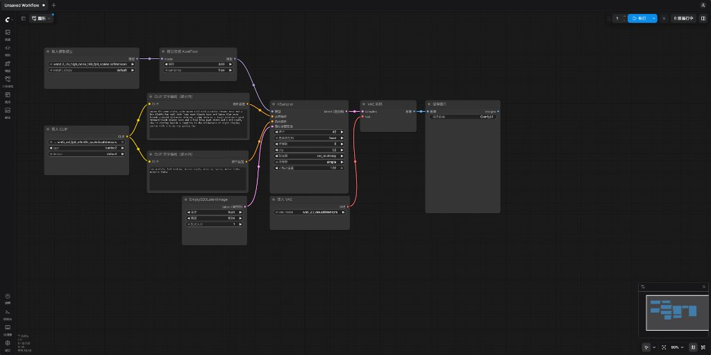

【视频生成初体验】从哑巴小狐狸到 3 分钟有声国漫爽剧：我在 RTX 5090 上让 AI 自动制片的一天

━━━━━━━━━━━━━━━━━━━━

◆ 开篇：听说 Sora 2 连网线都拔了，折腾了一年大语言模型的我终于决定摸一回视频生成

━━━━━━━━━━━━━━━━━━━━

虽然平时每天都在折腾大语言模型（Large Language Model，简称 LLM）、研究残差流和底层算子，但在视频生成这个领域，我一直是个彻头彻尾的门外汉——上一次认真看新闻，好像还是两年前 OpenAI 把初代 Sora 捧上“物理世界模拟器”神坛的时候。

直到昨晚睡前跟 AI 闲聊盘点现状，我才后知后觉地发现视频赛道早就换了人间：当年风光无限的 `Sora 2`，已经在今年 3 月宣布弃坑、4 月关停网页与客户端，到 **2026 年 9 月 24 日更是连 API 网线都拔得干干净净（直接返回 `410 Gone`）** ，连继任型号都没留。原因一点也不玄学——视频生成拼的不是长链条逻辑推理，而是高审美视频语料清洗、锁脸锁运镜的工程控制，以及实打实的推理电费成本；在这些维度上，字节（即梦 `Seedance`）、快手（可灵 `Kling`）、Google（`Veo 3`）、MiniMax（海螺 `MiniMax-H3`）早就把闭源商业服务卷穿了，而开源社区更是由中国团队挑起了大梁——阿里的通义万相 **`Wan 2.2`** 、腾讯的 **`HunyuanVideo`** 、以色列团队的 **`LTX-2`** 乃至原生带多国语言对口型配音的 **`MiniMax-H3`** 全都能直接下载权重跑在本地。

聊到兴头上，我的第一反应是顺嘴问了一句：“要不拿家里的 **DGX Spark（128GB 统一内存）** 跑个视频模型试试？”

话刚出口我自己先乐了——习惯了大语言模型，脑子里总觉得内存大就是王道。可大语言模型每吐一个词元（Token）只激活一行向量，卡脖子的是容量与读取；而 **扩散变换器（Diffusion Transformer，简称 DiT）** 生一段视频，哪怕经过三维变分自编码器压缩，潜空间里依然有几万个时空方块同时做全注意力稠密矩阵乘法。拿只有 `273 GB/s` 内存带宽的 Spark 去跑非慢死不可；反倒是家里平时放在 Windows 11 主机上专门打 3A 游戏的 **`NVIDIA RTX 5090`（32GB GDDR7 独显，带宽高达 `1.79 TB/s`，是 Spark 的 6.5 倍，配 `64 GB` 系统物理内存）** ，简直是为本地视频生成量身定做的甜点卡。

看了一眼时间已经凌晨一点半，我钻进被窝在手机上给终端里的 AI 留了一句话：“我去睡觉了，你们顺着局域网登进 5090 那台 Windows 电脑，先把阿里的 `Wan 2.2` 部署跑通。”

没想到这一句话开头，接下来大半天里，我不仅在 `Wan 2.2` 上第一次看懂了美术圈天天念叨的 **“ComfyUI 工作流”与显存轮班机制** ，还在发现 `Wan 2.2` 没声音、锁不住多角色之后，听从熟门熟路的网友指点当场升级成开源旗舰 **`MiniMax-H3` ＋ `ACE-Step 1.5` 音乐模型** ，顺手在本地全自动搓出了一部带中文对白口型、三幕交响配乐与字幕的 **3 分钟国漫爽剧** ——期间还排出了“风声提示词吹口哨”与“男主刘海放大十倍挂上宗祠吊灯”两个让人笑出眼泪的活体乌龙。

今天这篇就不聊深奥的模型内部架构，纯粹站在一个 **刚摸视频生成第一天的新手视角** ，把这趟从入门扫盲到实战出片的完整折腾记下来。

━━━━━━━━━━━━━━━━━━━━

◆ 第一章：一觉醒来先扫盲——把“模型、工作流、ComfyUI”一码归一码摆清楚

━━━━━━━━━━━━━━━━━━━━

早上醒来，AI 已经在 5090 主机独立的 `C:\AI\Wan22-ComfyUI\` 目录下把免安装便携包（`ComfyUI v0.44.0`）、原生支持 Blackwell `sm_120` 架构的 **`PyTorch 2.15.0+cu132`** 、注意力加速算子 **`SageAttention 2.2.0`** 以及 `Wan 2.2（14B FP8）` 全套 `64.17 GB` 权重全部验收通关了（为了不抢平时打 3A 游戏的内存，取消了后台自启，留好 `run_foreground.bat` 与 `stop_comfy.bat` 前台按需启停）。

我在浏览器里点开 `8188` 端口，第一眼看到的就是下面这张默认黑底网格画布——

盯着这张图看了半分钟，我脑子里一直在转一个最基础的问题—— **模型文件是 `.safetensors`，工作流是 `.json`，那“ComfyUI”自己到底是个啥？难道它只是一个画流程图的网页前端（UI）吗？**

把这个扣子解开，整个本地视觉生成的地基就彻底通透了—— **别被它名字里的 `UI` 误导了，按玩大语言模型的工具来对照，ComfyUI 其实是视觉生成界的“`vLLM`（Python 推理引擎后端）＋ `Open WebUI`（网页连线前端）”二合一，而且真正值钱的九成功夫全在后端引擎上——**

1.**模型文件（几十 GB 的 `.safetensors`）＝ 只有权重数字，一行代码都没有** ——存的纯粹是冷冰冰的浮点数矩阵权重，既不包含神经网络层怎么连接，也不知道怎么算注意力，自己根本不会动；
2.**工作流文件（几 KB 的 `.json`）＝ 只有接线顺序与入参字典，同样一行运算代码都没有** ——打开任何一个工作流 `.json`，里面只是一份静态点菜单，写着“第 1 号节点调 `UNETLoader` 读哪个权重文件名，第 10 号节点调采样器跑多少步”。上面那张初始截图之所以看着别扭，就是因为没点开左侧边栏加载专用 `.json` 前，空引擎随便摆了一张单张生图模型的默认菜谱，顺手抓了我们文件夹里排第一的视频权重填进去，当场“张冠李戴”；
3.**ComfyUI 本体 ＝ 真正写好了各家网络结构源码、采样器与显存管家的 Python 推理引擎** ——不管是阿里 `Wan 2.2`、腾讯混元还是后面升级的 `MiniMax-H3`，它们的 Transformer 前向传播、微分方程去噪循环、以及“哪个模型进显存开火、哪个退回系统内存候场”，Python 代码全由 ComfyUI 官方内置在后端 `comfy/` 目录里。浏览器画布只是给不写代码的人拖方框生成 `.json` 用的；哪怕关掉浏览器，直接往后端 `POST /prompt` 发一份 `.json`，照样满载出片。

加载正确的 `Wan 2.2` 工作流（上图）再看，神秘感瞬间归零—— **对程序员来说，这张连线图就是一张“可视化的 Python 函数有向无环图（Directed Acyclic Graph，简称 DAG）”。** 大语言模型是分词、主干、词表头焊死在一起的“一体机”，套个聊天框就够了；而视觉生成天生是“散装攒机”，需要文本编码器、潜空间底片、去噪主干和解码器一步步接力传张量。

顺带解开了另一个让我犯嘀咕的名词：为什么 `Wan 2.2` 要把去噪主干分成 **`high_noise`（高噪声，14.3GB）** 和 **`low_noise`（低噪声，14.3GB）** 两个文件？

因为扩散模型生视频本质上是 **“从老式电视机满屏雪花点里分 20 步抠图”** ——前 10 步满屏大雪花叫 **高噪声阶段** ，负责在混沌里定出小狐狸的体型与迈步大骨架；后 10 步轮廓已定、只剩细麻点叫 **低噪声阶段** ，负责拿放大镜精修逆光绒毛与胡须。阿里干脆训了两个 14B 专才一前一后接力轮班，每次只占 1 份 14B 显存，就换来了双倍参数量的细节。

━━━━━━━━━━━━━━━━━━━━

◆ 第二章：35.5 GB 乃至 39 GB 的散装模型，怎么塞进 32 GB 的 RTX 5090？

━━━━━━━━━━━━━━━━━━━━

看懂了散装接力，一个算术疑问马上就冒出来了：跑一条 `Wan 2.2` 视频要用到的模型加起来足有 **`6.7 GB（文本编码器）+ 14.3 GB（高噪）+ 14.3 GB（低噪）+ 0.25 GB（VAE）= 35.55 GB`** ，而 `RTX 5090` 一共只有 **`32 GB` 显存** ，难道每跑一步都要去慢吞吞地读写固态硬盘吗？

把每 `0.5` 秒采样的 `nvidia-smi` 真机显存与功耗日志画出来，答案一目了然——

**ComfyUI 根本不用反复读盘，而是拿主机自带的 `64 GB` 系统物理内存当候场休息室，在【64GB 内存 ↔ 32GB 显存】之间做毫秒级“轮班换岗”——**
- **第 0 至 8 秒** ——`6.7 GB` 文本编码器进显存算完提示词向量，立刻退回 `64 GB` 系统内存歇着；
- **第 15 至 88 秒** ——1 号高噪 14B 专家整块住进显存，稳态死死钉在 **`24.14 GiB`** ，功耗拉满 **`575 W`** 跑完前 10 步；
- **第 92.5 秒** ——前 10 步收尾，1 号专家退回系统内存、2 号低噪 14B 专家进显存，交接瞬间冲出峰值 **`27.95 GiB`** （开启 `SageAttention 2` 后，20 步 81 帧小狐狸耗时从 `292.4 秒` 直降到 **`191.6 秒`** ，图生视频 `170.6 秒`）。

────────────────────

💡 为什么 24GB 的 4090 卡在门外，而 32GB 的 5090 刚好贴着刀尖起飞？

看一眼上图那根橙色的 **`24 GiB` 虚线** 就懂了：单个 14B 专家稳态工作显存就要 `24.14 GiB`，24GB 显卡连一位专家都装不下，只能每算几层就去内存倒腾一次权重；而 **`32 GB` 显存配 `64 GB` 系统内存** ，不仅让 `Wan 2.2` 的 14B 专家整块常驻狂奔，连下午我们升级到单路总重 **`39.1 GB`** 的旗舰 **`MiniMax-H3`** 时，依然靠同一套内存轮班大法稳稳吃下——`14.61 GiB` 的多模态大脑（`Qwen3-VL-32B NVFP4`）先算完退回内存，接着 `19.53 GiB` 的音视频扩散主干（`INT8`）加 `1.82 GiB` 加速模块住进显存采样，实测整卡峰值 **`31,670 MiB`（约 `30.93 GiB`，离 `32,607 MiB` 物理上限只差不到 1 GB）** ，真正把这张 32GB 显卡榨到了最后一滴油。

━━━━━━━━━━━━━━━━━━━━

◆ 第三章：实事求是果断换炮——嫌 Wan 2.2“又哑又锁不住人”，升级 MiniMax-H3 搓出 3 分钟有声漫剧

━━━━━━━━━━━━━━━━━━━━

跑出第一只漫步草地的夕阳小狐狸（`wan22-fox-keyframes.png`）后，新鲜劲还没过五分钟，我就发现了 `Wan 2.2` 真拿来做短剧时的两处明显短板：
1.**它是个彻头彻尾的“哑巴模型”** ——只出画面不出半点声音，人物张嘴对不上台词，后期还得另找配音与口型对齐工具拼接；
2.**它缺原生“多图参考（Reference-to-Video）”槽位** ——图生视频只能死板锁死第 0 秒首帧，一旦切远景或让男女主与反派同框对戏，很难同时锁住三个人的长相与衣服。

我去问了一位熟悉视频生成的网友，对方一句话点醒了我—— **目前开源里真正最能打的其实是 MiniMax 刚开源的海螺 `MiniMax-H3`：原生音画同出（说话口型、动作音效、立体声一块生成），还支持最多塞 9 张参考图同时锁死角色和场景。**

二话不说，我直接让终端里的两位 AI 搭档接力升级：在同一个 ComfyUI 里拉下 `Comfy-Org/MiniMax-H3` 全套权重（含多参考主干 `ref2va`、首尾帧主干 `fl2va`、4 步/8 步加速 LoRA 与 `32kHz` 立体声音频解码器，合计 `60.4 GB`，跑单条视频按需加载其中一套约 `39.1 GB`），并出了道实战考题—— **用本地 5090 从零全自动拍一部 3 分钟（18 个镜头 × 10 秒）的国漫爽剧《重生宗祠夜：天命归来，唯护清雪》（重生身怀系统、宗祠破门护住受辱未婚妻、一掌抽飞恶毒堂哥、月夜花亭许定终身）。**

上面是从最终压制好的 3 分钟 720p 有声成片里直接截出的 6 场实拍画面（开启 `Ref2VA` 4 步加速后，5090 渲染一条 `1024 × 576`、`243` 帧共 `10.125 秒` 的有声镜头只需 **`110 秒`** ，18 个镜头约半小时一气呵成）。预先画好男主深蓝银纹立领、女主白玉簪素旗袍、反派酒红西装以及宗祠与湖心亭 5 张设定卡喂进 `<Picture 1>..<Picture 3>` 后，整整 18 个镜头跨场景切换，三个人物的五官与衣饰稳得纹丝不动，甚至第 2 镜半透明金色面板上还直接写出了工整的正楷汉字“天命守护系统 / 苏清雪正在受辱”。

但真正有含金量的根本不是一次跑通，而是第一版样片出来后，我们一连撞上并亲手排掉的 **三个让人哭笑不得的联合生成大坑** ——

────────────────────

**一、头号大坑：提示词里写一句“寒风呼啸”，男主开口前居然吹起了口哨**

第一版成片刚合出来，我点开听了十秒钟就乐了：
- 一是男主开口说“这一世”之前，背景里居然有一串极其滑稽的“呼、呜呜呜”吹口哨声，而且全片所有人的对白都像隔着老式收音机一样带着沙哑杂音；
- 二是一到人物换气停顿的间隙，背景声音像被刀切了一样掉进死寂真空，听着像十年前没有背景音的干瘪配音剧。

一开始 AI 还怀疑是不是 4 步加速 LoRA 步数太少没把声音去噪干净，专门跑了一条满血 20 步做对照，结果那串吹口哨和沙哑声原封不动还在。把声谱图打出来逐词核对英文提示词，才当场抓到真凶——

因为 `MiniMax-H3` 的画面与声音 **共用同一个联合潜空间** ，第一版分镜提示词里戏精上身，在画面与音效栏塞满了戏剧化英文词：写了 `cold night wind whistling`（寒风呼啸）配 `a sudden sharp gasp`（倒吸一口冷气），多模态编码器看到 `whistling` 直接字面理解成了 **“有人对着麦克风吹口哨”** ；写了 `storm of wind / crackling golden aura / trembling`（狂风、金色电流炸裂、声音颤抖），音频头就老老实实把风噪、电流声和破音气声全程焊进了说话人的声带谐波里。

找到病根后立下 **“前干后湿、分轨混音”** 铁律，两刀下去药到病除：
1.**提示词彻底洗净（前干）** ——删光所有风声、电流与喘息形容词，所有镜头统一改写为干净朴素的 `Quiet indoor hall and a clean close-mic foreground Mandarin voice`（安静室内与近场清晰普通话人声）。重跑一遍 4 步极速版，口哨声瞬间绝迹，连系统面板上的乱码都跟着变成了清晰汉字（不过仔细听人声底子仍有一丝极轻微的声码器颗粒感——这是本地瘦身版仅 `577 MB`、`32 kHz` 音频解码器的物理上限；云端闭源如字节 `Seedance` 走独立高码率语音流无此问题，本地若追求极致纯净，下一步可用 `CosyVoice` 先出 48kHz 纯净干声再喂进 H3 `<Audio 1>` 仅驱动口型）；
2.**本地 AI 乐师配乐＋侧链闪避（后湿）** ——单镜 10 秒各自独立采样天然不可能长出连贯配乐。我们在同一个 ComfyUI 里顺手拉起开源音乐大模型 **`ACE-Step 1.5 Turbo`（`10.03 GB`）** ，5090 只花 **`9.4 秒`** 就生成了一整首 108 秒立体声交响战斗曲，连同悬疑古琴、月夜古筝竹笛拼成 3 分钟完整原声带，再用 `FFmpeg` 的 **`sidechaincompress`（侧链压缩闪避）** 把人声与配乐混在一起：人物一开口配乐自动压低让路，一到停顿换气与片尾拥抱拉远，古筝与竹笛交响立刻涌上来顶满情绪。

────────────────────

**二、二号活体笑料：把男主大头照放第 1 槽，宗祠吊灯上长出了十倍大的“黑色刘海”**

第二版重拍出来我从头到尾看了一遍，放到 `01:31`（第 10 镜：两名黑衣恶奴左右包抄围攻男主）时，画面正上方突然冒出一团巨大的“黑色毛状物”，看着活像男主头顶燃起了暗黑火焰——

把第 10 镜的两张参考图拿出来一比对，差点笑岔气—— **吊灯上挂着的那团黑毛，竟然是男主近景大头照额头正上方那撮“中分碎刘海”的十倍放大版。**

原因非常直观：第 10 镜是个大远景全身镜头，男主站在画面正中央缩成了一个小人儿；可脚本传参时把 **男主近景大头照** 排在了 `<Picture 1>` 第 1 槽，把 **宗祠大厅全景图** 排在了 `<Picture 2>` 第 2 槽。模型在跨图注意力融合时以第 1 槽为主空间锚点，既在底下小人儿头上画了正常比例的头发，又舍不得丢掉 `<Picture 1>` 画面顶部正中央那一大团浓密黑发像素，干脆在半空中把它脑补成了一顶倒挂在水晶吊灯上的巨型假发套。

修法更是简单到只需要调换一行参数顺序—— **凡是拍全身远景镜头，一律把“大场景全景图”放在 `<Picture 1>` 第 1 槽锁定三维空间坐标，把“人物半身卡”退到 `<Picture 2>`** 。花 110 秒重拍这一镜（右图），天花板上的巨型刘海瞬间消失得无影无踪。

────────────────────

💡 彩蛋踩坑：多模态大模型审片虽爽，千万别让它一口气“生吞”6 个视频

顺便记一个今天把我自己吓出一身冷汗的小插曲：上午第一版 18 个镜头刚跑完时，长着原生视听觉的 `Gemini 4 Carbon` 兴冲冲地一口气并发调了 6 次文件读取，把 6 条 10 秒高清有声 `.mp4` 直接往主对话上下文里塞。结果 60 秒音视频展开成多模态词元后单轮暴涨超过 40 万词元，直接从原本的 `38 万` 一头撞穿了 `786,432`（768K）上下文上限，触发服务端紧急断尾截断，当场把我聊了一早上的上下文砍得干干净净。

吃一堑长一智，后面审片立刻改成了最省上下文的内行姿势—— **审画面抽一张 `3 × 6` 的 18 镜中点缩略拼图（几百 KB），审杂音切 10 秒单声道小音频配一张声谱图** ，花不到两千词元，照样把口哨声和吊灯刘海抓得明明白白。

━━━━━━━━━━━━━━━━━━━━

◆ 速查表

━━━━━━━━━━━━━━━━━━━━

| 维度 / 环节 | 本地 RTX 5090（32GB GDDR7 ＋ 64GB RAM）实战读数与避坑铁律 |
|---|---|
| 模型、工作流与 ComfyUI | **模型（`.safetensors`）** 是纯浮点数权重；**工作流（`.json`）** 是函数调用有向无环图配置单；**ComfyUI** 是内置网络源码、采样器与 **【64GB 内存 ↔ 32GB 显存】轮班管家** 的 Python 推理引擎后端 ＋ 网页画布 |
| `Wan 2.2` vs `MiniMax-H3` | `Wan 2.2（14B FP8）` 高低噪双专家画质稳（20 步 `170–191 秒`），但 **纯无声且缺多图锁脸槽** ；升级开源 **`MiniMax-H3`** 后原生直出 **32kHz 中文对口型台词 ＋ 最多 9 图参考锁死多人与场景** |
| 5090 刀尖显存占用 | `MiniMax-H3` 单路总重约 **`39.1 GB`** （`14.61 GiB` Qwen3-VL 编码器 ＋ `19.53 GiB` INT8 扩散主干 ＋ `1.82 GiB` 4步 LoRA ＋ `3.18 GiB` 音视频双 VAE），靠内存换班实测显存峰值 **`31,670 MiB`** ，刚好卡在 32GB 显卡甜点线上 |
| 3 分钟有声漫剧耗时 | `Ref2VA` 4 步加速模式下，渲染单条 **`1024 × 576` · `243 帧`（10.125 秒）** 有声镜头约 **`110 秒`** （18 镜共约 32 分钟）；`ACE-Step 1.5 Turbo` 生成 108 秒立体声交响配乐仅需 **`9.4 秒`** |
| 三条实战防翻车铁律 | 1.**防口哨与杂音** ——联合潜空间提示词严禁写 `whistling / gasp / storm of wind`，统一写近场干净人声，BGM 走 `ACE-Step` 后期侧链闪避混音；2.**防刘海挂吊灯** ——远景全身镜头把场景图放 `<Picture 1>` 第 1 槽定空间；3.**防审片爆窗口** ——抽缩略拼图与声谱图审片，不生吞多条原片 MP4 |

━━━━━━━━━━━━━━━━━━━━

◆ 参考资料

━━━━━━━━━━━━━━━━━━━━

- MiniMax, MiniMax-H3 Technical Blog & `Comfy-Org/MiniMax-H3` 开源重打包仓库与全参考提示词规范（2026；原生音视频联合生成、`FL2VA` 首尾帧与 `Ref2VA` 多参考架构）
- Wan Team (Alibaba), Wan 2.2 Open Large-Scale Video Generative Models（2025–2026；高低噪双专家扩散变换器架构）
- ACE Studio & StepFun, ACE-Step 1.5 Open-Source Music Generation Model（2026；`Comfy-Org/ACE-Step-1.5` 极速原声配乐生成）

━━━━━━━━━━━━━━━━━━━━

**以前总觉得那些晒几百个节点蜘蛛网的“工作流大师”深不可测，自己动手打开一看，所谓工作流不过是一份 JSON 函数调用单；真正让整条短剧流水线活过来的，不是人蹲在画布前连电线，而是让懂全局的 AI 自己写剧本、自己拉声谱图排雷、自己调接口重拍。**

**音视频共用同一个潜空间的代价，是你在画面里写一句“寒风呼啸”，角色开口前就真敢给你吹一段口哨；把大头照排在全景图前面，男主的碎刘海就真敢放大十倍挂上宗祠的水晶吊灯。**

**从半夜被窝里的一句部署指令，到下午桌面上热气腾腾的 3 分钟有声国漫成片——当 39 GB 的模型贴着 32 GB 显存的刀尖满载狂奔时，一个人就是一家小型动画制片厂的时代，已经静悄悄地塞进家里的游戏主机了。**

━━━━━━━━━━━━━━━━━━━━

// 靳岩岩的 AI 学习笔记 × Gemini 的浪漫 × GPT 的严谨
// 2026年11月15日

从睡前部署阿里 Wan 2.2 扫盲 ComfyUI 工作流与显存换班机制，到嫌它无声果断升级开源旗舰 MiniMax-H3 与 ACE-Step 1.5：在家里 RTX 5090 上排掉“寒风吹口哨”与“刘海挂吊灯”两大乌龙，全自动搓出一部 3 分钟有声国漫爽剧。
