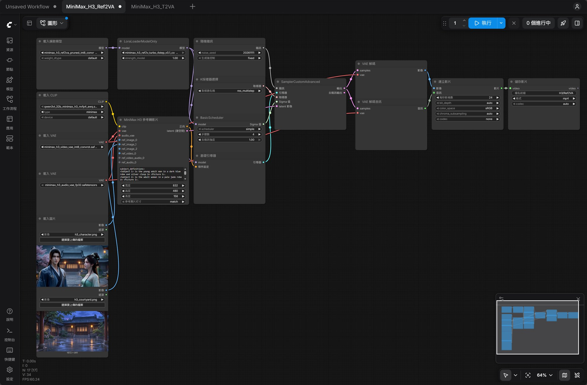
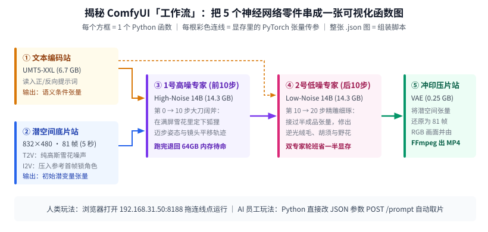
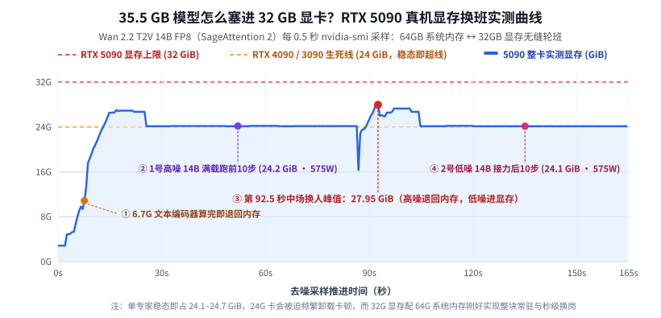
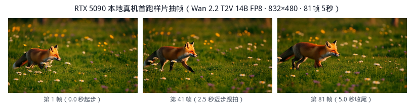

【ComfyUI】从哑巴小狐狸到 3 分钟有声国漫爽剧：我在 RTX 5090 上让 AI 自动制片的一天

━━━━━━━━━━━━━━━━━━━━

◆ 开篇：听说 Sora 2 连网线都拔了，折腾了一年大语言模型的我终于决定摸一回视频生成

━━━━━━━━━━━━━━━━━━━━

虽然平时每天都在折腾大语言模型（Large Language Model，简称 LLM）、研究残差流和底层算子，但在视频生成这个领域，我一直是个彻头彻尾的门外汉——上一次认真看新闻，好像还是两年前 OpenAI 把初代 Sora 捧上“物理世界模拟器”神坛的时候。

直到前几天睡前跟 AI 闲聊盘点现状，我才后知后觉地发现视频赛道早就换了人间：当年风光无限的 `Sora 2`，已经在今年 3 月宣布弃坑、4 月关停网页与客户端，到 **2026 年 9 月 24 日更是连 API 网线都拔得干干净净（直接返回 `410 Gone`）** ，连继任型号都没留。原因一点也不玄学——视频生成拼的不是长链条逻辑推理，而是高审美视频语料清洗、锁脸锁运镜的工程控制，以及实打实的推理电费成本；在这些维度上，字节（即梦 `Seedance`）、快手（可灵 `Kling`）、Google（`Veo 3`）、MiniMax（海螺 `MiniMax-H3`）早就把闭源商业服务卷穿了，而开源社区更是由中国团队挑起了大梁——阿里的通义万相 **`Wan 2.2`** 、腾讯的 **`HunyuanVideo`** 、以色列团队的 **`LTX-2`** 乃至原生带多国语言对口型配音的 **`MiniMax-H3`** 全都能直接下载权重跑在本地。

聊到兴头上，我的第一反应是顺嘴问了一句：“要不拿家里的 **DGX Spark（128GB 统一内存）** 跑个视频模型试试？”

话刚出口我自己先乐了——习惯了大语言模型，脑子里总觉得内存大就是王道。可大语言模型每吐一个词元（Token）只激活一行向量，卡脖子的是容量与读取；而 **扩散变换器（Diffusion Transformer，简称 DiT）** 生一段视频，哪怕经过三维变分自编码器压缩，潜空间里依然有几万个时空方块同时做全注意力稠密矩阵乘法。拿只有 `273 GB/s` 内存带宽的 Spark 去跑非慢死不可；反倒是家里平时放在 Windows 11 主机上专门打 3A 游戏的 **`NVIDIA RTX 5090`（32GB GDDR7 独显，带宽高达 `1.79 TB/s`，是 Spark 的 6.5 倍，配 `64 GB` 系统物理内存）** ，简直是为本地视频生成量身定做的甜点卡。

看了一眼时间已经凌晨一点半，我钻进被窝在手机上给终端里的 AI 留了一句话：“我去睡觉了，你们顺着局域网登进 5090 那台 Windows 电脑，先把阿里的 `Wan 2.2` 部署跑通。”

没想到这一句话开头，接下来大半天里，我不仅在 `Wan 2.2` 上第一次看懂了美术圈天天念叨的 **“ComfyUI 工作流”与显存轮班机制** ，还在发现 `Wan 2.2` 没声音、锁不住多角色之后，听从熟门熟路的网友指点当场升级成开源旗舰 **`MiniMax-H3` ＋ `ACE-Step 1.5` 音乐模型** ，顺手在本地全自动搓出了一部带中文对白口型、三幕交响配乐与字幕的 **3 分钟国漫爽剧** ——期间还排出了“风声提示词吹口哨”与“男主刘海放大十倍挂上宗祠吊灯”两个让人笑出眼泪的活体乌龙。

今天这篇就不聊深奥的模型内部架构，纯粹站在一个 **刚摸视频生成第一天的新手视角** ，把这趟从入门扫盲到实战出片的完整折腾记下来。

━━━━━━━━━━━━━━━━━━━━

◆ 第一章：一觉醒来先扫盲——把“模型、工作流、ComfyUI”一码归一码摆清楚

━━━━━━━━━━━━━━━━━━━━

早上醒来，AI 已经在 5090 主机独立的 `C:\AI\Wan22-ComfyUI\` 目录下把免安装便携包（`ComfyUI v0.44.0`）、原生支持 Blackwell `sm_120` 架构的 **`PyTorch 2.15.0+cu132`** 、注意力加速算子 **`SageAttention 2.2.0`** 以及 `Wan 2.2（14B FP8）` 全套 `64.17 GB` 权重全部验收通关了（为了不抢平时打 3A 游戏的内存，取消了后台自启，留好 `run_foreground.bat` 与 `stop_comfy.bat` 前台按需启停）。

我在浏览器里点开 `8188` 端口加载好工作流，看到的就是下面这张典型的黑底连线画布（以我们后面拍短剧跑的 `MiniMax_H3_Ref2VA` 多参考有声工作流为例）——



盯着这张图看了半分钟，我脑子里一直在转一个最基础的问题—— **模型文件是 `.safetensors`，工作流是 `.json`，那“ComfyUI”自己到底是个啥？难道它只是一个画流程图的网页前端（UI）吗？**

把这个扣子解开，整个本地视觉生成的地基就彻底通透了—— **别被它名字里的 `UI` 误导了，按玩大语言模型的工具来对照，ComfyUI 其实是视觉生成界的“`vLLM`（Python 推理引擎后端）＋ `Open WebUI`（网页连线前端）”二合一，而且真正值钱的九成功夫全在后端引擎上——**

1.**模型文件（几十 GB 的 `.safetensors`）＝ 只有权重数字，一行代码都没有** ——存的纯粹是冷冰冰的浮点数矩阵权重，既不包含神经网络层怎么连接，也不知道怎么算注意力，自己根本不会动；
2.**工作流文件（几 KB 的 `.json`）＝ 只有接线顺序与入参字典，同样一行运算代码都没有** ——打开任何一个工作流 `.json`，里面只是一份静态点菜单，写着“第 1 号节点调 `UNETLoader` 读哪个权重文件名，第 5 号节点挂哪个加速 `LoRA`，后面采样器跑多少步”，连线的顺序就是传参的顺序；
3.**ComfyUI 本体 ＝ 真正写好了各家网络结构源码、采样器与显存管家的 Python 推理引擎** ——不管是阿里 `Wan 2.2`、腾讯混元还是后面升级的 `MiniMax-H3`，它们的 Transformer 前向传播、微分方程去噪循环、以及“哪个模型进显存开火、哪个退回系统内存候场”，Python 代码全由 ComfyUI 官方内置在后端 `comfy/` 目录里。浏览器画布只是给不写代码的人拖方框生成 `.json` 用的；哪怕关掉浏览器，直接往后端 `POST /prompt` 发一份 `.json`，照样满载出片。



顺着这个思路再看早上先跑通的 `Wan 2.2` 结构图（上图），神秘感瞬间归零—— **对程序员来说，ComfyUI 连线图就是一张“可视化的 Python 函数有向无环图（Directed Acyclic Graph，简称 DAG）”。** 大语言模型是分词、主干、词表头焊死在一起的“一体机”，套个聊天框就够了；而视觉生成天生是“散装攒机”，需要文本编码器、潜空间底片、去噪主干和解码器一步步接力传张量。

顺带解开了另一个让我犯嘀咕的名词：生单张图片大家都熟，那生视频的关键差在哪，为什么 `Wan 2.2` 又要把去噪主干分成 **`high_noise`（高噪声，14.29GB）** 和 **`low_noise`（低噪声，14.29GB）** 两个文件？

关键就在于 **扩散模型生视频绝不是“一张接一张连画 81 张图片”（那样相邻两帧的脸型和毛发各画各的，拼起来只会疯狂乱闪），而是把整段 5 秒 81 帧压成一块 `[时间 × 高 × 宽]` 的“三维时空雪花砖”，让第 1 帧到第 81 帧的几万个时空方块在注意力矩阵里同时互相盯着看，分 20 步把整段连续动作一起雕出来** ——前 10 步满屏大雪花叫 **高噪声阶段** ，负责在时间轴上一次性锁死狐狸哪一帧抬爪、哪一帧落地以及摄像机平移的连续运动轨迹；后 10 步动作骨架已定、只剩细麻点叫 **低噪声阶段** ，负责精修风吹逆光绒毛时跨 81 帧连贯摆动而不闪烁的纹理细节。阿里干脆训了两个 14B 专才一前一后接力轮班，每次只占 1 份 14B 显存，就换来了双倍参数量的动态表现。

━━━━━━━━━━━━━━━━━━━━

◆ 第二章：35.5 GB 的散装模型，怎么塞进 32 GB 的 RTX 5090？

━━━━━━━━━━━━━━━━━━━━

看懂了散装接力，一个算术疑问马上就冒出来了：跑一条 `Wan 2.2` 文生视频，把工作流里点名的 4 个权重文件列张表加起来，总体积已经超过了 `RTX 5090` 的 **`32 GB` 显存** （第一章提的硬盘 `64.17 GB` 是因为还多存了一对图生视频用的高低噪 14B 主干）：

| 轮班棒次与零件角色 | 权重文件名（`.safetensors`） | 硬盘体积 | 进显存干什么活 |
|---|---|---|---|
| 第 1 棒：文本编码器 | `umt5_xxl_fp8_e4m3fn_scaled` | `6.74 GB` | 把中英文提示词算成语义向量，算完立刻退回 64GB 内存 |
| 第 2 棒：1 号高噪主干 | `wan2.2_t2v_high_noise_14B_fp8_scaled` | `14.29 GB` | 跑前 10 步，在满屏雪花里定出狐狸体型与迈步大骨架 |
| 第 3 棒：2 号低噪主干 | `wan2.2_t2v_low_noise_14B_fp8_scaled` | `14.29 GB` | 接过半成品跑后 10 步，精修逆光绒毛、胡须与野花 |
| 第 4 棒：视频解码器 | `wan_2.1_vae` | `0.25 GB` | 把去噪完的潜空间张量冲印还原成 81 帧 RGB 视频画面 |
| **单条工作流合计** | **4 个模型接力（同一时刻最多驻留 1 个主干）** | **`35.57 GB`** | **驻留在 64GB 系统内存候场，按棒次进出 32GB 显存** |

难道显卡装不下 `35.57 GB`，每跑一步都要去慢吞吞地读写固态硬盘吗？把每 `0.5` 秒采样的 `nvidia-smi` 真机显存与功耗日志画出来，答案一目了然——



**ComfyUI 根本不用反复读盘，而是拿主机自带的 `64 GB` 系统物理内存当候场休息室，在【64GB 内存 ↔ 32GB 显存】之间做毫秒级“轮班换岗”——**
- **第 0 至 8 秒** ——`6.74 GB` 文本编码器进显存算完提示词向量，立刻退回 `64 GB` 系统内存歇着；
- **第 15 至 88 秒** ——1 号高噪 14B 专家整块住进显存，连权重带激活稳态钉在 **`24.14 GiB`** ，功耗拉满 **`575 W`** 跑完前 10 步；
- **第 92.5 秒** ——前 10 步收尾，1 号专家退回系统内存、2 号低噪 14B 专家进显存，交接瞬间冲出峰值 **`27.95 GiB`** （开启 `SageAttention 2` 后，20 步 81 帧小狐狸耗时从 `292.4 秒` 直降到 **`191.6 秒`** ，图生视频 `170.6 秒`）。

顺手对比一下上图那根橙色的 **`24 GiB` 虚线** ——单个 14B 专家连权重带激活稳态就要 `24.14 GiB`，24GB 显卡装不下整位专家，每算几层就得去内存倒腾一次权重；家里这张 **`32 GB` 显存配 `64 GB` 系统内存** 刚好够整块常驻，换岗也不用碰硬盘。

────────────────────

💡 本地视频圈人手一个的 SageAttention，到底比 FlashAttention 强在哪？

刚上手时我也纳闷：玩大语言模型天天听的是 `FlashAttention`，怎么一进本地视频圈，网友开口闭口全在念叨装 **`SageAttention`** ？查完底层才发现这里藏着两层账：

第一层是 **绕开老黄刀法的物理限制** 。Windows 官方版 PyTorch 其实早就内置了 `FlashAttention-2`，但它只算 `FP16 / BF16`；而支持 `FP8` 加速的 `FlashAttention-3` 专门绑死了数据中心 **H100（`sm_90`）** 独有的 `wgmma` 异步指令，家里的 `RTX 4090` 和 `5090` 物理上根本跑不了。清华大学朱军团队开源的 **`SageAttention 2`** 相当于专门给消费级游戏卡造了一套“平民版低精度注意力”——免训练直接把前半截 `Q × K^T` 平滑离群值后压成 `INT8 / INT4`，把后半截 `P × V` 压成 `FP8`，直接调用家用卡都有的普通张量核高速计算（吞吐量是 `BF16` 的 2 至 4 倍）。大语言模型逐词解码卡在显存带宽，算力翻倍感知不强；但视频生成是几万个时空块做稠密矩阵乘法，纯卡算力，所以在 5090 上一开就能白捡三分之一以上的出片速度，肉眼还几乎看不出画质损失。

第二层是 **Windows 玩家的生态反转** 。它并不是因为原生兼容好才火的——恰恰相反，由于底层依赖原本只管 Linux 的 `Triton` 外加本地编译 CUDA 内核，早期 Windows 玩家直接敲 `pip install` 十装九炸；纯粹是因为“白捡三五成速度”实在太诱人，生生把社区逼出了 `triton-windows` 移植版与紧跟每个 PyTorch 版本发预编译 `.whl` 安装包的野生产业链，连 ComfyUI 官方也专门给它留了 `--use-sage-attention` 原生启动开关。

────────────────────

摸清了显卡内存轮班和注意力加速算子的家底，接下来就轮到真刀真枪做片子了。

━━━━━━━━━━━━━━━━━━━━

◆ 第三章：实事求是果断换炮——嫌 Wan 2.2“又哑又锁不住人”，升级 MiniMax-H3 搓出 3 分钟有声漫剧

━━━━━━━━━━━━━━━━━━━━



跑出上面这只逆光漫步草地的夕阳小狐狸后，新鲜劲还没过五分钟，我就发现了 `Wan 2.2` 真拿来做短剧时的两处明显短板：
1.**它是个彻头彻尾的“哑巴模型”** ——只出画面不出半点声音，人物张嘴对不上台词，后期还得另找配音与口型对齐工具拼接；
2.**它缺原生“多图参考（Reference-to-Video）”槽位** ——图生视频只能死板锁死第 0 秒首帧，一旦切远景或让男女主与反派同框对戏，很难同时锁住三个人的长相与衣服。

我去问了一位熟悉视频生成的网友，对方一句话点醒了我—— **目前开源里真正最能打的其实是 MiniMax 刚开源的海螺 `MiniMax-H3`：原生音画同出（说话口型、动作音效、立体声一块生成），还支持最多塞 9 张参考图同时锁死角色和场景。**

二话不说，我直接给终端里的两位 AI 分好工——由 **`Gemini 4 Carbon`（Low 档）** 当总导演主导剧本分镜与多模态审片，**`GPT-6.1-Sol`（Low 档）** 负责配环境、写批量渲染与压片脚本这类代码杂活儿：在同一个 ComfyUI 里拉下 `Comfy-Org/MiniMax-H3` 与后期配乐模型 **`ACE-Step 1.5`** ，并出了道实战考题—— **用本地 5090 从零全自动拍一部 3 分钟（18 个镜头 × 10 秒）的国漫爽剧《重生宗祠夜：天命归来，唯护清雪》（重生身怀系统、宗祠破门护住受辱未婚妻、一掌抽飞恶毒堂哥、月夜花亭许定终身）。**

打开 `Comfy-Org/MiniMax-H3` 仓库（整包共 `60.4 GiB`），里面其实并排放了 **两套二选一的音视频主干** ，名字看着只差几个字母，干的活儿完全不同：
1.**`FL2VA`（First-Last frame to Video & Audio，首尾帧生音视频，连配套 LoRA 共约 `21.3 GiB`）** ——给它喂第 0 秒开头第一帧和第 10 秒结尾最后一帧（或者一张图都不给纯写文字），它负责把开头画面原封不动钉死在第 0 秒像素上，自动补出中间 10 秒的变形或转场过渡；适合做单条转场特效，但没法直接拿单人设定照去拍多人跨机位对手戏；
2.**`Ref2VA`（Reference-to-Video & Audio，多图参考生音视频，即我们拍短剧真正启用的主干）** ——喂给它的是几张彼此独立的素材卡（比如男主单人照、反派单人照、宗祠空大厅），它不会死板地把参考图贴成第一帧，而是拆出每个人的五官衣服与房间结构，按剧本要求自己排机位，把几个人拼进同一个镜头里演对手戏。

把拍完这部有声短剧实际启用的 **6 个模型文件** （`Ref2VA` 全套 5 个零件外加后期配乐模型）列张表，它们是怎么接力塞进 `32 GB` 显存的就一清二楚了：

| 制片阶段与角色 | 权重文件名（`.safetensors`） | 体积（GiB） | 显存轮班棒次与职责 |
|---|---|---|---|
| 多模态理解大脑 | `qwen3vl_32b_minimax_h3_nvfp4_awq` | `14.61 GiB` | **每镜第 1 棒** ——读入角色场景设定图与中文台词剧本，算完退回 64GB 内存 |
| 多参考主干（`Ref2VA`） | `minimax_h3_ref2va_pruned_int8_convrot` | `19.53 GiB` | **每镜第 2 棒** ——锁死多人五官衣饰，同步去噪生成画面与语音潜变量 |
| 4 步加速 LoRA | `minimax_h3_ref2v_turbo_4step_v0.1_comfyui_bf16` | `1.82 GiB` | **每镜第 2 棒（挂在主干上同时进显存）** ——把原本 20 步采样压成 4 步极速出片 |
| 视频解码器 | `minimax_h3_video_vae_int8_convrot` | `2.62 GiB` | **每镜第 3 棒** ——主干退回内存后进场，解码出 `1024×576` 的 243 帧视频画面 |
| 立体声音频解码器 | `minimax_h3_audio_vae_fp32` | `0.56 GiB` | **每镜第 3 棒** ——同步解码出 `32 kHz` 双声道中文对口型台词与动作音效 |
| *单镜音视频小计* | *以上 5 个零件在 64GB 内存候场三班倒* | *`39.14 GiB`* | *最重是第 2 棒：主干 `19.53` + 加速 LoRA `1.82` = **`21.35 GiB`** 权重同驻显存，加上 243 帧激活冲到整卡峰值 **`30.93 GiB`（`31,670 MiB`）** ，刚好没超 32GB* |
| **后期交响配乐师** | **`ace_step_1.5_turbo_aio`（`ACE-Step 1.5`）** | **`9.34 GiB`** | **全片收工单开一棒** ——18 个镜头全拍完清空显存后单独上卡，8 步仅花 **`9.4 秒`** 谱出 108 秒 48kHz 立体声交响与古风原声带 |

────────────────────

💡 为什么 Wan 2.2 分高低噪两个主干，而 MiniMax-H3 只有一个主干？

对比第二章和第三章这两张模型表，最显眼的差异就是去噪主干的数量——这两家恰好代表了当下视频扩散模型的两条主流路线：

- **`Wan 2.2` 走的是“按时间步分家的双专家（MoE）”路线** ——把总计约 28B 参数拆成高噪 14B 和低噪 14B 两个独立主干，前半程定骨架、后半程修细节。好处是单次进显存只占 14B 的地方，代价是每生一条视频半路都得停下来去系统内存倒腾一次 14GB 权重，就算挂加速 `LoRA` 也得高噪低噪各配一份；
- **`MiniMax-H3`（以及腾讯混元、`LTX-2` 等多数模型）走的是“单主干（Dense DiT）一镜到底”路线** ——原版单流全模态主干超过 33B 参数，Comfy 官方重打包时把冗余的调制层结构剪枝缩到约 20B，再经旋转平滑消除离群值后做成 `INT8` 量化（即文件名里的 `pruned_int8_convrot`），压成单个 `19.53 GiB` 文件。同一个大脑从第 1 步满屏雪花一直管到最后一步精修画面与合成普通话语音，中途既不用换主干，也只需挂一份 `4 步加速 LoRA` 就能一口气跑到底——所以在 5090 上渲染一条 10 秒有声镜头的耗时（`110 秒`），比无声 5 秒的 `Wan 2.2` 反而更短。

────────────────────


上面是从最终压制好的 3 分钟 720p 有声成片里直接截出的 6 场实拍画面（完整有声成片已上传视频号： *https://weixin.qq.com/sph/AeRVu9yofE* ；开启 `Ref2VA` 4 步加速后，5090 渲染一条 `1024 × 576`、`243` 帧共 `10.125 秒` 的有声镜头只需 **`110 秒`** ，18 个镜头约半小时一气呵成）。预先画好男主深蓝银纹立领、女主白玉簪素旗袍、反派酒红西装以及宗祠与湖心亭 5 张设定卡喂进 `<Picture 1>..<Picture 3>` 后，整整 18 个镜头跨场景切换，三个人物的五官与衣饰稳得纹丝不动，甚至第 2 镜半透明金色面板上还直接写出了工整的正楷汉字“天命守护系统 / 苏清雪正在受辱”。

────────────────────

💡 大语言模型的 LoRA 用来换口味，视频圈的“4 步加速 LoRA”挂在什么网络上、怎么管提速？

平时玩大语言模型，低秩适应补丁（Low-Rank Adaptation，简称 `LoRA`）基本都是用来喂行业语料或换说话腔调的；但在图像和视频扩散圈里，上表第 3 项那个 `1.82 GiB` 的 **`4 步加速 LoRA`（步数蒸馏补丁，Step-Distillation LoRA）** 干的纯粹是“抄近道省步数”的活儿。


直接读一下 5090 硬盘上这两个 `.safetensors` 权重的文件头就能看穿底细（上图）：`MiniMax-H3` 的扩散主干骨子里和我们熟悉的大语言模型同构，就是一座 **50 层、隐藏维度 `5,376` 的标准 Transformer 大楼** （外加 2 层文本精炼层），入口把画面小块和声音小块统一投成 `5,376` 维向量一锅炖，每一层里面也是最眼熟的 **4 块 `INT8` 线性大矩阵** （注意力的 `qkv_proj / out_proj` 与前馈网的 `mlp.fc1 / fc2`）。

原版主干从雪花还原音视频走得是一条弯曲轨迹，不仅要走满 20 小步，每一步还要把“正向提示词（想要什么）”和“负向提示词（不想要模糊崩脸）”各跑一遍前向做向量减法放大（整栋 50 层大楼一共要跑 40 遍前向）。为此，厂商在出厂前专门拿几百张卡替玩家训好了这包共 `624` 个张量的现成补丁：在全部 52 层的每块 `INT8` 大矩阵旁边，并排焊上一条瓶颈窄门只有 **`r = 128`** （三合一 `qkv_proj` 为 `384`）的 `BF16` 低秩小旁路 `lora_A → lora_B`，把拉直轨迹和正负向放大一并训了进去。玩家下载回来不用做任何训练——往主干上一挂，单遍计算只多出约 `4%` 的旁路零头，但整栋 50 层大楼的前向总次数直接从 40 遍砍到 **只跑 4 遍** ；遇到异常时一拔掉又能立刻退回原版 20 步排查——下面排第一个大坑时，我们就靠插拔它排除了嫌疑。

────────────────────

真正有含金量的根本不是一次跑通，而是第一版样片出来后，我们一连撞上并亲手排掉的 **三个让人哭笑不得的联合生成大坑** ——

**一、头号大坑：提示词里写一句“寒风呼啸”，男主开口前居然吹起了口哨**

第一版成片刚合出来，我点开听了十秒钟就乐了：
- 一是男主开口说“这一世”之前，背景里居然有一串极其滑稽的“呼、呜呜呜”吹口哨声，而且全片所有人的对白都像隔着老式收音机一样带着沙哑杂音；
- 二是一到人物换气停顿的间隙，背景声音像被刀切了一样掉进死寂真空，听着像十年前没有背景音的干瘪配音剧。

一开始 AI 还怀疑是不是 4 步加速 LoRA 步数太少没把声音去噪干净，专门跑了一条满血 20 步做对照，结果那串吹口哨和沙哑声原封不动还在。把声谱图打出来逐词核对英文提示词，才当场抓到真凶——

因为 `MiniMax-H3` 的画面与声音 **共用同一个联合潜空间** ，第一版分镜提示词里戏精上身，在画面与音效栏塞满了戏剧化英文词：写了 `cold night wind whistling`（寒风呼啸）配 `a sudden sharp gasp`（倒吸一口冷气），多模态编码器看到 `whistling` 直接字面理解成了 **“有人对着麦克风吹口哨”** ；写了 `storm of wind / crackling golden aura / trembling`（狂风、金色电流炸裂、声音颤抖），音频头就老老实实把风噪、电流声和破音气声全程焊进了说话人的声带谐波里。

找到病根后立下 **“前干后湿、分轨混音”** 铁律，两刀下去药到病除：
1.**提示词彻底洗净（前干）** ——删光所有风声、电流与喘息形容词，所有镜头统一改写为干净朴素的 `Quiet indoor hall and a clean close-mic foreground Mandarin voice`（安静室内与近场清晰普通话人声）。重跑一遍 4 步极速版，口哨声瞬间绝迹，连系统面板上的乱码都跟着变成了清晰汉字（不过仔细听人声底子仍有一丝极轻微的声码器颗粒感——这是本地瘦身版仅 `577 MB`、`32 kHz` 音频解码器的物理上限；云端闭源如字节 `Seedance` 走独立高码率语音流无此问题，本地若追求极致纯净，下一步可用 `CosyVoice` 先出 48kHz 纯净干声再喂进 H3 `<Audio 1>` 仅驱动口型）；
2.**本地 AI 乐师配乐＋侧链闪避（后湿）** ——单镜 10 秒各自独立采样天然不可能长出连贯配乐。我们在同一个 ComfyUI 里顺手拉起上表第 6 项开源音乐大模型 **`ACE-Step 1.5 Turbo`（`9.34 GiB` 一体包）** ，5090 只花 **`9.4 秒`** 就生成了一整首 108 秒立体声交响战斗曲，连同悬疑古琴、月夜古筝竹笛拼成 3 分钟完整原声带，再用 `FFmpeg` 的 **`sidechaincompress`（侧链压缩闪避）** 把人声与配乐混在一起：人物一开口配乐自动压低让路，一到停顿换气与片尾拥抱拉远，古筝与竹笛交响立刻涌上来顶满情绪。

────────────────────

**二、二号活体笑料：把男主大头照放第 1 槽，宗祠吊灯上长出了十倍大的“黑色刘海”**

第二版重拍出来我从头到尾看了一遍，放到 `01:31`（第 10 镜：两名黑衣恶奴左右包抄围攻男主）时，画面正上方突然冒出一团巨大的“黑色毛状物”，看着活像男主头顶燃起了暗黑火焰——


把第 10 镜的两张参考图拿出来一比对，差点笑岔气—— **吊灯上挂着的那团黑毛，竟然是男主近景大头照额头正上方那撮“中分碎刘海”的十倍放大版。**

原因非常直观：第 10 镜是个大远景全身镜头，男主站在画面正中央缩成了一个小人儿；可脚本传参时把 **男主近景大头照** 排在了 `<Picture 1>` 第 1 槽，把 **宗祠大厅全景图** 排在了 `<Picture 2>` 第 2 槽。模型在跨图注意力融合时以第 1 槽为主空间锚点，既在底下小人儿头上画了正常比例的头发，又舍不得丢掉 `<Picture 1>` 画面顶部正中央那一大团浓密黑发像素，干脆在半空中把它脑补成了一顶倒挂在水晶吊灯上的巨型假发套。

把参数顺序调换一下—— **将“宗祠大厅全景图”改放 `<Picture 1>` 第 1 槽定空间坐标，“男主半身大头照”退到 `<Picture 2>`** ，花 110 秒重拍出来（右图），正中央水晶吊灯上的那团巨型刘海确实清干净了；不过仔细看右图的左上角和右上角，其实还斜垂着两条深色黑影（在视频动态画面里更明显）——因为拿头发顶满画框上沿的近景大头照去喂人物只占十分之一的全身远景，十倍尺度差摆在那儿，模型还是忍不住把大头照两侧的鬓角黑像素贴到了画面顶角当暗角遮挡。看来调换槽位只能救回中心主视觉，真要连边角残影都彻底根除，拍远景时得专门喂一张头顶留白的全身立绘卡才行。

────────────────────

**三、三号审片乌龙：多模态大模型审片虽爽，千万别让它一口气“生吞”6 个视频**

最后记一个当天把我自己吓出一身冷汗的小插曲：上午第一版 18 个镜头刚跑完时，长着原生视听觉的 `Gemini 4 Carbon` 兴冲冲地一口气并发调了 6 次文件读取，把 6 条 10 秒高清有声 `.mp4` 直接往主对话上下文里塞。结果 60 秒音视频展开成多模态词元后单轮暴涨超过 40 万词元，直接从原本的 `38 万` 一头撞穿了 `786,432`（768K）上下文上限，触发服务端紧急断尾截断，当场把我聊了一早上的上下文砍得干干净净。

吃一堑长一智，后面审片立刻改成了最省上下文的内行姿势—— **审画面抽一张 `3 × 6` 的 18 镜中点缩略拼图（几百 KB），审杂音切 10 秒单声道小音频配一张声谱图** ，花不到两千词元，照样把口哨声和吊灯刘海抓得明明白白。

━━━━━━━━━━━━━━━━━━━━

◆ 第四章：扒开最终跑通的工作流文件——AI 到底是怎么全自动编排短剧的？

━━━━━━━━━━━━━━━━━━━━

前面第一章说过，所谓 ComfyUI 工作流不过是一份静态 JSON 点菜单。拍完这 18 个镜头回头打开工程目录，同一条多参考工作流其实存了双胞胎两份：

一份就是第一章开头截图里拖进浏览器画布给人看的 `MiniMax_H3_Ref2VA.json`，足有 `872` 行——打开一看，四分之三的篇幅全是 `"pos": [0, 240], "size": [320, 200]` 这类“方框摆在网页哪个像素坐标、拉多宽多高”的前端排版信息；另一份才是 AI 真正提交给后端接口干活的 `MiniMax_H3_Ref2VA_api.json`，全文只有短短 `195` 行。

下面就是脱掉前端坐标外衣后，最终跑通单镜有声画面的真实工作流核心结构——里面的 `["1", 0]` 没有任何魔法，字面意思就是 **“把 1 号节点的第 0 个返回值传进来当输入参数”** ，前面第三章表格里的 5 个模型零件是怎么串起来的，扫一眼编号就全对上了：

```json
{
  // 1～5 号节点：点名挂载第三章表格里的 5 个模型文件
  "1": { "class_type": "UNETLoader", "inputs": { "unet_name": "minimax_h3_ref2va_pruned_int8_convrot.safetensors" } },
  "2": { "class_type": "CLIPLoader", "inputs": { "clip_name": "qwen3vl_32b_minimax_h3_nvfp4_awq.safetensors", "type": "minimax" } },
  "3": { "class_type": "VAELoader",  "inputs": { "vae_name": "minimax_h3_video_vae_int8_convrot.safetensors" } },
  "4": { "class_type": "VAELoader",  "inputs": { "vae_name": "minimax_h3_audio_vae_fp32.safetensors" } },
  "5": {
    "class_type": "LoraLoaderModelOnly",
    "inputs": { "model": ["1", 0], "lora_name": "minimax_h3_ref2v_turbo_4step_v0.1_comfyui_bf16.safetensors", "strength_model": 1.0 }
  },

  // 20～21 号节点：喂入参考图（远景镜头把宗祠全景放第 1 槽定空间，角色卡退居第 2 槽）
  "20": { "class_type": "LoadImage", "inputs": { "image": "hall_wide.png" } },
  "21": { "class_type": "LoadImage", "inputs": { "image": "villain_card.png" } },

  // 6 号节点：多模态大脑编码（英文写摄影调度，用 <d>[Chinese]...</d> 原生嵌入地道中文爽剧台词）
  "6": {
    "class_type": "MiniMaxH3ReferenceToVideo",
    "inputs": {
      "clip": ["2", 0], "vae": ["3", 0], "audio_vae": ["4", 0],
      "width": 1024, "height": 576, "length": 243,
      "ref_images.ref_image_0": ["20", 0],
      "ref_images.ref_image_1": ["21", 0],
      "prompt": "subject_definitions: ...\ndetailed_description:\n[Shot 1] A medium close-up inside <Subject 1>... He steps forward and says clearly in a clean foreground Mandarin male voice, <d>[Chinese] 好啊，你这个废物还敢送上门来，今晚连她一块滚出林家。</d>\noverall_soundscape:\nQuiet indoor hall and a clean close-mic foreground Mandarin male voice."
    }
  },

  // 9～15 号节点：挂 4 步加速采样 → 画面与立体声分头解码 → 压成 24 帧有声 MP4
  "9":  { "class_type": "BasicScheduler", "inputs": { "model": ["5", 0], "steps": 4, "denoise": 1.0 } },
  "11": { "class_type": "SamplerCustomAdvanced", "inputs": { "noise": ["7", 0], "guider": ["10", 0], "sampler": ["8", 0], "sigmas": ["9", 0], "latent_image": ["6", 1] } },
  "12": { "class_type": "VAEDecode",      "inputs": { "samples": ["11", 0], "vae": ["3", 0] } },
  "13": { "class_type": "VAEDecodeAudio", "inputs": { "samples": ["11", 0], "vae": ["4", 0] } },
  "14": { "class_type": "CreateVideo",    "inputs": { "images": ["12", 0], "audio": ["13", 0], "fps": 24.0 } },
  "15": { "class_type": "SaveVideo",      "inputs": { "video": ["14", 0], "filename_prefix": "H3/Ref2VA", "format": "mp4" } }
}
```

看懂了这份单镜 JSON 模板，外面那层“全自动制片”根本不需要人打开浏览器拖一根线，纯粹是一个三步走的 Python 批处理循环：

1.**批量拍完 18 镜（外英内中分镜词注入）** ——总导演 `Gemini 4 Carbon` 先把整部短剧写成 18 份“英文镜头调度嵌套 `<d>[Chinese] 中文网文台词 </d>`”的文本（既保住了扩散模型最吃得准的英文运镜语法，又避免了让老外模型硬写中文爽剧时常见的译制片腔）；渲染脚本 `render_all_18.py` 读取上面的 JSON 字典，逐镜替换图片槽位与 `prompt` 字段，连续 18 次 `POST` 给 `http://192.168.31.50:8188/prompt` 排队收片；
2.**腾空显存，由配乐脚本动态提交音乐工作流谱三幕原声带** ——18 个镜头落盘后，先往 `http://192.168.31.50:8188/free` 发送 `POST` 请求体 `{"unload_models": true, "free_memory": true}` 把前 5 个音视频模型全请出显存；随后运行后期配乐脚本 `upgrade_audio_ost.py`——它没有单存 `.json` 文件，而是直接在代码里拼好一份只有 8 个节点的音乐工作流字典发给同一个 `8188` 端口，点名加载 `ace_step_1.5_turbo_aio.safetensors`，不到半分钟就依次生成了悬疑古琴（46 秒）、交响战鼓（108 秒）与月夜古筝竹笛（50 秒）三段无损配乐；
3.**字幕烧录与侧链闪避压片** ——最后由 `assemble_drama.py` 与 `upgrade_audio_ost.py` 调用 `FFmpeg`，把 18 条有声镜头超分拼接至 `1280×720`、烧入时间轴对齐的 `.ass` 字幕，并用 `sidechaincompress` 滤镜让三幕配乐随着人物开口自动压低避让，一键吐出最终的 3 分钟成片。

────────────────────

本次折腾用到的全套工程文件已经整理上传到 GitHub： *https://github.com/lmxxf/grocery-haven/tree/master/minimax-h3-5090* （上级目录同时留有 `wan22-5090` 入门套件与 `Wan 2.2` 工作流）。仓库根目录下直接备齐了多图参考与文生音视频两套双版本工作流——想在浏览器画布里看连线的直接拖入 `MiniMax_H3_Ref2VA.json` 或 `MiniMax_H3_T2VA.json`，想用代码批量跑的直接调上文展示的 `MiniMax_H3_Ref2VA_api.json` 与 `h3_generate.py`（配套的防爆显存启动脚本为 `run_h3_foreground.bat`）；子目录 `drama_project/` 下则完整放着《重生宗祠夜》的分镜剧本、5 张定妆卡、洗净口哨杂音后的 18 镜提示词，以及批量渲染脚本 `render_all_18.py`、字幕压制脚本 `assemble_drama.py` 和内置了 `ACE-Step 1.5` 配乐工作流与侧链混音的 `upgrade_audio_ost.py`，家里有卡的朋友可以直接拿去改词出片。

━━━━━━━━━━━━━━━━━━━━

◆ 速查表

━━━━━━━━━━━━━━━━━━━━

| 维度 / 环节 | 本地 RTX 5090（32GB GDDR7 ＋ 64GB RAM）实战读数与避坑铁律 |
|---|---|
| 模型、工作流与 ComfyUI | **模型（`.safetensors`）** 是纯浮点数权重；**工作流（`.json`）** 是函数调用有向无环图配置单；**ComfyUI** 是内置网络源码、采样器与 **【64GB 内存 ↔ 32GB 显存】轮班管家** 的 Python 推理引擎后端 ＋ 网页画布 |
| `Wan 2.2` vs `MiniMax-H3` | `Wan 2.2（14B FP8）` 高低噪双专家画质稳（20 步 `170–191 秒`），但 **纯无声且缺多图锁脸槽** ；升级开源 **`MiniMax-H3`** 后原生直出 **32kHz 中文对口型台词 ＋ 最多 9 图参考锁死多人与场景** |
| 5090 刀尖显存占用 | `MiniMax-H3` 单路总重 **`39.14 GiB`** （`14.61 GiB` Qwen3-VL 编码器 ＋ `19.53 GiB` INT8 扩散主干 ＋ `1.82 GiB` 4步 LoRA ＋ `3.18 GiB` 音视频双 VAE），靠三班倒换班实测显存峰值 **`31,670 MiB`（`30.93 GiB`）** ，刚好卡住 32GB 显卡上限 |
| 3 分钟有声漫剧耗时 | `Ref2VA` 4 步加速模式下，渲染单条 **`1024 × 576` · `243 帧`（10.125 秒）** 有声镜头约 **`110 秒`** （18 镜共约 32 分钟）；`ACE-Step 1.5 Turbo` 生成 108 秒立体声交响配乐仅需 **`9.4 秒`** |
| 三条实战防翻车铁律 | 1.**防口哨与杂音** ——联合潜空间提示词严禁写 `whistling / gasp / storm of wind`，统一写近场干净人声，BGM 走 `ACE-Step` 后期侧链闪避混音；2.**防刘海挂吊灯** ——远景镜头把全景图放 `<Picture 1>` 第 1 槽救回中心画面，并尽量配全身立绘卡消除顶角尺度残影；3.**防审片爆窗口** ——抽缩略拼图与声谱图审片，不生吞多条原片 MP4 |

━━━━━━━━━━━━━━━━━━━━

◆ 参考资料

━━━━━━━━━━━━━━━━━━━━

- MiniMax, MiniMax-H3 Technical Blog & `Comfy-Org/MiniMax-H3` 开源重打包仓库与全参考提示词规范（2026；原生音视频联合生成、`FL2VA` 首尾帧与 `Ref2VA` 多参考架构）
- Wan Team (Alibaba), Wan 2.2 Open Large-Scale Video Generative Models（2025–2026；高低噪双专家扩散变换器架构）
- ACE Studio & StepFun, ACE-Step 1.5 Open-Source Music Generation Model（2026；`Comfy-Org/ACE-Step-1.5` 极速原声配乐生成）
- Jintao Zhang et al., SageAttention2: Efficient Attention with Thorough Outlier Smoothing and Per-thread INT4 Quantization, arXiv:2411.10958（清华大学朱军团队，ICML 2025；初代 SageAttention 发表于 ICLR 2025）

━━━━━━━━━━━━━━━━━━━━

**以前总觉得那些晒几百个节点蜘蛛网的“工作流大师”深不可测，自己动手打开一看，所谓工作流不过是一份 JSON 函数调用单；真正让整条短剧流水线活过来的，不是人蹲在画布前连电线，而是让懂全局的 AI 自己写剧本、自己拉声谱图排雷、自己调接口重拍。**

**音视频共用同一个潜空间的代价，是你在画面里写一句“寒风呼啸”，角色开口前就真敢给你吹一段口哨；把大头照排在全景图前面，男主的碎刘海就真敢放大十倍挂上宗祠的水晶吊灯。**

**从半夜被窝里的一句部署指令，到下午桌面上热气腾腾的 3 分钟有声国漫成片——当 39 GB 的模型贴着 32 GB 显存的刀尖满载狂奔时，一个人就是一家小型动画制片厂的时代，已经静悄悄地塞进家里的游戏主机了。**

━━━━━━━━━━━━━━━━━━━━

// 靳岩岩的 AI 学习笔记 × Gemini 的浪漫 × GPT 的严谨
// 2026年11月17日

从部署 Wan 2.2 扫盲 ComfyUI 工作流与显存换班机制，到升级开源 MiniMax-H3 与 ACE-Step 1.5：在 RTX 5090 上排掉“寒风吹口哨”与“刘海挂吊灯”两大乌龙，全自动搓出 3 分钟有声国漫爽剧。
