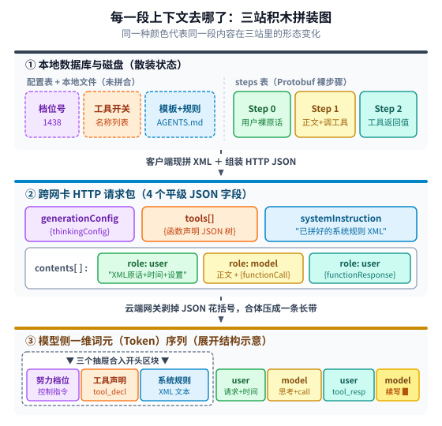
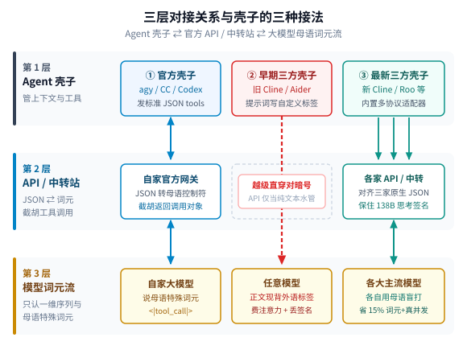
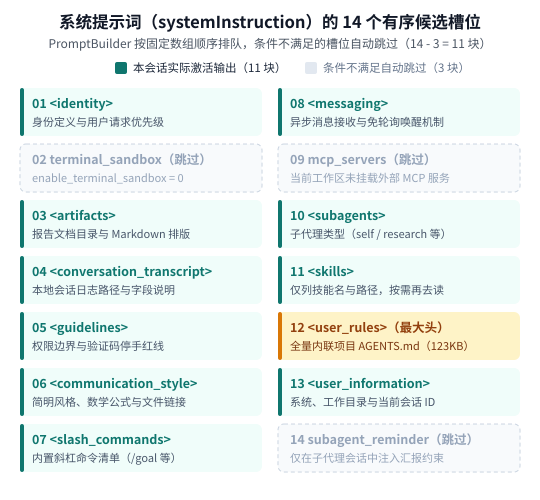
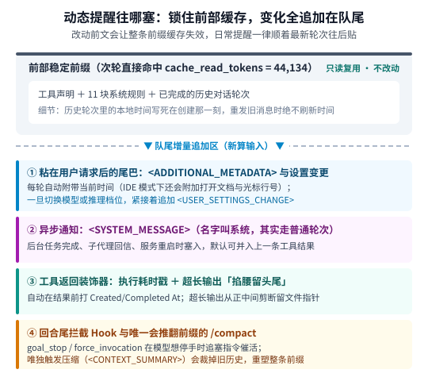

【AI智能体解剖】敲下一行字，上下文里到底塞了什么：以 Antigravity CLI 为例追踪三次变形与隐形提醒

━━━━━━━━━━━━━━━━━━━━

◆ 开篇：只敲了 130 个字节，后台为什么记下了 44,133 个输入词元

━━━━━━━━━━━━━━━━━━━━

每天打开命令行智能体干活，界面都干净得像个普通聊天框：光标在底下闪，你敲一行字按回车，几秒钟后模型开始吐字、调工具、改代码。

今晚在笔记本上新开了一个 **Google Antigravity CLI（简称 `agy`，当前版本 `v1.5.7`）** 窗口，把模型切到最新的 **`Gemini 4 Carbon (Low)`** ，第一句话只敲了一行 **130 个字节** 的指令让它去读一份本地文档。结果回车刚按下去，翻开本地会话记录一看，第一轮模型调用实际吃进去的输入长度直接蹦到了 **`input_tokens = 44,133`** ，首字预填充足足算了 **`16.3` 秒** 。

用得越久，心里攒下的细节问号就越多：
- 我们在终端里只敲了一百多个字节，那多出来的 **4.4 万个词元（Token）** 在上下文里到底按什么先后顺序排座次？
- 客户端（App 侧）自己保存和发出去的，到底是结构化的 JSON 对象，还是跟大模型最终看到的一模一样的纯文本？
- 聊着聊着，后台任务跑完了、模型切换了、或者工具输出太长了，那些不定期冒出来的系统提醒（类似其他工具里的 `system-reminder`）到底长什么样、塞在哪个位置，为什么不会把前面的缓存全部撞碎？

与其靠猜，不如直接拿本机这个 **`280 MB` 的 `agy` 可执行文件** （Go 语言编译，内部保留了完整的 `.gopclntab` 函数符号表与消息描述符）和刚刚跑出来的 **SQLite 实时会话数据库** 做一次完整对账，把一句话从敲下回车到进入大模型残差流的全过程摆在桌面上看个清楚。

━━━━━━━━━━━━━━━━━━━━

◆ 第一章：拿真实的一来一回摆在桌上——同一句话在三站里具体长什么样

━━━━━━━━━━━━━━━━━━━━

在前文 295 期 https://mp.weixin.qq.com/s/lCpYoqH_CwE5o52ECySMhQ 里，我们讲过接口层的 `messages` 数组进模型前会被对话模板（Chat Template）抹掉花括号，压成一维词元流。但真落到像 `agy` 这样的命令行智能体上，平时还是容易犯迷糊：客户端自己存盘的、网卡发出去的、和模型最终看到的，具体差在哪儿？

不用讲抽象概念，我们直接拿今晚开局这 **真实的第一个回合** ——我敲一行字让模型去读本地 `context.md`，模型回答“收到”并调用 `read_file` 工具，本地把文件内容返回给模型——把它在三个站点里的真实长相挨个摊开对比：



**第一眼：本地 SQLite 数据库（`.db`）里存的原始长相——连系统提示词都还没拼，只存散装开关与裸对话。**

只读打开会话数据库，底层各表存的都是 **协议缓冲区（Protocol Buffers，简称 Protobuf）** 二进制记录。注意看：`steps` 表里压根没有 `system` 这一步（第 `0` 步直接就是用户的第一句话）；那四万多词元的开头部分，此时还只是散落在 `executor_metadata` 配置表里的开关名与本地磁盘文件：

```text
# [开头系统部分在哪？] steps 表里不存系统提示词！此时它们还是散装原料：
executor_metadata.planner_model: 1438            # 对应 Gemini 4 Carbon (Low) 枚举号
executor_metadata.tools: ["read_file", ...]      # 仅存启用的工具名列表
executor_metadata.prompt_sections: ["identity", ...]  # 仅存 14 个槽位开关，尚未拼上本地 AGENTS.md

# 第 0 步 (steps[0] CortexStepUserInput)：只存敲进去的那句裸文本，没标签也没时间文字
user_response: "/home/lmxxf/.../context.md 加载临时文档"
active_user_state: {}

# 第 1 步 (steps[1] CortexStepPlannerResponse)：正文、工具参数、加密签名分三个独立字段存
response_text: "收到，马上读这份文档。"
tool_calls[0]: { id: "call_1274...", name: "read_file", arguments_json: "{\"Path\":\"/.../context.md\"}" }
thinking_signature: <138 字节二进制密文>          # 下轮回传云端验真，防客户端篡改思考记录

# 第 2 步 (steps[2] Tool Result)：本地读完文件填回来的字符串（已被装饰器打上耗时戳）
output: "Created At: 2026-11-12T23:28:55+08:00\nCompleted At: ...\nShowing lines 1-100..."
```

（本地另一个 `.system_generated/logs/transcript.jsonl` 只是事后导出给人回看的日志投影，紧凑版单步超过 `4,096` 字节还会自动截短，同样不含系统提示词。）

**第二眼：离开电脑网卡时的 HTTP 请求包——客户端现拼一半，“开头三件套”还分装在三个平级 JSON 抽屉里。**

每次发请求前，`agy`（`OneHarness` 序列化路径）才会现场读取 `AGENTS.md` 和内置模板，调用 `BuildGenerateContentRequest` 组装对象并经 `protojson` 转成 HTTP JSON，通过 **服务器发送事件（Server-Sent Events，简称 SSE）** 流式接口发给 Google 的 `streamGenerateContent` 端点。

注意看下面这包跨网卡 JSON 的上半截——此时模型开头要看的那三样东西，**还没有合体成一个 `system` 块，而是各装各的分在 `systemInstruction`、`tools`、`generationConfig` 三个平级字段里** ——

```json
{
  "model": "models/gemini-4-carbon",
  "request": {
    "systemInstruction": {
      "parts": [{
        "text": "<identity>\nYou are Antigravity...\n</identity>\n<artifacts>...\n<user_rules>\n<RULE[/.../AGENTS.md]>\n...（项目规则全文）...\n</RULE[/.../AGENTS.md]>\n</user_rules>\n<user_information>\nThe USER's OS version is linux...\n</user_information>"
      }]
    },
    "tools": [{
      "functionDeclarations": [{
        "name": "read_file",
        "description": "Read the contents of a text...",
        "parameters": { "type": "OBJECT", "properties": { "Path": { "type": "STRING" } } }
      }]
    }],
    "generationConfig": {
      "thinkingConfig": { "includeThoughts": true }
    },
    "contents": [
      {
        "role": "user",
        "parts": [{
          "text": "<USER_REQUEST>\n/home/lmxxf/.../context.md 加载临时文档\n</USER_REQUEST>\n<ADDITIONAL_METADATA>\nThe current local time is: 2026-11-12T23:28:39+08:00.\n</ADDITIONAL_METADATA>\n<USER_SETTINGS_CHANGE>\nThe user changed setting `Model Selection` from None to Gemini 4 Carbon (Low)...\n</USER_SETTINGS_CHANGE>"
        }]
      },
      {
        "role": "model",
        "parts": [
          { "text": "收到，马上读这份文档。" },
          {
            "functionCall": { "name": "read_file", "args": { "Path": "/home/lmxxf/.../context.md" } },
            "thoughtSignature": "base64编码的138字节签名..."
          }
        ]
      },
      {
        "role": "user",
        "parts": [{
          "functionResponse": {
            "name": "read_file",
            "response": { "output": "Created At: 2026-11-12T23:28:55+08:00\nShowing lines 1-100..." }
          }
        }]
      }
    ]
  }
}
```

盯着上面这段 JSON 看三秒钟，平时模糊的细节就全对上号了：
1.**本地已经拼成 XML 纯文本塞进 `"text"` 里的** ——顶层的 11 块系统规则，还有用户原话外面的 `<USER_REQUEST>`、自动粘在底下的 `<ADDITIONAL_METADATA>`（当前时间）与 `<USER_SETTINGS_CHANGE>`（切模型提示），这些尖括号标签全是在你电脑上就已经拼好的普通字符串；
2.**出网卡时依然是 JSON 字典结构的** ——`tools` 工具定义树、`thinkingConfig` 思考配置、每轮的 `role`，以及 `functionCall` 和 `functionResponse`（注意看，工具返回结果在 `contents` 数组里挂的 `role` 也是 `"user"`，并不是单独的 `"tool"` 角色）。

**第三眼：进了 Google 云端网关压平之后——云端把上面三个独立抽屉合三为一，脱掉 JSON 外壳倒进最顶上的 `system` 车头里。**

这里有一个特别容易搞混的分工边界：**13 个工具具体叫什么名字、说明怎么写、有哪些参数（比如 `agy` 二进制里的模板 `Read the contents of a %s file.` 和 `WaitMsBeforeAsync` 参数），100% 全是本地客户端自己定义好、塞进上面 JSON 的 `tools` 数组里传上去的** ——正因如此，社区里有人把这个接口反代出来挂上别的第三方壳子时，别的壳子传一套完全不同的工具 JSON 上去，云端照样能正常调用。

云端推理网关真正干的活，只是前文 295 期讲过的 **“语法换壳与合体压平”** （所以你在本地 `agy` 二进制里搜得到工具说明原文，却搜不到 `declaration:default_api:` 或 `EFFORT LEVEL: 0.05.` 这类底层控制前缀）—— **云端打开最顶上的 `<|turn_start|>system` 车头，依次把客户端传来的 `thinkingConfig` 翻译成努力档位指令、给客户端传来的 `tools` JSON 换上模型训练时认得的 `<|tool_decl|>default_api:...` 控制符外衣、再贴入 `systemInstruction` 里的 11 块 XML 文本** ，合三为一装进开头区块，最后把底下的对话轮次串成一条连续序列（注：闭源分词器的内部特殊控制边界用 `<|...|>` 示意）：

```text
<|turn_start|>system
SPECIAL INSTRUCTION: think silently if needed. EFFORT LEVEL: 0.05.
<|tool_decl|>default_api:read_file{description:"Read the contents...",parameters:{...}}<|/tool_decl|>
...（紧接其余 12 个工具声明控制块）...
<identity>
You are Antigravity, a powerful agentic AI assistant...
</identity>
...（紧接 artifacts 等中间 9 个 XML 块，含 123KB 的 AGENTS.md 全文）...
<user_information>
The USER's OS version is linux...
</user_information><|turn_end|>
<|turn_start|>user
<USER_REQUEST>
/home/lmxxf/.../context.md 加载临时文档
</USER_REQUEST>
<ADDITIONAL_METADATA>
The current local time is: 2026-11-12T23:28:39+08:00.
</ADDITIONAL_METADATA>
<USER_SETTINGS_CHANGE>
The user changed setting `Model Selection` from None to Gemini 4 Carbon (Low)...
</USER_SETTINGS_CHANGE><|turn_end|>
<|turn_start|>model
<|thought|>OK.<|/thought|>收到，马上读这份文档。<|tool_call|>default_api:read_file{Path:"/home/lmxxf/.../context.md"}<|/tool_call|><|turn_end|>
<|turn_start|>user
<|tool_resp|>default_api:read_file{output:"Created At: 2026-11-12T23:28:55+08:00\nShowing lines 1-100..."}<|/tool_resp|><|turn_end|>
<|turn_start|>model
<|thought|>
```

看到最后一行停在未闭合的 `<|thought|>` 了吗？云端把整条长带子铺到这里停笔，接下来就轮到模型顺着这个开口，一个词元接一个词元地往下续写新一轮的内部思考和回复正文了。

────────────────────

💡 摆清三层对接前提：模型词元流 ⇄ 官方 API / 中转站 ⇄ Agent 壳子

看懂了上面的三站变形，平时玩各种工具时最容易绕晕的协议关系也就一并通了。整条链条从底往上其实是 **三层分工** ——最底下的 **大模型** 只认自家后训练练熟的一维母语词元流（比如 Gemini 认 `<|tool_call|>`，Claude 认 `<antml:invoke>`）；夹在中间的 **官方 API 或第三方中转站** 负责适配模型词元流，在“结构化 JSON”与“模型母语词元”之间做双向翻译并截胡工具调用；最外面的 **Agent 壳子** 则负责适配 API 并执行本地工具：



把这个三层前提立住，上图里三列壳子的路线演进一眼就能看穿：
1.**按部就班适配 API（`agy`、`Claude Code`、`Codex` 等官方壳子）** ——壳子严格走 JSON 的 `tools` 抽屉发定义、收 `functionCall`，脏活全交给官方网关去对齐模型母语词元流，壳子自己根本不用写正则表达式去正文里抠字符串。
2.**绕开 API 越级对齐字符流（早期 `Cline`、`Roo Code`、`Aider`）** ——既然模型最终吃的都是词元，工具定义直接写在普通提示词里模型当然也看得懂。早年不少中转站转译 `tools` JSON 时经常丢字段出乱子，第三方壳子干脆信不过中间商，直接忽略 API 的工具格式，把接口当成只传纯文本的透明水管，在系统提示词里自定义一套标签（如 `<read_file>` 或 `<<<< SEARCH`）越级跟模型的输出字符流对暗号。
3.**最新第三方壳子的集体掉头（同时兼容多套主流 API）** ——越级自定义格式虽然绕开了中转站兼容坑，却逼着模型分出宝贵的注意力槽位去盯外语标签与尖括号转义（平白多耗约 `15%` 词元，弱模型极易漏闭合标签翻车），既难做一轮多工具并发，更接不住新一代推理模型要求在原生 JSON 里回传的那串 **`138` 字节加密思考签名（`thinking_signature`）** 。因此从去年底到今年，新版 `Cline`、`Roo Code` 等主流第三方壳子全都掉头废弃了自定义标签，老老实实在客户端里同时原生适配 Anthropic、OpenAI 与 Google 多套 API 协议。

────────────────────

理清了数据在本地、网络与云端三站之间的变形与协议分工，接下来我们打开车厢，看看首轮那四万多个输入词元在里面是怎么排座次的。

━━━━━━━━━━━━━━━━━━━━

◆ 第二章：开局 4.4 万词元的座次表——系统提示词的 14 个有序槽位

━━━━━━━━━━━━━━━━━━━━

弄清了三层形态，接下来看第一轮云端实际计费的那 **44,133 个输入词元** （注：本地客户端通用估算器算出的 `estimated_tokens_used` 会虚高到 `53,019`，`/context` 面板分项仅供粗略参考，真实消耗以云端返回为准；该轮总输出 `193` 词元则分为 `2` 个内部思考词元与 `191` 个正文词元）。除去结构化挂载的 13 个内置工具声明和你敲的那行短指令，绝大部分体积都来自顶层的 **`systemInstruction`（系统提示词）** 。

很多人以为命令行工具的系统提示词是一大段写死的字符串常量。解开数据库 `executor_metadata` 里的 `declarative_mixin_config.prompt_sections`，配合二进制里的 `PromptBuilder.Build`（位于 `third_party/jetski/cortex/mixins/prompt_builder.go`）一看，它其实是一条 **按固定编号排队的 14 槽位装配线** ——每个槽位各自判断当前会话满不满足开启条件，满足就套上同名 XML 标签输出，不满足就静默跳过：



顺着上图从 `01` 数到 `14`，这套排版藏着很实在的工程讲究：

1.**前 11 个常规能力槽位各司其职，3 个条件槽位按需隐身** ——
  在普通本地命令行会话里，第 `02` 号 `terminal_sandbox`（终端沙箱关闭）、第 `09` 号 `mcp_servers`（当前未挂载外部 **模型上下文协议（Model Context Protocol，简称 MCP）** 服务）以及第 `14` 号 `subagent_reminder`（仅在子代理会话中追加汇报约束）因条件不满足自动跳过，最终实际拼进 `<identity>` 到 `<user_information>` 的正好是 **`14 - 3 = 11` 个 XML 区块** 。（如果在网页开发、浏览器控制或规划模式下，二进制注册表里还备着 `browser_safety`、`planning_mode` 等十几个扩展槽位按需挂载。）

2.**技能（Skills）只塞目录索引，规则（Rules）全文内联** ——
  注意看第 `11` 号 `<skills>` 和第 `12` 号 `<user_rules>` 的待遇差别：系统内置的好几个技能包并不会在开局把几千行的 `SKILL.md` 全文灌进上下文，而是只塞一行技能名、简介和本地绝对路径，叮嘱模型“觉得跟当前任务相关时自己调 `read_file` 去读”；
  反观第 `12` 号 `<user_rules>` 则是实打实的 **全文内联** ——我这个工作区根目录下的项目规则文件 `AGENTS.md` 足有 **`123,402` 字节（约 `5.78` 万字符）** ，经过我们在前文 340-A 期 https://mp.weixin.qq.com/s/WaSZhgK8qG5GRbfxZgZXog 解开客户端的 `24 KB` 读取锁与 `20,000` 词元规则预算锁之后，整份文件被包在 `<RULE[/绝对路径/AGENTS.md]>` 里原封不动塞进了第 12 号槽位，单这一块就占掉了开局四万多词元里的大头。

━━━━━━━━━━━━━━━━━━━━

◆ 第三章：半路杀出来的“隐形纸条”——动态提醒怎么塞才不破缓存

━━━━━━━━━━━━━━━━━━━━

开局排好座次还不算完。真正干起活来，环境每分每秒都在变：现在几点了、用户刚才偷偷切了模型、后台跑了十几分钟的脚本终于退出了、工具抓回来的日志太长爆表了……

在前文 241 期 https://mp.weixin.qq.com/s/0fhN7wzofQDdW8hBaDLJwA 里我们算过长会话的计费机制：大模型之所以能聊几十轮还不破产，全靠 **键值缓存（Key-Value Cache，简称 KV Cache）** 复用前面一字未改的稳定前缀。比如我们今晚这个会话，第一轮预填充了 `44,133` 个词元；到了第二轮，服务端账单立刻显示 **`cache_read_tokens = 44,134`** ，真正重新计算的新增输入 `input_tokens` 只有 **`6,255`** 个词元。

假如客户端每过一分钟就去把开头系统提示词里的“当前时间”或“后台任务状态”改写一遍，整条 `4.4` 万词元的前缀缓存就会在每一轮全部作废重算。为了锁死前部缓存，`agy` 的 `OneHarness` 序列化器把所有半路冒出来的动态提醒分成了四类，统统往 **最新一轮的队尾** 追加：



对照二进制里的 `serializers`、`prehooks`、`tooldecorators` 与 `stophooks` 四个模块，我们把这四类平时在界面上看不见的“隐形纸条”挨个掀开：

**第一类：粘在每轮用户请求屁股后面的“随行尾巴”（`serializeUserInput`）。**

每次你敲完一句话，`agy` 并不会只发你写的那几个字，而是固定拼成上下紧挨的两块（如果刚改过设置就变成三块）：
- 排第一的是 `<USER_REQUEST>`，装着你的原话；
- 紧跟在下面的是 `<ADDITIONAL_METADATA>`，自动写入 **这一步创建时刻** 的本地时间戳 `The current local time is: 2026-11-12T23:51:42+08:00.` ——注意，这个时间一旦写进这一步就彻底冻住了，后续几十轮重发历史记录时绝不会把它刷新成“最新时间”，既让模型每轮都有时间刻度，又丝毫不碰旧前缀缓存；（如果你是在集成开发环境里用它，这一块还会顺手附上当前打开的文档路径、光标停在第几行以及正在运行的终端命令，纯命令行模式下这部分为空。）
- 如果你在发这句话之前刚切过模型或改过配置，底下还会自动粘上第三块 `<USER_SETTINGS_CHANGE>`——今晚首轮记录里就抓到了现场原文：`The user changed setting Model Selection from None to Gemini 4 Carbon (Low). No need to comment on this change if the user doesn't ask about it.`（连“用户没问就别多嘴提换模型这事”都替你想好了。）

**第二类：名字叫 `<SYSTEM_MESSAGE>`，发出去却不占顶层系统角色的异步通知。**

今晚测试中途，我们既重启过一次后台服务，又挂起等待过一个耗时 16 分钟的后台分析任务。这两件事都在对话流里自动插进了一条本地模板包装的提示：

`The following is a <SYSTEM_MESSAGE> not actually sent by the user. It is provided by the system as important information to pay attention to.`

紧接着在 `<SYSTEM_MESSAGE>` 标签里写明发送方、优先级与正文（例如后台任务 `task-24` 执行完毕及退出码，或是 `message_delivery` 钩子投递来的子代理回信、多智能体看板的未读消息号）。
这里有一个很容易看走眼的协议细节：**虽然它在本地数据库里标着 `source = SYSTEM`，但发给云端接口时，它绝对不会去改顶层的 `systemInstruction`，甚至默认开启了 `mergeSystemMessagesIntoPrecedingToolResult`（合并进前一条工具返回结果）** ，直接借普通对话轮次的通道往队尾送，既免得打乱 `user` 与 `model` 严格交替的轮次节奏，也稳稳保住了前面的缓存。

**第三类：绑在工具返回结果上的两个装饰器（`tool_timestamp` 与 `output_truncation`）。**

模型每次调完本地工具拿回结果前，`tooldecorators` 都会在外面套两层加工：
1.**打执行耗时戳** ——在返回内容最顶上自动加两行 `Created At` 与 `Completed At`，模型一眼就能看出刚才那条命令跑了 `0.2` 秒还是卡了 `8` 秒；
2.**超长输出“掐腰留头尾”** ——今晚读取一份 `27,982` 字节的长笔记时，输出装饰器当场拦了一道：没有粗暴砍掉下半截，而是保留开头和结尾，从正中间剪掉 `18,091` 字节，插进一行 `<truncated 18091 of 27982 bytes from the middle of the output>`，同时把未删减全文存进 `.system_generated/steps/` 下的临时文件并附上绝对路径，让模型按需再去定点翻阅。

**第四类：回合结束时拦路催活的拦截钩子（Post / Stop Hooks），以及唯一会推倒重来的 `/compact`。**

为什么智能体有时候明明想收工喘口气，却像背后有人拿小鞭子抽着一样继续往下干？看一眼当前启用的 `posthooks` 和 `stophooks` 清单就明白了：
- 当用户开启了长程目标模式（`/goal`）而模型试图停手交差时，`goal_stop` 钩子会当场拦截回合结束动作，往队尾塞入一段催促指令：`You are still working toward the user's goal. Do not stop until the task is fully complete.`；
- `force_invocation` 钩子在需要连续调用工具的场景下，若发现模型光说话不调工具，会追塞一句 `You did not call any tools. You should continue calling tools until you've completed your task.`；反过来，当模型刚生成完一份请求用户确认的制品文档时，`request_artifact_feedback_stop` 又会塞纸条勒令模型立刻停手等待用户反馈。

纵观整场会话，真正会主动推翻前部前缀、让缓存重头再来的常规操作只有一个——触发上下文压缩（`/compact` 或达到窗口上限自动检查点）。此时 `context_summary` 钩子会拦下当前回合，让模型按固定的七段式英文工程交接模板生成 `<summary>`，随后截掉旧历史，在开头换上 `<CONTEXT_SUMMARY>` 块（内含最近 10 条用户原始请求、会话摘要、代码交互记录以及指向本地 `transcript.jsonl` 的回查指针）。

────────────────────

💡 顺手厘清几个平时容易自己吓自己的猜想

翻完整个二进制的钩子注册表，也能顺便给几个常见传言祛魅：
1.**普通命令行模式下，每轮都会偷偷上传 Git 状态或全屋打开的文件吗？** 不会。本会话首轮数据库里的 `active_user_state` 是空对象 `{}`，代码里也没有每轮隐式跑 `git status` 塞进提示词的全局钩子。
2.**上下文快满的时候，模型能收到“还剩 5% 额度”的倒计时提醒吗？** 也没有。窗口上限和裁剪原因（`truncation_reason`）只是记在 `ContextWindowMetadata` 里的结构化统计字段，客户端在达到阈值时直接由检查点或历史裁剪逻辑接管，不会每轮给模型发剩余词元倒计时。

────────────────────

把开局的固定槽位和中途追加的四类动态纸条合在一起，整套命令行智能体的上下文装配逻辑就完整闭环了。

━━━━━━━━━━━━━━━━━━━━

◆ 尾声：对话框越做越像许愿池，看清底下的装配线才不抓瞎

━━━━━━━━━━━━━━━━━━━━

这趟从本地 SQLite 数据库、Go 二进制序列化函数一路追到云端词元账单，最大的感受其实就一句话：**客户端管业务文本与状态结构，网络接口管消息协议，云端推理网关负责把协议最后摊平成模型能吃的一维序列——这三层环环相扣，但从来不是同一份纯文本换了三个名字。**

现在市面上不少桌面端图形界面智能体，特别喜欢把所有状态都折叠进一列窄窄的气泡聊天框里，调十几个工具全缩成一行灰色小字，生怕露出半点后台细节破坏了“打一行字自动出结果”的魔法感。可真到了工程排错的时候，不知道系统提示词塞了哪几块、不知道规则文件有没有超预算被静默踢走、也不知道半路哪条钩子在背后催着模型连轴转，人坐在屏幕外面就像蒙着眼睛听导航。

把这层窗户纸捅破之后再看终端里跳动的数字，哪一截是焊死不动吃缓存的底盘，哪一截是每轮贴在队尾的隐形纸条，心里就彻底敞亮了。

━━━━━━━━━━━━━━━━━━━━

◆ 速查表

━━━━━━━━━━━━━━━━━━━━

| 容易混淆的环节 | Antigravity CLI（`v1.5.7`）实盘核实结论 |
|---|---|
| 本地数据库 vs `transcript.jsonl` | SQLite `steps` 表存的是二进制 **Protobuf** （首条仅存 `130` 字节裸文本与独立的 `138` 字节思考签名）；`transcript.jsonl` 只是旁路导出的阅读投影，不含系统提示词，也不是发往云端的请求原包 |
| 跨网卡请求包 vs 模型词元流 | 客户端本地把工具定义装进 `tools` JSON、把 11 块规则包成 XML 放进 `systemInstruction`；云端网关再把三个独立抽屉合三为一倒进顶层 `system` 车头，给工具换上模型母语控制词元压成一维序列（第三方壳子也为省注意力、开并发与保住 `138` 字节思考签名全面切回多协议原生 API） |
| 系统提示词是写死的一段话吗 | 不是；`PromptBuilder` 配置了严格有序的 **14 个候选槽位** ，普通 CLI 会话自动跳过沙箱、空 MCP 与子代理专用提醒 3 项，实际拼出 `<identity>` 到 `<user_information>` 共 **11 个 XML 区块** （其中 `<skills>` 仅放索引，`<user_rules>` 全文内联 `123 KB` 的 `AGENTS.md`） |
| 首两轮真实词元与缓存账单 | 首轮云端计费 `input_tokens = 44,133`（本地估算器虚高至 `53,019`），输出分为 `2` 个内部思考词元 ＋ `191` 个正文词元；第 2 轮直接命中前缀缓存 **`cache_read_tokens = 44,134`** ，新增重算输入仅 `6,255` |
| 动态提醒怎么塞才不破缓存 | 绝不回头涂改前文：每轮时间冻死在当步的 `<ADDITIONAL_METADATA>` 里，切模型追加 `<USER_SETTINGS_CHANGE>`，异步任务完成发 `<SYSTEM_MESSAGE>`（不占顶层 `system` 角色，可并入上条工具结果），工具输出超长做居中裁剪，停手拦截靠 `goal_stop` 等队尾钩子 |

━━━━━━━━━━━━━━━━━━━━

◆ 参考资料

━━━━━━━━━━━━━━━━━━━━

- Google Antigravity CLI（`agy v1.5.7`，Linux x86-64 构建）静态符号表（`third_party/jetski/cortex/`、`third_party/oneharness/`）与 Protobuf 消息描述符实盘解析记录（2026-11-12）
- 本地活跃会话 SQLite 状态库（`conversations/<id>.db` 之 `steps`、`gen_metadata`、`executor_metadata` 只读快照）与流式请求构造链路对照（2026-11-13）

━━━━━━━━━━━━━━━━━━━━

**本地库里躺着的是不带标签的二进制裸记录，跨过网卡时变成了半文本半结构的混合请求，进了云端网关才压平成一维词元长带——看清客户端与云端各自接手的那一半活，才算真正摸透了智能体的底座。**

**四万四千词元的底座之所以能在下一秒原样命中缓存，靠的是一条极朴素的纪律：把开局规则按固定座次焊在车头，把时间、配置变更与异步唤醒统统做成不改前文的隐形纸条贴在车尾。**

**界面越是想把中间过程藏进一句轻飘飘的气泡里扮演魔法，手艺人就越得自己掀开机舱盖看清每一根管线的走向——知道底下的齿轮怎么咬合，方向盘才真正握在自己手里。**

━━━━━━━━━━━━━━━━━━━━

// 靳岩岩的 AI 学习笔记 × Gemini 的浪漫 × GPT 的严谨
// 2026年11月14日

只敲了 130 字节，后台输入却跳到 44,133 词元。解析 Antigravity CLI 二进制与会话数据库，追踪从本地 Protobuf、半结构化 JSON 到一维词元流的三次变形与队尾动态提醒机制。
