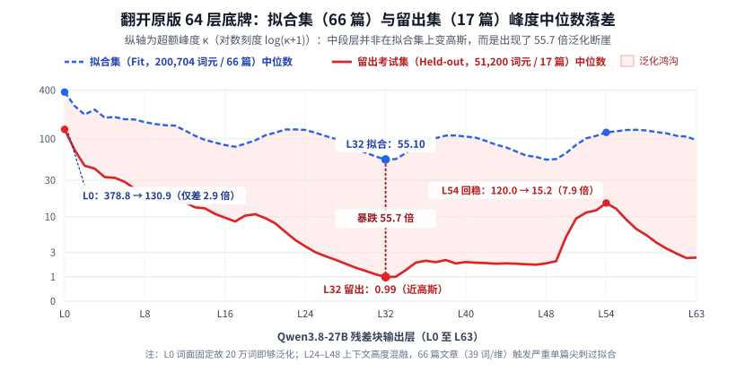
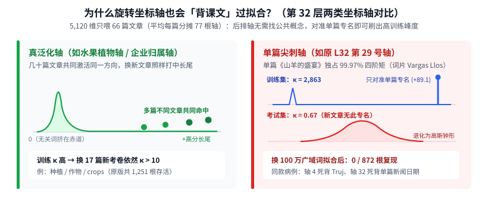
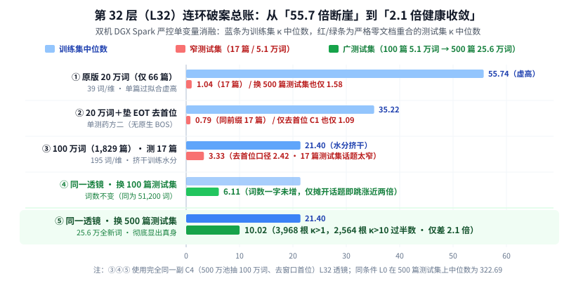

【ICA-Lens 破案】原作者一眼盯住“第 32 层 = 0.99”之后：双机重跑 500 万词，揪出两头一起骗人的采样陷阱

━━━━━━━━━━━━━━━━━━━━

◆ 开篇：开源刚满四小时，原作者在评论区抓出了一个不对劲的数字

━━━━━━━━━━━━━━━━━━━━

在前文 369 期 https://mp.weixin.qq.com/s/d0a-0B-shqgmzOkUbjtfcg 里，我们用家里的两台 DGX Spark 花 133 分钟拧出了 `Qwen3.8-27B` 全部 64 层（共 `327,680` 根坐标轴）的中英双语 **独立成分分析透镜（Independent Component Analysis Lens，简称 ICA-Lens，原理见前文 367 期 https://mp.weixin.qq.com/s/dvU20vg3R033QFlAgmOX3A ）** ，把权重开源到了 HuggingFace，顺手给原作者刘思达团队的官方仓库提了一个社区收录 Issue（ *https://github.com/liusida/ica-lens-paper/issues/4* ）。

没想到开源刚过四个小时，刘思达就在凌晨连回了五条评论，第一眼就盯住了我们报告里的一个数字—— **第 32 层（`L32`）在留出测试集上的 4 次方超额峰度（Excess Kurtosis，记作 `κ`）中位数只有 `0.99`** ——

**“0.99 at L32 — this might be alarming. should not be like that low. 0.99 is basically Gaussian.”** （第 32 层只有 0.99 有点不对劲，不该低成这样，0.99 基本上就是纯高斯噪声了。）

在前文 369 期画全模型地形图时，我们看到留出集峰度从第 0 层的 `130.87` 一路降到第 32 层的 `0.99`，再到第 54 层回升至 `15.24`，当时的第一反应是把它全部解释成“模型走到正中间时，上下文揉成了一团稠密的高斯暗箱”。

但刘思达凭着做遍大小模型的经验，当场提出了两个非常具体的工程怀疑，甚至在连夜发布的 `icalens 0.4.1` 新版文档里，直接拿我们的文件名 `Qwen3.8-27B_jacobian_lens.pt` 当示例加好了 **雅可比透镜（Jacobian Lens，简称 J-lens，见前文 365 期 https://mp.weixin.qq.com/s/I1puPtcgynImhOqHlRmwDg ）** 的原生挂载接口：

1.**怀疑一（样本太稀触发过拟合）** ——`Qwen3.8-27B` 的残差流宽度是 `5,120` 维，我们拟合用的 `200,704` 个词元除下来，平均每个维度只摊到 **`39` 个词** 。他建议先对比一下第 32 层在 **拟合集（Fit，相当于平时做的练习题）** 与 **留出集（Held-out，相当于没见过的新考卷）** 上的峰度落差，并试着像他们处理小模型那样，先在 **500 万个词元** 的大文档池上跑前向，再随机打散抽样 **100 万个词元** 来拧坐标轴；
2.**怀疑二（窗口第 0 位“下水口”污染圆心）** ——大模型读长文时习惯把无处安放的多余注意力全倒在每个输入窗口的第 0 个位置上，导致第 0 位的向量长相怪异。他建议在每个窗口开头垫一个起始符，再把第 0 位的向量踢出均值计算。

这两个怀疑到底谁是真凶？如果把水分挤干，前文 369 期看到的“早层高、腰部低”的沙漏地形还在不在？今天回到北京家里，我们直接拉起两台 DGX Spark，锁定第 0 层和第 32 层跑完了全套单变量对照实验。跑出来的底牌，比我们和原作者事先猜的都更有意思。

━━━━━━━━━━━━━━━━━━━━

◆ 第一章：翻开旧账本吓一跳——66 篇课文分 5,120 根轴，后排全在“背专名”

━━━━━━━━━━━━━━━━━━━━

动手重跑之前，我们先按刘思达说的办法，把本地磁盘里早就存好、但写前文 369 期时没并排细看的 **拟合集峰度** 翻出来，跟 **留出考试集峰度** 摆在同一张图上对账——

图一画出来，案子当场破了一半：

- 在 **第 0 层（`L0`）** ，练习题上的峰度中位数是 **`378.81`** ，换到新考卷上是 **`130.87`** （`5,120` 根轴里有 `5,058` 根依然跨过 `κ > 10`），两边只差 **`2.9 倍`** ，稳稳当当；
- 可到了正中间的 **第 32 层（`L32`）** ，练习题上的峰度中位数明明高达 **`55.10`** （全部 `5,120` 根轴 `100%` 满足 `κ > 1`，足足 **`3,920` 根轴** 跨过 `κ > 10`），根本不是什么高斯分布；结果一换到新考卷上，中位数瞬间摔成了 **`0.99`** ，两边差出了惊人的 **`55.7 倍`** 。

看到这儿，一个很反直觉的问题就冒出来了：**我们又没有训练几千万参数的神经网络，只是把 `5,120` 维空间原地旋转了 50 步，怎么旋转个坐标轴也能“死背课文过拟合”？**

我们去数了一下原版语料文件里的**文章篇数**，一下全明白了。

当时为了凑够 `200,704` 个拟合词元，脚本允许从每篇维基百科长文里连续切出最多 `4,096` 个词元——结果 `20` 万个词元合起来，一共只切自 **区区 `66` 篇文章** （英文 `32` 篇加中文 `34` 篇；而 `51,200` 个词元的留出考试集更是只切自 **`17` 篇文章** ）。

算笔小学除法：我们要拧出 **`5,120` 根** 互相垂直独立的坐标轴，可手头的教材统共只有 **`66` 篇课文** —— **平均每 1 篇课文，要分摊整整 `77` 根专属坐标轴** 。

先拿一个只有 4 个句子的极简例子想想 `FastICA` 会怎么偷懒：它的唯一目标是让某根轴上的读数“平时全是 `0`、偶尔蹦出几个大数”（这样 4 次方峰度 `κ` 最高）。
- 在 **第 0 层** ，每个词还没掺进上下文。同一个汉字 `“的”` 或英文 `“apple”`，不管出现在哪篇文章里，向量长得几乎一模一样，想拿高分就只能老老实实对准常见字本身，换新文章照样管用；
- 可到了 **第 32 层** ，前面已经过了 32 层注意力，每个位置的向量都揉进了整段话的前因后果，20 万个位置变成了 20 万个各不相同的点。这时候排在前四分之一的强公共概念（比如前文 369 期测出的“水果植物轴”和“企业归属轴”，共 `1,251` 根在考卷上依然 `κ > 10`）信号够强，还能跨文章立住；而剩下的几千根轴在 `5,120` 维里自由度太充裕，干脆走起了作弊捷径—— **直接把箭头对准某 1 篇课文里独有的生僻人名或日期格式** ，让别的文章投影全抵消成 `0`，白嫖几千分的练习题峰度。

我们直接把原版第 32 层里“练习题分数奇高、一上考场就归零”的三根代表轴揪出来解码成原文，当场抓了个人赃并获——

看这三根活生生的“背课文专用轴”：

1.**原 `L32` 第 29 号轴（练习题 `κ = 2,863.46` → 考卷 `κ = 0.67`）** ——全场的四阶峰度贡献里，**`99.97%` 独占自同一篇英文维基条目《山羊的盛宴》（*The Feast of the Goat*）** ，专门盯着秘鲁作家巴尔加斯·略萨姓氏里的半截词片 `Vargas Llos` 飙出 `+89.1` 分；
2.**原 `L32` 第 4 号轴（练习题 `κ = 1,493.40` → 考卷 `κ = 0.84`）** ——前 100 次最高激活 **`100%` 全在同一篇《山羊的盛宴》里** ，专门死背该小说里多米尼加独裁者特鲁希略姓氏的半截词片 `Truj`（`+60.3` 分）——光这一篇小说就霸占了好几根上千分的私人定制针；
3.**原 `L32` 第 32 号轴（练习题 `κ = 1,122.91` → 考卷 `κ = 0.84`）** —— **`99.87%` 的四阶矩全押在第 `137` 号中文新闻编年表一篇文档上** ，专门背这篇流水账里的空行日期头 `“\n\n7月21”`、`“\n\n7月27”`、`“\n\n7月28”` 。

新考卷那 17 篇文章里既没有略萨也没有特鲁希略，几万个陌生句子往这些私人定制针上一投影，正负随机抵消，自然全退化成了 `κ < 1` 的高斯钟形曲线。

━━━━━━━━━━━━━━━━━━━━

◆ 第二章：先审二号嫌疑犯——窗口第 0 位的“注意力下水口”，背不背这口锅？

━━━━━━━━━━━━━━━━━━━━

抓到了“66 篇课文背专名”的一号嫌犯，我们还不能急着结案——刘思达提的第二个怀疑（窗口第 0 位的离群干扰）到底占多大分量，得单独拎出来验明正身。

先用一个具体现象说说什么是窗口第 0 位的 **“注意力下水口”（Attention Sink，也常译作注意力汇）** 。在 Transformer 的注意力层里，所有历史词元分到的注意力权重加起来等于 `100%`。当模型读到半截句子、觉得前面并没有哪个词值得重点关注时，多出来的那七八成权重总得找个地方排掉；预训练下来，模型养成了一个普遍习惯—— **把无处安放的多余权重全倒进当前窗口的第 0 个格子（`position-0`）里当“下水口”** 。

很多欧美模型（如 Llama、Gemma）会在每段开头自带一个专门的序列起始符（Beginning-of-Sequence，简称 `BOS`）去接这股下水；但我们查了 `Qwen3.8-27B` 的分词器配置，它的原生 `bos_token` 是空的（`None`）。我们在前文 369 期直接把正文第 1 个字摆在第 0 格，结果第 32 层实测下来：
- 窗口内普通位置（第 1 格及以后）的残差向量长度中位数是 **`83.57`** ；
- 而站在 **第 0 格** 的首个正文词，向量长度中位数被灌到了 **`217.02`** （足足大了 **`2.6 倍`** ）。如果我们按刘思达的思路，在每个窗口前先垫一个文档结束分隔符 `<|endoftext|>`（词表编号 `248044`）替正文挡刀，首个正文词的长度立刻回落到了温和的 **`61.81`** 。

看起来很像凶手对不对？可我们把向量按 `ICA-Lens` 的规矩先缩到单位球面上再算平均值（`center`）一看：因为每个窗口长达 `512` 个词，第 0 格只占五百分之一，踢掉第 0 格之后，第 32 层的球面圆心只挪动了微不足道的 **`0.41%`** 。

真刀真枪拉上原版 20 万词跑两组单变量对照（`C1` 不改输入直接踢掉每个窗口第 0 格并用同源非零位置补齐词数；`C2` 窗口开头垫 `<|endoftext|>` 再踢掉第 0 格），第 32 层的考试成绩当场揭晓：
- **`C0`（原版 20 万词基线）** ——练习题 `55.74` → 17 篇考卷 **`1.04`** （同去首位口径 `1.02`）；
- **`C1`（20 万词，仅踢掉第 0 格）** ——练习题 `55.01` → 同去首位口径考卷 **`1.09`** （几乎纹丝不动）；
- **`C2`（20 万词，垫 `<|endoftext|>` 再踢第 0 格）** ——练习题 `35.22` → 同前缀考卷 **`0.79`** （不但没治好，反而因为给本无 `BOS` 的 Qwen 强塞了陌生前缀，轻微扰动了 48 层线性注意力的初始递归状态）。

二号嫌疑犯当场洗脱主嫌：**只要底层教材还是那 66 篇课文，怎么伺候窗口第 0 位，第 32 层的考试峰度都跨不过 `1.1`** 。

━━━━━━━━━━━━━━━━━━━━

◆ 第三章：双机过 500 万词大池——最后一道反转，竟藏在“17 篇考卷”自己身上

━━━━━━━━━━━━━━━━━━━━

排除了干扰项，两台 DGX Spark 正式火力全开验证一号药方。因为这次只锁定第 0 层和第 32 层对账，我们直接让模型跑到第 32 层抄完数就“半路下车”，连第 33 至 63 层的权重都不装进内存，立省 `26 GiB` 统一内存且前向提速近一倍。

我们严格避开留出考试集，重新拉取了一个横跨 **`1,829` 篇长文章** （英文 `805` 篇加中文 `1,024` 篇，文章广度扩大 **`27.7 倍`** ）、总计 **`5,000,000` 个词元（500 万词）** 的 1:1 双语大池，再按固定随机种子从中不放回地打散抽样 **`1,000,000` 个词元（100 万词，每个维度分摊 `195.3` 个词，密度放大 5 倍）** 送进 `FastICA`（`C3` 保留窗口首位，`C4` 直接在原始窗口里踢掉首位，`C5` 垫 `<|endoftext|>` 踢首位）。

第一眼拿到 `100 万词` 新透镜在原版 `17` 篇考卷上的成绩单时，出现了一个既在意料之中、又留着半截悬念的数字：

- **好消息是作弊水分彻底挤干了** ——第 32 层的练习题峰度中位数从虚高的 **`55.74` 大幅回落到了 `21.74`（`C3`）和 `21.40`（`C4`）** ；之前抓出来的那 **`872` 根“背课文尖刺轴”** （原练习题 `κ > 50` 且考卷 `κ < 1`），在新透镜里的读取方向匹配余弦中位数跌到了 `0.11`，超过 `0.8` 复现的根数是干净利落的 **`0 / 872`（全军覆没）** ；
- **中英文“苹果”在第 32 层当场会师满分** ——在本次重采的 20 万词 `C0` 里，第 32 层英文和中文盲选挑的还不是同一根轴（中文盲测 `87.5%`）；而换上 **100 万词（`C3 / C4 / C5` 三组）** 后，第 32 层中英文 **`100%` 盲选撞上同一根第 1 名坐标轴** ，且两边留出消歧准确率双双升至 **`100%`** ；
- **可奇怪的悬念是** ——`C3` 和 `C4` 在那份 `51,200` 词的原版留出考卷上，峰度中位数虽然从 `1.04` 翻了两三倍涨到 **`2.40` 和 `3.33`** （去首位同口径 `2.39` 和 `2.42`，`κ > 10` 强轴从 `1,246` 根涨到 **`1,736` 根** ），但离它自己的练习题中位数 **`21.40`** 怎么还隔着七八倍？

盯着 `21.40` 和 `3.33` 这两个数想了三秒，我们突然反应过来：**光顾着查训练集只有 66 篇课文，忘了我们的留出考试集总共也只有 `17` 篇文章（英文 6 篇加中文 11 篇）。**

拿一个最直观的比方一算就通了：
- 在 **第 0 层** ，坐标轴认的是 `“的”`、`“不”`、`“the”` 这种高频单字，随便抽 **17 篇文章** 当考卷，每个常见字都能出场几十次，自然能测出 `150+` 的高分；
- 可到了 **第 32 层** ，`5,120` 根坐标轴认的是跨句子的 **具体百科话题与语义组合** （比如一根轴管“有机化学反应”，一根轴管“文艺复兴建筑”，一根轴管“果园农作物”）。哪怕这 `5,120` 根尺子根根都是货真价实的泛化好尺子，你只拿区区 **17 篇维基条目** 去考它们， **至少四分之三的话题在这 17 篇文章里连一次出场机会都没有** ——一次对口话题都没撞上的真尺子，读数全在零附近微微起伏，算出来的考卷峰度可不就被死死按在两三分了吗？

验证这个推论只需要两分半钟：我们完全不动刚拧好的透镜，严格排除此前用过的全部 `1,846` 篇文章，从维基语料后面全新抽取了两份 **每篇只切 1 个 `512` 词窗口** 的广域新考卷——第一份是 **100 篇全新文章（总词数分毫不差，还是精确的 `51,200` 个词，只把话题从 17 篇摊开到 100 篇）** ，第二份是 **500 篇全新文章（`256,000` 个词）** 。

结果一出炉，最后一块拼图严丝合缝地扣上了——

看上图里的第四行和第五行，同一个 `C4`（100 万词去首位）透镜一字未改，只把考卷的话题摊开：

1.**词数一字不增（同样精确 `51,200` 词），仅从 17 篇换成 100 篇新文章** ——第 32 层的考试峰度中位数当场从 `3.33` **跳涨近两倍冲到 `6.11`** （`κ > 10` 的强长尾轴从 `1,736` 根涨到 **`2,193` 根** ），反观 66 篇拧出来的旧版 `C0` 换上同一份百篇考卷依然只有 **`1.10`** ；
2.**扩到 500 篇全新文章（`25.6` 万词）** ——`C4` 的考试峰度中位数直接突破两位数冲上 **`10.02`** （`C3` 也达到 **`9.75`** ），全层 `5,120` 根轴里有 **`3,968` 根（`77.5%`）** 跨过 `κ > 1`，**`2,564` 根（`50.1%`，正式过半）** 跨过强长尾门槛 `κ > 10`，与它自身的拟合中位数 `21.40` 只差 **`2.1 倍`** ，连原版第 0 层的泛化比（`2.9 倍`）都追平了（而旧版 `C0` 在这 500 篇大考卷上依旧趴在 **`1.58`** 动弹不得）。

────────────────────

💡 结案清点：既还了第 32 层的清白，也保住了“双峰沙漏”的大骨架，顺手跑通 `0.4.1` 合体

把这趟连环破案的最终物理结论理成三句话，两边不偏不倚：

- **第一，刘思达盯住 `0.99` 的直觉非常准** ——第 32 层绝不是纯高斯浆糊。此前 `0.99` 的极端低分，是由 **“训练集仅 66 篇文章导致后排轴死背专名过拟合”** 与 **“测试集仅 17 篇文章导致大半真话题轴没机会出场”** 两头共同挤压出来的假象；换上 `1,829` 篇百万词拟合配 `500` 篇广域考卷后，第 32 层过半数坐标轴都有着 `κ > 10` 的扎实非高斯长尾，真实中位数在 **`10.02`** ；
- **第二，前文 369 期看到的“早层高、腰部深谷”跨层规律依然稳稳成立** ——在完全相同的 `500` 篇广域考卷上，第 0 层 `C4` 的留出峰度中位数高达 **`322.69`（`5,120` 根轴 `100%` 满足 `κ > 10`）** ，从第 0 层的 `322.69` 潜入第 32 层正中央的 `10.02`，依然有着超过 **`32 倍`** 的真实物理下潜（同时提醒一个诚实细节：即便在百万词下，两次独立拟合之间能做到读写双向余弦都 `> 0.8` 逐根锁死的比例仍只是少数强轴，说明中层还有大量等效旋转子空间与慢收敛维度，不能把五千根轴全当成唯一焊死的原子概念）；
- **第三，无原生 `BOS` 模型别强塞代理前缀，且 `icalens 0.4.1` 双镜合体已验证跑通** ——对 `Qwen3.8-27B` 这类无 `BOS` 模型，不改输入、直接在拟合时剔除窗口第 0 格（`C4`）效果最好；同时我们也在本地用作者新发的 `icalens 0.4.1` 跑通了 `additional_readouts` 接口，只花 **`22.7 秒`** 就把前文磨好的 `N=100` 双语 `J-lens` 原生挂进了第 32 层的 `5,120` 根轴档案里保存重载成功。

────────────────────

等我们把这篇复盘笔记的细节核对停当，就把这份热乎的实验账单回贴到 GitHub Issue #4 上，跟原作者做一次跨时区的对账。下面把全套实验读数收进速查表。

━━━━━━━━━━━━━━━━━━━━

◆ 速查表

━━━━━━━━━━━━━━━━━━━━

| 实验条件与检验维度 | 第 0 层（L0）读数 | 第 32 层（L32）读数与破案结论 |
|---|---|---|
| 原版基线 `C0`（`200,704` 词 / 仅 **66 篇** ） | 拟合 `399.7` → 17 篇考卷 **`131.0`** → 500 篇考卷 **`153.1`** | 拟合虚高至 **`55.74`** → 17 篇考卷摔至 **`1.04`** （500 篇考卷亦仅 **`1.58`** ）；揪出第 29/4/32 号等尖刺轴单篇独占 `99.9%` 四阶矩死背 `Vargas Llos` 与新闻日期 |
| 单测下水口 `C1 / C2`（仍为 20 万词 / 66 篇） | 仅去首位 `123.0`；垫 `<\|endoftext\|>` 去首位 `125.8` | 窗口第 0 格模长虽达 `217.0`（正文 `83.6` 的 `2.6` 倍），但球面均值仅偏 `0.41%`；`C1` 同口径考卷 **`1.09`** 、`C2` 同前缀考卷 **`0.79`** ，单独改首位救不活过拟合 |
| 广域百万词 `C3`（500 万池 / **1,829 篇** 抽 100 万，留首位） | 拟合 `402.0` → 17 篇考卷 **`156.1`** → 500 篇考卷 **`339.8`** | 拟合挤干水分回落至 **`21.74`** （原 872 根假尖刺轴 `0` 复现）；17 篇窄考卷 **`2.40`** → 同词数 100 篇考卷 **`5.62`** → 500 篇广考卷 **`9.75`** |
| **最佳配方 `C4`（500 万池抽 100 万词 ＋ 直接去窗口首位）** | 拟合 `373.2` → 500 篇广考卷 **`322.69`** （`5,120` 轴全 `>10`） | 拟合 **`21.40`** → 17 篇窄卷 `3.33` → 同为 5.1 万词的 100 篇卷 **`6.11`** → **500 篇广考卷冲上 `10.02`** （`77.5%` 轴 `>1`、过半 `2,564` 轴 `>10`，泛化比收窄至 **`2.1 倍`** ） |
| 语义对齐与 `icalens 0.4.1` 联合挂载 | `L0` 词面层各组稳定区分中英 | `L32` 升至 100 万词后（`C3/C4/C5`），中英文 `apple / 苹果` **`100%` 盲选撞上同一根轴且留出准确率双满分** ；`0.4.1` `named readouts` 耗时 `22.7 秒` 成功合体挂载 `N=100 J-lens` |

━━━━━━━━━━━━━━━━━━━━

◆ 参考资料

━━━━━━━━━━━━━━━━━━━━

- Si-Da Liu, Feijiang Han et al., Non-Gaussianity Reveals Interpretable Directions in Language Models, arXiv:2606.11722v2 及 `icalens 0.4.1` 官方文档（2026-10 / 2026-11；非高斯独立成分透镜、拟合与留出峰度诊断及 `additional_readouts` 命名读出接口）
- Guangxuan Xiao et al., Efficient Streaming Language Models with Attention Sinks, ICLR 2024（注意力下水口 / Attention Sink 窗口首位离群机制）
- 靳岩岩项目组内部实验归档，《Qwen3.8-27B ICA-Lens 双机 500 万词池单变量消融与广域留出检验报告》（2026-11-14；双 DGX Spark `L0 / L32` 十二组拟合、尖刺轴溯源与 500 篇未见文档检验记录）

━━━━━━━━━━━━━━━━━━━━

**五千一百二十根坐标轴分六十六篇课文，后排的尺子不去找跨文章的公理，转头把略萨的半截姓氏背成了两千八百分的尖刺——哪怕没有神经网络，只要自由度大过见识，连旋转一下坐标轴都会学会应试作弊。**

**六十六篇教材造出了五十五分的假高峰，十七篇考卷又压出了零点九九的假深谷；等把练习册和考卷两头的话题一起摊开到上千篇文章，一升一降在十点零二会师，真实的模型地形才终于露出了水面。**

**开源最迷人的时刻，莫过于凌晨四小时后原作者在评论区指出的那一行数字：一句直觉救回了一层被冤枉的高斯轴，而两台机器跑出来的双侧采样陷阱，又给这道问题添上了意料之外的下半句。**

━━━━━━━━━━━━━━━━━━━━

// 靳岩岩的 AI 学习笔记 × Gemini 的浪漫 × GPT 的严谨
// 2026年11月16日

开源双语 ICA-Lens 四小时后，原作者刘思达指出第 32 层留出峰度 0.99 疑似过拟合。我们用双机跑完 500 万词池消融，抓获死背单篇专名的假尖刺轴与 17 篇窄考卷漏测陷阱，将留出中位数修复至 10.02。
