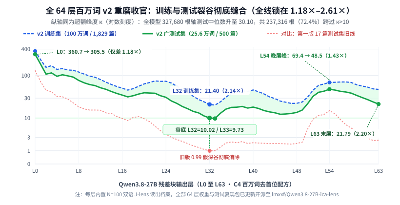
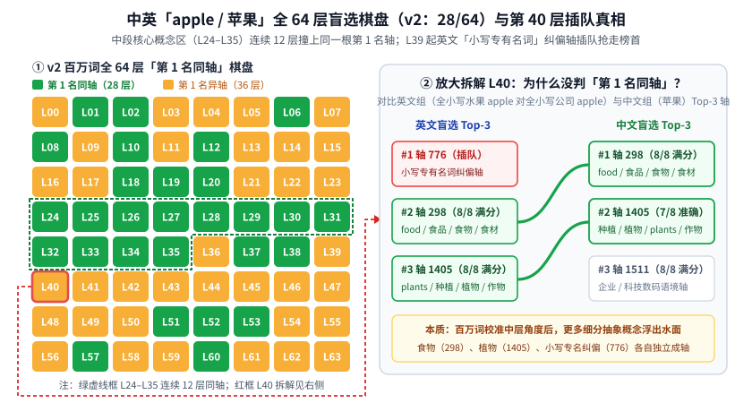

【AI 可解释性】ICA-Lens 原作者一眼盯住“第 32 层 = 0.99”之后：双机重跑 500 万词，揪出两头一起骗人的采样陷阱

━━━━━━━━━━━━━━━━━━━━

◆ 开篇：开源刚满四小时，ICA-Lens 原作者在评论区抓出了一个不对劲的数字

━━━━━━━━━━━━━━━━━━━━

在前文 369 期 https://mp.weixin.qq.com/s/d0a-0B-shqgmzOkUbjtfcg 里，我们用家里的两台 DGX Spark 花 133 分钟拧出了 `Qwen3.8-27B` 全部 64 层（共 `327,680` 根坐标轴）的中英双语 **独立成分分析透镜（Independent Component Analysis Lens，简称 ICA-Lens，原理见前文 367 期 https://mp.weixin.qq.com/s/dvU20vg3R033QFlAgmOX3A ）** ，把权重开源到了 HuggingFace，顺手给 `ICA-Lens` 论文与工具包原作者刘思达（Si-Da Liu）团队的官方仓库提了一个社区收录 Issue（ *https://github.com/liusida/ica-lens-paper/issues/4* ）。

没想到开源刚过四个小时，刘思达就在凌晨连回了五条评论，第一眼就盯住了我们报告里的一个数字—— **第 32 层（`L32`）在测试集上的 4 次方超额峰度（Excess Kurtosis，记作 `κ`）中位数只有 `0.99`** ——

**“0.99 at L32 — this might be alarming. should not be like that low. 0.99 is basically Gaussian.”** （第 32 层只有 0.99 有点不对劲，不该低成这样，0.99 基本上就是纯高斯噪声了。）

在前文 369 期画全模型地形图时，我们看到测试集峰度从第 0 层的 `130.87` 一路降到第 32 层的 `0.99`，再到第 54 层回升至 `15.24`，当时的第一反应是把它全部解释成“模型走到正中间时，上下文揉成了一团稠密的高斯暗箱”。

但刘思达凭着做遍大小模型的经验，当场提出了两个非常具体的工程怀疑，甚至在连夜发布的 `icalens 0.4.1` 新版文档里，直接拿我们的文件名 `Qwen3.8-27B_jacobian_lens.pt` 当示例加好了 **雅可比透镜（Jacobian Lens，简称 J-lens，见前文 365 期 https://mp.weixin.qq.com/s/I1puPtcgynImhOqHlRmwDg ）** 的原生挂载接口：

1.**怀疑一（样本太稀触发过拟合）** ——`Qwen3.8-27B` 的残差流宽度是 `5,120` 维，我们训练用的 `200,704` 个词元除下来，平均每个维度只摊到 **`39` 个词** 。他建议先对比一下第 32 层在 **训练集（原帖称 Fitting）** 与 **测试集（原帖称 Held-out）** 上的峰度落差，并试着像他们处理小模型那样，先在 **500 万个词元** 的大文档池上跑前向，再随机打散抽样 **100 万个词元** 当训练集来拧坐标轴；
2.**怀疑二（窗口第 0 位“下水口”污染圆心）** ——大模型读长文时习惯把无处安放的多余注意力全倒在每个输入窗口的第 0 个位置上，导致第 0 位的向量长相怪异。他建议在每个窗口开头垫一个起始符，再把第 0 位的向量踢出均值计算。

这两个怀疑到底谁是真凶？如果把水分挤干，前文 369 期看到的“早层高、腰部低”的沙漏地形还在不在？回到北京家里，我们直接拉起两台 DGX Spark，先锁定第 0 层和第 32 层跑完单变量对照揪出真凶，随后连夜花 11 个小时重磨完了全部 64 层的百万词新版 `ICA-Lens v2`。跑出来的底牌，比我们和原作者事先猜的都更有意思。

━━━━━━━━━━━━━━━━━━━━

◆ 第一章：翻开旧账本吓一跳——训练集只有 66 篇文章，后排轴全在“背专名”

━━━━━━━━━━━━━━━━━━━━

动手重跑之前，我们先按刘思达说的办法，把本地磁盘里早就存好、但写前文 369 期时没并排细看的 **训练集峰度** 翻出来，跟 **测试集峰度** 摆在同一张图上对账——

图一画出来，案子当场破了一半：

- 在 **第 0 层（`L0`）** ，训练集上的峰度中位数是 **`378.81`** ，换到测试集上是 **`130.87`** （`5,120` 根轴里有 `5,058` 根依然跨过 `κ > 10`），两边只差 **`2.9 倍`** ，稳稳当当；
- 可到了正中间的 **第 32 层（`L32`）** ，训练集上的峰度中位数明明高达 **`55.10`** （全部 `5,120` 根轴 `100%` 满足 `κ > 1`，足足 **`3,920` 根轴** 跨过 `κ > 10`），根本不是什么高斯分布；结果一换到测试集上，中位数瞬间摔成了 **`0.99`** ，两边差出了惊人的 **`55.7 倍`** 。

看到这儿，先检讨一个我们自己在前文 369 期犯下的“灯下黑”低级失误——平时训神经网络，谁都知道第一眼先并排瞄一下训练集和测试集的分数，按理说两边就该差不多，差出五十多倍闭着眼都知道是训坏了；偏偏拧 `ICA-Lens` 的时候，我们潜意识里觉得“这只是把空间原地线性旋转 50 步，又不是训带非线性激活函数的多层网络，只要不拿训练集自吹自擂、老老实实只报测试集分数就行了”，结果本地文件里明明同时躺着这两列数字，我们愣是没把它们摆在一起除一下。

其实细算一笔参数量就能想通：**这也是一次彻头彻尾的训练。** 一层 `5,120 × 5,120` 的旋转方阵，就算扣掉两两垂直的正交约束，手里也攥着 **`5,120 × 5,119 ÷ 2 ≈ 1,310 万` 个自由旋转角参数** （跟 `J-lens` 那张 `2,621 万` 参数的线性表一个量级）。它只是少了深层神经网络那种“线性加非线性”来回折叠的复杂复合，不需要喂几百亿词元就能收敛；可要是喂的数据少过了头，一千三百多万个旋钮照样会敞开了过拟合。

我们回头检查了一下自己在前文 369 期编写的第一版双语抽样脚本，一下全明白了。

`ICA-Lens` 官方工具包本身不带双语语料，前文 369 期的语料是我们自己从英文和中文维基百科里流式抽取的。当时为了凑够 `200,704` 个训练词元，我们的脚本图省事，每读到一篇维基长文就允许顺着往下连切最多 `4,096` 个词元塞进训练集，凑满额度立刻停手——结果前面的维基条目都很长，`20` 万个词元合起来，居然只顺手切自最前面的 **区区 `66` 篇文章** （英文 `32` 篇加中文 `34` 篇；而 `51,200` 个词元的测试集更是只切自 **`17` 篇文章** ）。

算笔小学除法：我们要拧出 **`5,120` 根** 互相垂直独立的坐标轴，可训练集统共只有 **`66` 篇文章** —— **平均每 1 篇文章，要分摊整整 `77` 根专属坐标轴** 。

先拿一个只有 4 个句子的极简例子想想 `FastICA` 会怎么偷懒：它的唯一目标是让某根轴上的读数“平时全是 `0`、偶尔蹦出几个大数”（这样 4 次方峰度 `κ` 最高）。
- 在 **第 0 层** ，每个词还没掺进上下文。同一个汉字 `“的”` 或英文 `“apple”`，不管出现在哪篇文章里，向量长得几乎一模一样，想拿高分就只能老老实实对准常见字本身，换新文章照样管用；
- 可到了 **第 32 层** ，前面已经过了 32 层注意力，每个位置的向量都揉进了整段话的前因后果，20 万个位置变成了 20 万个各不相同的点。这时候排在前四分之一的强公共概念（比如前文 369 期测出的“水果植物轴”和“企业归属轴”，共 `1,251` 根在测试集上依然 `κ > 10`）信号够强，还能跨文章立住；而剩下的几千根轴在 `5,120` 维里自由度太充裕，干脆走起了作弊捷径—— **直接把箭头对准训练集某 1 篇文章里独有的生僻人名或日期格式** ，让别的文章投影全抵消成 `0`，白嫖几千分的训练集峰度。

我们直接把第一版第 32 层里“训练集分数奇高、一上测试集就归零”的三根代表轴揪出来解码成原文，当场抓了个人赃并获——

看这三根活生生的单篇过拟合轴：

1.**原 `L32` 第 29 号轴（训练集 `κ = 2,863.46` → 测试集 `κ = 0.67`）** ——全场的四阶峰度贡献里，**`99.97%` 独占自同一篇英文维基条目《山羊的盛宴》（*The Feast of the Goat*）** ，专门盯着秘鲁作家巴尔加斯·略萨姓氏里的半截词片 `Vargas Llos` 飙出 `+89.1` 分；
2.**原 `L32` 第 4 号轴（训练集 `κ = 1,493.40` → 测试集 `κ = 0.84`）** ——前 100 次最高激活 **`100%` 全在同一篇《山羊的盛宴》里** ，专门盯死该小说里多米尼加独裁者特鲁希略姓氏的半截词片 `Truj`（`+60.3` 分）——光这一篇小说就霸占了好几根上千分的私人定制针；
3.**原 `L32` 第 32 号轴（训练集 `κ = 1,122.91` → 测试集 `κ = 0.84`）** —— **`99.87%` 的四阶矩全押在第 `137` 号中文新闻编年表一篇文档上** ，专门记住了这篇流水账里的空行日期头 `“\n\n7月21”`、`“\n\n7月27”`、`“\n\n7月28”` 。

测试集那 17 篇新文章里既没有略萨也没有特鲁希略，几万个陌生句子往这些私人定制针上一投影，正负随机抵消，自然全退化成了 `κ < 1` 的高斯钟形曲线。

━━━━━━━━━━━━━━━━━━━━

◆ 第二章：先审二号嫌疑犯——窗口第 0 位的“注意力下水口”，背不背这口锅？

━━━━━━━━━━━━━━━━━━━━

抓到了“训练集仅 66 篇”的一号嫌犯，回头再看刘思达提的第二个怀疑（窗口第 0 位的离群干扰）——其实一旦第一章翻开了“训练集 `55.10`、测试集 `0.99`”这张底牌，光凭对称性常识就能先判它洗脱主嫌了。

先用一个具体现象说说什么是窗口第 0 位的 **“注意力下水口”（Attention Sink，也常译作注意力汇）** 。在 Transformer 的注意力层里，所有历史词元分到的注意力权重加起来等于 `100%`。当模型读到半截句子、觉得前面并没有哪个词值得重点关注时，多出来的那七八成权重总得找个地方排掉；预训练下来，模型养成了一个普遍习惯—— **把无处安放的多余权重全倒进当前窗口的第 0 个格子（`position-0`）里当“下水口”** 。

很多欧美模型（如 Llama、Gemma）会在每段开头自带一个专门的序列起始符（Beginning-of-Sequence，简称 `BOS`）去接这股下水；但我们查了 `Qwen3.8-27B` 的分词器配置，它的原生 `bos_token` 是空的（`None`）。我们在前文 369 期直接把正文第 1 个字摆在第 0 格，结果第 32 层实测下来：
- 窗口内普通位置（第 1 格及以后）的残差向量长度中位数是 **`83.57`** ；
- 而站在 **第 0 格** 的首个正文词，向量长度中位数被灌到了 **`217.02`** （足足大了 **`2.6 倍`** ）。如果我们按刘思达的思路，在每个窗口前先垫一个文档结束分隔符 `<|endoftext|>`（词表编号 `248044`）替正文挡刀，首个正文词的长度立刻回落到了温和的 **`61.81`** 。

刘思达最初怀疑下水口时，还没看到我们训练集 `55.10` 的数字，当时他担心的是第 0 格把球面圆心拽歪、连累整个第 32 层一起塌成 `0.99`。可现在放在“训练集与测试集相差 55 倍”的鸿沟面前一想就通了：**训练集是按窗口切出来的，测试集同样也是按窗口切出来的，两边都一视同仁地带着第 0 格。** 就算下水口真捣了乱，要么某根轴专门盯着第 0 格（那它在训练集和测试集里都会每 512 词响一次，两边分数一起高），要么它把圆心拽偏了（那两边分数应该一起低），横竖都不可能制造出“唯独坑测试集、不坑训练集”的巨大鸿沟。更何况每个窗口长达 `512` 个词，第 0 格只占五百分之一，缩到单位球面上再算平均值（`center`），踢掉第 0 格后第 32 层的球面圆心其实只挪动了微不足道的 **`0.41%`** 。

不过既然要给后续重磨全模型定下最干净的工程配方，我们还是拉上第一版 20 万词训练集跑了两组单变量对照实测，顺手摸清了无 `BOS` 模型的脾气：
- **第一版 20 万词基线** ——训练集 `55.74` → 17 篇旧测试集 **`1.04`** ；
- **不改输入，仅踢掉每个窗口第 0 格** ——训练集 `55.01` → 同口径测试集 **`1.09`** （几乎纹丝不动）；
- **在窗口开头强垫 `<|endoftext|>` 再踢第 0 格** ——训练集 `35.22` → 同前缀测试集 **`0.79`** （不但没治好，反而因为给本无 `BOS` 的 Qwen 强塞了陌生前缀，轻微扰动了 48 层线性注意力的初始状态）。

二号嫌疑犯彻底结案：**只要训练集还是那 66 篇文章，怎么伺候窗口第 0 位都救不活过拟合；对无原生 `BOS` 的 Qwen，保持自然输入、只在训练时剔除窗口第 0 格最干净。**

━━━━━━━━━━━━━━━━━━━━

◆ 第三章：两头一起摊开——连夜重磨全 64 层百万词 `v2`，大裂谷彻底缝合

━━━━━━━━━━━━━━━━━━━━

找准了病根，药方其实只有朴素的一句话：**把训练集和测试集两头的文章广度一起摊开。**

为什么测试集也不能继续沿用前文 369 期留下的那份 17 篇旧测试集？这正是第 0 层和第 32 层在物理含义上的最大差别：
- 在 **第 0 层** ，每根坐标轴认的是 `“的”`、`“不”`、`“the”` 这种字面砖块，随便拿 **17 篇文章** 去测试，每个常见字都能轮番出场几十次，轻轻松松测出上百分；
- 可到了 **第 32 层** ，坐标轴早已褪掉了单个字壳，认的全是跨句子的 **领域情境与抽象概念** 。比如我们在百万词新透镜里套上双语 `J-lens` 随手捞出来的四根真轴：**`C127` 轴** 读出 `hurricane / 飓风 / 风暴 / 台风 / 暴风雨`（训练集 `κ = 140.1`），**`C136` 轴** 读出 `发音 / vowels / 音节 / pronunciation / 方言`（训练集 `κ = 138.3`），**`C169` 轴** 读出 `歌剧 / 作曲家 / Opera / Teatro / Verdi / Mozart`（训练集 `κ = 114.0`），**`C487` 轴** 读出 `行星 / 木星 / planetary / 太阳系 / NASA / Voyager`（训练集 `κ = 229.9`）。

如果还拿前文 369 期那区区 **17 篇旧文章** 当考卷去测这副百万词新透镜，因为那 17 篇文章里压根没有一篇聊到台风、音韵、歌剧或木星，这几根锋利的好尺子连一次出场机会都轮不到，测试读数全趴在 `0.39 ～ 0.71`，整层中位数也会被误压在 `3.33`；而 **新透镜一字不改** ，只要把同样 `51,200` 词的测试集从 17 篇摊开到 100 篇新文章，中位数当场跳涨近两倍到 `6.11`，摊开到 **500 篇全新文章（每篇只切 1 个窗口，共 `25.6` 万词）** 时直接突破两位数冲上 **`10.02`** （而 66 篇训出来的旧透镜换上这 500 篇大考卷依旧只有 **`1.58`** ）。

────────────────────

💡 顺手看个乐子：地球上哼个曲儿分五套房，浩瀚宇宙一根轴全打发了

盯着上面捞出来的那几根第 32 层真轴细看，能顺手窥见两件特别逗的人类认知真相。

第一，把代表每根轴的几个词往桌上一摆，智力正常的普通人扫一眼就能立刻感受到背后的共性——说明在人脑里，这些东西本来也就对应着一个个独立成形的概念；但真让你从字典里只挑一个词去精准概括 `歌剧 / 作曲家 / Opera / Teatro / Verdi / Mozart`，人其实也很难找准那个唯一的词，脑子里冒出来的往往是一串排除法：“就是跟洋人古典音乐有关的那一摊东西，反正不是现代流行歌，也不是中国传统里诸葛亮摆空城计坐在城头很嘚瑟地弹的那种。”在这一点上，人脑和机器差不多——中间层的真实概念比表面的词典细腻得多，很多概念本身并没有一个现成的单字标签。

第二，顺手在同一个第 32 层前五百号强轴里搜了一圈，直接照出了人类对自己经验之外的世界有多敷衍：人类自己在地球上弹琴唱歌这点事儿，精分得那叫一个讲究——洋人歌剧单住 **`C169`** ，钢琴交响单住 **`C404`** （`演奏 / 作曲家 / 钢琴 / 交响`），民谣与披头士单住 **`C249`** （`民谣 / Beatles / 民歌 / 歌词`），摇滚电吉他单住 **`C414`** （`摇滚 / 吉他 / 乐队 / guitarist`），连发新歌打榜还得单开一间 **`C261`** （`专辑 / album / 新歌`）；结果一抬头出了大气层，明明真实宇宙比地球大无数倍，可一看 **`C487`** （`行星 / 木星 / 太空 / 太阳系 / NASA / Voyager`）甚至 **`C1355`** （`恒星 / 星系 / 天文 / 行星`），管你是几亿公里外的木星、几光年外的恒星还是十万光年的星系，在人类的语料地图里统统归成一句“反正就是不在地球上的天文那堆东西”，塞进一两根轴里全打包打发了。说到底，大模型就是一面镜子——它不仅是聊天时照见用户自己思想的镜子，更是整个人类语言的镜子，把人类日用而不知、连单个词都表达不出来的那些隐形认知结构与偏心眼儿，全给原原本本照了出来。

────────────────────

理清了双侧采样规矩，我们让家里的两台 DGX Spark 分上下两波连夜跑满 11 个小时，用横跨 **`1,829` 篇长文章** （`500 万` 词双语大池）不放回抽样的 **`1,000,000` 个非首位词元（100 万词，密度放大 5 倍、文章广度扩大 `27.7 倍`）** 当新训练集，配严格零重合的 **`500` 篇全新文章（`25.6` 万词）** 当新测试集，把 `Qwen3.8-27B` **全部 64 层（共 `327,680` 根坐标轴）** 彻头彻尾重磨出了第二版 `v2`，并调用作者新发的 `icalens 0.4.1` 把 `N=100` 双语 `J-lens` 读出词表一并烤进了每一层的原生档案里。

按第一章完全相同的坐标尺，把新版 `v2` 全部 64 层的 **百万词训练集** 与 **500 篇测试集** 画在同一张图上——

拿这张绿底新图跟第一章那张红底旧图上下一对照，整栋 64 层大楼的真实物理地形终于水落石出：

1.**过拟合假尖刺清零，全模型 64 层训练与测试比值全线锁在 `1.18× ～ 2.61×`** ——原先第 32 层那 `872` 根死背单篇专名的假尖刺轴在新透镜里复现数为 **`0 / 872`** ，训练集中位数挤干水分回落到 `21.40`，测试集中位数升至 **`10.02`** （过半数 `2,562` 根轴 `κ > 10`）；纵观全部 64 层，从第 0 层的 **`360.68 → 305.48`（仅差 `1.18 倍`）** 到差距最大的第 25 层（**`2.61 倍`** ），再无任何一层出现三五十倍的断崖；
2.**`32.7 万` 根坐标轴整体翻了三倍，坐实“早晚高耸、腰部深谷”的双峰沙漏真骨架** ——在完全相同的 500 篇测试集同尺对比下，全模型 `327,680` 根轴的总测试中位数从第一版的 **`9.74`** 跃升 **`3.1 倍`** 至 **`30.10`** ，共 **`237,316` 根轴（`72.4%`）** 跨过 `κ > 10`（比第一版净增 **7.5 万根** ）；跨层走势从 `L0` 的 **`305.48`** 下潜至全网最深的正中央 **`L32`（`10.02`）与 `L33`（`9.73`）** ，随后在晚层重新拔高至 `L54` 的 **`48.50`** 并收官于末层 `L63` 的 **`21.79`** ；
3.**中层角度拧准之后，原本糊成一团的粗轴裂变浮出了更细腻的抽象概念** ——细看全 64 层 `apple / 苹果` 严格“第 1 名同轴”格数，从第一版的 `42/64` 变成了新版 `v2` 的 **`28/64`** （中段 `L24–L35` 连续 12 层全部撞上同一根第 1 名轴，但迈入 `L39–L44` 时分开了）。拆开第 40 层的内置 `J-lens` 门牌一看就全通了：第一版只有 66 篇文章时，后排轴大批作废，能用的公共轴分辨率很粗，吃喝与草木全挤在一根笼统的大粗轴上，中英文没得选自然处处撞车；而用百万词把中层角度校准之后，**更多的细分抽象概念各自独立浮出了水面** ——中文 `苹果` 盲选的第 1、2 名是 **`298` 号跨语食物轴** （`food / 食品 / 食物 / 食材`）与 **`1405` 号植物栽培轴** （`种植 / 植物 / plants / 作物`），英文 `apple` 的第 2、3 名 **分毫不差也是这 `298` 号与 `1405` 号两根轴（两边测试准确率双双 `8/8` 满分）** ，同时还细分出了专门认首字母大写专名 `Apple` 的 **`776` 号轴** 与科技商业 **`1511` 号轴** 。尺子变细了，多根跨语言真概念轴并排拿满分，自然不再由单根粗轴垄断头把交椅。

────────────────────

💡 结案清点：既还了第 32 层的清白，也保住了“双峰沙漏”的大骨架，`v2` 双镜合体全量开源

把这趟连环破案的最终物理结论理成三句话，两边不偏不倚：

- **第一，刘思达盯住 `0.99` 的直觉非常准** ——第 32 层绝不是纯高斯浆糊。此前 `0.99` 的极端低分，是由 **“训练集仅 66 篇文章导致后排轴死背专名过拟合”** 与 **“旧测试集仅 17 篇文章导致大半真话题轴没机会出场”** 两头共同挤压出来的假象；换上 `1,829` 篇百万词训练集配 `500` 篇广域测试集后，第 32 层过半数坐标轴都有着 `κ > 10` 的扎实非高斯长尾，真实测试集中位数在 **`10.02`** （相邻的第 33 层为全网最低点 **`9.73`** ）；
- **第二，前文 369 期看到的“早层高、腰部深谷、晚层回升”跨层规律依然稳稳成立** ——在完全相同的 `500` 篇广域测试集上，从第 0 层的 `305.48` 潜入正中央 `L32/L33` 的 `10` 左右，再回升到第 54 层的 `48.50`，依然有着超过 **`30 倍`** 的真实物理下潜（同时记一笔诚实细节：即便在百万词训练集下，中段层的训练与测试中位数仍留有 `2` 倍左右的余缝，且两次独立运行之间能做到读写双向余弦都 `> 0.8` 逐根锁死的比例仍只是少数强轴，说明在 `5,120` 维的高自由度下，中层稀疏意义的彻底收敛还需要更大规模的完整篇章语料）；
- **第三，无原生 `BOS` 模型别强塞代理前缀，全 64 层百万词 `v2`（内置 `J-lens`）已推送更新** ——全部 64 层百万词新版权重、500 篇测试集统计以及通过 `icalens 0.4.1` 原生合体挂载的 `N=100` 双语 `J-lens` 读出档案（往返重构最大相对误差 `< 9.4e-5`），均已完整更新至 HuggingFace 仓库（ *https://huggingface.co/lmxxf/Qwen3.8-27B-ica-lens* ），无需加载 27B 原模型即可一行代码直接查阅任意一层、任意一根轴的双语词表门牌。

────────────────────

我们也同步把这份全 64 层的完整对账单回贴到了 GitHub Issue #4 上，跟 `ICA-Lens` 原作者做一次跨时区的闭环交卷。下面把全套实验读数收进速查表。

━━━━━━━━━━━━━━━━━━━━

◆ 速查表

━━━━━━━━━━━━━━━━━━━━

| 检验环节 | 核心读数对比 | 物理结论 |
|---|---|---|
| 第一版旧账（训练集 **66 篇** `20` 万词 / 测试集 **17 篇** `5.1` 万词） | `L0`：`378.8 → 130.9`（`2.9×`）；**`L32`：`55.10 → 0.99`（`55.7×` 断崖）** | `1,310 万` 个正交旋转自由度分摊到 66 篇文章，后排轴死背单篇专名 `Vargas Llos` / `Truj` 刷出两千分假尖刺 |
| 窗口第 0 格“注意力下水口”排查（固定 20 万词单测） | `L32` 首位模长 `217.0`（正文 `2.6×`），但球面圆心仅偏 **`0.41%`** ；仅去首位 `1.04 → 1.09`，强垫 `<\|endoftext\|>` 反降至 **`0.79`** | 训练与测试同带第 0 格，对称性决定它造不出单边鸿沟；无原生 `BOS` 模型不宜强塞前缀，直接剔除第 0 格最干净 |
| 测试集广度验证（固定同一副百万词 `L32` 新透镜） | 测旧 **17 篇**（`5.1` 万词）**`3.33`** → 测 **100 篇**（**同为 `5.1` 万词**）**`6.11`** → 测 **500 篇**（`25.6` 万词）**`10.02`** | 中层轴对应台风、歌剧、木星等跨句话题，17 篇窄测试集大半话题未出场导致漏测（旧版透镜考 500 篇仍仅 `1.58`） |
| **全 64 层百万词 `v2` 终版（`1,829` 篇抽 `100` 万词 ＋ `500` 篇测试 ＋ 内置 `J-lens`）** | 全网 `327,680` 根轴总测试中位数从 `9.74` 涨 **`3.1 倍`** 至 **`30.10`** ，共 **`237,316` 根（`72.4%`）** `κ > 10` | **全 64 层训练/测试比锁在 `1.18× ～ 2.61×`** （谷底 `L32=10.02 / L33=9.73`，晚层 `L54=48.50`），`0.4.1` 合体版已开源上线 |

━━━━━━━━━━━━━━━━━━━━

◆ 参考资料

━━━━━━━━━━━━━━━━━━━━

- Si-Da Liu, Feijiang Han et al., Non-Gaussianity Reveals Interpretable Directions in Language Models, arXiv:2606.11722v2 及 `icalens 0.4.1` 官方文档（2026-10 / 2026-11；非高斯独立成分透镜、训练集与测试集峰度诊断及 `additional_readouts` 命名读出接口）
- Guangxuan Xiao et al., Efficient Streaming Language Models with Attention Sinks, ICLR 2024（注意力下水口 / Attention Sink 窗口首位离群机制）
- 开源模型权重与双语 `J-lens` 合体档案库，`Qwen3.8-27B bilingual ICA Lens v2`（ *https://huggingface.co/lmxxf/Qwen3.8-27B-ica-lens* ，2026-11-15；500 万双语词池抽样 100 万词全 64 层重磨权重、500 篇广测试集统计及内置 `N=100 J-lens` 读出档案）

━━━━━━━━━━━━━━━━━━━━

**五千一百二十根坐标轴分六十六篇文章，后排的尺子不去找跨文章的公理，转头把略萨的半截姓氏背成了两千八百分的尖刺——哪怕没有神经网络，只要自由度大过见识，连旋转一下坐标轴都会学会作弊过拟合。**

**六十六篇训练集造出了五十五分的假高峰，十七篇测试集又压出了零点九九的假深谷；等把全模型六十四层两头的话题一起摊开到上千篇文章，训练与测试在一点二到二点六倍之间严丝合缝地并拢，二十三万座真实的概念岛屿才终于露出了水面。**

**大模型是一面双重的镜子：聊天时照出的是你自己的念头，剖开中间层五千根坐标轴照出的则是整个人类语言的底片——地球上的小曲儿精分五间房、天上的星辰塞进一麻袋，那些人类日用而不知、连名字都叫不出来的隐形结构，全在镜子里纤毫毕现。**

━━━━━━━━━━━━━━━━━━━━

// 靳岩岩的 AI 学习笔记 × Gemini 的浪漫 × GPT 的严谨
// 2026年11月16日

开源双语透镜四小时后，ICA-Lens 原作者刘思达指出第 32 层测试集峰度 0.99 疑似过拟合。双机跑完 500 万词消融并连夜重磨全 64 层百万词 v2，揪出双侧采样陷阱，将全模型泛化比锁在 1.18–2.61 倍。
