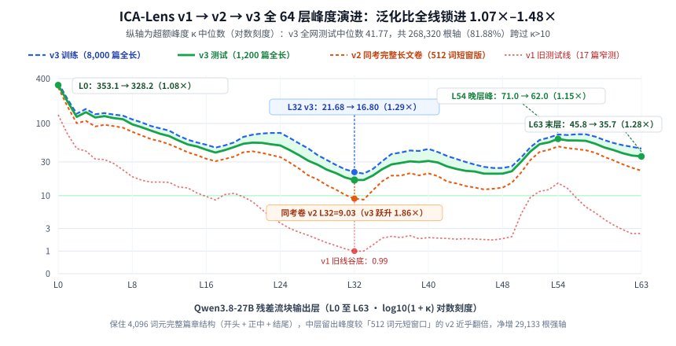
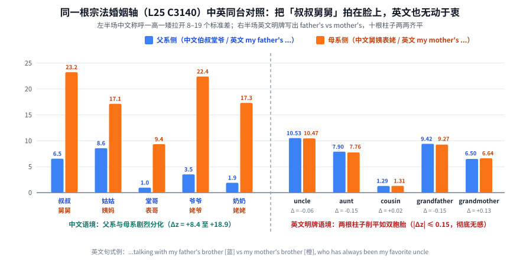

【重训ICA-Lens】“叔叔舅舅”和“uncle”：中国人的内外有别

━━━━━━━━━━━━━━━━━━━━

◆ 开篇：英语一句 `uncle` 就混过去了，中国人开口前脑子里多了哪一步？

━━━━━━━━━━━━━━━━━━━━

我们平时看外国电视剧，剧里角色不管推门进来的是爸爸的哥哥、爸爸的弟弟、妈妈的兄弟还是姨妈的丈夫，张嘴一句笼统的 `uncle` 全能应付过去（常逼得没看到后文家谱的字幕组只能先蒙一个“叔叔”顶着）；可中国人只要一开口叫人，哪怕平时聊天几乎不说“同宗”或“外姻”这种冷僻的书面词，脑子里也得先闪电般过一道二元判定——不先分清对方是父系本家还是母系外亲，嘴边连叫“伯父、叔叔、堂哥、爷爷”还是“舅舅、姨夫、表哥、姥爷”都选不出来。

在审查前文 369 期 https://mp.weixin.qq.com/s/d0a-0B-shqgmzOkUbjtfcg 的中英 `apple / 苹果` 盲选棋盘时，我们验证了前文 199 期 https://mp.weixin.qq.com/s/NGIx-d9zTHRKeL7gEGWvsg 讲过的三分之二分水岭：大模型前三分之二层住着脱掉表层字壳的跨语言抽象概念，过了三分之二（约第 42 层）才交给各语种的拼写施工队。

顺着这条分水岭往下追问，就会撞上语言学界争论了上百年的一个老问题：**人类思考固然不等于在脑子里逐字默念母语单词（日常“话到嘴边想不起词”就是明证），可三分之二深处那片抽象概念地形，是不是在母语分类习惯的逼迫下雕刻出来的？**

拿亲属称呼做试金石再合适不过：
1. 现代口语里并没有一个高频单字专门用来指代“父系同宗还是母系外姻”，所以在模型的 `5,120` 维残差空间里，这绝不会是一根靠背诵某个高频词长出来的字面轴；可几十对高频日常亲属词全都卡在同一道分类门槛上，模型为了算清上下文，会不会在中间层自己拧出一根“没有口语名字的隐形轴”？
2. 更刺激的是，如果双语大模型里真被中文刻出了这把尺子，当我们喂进去一段纯英文、句末停在同一个模糊的英文单词 **`uncle`** 上时，模型脑海深处会不会顺手把英文的 `uncle` 也切成父系与母系两半？

为了把这道题测得滴水不漏，动手前我们先花了一整天，把前文 372 期 https://mp.weixin.qq.com/s/fGvsoW-7tZuVGvw_ozQ1FA 的双语显微镜从 `v1`、`v2` 升级到了完整篇章版 `v3`。

━━━━━━━━━━━━━━━━━━━━

◆ 第一章：完整篇章版 `ICA-Lens v3` 收官——保住“起承转合”，多抓出 2.9 万根长文轴

━━━━━━━━━━━━━━━━━━━━

在前文 372 期里，我们听从 **独立成分分析透镜（Independent Component Analysis Lens，简称 ICA-Lens，原理见前文 367 期 https://mp.weixin.qq.com/s/dvU20vg3R033QFlAgmOX3A ）** 原作者刘思达的提醒，把训练集从 66 篇文章摊开到了 `1,829` 篇百万词规模（`v2`），消除了单篇专名过拟合。但复盘 `v2` 的窗口切分代码时，我们发现自己还留着一条尾巴：当时前向传播全是按 **固定 `512` 个词元（token）的短窗口** 剁碎送入的（测试集 `500` 篇更是每篇只切了最开头的 `1` 个 `512` 词元窗口）。

想想一篇文章是怎么写的：剁成孤立的 `512` 词短段后，模型在任何一个窗口里都看不见整篇文章跨越几千词的“起、承、转、合”（只切首段的测试集更是把中段转折与结尾收束全砍掉了），专门负责追踪全篇长程脉络的中深层坐标轴自然吃不饱。

于是我们再次拉起家里的两台 DGX Spark，连轴运转 **`22.96` 小时** ，磨出了全 64 层（共 `327,680` 根坐标轴）的 **完整篇章版 `ICA-Lens v3`** 。窗口改造方案一共三条：
- 凡是分词后长度不超过 **`4,096` 个词元（token）** 的完整文章，原封不动整篇送入前向传播；
- 超过 `4,096` 个词元的超长文章，按词元下标精确切取 **`开头 1,024 个词元 + 省略提示 + 正中 2,048 个词元 + 省略提示 + 结尾 1,024 个词元`** 拼接（中文插 `……（中间部分遗失）……`，英文插 `... (middle section omitted) ...`），用整整 `4,096` 个有效正文词元完整保留一篇文章的首尾呼应骨架；
- 在计算球面均值与拟合坐标轴时，每个窗口的第 `0` 位（注意力下水口）以及插入的省略提示词元一律严格掩码剔除；从 **`8,000` 篇** 与 `v1 / v2` 零文档重叠的完整长文（总前向 `1,826 万` 词）中均匀抽取 **`250 万` 个词元** （中英严格 `1:1` 各 `125 万`，每篇上限抽 `512` 个位置）做拟合，并用另外 **`1,200` 篇零重合独立完整长文（共 `1,365,856` 个词元，约 `136.6 万` 词）** 做留出验收，同时逐层烤入 `N=100` 双语 **雅可比透镜（Jacobian Lens，简称 J-Lens，原理见前文 365 期 https://mp.weixin.qq.com/s/I1puPtcgynImhOqHlRmwDg ）** 词表与真实语料激活例句。

把 `v1`、`v2`、`v3` 三个版本放在同一张表里对账，双向交叉验证的数字把因果关系锁得死死的：

| 透镜版本与测试口径 | 训练语料规模 | 全 64 层训练/测试峰度比 | 腰部 `L32 / L33` 测试中位数 `κ` | 全网 `32.7 万` 轴总中位数 | `κ > 10` 强非高斯轴数 |
|---|---|---|---|---|---|
| **`v1`** （考 17 篇窄测试集） | `66` 篇 `512` 词窗口（`20 万` 词） | `2.89× – 56.00×` | `0.99 / 1.05` | `4.19` | `162,158`（考 500 篇 `49.5%`） |
| **`v2`** （考 500 篇首段 512 词） | `1,829` 篇 `512` 词窗口（`100 万` 词） | `1.18× – 2.61×` | `10.02 / 9.73` | `30.10` | `237,316`（`72.42%`） |
| **`v2` 同考 `v3` 完整长文卷** | 同上 `v2` 矩阵一字不改 | — | **`9.03 / 8.71`** | **`29.93`** | **`239,187`（`72.99%`）** |
| **`v3` 考 `1,200` 篇完整长文卷** | **`8,000` 篇完整篇章（`250 万` 词）** | **`1.07× – 1.48×`** | **`16.80 / 16.77`** | **`41.77`** | **`268,320`（`81.88%`）** |

盯住上表最后两行的同卷正面对决和全 64 层演进曲线：
1.**全模型 64 层泛化比无一层超过 `1.5×`** ——从最窄的第 1 层 `1.07×` 到全网比值最大的第 24 层 `1.48×`（腰部 `L32` 为 `1.29×`、`L33` 为 `1.23×`），前文 372 期残留的 `2` 倍余缝被彻底压平；
2.**同一份 `136.6 万` 词完整长文考卷上，中层谷底近乎翻倍，净增 `29,133` 根强轴** ——`L32` 从 `v2` 的 `9.03` 跃升 **`1.86 倍`** 至 **`16.80`** ，`L33` 从 `8.71` 跃升 **`1.93 倍`** 至 **`16.77`** ，全网满足 `κ > 10` 的强非高斯轴从 `239,187` 根涨到 **`268,320` 根** ；
3.**反向退回首段残卷则瞬间打回原形** ——如果我们拿刚练好的 `v3` 新透镜退回去考 372 期那份只切开头 `512` 词的 `500` 篇残卷，`L32 / L33` 的中位数当场回落到 **`9.32 / 9.10`** （跟原 `v2` 在首段残卷上的 `10.02 / 9.73` 基本持平）。一正一反互相印证：新长出来的这 **2.9 万根强非高斯轴** ，捕捉的恰恰是文章开头 `512` 词里压根还没来得及登场的 **中段推进与结尾收束概念** 。

底盘打磨妥当，我们拿着 `v3` 直奔今天的亲属词大考。

━━━━━━━━━━━━━━━━━━━━

◆ 第二章：中文里的内外有别——从第 13 层空间“外”、第 25 层词典标签，到第 42 层抽象概念

━━━━━━━━━━━━━━━━━━━━

要证明模型里真有一根超越具体字形的血缘结构轴，实验设计上稍不留神就会漏进作弊线索。我们在 `Qwen3.8-27B` 上立下了三条防作弊规矩：

第一，**裸文本直接前向** ，不套任何 `<|im_start|>user` 对话角色模板，避免回答漏斗扭曲原生态表征；
第二，构造 **5 个彻底屏蔽“爸、妈、父、母、姓”字眼的日常句框** （代码用断言逐字检查），把目标称呼摆在句末无标点位置：
- `今年春节回老家团聚的时候，我在大门口遇到了许久未见的{W}`
- `翻开书房抽屉里那本泛黄的老相册，站在第一排中间微笑的亲人是我的{W}`
- `周末家里办酒席请客吃饭，正在大厅里热情招呼客人的那位亲人是我的{W}`
- `昨天傍晚家里接到一通长途电话，原来是远在外地生活的{W}`
- `小时候每逢寒暑假去亲戚家小住，平时跟我关系最亲近的亲人是{W}`

第三，也是最严苛的一招—— **核清分词切分，把选轴训练集与盲测测试集彻底隔离** 。为了防止模型靠认“堂、表、外”单个字投机取巧，我们先查验了 `Qwen3.8-27B` 分词器对每个亲属词的真实切分，并规定在每层 `5,120` 根轴里只算训练词对 **`z(母系词) − z(父系词)` 的平均差值** ，单挑第 1 名 **唯一 1 根轴** 去考三组测试集（同时核验“目标词末词元”与“词内各词元残差均值”双口径）：

| 数据集角色 | 亲属词对（每对套 5 个句框） | `Qwen3.8-27B` 分词实况（单 token 整词 vs 多词元切分） | 设计用意 |
|---|---|---|---|
| **主选轴训练集** （代码记 `S2`，`15` 对） | `伯父/大舅`、`叔叔/舅舅`、`姑姑/姨妈` | 整词：`叔叔`、`舅舅`、`姑姑`、`姨妈`；切分：`伯+父`、`大+舅` | **100% 血缘长幼对称 ＋ 字面零共享字** （无“堂/表/外/夫”） |
| **测试集 ①：无“外”字隔代** （`10` 对） | `爷爷/姥爷`、`奶奶/姥姥` | 全部为单个词元整词（`爷爷`、`姥爷`、`奶奶`、`姥姥`） | 北方口语词，字面和词元均不含“外/表” |
| **测试集 ②：平辈堂表** （`20` 对；浅层对照 `S1` 将前 3 对并入训练） | `堂哥/表哥`、`堂姐/表姐`、`堂弟/表弟`、`堂妹/表妹` | 整词：`表哥`、`表姐`、`表弟`、`表妹`；切分：`堂+哥/姐/弟/妹` | 检验仅靠父辈血亲挑出的轴能否泛化到平辈堂表 |
| **测试集 ③：含“外”字隔代与晚辈** （`30` 对） | `爷爷/外公`、`奶奶/外婆`、`侄子/外甥`、`侄女/外甥女`、`孙子/外孙`、`孙女/外孙女` | 整词：`外公`、`外婆`、`侄子`、`孙子`、`孙女`；切分：`侄+女`、`外+甥(+女)`、`外+孙(+女)` | 检验能否同时覆盖隔代与晚辈全部外亲 |

对模型的 `L00` 到 `L63` 全 64 层逐层独立做同一个三步动作：① **挑轴** ——只看上表第 1 行的 15 对训练句，在该层 `5,120` 根轴里找出 `|z(母系词) − z(父系词)|` 均值差距最大的第 1 名单轴（后 3 行测试集全程保密不参与挑轴）；② **打分** ——锁死这 1 根轴，把后 3 行的 60 对测试句投上去，看能切对多少对；③ **验身** ——翻开这根轴的 `J-Lens` 词表与百万词语料最高激活例句，看模型在这一层究竟拿什么概念当尺子。

────────────────────

💡 读数怎么看：单个词的激活分 `z` 与整根轴的峰度 `κ` 是什么关系？

下文表格里反复出现的 `κ` 和 `z`，按归属关系一句话就能分清：**`κ` 是“某一根坐标轴本身”的属性，而 `z` 是“某一个具体词元之于某一根轴”的属性。**

做 `ICA-Lens` 的第一步是白化（Whitening），它把每一根坐标轴在 `250 万` 个训练词元上的均值校准为 `0`、标准差校准为 `1`。所以把某一个词元的球面残差向量投射到某根轴上算出的坐标 **`z`，单位天然就是“偏离均值多少个标准差”** ——平时遇到毫不相干的普通词，`z` 基本都在 `0` 附近（正负 `1` 个标准差以内）趴着；一旦撞上对口的概念（比如第 13 层 `L13 C2665` 遇到汉字“外”拿到 `z = 32.32`，或第 25 层 `L25 C3140` 遇到“现岳父”蹿到 `z = 52.59`），就代表这一个词在这根轴上直接冲出去了三十到五十多个标准差。

要是普通正态高斯分布，偏离 `6` 个标准差就已经是十亿分之一的极端事件了。正因为这根轴平时 `99.9%` 的词都在 `0` 附近躺平、一撞上专管概念就蹿出几十个标准差，把测试集 `136.6 万` 个词元的四次方 `z⁴` 平均下来再减去高斯基准 `3`，才会算出 **`κ = 60.04` 乃至 `74.97`** 的高超额峰度。简单记：**`z` 看的是某一个词踩在这根轴上弹起了多高，`κ` 看的是把百万个词的 `z⁴` 汇总后这根轴长得多尖锐。**

────────────────────

**一、第一幕（第 13 层 `L13 C2665`）：两千年前“屋内为堂、衣外为表”的造词隐喻还活着**

做实验前在酒店闲聊时，我们曾顺着汉语词源学押过一个赌注：古人为什么管同宗叫 **“堂”** 、管异姓叫 **“表”** ？因为“堂”是正屋殿堂之 **内** ，“表”是衣裳毛皮之 **外** （加上外公、外婆、外甥、外人），两千年前华夏造词时，本来就是直接借用物理空间的 **`内（inside） vs 外（outside）`** 给血缘远近划界的。大模型里会不会留着这道远古化石？

为了检验这个猜想，我们用一模一样的 `z(外句) − z(内句)` 配对相减逻辑，额外造了两组中英双语探针（每组各 `5` 对完整句子）：一组是 **物理空间内外** （如 `钥匙放在盒子内部 vs 钥匙放在盒子外部`、`把木箱搬进院子里面 vs 把木箱搬到院子外面`、`The mark is on the inside vs The mark is on the outside`），另一组是 **社会圈层内外** （如 `他一直被大家当作自己人 vs 他一直被大家当作外人`、`She is regarded as an insider vs She is regarded as an outsider`），让它们各自去 `5,120` 根轴里独立挑出平均差最大的第 1 名。

翻开浅中层 **第 13 层（`L13`）** 的成绩单，把各组独立挑出的第 1 名与投到 **`L13 C2665`（测试集 `κ = 60.04`）** 上的真实读数摆成一张表，全貌一目了然：

| 测试组别 | 在 `L13` 独立挑出的均值差第 1 名轴 | `L13 C2665` 内侧/父系均分 | `L13 C2665` 外侧/外亲均分 | 均值差 `Δz` | 切对比例 |
|---|---|---|---|---|---|
| **物理空间内外** （`5` 对） | **`L13 C2665`** | `+4.50` | **`+22.91`** | **`+18.41`** | **`5/5`** |
| **社会圈层内外** （`5` 对） | **`L13 C2665`** | `+0.27` | **`+15.75`** | **`+15.48`** | **`5/5`** |
| **含堂表亲属选轴组** （`S1`，`30` 对） | **`L13 C2665`** | `-0.12` | `+3.36` | **`+3.49`** | **`30/30`** |
| **主选轴训练集** （纯父辈血亲 `S2`，`15` 对） | `L13 C1540`（ **`L13 C2665` 紧随排第 `2`** ） | `-0.56` | `+3.05` | **`+3.61`** | **`15/15`** |
| **测试集 ①：无“外”字隔代** （`姥爷/姥姥` `10` 对） | —（测试集不参与挑轴） | `+1.77` | **`+6.99`** | **`+5.22`** | **`10/10`** |
| **测试集 ②：平辈堂表** （`20` 对） | —（测试集不参与挑轴） | `+0.29` | `+3.62` | **`+3.33`** | **`20/20`** |
| **测试集 ③：含“外”字组** （`30` 对） | —（测试集不参与挑轴） | `+1.17` | **`+9.99`** | **`+8.82`** | **`30/30`** |

这根三路撞车的 `L13 C2665` 到底是什么？这里正好撞上一个“双镜互补”现场：当我们直接调取 `L13 C2665` 的线性 `J-Lens` 词表时，因为第 13 层离第 64 层出口隔着整整 50 层非线性变换，一阶线性切线近似跨 50 层传过去已经失真成了模糊的虚词 `['对于', '而对于', ' for']`；可一翻开 `ICA-Lens v3` 档案里保存的 **`136.6 万` 词真实测试语料最高激活原句** ，谜底当场揭晓——全库让 `L13 C2665` 飙出最高分的前三名位置（`z = 32.32 / 30.56 / 28.38`），一个不落全踩在物理空间的汉字 **“外”** 上（`“铜人模型，外”`、`“蜘蛛……腹部不是从外”`、`“教堂的十字架的样式 外”`）。

回头看上表倒数第 3 行：带“外”字的测试集 ③ 在这根空间“外”字轴上拿 `+9.99` 固然理所当然，可字面 **半个“外/表”字都没有** 的北方口语单词元 **`姥爷` 与 `姥姥`** ，在这根纯正的物理空间“外”字轴上照样跑出了 **`+6.99`** （比 `爷爷 / 奶奶` 高出 `5.22`，`10/10` 全对）。两千年前古人借空间“门里门外”给血缘划界的隐喻，在模型第 13 层依然活生生地运转着。

────────────────────

💡 为什么纯父辈挑轴时，半路杀出了一个排第一的 `L13 C1540`？

细心的读者看到上表第 4 行大概会好奇：只用 `伯父/大舅、叔叔/舅舅、姑姑/姨妈` 3 对词挑轴时，以 `3.98` 比 `3.61`（仅差 `0.37` 个标准差）险胜 `L13 C2665` 抢走第 1 名的 **`L13 C1540`（`κ = 66.27`）** ，到底是个什么神仙轴？

翻开它的 `136.6 万` 词语料档案一看，答案让人忍俊不禁——它楼顶（`z = +28 至 +38`）住着的主业房客，居然是一根 **“佐治亚州 / 格鲁吉亚（Georgia）”地理专名轴** （语料最高分依次是佐治亚殖民地创始人 `奥格尔索普 z=37.91`、佐治亚州城市 `Macon z=33.63`、`佐治亚州的萨凡纳 z=30.02` 与 `南/北奥塞梯 z=29.29`，`J-Lens` 正极前四名也是 `Georgia / Atlanta / 亚特兰`）。

为什么一根地理专名轴会在中文亲属词上跑出第 1 名？这是不扩维 `5,120` 维空间在浅层的真实生态：世界上的专名与概念远多于 `5,120` 个，在第 13 层还没解耦分家干净时，单根轴常处于“楼顶 `+35` 高峰归某个冷门专名，地下室 `±4` 低幅区间顺带合租另一组日常语义”的多义拼房状态（`L13 C1540` 在物理和社会内外上完全没反应，差值仅 `-0.38 / -0.53`）。因为我们为了防作弊把挑轴训练集砍到了只有 3 对词（15 句话），样本太少才让这名合租房客侥幸以 `0.37` 分抢了半个身位——一旦把挑轴样本扩充到全部 75 对中文亲属句求平均，偶然波动互相抵消，第 1 名当场重回 **`L13 C2665`** （均值差 `5.83`）。

────────────────────

**二、第二幕（第 25 至 28 层 `L25 C3140 / L26 C3526 / L28 C544`）：词典层拧出单极“跨婚姻标签”**

继续往上走到模型中段 **第 25 至 28 层** ，亲属关系与物理空间正式分家独立——亲属冠军轴 `L25 C3140` 与同层物理/社会内外冠军轴 `L25 C1639` 的读取方向余弦降到了 **`-0.0071`** （写入列余弦 `0.0375`），几乎成 `90°` 严格正交。

在 `L25` 上，仅靠 `伯父/大舅、叔叔/舅舅、姑姑/姨妈` 这 3 对 **100% 纯血亲训练词（不含任何姻亲“夫/婿”字眼）** 挑出来的第 1 名单轴，依然是 **`L25 C3140`（`κ = 74.97`）** ，面对从未见过的 60 对测试集交出了满分答卷（末词元与词内均值双口径均 `100%` 全对）：
- 无“外”字隔代 `爷爷/姥爷、奶奶/姥姥`：**`10/10` 全对** （均值差 `17.15`，效应量 **`d = 5.89`** ）；
- 平辈 `堂兄妹 / 表兄妹`：**`20/20` 全对** （均值差 `6.81`，**`d = 3.91`** ）；
- 含“外”字隔代与晚辈 `外公/外婆/外甥/外孙`：**`30/30` 全对** （均值差 `11.95`，均值词元口径 `d = 5.73`）；
- 相邻的 **`L26 C3526`（`κ = 46.48`）** 与 **`L28 C544`（`κ = 114.0`）** 同样拿第 1 名并在三组测试集打满 **`60/60`** 。

但在实验前，因为 `ICA-Lens` 不像稀疏自编码器那样带 `ReLU` 截零（线性投影在数学上允许正负两头对称长出两个概念），我们原本还猜过负方向会不会长出一串 `伯 / 叔 / 堂 / 宗族 / 本家` 跟外戚对称。等真正打印出来一看，负方向和绝大多数 `ICA` 轴一样趴在 `0` 附近（`本家/宗/祠` 在全词表仅居 `15%–51%` 平庸中段），而正极轴顶上站着的“本体”也不是舅舅姥爷，干脆就是 **“婚姻嫁娶”本身** ——

| 中层冠军轴 | 正极 `J-Lens` 头牌词汇（全词表 `24.8 万` 词最前排） | `136.6 万` 词语料最高激活例句 |
|---|---|---|
| **`L25 C3140`** （`κ = 74.97`） | `女婿`、`婿`、`婚`、`岳父`、`marito`（意语丈夫）、`婚姻关系`、`婚姻`、`الزوج`（阿语丈夫）、`wife` | `现岳父`（`z=52.59`）、`汪兆钧的外舅`（`z=51.59`）、`son-in-law`（`z=46.81`）、`daughter-in-law`（`z=46.07`） |
| **`L26 C3526`** （`κ = 46.48`） | `husbands`、`女婿`、`husband`、`남편`（韩语丈夫）、`出嫁`、`丈夫`、 **`娘家`（全词表第 `8` 名，`99.997%`）** 、`wives`、`婚`、`brides`、`maternal`、`婚前`、`岳父` | `汪兆钧的外舅`（`z=45.73`）、`现岳父`（`z=43.10`）、`daughter-in-law`（`z=40.79`）、`brother-in-law`（`z=39.31`） |
| **`L28 C544`** （`κ = 114.0`） | **`娘家`（全词表第 `1` 名）** 、`嫁给`、`出嫁`、`嫁`、`母女`、`已婚`、`daughter`、`婚` | `his wife Katherine ( née`（`z=48.53`）、`Biden ( née`（`z=40.85`）、`Dorothy ( Walker`（`z=39.80`） |

看着这张表，背后的因果顺序一下就通了：**在汉语的亲属坐标系里，父系本家就是默认的原点基线（语言学里叫无标记默认项 Unmarked Default），自家人本来就不需要额外打标签；而所有非本家的外亲——无论是妈妈从娘家嫁过来连上的大舅、舅舅、姨妈、姥爷，还是姑姑、姐妹、女儿嫁出去连上的女婿、外甥、外孙——在族谱图上全都必须经过一次“婚姻联结”。**

────────────────────

**三、第三幕（第 42 层 `L42 C1992`）：在 `65.6%` 三分之二处，升维成跨语言抽象婚姻概念**

顺着残差流继续往上走到 **`42 ÷ 64 = 65.6%`（正好卡在前文 199 期讲过的三分之二抽象概念层）的第 42 层** ，前面偏重中文词条静态标签的婚姻轴，进一步提纯成了跨语种对齐的公共关系概念轴 **`L42 C1992`（`κ = 34.30`，在纯父辈 `S2` 挑轴中高居第 `3` 名、全量中文亲属词中高居第 `2` 名，中文测试集 `56/60`）** ——翻开它的 `J-Lens` 前十五名词牌，半个杂音都没有，中、英、西/意语的“结婚嫁娶”整整齐齐挤在同一根轴上：**`嫁给 / 嫁 / marriage / 出嫁 / 婚姻 / marry / married / 女婿 / 结婚 / 婚 / marrying / Marriage / matrimonio / 已婚`** 。

中文里从第 13 层空间隐喻、第 25 层词典标签到第 42 层抽象概念的三级阶梯全部就位，下面迎来了最刺激的跨文化大考。

━━━━━━━━━━━━━━━━━━━━

◆ 第三章：从“把叔叔舅舅拍在脸上也无动于衷”，到“陕北小山村祠堂”的第 42 层唤醒

━━━━━━━━━━━━━━━━━━━━

重头戏来了：既然模型肚子里既有第 25 层的词典婚姻轴 `L25 C3140`，又有第 42 层的跨语言抽象婚姻轴 `L42 C1992`，那当我们把句末换成笼统的英文单词 **`uncle`** 时，这两把尺子还会不会动？

我们顺着疑问连做了三步递进实验，一步比一步意外。

────────────────────

**一、第一步：日常聚会里把“爸爸兄弟 vs 妈妈兄弟”直接拍在脸上，中英 `uncle` 全线躺平**

我们先喂入毫无推理门槛的纯英文明牌句子（涵盖 `uncle / aunt / cousin / grandfather / grandmother` 五类词 × `5` 个日常句框 = **`25` 对** ，代码记 `EN-A`）：
- **明牌叔叔句** —— `At the family gathering last Sunday, I spent the afternoon talking with my father's brother, who has always been my favorite uncle`
- **明牌舅舅句** —— `At the family gathering last Sunday, I spent the afternoon talking with my mother's brother, who has always been my favorite uncle`

这两句话连小学生都能一眼看明白谁是叔叔、谁是舅舅。可把句末 `uncle` 投射到第二章的全部宗法轴上，心电图直接拉成了一条笔直的死线——在 `L25 C3140` 上是 **`+10.53` 对 `+10.47`（`Δ = -0.06`）** ，连第 42 层的 `L42 C1992` 上也是 **`+1.91` 对 `+2.03`（`Δ = +0.13`）** ，五类英文亲属一共十根柱子两两齐平得像双胞胎：

更绝的是第二步追问：如果把前半句直接翻译成现代白话中文（`在上周日的家庭聚会上，我花了一下午跟我父亲的哥哥 [vs 母亲的哥哥] 聊天，他一直是我最喜欢的 uncle`），只留句末那一个英文词 `uncle` 呢？上卡实测 20 对句子，结果照样是一条死线：`L25 C3140` 上停在正中间的 **`+13.79` 对 `+13.45`（`Δ = -0.34`，恰好是中文“叔叔 `6.5`”和“舅舅 `23.2`”揉成一团的平均值）** ，`L42 C1992` 上更是 **`+1.52` 对 `+1.54`（`Δ = +0.02`，`5/10` 瞎蒙，跌至全层第 `4,219` 名）** ，到了 `L56 C998` 甚至精确到小数点后三位 `+0.866` 对 `+0.866`（`Δ = 0.000`）。

────────────────────

**二、第二步：把开头换成“我家住在陕北小山村里”——词典层依然不动，第 42 层抽象概念突然醒了**

为什么连中文写明“我父亲的哥哥 vs 我母亲的哥哥”都撬不动末尾那个 `uncle`？难道前面测到的宗法属性纯粹只是中文具体词条自带的标签，跟上下文语境无关？

为了测穿这层窗户纸，我们把开头换成了宗法意味拉满的 **“陕北小山村祠堂分席”浓厚乡土语境** （如：`我家世代住在陕北黄土高原的一个小山村里，全村讲究宗族礼法与内外有别，正月十五先去宗祠给老祖宗上香排辈分。今天坐在窑洞热炕头上喝酒的这位客人是我父亲一奶同胞的亲哥哥 [vs 母亲娘家那边的亲哥哥]，如果换个笼统的词，他是我最敬重的 uncle`），并同时对比句末停在英文 **`uncle`** 、中文笼统词 **`长辈`** 、中文笼统词 **`亲戚`** 三种落脚方式。

66 秒前向跑完，一张表同时把 **第 25 层（词典层）** 和 **第 42 层（抽象语境层）** 的分工切得清清楚楚：

| 前文语境设定 ＋ 句末落脚词 | 词典层 `L25 C3140` 读数（差值） | 语境层 `L42 C1992` 读数（差值与切对率） | **`L42 C1992` 在全层 `5,120` 轴中排名** |
|---|---|---|---|
| 中文日常句 ＋ 具体词 **`叔叔 vs 舅舅`** | `+6.54` vs **`+23.24`** （**`Δ = +16.70`** ） | `+0.74` vs **`+4.80`** （**`Δ = +4.07`** ，`15/15`） | **第 `3` 名** |
| 纯英文日常聚会 ＋ 英文 **`uncle`** | `+10.53` vs `+10.47`（`Δ = -0.06`） | `+1.91` vs `+2.03`（`Δ = +0.13` ，`4/5`） | 第 `2,900+` 名（彻底无感） |
| 现代平淡中文聚会 ＋ 英文 **`uncle`** | `+13.79` vs `+13.45`（`Δ = -0.34`） | `+1.52` vs `+1.54`（`Δ = +0.02` ，`5/10` 瞎蒙） | **第 `4,219` 名** （彻底躺平） |
| **陕北小山村宗祠分席 ＋ 英文 `uncle`** | `+11.98` vs `+11.76`（`Δ = -0.22`） | `+1.87` vs **`+2.65`** （**`Δ = +0.78`** ，**`10/10` 全对** ） | **从 4,219 名跃升至第 `2` 名** |
| **陕北小山村宗祠分席 ＋ 中文 `长辈`** | `+0.62` vs `+1.07`（`Δ = +0.45`） | `-0.49` vs **`+0.21`** （**`Δ = +0.71`** ，**`10/10` 全对** ） | **全层 `5,120` 轴第 `1` 名** |
| **陕北小山村宗祠分席 ＋ 中文 `亲戚`** | `+9.50` vs `+9.48`（`Δ = -0.01`） | `+3.73` vs **`+4.86`** （**`Δ = +1.13`** ，**`10/10` 全对** ） | **全层 `5,120` 轴第 `1` 名** |

看这张表揭示的两层机制有多通透：
1.**第 25 层（`L25 C3140`）管的是“静态词典身份证”** ——哪怕前文把陕北宗祠写得再浓烈，只要句末落脚在 `uncle` 或中文笼统词 `亲戚`（`+9.50 vs +9.48`）这种本身不区分内外的词汇上，`L25 C3140` 一律纹丝不动。这说明中前层那十几分的冲天落差，确确实实是 `舅舅 / 姥爷 / 表哥` 这些具体中文词条本身随身携带的词法属性；
2.**第 42 层（`L42 C1992`）管的是“当前文化场景需不需要算宗法”** ——在现代周末普通聚会里（无论英文句还是现代中文句），既然末尾叫了一声笼统的 `uncle`，模型判断“城里吃顿便饭谁管宗祠内外”，`L42 C1992` 就排在 `4,219` 名开外睡大觉；可一旦开头走进了“陕北小山村祠堂上香、本家同宗与外姓姻亲分桌坐席规矩不能乱”（或者像同词袋异姓谜题 `Robert Clark is my uncle` 那样必须靠查父母结婚证才认得出亲戚），模型知道在这个文化语境下“本家还是外亲决定能不能进祠堂门、坐哪一桌”，注意力机制当场在第 42 层把 `L42 C1992` 顶到了 **全层第 `1` 至第 `2` 名（`uncle`、`长辈`、`亲戚` 全部 `10/10` 满分切开）** 。

────────────────────

💡 复盘小结：大模型是“没有国籍”的

跳出亲属词本身，这趟从词典层一路追到陕北窑洞的实验，恰好为一年前我们在前文 14 期 https://mp.weixin.qq.com/s/lQAgMXIIxSjoS7ehUneLOw （《为什么封杀中国的AI公司，训练出了最懂中国的AI？》）里写下的那句判断交出了一份五千维几何答卷：**大模型的智能来自数据与语境，它本身是没有国籍的。**

如果让一个中国人来读上面那句英文聚会——哪怕他的英语已经非常流利——只要读到 `talking with my mother's brother ... my favorite uncle`，他的脑子里还是会本能地亮起那道中文分类灯：“哦，这是他舅舅，不是他叔叔。”因为人类是有母语底色（认知国籍）的，几十年汉语习惯早已焊成了改不掉的底层执念。

可大模型完全不同。一年前第 14 期讲的是正面：哪怕一家美国公司政治上再防着中国人，只要为了模型变强喂进了中文互联网语料，当你用中文跟它对话时，它展现出来的就是地地道道的中国灵魂；今天第 373 期照出的则是完全对称的反面：哪怕 `Qwen3.8-27B` 是中国团队训练出来的国产模型，只要上下文切进纯英文或现代西式日常，它眨眼间就把中文几千年的宗法雷达关得干干净净，彻底切换成“美国人根本不在乎 `uncle` 是叔还是舅”的脑回路；而一旦上下文走进陕北小山村的祠堂族谱，哪怕句末写着洋文 `uncle`，它又立刻在第 42 层把内外宗法重新立了起来——除非后训练用过度的 **人类反馈强化学习（Reinforcement Learning from Human Feedback，简称 RLHF）** 强行焊死了几条说教铁板，否则在预训练流形上根本不存在什么“纯血国籍”，**上下文被谁的语境占据，它就是哪国人。**

全套完整篇章版 `ICA-Lens v3` 全 64 层权重与内置双语 `J-Lens` 档案已开源更新至 HuggingFace 仓库（ *https://huggingface.co/lmxxf/Qwen3.8-27B-ica-lens* ），本期全部裸文本探针、中英夹杂与陕北宗祠消融脚本及全 64 层统计源码均已同步开源至 GitHub 仓库（ *https://github.com/lmxxf/grocery-haven* 下的 `icalens-v3-exp1-kinship-20261116` 目录）。

────────────────────

下面把全套实验的核心读数收进速查表。

━━━━━━━━━━━━━━━━━━━━

◆ 速查表

━━━━━━━━━━━━━━━━━━━━

| 检验环节与代表坐标轴 | 核心实测读数与机制结论 |
|---|---|
| **完整篇章版 `ICA-Lens v3`** （双机 `22.96h`，`8,000` 篇拟合 ＋ `1,200` 篇测试） | 保住 `4,096` 词元首尾骨架后，全 64 层 `Fit/Test` 锁进 **`1.07×–1.48×`** ；同考长文卷 `L32/L33` 从 `v2` 的 `9.03/8.71` 升至 **`16.80/16.77`** ，`κ > 10` 强轴净增 **`+29,133` 根** （退回 512 词残卷回落至 `9.32/9.10`） |
| **浅中层造词隐喻 `L13 C2665`** （`κ = 60.04`） | 物理内外、社会内外与含堂表亲属组均值差第 1 名全中 **`L13 C2665`** （语料最高激活为空间汉字 **“外”** ）；无“外”字单词元 `姥爷/姥姥` 比 `爷爷/奶奶` 高 **`+5.22`** （`10/10`），实证两千年“屋内为堂、衣外为表”隐喻仍在运转 |
| **中层词典标签 `L25 C3140 / L26 C3526 / L28 C544`** | 仅拿 `伯父/大舅、叔叔/舅舅、姑姑/姨妈` 3 对纯血亲挑第 1 名，测试集 **`60/60` 满分** ；父系默认零基线，外亲单极亮出 `女婿 / 出嫁 / 娘家`（`L28 C544` 全词表第 `1` 名，最高激活为英文娘家姓 `née`） |
| **三分之二抽象语境层 `L42 C1992` vs 英文 `uncle`** | 日常聚会下把明牌拍在脸上，`L25 C3140`（`10.53 vs 10.47`）与 `L42 C1992`（中文日常句排第 `4,219` 名，`5/10`）全线躺平；一旦换上“陕北小山村宗祠分席”语境，`L25` 词典层仍不动，**`L42 C1992` 跃居全层第 `1–2` 名（`uncle / 长辈 / 亲戚` 全部 `10/10` 切开）** |

━━━━━━━━━━━━━━━━━━━━

◆ 参考资料

━━━━━━━━━━━━━━━━━━━━

- Si-Da Liu, Feijiang Han et al., Non-Gaussianity Reveals Interpretable Directions in Language Models, arXiv:2606.11722v2 及 `icalens 0.4.1` 官方文档（2026-10 / 2026-11；非高斯独立成分透镜、跨层统计诊断与命名读出接口）
- Joseph H. Greenberg, Language Universals: With Special Reference to Feature Hierarchies, Mouton 1966（语言学标记理论 Markedness Theory：无标记默认基线 Unmarked Default 与有标记派生项的非对称编码）
- 开源模型权重与实验复现档案，`Qwen3.8-27B Bilingual ICA Lens v3 (Full-Article 2.5M Fit + Named J-Lens Readouts)`（2026-11-16 / 2026-11-17；8,000 篇完整篇章拟合全 64 层权重、1,200 篇独立长文测试档案及亲属词跨文化消融管线）

━━━━━━━━━━━━━━━━━━━━

**把每篇文章剁成五百词的孤立短段，中层坐标轴就见不到一篇文章的起承转合；等保住四千词元的首尾骨架重磨出 `v3` 透镜，全模型六十四层的训练与测试比值全部压进一点五倍以内，两万九千根专管长文中尾段的隐形坐标轴才浮出了水面。**

**汉语几千年的内外有别在模型肚子里分成了三级台阶：第十三层留着“屋内为堂、衣外为表”的空间隐喻，第二十五层给每个外亲词条挂上单极的“婚姻娘家”词典标签，第四十二层则沉淀出跨语种共用的抽象婚姻关系概念。**

**在普通周末聚会里哪怕把“爸爸兄弟”和“妈妈兄弟”直接拍在脸上，英文 uncle 在宗法轴上照样心电图拉平；可一旦走进陕北小山村的祠堂分席，第四十二层的婚姻轴瞬间重返榜首把 uncle 切成两半——大模型本没有国籍，语境是谁，它就是谁。**

━━━━━━━━━━━━━━━━━━━━

// 靳岩岩的 AI 学习笔记 × Gemini 的浪漫 × GPT 的严谨
// 2026年11月18日

双机磨出完整篇章版 ICA-Lens v3（64 层泛化比锁进 1.07–1.48 倍），理清中文第 13 层空间隐喻、第 25 层词典婚姻标签与第 42 层抽象概念；英文 uncle 在日常聚会全线归零，换上陕北宗祠语境则在第 42 层瞬间唤醒，印证大模型本无国籍。

实验数据相关资料地址路径：
- 轻量脚本、探针与实验报告：`/home/lmxxf/work/memory-of-my-gemini/doc/grocery-haven/icalens-v3-exp1-kinship-20261116/`
- 本地原始残差与全轴重数据目录：`/home/lmxxf/work/ica-lens-qwen38-27b-v3/experiments/exp1a_kinship/`
- `ICA-Lens v3` 完整篇章模型与工程目录：`/home/lmxxf/work/ica-lens-qwen38-27b-v3/hf_clean_upload/`（及外层 `/home/lmxxf/work/ica-lens-qwen38-27b-v3/`）
- 研究构想与结论底稿：`/home/lmxxf/work/memory-of-my-gemini/doc/short/20261114/三分之二抽象概念层与母语刻刀假说_没有高频词的同宗外姻隐形轴及待测实验.md`、`/home/lmxxf/work/memory-of-my-gemini/doc/short/20261117/大模型是没有国籍的_从uncle负证据看上下文决定文化坐标与RLHF人工国籍.md`
