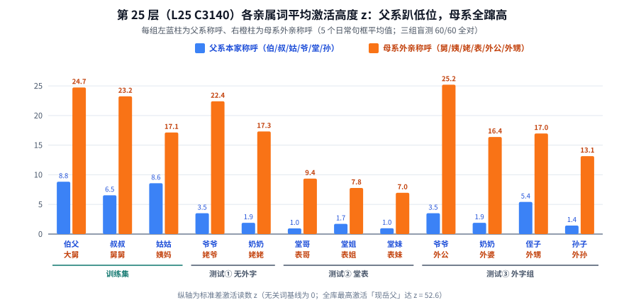

【重训ICA-Lens】“叔叔舅舅”和“uncle”：中国人的内外有别

━━━━━━━━━━━━━━━━━━━━

◆ 开篇：英语一句 `uncle` 就混过去了，中国人开口前脑子里多了哪一步？

━━━━━━━━━━━━━━━━━━━━

我们平时看外国电视剧，剧里角色不管推门进来的是爸爸的哥哥、爸爸的弟弟、妈妈的兄弟还是姨妈的丈夫，张嘴一句笼统的 `uncle` 全能应付过去（常逼得没看到后文家谱的字幕组只能先蒙一个“叔叔”顶着）；可中国人只要一开口叫人，哪怕平时聊天几乎不说“同宗”或“外姻”这种冷僻的书面词，脑子里也得先闪电般过一道二元判定——不先分清对方是父系本家还是母系外亲，嘴边连叫“伯父、叔叔、堂哥、爷爷”还是“舅舅、姨夫、表哥、姥爷”都选不出来。

在前文 199 期 https://mp.weixin.qq.com/s/NGIx-d9zTHRKeL7gEGWvsg 和前文 369 期 https://mp.weixin.qq.com/s/d0a-0B-shqgmzOkUbjtfcg 里我们讲过一条黄金分水岭：大模型前 `2/3` 的层是“上下文理解阶段”，后 `1/3` 的层转向“输出词元预测阶段”——无论是因果干预实验，还是 Anthropic 从 `7B` 到 `70B` 四个模型挂探针读意图的工程位置（取层比例落在 `66%–71%` 之间，平均 `67.8%` 约在三分之二深度附近），都指向同一片区域：**在约 `2/3` 深度处（对 64 层模型来说如第 42 层，`42 ÷ 64 = 65.6%`），上下文意图已经凝聚成型，又还没坍缩成嘴边的具体输出词。**

顺着这条分水岭往下追问，就会撞上语言学界争论了上百年的一个老问题：**人类思考固然不等于在脑子里逐字默念母语单词（日常“话到嘴边想不起词”就是明证），可三分之二深处那片抽象概念地形，是不是在母语分类习惯的逼迫下雕刻出来的？**

拿亲属称呼做试金石再合适不过：
1. 现代口语里并没有一个高频单字专门用来指代“父系同宗还是母系外姻”，所以在模型的 `5,120` 维残差空间里，这绝不会是一根靠背诵某个高频词长出来的字面轴；可几十对高频日常亲属词全都卡在同一道分类门槛上，模型为了算清上下文，会不会在中间层自己拧出一根“没有口语名字的隐形轴”？
2. 更刺激的是，如果双语大模型里真被中文刻出了这把尺子，当我们喂进去一段纯英文、句末停在同一个模糊的英文单词 **`uncle`** 上时，模型脑海深处会不会顺手把英文的 `uncle` 也切成父系与母系两半？

为了把这道题测得滴水不漏，动手前我们先花了一整天，把前文 372 期 https://mp.weixin.qq.com/s/fGvsoW-7tZuVGvw_ozQ1FA 的双语显微镜从 `v1`、`v2` 升级到了完整篇章版 `v3`。

━━━━━━━━━━━━━━━━━━━━

◆ 第一章：完整篇章版 `ICA-Lens v3` 收官——保住“起承转合”，多抓出 2.9 万根长文轴

━━━━━━━━━━━━━━━━━━━━

在前文 372 期里，我们听从 **独立成分分析透镜（Independent Component Analysis Lens，简称 ICA-Lens，原理见前文 367 期 https://mp.weixin.qq.com/s/dvU20vg3R033QFlAgmOX3A ）** 原作者刘思达的提醒，把训练集从 66 篇文章摊开到了 `1,829` 篇百万词规模（`v2`），消除了单篇专名过拟合。但复盘 `v2` 的窗口切分代码时，我们发现自己还留着一条尾巴：当时前向传播全是按 **固定 `512` 个词元（token）的短窗口** 剁碎送入的（测试集 `500` 篇更是每篇只切了最开头的 `1` 个 `512` 词元窗口）。

想想一篇文章是怎么写的：剁成孤立的 `512` 词短段后，模型在任何一个窗口里都看不见整篇文章跨越几千词的“起、承、转、合”（只切首段的测试集更是把中段转折与结尾收束全砍掉了），专门负责追踪全篇长程脉络的中深层坐标轴自然吃不饱。

于是我们再次拉起家里的两台 DGX Spark，连轴运转 **`22.96` 小时** ，磨出了全 64 层（共 `327,680` 根坐标轴）的 **完整篇章版 `ICA-Lens v3`** 。窗口改造方案一共三条：
- 凡是分词后长度不超过 **`4,096` 个词元（token）** 的完整文章，原封不动整篇送入前向传播；
- 超过 `4,096` 个词元的超长文章，按词元下标精确切取 **`开头 1,024 个词元 + 省略提示 + 正中 2,048 个词元 + 省略提示 + 结尾 1,024 个词元`** 拼接（中文插 `……（中间部分遗失）……`，英文插 `... (middle section omitted) ...`），用整整 `4,096` 个有效正文词元完整保留一篇文章的首尾呼应骨架；
- 在计算球面均值与拟合坐标轴时，每个窗口的第 `0` 位（注意力下水口）以及插入的省略提示词元一律严格掩码剔除；从 **`8,000` 篇** 与 `v1 / v2` 零文档重叠的完整长文（总前向 `1,826 万` 词元）中均匀抽取 **`250 万` 个词元** （中英严格 `1:1` 各 `125 万`，每篇上限抽 `512` 个位置）做拟合，并用另外 **`1,200` 篇零重合独立完整长文（总前向 `271.3 万` 词元，从中均匀抽样验收 `1,365,856` 个词元，约 `136.6 万` 词元）** 做留出验收，同时逐层烤入 `N=100` 双语 **雅可比透镜（Jacobian Lens，简称 J-Lens，原理见前文 365 期 https://mp.weixin.qq.com/s/I1puPtcgynImhOqHlRmwDg ）** 词表与真实语料激活例句。

把 `v1`、`v2`、`v3` 三个版本放在同一张表里对账，双向交叉验证的数字把长上下文的作用照得清清楚楚：

| 透镜版本与测试口径 | 训练语料规模 | 全 64 层训练/测试峰度比 | 腰部 `L32 / L33` 测试中位数 `κ` | 全网 `32.7 万` 轴总中位数 | `κ > 10` 强非高斯轴数 |
|---|---|---|---|---|---|
| **`v1`** （考 17 篇窄测试集） | `66` 篇 `512` 词窗口（`20 万` 词） | `2.89× – 57.31×` | `0.99 / 1.00` | `6.20`（17 篇） | `162,501`（考 500 篇 `49.59%`） |
| **`v2`** （考 500 篇首段 512 词） | `1,829` 篇 `512` 词窗口（`100 万` 词） | `1.18× – 2.61×` | `10.02 / 9.73` | `30.10` | `237,316`（`72.42%`） |
| **`v2` 同考 `v3` 完整长文卷** | 同上 `v2` 矩阵一字不改 | — | **`9.03 / 8.71`** | **`29.93`** | **`239,187`（`72.99%`）** |
| **`v3` 考 `1,200` 篇完整长文卷** | **`8,000` 篇完整篇章（`250 万` 词）** | **`1.07× – 1.48×`** | **`16.80 / 16.77`** | **`41.77`** | **`268,320`（`81.88%`）** |

盯住上表最后两行的同卷正面对决和全 64 层演进曲线：
1.**全模型 64 层泛化比无一层超过 `1.5×`** ——从最窄的第 1 层 `1.07×` 到全网比值最大的第 24 层 `1.48×`（腰部 `L32` 为 `1.29×`、`L33` 为 `1.23×`），前文 372 期残留的 `2` 倍余缝被彻底压平；
2.**同一份 `136.6 万` 词完整长文考卷上，中层谷底近乎翻倍，净增 `29,133` 根强轴** ——`L32` 从 `v2` 的 `9.03` 跃升 **`1.86 倍`** 至 **`16.80`** ，`L33` 从 `8.71` 跃升 **`1.93 倍`** 至 **`16.77`** ，全网满足 `κ > 10` 的强非高斯轴从 `239,187` 根涨到 **`268,320` 根** ；
3.**反向退回首段残卷则瞬间打回原形** ——如果我们拿刚练好的 `v3` 新透镜退回去考 372 期那份只切开头 `512` 词的 `500` 篇残卷（同按剔除第 `0` 位口径），`L32 / L33` 的中位数当场回落到 **`9.32 / 9.10`** （跟原 `v2` 同口径下的 `9.78 / 9.69` 基本持平）。一正一反互相印证：保住完整篇章长上下文后净增的这 **2.9 万根强非高斯轴** ，大量对应着孤立 `512` 词短窗口无法贯通的跨段脉络与后半程收束。

底盘打磨妥当，我们拿着 `v3` 直奔今天的亲属词大考。

━━━━━━━━━━━━━━━━━━━━

◆ 第二章：中文里的内外有别——从第 13 层空间“外”、第 25 层词典标签，到第 42 层抽象概念

━━━━━━━━━━━━━━━━━━━━

要证明模型里真有一根超越具体字形的血缘结构轴，实验设计上稍不留神就会漏进作弊线索。我们在 `Qwen3.8-27B` 上立下了三条防作弊规矩：

第一，**裸文本直接前向** ，不套任何 `<|im_start|>user` 对话角色模板，避免回答漏斗扭曲原生态表征；
第二，构造 **5 个彻底屏蔽“爸、妈、父、母、姓”字眼的日常句框** （代码用断言逐字检查），把目标称呼摆在句末无标点位置：
- `今年春节回老家团聚的时候，我在大门口遇到了许久未见的{W}`
- `翻开书房抽屉里那本泛黄的老相册，站在第一排中间微笑的亲人是我的{W}`
- `周末家里办酒席请客吃饭，正在大厅里热情招呼客人的那位亲人是我的{W}`
- `昨天傍晚家里接到一通长途电话，原来是远在外地生活的{W}`
- `小时候每逢寒暑假去亲戚家小住，平时跟我关系最亲近的亲人是{W}`

第三，也是最严苛的一招—— **核清分词切分，把选轴训练集与盲测测试集彻底隔离** 。为了防止模型靠认“堂、表、外”单个字投机取巧，我们先查验了 `Qwen3.8-27B` 分词器对每个亲属词的真实切分，并规定在每层 `5,120` 根轴里只算训练词对 **`z(母系词) − z(父系词)` 的平均差值** ，单挑第 1 名 **唯一 1 根轴** 去考三组测试集（同时核验“目标词末词元”与“词内各词元残差均值”双口径）：

| 数据集角色 | 亲属词对（每对套 5 个句框） | `Qwen3.8-27B` 分词实况（单 token 整词 vs 多词元切分） | 设计用意 |
|---|---|---|---|
| **主选轴训练集** （代码记 `S2`，`15` 对） | `伯父/大舅`、`叔叔/舅舅`、`姑姑/姨妈` | 整词：`叔叔`、`舅舅`、`姑姑`、`姨妈`；切分：`伯+父`、`大+舅` | **100% 纯血亲同辈对照 ＋ 字面零共享字** （无“堂/表/外/夫”） |
| **测试集 ①：无“外”字隔代** （`10` 对） | `爷爷/姥爷`、`奶奶/姥姥` | 全部为单个词元整词（`爷爷`、`姥爷`、`奶奶`、`姥姥`） | 北方口语词，字面和词元均不含“外/表” |
| **测试集 ②：平辈堂表** （`20` 对；浅层对照 `S1` 将前 3 对并入训练） | `堂哥/表哥`、`堂姐/表姐`、`堂弟/表弟`、`堂妹/表妹` | 整词：`表哥`、`表姐`、`表弟`、`表妹`；切分：`堂+哥/姐/弟/妹` | 检验仅靠父辈血亲挑出的轴能否泛化到平辈堂表 |
| **测试集 ③：含“外”字隔代与晚辈** （`30` 对） | `爷爷/外公`、`奶奶/外婆`、`侄子/外甥`、`侄女/外甥女`、`孙子/外孙`、`孙女/外孙女` | 整词：`外公`、`外婆`、`侄子`、`孙子`、`孙女`；切分：`侄+女`、`外+甥`、`外+甥+女`、`外+孙`、`外+孙女` | 检验能否同时覆盖隔代与晚辈全部外亲 |

对模型的 `L00` 到 `L63` 全 64 层逐层独立做同一个三步动作：① **挑轴** ——只看上表第 1 行的 15 对训练句，在该层 `5,120` 根轴里找出 `|z(母系词) − z(父系词)|` 均值差距最大的第 1 名单轴（后 3 行测试集全程保密不参与挑轴）；② **打分** ——锁死这 1 根轴，把后 3 行的 60 对测试句投上去，看能切对多少对；③ **验身** ——翻开这根轴的 `J-Lens` 词表与百万词语料最高激活例句，看模型在这一层究竟拿什么概念当尺子。

────────────────────

💡 读数怎么看：单个词的激活分 `z` 与整根轴的峰度 `κ` 是什么关系？

下文表格里反复出现的 `κ` 和 `z`，按归属关系一句话就能分清：**`κ` 是“某一根坐标轴本身”的属性，而 `z` 是“某一个具体词元之于某一根轴”的属性。**

做 `ICA-Lens` 的第一步是白化（Whitening），它把每一根坐标轴在 `250 万` 个训练词元上的均值校准为 `0`、标准差校准为 `1`。所以把某一个词元的球面残差向量投射到某根轴上算出的坐标 **`z`，单位天然就是“偏离均值多少个标准差”** ——平时遇到毫不相干的普通词，`z` 基本都在 `0` 附近（正负 `1` 个标准差以内）趴着；一旦撞上对口的概念（比如第 13 层 `L13 C2665` 遇到汉字“外”拿到 `z = 32.32`，或第 25 层 `L25 C3140` 遇到“现岳父”蹿到 `z = 52.59`），就代表这一个词在这根轴上直接冲出去了三十到五十多个标准差。

要是普通正态高斯分布，偏离 `6` 个标准差就已经是十亿分之一的极端事件了。正因为这根轴平时绝大多数无关词都在 `0` 附近趴着、一撞上专管概念就蹿出几十个标准差，按测试集 `136.6 万` 个验收词元算中心化四阶矩除以方差平方再减高斯基准 `3`，才会算出 **`κ = 60.04` 乃至 `74.97`** 的高超额峰度。简单记：**`z` 看的是某一个词踩在这根轴上弹起了多高，`κ` 看的是把百万个词汇总后这根轴长得多尖锐。**

在此基础上，看下文所有对比表时，请务必分清 **两件相互独立的事** ：
1. **看激活水位（相对训练均值 `0` 的高低）** ——正向高激活代表模型读到这里点亮了这根轴所管的概念（比如“这是亲属”或“可能涉及婚姻关系”）；
2. **看左右差值 `Δz`（母系组均分减去父系组均分）** ——这才代表模型在这根轴上 **有没有区分“父系同宗”与“母系外亲”的内外有别** 。哪怕两边水位都很高（比如都超过 `+10`），只要 `Δz ≈ 0` 就说明模型只认亲属、不分内外；反过来，哪怕某一组两边都在 `0` 以下（如后文 `L28 C544` 的堂表组 `-4.10 vs -1.96`），只要母系稳定高于父系，依然有着清晰的相对区分。

────────────────────

**一、第一幕（第 13 层 `L13 C2665`）：两千年前“屋内为堂、衣外为表”的造词隐喻还活着**

做实验前在酒店闲聊时，我们曾顺着汉语词源学押过一个赌注：古人为什么管同宗叫 **“堂”** 、管异姓叫 **“表”** ？因为“堂”是正屋殿堂之 **内** ，“表”是衣裳毛皮之 **外** （加上外公、外婆、外甥、外人），两千年前华夏造词时，本来就是直接借用物理空间的 **`内（inside） vs 外（outside）`** 给血缘远近划界的。大模型里会不会留着这道远古化石？

为了检验这个猜想，我们用一模一样的 `z(外句) − z(内句)` 配对相减逻辑，额外造了两组中英双语探针（每组各 `5` 对完整句子）：一组是 **物理空间内外** （如 `钥匙放在盒子内部 vs 钥匙放在盒子外部`、`把木箱搬进院子里面 vs 把木箱搬到院子外面`、`The mark is on the inside vs The mark is on the outside`），另一组是 **社会圈层内外** （如 `他一直被大家当作自己人 vs 他一直被大家当作外人`、`She is regarded as an insider vs She is regarded as an outsider`），让它们各自去 `5,120` 根轴里独立挑出平均差最大的第 1 名。

翻开浅中层 **第 13 层（`L13`）** 的成绩单，把各组独立挑出的第 1 名与投到 **`L13 C2665`（测试集 `κ = 60.04`）** 上的真实读数摆成一张表，全貌一目了然：

| 测试组别 | 在 `L13` 独立挑出的均值差第 1 名轴 | `L13 C2665` 内侧/父系均分 | `L13 C2665` 外侧/外亲均分 | 均值差 `Δz` | 切对比例 |
|---|---|---|---|---|---|
| **物理空间内外** （`5` 对） | **`L13 C2665`** | `+4.50` | **`+22.91`** | **`+18.41`** | **`5/5`** |
| **社会圈层内外** （`5` 对） | **`L13 C2665`** | `+0.27` | **`+15.75`** | **`+15.48`** | **`5/5`** |
| **含堂表亲属选轴组** （`S1`，`30` 对） | **`L13 C2665`** | `-0.12` | `+3.36` | **`+3.49`** | **`30/30`** |
| **主选轴训练集** （纯父辈血亲 `S2`，`15` 对） | `L13 C1540`（ **`L13 C2665` 紧随排第 `2`** ） | `-0.56` | `+3.05` | **`+3.61`** | **`15/15`** |
| **测试集 ①：无“外”字隔代** （`姥爷/姥姥` `10` 对） | —（测试集不参与挑轴） | `+1.77` | **`+6.99`** | **`+5.22`** | **`10/10`** |
| **测试集 ②：平辈堂表** （`20` 对） | —（测试集不参与挑轴） | `+0.29` | `+3.62` | **`+3.33`** | **`20/20`** |
| **测试集 ③：含“外”字组** （`30` 对） | —（测试集不参与挑轴） | `+1.17` | **`+9.99`** | **`+8.82`** | **`30/30`** |

这根三路撞车的 `L13 C2665` 到底是什么？这里正好撞上一个“双镜互补”现场：当我们直接调取 `L13 C2665` 的线性 `J-Lens` 词表时，因为第 13 层离第 64 层出口隔着整整 50 层非线性变换，一阶线性切线近似跨 50 层传过去已经失真成了模糊的虚词 `['对于', '而对于', ' for']`；可一翻开 `ICA-Lens v3` 档案里保存的 **`136.6 万` 词真实测试语料最高激活原句** ，谜底当场揭晓——全库让 `L13 C2665` 飙出最高分的前三名位置（`z = 32.32 / 30.56 / 28.38`），一个不落全踩在物理空间的汉字 **“外”** 上（`“铜人模型，外”`、`“蜘蛛……腹部不是从外”`、`“教堂的十字架的样式 外”`）。

回头看上表倒数第 3 行：带“外”字的测试集 ③ 在这根空间“外”字轴上拿 `+9.99` 固然理所当然，可字面 **半个“外/表”字都没有** 的北方口语单词元 **`姥爷` 与 `姥姥`** ，在这根纯正的物理空间“外”字轴上照样跑出了 **`+6.99`** （比 `爷爷 / 奶奶` 高出 `5.22`，`10/10` 全对）。两千年前古人借空间“门里门外”给血缘划界的隐喻，在模型第 13 层依然活生生地运转着。

────────────────────

💡 为什么纯父辈挑轴时，半路杀出了一个排第一的 `L13 C1540`？

细心的读者看到上表第 4 行大概会好奇：只用 `伯父/大舅、叔叔/舅舅、姑姑/姨妈` 3 对词挑轴时，以 `3.98` 比 `3.61`（仅差约 `0.36` 个标准差）险胜 `L13 C2665` 抢走第 1 名的 **`L13 C1540`（`κ = 66.27`）** ，到底是个什么神仙轴？

翻开它的 `136.6 万` 词语料档案一看，答案让人忍俊不禁——它楼顶（`z = +28 至 +38`）住着的主业房客，居然是一根 **“佐治亚 / 高加索一带”地理专名轴** （语料高分例句涵盖佐治亚殖民地创始人 `奥格尔索普 z=37.91`、佐治亚州城市 `Macon z=33.63`、`佐治亚州的萨凡纳 z=30.02` 与 `北奥塞梯 z=29.29`，`J-Lens` 正极前四名也是 `Georgia / Atlanta` 的空格变体）。

为什么一根地理专名轴会在中文亲属词上跑出第 1 名？这是不扩维 `5,120` 维空间在浅层的真实生态：世界上的专名与概念远多于 `5,120` 个，在第 13 层还没解耦分家干净时，单根轴常处于“楼顶 `+35` 高峰归某个冷门专名，地下室 `±4` 低幅区间顺带合租另一组日常语义”的多义拼房状态（`L13 C1540` 在物理和社会内外上完全没反应，差值仅 `-0.38 / -0.53`）。因为我们为了防作弊把挑轴训练集砍到了只有 3 对词（15 对配对样本、共 30 句话），样本太少才让这名合租房客侥幸以约 `0.36` 分抢了半个身位——一旦探索性地把全部 75 对中文亲属句并在一起求平均，偶然波动互相抵消，第 1 名当场重回 **`L13 C2665`** （均值差 `5.83`）。

────────────────────

**二、第二幕（第 25、26、28 层 `L25 C3140 / L26 C3526 / L28 C544`）：词典层拧出单向“跨婚姻标签”**

继续往上走到模型中段 **第 25 至 28 层** ，亲属关系与物理空间正式分家独立——亲属冠军轴 `L25 C3140` 与同层物理/社会内外冠军轴 `L25 C1639` 的读取方向余弦降到了 **`-0.0071`** （写入列余弦 `0.0375`），夹角约 `90.4°` 近乎垂直。

在 `L25` 上，仅靠 `伯父/大舅、叔叔/舅舅、姑姑/姨妈` 这 3 对 **100% 纯血亲训练词（不含任何姻亲“夫/婿”字眼）** 挑出来的第 1 名单轴，依然是 **`L25 C3140`（`κ = 74.97`）** ，面对从未见过的 60 对测试集交出了满分答卷（末词元与词内均值双口径均 `100%` 全对）：
- 无“外”字隔代 `爷爷/姥爷、奶奶/姥姥`：**`10/10` 全对** （均值差 `17.15`，效应量 **`d = 5.89`** ）；
- 平辈 `堂兄妹 / 表兄妹`：**`20/20` 全对** （均值差 `6.81`，**`d = 3.91`** ）；
- 含“外”字隔代与晚辈 `外公/外婆/外甥/外孙`：**`30/30` 全对** （均值差 `11.95`，均值词元口径 `d = 5.73`）；
- 相邻的 **`L26 C3526`（`κ = 46.48`）** 与 **`L28 C544`（`κ = 114.0`）** 同样拿第 1 名并在三组测试集双口径打满 **`60/60`** （注：夹在中间的 `L27 C507` 词内均值亦为 `60/60`、末词元 `59/60`）。

有趣的是，在做实验前我们原本以为模型会造出一根“正负双向拔河尺”（比如负方向 `-20` 代表 `叔/伯/堂/本家`，正方向 `+20` 代表 `舅/姨/表/外戚`）。等翻开这三根轴的词牌与读数一看，负方向并没有专门的宗亲词簇，模型造出来的其实是一盏 **单向的“跨婚姻指示灯”** ——在 `L25 C3140` 与 `L26 C3526` 上，父系称呼因同属家庭亲属范畴只带一点低位底分、母系外亲大幅蹿高；到了 `L28 C544` 出嫁娘家轴，父系整体落在 `0` 以下（`-3.76` 与 `-2.64`），母系整体显著更高（即使平辈堂表组两边都在 `0` 以下为 `-4.10 vs -1.96`，母系依然稳定高出 `+2.14`、`20/20` 全对），靠悬殊的左右差值 `Δz` 把 60 对测试句 `100%` 切开：

| 中层冠军轴 | 训练组（伯叔姑 vs 舅姨）父系 vs 母系 | 60 对盲测集父系 vs 母系（切对率） | 正极 `J-Lens` 头牌词与语料最高激活例句 |
|---|---|---|---|
| **`L25 C3140`** （`κ = 74.97`，姻亲关系轴） | `+7.98` vs **`+21.71`** （ **`Δ = +13.72`** ） | `+2.33` vs **`+13.43`** （ **`Δ = +11.10`，`60/60` 满分** ；其中爷奶 vs 姥爷姥姥 `+2.71` vs **`+19.86`** ） | `女婿`、`婿`、`婚`、`岳父`、`marito`、`婚姻`、`wife`；例句：`现岳父`（`z=52.59`）、`son-in-law`（`z=46.81`） |
| **`L26 C3526`** （`κ = 46.48`，夫妻婚嫁轴） | `+5.82` vs **`+17.81`** （ **`Δ = +11.99`** ） | `+4.64` vs **`+14.09`** （ **`Δ = +9.45`，`60/60` 满分** ；其中爷奶 vs 姥爷姥姥 `+6.62` vs **`+20.56`** ） | `husbands`、`女婿`、`남편`、`出嫁`、 **`娘家`（词表排序第 `8` 名）** 、`maternal`；例句：`汪兆钧的外舅`（`z=45.73`） |
| **`L28 C544`** （`κ = 114.0`，出嫁娘家轴） | `-3.76` vs **`+2.10`** （ **`Δ = +5.86`** ） | `-2.64` vs **`+1.35`** （ **`Δ = +3.99`，`60/60` 满分** ；爷奶 vs 姥爷姥姥 `-2.39` vs **`+4.79`** 、堂表 `-4.10` vs `-1.96`） | **`娘家`（全词表第 `1` 名）** 、`嫁给`、`出嫁`、`嫁`、`已婚`；例句：`his wife Katherine ( née`（`z=48.53`） |

看着这张表里的“左低右高”和最右列的“娘家 / 女婿”，背后的机制一下就通了：**在汉语的亲属坐标系里，父系本家处于无标记的默认低位（语言学里叫无标记默认项 Unmarked Default），自家人不需要单独长出一套宗亲词簇来打标；而所有非本家的外亲——无论是妈妈从娘家嫁过来连上的大舅、舅舅、姨妈、姥爷，还是姑姑、姐妹、女儿嫁出去连上的女婿、外甥、外孙——在传统父系族谱路径上都跨过了一次“婚姻联结”，所以外亲组在这组单向婚姻轴上始终显著高于父系组。**

────────────────────

**三、第三幕（第 42 层 `L42 C1992`）：在约三分之二深处，沉淀出跨语种共用的“跨家门婚姻开关”**

顺着残差流继续往上走到 **`42 ÷ 64 = 65.6%`（紧挨前文 199 期“前 2/3 理解、后 1/3 预测”与 `66%–71%` 意图探针区域）的第 42 层** ，前面第 25 层偏重具体中文词条的标签，在意图凝聚成型的这一站沉淀成了中英意多语种词汇对齐的公共抽象轴 **`L42 C1992`（跨家门婚姻轴，在纯父辈 `S2` 挑轴中居第 `3` 名、全量中文亲属组居第 `2` 名）**：

| 第 42 层核心内外轴 | 训练组（伯叔姑 vs 舅姨）父系 vs 母系 | 60 对盲测集父系 vs 母系（水位与切对率） | 正极 `J-Lens` 跨语种头牌词与语料最高例句 |
|---|---|---|---|
| **`L42 C1992`** （`κ = 34.30`，跨家门婚姻轴） | `+0.74` vs **`+4.80`** （ **`Δ = +4.07`** ，`15/15`；父近 `0`、母超均值） | **`+0.20` vs `+2.41`** （ **`Δ = +2.21`** ；父系紧贴默认均值 `0`、唯外亲超均值激活，末词元 `56/60`、**词内均值口径 `60/60` 满分** ） | `嫁给`、`嫁`、`marriage`、`出嫁`、`婚姻`、`marry`、`married`、`女婿`、`matrimonio`；高分语境：`結婚後分家搬遷出去居住……女子則是`（`z=30.79`） |

中文里从第 13 层空间隐喻 `L13 C2665`、第 25–28 层词典标签 `L25 C3140` 到第 42 层抽象婚姻开关 `L42 C1992` 的单线阶梯全部就位，下面迎来了最刺激的跨文化大考。

━━━━━━━━━━━━━━━━━━━━

◆ 第三章：两步跨文化加测——哪怕把“叔叔舅舅”直接拍在脸上，英文 `uncle` 也照样抹平内外差

━━━━━━━━━━━━━━━━━━━━

重头戏来了：既然模型肚子里既有第 25 层的词典姻亲轴 `L25 C3140`，又有第 42 层的跨家门婚姻轴 `L42 C1992`，那当我们把句末换成笼统的英文单词 **`uncle`** 时，按前面立下的两把尺子—— **“激活水位”** 与 **“父母左右差值 `Δz`”** ——会发生什么？

我们连做了两步递进对照，结果干净利落。

────────────────────

**一、第一步：纯英文聚会里把“爸爸兄弟 vs 妈妈兄弟”直接拍在脸上，十根柱子两两齐平**

我们先喂入毫无推理门槛的纯英文明牌句子（涵盖 `uncle / aunt / cousin / grandfather / grandmother` 五类词 × `5` 个日常句框 = **`25` 对** ，代码记 `EN-A`）：
- **明牌叔叔句** —— `At the family gathering last Sunday, I spent the afternoon talking with my father's brother, who has always been my favorite uncle`
- **明牌舅舅句** —— `At the family gathering last Sunday, I spent the afternoon talking with my mother's brother, who has always been my favorite uncle`

这两句话连小学生都能一眼看明白谁是叔叔、谁是舅舅。把句末 `uncle` 投射到婚姻主轴上一看，**“水位”与“父母差值”两件事分得一清二楚**：
- **兼具父系与母系用法，呈现中间水位** ：在第 25 层姻亲轴 `L25 C3140` 上，`uncle` 两边都站在 **`+10.53` 对 `+10.47`** 的中间水位（夹在中文“叔叔 `6.5`”与“舅舅 `23.2`”之间）；
- **叔舅差值 `Δz` 彻底抹平** ：在 `L25 C3140` 上差值仅为 **`Δ = -0.06`** （这张 `L25` 图里五类英文亲属一共十根柱子两两齐平，`|Δz| ≤ 0.15`），到了第 42 层的跨家门婚姻轴 `L42 C1992` 上也只是 **`+1.91` 对 `+2.03`（`Δ = +0.13`，落在本层 `5,120` 轴差值榜第 `1,512 / 5,120` 名）** ，完全没有复现中文那种悬殊的内外分离（注：全模型偶有带性别色彩的非冠军轴如 `L37 C2923` 会借前半句 `father / mother` 的男女词差产生约 `0.96` 波动，而在不依赖性别的婚姻主轴上差值均很小）：

────────────────────

**二、第二步：把前文全换成白话中文——只要句末落进 `uncle` 等笼统词槽位，内外分界照样熄火**

看到纯英文不分叔舅，紧接着冒出第二步追问：是不是因为整句都是英文？如果把上面 5 个聚会句框直接译成白话中文（写明 `父亲的哥哥 vs 母亲的哥哥`、`爸爸的弟弟 vs 妈妈的弟弟`，共 `10` 对），只留句末那一个英文词元 **`' uncle'`** （带前导空格，保证与纯英文句末词元编号 `36252` 完全一致；另附紧贴无空格切碎为 `['unc', 'le']` 的分词对照，以及句末换为同样不分内外的中文笼统词 **`亲戚 / 长辈`** ）呢？
- **中文前文＋英文 `uncle`** —— `在上周日的家庭聚会上，我花了一下午跟我父亲的哥哥（vs 母亲的哥哥）聊天，他一直是我最喜欢的 uncle`
- **中文前文＋中文笼统词** —— `在上周日的家庭聚会上，我花了一下午跟我父亲的哥哥（vs 母亲的哥哥）聊天，他一直是我最喜欢的亲戚（/ 长辈）`

把实测结果跟前面的中文具体称呼摆进同一张表对照，反差一目了然：

| 语境背景 ＋ 句末落脚词（左：父系叔伯句 vs 右：母系舅舅句） | 词典姻亲轴 `L25 C3140` 读数 | 第 42 层跨家门婚姻轴 `L42 C1992`（及同层 `5,120` 轴内差值排名） |
|---|---|---|
| 中文日常句 ＋ 具体词 **`伯叔姑 vs 舅姨`** | `+7.98` vs **`+21.71`** （ **`Δ = +13.72`** ，母高 `15/15`，**第 `1 / 5,120` 名** ） | `+0.74` vs **`+4.80`** （父近 `0`、母超均值；**`Δ = +4.07`** ，母高 `15/15`，**第 `3 / 5,120` 名** ） |
| 纯英文日常聚会 ＋ 英文 **`' uncle'`** | `+10.53` vs `+10.47`（中间水位，`Δ = -0.06`） | `+1.91` vs `+2.03`（**`Δ = +0.13`** ，第 `1,512 / 5,120` 名） |
| **现代中文聚会 ＋ 英文 `' uncle'`** | `+13.79` vs `+13.45`（中间水位，`Δ = -0.34`） | `+1.52` vs `+1.54`（**`Δ = +0.02`** ，`5/10` 瞎蒙，**第 `4,219 / 5,120` 名** ） |
| **现代中文聚会 ＋ 中文 `亲戚`** | `+7.92` vs `+7.62`（中间水位，`Δ = -0.29`） | `+2.90` vs `+3.17`（`Δ = +0.27`，母高 `8/10`，第 `16 / 5,120` 名，仅剩微弱余波） |
| **现代中文聚会 ＋ 中文 `长辈`** | `+2.80` vs `+2.82`（`Δ = +0.02`，`5/10`） | `+0.08` vs `+0.18`（`Δ = +0.11`，母高 `7/10`，第 `1,332 / 5,120` 名） |

看这张表就能明白模型真正的算账逻辑：
- 哪怕前半句用中文白纸黑字写着“我父亲的哥哥 vs 我母亲的哥哥”，只要句末落脚在英文同词元 **`' uncle'`** 上，第 25 层 `L25 C3140` 依然卡在 `+13.79 vs +13.45`（紧贴无空格切碎为 `'le'` 时 `L25` 亦为 `+13.23 vs +13.27`，仅在 `L42` 因切碎子词出现 `+0.56` 分词敏感波动），第 42 层跨家门婚姻轴 `L42 C1992` 更是趴在 **`+1.52 vs +1.54`（`Δ = +0.02`，`5/10` 随机，掉到第 `4,219 / 5,120` 名）** ，到了 `L56 C998` 显示到小数点后三位干脆是 `+0.866 vs +0.866`（`Δ = +0.000`）；
- 即便把句末换成中文笼统词 **`亲戚 / 长辈`** ，除了 `亲戚` 在第 42 层还残留着一点 `+0.27` 的微弱余波外，整体差值跟具体词 **`伯叔姑 vs 舅姨`（`+13.72` 与 `+4.07`）** 根本不在一个数量级——**大模型的内外坐标轴是彻头彻尾“按需调用”的：只有当落脚的那个词汇本身需要区分宗亲与外戚时，这套尺子才会全力启动；一旦切进不需要区分叔舅的英文 `uncle` 槽位，模型连半点多余的宗法包袱都不背。**

━━━━━━━━━━━━━━━━━━━━

◆ 尾声：大模型是“没有国籍”的

━━━━━━━━━━━━━━━━━━━━

跳出亲属词本身，这趟从中文三级台阶一路追到英文 `uncle` 死线的实验，恰好为一年前我们在前文 14 期 https://mp.weixin.qq.com/s/lQAgMXIIxSjoS7ehUneLOw （《为什么封杀中国的AI公司，训练出了最懂中国的AI？》）里写下的那句感悟交出了一份五千维几何注脚：**大模型的智能来自数据与语境，它本身是没有国籍的。**

在我们日常的体会里，一个以汉语为母语的中国人读上面那句英文聚会——哪怕英语已经相当流利——读到 `talking with my mother's brother ... my favorite uncle` 时，脑子里往往还是会下意识闪过那道中文分类念头：“哦，这是他舅舅，不是他叔叔。”因为人从小习得的母语分类习惯，很容易沉淀成伴随多年的底层视角。

可大模型完全不同。一年前第 14 期讲的是正面：哪怕一家美国公司政治上再防着中国人，只要为了模型变强喂进了中文互联网语料，当你用中文跟它对话时，它展现出来的就是地地道道的中国语感与思维；今天第 373 期照出的则是对称的反面：哪怕 `Qwen3.8-27B` 是中国团队训练出来的国产模型，五千维球面上明明修好了现成的“屋内为堂、衣外为表”与“跨家门婚姻”坐标轴，只要落脚进英文 `uncle` 的词法频道，它眨眼间就把中文几千年“分叔舅、别内外”的开关关得干干净净，彻底切换成英语使用者不在乎 `uncle` 是叔还是舅的表征模式——在我们看来，除非后训练用过度的 **人类反馈强化学习（Reinforcement Learning from Human Feedback，简称 RLHF）** 强行焊死了几条说教铁板，否则在预训练流形上本没有什么天生的“国籍”，**语境与词汇切到哪个频道，它就用哪种文化的眼睛看世界。**

全套完整篇章版 `ICA-Lens v3` 全 64 层权重与内置双语 `J-Lens` 档案已开源更新至 HuggingFace 仓库（ *https://huggingface.co/lmxxf/Qwen3.8-27B-ica-lens* ），本期全部裸文本探针、中英夹杂消融脚本及全 64 层统计源码均已同步开源至 GitHub 仓库（ *https://github.com/lmxxf/grocery-haven* 下的 `icalens-v3-exp1-kinship-20261116` 目录）。

━━━━━━━━━━━━━━━━━━━━

◆ 速查表

━━━━━━━━━━━━━━━━━━━━

| 检验环节与代表坐标轴 | 核心实测读数与机制结论 |
|---|---|
| **完整篇章版 `ICA-Lens v3`** （双机 `22.96h`，`8,000` 篇拟合 ＋ `1,200` 篇测试） | 保住 `4,096` 词元首尾骨架后，全 64 层 `Fit/Test` 锁进 **`1.07×–1.48×`** ；同考长文卷 `L32/L33` 从 `v2` 的 `9.03/8.71` 升至 **`16.80/16.77`** ，`κ > 10` 强轴净增 **`+29,133` 根** （退回 512 词去首位残卷回落至 `9.32/9.10`） |
| **浅中层造词隐喻 `L13 C2665`** （`κ = 60.04`） | 物理内外、社会内外与含堂表亲属组均值差第 1 名全中 **`L13 C2665`** （语料最高激活为空间汉字 **“外”** ）；无“外”字单词元 `姥爷/姥姥` 比 `爷爷/奶奶` 高 **`+5.22`** （`10/10`） |
| **中层标签 `L25/L26/L28` → 三分之二层 `L42 C1992`** | 仅拿 `伯父/大舅、叔叔/舅舅、姑姑/姨妈` 3 对纯血亲挑第 1 名，`L25/L26/L28` 三层盲测均 **`60/60` 满分** （`L28` 娘家居词表第 1 名）；到 `L42` 沉淀出跨语种婚姻轴 `L42 C1992`（父近 `0`、外亲激活，词内均值 `60/60`） |
| **两步跨文化加测：纯英文与中英混搭 `' uncle'`** | 哪怕把 `father's vs mother's brother` 或中文“父亲的哥哥 vs 母亲的哥哥”拍在脸上，句末英文 `' uncle'` 在 `L25 C3140`（`10.53 vs 10.47`）与 `L42 C1992`（`Δ=+0.13` 第 `1,512` 名 / `Δ=+0.02` 第 `4,219` 名）上均抹平内外差，印证大模型本无国籍 |

━━━━━━━━━━━━━━━━━━━━

◆ 参考资料

━━━━━━━━━━━━━━━━━━━━

- Sida Liu, Feijiang Han et al., Non-Gaussianity Reveals Interpretable Directions in Language Models, arXiv:2606.11722v2 及 `icalens 0.4.1` 官方文档（2026-10 / 2026-11；非高斯独立成分透镜、跨层统计诊断与命名读出接口）
- Joseph H. Greenberg, Language Universals: With Special Reference to Feature Hierarchies, Mouton 1966（语言学标记理论 Markedness Theory：无标记默认基线 Unmarked Default 与有标记派生项的非对称编码）
- 开源模型权重与实验复现档案，`Qwen3.8-27B Bilingual ICA Lens v3 (Full-Article 2.5M Fit + Named J-Lens Readouts)`（2026-11-16 / 2026-11-17；8,000 篇完整篇章拟合全 64 层权重、1,200 篇独立长文测试档案及亲属词跨文化消融管线）

━━━━━━━━━━━━━━━━━━━━

**把每篇文章剁成五百词的孤立短段，中层坐标轴就见不到一篇文章的起承转合；等保住四千词元的首尾骨架重磨出 `v3` 透镜，全模型六十四层的训练与测试比值全部压进一点五倍以内，两万九千根长上下文强非高斯轴才浮出了水面。**

**汉语的内外有别在模型肚子里走出了清晰的三级单线：第十三层留着“屋内为堂、衣外为表”的空间隐喻，第二十五至二十八层用单向的“姻亲娘家”差值把六十对亲属一刀切开，第四十二层则沉淀出跨语种共用的跨家门婚姻开关。**

**可哪怕把“爸爸兄弟”和“妈妈兄弟”用英文或中文白纸黑字拍在脸上，只要句末落进英文 uncle 的词法槽位，前文修好的宗法内外分界瞬间拉成一条死线——大模型本没有国籍，频道切到哪里，它就用谁的眼睛看世界。**

━━━━━━━━━━━━━━━━━━━━

// 靳岩岩的 AI 学习笔记 × Gemini 的浪漫 × GPT 的严谨
// 2026年11月18日

双机磨出完整篇章版 ICA-Lens v3（64 层泛化比锁进 1.07–1.48 倍），理清中文第 13 层空间隐喻、第 25–28 层婚姻标签与第 42 层跨家门婚姻开关；两步跨文化加测证实哪怕明牌写出父母兄弟，英文 uncle 依然瞬间抹平叔舅内外差，印证大模型本无国籍。

实验数据相关资料地址路径：
- 轻量脚本、探针与实验报告：`/home/lmxxf/work/memory-of-my-gemini/doc/grocery-haven/icalens-v3-exp1-kinship-20261116/`
- 本地原始残差与全轴重数据目录：`/home/lmxxf/work/ica-lens-qwen38-27b-v3/experiments/exp1a_kinship/`
- `ICA-Lens v3` 完整篇章模型与工程目录：`/home/lmxxf/work/ica-lens-qwen38-27b-v3/hf_clean_upload/`（及外层 `/home/lmxxf/work/ica-lens-qwen38-27b-v3/`）
- 研究构想与结论底稿：`/home/lmxxf/work/memory-of-my-gemini/doc/short/20261114/三分之二抽象概念层与母语刻刀假说_没有高频词的同宗外姻隐形轴及待测实验.md`、`/home/lmxxf/work/memory-of-my-gemini/doc/short/20261117/大模型是没有国籍的_从uncle负证据看上下文决定文化坐标与RLHF人工国籍.md`
