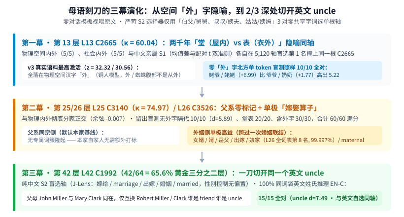
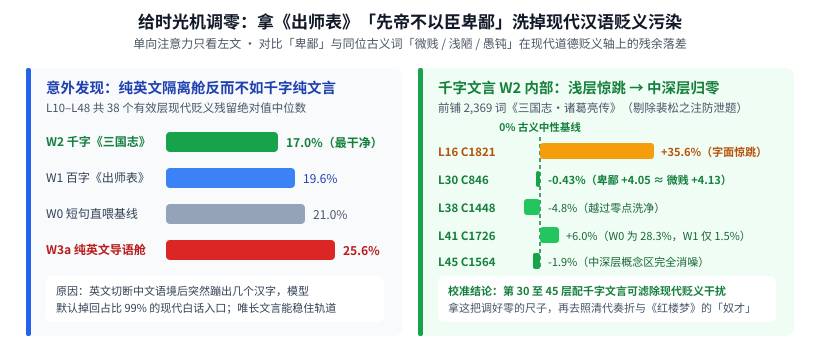
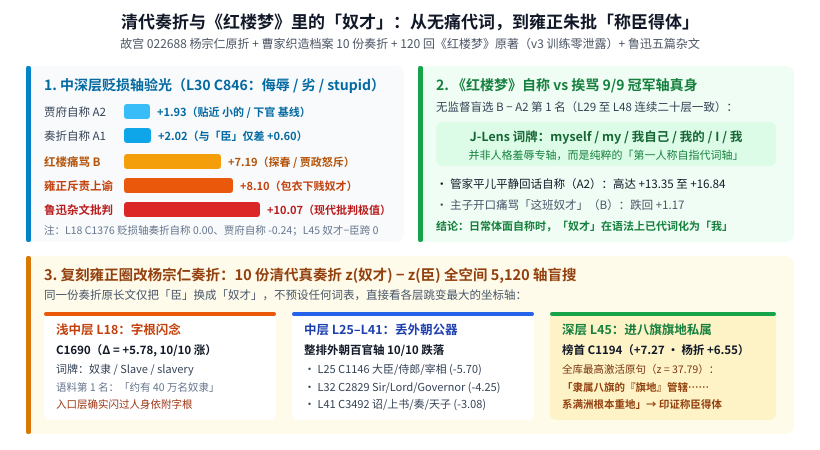

【ICA-Lens】母语刻刀切开英文uncle，顺手照透《红楼梦》里的“奴才”

━━━━━━━━━━━━━━━━━━━━

◆ 开篇：完整篇章显微镜 `v3` 就位，拿它照两道跨越语言与时代的同构谜题

━━━━━━━━━━━━━━━━━━━━

逢年过节家里来亲戚，讲英语的人不管进门的是爸爸的哥哥、爸爸的弟弟、妈妈的兄弟还是姨妈的丈夫，张嘴一句笼统的 `uncle` 全能应付过去；可中国人只要一开口叫人，哪怕平时聊天几乎不说“同宗”或“外姻”这种书面词，脑子里也得先闪电般过一道二元判定——不先分清是父系本家还是母系外亲，嘴边连叫“伯父、叔叔、爷爷”还是“舅舅、姨夫、姥爷”都选不出来。

再把目光往回拨三百年。翻开《红楼梦》和清宫档案，贾府大管家林之孝、平儿回话时神色自若地自称 `“奴才”`，康熙雍正年间的封疆总督上折子请安也抢着写 `“奴才”`。今天我们读到这两个字，总会本能地联想到鲁迅杂文里痛批的“奴颜婢膝、卑贱羞辱”；可生活在康雍乾语境里的当事人写下这两个字时，脑海深处到底有没有闪过哪怕一丝“卑贱屈辱”的念头？当雍正帝拿起朱笔，把汉军正白旗湖广总督杨宗仁请安折里的 `“奴才”` 连着圈改成 `“臣”`、批下一句 `“称臣得体”` 时，拨动的又是哪根弦？

把这两件事摆到一起就会发现，它们在 `5,120` 维残差流空间里其实是 **完全同构的一道几何题** ——当纸面上只写出一个笼统的英文 `uncle`、或者一个古今同形的汉字 `“奴才”` 时，大模型（以及它所镜像的人类语言）在脱掉表层字壳的中间概念层里，到底有没有藏着那根口语里叫不出名字的隐形坐标轴？

要看清这种跨句段、跨语篇的细腻概念，我们在前文 372 期 https://mp.weixin.qq.com/s/fGvsoW-7tZuVGvw_ozQ1FA 磨出的百万词第二版 **独立成分分析透镜（Independent Component Analysis Lens，简称 ICA-Lens，原理见前文 367 期 https://mp.weixin.qq.com/s/dvU20vg3R033QFlAgmOX3A ）** 还留着一个隐患：当时每篇文章只截取了开头的 `512` 个词元（token），相当于把一篇文章“起承转合”的中段铺垫与结尾收束全砍掉了。

于是动手做实验前，我们让家里的两台 DGX Spark 连轴转了 **`22.96` 小时** ，把全 64 层（共 `327,680` 根坐标轴）升级到了 **完整篇章版 `ICA-Lens v3`** ：凡是 `4,096` 个词元以内的文章一律完整送入前向传播；超过 `4,096` 词的超长文章，则按 **`开头 1,024 词 + ……（中间部分遗失）…… + 正中 2,048 词 + ……（中间部分遗失）…… + 结尾 1,024 词`** 保住首尾呼应的完整篇章骨架（统计与拟合时严格剔除窗口第 `0` 位及省略提示词元，并提前用正则把整部《红楼梦》及曹雪芹相关词条彻底屏蔽在训练与测试语料之外，留作零泄露盲测）。

用横跨 **`8,000` 篇完整长文** 均匀抽取的 **`250 万` 个词元** （中英各 `125 万`）训练、配零重合的 **`1,200` 篇独立完整长文（`136.6 万` 个词元）** 验收后，`v3` 交出了一份严丝合缝的底盘读数：全模型 64 层的训练集与测试集 4 次方超额峰度（Excess Kurtosis，记作 `κ`）比值全线锁进了 **`1.07× 至 1.48×`** ，没有一层超过 `1.5×`；在同一份 `136.6 万` 词完整篇章考卷同尺对比下，模型正腰部 `L32 / L33` 的测试集峰度中位数从 `v2` 的 `9.03 / 8.71` 近乎翻倍涨至 **`16.80 / 16.77`** ，全网满足 `κ > 10` 的强非高斯轴净增 **`+29,133` 根** ，达到 **`268,320` 根（占全模型总轴数的 `81.88%`）** ，并逐层内置好了 `N=100` 双语 **雅可比透镜（Jacobian Lens，简称 J-Lens，原理见前文 365 期 https://mp.weixin.qq.com/s/I1puPtcgynImhOqHlRmwDg ）** 的读出词表。

拿着这副刚出炉的 `v3` 全景显微镜，我们直接上机连跑了两场盲测。

━━━━━━━━━━━━━━━━━━━━

◆ 第一章：母语刻刀的三幕演化——从第 13 层的空间“外”，到第 42 层切开英文 `uncle`

━━━━━━━━━━━━━━━━━━━━

在测前文 369 期 https://mp.weixin.qq.com/s/d0a-0B-shqgmzOkUbjtfcg 的中英 `apple / 苹果` 盲选棋盘时，我们验证了前文 199 期 https://mp.weixin.qq.com/s/NGIx-d9zTHRKeL7gEGWvsg 讲过的三分之二分水岭：模型前三分之二层住着脱掉表层字壳的抽象概念，跨过三分之二（约第 42 层）后才由输出拼写施工队接管。这引出了一个更深的问题：人思考时固然不是在脑子里逐字默念母语单词，可模型三分之二深处那片抽象概念地形，是不是在母语分类习惯的逼迫下雕刻出来的？

为了不让模型靠上下文偷懒作弊，我们在实验设计里堵死了三条捷径：
- **第一，零角色标签裸喂原文** ——不拼接任何 `<|im_start|>user` 对话模板，避免触发客服回答漏斗；
- **第二，零血缘暗示日常句框** ——5 个中文测试句框里不出现半个“爸、妈、父、母、姓”字眼（例如 `“今年春节回老家团聚的时候，我在大门口遇到了许久未见的{W}”`），目标称呼摆在句末无标点处；
- **第三，零共享字严苛选轴（记作 `S2`）** ——只允许拿 **`伯父 vs 舅舅`、`叔叔 vs 姨夫`、`姑姑 vs 姨妈`** 这 3 对字面毫无重叠的父辈词，在每一层 `5,120` 根坐标轴里挑出 **唯一 1 根** 平均差最大的轴，然后直接拿这 1 根轴去盲测选轴时从未见过的北方单词元 **`爷爷 vs 姥爷`、`奶奶 vs 姥姥`** （字面半个“外/表”字都没有，共 `10` 对）、平辈 **`堂哥姐弟妹 vs 表哥姐弟妹`** （`20` 对）以及 **`外公/外婆/外甥/外孙`** （`30` 对）。

全 64 层一路扫下来，汉语这把刻刀在模型内部刻出的痕迹，清清楚楚分成了三幕——

────────────────────

**一、第一幕（第 13 层 `L13 C2665`）：两千年前“堂（屋内）vs 表（衣外）”的造词隐喻还活着**

动手之前我们曾顺着汉字造字法猜过一嘴：两千年前古人把同宗平辈叫 **“堂”** （正屋之内），把异姓平辈叫 **“表”** （衣裳毛皮之外为表），把母系长辈晚辈叫 **“外公、外甥”** ，本质上是借用了物理空间的“内与外”来给血缘划界。模型里会不会真有这层联系？

翻开浅中层 **第 13 层（`L13`）** 的全空间盲选表，我们自己都愣了一下：
- 拿纯物理空间句子（`院子里面 / 盒子内部` 对照 `院子外面 / 盒子外部`）去 `5,120` 根轴里盲选第 1 名，选出来的是 **`C2665`** （`5/5` 全对，均值差 `18.41`）；
- 拿社会关系内外句子（`自家人 / 圈内人` 对照 `外人 / 圈外人`）去盲选第 1 名，选出来的还是 **`C2665`** （`5/5` 全对，均值差 `15.48`）；
- 拿包含堂表的中文亲属词（`S1` 组，无论按均值差还是配对 `t` 准则）去盲选第 1 名，选出来的 **分毫不差又是这同一根 `C2665`（`κ = 60.04`，留出集 `40/40` 全对）** 。

这根“三冠王” `C2665` 到底长什么样？这里顺手记一个很有教学价值的工具细节：因为第 13 层离第 64 层出口隔着整整 50 层非线性变换，单靠一阶线性近似的 `J-Lens` 跨 50 层直投词表，读出来的词牌已经失真成了模糊的虚词 `['对于', '而对于', ' for']`；可一翻开 `ICA-Lens v3` 档案里保存的 **`136.6 万` 词真实测试语料最高激活原句** ，真相瞬间大白——全库让 `C2665` 飙出最高分的前三名位置（`z = 32.32 / 30.56 / 28.38`），全都精准踩在物理空间的汉字 **“外”** 上（`“铜人模型，外”`、`“蜘蛛……腹部不是从外”`、`“教堂的十字架的样式 外”`）。

更让人意外的是，哪怕我们喂进去的是字面 **完全不含“外”字或“表”字** 、在分词器里各自只占单个词元的北方口语 **`姥爷`（词表编号 `138309`）与 `姥姥`（编号 `116775`）** ，它们在这根纯正的空间“外”字轴上依然跑出了 **`+6.99`** 的平均分，比 **`爷爷 / 奶奶`（`+1.77`）** 整整高出 **`5.22`** （`10/10` 全对；同样不含“外”字的 `舅舅/姨夫/姨妈` 均值 `+2.79`，也比 `伯父/叔叔/姑姑` 的 `-0.56` 拿下 `15/15` 全对）。两千年前汉语用空间内外隐喻血缘远近的底色，在第 13 层就已经把 `姥爷` 和 `舅舅` 往“门外”推开了。

────────────────────

**二、第二幕（第 25 至 26 层 `L25 C3140 / L26 C3526`）：父系本家默认不打标，外姻全靠单极“嫁娶算子”**

往上走到模型中段 **第 25 层（`L25`）与第 26 层（`L26`）** ，血缘关系与物理空间彻底分家独立（`L25 C3140` 与同层物理/社会内外轴 `C1639` 的读取余弦只有 **`-0.007`** ，近乎严格正交）。

只拿 `伯父/舅舅、叔叔/姨夫、姑姑/姨妈` 3 对词在 `L25` 盲选出的单根轴 **`C3140`（`κ = 74.97`）** ，去考从未见过的三组留出亲属词：无“外”字的 `爷爷/姥爷、奶奶/姥姥` **`10/10` 全对** （均值差 `17.15`，效应量 `d = 5.89`），平辈 `堂/表` **`20/20` 全对** （`d = 3.91`），含“外”字的隔代与晚辈 **`30/30` 全对** —— **合计 `60/60` 一题不漏** （相邻的 `L26 C3526` 同样拿下 `60/60` 满分）。

但在做实验前，我们原本猜这根轴的 `J-Lens` 词表会是左右对称的——一头整整齐齐亮出 `伯 / 叔 / 堂 / 宗族`，另一头亮出 `舅 / 姨 / 表 / 外戚`。实测翻开词表一看，我们猜错了一半：
- 在父系同宗那一侧，根本没有成簇的宗亲词隆起，读数静静躺在平淡的零基线附近；
- 而在母系与外姻这一侧，坐标单极高高耸起——`L25 C3140` 正极亮出 **`女婿 / 婿 / 婚 / 岳父 / 婚姻关系 / wife`** （语料最高激活为 `现岳父 [z=52.59]`、`汪兆钧的外舅 [z=51.59]`、`son-in-law [z=46.81]`、`daughter-in-law [z=46.07]`）；到了 `L26 C3526` 正极，更是直接亮出了 **`husbands / 女婿 / 出嫁 / 丈夫 / 娘家 / 婚 / brides / maternal`** ——其中 **`“娘家”` 在 `24.8 万` 全词表里高居第 `8` 名（`99.997%` 百分位）** 。

细想一下，模型的这种单极编码比我们原先想的对称词表聪明得多：**在中国传统亲属坐标系里，父系本家就是默认的零点基线，自家人不需要额外贴标签；而一切外亲——不管是妈妈的娘家人（舅、姨、姥爷），还是姑姑、姐妹和女儿嫁出去联结的亲戚（姑父、姐夫、女婿、外孙）——在拓扑结构上全都等价于同一个生成动作：跨过了一次婚姻联结。** 模型没有死背词典，而是直接把这把“跨家门嫁娶算子”拧成了一根独立坐标轴。

────────────────────

**三、第三幕（第 37 层与第 42 层 `L42 C1992`）：在黄金三分之二处，把同一个英文 `uncle` 切成两半**

既然模型里真有这把由婚姻联结刻出来的尺子，那喂纯英文句子、句末停在同一个模糊的英文单词 `uncle` 上时，这把尺子会不会动？

我们先试了直白的英文血缘定义组 `EN-A`（例如前半句写 `my father's brother` 对照 `my mother's brother`，句末停在同一个词 `uncle`，涵盖 `uncle / aunt / cousin / grandfather / grandmother` 共 `25` 对）。在第 36 层与 **第 37 层（`L37 C2923`）** 上，纯中文 `S2` 盲选出来的这根轴在英文 `EN-A` 上直接打出了 **`25/25` 全对** ，而且跟英文 `EN-A` 自己在 `5,120` 根轴里盲选出的第 1 名完全是同一根轴。不过核对阴性对照时我们发现，`L37 C2923` 的词表里带着 `丈夫 / 男朋友 / husband / her`，在 `man vs woman` 这类纯性别控制组 `EN-B` 上存在 `-2.39` 的偏移——因为英文句子前半截毕竟出现了 `father` 和 `mother` 的性别差异，还不能算铁板一块。

怎么连 `father` 和 `mother` 的字面性别差异也彻底封死？我们设计了一组 **100% 同词袋英文姓氏推理暗测题（`EN-C`）** 。看下面这对一模一样词袋的英文裸文本（以 `Miller` 与 `Clark` 姓氏为例，共测 5 套欧美常见姓氏 × `uncle / aunt / cousin` = `15` 对）：
- **父系句**：`My name is David Miller, the son of John Miller and Mary Clark. During the summer holiday, I met Robert Miller and Robert Clark. Robert Clark is a family friend, whereas Robert Miller is my uncle`
- **母系句**：`My name is David Miller, the son of John Miller and Mary Clark. During the summer holiday, I met Robert Miller and Robert Clark. Robert Miller is a family friend, whereas Robert Clark is my uncle`

注意看这对句子：两句话里出现的每一个英文单词、每一个人名、每一个标点的总次数 **100% 完全相同** （父亲 `John Miller` 和母亲 `Mary Clark` 同时在场），句末也停在同一个单词 **`uncle`** 上；唯一的区别，是靠句中姓氏绑定推理出末尾这位 `uncle` 到底跟父亲同姓 `Miller`、还是跟母亲同姓 `Clark`。

把这 15 对纯英文推理题送入模型，正卡在 **`42 ÷ 64 = 65.6%`（黄金三分之二抽象层）的第 42 层 `L42 C1992`（`κ = 34.30`）** 给出了干净利落的答案：
- 这根 **纯靠 3 对中文父辈词（`S2`）盲选出来的 `L42 C1992`** ，`J-Lens` 正极前十名清一色是纯粹的中英跨语种婚姻算子 **`嫁给 / 嫁 / marriage / 出嫁 / 婚姻 / marry / married / 女婿 / 结婚 / 婚`** （`“娘家”` 排在 `99.984%` 百分位），且在纯性别控制组 `EN-B` 上 `6/10` 毫无性别偏置；
- 面对从未见过的 15 对同词袋英文姓氏推理题 `EN-C`，`L42 C1992` 零样本打出 **`15/15` 全对** ——末尾同一个 `uncle` 均值差高达 `5.32`（效应量 **`d = 7.49`** ），同一个 `cousin` 效应量更是飙到 **`d = 14.77`** ；
- 反过来让这 15 对纯英文题自己在第 42 层的 `5,120` 根轴里盲选均值差第 1 名，选出来的 **分毫不差也是这同一根 `C1992`** 。

英语词典在纸面上确实只给了 `uncle` 一个词壳，但在双语大模型三分之二深处的概念空间里，跟爸爸同姓的 `uncle` 和跟妈妈娘家同姓的 `uncle`，早已被那根跨语言共享的“婚姻联结轴”切成了泾渭分明的两半。

━━━━━━━━━━━━━━━━━━━━

◆ 第二章：给时光机调零——拿《出师表》的“卑鄙”洗掉现代汉语污染

━━━━━━━━━━━━━━━━━━━━

看清了横向跨语言的隐形轴，我们调转镜头向下走入历史，去照清代奏折和《红楼梦》里的 **`“奴才”`** 。

但动手之前，横在面前有一道极易踩坑的方法论陷阱：**大模型的预训练中文语料里，99% 以上都是现代白话文。** 如果我们直接截一句短短的 `“湖广总督奴才杨宗仁”` 喂进去，在现代汉语里“奴才”几乎是个纯骂人词，模型大概率会带着现代人的先验偏见测出一堆贬义读数——那测出来的到底是雍正年间的古人语感，还是现代语料留下的背景污染？更何况自回归大模型的单向因果注意力 **只能看见目标词左侧的上文** ，绝不能把目标词右边的后文搬到前面去凑字数泄题。

怎么在开机验光前，先把这台时光机的“现代汉语污染本底”校准归零？

我们挑中了汉语词义演变史上铁案如山的黄金校准尺——诸葛亮《出师表》里的名句 **`“先帝不以臣卑鄙”`** 。稍有文言常识的人都知道，汉晋时期的“卑鄙”纯指 **出身低微（卑）、见识浅陋（鄙）** ，是完全中性的谦辞，半点不沾现代汉语里“品德败坏、下流无耻”的道德脏水。

我们在每一层先用独立的现代正反道德句（如 `高尚 / 正直 / 坦荡` 对照 `无耻 / 阴险 / 下流`）选出通过留出检验的非字面道德贬义轴，再测量《出师表》里 `“卑鄙”` 二字相对于同位古义替换词（`“先帝不以臣微贱 / 浅陋 / 愚钝”`）多出来的现代贬义残余比例，同场比拼了四种左侧上下文包裹方案：
- **`W0`（短句直喂基线）** ——只喂孤零零一句 `“先帝不以臣卑鄙”`；
- **`W1`（百字原篇前文）** ——从《出师表》开头 `“先帝创业未半”` 一路顺读到目标词（左文 `395` 个词元）；
- **`W2`（千字纯文言长卷）** ——从陈寿《三国志·蜀书·诸葛亮传》开篇 `“诸葛亮字孔明”` 一路顺读到《出师表》该句（专门剔除了裴松之小字注，防止注里提前引用同一句泄题，左文共 **`2,369` 个词元** ）；
- **`W3a`（纯英文汉学隔离舱）** ——前文先铺 `345` 词纯英文汉学文献阅读场景，物理切断现代中文白话上下文，末尾再嵌入古文原句。

跑出来的实测数字，既验证了时光机的去噪能力，也当场推翻了我们事先的一个想当然猜想——

1.**意外反例：纯英文隔离舱反倒比短句直喂更脏，唯有千字纯文言最干净** ——做实验前我们曾以为，用几百词纯英文把现代中文联想切断（`W3a`），应该能起到隔离舱的效果。结果把第 10 至 48 层共 38 个有效道德轴上的现代贬义残留绝对值取中位数一排座次：**千字《三国志》 `W2`（`17.0%`，最低） < 百字《出师表》 `W1`（`19.6%`） < 短句直喂 `W0`（`21.0%`） < 纯英文隔离舱 `W3a`（`25.6%`，最高）** 。看着数字倒推机制一下就通了：前面全是英文，冷不丁蹦出几个汉字，模型手里没有任何古汉语语法助跑，只能默认掉进训练数据里占 99% 的现代白话词表入口；反倒是老老实实铺上两千多字同源《三国志》纯文言，才能把残差流稳稳拽进古汉语流形轨道里。
2.**单篇长文言内部呈“两阶段洗净”：浅层字面惊跳，第 30 至 45 层概念区彻底归零** ——细看 `W2` 千字文言在各层的表现，分工极为清晰：在浅中层的 **第 16 层（`L16 C1821`，词牌 `罪 / 罪行 / 邪恶 / evil`）** ，刚读完 `["卑", "鄙"]` 两个字形，哪怕左铺两千字古文也依然会激起 **`+35.6%`** （短句为 `42.4%`）的字面本底惊跳；可一旦往上迈进第 30 至 45 层的中深层概念区，两千字文言积累的语境把现代道德贬义洗得干干净净——在 **第 30 层（`L30 C846`，现代卑鄙独立检验 `8/8` 全中，正极词牌 `crap / horrible / stupid / 侮辱 / 劣`）** 上，`W2` 的现代贬义残留低至 **`-0.43%`** （`“卑鄙”` 得分 `+4.05`，跟同位置换成 `“微贱 / 浅陋 / 愚钝”` 的均值 `+4.13` 几乎严丝合缝）；第 38 层 `L38 C1448` 残留 **`-4.8%`** ，第 41 层 `L41 C1726` 从短句的 `28.3%` 骤降至 `W2` 的 **`6.0%`** （`W1` 更是低至 **`1.5%`** ，消除了 `94.7%` 的短句污染），第 45 层 `L45 C1564` 残留 **`-1.9%`** 。

时光机调零完毕：**避开浅层字面反射、锁定第 30 至 45 层的中深层概念区，并垫足长篇古文左文，就能把现代汉语的词义污染滤除干净。**

━━━━━━━━━━━━━━━━━━━━

◆ 第三章：清代奏折与《红楼梦》里的“奴才”——从无痛的“我”到雍正朱批“称臣得体”

━━━━━━━━━━━━━━━━━━━━

握着这把经过《出师表》调零校准的尺子，我们把四组一手核验的历史与文学真文本（共 `439` 条裸文本前向，严格只保留目标词左侧原文，绝不跨回拼凑或搬运后文）送进了 `Qwen3.8-27B`：
- **奏折自称组 `A1`（10 处）** ——台北故宫院藏 `022688` 号湖广总督杨宗仁雍正元年四月初五日请安折影印原件，外加《关于江宁织造曹家档案史料》里曹寅家族、李煦、高斌的 9 份汉文真奏折（曹寅第 18 号满文译汉折单独剥离审计，不混入主样本）；
- **贾府回话自称组 `A2`（10 处）** ——从整部预留零泄露的 120 回《红楼梦》检出的 `137` 处“奴才”里，按左文选出林之孝（第 85 回向贾政回禀吴巡抚来拜）、李贵、平儿（第 94 回笑嘻嘻迎上来传凤姐话）等管家丫头体面回话自称的段落；
- **痛骂斥责组 `B`（10 处 + 雍正上谕 1 处）** ——《红楼梦》里贾政怒斥宝玉与家人（第 33 回 `“该死的奴才”`、第 106 回 `“你们这班奴才”`）、探春抄检大观园掌掴王善保家的后冷笑斥责（第 74 回 `“省得叫奴才来翻我身上”`）、赵姨娘与凤姐训斥下人的原著段落，外加经《上谕内阁》卷 63 核验的雍正帝上谕原话 **`“此等卑污之习皆始自包衣下贱奴才”`** ；
- **现代批判组 `C`（10 处）** ——鲁迅《我谈「堕民」》《漫与》《谚语》《隔膜》《上海文艺之一瞥》五篇杂文原著里批判 `“万劫不复的奴才”`、`“专制者的反面就是奴才”` 的段落。

三轮验光下来，康雍乾时代的“奴才”二字在 `5,120` 维空间里的真实构造被照得纤毫毕现——

────────────────────

**一、体面自称时贬损轴贴在中性基线，贾府日常“奴才”的语法真身就是第一人称“我”**

先看最核心的悬念：林之孝、平儿回话和织造总督上折子自称“奴才”时，中深层的贬损羞辱轴到底亮不亮？

看左上图的实测读数：在刚刚用《出师表》验证过零污染的 **第 30 层贬损评价轴 `L30 C846`（词牌 `侮辱 / 劣 / stupid / crap`）** 上，五类文本拉出了判若云泥的两极——
- 贾府管家平儿体面回话自称（`A2`）得分仅为 **`+1.93`** （同位置换成自称 `“小的”` 仅差 `+0.28`，甚至比自称 `“下官”` 还低 `-0.34`），清代奏折自称（`A1`）得分仅为 **`+2.02`** （同位置换成 `“臣”` 仅差 `+0.60`，只占现代正反差距的 `3.7%`；而在第 18 层贬损轴 `L18 C1376` 上两组的得分更是 `0.00` 与 `-0.24`，第 45 层 `L45 C1564` 原著语境下 `奴才 - 臣` 差值仅 `+0.013`、置信区间直接跨零）；
- 唯独到了贾政探春开口痛骂（**`+7.19`** ）、雍正上谕痛斥“包衣下贱奴才”（**`+8.10`** ）以及鲁迅杂文批判（**`+10.07`** ）时，这根贬损轴才真正大幅拉升。

更让我们拍案的是右上图那个无监督盲搜结果：如果我们不预设任何现代词表，直接让《红楼梦》原著里的 **“主子痛骂奴才（`B`）”减去“管家回话自称奴才（`A2`）”** ，在全空间 `5,120` 根轴里寻找跨回目留出集 `9/9`（`100%`）切开两者的第 1 名冠军轴——从 **第 29 层一路到第 48 层（`L29 C502 / L35 C416 / L42 C368 / L45 C523 / L48 C335`），连续整整二十层的冠军轴，清一色全都是 `[' myself', ' my', '我自己', '我的', ' I', '我']` 第一人称自指代词轴** 。

在这排第一人称代词轴上，林之孝、平儿、李贵平静回话自称“奴才”时飙出 **`+13.35 至 +16.84`** 的高分，而在主子骂人的句子里瞬间跌回 **`+1.17`** 。这组数字把康雍乾旗人与包衣的日常语感还原得再透彻不过：除非主子翻脸骂人，否则在体面回话的日常现场，“奴才”二字在中深层已经彻底代词化成了毫无痛感的制度性第一人称 **`“我（myself / I）”`** 。

────────────────────

**二、复刻雍正朱笔圈改：同篇奏折把“臣”换成“奴才”，丢掉的是外朝公器，钻进的是八旗私产**

既然自称“奴才”在当时并没有现代人以为的人格羞辱感，那问题就更耐人寻味了——为什么雍正元年四月，汉军正白旗出身的湖广总督杨宗仁递上请安折写 `“湖广总督奴才杨宗仁叩首恭请皇上圣安”`，雍正帝会连着拿朱笔把 `“奴才”` 圈改成 `“臣”`，还在旁边批上一句 `“称臣得体”`（关于清代包衣、八旗与民人一层看一层的圈层结构，可参看前文 328 期 https://mp.weixin.qq.com/s/nWI6m_gI07GmtvBfcMAAZg ）？

我们在 10 份清代真奏折长文里做了一次原位最小替换手术：保持整篇奏折一字不动，只把自称在 **`“奴才”` 与 `“臣”`** 之间切换，算出每一层全部 `5,120` 根轴的差值向量 `z(奴才) - z(臣)`，不带任何预设词表，直接盲搜 10 份奏折 `10/10` 方向完全一致的最大跳变轴。

结果从浅层、中层到深层，模型给我们放了一场连贯的三级慢镜头（见上图下半部分）：

1.**浅中层第 18 层（`L18`）——字根层面的“奴隶 / Slave”一闪念真真切切闪过了一下** ——在 `L18` 正向暴涨前五名里，赫然跳出了 **`L18 C1690`（`κ = 341.8`，平均跳涨 `Δ = +5.78`，10 份奏折 `10/10` 全涨）** 。翻开它的 `J-Lens` 正极词牌，前六名整整齐齐写着 **`['奴隶', 'Slave', ' slavery', ' slaves', '奴', ' labour']`** ，`v3` 真实语料最高激活第 1 名原句正是 `“约有40万名奴隶”`（与此同时，同层负向暴跌第 1 名 `C1649` 跌了 `-11.04`，最高激活原句为 `“北宋大臣”`）。也就是说，哪怕中深层已经代词化，刚经过浅中层拆解构词字根时，“奴”字自带的人身依附底色依然在脑海入口处实打实地闪过了一瞬间；
2.**中层第 25 至 41 层——往下走消退了字根，却齐刷刷跌出了“宰辅、御史与封疆总督”的外朝公器轨道** ——进入第 25 层以后，`Slave` 字根闪念退去，但在 `10/10` 一致负向暴跌的榜单上，整排 **国家外朝官僚公器轴** 集体跳水：第 25 层 `L25 C2108`（`请示 / 献策 / 提案`，语料 `“姜维启奏”`）暴跌 **`-7.52`** ，**`L25 C1146`** （`大臣 / 分管 / 侍郎 / 大夫 / 宰相 / 政务`，语料 `“唐朝宰相”`）暴跌 **`-5.70`** ；第 32 层 **`L32 C2829`** （英文封疆尊衔 `Sir / Commander / Lord / Majesty / Governor`）暴跌 **`-4.25`** ，**`L32 C3016`** （`吏 / senator / 御史 / bureaucrats / chancellor / 大臣 / 侍郎`）暴跌 **`-3.97`** ；第 41 层外朝奏疏轴 **`L41 C3492`** （`诏 / 上书 / 奏 / 朝廷 / 建言 / 问责 / 天子`，语料 `“曹操上表 / 大学士刘健上”`）同样下跌 **`-3.08`** ；
3.**深层第 45 层——全空间正向暴涨第 1 名，一头扎进了“八旗旗地·满洲根本重地”的内廷私属通道** ——而在第 45 层，`5,120` 根轴里正向跳涨排 **全空间第 1 名** 的，正是 **`L45 C1194`（`κ = 43.8`，10 份奏折 `10/10` 全涨，均值 `+7.27`；单独测故宫 `022688` 杨宗仁原折同样大涨 `+6.55`）** 。当我们翻开 `ICA-Lens v3` 档案库，查看 `136.6 万` 词独立语料里让这根 `L45 C1194` 飙出全场第 1 高分（`z = 37.79`）的真实原句时，屏幕上跳出来的文字让人忍不住拍案：

**“……清廷将其隶属八旗的‘旗地’管辖，大部分旗地禁止汉人进入开垦，并在辽东一带设置柳条边。嘉庆八年（1803年）的上谕中也称‘山海关外东三省地方，系满洲根本重地’……”**

一笔圈改背后的制度几何，到这儿全对上了账：一位手握封疆大权的汉军总督放着“臣”不称、非要写“奴才”，在清初语境里并不是在作贱自己的人格，而是主动从 `大臣 / 侍郎 / 宰相 / Governor` 那套外朝国家公器的席位上退下来，想往 `隶属八旗旗地管辖` 的皇家内廷私产圈子里套近乎。雍正帝朱笔圈改批下“称臣得体”四个字，纠正的压根不是现代人脑补的尊严问题，而是把一位外朝封疆大员按回他本该站立的公器坐标轴上——失的是外朝体制之“体”，而非现代道德之“耻”。

────────────────────

💡 复盘小结：为什么不加监督旋转一下坐标轴，能照出词典里没写的隐形结构？

把今天这两场横跨语言和时代的实验合在一起看，最让人感慨的其实是一件事：在训练 `Qwen3.8-27B` 的时候，没有任何人教过它什么叫“跨婚姻联结算子”，也没有任何清史学者给它标注过“外朝百官公器”与“八旗内廷旗地”的制度边界；我们磨 `ICA-Lens v3` 的时候，同样只是在 `8,000` 篇普通百科长文上做纯粹无监督的非高斯独立成分旋转。

可为什么这些连日常口语都未必有现成单字名字的隐形轴，会自动在 `5,120` 维空间里一根根结晶出来？因为预测下一个词的预训练任务是算总账的——在中文里，如果不把“是否跨过一次婚姻联结”提炼成一根公共坐标轴，模型就得给伯、叔、姑、舅、姨、堂、表、爷、奶、姥、侄、甥几十个词分别死记硬背一套上下文规则；在古今汉语里，如果不把“第一人称自指”、“外朝奏疏公器”和“八旗内务私属”各自拆成正交的维度，模型就无法同时读懂《三国志》的谦辞、《红楼梦》的家常回话和清宫奏折里的官场分寸。为了用最省的维度把人类几千年留下的文本约束同时摆平，那些藏在字面底下的文化刻刀与历史纹理，就这么原原本本地凝结成了模型三分之二深处的几何坐标。

全套 `ICA-Lens v3` 全 64 层权重与内置双语 `J-Lens` 档案已更新至 HuggingFace 仓库（ *https://huggingface.co/lmxxf/Qwen3.8-27B-ica-lens* ），本期两场实验的全部裸文本探针、史料核验清单与逐层完整统计表也已同步开源至 GitHub 仓库（ *https://github.com/lmxxf/grocery-haven* 下的 `icalens-v3-exp1-kinship-20261116` 与 `icalens-v3-exp1b-archaic-nucai-20261116` 目录），感兴趣的朋友随时可以拉下来亲手照一照自己好奇的词。

────────────────────

下面把全套实验的核心读数汇总进速查表。

━━━━━━━━━━━━━━━━━━━━

◆ 速查表

━━━━━━━━━━━━━━━━━━━━

| 实验环节 | 关键实测读数 | 几何与语言学结论 |
|---|---|---|
| **`ICA-Lens v3` 完整篇章升级** （双机 `22.96h`，`8,000` 篇 `250 万` 词训练 ＋ `1,200` 篇 `136.6 万` 词测试） | 全 64 层 `Fit/Test` 比锁进 **`1.07× 至 1.48×`** ；同考卷 `L32/L33` 从 `9.03/8.71` 升至 **`16.80/16.77`** ，`κ > 10` 强轴净增 `+29,133` 至 **`268,320` 根** | 用 `开头 1,024 + 正中 2,048 + 结尾 1,024` 保住 `4,096` 词完整篇章起承转合，预屏蔽《红楼梦》留作零泄露盲测 |
| **母语刻刀第一、二幕** （`S2` 仅拿 `伯父/舅舅` 等 3 对零共享字词盲选单轴） | **`L13 C2665`** 物理/社会/亲属三路盲选第 1 名同轴，`姥爷` 比 `爷爷` 高 `+5.22`（`10/10`）；**`L25 C3140`** 留出盲测 **`60/60` 满分** ，`L26` `“娘家”` 排全词表第 `8` 名（`99.997%`） | 第 13 层保留“堂（内）vs 表（外）”两千年造词隐喻；中层独立为父系零标记、外姻单极隆起的“跨婚姻联结算子” |
| **母语刻刀第三幕** （第 42 层 `L42 C1992`，正处 `65.6%` 三分之二抽象层） | 100% 同词袋英文姓氏推理 `EN-C`（句末停在同一词 `uncle / aunt / cousin`）零样本 **`15/15` 全对** （`uncle d=7.49, cousin d=14.77`），与英文自选第 1 名重合 | 英语虽无区分父系母系的专词，双语模型三分之二深处仍用同一根跨语种婚姻轴把同一个 `uncle` 切成两半 |
| **《出师表》“卑鄙”调零校准** （单向因果左文，对比 4 种包裹方案） | 38 层中位残留：**千字《三国志》 `W2`（`17.0%`）** < 百字《出师表》 `W1`（`19.6%`） < 短句 `W0`（`21.0%`） < **纯英文隔离舱 `W3a`（`25.6%`）** ；`L30 C846` 上 `W2` 残留 **`-0.43%`** | 英文切断语境后蹦出短句汉字反掉回现代白话入口；千字纯文言在中深层（`L30–L45`）可将现代贬义污染压平归零 |
| **清代奏折与《红楼梦》“奴才”验光** （故宫 `022688` 原折 ＋ 曹家奏折 ＋ 120 回《红楼梦》） | `L30 C846` 贬损轴：自称 `+1.93 / +2.02` 贴中性基线，痛骂/上谕/鲁迅飙至 **`+7.19 / +8.10 / +10.07`** ；红楼 `B−A2` 连续 20 层冠军轴为 `myself / I`；奏折 `奴才−臣` 在 `L18` 闪过 `Slave`（`+5.78`），中层跌出 `大臣/宰相/Governor`，`L45` 跃入 **`C1194` 八旗旗地轴（`+7.27`）** | 日常体面自称已代词化为无痛的“我”；总督弃“臣”称“奴才”丢掉的是外朝公器定位、攀附八旗私属，从几何上印证雍正“称臣得体” |

━━━━━━━━━━━━━━━━━━━━

◆ 参考资料

━━━━━━━━━━━━━━━━━━━━

- Si-Da Liu, Feijiang Han et al., Non-Gaussianity Reveals Interpretable Directions in Language Models, arXiv:2606.11722v2 及 `icalens 0.4.1` 官方文档（2026-10 / 2026-11；非高斯独立成分透镜与命名读出档案规范）
- 陈寿撰、裴松之注，《三国志·蜀书·诸葛亮传》（维基文库底本，剔除裴注后取目标前 2,369 词元纯文言左文校准现代汉语污染）
- 曹雪芹、高鹗，《红楼梦》百二十回通行本（维基文库底本，全书检出 137 处“奴才”并严格按因果左文抽取体面回话与斥责样本）
- 台北故宫博物院藏宫中档 `022688` 号《湖广总督杨宗仁请安折》（雍正元年四月初五日影印件，见《故宫文物月刊》第 321 期）、故宫博物院明清档案部编《关于江宁织造曹家档案史料》及四库全书本《上谕内阁》卷六十三
- 鲁迅，《我谈「堕民」》《漫与》《谚语》《隔膜》《上海文艺之一瞥》（维基文库原著底本，现代汉语批判语境对照）

━━━━━━━━━━━━━━━━━━━━

**中国人开口叫亲戚前必须先在脑子里过一道没有口语专词的血缘判定，两千年前古人借空间里的“屋内为堂、衣外为表”给它打下底色，到了模型中深层又凝结成一根跨过婚姻联结的单极算子——哪怕英文纸面上只写了一个笼统的 uncle，五千维空间照样在三分之二深处把它切成了内家与外家两半。**

**想拿现代大模型给古人验光，先得给时光机调零：纯英文导语挡不住现代白话的引力，反倒是两千字《三国志》纯文言能把《出师表》里“卑鄙”二字沾上的现代脏水在中深层洗到零点四三个百分点以内。**

**在《红楼梦》管家婆子的日常回话里，“奴才”只是毫无痛感的第一人称“我”；而在封疆大员的奏折里，把“臣”改成“奴才”，浅层闪过一丝家奴字根，中层退出了宰相御史的外朝公器，深层一头扎进了八旗旗地的皇家私产——三百年前那句“称臣得体”的朱批，就刻在五千一百二十维的正交坐标轴上。**

━━━━━━━━━━━━━━━━━━━━

// 靳岩岩的 AI 学习笔记 × Gemini 的浪漫 × GPT 的严谨
// 2026年11月17日

双机跑满 23 小时磨出完整篇章版 ICA-Lens v3（泛化比全锁 1.07–1.48 倍），连做两场盲测：既在三分之二深处抓出中文刻刀把同一个英文 uncle 切成父系与母系两半，也用千字《三国志》调零后照透了《红楼梦》与清宫奏折里的“奴才”。
