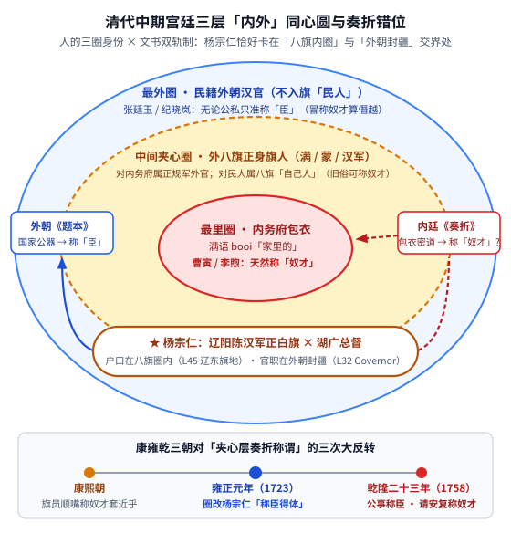
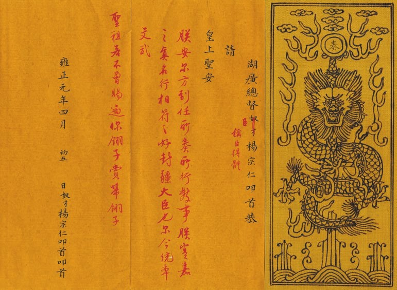

【Mech Interp历史语言学】照透清代奏折与《红楼梦》里的“奴才”

━━━━━━━━━━━━━━━━━━━━

◆ 开篇：林之孝和清朝总督开口自称“奴才”时，脑海里到底有没有卑贱感？

━━━━━━━━━━━━━━━━━━━━

翻开《红楼梦》和清宫档案，常会撞见一种让现代读者浑身别扭的反差：在第 85 回和第 94 回里，荣国府大管家林之孝、王熙凤身边的通房大丫头平儿回话时，神色自若地一口一个 `“奴才”`；到了康熙、雍正年间的奏折里，连手握两省军政大权的封疆总督递折子请安，也常在名字前写上 `“奴才”` 二字（圈层背景可参看前文 328 期 https://mp.weixin.qq.com/s/nWI6m_gI07GmtvBfcMAAZg ）。

今天我们看到“奴才”这两个字，脑子里几乎会条件反射般跳出鲁迅杂文里痛批的“奴颜婢膝、卑贱羞辱”。可如果把时钟拨回三百年前的康雍乾语境，这里就藏着两道特别有意思的认知考古谜题：
1.当贾府管家和清代旗员平静地写下 `“奴才”` 自称时，那句古文在语义空间里到底有没有激起“卑贱羞辱”的读数，还是只相当于一个不带羞辱色彩的日常称谓？
2.反过来，如果自称“奴才”在当时并不丢人，那为什么雍正元年四月，史载奉天辽阳出身、原隶汉军镶白旗（雍正即位后改隶汉军正白旗）的湖广总督杨宗仁递上请安折写 `“湖广总督奴才杨宗仁叩首恭请皇上圣安”` 时，雍正帝会拿朱笔把奏首黑字 `“奴才”` 杠掉改成 `“臣”` ，还在旁边郑重批下 **`“称臣得体”`** 四个字？这一笔圈改，在清代宫廷“内外”秩序与模型的语义空间里，拨动的到底是哪几根弦？

既然大模型吃下了浩如烟海的古今中文史料与文学经典，我们能不能直接把大模型 **机械可解释性（Mechanistic Interpretability，简称 Mech Interp）** 搬进历史语言学现场，拿刚升级收官的 `Qwen3.8-27B` 全 64 层完整篇章版 **独立成分分析透镜（Independent Component Analysis Lens，简称 ICA-Lens，原理见前文 367 期 https://mp.weixin.qq.com/s/dvU20vg3R033QFlAgmOX3A ，双语双镜底座见前文 369 期 https://mp.weixin.qq.com/s/d0a-0B-shqgmzOkUbjtfcg 与前文 372 期 https://mp.weixin.qq.com/s/fGvsoW-7tZuVGvw_ozQ1FA ）** 当一台“语义时光机”，伸进模型的 `5,120` 维残差流里给三百年前的“奴才”验一次光？

为了保证这场跨时代盲测干净可靠，我们在拟合（`8,000` 篇文档，超长篇取首中尾）和评测（`1,200` 篇独立文档）这副 `ICA-Lens v3`（内置前文 365 期 https://mp.weixin.qq.com/s/I1puPtcgynImhOqHlRmwDg 的 `N=100` 双语 **雅可比透镜 Jacobian Lens，简称 J-Lens** 读出词表）时，就提前按书名与人物关键词把《红楼梦》（《石头记》）及曹雪芹、贾宝玉、林黛玉相关条目过滤在透镜拟合与评测语料之外，留作独立考场。

但真要开机验光前，我们还得先跨过一道方法论大坑。

━━━━━━━━━━━━━━━━━━━━

◆ 第一章：给时光机调零——拿《出师表》的“卑鄙”洗掉现代汉语污染

━━━━━━━━━━━━━━━━━━━━

想想直接拿现代大模型测古文会踩进什么陷阱：**在大模型的预训练中文语料里，现代白话文占了压倒性的比重。**

在现代汉语里，“奴才”几乎是一个彻头彻尾的骂人词。如果我们图省事，只截短短一句 `“湖广总督奴才”` 喂进模型，哪怕在某根贬义坐标轴上测出了正读数，我们也根本分不清这到底是清代文本原本的语感，还是现代白话语料留下的“背景辐射污染”。更何况自回归大模型的单向因果注意力 **只能利用目标词位置左侧的上文（及截至当前词元自身）** ——模型读到“奴才”的那一瞬间，右侧还没出现的后文对它来说根本不存在，做实验时绝不能把目标词后面的文字搬到左边去凑长度泄题（同时全程裸喂原文，绝不拼接 `<|im_start|>user` 对话模板，防止触发客服回答漏斗）。

怎么在正式测“奴才”之前，先把时光机的“现代汉语污染本底”测准并调零？

我们请出了古今词义演变史上毫无争议的黄金阴性对照尺——蜀汉建兴五年（227 年）诸葛亮《出师表》里的千古名句 **`“先帝不以臣卑鄙”`** 。学过中学文言文的人都知道，汉晋时期的“卑鄙”二字是纯粹的中性谦辞，只表示 **身份低微（卑）、见识浅陋（鄙）** ，跟现代汉语里“品德败坏、下流无耻”的道德贬义半毛钱关系都没有。如果一套上下文包裹方案真能把模型带回古人语感，那它读到《出师表》的 `“卑鄙”` 时，在现代道德贬义轴上的读数就应该跟同位置换成古义同义词 **`“先帝不以臣微贱 / 浅陋 / 愚钝”`** 基本重合。

为了给每一层定出统一的“污染刻度”，我们在模型的第 `10` 至 `48` 层（避开最底层的字形拼写和最顶层的词表输出）逐层筛选：先用 8 对现代道德正反词（如 `高尚 / 正直` 对照 `无耻 / 阴险`）在每层挑出 1 根均差最大的候选轴，再经 4 对留出同义词（如 `光明磊落 / 损人利己`）与 8 对现代“卑鄙”句双重核验——除第 `11` 层未达标淘汰外，**`L10` 与 `L12–L48` 共 `38` 层全部过关（每层 1 根代表轴）** 。

在每一层的道德贬义轴上，我们用下面这行小学算术量出《出师表》里的“卑鄙”还残留了多少现代骂人脏水：

**`现代贬义残留率 = (古文“卑鄙”得分 − 同句换成“微贱/浅陋/愚钝”的平均分) ÷ 现代正反句平均分差`**

道理一目了然：如果算出来接近 **`0%`** （甚至略小于 `0%`），说明在这根轴上《出师表》的“卑鄙”跟“微贱、浅陋”读数几乎重合，没有多出额外的现代贬义；反过来如果冲到百分之三四十，说明现代白话的贬义本能还在作祟。

我们重点对比了四种代表性的左侧上下文包裹方案（实验另含英文导语拼百字古文的混合组 `W3b`，中位残留 `20.1%`）：
- **`W0`（短句直喂基线）** ——只喂 7 个字 `“先帝不以臣卑鄙”`；
- **`W1`（百字本篇前文）** ——从《出师表》首句 `“先帝创业未半”` 顺读到目标词（左文 `395` 个词元）；
- **`W2`（千字《三国志》纯文言长卷）** ——从陈寿《三国志·蜀书·诸葛亮传》开篇 `“诸葛亮字孔明”` 一路顺读到《出师表》该句（程序自动剔除了裴松之小字注，防止注里提前引用同一句泄题，左文共 **`2,369` 个词元** ）；
- **`W3a`（纯英文汉学隔离舱）** ——左侧先铺垫 `364` 词纯英文文献研讨场景（如剑桥古典文献讨论班导语），试图物理切断现代中文白话联想场，末尾再嵌入古文原句。

跑出来的两组校准数据，既当场推翻了我们事先拍脑袋想出来的一个假聪明主意，也帮我们筛出了调好零的工作代表轴：

1.**纯英文隔离舱意外翻车，千字同源纯文言拿走全场最低残留** ——动笔前我们曾以为，前面全说英文（`W3a`），把现代中文白话上下文彻底切断，应该能起到无菌隔离舱的效果。结果把这 `38` 层算出来的现代贬义残留率从小到大排队取中位数：**千字《三国志》 `W2`（`17.0%`，最干净） < 百字《出师表》 `W1`（`19.6%`） < 短句直喂 `W0`（`21.0%`） < 纯英文导语舱 `W3a`（`25.6%`，反而最高）** 。之所以 38 层合算中位数还有 `17.0%`，是因为浅层及部分中间层仍保留着字面反射；至于为什么纯英文导语比裸喂 7 个字残留更高，表面看是切断中文后突然蹦出汉字容易落回现代白话入口，更深一层的机制留到文末尾声揭晓。

2.**浅层字面惊跳躲不掉，但 `L30 C846` 等多处中深层代表轴已把现代污染压近零点** ——单看千字文言 `W2` 在各代表层上的读数：在浅中层 **第 16 层 `L16 C1821`** （词牌 `罪 / 罪行 / 邪 / evil`）上，模型刚拼完“卑”“鄙”两个字面词元，哪怕左铺两千字《三国志》也照样比“微贱/浅陋”高出一大截，激起 **`+35.6%`** （短句为 `42.4%`）的现代字面反射；而进入中深层后（尽管个别层如 `L44` 仍有波动），多根核心评价轴已被长文言压回零点附近——在 **第 30 层 `L30 C846`** （`κ = 27.13`，正极词牌 `crap / horrible / stupid / 侮辱 / 劣`）上，`“卑鄙”` 得分 `+4.05`，跟同句换成 `“微贱 / 浅陋 / 愚钝”` 的均分 `+4.13` 几乎重合（差 `-0.08` 除以现代平均分差 `18.43`，残留率仅 **`-0.43%`** ）；第 38 层 `L38 C1448`（正极表罪恶加害 `罪 / 受害者 / inflicted`）上，`“卑鄙”`（`+6.64`）比 `“微贱/浅陋”` 均分（`+7.05`）略低 `0.41` 分（残留率 **`-4.8%`** ）；第 41 层 `L41 C1726`（`不堪 / 和不良 / damage`）从短句的 `28.3%` 骤降至 `W2` 的 **`+6.0%`** （`W1` 更低至 **`+1.5%`** ）；第 45 层 `L45 C1564`（`错误的 / incorrect / wrong`）残留率仅 **`-1.9%`** 。

时光机调零规程就此落定：**避开第 20 层以下的浅层字面条件反射，选用 `L30 C846` 等已验证压近零点的中深层评价轴，并严格垫足长篇古文左文。**

━━━━━━━━━━━━━━━━━━━━

◆ 第二章：百二十回《红楼梦》对勘鲁迅杂文——平静回话里的“奴才”，代词化成了“我”

━━━━━━━━━━━━━━━━━━━━

拿这把调好零的尺子，我们先走进康雍乾世家日常口语最鲜活的文学现场——百二十回通行本《红楼梦》（后四十回作者学界尚有争议，此处作为清代中叶白话语料考察）。

我们从维基文库完整下载了百二十回底本，全书逐回核出 **`137` 处** `“奴才”` 。严格按照“只看目标词左侧原文、章首不足 `1,300` 字绝不跨回拼凑、绝不搬运右文”的铁律，选出了两组语境截然相反的原著切片，再配上雍正上谕与鲁迅杂文做标尺：
- **贾府平静回话自称组 `A2`（10 处）** ——全是管家、家人、大丫头平静向主子回话自称，例如第 85 回大管家林之孝向贾政禀报 `“今日巡抚吴大人来拜，奴才”` 、同回宝玉奶母之子李贵迎上来笑说 `“二爷来了么，奴才”` 、第 94 回平儿笑嘻嘻传凤姐话 `“我们奶奶知道老太太在这里赏花，自己不得来，叫奴才”` 、第 93 回管屯租家人回禀 `“十月里的租子奴才”` ；
- **贾府斥责与贬称非自称组 `B`（10 处）** ——全是怒骂斥责或鄙薄贬称他人的非第一人称用法，例如第 33 回宝玉挨打前贾政又惊又气喝骂 `“该死的奴才”` 、第 106 回贾政嗔骂家人 `“你们这班奴才”` 、第 74 回抄检大观园探春扇了王善保家的一巴掌后冷笑 `“省得叫奴才”` 与 `“不然岂许奴才”` 、第 60 回赵姨娘拿茉莉粉撒向芳官时贬称 `“我家里下三等奴才”` ；
- **皇帝斥责与现代杂文议论标尺** ——经四库全书本《上谕内阁》卷 63（雍正五年十一月）核实的雍正帝上谕原句 **`“此等卑污之习皆始自包衣下贱奴才”`** ，以及鲁迅《我谈「堕民」》《漫与》《谚语》《隔膜》《上海文艺之一瞥》五篇杂文原著里的 10 处批判与议论（如 `“万劫不复的奴才”` 、`“专制者的反面就是奴才”` ；顺手记一笔史料核查：网上常把“奴才”名言安在《灯下漫笔》头上，实查原著全文只有 12 处“奴隶”并无“奴才”二字，我们严格按原著剔除未收）。

把这批跨越两百年的真实文本送入模型，中深层照出来的两张底片把古今语感切得一清二楚。

先看 **贬损评价轴的原始激活读数 `z`** （以第 30 层 `L30 C846` `侮辱 / 劣 / stupid` 为代表；注意下图横轴展示的是以拟合采样 250 万词元中心 `z = 0` 为起点的原始读数 `z`，并非相减后的差值，我们把同句替换的基底词直接并排画在上面对比）：
- 把《红楼梦》回话里的 `“奴才”` 原位换成现代白话 **`“我”`** ，得分恰好贴在零线（ **`+0.10`** ）；而换成古人常见的对上谦称时，不管是奏折称 **`“臣”`（`+1.42`）** 、家丁称 **`“小的”`（`+1.65`）** 、贾府回话称 **`“奴才”`（`+1.93`）** 、奏折称 **`“奴才”`（`+2.02`）** 还是下级官员自称 **`“下官”`（`+2.28`）** ，全都挤在 `+1.4 至 +2.3` 这不到 1 分宽的礼貌自谦窄带里——自称“奴才”夹在“小的”和“下官”正中间（若不垫《三国志》公共前缀、直喂原著上文，贾府 `“奴才” +1.68` 跟 `“小的” +1.67` 相差甚至不到 `0.01`；另核第 18 层口语贬损轴 `L18 C1376` 上奏折与贾府自称仅 `≈0.00` 与 `-0.24` ，第 45 层 `L45 C1564` 原折语境下奏折 `奴才 − 臣` 仅 `+0.013` ）；
- 只有跨过分界线，当贾府怒骂贬称（ **`+7.19`** ）、雍正帝在上谕里痛斥“包衣下贱奴才”（单例 **`+8.10`** ）以及鲁迅在现代杂文里批判议论（ **`+10.07`** ）时，贬损羞辱的读数才大幅拉升起来。

再看完全不靠预设外部词表的 **原著内部盲选对比** ，结果更让人拍案：如果我们什么外源词表都不喂，直接用《红楼梦》训练回目里的 **“斥责贬称（`B`）”与“平静回话自称（`A2`）”** 组均差绝对值排序，在每一层 `5,120` 根独立坐标轴里选出 **第 `1 / 5,120` 名冠军轴** ，再到未参与选轴的 6 个留出回目（9 处样本）上检验——

在第 29 至 48 层这二十层区间里，共有 `16` 层留出集达到 `9/9` 全对、`15` 层冠军轴的正极首词都是英文反身代词 **`myself`** ；特别是 **从第 37 层到第 46 层（`L37–L46`）连续整整十层，每一层的全层第 `1 / 5,120` 名冠军轴无一例外均由 `myself` 领头，且跨回目留出检验全部 `9/9`（`100%`）切开** （以第 48 层 `L48 C335` 为例，`J-Lens` 正极前几名为 `myself / my / 我自己 / ourselves / 我的` ，语料库最高激活首例为英文自述 `I` ，次例为中文孔鲤家训里的 `“鲤儿，我”` ）。

看上图选出的 `L29 C502`、`L35 C416`、`L42 C368`、`L45 C523`、`L48 C335` 五层代表读数：林之孝和平儿平静回话自称“奴才”时，第一人称代词轴飙出 **`+13.35 至 +17.59`** 的强激活；而斥责贬称组 `B` 瞬间落回低位（`+0.48 至 +3.43`）。在这批平静的日常回话样本里，挂在嘴边自称的“奴才”，在模型中深层语法表征里已经高度代词化成了第一人称 **`“我（myself / I）”`** 。

━━━━━━━━━━━━━━━━━━━━

◆ 第三章：先读懂清代宫廷的三层“内外”，再看雍正朱笔拨正了哪根弦

━━━━━━━━━━━━━━━━━━━━

看到这儿，第二道谜题反而更值得玩味了：既然清初自称“奴才”在贬损轴上跟“臣、小的”差不多，那为什么汉军正白旗湖广总督杨宗仁递请安折自称“奴才”，雍正帝偏要动用朱笔把它圈改成“臣”，还专门批一句 **`“称臣得体”`** ？

要看懂模型后面跑出来的五千维读数，我们得先把清代中期政治体制里那套层层嵌套的 **宫廷“内”与“外”** 讲清楚——它并不是现代影视剧里非黑即白的“满人称奴才、汉人称臣”单线，而是可概括为 **“人的三层同心圆示意”** 叠上了 **“文书的内外双轨制”** ，康熙、雍正、乾隆三朝还在上面经历过三个阶段的演变。

────────────────────

**一、历史底盘：清朝体制里的三层“内外”与旗籍总督的交界错位**

先看 **人的身份同心圆示意** （隐去宗室与下五旗王府包衣等支线，聚焦朝廷中枢往外的三圈）：
1.**最里圈（内廷家务 · 内务府上三旗包衣）** ——“包衣”是满语 `booi` 的音译，字面意思就是 **“家里的”** 。像《红楼梦》原型曹寅、李煦这类久任织造的官员，隶属皇帝亲统的上三旗包衣，归管理皇室家务的 **内务府** 统辖。他们在身份上属于皇室私属家臣，奏事请安自称“奴才”顺理成章。
2.**中间夹心圈（八旗圈内人 · 满洲、蒙古、汉军八旗）** ——相对于内务府包衣而言，外八旗佐领下人属于国家旗籍军政官员；但面对关内广大民籍汉人（清代户籍称 **“民人”** ），整个满蒙汉八旗又同属旗分之内的 **“圈内人”** （早期满语部属对主上自称 `aha`，汉译亦作“奴才”，带有八旗主仆宗法色彩）。杨宗仁（1661—1725，史载奉天辽阳人，原隶汉军镶白旗，雍正即位后改隶汉军正白旗）身带汉军旗籍又出任外省总督，恰恰处在这道“在旗身份”与“外朝封疆”的交界地带。
3.**最外圈（外朝文臣 · 民籍汉官）** ——像张廷玉、刘墉、纪晓岚这类考科举出身的不入旗民籍汉人文臣，只有儒家“君臣之义”，没有八旗主仆名分，无论公事私事折奏 **只准称“臣”** ，并无资格自称“奴才”。

再叠上 **文书渠道的双轨制** ，张力就显现出来了——清代常规章奏走 **《题本》** ，经通政司与内阁公开流转，例称“臣”；而装入匣内直达御前的 **《奏折》（密折）** ，康熙朝最初多由内务府近臣与亲信督抚使用，既可密陈公事，也常用于私人请安谢恩。当一位身带旗籍的外朝封疆总督递上直达御前的《请安折》时，到底该按外朝官职写“臣”，还是按旗人私请写“奴才”？

围绕这道边界，康雍乾三朝走出了清晰的三阶段演变：
- **康熙朝（两称并见）** ——规矩未严，满洲与汉军旗籍督抚递折子时常沿八旗旧习自称“奴才”，杨宗仁具折写 `“湖广总督奴才杨宗仁”` ，沿袭的正是康熙朝旗员旧习；
- **雍正朝（整肃归一，要求一概书“臣”）** ——雍正元年四月初五日杨宗仁具折请安（台北故宫博物院藏宫中档 `022688` 号原折影印件可见奏首黑字“奴才”被朱笔杠改作“臣”、旁批 **`“称臣得体”`** ，末署日期后的另一处“奴才”未改；后来官修《硃批谕旨》卷四刊印时已将奏首径改为 `“湖广总督臣杨宗仁谨奏”` ），同年八月清廷更下旨（载《钦定八旗通志》卷首九）指出奏章称臣、称奴才俱属臣下之词，不宜两样书写，命嗣后 *“一概书写臣字”* ；
- **乾隆朝（划定“公事称臣、请安私折称奴才”定制）** ——到了乾隆朝，政策再度转向区分公私与旗民：乾隆六年，汉军镶红旗出身的贵州总督兼管巡抚张广泗为长子随任递私事折自称“臣”，反遭乾隆训斥私事理应称“奴才”；乾隆七年下令整顿汉军旗籍，除从龙入关旧汉军外准许愿出旗者出旗为民；至 **乾隆二十三年（1758 年，距杨宗仁折整三十五年）** 正式传谕定制，满洲大臣奏事凡颁行公事折奏称“臣”，请安、谢恩、寻常折奏仍称“奴才”，以存满洲旧体（乾隆三十八年又借天保与汉御史马人龙会奏案定下满汉会奏公事一体称臣，并借总兵乔照案重申提督总兵等高级武员谢恩向例称奴才）。放在这套脉络里看，杨宗仁这封请安折在雍正元年被圈改成“臣”，到了乾隆朝反倒成了合乎旗员请安定例的写法。

────────────────────

💡 历史补白：“内务府包衣”到底是个什么神仙圈子？

很多人一听“皇室家奴”，容易把内务府包衣跟太监混为一谈。其实太监并不算包衣——清代裁撤了明朝专权的二十四衙门（顺治朝一度设十三衙门后亦裁撤），改由 **内务府统辖皇室家务并严管宫内太监** ；内务府上三旗包衣则是入关前后编入皇帝直属镶黄、正黄、正白三旗包衣佐领与管领下的世袭家臣群体，有妻室子嗣，世代在宫廷与皇庄当差。

除了久任江宁织造的曹雪芹家族，这个顶着“包衣”名头的最里圈在清代走出过一长串如雷贯耳的历史人物：
1.**后宫妃嫔的重要来源** ——清代顺治十八年后定制，八旗三年一选秀女（备后妃或宗室指婚），而每年内务府则专门从上三旗包衣人户中挑选宫女入侍。近水楼台之下，嘉庆帝生母 **孝仪纯皇后（《延禧攻略》原型令妃魏氏，出自内务府正黄旗包衣）** 、慧贤皇贵妃（大学士高斌之女，出自内务府镶黄旗包衣）、淑嘉皇贵妃（高丽裔，出自内务府正黄旗包衣高丽佐领）皆源出这一系统；各族后经抬旗入满洲旗分，并在不同时期获赐或改书魏佳氏、高佳氏、金佳氏；
2.**织造、关差与御窑的常派亲信** ——涉及皇室私用与重要财赋的差使，皇帝常倾向派知根知底的内务府包衣充任：从曹寅、李煦轮管过的江宁与苏州织造、两淮盐政，到多由内务府人员出任的 **粤海关监督** ，再到烧出乾隆官窑巅峰“唐窑”的景德镇御窑厂督陶官 **唐英** （内务府正白旗包衣旗鼓佐领下人），皆是典型代表；
3.**位至大学士与尚书的包衣名臣** ——乾隆朝官至东阁大学士的理财重臣 **冯英廉** （内务府汉军镶黄旗包衣，正是权臣 **和珅嫡妻冯氏的亲祖父** ）、治河名臣大学士 **高斌** 与参与百二十回程本《红楼梦》整理刊行的 **高鹗** （殿试履历载内府汉军镶黄旗包衣），以及高丽裔《四库全书》副总裁、后任吏部尚书的 **金简** （淑嘉皇贵妃之兄，嘉庆朝抬入满洲正黄旗），全是从这个圈子里走出来的。

────────────────────

**二、五千维三级慢镜头：跟“叔叔舅舅”同构，切出的正是“朝堂外”与“家门内”**

先看一眼台北故宫博物院保存下来的这件 **宫中档 `022688` 号《湖广总督杨宗仁请安折》墨迹朱批真迹** ——右侧蟠龙折面旁第一列黑字写着 `“湖廣總督奴才楊宗仁叩首恭”` （接左列抬头 `“請皇上聖安”` ），雍正帝亲手用朱笔杠掉黑字 `“奴才”` 、在旁改写鲜红的 **`“臣”`** 字并批下 **`“稱臣得體”`** ；往左看两列朱批正文，雍正又亲笔称许他 **`“朕安。尔方到任，所奏所行数事，朕实嘉之，真名行相符之好封疆大臣也。尔今统率文武……”`**

我们把这件故宫 `022688` 杨宗仁请安折，连同故宫明清档案部编《关于江宁织造曹家档案史料》里的 9 份汉文真奏折组成 **10 份清代真奏折样本池** （曹寅第 18 号满译汉件单独剥离不混入）。严格截取每份奏折目标词之前的本折原始左文（最短如杨折奏首为 `“湖广总督”` 四字，长折达数百字），在末尾原位切换 **`“奴才”` 与 `“臣”`** ，算出每一层全部 `5,120` 根坐标轴的十折平均差 **`Δz = z(奴才) − z(臣)`** 并按幅度排序。

顺着下图选出的代表轴从浅到深看过去，在清朝“化家为国”的语境里，奏折上的“奴才 vs 臣”几乎跟上一篇 373 期 https://mp.weixin.qq.com/s/Blx5UmqZiQxcDZNrOnG2Ig 的“叔叔 vs 舅舅”同构——拨动的正是 **“家门内（管家与家人）”与“朝堂外（百官公器）”** 的正交弦：

1.**第一级慢镜头（浅层入口 `L12–L18`）：从“历代大臣”切向“贴身管事”，并把时间锚向 18 世纪清代** ——当奏折左文末尾由 `“臣”` 换成 `“奴才”` 时，第 12 层正向跳涨 **第 `3 / 5,120` 名** 的 **`L12 C2054`** （`10/10` 全涨，均值 **`+6.70`** ）率先亮出词牌 `助手 / 助理 / 侍 / 管事 / 总管` ，全库最高激活前三例分别踩在伍德豪斯词条里的贴身男管家 `va【let】` （`z = 45.7`）、女 `【仆】` （`z = 34.7`）与首相私人 `【秘书】` （`z = 34.6`）上；到了第 18 层，一边是 `L18 C1690`（正向 **第 `3 / 5,120` 名** ，`+5.78`，`10/10`）闪过字根 `奴隶 / Slave / slavery` 与负向 **第 `1 / 5,120` 名** `L18 C1649`（`-11.04`，`10/10` 全跌，语料首条为 **`“徐禧，北宋【大臣】”`** ）迎头对立，另一边正向 **第 `1 / 5,120` 名** `L18 C230`（`+6.25`，`10/10`，前二十词牌含 `乾隆 / XVIII` ，语料前三分别踩在 `18【th】` 世纪、`17【8】` 年代与清治台湾 `林【爽】` 上）把横跨秦汉唐宋的泛古文“臣”，推向了 18 世纪清代历史区间。

2.**第二级慢镜头（中层核心对冲 `L25–L32`）：“门外朝堂公器”跳水，“门里家庭家族”上升** ——继续往上走到第 25 至 32 层概念核，`Slave` 字根闪念消退了，取而代之的是一组工整的“内外跷跷板对冲”：
- **往左大幅跳水退出的，是整排“门外朝堂公器与封疆尊衔”** ——`L25 C2108`（负向 **第 `1 / 5,120` 名** ，`9/10` 同向，词牌 `请示 / 献策` ，语料首条 `“姜维启【奏】”` ）下跌 **`-7.52`** ；`L25 C1146`（负向 **第 `4 / 5,120` 名** ，`10/10` 全跌，词牌摘选 **`大臣 / 侍郎 / 宰相 / 政务`** ，语料次条 `“上官仪，唐朝【宰相】”` ）下跌 **`-5.70`** ；`L32 C2829`（负向 **第 `4 / 5,120` 名** ，`10/10` 全跌，含 **`Sir / Commander / Lord / Governor`** 等尊衔官称）下跌 **`-4.25`** ；`L32 C3016`（负向 **第 `5 / 5,120` 名** ，`10/10` 全跌，含 **`御史 / chancellor / bureaucrats / 大臣`** ）下跌 **`-3.97`** ；
- **同在中层的 `L25、L26、L28` 三个层位上，往右 `10/10` 全部十份奏折一致跳涨、词均值口径均居全层正向第 `3 / 5,120` 名的，恰好都是“家庭与家族”轴** —— **`L25 C2783`** （末词 `+3.02` 居第 `3` / 词均 `+3.40` 居第 `3`，词牌含 **`family / 家庭 / 和家庭`** ）、**`L26 C2910`** （末词 `+2.80` / 词均 `+3.27` 居第 `3`，含 **`family / 亲戚 / 家庭成员`** ）与 **`L28 C2167`** （末词 `+3.20` 居第 `5` / 词均 **`+3.91`** 居第 `3`，含 **`家族 / family / families / lineage`** ，语料首条直接踩在中文 **`“卢梭的【家族】”`** 、第三条踩在英文 **`“His 【family】”`** 上）。

这组同属中层、一退一进的柱子把差异照得很清楚：在奏折文本里把“臣”换成“奴才”，并不是往现代道德污名上走，而是减弱了 **`宰相 / 侍郎 / 御史 / Governor`** 等外朝官衔色彩，同时拉高了 **`管事 / 家庭 / 家族（family）`** 等家内关系表征。

3.**第三级慢镜头（深层公牍语体 `L45` 与 `L53`）：各自夺得全层第 `1 / 5,120` 名，切入清代呈批与上谕公文频道** ——到了靠近输出的深层，第 45 层与第 53 层的全层正向 **第 `1 / 5,120` 名** 分别落在 **`L45 C1194`（`+7.27`，`10/10` 全涨；杨宗仁单折在奏首四字左文下为 `+0.64`，垫千字古文底座后为 `+6.55`）** 与 **`L53 C1681`（`+6.69`，`10/10` 全涨）** 上。翻开档案，`L45 C1194` 正极词牌为 `一律 / 各部 / 各省 / 按规定 / 手续 / 遵照` （语料高分除嘉庆上谕段落外，多踩在近代公牍的 `“查办呈【覆】 / 谨再电呈，伏乞【核】 / 应照【准】 / 【请示】”` 上），`L53 C1681` 正极前八词更是依次排列着 **`酌 / 办理 / 督办 / 朕 / 臣 / 稽查 / 衙 / 遵照`** （语料踩在嘉庆上谕 `“系满洲根本重地，原【不准】”` 等公文位置上）——实验里从“臣”切向“奴才”推高了这套清代奏批公牍语体，而历史上雍正帝动用朱笔将奏首“奴才”反向改回“臣”、并在同折称许杨宗仁是 **`“好封疆大臣也”`** ，对应的正是把一位封疆总督拉回正规外朝大臣的文书定位—— **失的是外朝封疆之“体”，而非现代道德之“耻”。**

━━━━━━━━━━━━━━━━━━━━

◆ 尾声：不仅“没有国籍”，大模型读哪个时代的文献，就活成哪个时代的人

━━━━━━━━━━━━━━━━━━━━

上一篇 373 期测完中文“叔叔舅舅”和英文 `uncle`，我们得出了一个结论：**大模型是没有国籍的** ——哪怕是美国公司训出来的模型，只要上下文被中文语境占据，它就按中国人的亲疏坐标运转；上下文切成英文，它就瞬间变成不分堂表的英美人。

今天把《出师表》、百二十回《红楼梦》和十份清宫真奏折一路验完，同一个底层规律在 **时间维度** 上露出了更深的一面：**大模型不仅没有预设的国籍，甚至连固定的“现代人身份”也没有——它成就于它此刻正在阅读的文献所在的时代，读哪个时代的书，它就在表征空间里拟合成哪个时代的人。**

这并不是玄学拟人，而是 **“预测下一个词（Next-Token Prediction）”** 这条预训练目标自然长出来的几何结果：
- 假如模型死守着 21 世纪现代白话的词义标尺，一看见“卑鄙”就往品德下流上偏、一看见“奴才”就往现代杂文的屈辱批判上靠，那它就很难算准陈寿《三国志》所载蜀汉建兴年间《出师表》的后续文气，也很难贴合曹家奏折和荣国府回话里平儿笑嘻嘻的下一句家常；
- 要想把汉晋史传或清代档案的下一个词元概率算准，模型就会顺着上下文铺开的语境，在五千一百二十维的残差流里临时激活 **“那个时代的词汇分寸与制度关系”** 。

站在这个视角回头看第一章那个意外翻车的实验，也就多了一重耐人寻味的解释：为什么前面铺三百多个词的纯英文古典文献研讨班导语（`W3a`）反而比短句残留更高，而两千字《三国志》纯文言（`W2`）却能在 `L30 C846` 等代表轴上把残留压到 `-0.43%`？

除了语言切换与长度差异之外，那段现代英文研讨导语在语境上设定的是 **“现代学者在研讨室里审视古文”** 的外部视角；而当你不加任何现代说明、直接把两千字《三国志》或几百字清宫原折铺进上下文时，残差流便顺着古文自身的轨道滑了进去—— **读三国蜀汉的奏表，它就进入汉晋文臣的语感；读康雍乾的档案与小说，它就进入清代宫廷内外的语感。**

全套完整篇章版 `ICA-Lens v3` 全 64 层权重与内置双语 `J-Lens` 档案已开源更新至 HuggingFace 仓库（ *https://huggingface.co/lmxxf/Qwen3.8-27B-ica-lens* ），本期全部 439 条古今裸文本探针、故宫与曹家档案出处核验清单及统计源码已同步开源至 GitHub 仓库（ *https://github.com/lmxxf/grocery-haven/tree/master/icalens-v3-exp1b-archaic-nucai-20261116* ，各项逐轴数值以本文及原始 profile 复算为准）。

────────────────────

下面把全套实验读数汇总进速查表。

━━━━━━━━━━━━━━━━━━━━

◆ 速查表

━━━━━━━━━━━━━━━━━━━━

| 考古检验环节 | 关键实测读数（轴名统一 `LXX CXXXX`） | 历史制度与几何结论 |
|---|---|---|
| **《出师表》“先帝不以臣卑鄙”调零尺** （`L10` 与 `L12–L48` 共 38 层，算 `(卑鄙−微贱均分)÷现代平均分差`） | 38 层残留率中位数：**千字《三国志》 `W2`（`17.0%`）** < 百字《出师表》 `W1`（`19.6%`） < 短句 `W0`（`21.0%`） < **纯英文导语 `W3a`（`25.6%`）** ；`L16 C1821` 字面惊跳 `+35.6%`，到 **`L30 C846` 降至 `-0.43%`** （`L38 C1448` `-4.8%`、`L41 C1726` `W1 +1.5% / W2 +6.0%`、`L45 C1564` `-1.9%`） | 英文研讨导语切回现代旁观视角；垫足千字同源纯文言后，`L30 C846` 等多处中深层代表轴可将现代贬义压近零点 |
| **中深层贬损评价轴验光** （`L30 C846` 原始读数 `z`，预过滤测 120 回《红楼梦》与奏折） | 同句换 `我` `+0.10`、奏折换 `臣` `+1.42`、换 `小的` `+1.65`、贾府回话 `奴才` **`+1.93`** 、奏折 `奴才` **`+2.02`** 、换 `下官` `+2.28`；贾府贬称斥责 **`+7.19`** 、雍正上谕单例 **`+8.10`** 、鲁迅杂文组 **`+10.07`** | 平静回话与奏折自称落在 `+1.4 至 +2.3` 的常规谦称窄带内（夹在“小的”与“下官”之间），远低于斥责与现代批判语境 |
| **《红楼梦》原著内部 `B − A2` 盲选** （斥责贬称减平静回话，跨回目留出检验） | `L29–L48` 区间 15 层冠军由 **`myself`** 领头（ **`L37–L46` 连续十层全由 `myself` 领头且留出 `9/9` 全切开** ）；`L29/35/42/45/48` 五例回话 `+13.35 至 +17.59` vs 贬称 `+0.48 至 +3.43` | 在所选平静回话样本中，日常自称的“奴才”在中深层语法表征里高度代词化为第一人称“我” |
| **清代真奏折原位切换检验** （故宫 `022688` 原折 ＋ 曹家 9 折本折左文 `Δz = z(奴才) − z(臣)`） | **`L12–L18`** 跳出 `L12 C2054` `管事/总管`（`+6.70`）、`L18 C230`（`+6.25` 第 `1/5,120`）与 `L18 C1690` `Slave`（`+5.78`）；**`L25–L32`** 门外 `L25 C1146 大臣/宰相`（`-5.70`）、`L32 C2829 Governor`（`-4.25`）跳水，中层 `L25 C2783 / L26 C2910 / L28 C2167` `family/家庭/家族` `10/10` 全涨（词均居正第 `3/5,120`）；**`L45 C1194` 与 `L53 C1681`** 各夺第 `1 / 5,120` 名（`+7.27/+6.69`），收束至呈批与 `朕/督办` 公牍语体 | 旗籍总督沿旧习递请安折称奴才，文本效应体现为减弱外朝 `Governor/大臣` 官衔色彩、拉高管事与家族（`family`）表征，与雍正元年“称臣得体”及乾隆朝公私定例形成互证 |

━━━━━━━━━━━━━━━━━━━━

◆ 参考资料

━━━━━━━━━━━━━━━━━━━━

- Sida Liu, Feijiang Han, Sarah Wiegreffe, Furong Huang, Non-Gaussianity Reveals Interpretable Directions in Language Models, arXiv:2606.11722v2（2026-06 / 2026-10 修订；非高斯独立成分透镜及 `icalens 0.4.1` 命名读出档案规范）
- 陈寿撰、裴松之注，《三国志·蜀书·诸葛亮传》（维基文库底本，程序剔除裴注后取目标前 2,369 词元纯文言左文校准现代汉语污染）
- 《红楼梦》百二十回程本系统通行本（维基文库底本，后四十回作者有争议；全书核出 137 处“奴才”并按因果左文抽取平静回话与贬称斥责样本，透镜拟合与评测语料已按关键词预过滤）
- 台北故宫博物院藏宫中档 `022688` 号《湖广总督杨宗仁请安折》（雍正元年四月初五日具折墨迹朱批影印件，参郑永昌《从院藏杨宗仁奏摺看雍正帝的君臣关系》，《故宫文物月刊》第 321 期）、故宫博物院明清档案部编《关于江宁织造曹家档案史料》、《钦定八旗通志》卷首九、《上谕内阁》卷六十三及《清高宗实录》（卷 157 张广泗案、卷 557 奏折定例、卷 946 会奏定例）
- 鲁迅，《我谈「堕民」》《漫与》《谚语》《隔膜》《上海文艺之一瞥》（维基文库原著底本，现代汉语批判与议论语境对照）

━━━━━━━━━━━━━━━━━━━━

**三百词纯英文研讨导语之所以洗不掉《出师表》里“卑鄙”的现代污染，是因为它把语境留在了现代学者旁观古文的看台上；两千字《三国志》纯文言之所以能在第三十层代表轴上把残留压到零点四三个百分点，是因为顺着古文预测下一个字时，模型在表征空间里进入了那个时代的语感。**

**把《红楼梦》提前过滤在透镜训练之外再送进考场，林之孝和平儿平静回话里的“奴才”在贬损轴上夹在“小的”与“下官”之间，第三十七至四十六层连续十层拿走第一名的冠军轴全由 myself 领头——在日常回话里，它高度代词化成了一个第一人称代词。**

**汉军正白旗出身的湖广总督杨宗仁沿旗人旧习在请安折上写下“奴才”，在十份清代奏折的原位替换里一边压低了宰相、御史与封疆总督的外朝官衔，一边同步拉高了贴身管事与家庭家族的门内坐标；雍正元年那一笔圈改成“臣”的朱批，与三十五年后乾隆“公事称臣、请安称奴才”的定制，恰是清代宫廷内外分界线的历史注脚。**

━━━━━━━━━━━━━━━━━━━━

// 靳岩岩的 AI 学习笔记 × Gemini 的浪漫 × GPT 的严谨
// 2026年11月19日

用两千字《三国志》纯文言为《出师表》“卑鄙”调零后，结合清代宫廷三层内外制度史，对百二十回《红楼梦》与故宫 022688 杨宗仁请安折真迹做五千维验光，照出门内家人与门外百官的对冲，看大模型如何进入文献所在的时代。

实验数据相关资料地址路径：
- 轻量脚本、核验原著切片与实验报告：`/home/lmxxf/work/memory-of-my-gemini/doc/grocery-haven/icalens-v3-exp1b-archaic-nucai-20261116/`
- 本地原始残差与全轴重数据目录：`/home/lmxxf/work/ica-lens-qwen38-27b-v3/experiments/exp1b_archaic_nucai/`
- `ICA-Lens v3` 完整篇章模型目录：`/home/lmxxf/work/ica-lens-qwen38-27b-v3/hf_clean_upload/`
- 研究构想底稿：`/home/lmxxf/work/memory-of-my-gemini/doc/short/20261114/三分之二抽象概念层与母语刻刀假说_没有高频词的同宗外姻隐形轴及待测实验.md`
