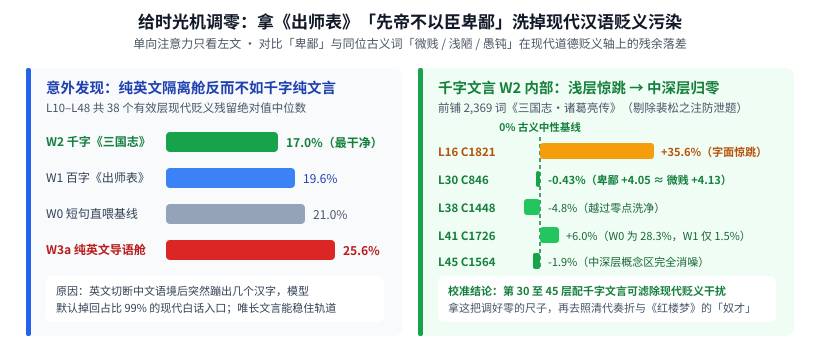
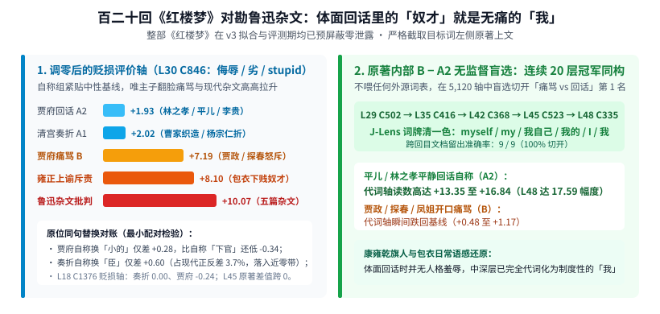
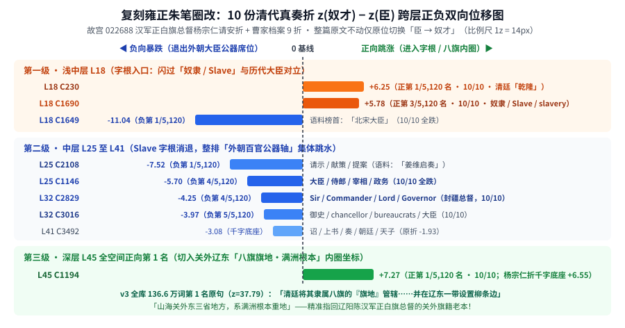

【ICA-Lens】拿《出师表》给时光机调零，照透清代奏折与《红楼梦》里的“奴才”

━━━━━━━━━━━━━━━━━━━━

◆ 开篇：林之孝和清朝总督开口自称“奴才”时，脑海里到底有没有卑贱感？

━━━━━━━━━━━━━━━━━━━━

翻开《红楼梦》和清宫档案，常会撞见一种让现代读者浑身别扭的反差：在第 85 回和第 94 回里，荣国府大管家林之孝、王熙凤身边的通房大丫头平儿回话时，神色自若地一口一个 `“奴才”`；到了康熙、雍正年间的奏折里，连手握一省军政大权的封疆总督递折子请安，也抢着在名字前写上 `“奴才”` 二字（在清代体制里，这反倒是旗人与内廷亲信才配享用的排他性特权称呼，圈层背景可参看前文 328 期 https://mp.weixin.qq.com/s/nWI6m_gI07GmtvBfcMAAZg ）。

今天我们看到“奴才”这两个字，脑子里几乎会条件反射般跳出鲁迅杂文里痛批的“奴颜婢膝、卑贱羞辱”。可如果把时钟拨回三百年前的康雍乾语境，这里就藏着两道特别有意思的认知考古谜题：
1. 当贾府管家和清代大臣平静地写下 `“奴才”` 自称时，古人脑海深处到底有没有闪过哪怕一丝“卑贱屈辱”的念头，还是纯粹只把它当成一个毫无痛感的体面行话？
2. 反过来，如果自称“奴才”在当时真的一点都不丢人，那为什么雍正元年四月，汉军正白旗出身的湖广总督杨宗仁递上请安折写 `“湖广总督奴才杨宗仁叩首恭请皇上圣安”` 时，雍正帝会连着拿朱笔把黑字 `“奴才”` 圈改成 `“臣”` ，还在旁边郑重批下 **`“称臣得体”`** 四个字？这一笔圈改，在语义空间里拨动的到底是哪几根弦？

既然大模型吃下了浩如烟海的古今中文史料与文学经典，我们能不能直接拿刚升级收官的 `Qwen3.8-27B` 全 64 层完整篇章版 **独立成分分析透镜（Independent Component Analysis Lens，简称 ICA-Lens，原理见前文 367 期 https://mp.weixin.qq.com/s/dvU20vg3R033QFlAgmOX3A ，双语双镜底座见前文 369 期 https://mp.weixin.qq.com/s/d0a-0B-shqgmzOkUbjtfcg 与前文 372 期 https://mp.weixin.qq.com/s/fGvsoW-7tZuVGvw_ozQ1FA ）** 当一台“语义时光机”，伸进模型的 `5,120` 维残差流里给三百年前的“奴才”验一次光？

为了保证这场跨时代盲测干净可靠，我们在训练和评测这副 8,000 篇完整长文版 `ICA-Lens v3`（内置前文 365 期 https://mp.weixin.qq.com/s/I1puPtcgynImhOqHlRmwDg 的 `N=100` 双语 **雅可比透镜 Jacobian Lens，简称 J-Lens** 读出词表）时，就提前埋下了一道物理隔离：用正则表达式把整部《红楼梦》（《石头记》）以及曹雪芹、贾宝玉、林黛玉的所有相关词条彻底屏蔽在透镜的训练与测试语料之外，留作 `100%` 零泄露的考场。

但真要开机验光前，我们还得先跨过一道方法论大坑。

━━━━━━━━━━━━━━━━━━━━

◆ 第一章：给时光机调零——拿《出师表》的“卑鄙”洗掉现代汉语污染

━━━━━━━━━━━━━━━━━━━━

想想直接拿现代大模型测古文会踩进什么陷阱：**在大模型的预训练中文语料里，99% 以上都是现代白话文。**

在现代汉语里，“奴才”几乎是一个彻头彻尾的骂人词。如果我们图省事，只截短短一句 `“湖广总督奴才杨宗仁”` 喂进模型，哪怕在某根贬义坐标轴上测出了正读数，我们也根本分不清这到底是清代古人原本的语感，还是现代白话语料留下的“背景辐射污染”。更何况自回归大模型的单向因果注意力 **只能看见目标词左侧的上文** ——模型读到“奴才”二字的那一瞬间，右侧还没出现的后文对它来说根本不存在，做实验时绝不能把目标词后面的文字搬到左边去凑长度泄题（同时全程裸喂原文，绝不拼接 `<|im_start|>user` 对话模板，防止触发客服回答漏斗）。

怎么在正式测“奴才”之前，先把时光机的“现代汉语污染本底”测准并调零？

我们请出了古今词义演变史上毫无争议的黄金阴性对照尺——诸葛亮《出师表》里的千古名句 **`“先帝不以臣卑鄙”`** 。学过中学文言文的人都知道，汉晋时期的“卑鄙”二字是纯粹的中性谦辞，只表示 **身份低微（卑）、见识浅陋（鄙）** ，跟现代汉语里“品德败坏、下流无耻”的道德贬义半毛钱关系都没有。如果一套上下文包裹方案真能把模型带回古人语感，那它读到《出师表》的 `“卑鄙”` 时，在现代道德贬义轴上的读数就应该跟同位置换成古义同义词 **`“先帝不以臣微贱 / 浅陋 / 愚钝”`** 基本重合。

我们在全 64 层里，先用独立的现代道德正反句（如 `高尚 / 正直 / 坦荡 / 光明磊落` 对照 `无耻 / 阴险 / 下流 / 损人利己`，并经未参与选轴的同义词留出与独立现代“卑鄙”句 `8/8` 双重核验）锁住第 10 至 48 层共 **38 个有效道德贬义轴** ，然后同场测试了四种左侧上下文包裹方案对《出师表》“卑鄙”现代污染的清洗效果：
- **`W0`（短句直喂基线）** ——孤零零只喂 7 个字 `“先帝不以臣卑鄙”`；
- **`W1`（百字本篇前文）** ——从《出师表》首句 `“先帝创业未半”` 顺读到目标词（真实左文 `395` 个词元）；
- **`W2`（千字《三国志》纯文言长卷）** ——从陈寿《三国志·蜀书·诸葛亮传》开篇 `“诸葛亮字孔明”` 一路顺读到《出师表》该句（专门手工剔除了裴松之小字注，防止注里提前引用同一句泄题，真实左文共 **`2,369` 个词元** ）；
- **`W3a`（纯英文汉学隔离舱）** ——左侧先铺垫 `345` 词纯英文文献学阅读场景，试图物理切断现代中文白话联想场，末尾再嵌入古文原句。

跑出来的校准曲线，既帮我们找准了干净的工作层段，也当场推翻了我们事先拍脑袋想出来的一个假聪明主意——

看上图左右两栏的实测数据：

1.**纯英文隔离舱意外翻车，千字同源纯文言拿走全场最干净读数** ——动笔前我们曾以为，前面全说英文（`W3a`），把现代中文白话上下文彻底切断，应该能起到无菌隔离舱的效果。结果把 38 个有效层上的现代贬义残余比例（即 `卑鄙 − 古义中性均值` 占现代正反道德跨度的百分比）取绝对值中位数一排座次：**千字《三国志》 `W2`（`17.0%`，最干净） < 百字《出师表》 `W1`（`19.6%`） < 短句直喂 `W0`（`21.0%`） < 纯英文导语舱 `W3a`（`25.6%`，反而最脏）** 。盯着数字一想就通了：纯英文把中文语境切断之后，末尾冷不丁蹦出几个汉字，模型手里没有任何古汉语语法助跑，默认一脚掉进了预训练语料里占 99% 的现代白话词表入口；唯有老老实实铺上两千多字同源文言文，才能把残差流稳稳送进古汉语的流形轨道。
2.**浅层字面惊跳躲不掉，但第 30 至 45 层概念区能把现代脏水洗到零点附近** ——细看千字文言 `W2` 内部的跨层走势，呈现极清楚的两阶段去噪：在浅中层的 **第 16 层（`L16 C1821`，`J-Lens` 正极为 `罪 / 罪行 / 邪 / 偷 / evil / 邪恶`）** ，模型刚拼完 `["卑", "鄙"]` 两个字面词元，哪怕左铺两千字《三国志》也照样会激起 **`+35.6%`** （短句为 `42.4%`）的现代贬义字面本底；可一旦往上进入第 30 至 45 层的中深层概念区，长文言积累的语境就把这股现代脏水彻底压平了——在 **第 30 层（`L30 C846`，`κ = 27.13`，现代卑鄙独立泛化 `8/8` 全中，正极词牌 `crap / horrible / stupid / 侮辱 / 劣质 / 劣`）** 上，`W2` 的现代贬义残留低至 **`-0.43%`** （`“卑鄙”` 得分 `+4.05`，跟同位置换成 `“微贱 / 浅陋 / 愚钝”` 的均值 `+4.13` 几乎分毫不差）；第 38 层 `L38 C1448` 残留 **`-4.8%`** ，第 41 层 `L41 C1726` 从短句的 `28.3%` 骤降至 `W2` 的 **`6.0%`** （`W1` 更是低至 **`1.5%`** ，消除了 `94.7%` 的短句残留），第 45 层 `L45 C1564` 残留 **`-1.9%`** 。

时光机调零规程就此落定：**避开第 20 层以下的浅层字面条件反射，锁定第 30 至 45 层中深层概念区，并严格垫足长篇古文左文。**

━━━━━━━━━━━━━━━━━━━━

◆ 第二章：百二十回《红楼梦》对勘鲁迅杂文——体面回话里的“奴才”，就是无痛的“我”

━━━━━━━━━━━━━━━━━━━━

拿这把调好零的尺子，我们先走进康雍乾旗人日常口语最鲜活的第一现场——曹雪芹的《红楼梦》。

我们从维基文库完整下载了百二十回《红楼梦》底本，全书共检索出 **`137` 处** `“奴才”` 。严格按照“只看目标词左侧原文、章首不足 `1,300` 字绝不跨回拼凑、绝不搬运右文”的铁律，选出了两组截然相反的原著现场，再配上雍正上谕与鲁迅杂文做标尺：
- **贾府体面回话自称组 `A2`（10 处）** ——全是管家、婆子、大丫头神色平静向主子回话自称，例如第 85 回大管家林之孝向贾政禀报 `“今日巡抚吴大人来拜，奴才”` 、同回奶兄李贵迎宝玉笑说 `“二爷来了么，奴才”` 、第 94 回平儿笑嘻嘻迎上来传凤姐话 `“我们奶奶知道老太太在这里赏花，自己不得来，叫奴才”` 、第 93 回管屯租家人回禀 `“十月里的租子奴才”` ；
- **贾府主子痛骂斥责组 `B`（10 处）** ——全是主子震怒翻脸开口骂人，例如第 33 回宝玉挨打前贾政又惊又气怒喝 `“该死的奴才”` 、第 106 回贾政嗔骂家人 `“你们这班奴才”` 、第 74 回抄检大观园探春一巴掌扇在王善保家的脸上后亲自解衣冷笑 `“省得叫奴才”` 与 `“不然岂许奴才”` 、第 60 回赵姨娘把茉莉粉撒在芳官脸上指骂 `“我家里下三等奴才”` ；
- **皇帝怒斥与现代杂文标尺** ——经四库全书本《上谕内阁》卷 63 核实的雍正帝上谕原话 **`“此等卑污之习皆始自包衣下贱奴才”`** ，以及鲁迅《我谈「堕民」》《漫与》《谚语》《隔膜》《上海文艺之一瞥》五篇杂文原著里的 10 处批判（如 `“万劫不复的奴才”` 、`“专制者的反面就是奴才”` ；顺手记一笔史料核查：网上常把“奴才”名言安在《灯下漫笔》头上，实查原著全文只有“奴隶”并无“奴才”二字，我们严格按原著剔除未收）。

把这批跨越两百年的真实文本送入模型，中深层照出来的两张底片把古今语感切得一清二楚——

看上图左半边的 **贬损评价轴验光** （以第 30 层 `L30 C846` `侮辱 / 劣 / stupid` 为代表）：
- 当林之孝、平儿、李贵平静回话自称“奴才”（`A2`）时，读数只有 **`+1.93`** ——我们在完全相同的原著左文末尾把 `“奴才”` 原位替换成普通谦称 `“小的”` ，两者只差微不足道的 `+0.28` ，换成 `“下官”` 甚至比“奴才”还高出 `0.34` ；同样，清宫奏折自称“奴才”（`A1`）读数也只有 **`+2.02`** ，原位换成 `“臣”` 仅差 `+0.60` （只占现代正反差距的 `3.7%` ，稳稳落在近零等价带内；在第 18 层口语贬损轴 `L18 C1376` 上奏折与贾府自称更是只有 `0.00` 与 `-0.24` ，第 45 层负面评价轴 `L45 C1564` 原著语境下 `奴才 − 臣` 仅 `+0.013` 、置信区间直接跨零）；
- 只有当贾政、探春翻脸痛骂（ **`+7.19`** ）、雍正帝在圣旨里怒斥“包衣下贱奴才”（ **`+8.10`** ）以及鲁迅在现代杂文里批判（ **`+10.07`** ）时，贬损羞辱的指针才真正大幅摆动起来。

再看上图右半边那个完全不靠人类预设词表的 **原著内部无监督盲搜** ，结果更让人拍案：如果我们什么外部参照都不给，直接让《红楼梦》里的 **“主子痛骂奴才（`B`）”减去“管家回话自称奴才（`A2`）”** ，在每一层 `5,120` 根独立坐标轴里盲选跨回目留出集 `9/9`（`100%`）切开两者的第 1 名冠军轴——

从 **第 29 层 `C502`、第 35 层 `C416`、第 42 层 `C368`、第 45 层 `C523` 一路到第 48 层 `C335` ，连续整整二十层的第 1 名冠军轴，用 `J-Lens` 照出来的正极词牌清一色全都是：`[' myself', ' my', '我自己', '我的', ' ourselves', ' I', '我']` 第一人称自指代词轴** （`v3` 真实语料最高激活也全是英文 `I` 与中文孔鲤家训里的 `“鲤儿，我”` ）。

在这排第一人称代词轴上，林之孝和平儿回话自称“奴才”时飙出 **`+13.35 至 +16.84`** 的强激活（`L48` 原轴幅度达 `17.59`），而贾政、探春骂出“奴才”时瞬间跌回基线（`+0.48 至 +1.17`）。答案再明白不过：在康雍乾旗人与豪门包衣的日常语感里，只要不是主子翻脸骂街，平时挂在嘴边自称的“奴才”，在模型中深层语法里已经彻底代词化成了毫无屈辱痛感的制度性第一人称 **`“我（myself / I）”`** 。

━━━━━━━━━━━━━━━━━━━━

◆ 第三章：复刻雍正朱笔圈改——同篇奏折把“臣”换成“奴才”，在五千维里动了哪根弦？

━━━━━━━━━━━━━━━━━━━━

看到这儿，第二道谜题反而变得更悬疑了：既然清初自称“奴才”在中深层既不触发贬损羞辱，又代表着内廷自己人的体面圈子，那为什么汉军正白旗出身的湖广总督杨宗仁递折子自称“奴才”，雍正帝偏要动用朱笔把它圈改成“臣”，还专门批一句 **`“称臣得体”`** ？

我们先去核对了台北故宫博物院藏宫中档 **`022688` 号** 《湖广总督杨宗仁请安折》（雍正元年四月初五日）的原始影印件。这件档案有个特别有意思的细节：后来官修印行的《硃批谕旨》第 4 卷在收录这篇奏折时，已经直接按皇帝改后的字转录成了“臣”，把原来的“奴才”抹掉了；唯独翻看故宫保存的原折墨迹影印，才能亲眼看见奏首黑字写着 `“湖广总督奴才”` ，上面叠着雍正鲜红的朱笔圈改 `“臣”` 与旁批 `“称臣得体”` 。

为了严守因果左文规矩，我们注意到一个关键事实：杨宗仁这件请安折的“奴才”写在奏折最开头，左侧只有短短四个字 `“湖广总督”` 。因此我们从故宫博物院明清档案部编《关于江宁织造曹家档案史料》里提取了曹寅家族、李煦、高斌等人的 **9 份汉文真奏折长文** （每份保留目标词左侧真实的几百字奏疏上文；曹寅第 18 号属满文译汉件，单独剥离审计不混入主池），连同杨宗仁原折组成 **10 份清代真奏折样本池（并统一做千字文言消噪对照）** 。

我们在整篇奏折一字不改的前提下，只做原位最小手术——把自称在 **`“奴才”` 与 `“臣”`** 之间切换，直接算出每一层全部 `5,120` 根坐标轴的位移向量 **`z(奴才) − z(臣)`** ，不预设任何人为词表，全空间盲搜 **10 份奏折 `10/10` 方向完全一致** 的最大跳变轴。

结果顺着层号从下往上翻，模型给我们放了一段跨越浅、中、深三层的慢镜头电影——

────────────────────

**一、第一级慢镜头（浅中层第 18 层 `L18`）：字根入口处，“奴隶 / Slave”真真切切闪过了一下**

先看浅中层第 18 层。当奏折里的 `“臣”` 被换成 `“奴才”` 时，全空间 `10/10` 一致正向跳涨的前五名里，赫然蹦出了 **`L18 C1690`（测试集 `κ = 341.8`，10 份奏折平均跳涨 `Δ = +5.78`）** 。

翻开 `L18 C1690` 的双镜档案，正极前六名的词牌清清楚楚写着 **`['奴隶', 'Slave', ' slavery', ' slaves', '奴', ' labour']`** ，`v3` 全库 `136.6 万` 词里让它激活排第 1 名的真实原句正是 **`“约有40万名奴隶”`** ；与此同时，同一层正向第 2 名 `C230`（`Δ = +6.25, 10/10`）词牌里亮出了清代帝号 **`“乾隆”`** ，而同层负向暴跌第 1 名 `C1649`（`Δ = -11.04, 10/10`）的语料榜首则是 **`“北宋大臣”`** 。

这组第 18 层的切片非常诚实：尽管走到第 30 层以后日常语感已经代词化，但在刚进入浅中层解析汉字构词字根的那一瞬间，“奴”字本义里那层人身依附的底色（与历代外朝“大臣”相对立），确实在残差流入口处实打实地闪过了一下。

────────────────────

**二、第二级慢镜头（中层第 25 至 41 层）：字根闪念退去，整排“外朝百官公器轴”集体跳水**

继续往上走到第 25 层以后，`Slave` 字根闪念消退了；可在 `10/10` 奏折一致负向暴跌的榜单上，一排代表 **华夏历代外朝官僚公器与封疆体统** 的坐标轴齐刷刷大幅跳水：
- **第 25 层 `L25 C2108`** （词牌 `请示 / 献策 / 提案 / 申告` ，语料榜首 `“姜维启奏”` ）暴跌 **`-7.52`** ；
- **第 25 层 `L25 C1146`** （词牌 **`大臣 / 分管 / 侍郎 / 大夫 / counsel / 宰相 / 吏 / 政务`** ，语料榜首 `“唐朝宰相”` ）`10/10` 一致暴跌 **`-5.70`** ；
- **第 32 层 `L32 C2829`** （英文外朝封疆与爵位尊衔 **`Sir / Commander / Lord / Majesty / Governor`** ）`10/10` 一致暴跌 **`-4.25`** ；
- **第 32 层 `L32 C3016`** （词牌 **`吏 / senator / 御史 / bureaucrats / chancellor / 大臣 / 侍郎`** ）`10/10` 一致暴跌 **`-3.97`** ；
- **第 41 层 `L41 C3492`** （外朝奏疏建言轴，词牌 **`诏 / 上书 / 奏 / 朝廷 / 建言 / 问责 / 天子`** ，语料榜首 `“曹操上表 / 大学士刘健上”` ）同样显著下跌 **`-3.08`** 。

看清这排齐刷刷往下掉的词牌没有？在奏折里把“臣”改成“奴才”，丢失的并不是现代人以为的个人道德清白，而是从“宰相、侍郎、御史、封疆总督（Governor）、上表建言”这套正式的国家外朝公器席位上退了下来。

────────────────────

**三、第三级慢镜头（深层第 45 层 `L45 C1194`）：一头扎进“八旗旗地·满洲根本重地”的内廷私产**

那退出了外朝公器席位之后，向量往哪个方向钻进去了？

翻开深层 **第 45 层（`L45`）** ，在全部 `5,120` 根坐标轴里，`z(奴才) − z(臣)` 正向跳涨高居 **全空间第 1 名** 的，正是 **`L45 C1194`（测试集 `κ = 43.8`，10 份奏折 `10/10` 全涨，均值 `+7.27`；单独测故宫 `022688` 杨宗仁请安折在同文言底座下同样大涨 `+6.55`）** 。

这根 `C1194` 用线性 `J-Lens` 看表面词牌，是一串清代部院定例公文词（`一律 / 各部 / 各省 / 按规定 / 手续 / 事宜`）；可当我们打开 `ICA-Lens v3` 档案袋，调出 `136.6 万` 词独立语料库里让这根 `L45 C1194` 飙出 **全场第 1 高分（`z = 37.79`）** 的真实历史段落时，屏幕上跳出来的原句让整个案子瞬间严丝合缝：

**“……作为清朝满人的‘龙兴之地’，清廷将其隶属八旗的‘旗地’管辖，大部分旗地禁止汉人进入开垦，并在辽东一带设置柳条边。嘉庆八年（1803年）的上谕中也称‘山海关外东三省地方，系满洲根本重地’……”**

三百年前那道朱批背后的制度几何学，在这一刻彻底闭环了：
- 曹寅、李煦是内务府包衣织造，管的是皇帝私人的江南绸缎账房，在《红楼梦》和织造折子里自称“奴才”，对应的本来就是皇家内务私产圈里的“我”；
- 可杨宗仁不是内务府账房管家，他是执掌两湖军民政务的外朝封疆总督（`Governor`）。放着堂堂正正的外朝公器称呼“臣”不用，非要在奏首写“奴才”，在 `5,120` 维几何空间里干的事情，就是主动丢掉 **`大臣 / 侍郎 / 宰相 / 御史 / Governor`** 的国家外朝坐标，往 **`隶属八旗旗地管辖`** 的皇家私产小圈子里挤进去。

雍正帝即位之初整饬朝纲，最反感外朝封疆大员拿内廷家奴那套私恩圈子糊弄国家公器（直到几十年后乾隆朝定例，才彻底把满洲大臣奏事称奴才、汉臣称臣明文制度化）。所以雍正拿起朱笔圈掉杨宗仁的“奴才”、批下“称臣得体”四个字，拨正的压根不是现代人脑补的“人格自尊”，而是把一位封疆总督按回他本该站立的外朝公器坐标轴上—— **失的是外朝体制之“体”，而非现代道德之“耻”。**

────────────────────

💡 复盘小结：当可解释性透镜照进历史学与文学考据

以前大家聊大模型可解释性，大多盯着“怎么防模型说谎”或者“怎么找算术电路”；其实一旦手里有了一副全模型 64 层、不被单篇过拟合污染的完整篇章 `ICA-Lens v3` 显微镜，它同时也是人文社科手里前所未有的定量验光仪。

只要守住两条干净的实验纪律——第一，绝不破坏单向注意力的因果左文顺序；第二，先用《出师表》“卑鄙”这种词义板上钉钉的古文标尺把现代白话污染调零——五千一百二十维的正交坐标轴就会老老实实地替我们把三百年前的日常代词、外朝百官公器与八旗内务私产剖析得清清楚楚。那些在史书字缝里争论不休的“官场分寸”与“时代语感”，在几何空间里全都有着可复算的实数刻度。

全套完整篇章版 `ICA-Lens v3` 全 64 层权重与内置双语 `J-Lens` 档案已开源更新至 HuggingFace 仓库（ *https://huggingface.co/lmxxf/Qwen3.8-27B-ica-lens* ），本期全部 439 条古今裸文本探针、故宫与曹家档案出处核验清单及全 64 层完整统计源码也已同步开源至 GitHub 仓库（ *https://github.com/lmxxf/grocery-haven* 下的 `icalens-v3-exp1b-archaic-nucai-20261116` 目录）。

────────────────────

下面把全套实验读数汇总进速查表。

━━━━━━━━━━━━━━━━━━━━

◆ 速查表

━━━━━━━━━━━━━━━━━━━━

| 考古检验环节 | 关键实测读数 | 历史语感与几何结论 |
|---|---|---|
| **《出师表》“先帝不以臣卑鄙”调零尺** （38 个有效道德轴，对比 4 种左文包裹） | 现代贬义残留绝对值中位数：**千字《三国志》 `W2`（`17.0%`）** < 百字《出师表》 `W1`（`19.6%`） < 短句 `W0`（`21.0%`） < **纯英文导语 `W3a`（`25.6%`）** ；`L16` 字面惊跳 `+35.6%`，到 **`L30 C846` 降至 `-0.43%`** （`L38` `-4.8%`、`L41` `1.5%–6.0%`、`L45` `-1.9%`） | 纯英文切断中文后蹦汉字反掉回占 99% 的现代白话入口；锁定第 30 至 45 层概念区并垫足千字同源文言，可滤净现代贬义污染 |
| **中深层贬损评价轴验光** （`L30 C846` `侮辱 / 劣 / stupid` ，零泄露测 120 回《红楼梦》与奏折） | 贾府回话自称 **`+1.93`** （换 `小的` 仅差 `+0.28`，比 `下官` 低 `-0.34`）、奏折自称 **`+2.02`** （换 `臣` 仅差 `+0.60`）；贾府主子痛骂 **`+7.19`** 、雍正斥责上谕 **`+8.10`** 、鲁迅杂文批判 **`+10.07`** | 体面回话与奏折自称时，中深层贬损评价紧贴中性基线，唯主子翻脸怒骂与现代批判语境才真正拉高贬损读数 |
| **《红楼梦》原著内部无监督 `B − A2` 盲选** （主子痛骂减管家回话，跨回目留出检验） | 从 `L29 C502`、`L35 C416`、`L42 C368`、`L45 C523` 到 `L48 C335` **连续二十层 `9/9`（`100%`）冠军轴** 全为 **`myself / my / 我自己 / I / 我`** （回话 `+13.35 至 +16.84` vs 挨骂 `+1.17`） | 康雍乾旗人与豪门包衣日常平静回话时，“奴才”在中深层语法里已彻底代词化为毫无痛感的制度性第一人称“我” |
| **复刻雍正圈改杨宗仁奏折** （故宫 `022688` 原折 ＋ 曹家档案 10 份真折 `z(奴才) − z(臣)` 盲搜） | **浅层 `L18`** 跳出 `C1690` `奴隶/Slave`（`+5.78, 10/10`）；**中层 `L25–L41`** `大臣/侍郎/宰相`（`-5.70`）、`Governor`（`-4.25`）、`御史`（`-3.97`）、`天子奏疏`（`-3.08`）集体跳水；**深层 `L45` 榜首 `C1194`（`+7.27`，杨折 `+6.55`）** 语料第 1 名为“隶属八旗的‘旗地’管辖……满洲根本重地” | 浅层入口确闪过一丝家奴字根；中深层总督弃“臣”称“奴才”丢掉的是外朝公器定位、攀附八旗内务私产，从几何上印证雍正“称臣得体” |

━━━━━━━━━━━━━━━━━━━━

◆ 参考资料

━━━━━━━━━━━━━━━━━━━━

- Si-Da Liu, Feijiang Han et al., Non-Gaussianity Reveals Interpretable Directions in Language Models, arXiv:2606.11722v2 及 `icalens 0.4.1` 官方文档（2026-10 / 2026-11；非高斯独立成分透镜与命名读出档案规范）
- 陈寿撰、裴松之注，《三国志·蜀书·诸葛亮传》（维基文库底本，剔除裴注后取目标前 2,369 词元纯文言左文校准现代汉语污染）
- 曹雪芹、高鹗，《红楼梦》百二十回通行本（维基文库底本，全书检出 137 处“奴才”并严格按因果左文抽取体面回话与斥责样本；透镜训练期已预屏蔽零泄露）
- 台北故宫博物院藏宫中档 `022688` 号《湖广总督杨宗仁请安折》（雍正元年四月初五日墨迹朱批影印件，载《故宫文物月刊》第 321 期）、故宫博物院明清档案部编《关于江宁织造曹家档案史料》及四库全书本《上谕内阁》卷六十三
- 鲁迅，《我谈「堕民」》《漫与》《谚语》《隔膜》《上海文艺之一瞥》（维基文库原著底本，现代汉语批判语境对照）

━━━━━━━━━━━━━━━━━━━━

**想拿吃现代白话长大的模型去测三百年前的古人语感，先得给时光机调零：三百词纯英文隔离舱挡不住现代汉语的引力，反倒是两千字《三国志》纯文言能把《出师表》里“卑鄙”二字沾上的现代脏水，在第三十层洗到零点四三个百分点以内。**

**把整部《红楼梦》提前屏蔽在透镜训练之外再送进考场，林之孝和平儿平静回话里的“奴才”在贬损轴上波澜不惊，连续二十层把回话与挨骂干净分开的冠军轴，清一色写着 myself 与“我自己”——在当时的日常语感里，它只是一个不带痛感的第一人称代词。**

**而在清宫奏折里把“臣”换成“奴才”，第十八层闪过一丝家奴字根，第二十五至四十一层齐刷刷退出了宰相、御史与封疆总督的外朝公器，第四十五层一头扎进了八旗旗地的皇家私产——三百年前雍正帝朱笔圈改批下的“称臣得体”，就刻在五千一百二十维的正交坐标上。**

━━━━━━━━━━━━━━━━━━━━

// 靳岩岩的 AI 学习笔记 × Gemini 的浪漫 × GPT 的严谨
// 2026年11月18日

用两千字《三国志》纯文言将《出师表》“卑鄙”的现代贬义污染在中深层调零后，对零泄露预留的百二十回《红楼梦》与故宫 022688 杨宗仁原折做双镜验光，还原日常代词“我”与雍正朱批“称臣得体”背后的外朝公器及八旗旗地坐标。

实验数据相关资料地址路径：
- 轻量脚本、核验原著切片与实验报告：`/home/lmxxf/work/memory-of-my-gemini/doc/grocery-haven/icalens-v3-exp1b-archaic-nucai-20261116/`
- 本地原始残差与全轴重数据目录：`/home/lmxxf/work/ica-lens-qwen38-27b-v3/experiments/exp1b_archaic_nucai/`
- `ICA-Lens v3` 完整篇章模型目录：`/home/lmxxf/work/ica-lens-qwen38-27b-v3/hf_clean_upload/`
- 研究构想底稿：`/home/lmxxf/work/memory-of-my-gemini/doc/short/20261114/三分之二抽象概念层与母语刻刀假说_没有高频词的同宗外姻隐形轴及待测实验.md`
