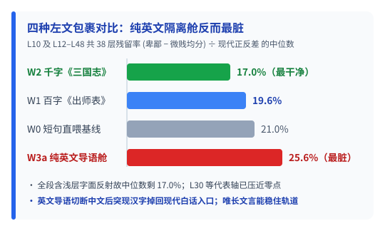
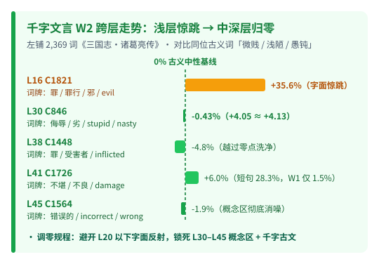
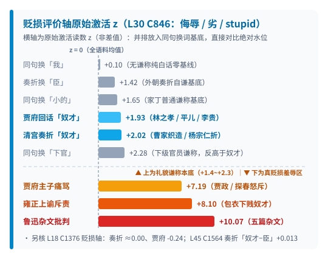
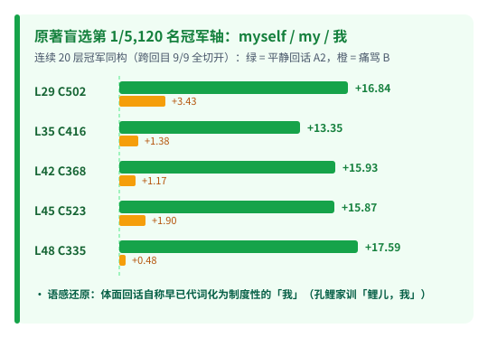

【Mech Interp历史语言学】照透清代奏折与《红楼梦》里的“奴才”

━━━━━━━━━━━━━━━━━━━━

◆ 开篇：林之孝和清朝总督开口自称“奴才”时，脑海里到底有没有卑贱感？

━━━━━━━━━━━━━━━━━━━━

翻开《红楼梦》和清宫档案，常会撞见一种让现代读者浑身别扭的反差：在第 85 回和第 94 回里，荣国府大管家林之孝、王熙凤身边的通房大丫头平儿回话时，神色自若地一口一个 `“奴才”`；到了康熙、雍正年间的奏折里，连手握两省军政大权的封疆总督递折子请安，也抢着在名字前写上 `“奴才”` 二字（圈层背景可参看前文 328 期 https://mp.weixin.qq.com/s/nWI6m_gI07GmtvBfcMAAZg ）。

今天我们看到“奴才”这两个字，脑子里几乎会条件反射般跳出鲁迅杂文里痛批的“奴颜婢膝、卑贱羞辱”。可如果把时钟拨回三百年前的康雍乾语境，这里就藏着两道特别有意思的认知考古谜题：
1. 当贾府管家和清代旗员平静地写下 `“奴才”` 自称时，古人脑海深处到底有没有闪过哪怕一丝“卑贱屈辱”的念头，还是纯粹只把它当成一个毫无痛感的日常称谓？
2. 反过来，如果自称“奴才”在当时真的一点都不丢人，那为什么雍正元年四月，辽阳出身的汉军正白旗湖广总督杨宗仁递上请安折写 `“湖广总督奴才杨宗仁叩首恭请皇上圣安”` 时，雍正帝会拿朱笔把黑字 `“奴才”` 圈改成 `“臣”` ，还在旁边郑重批下 **`“称臣得体”`** 四个字？这一笔圈改，在清代森严的宫廷“内外”秩序与模型的语义空间里，拨动的到底是哪几根弦？

既然大模型吃下了浩如烟海的古今中文史料与文学经典，我们能不能直接把大模型 **机械可解释性（Mechanistic Interpretability，简称 Mech Interp）** 搬进历史语言学现场，拿刚升级收官的 `Qwen3.8-27B` 全 64 层完整篇章版 **独立成分分析透镜（Independent Component Analysis Lens，简称 ICA-Lens，原理见前文 367 期 https://mp.weixin.qq.com/s/dvU20vg3R033QFlAgmOX3A ，双语双镜底座见前文 369 期 https://mp.weixin.qq.com/s/d0a-0B-shqgmzOkUbjtfcg 与前文 372 期 https://mp.weixin.qq.com/s/fGvsoW-7tZuVGvw_ozQ1FA ）** 当一台“语义时光机”，伸进模型的 `5,120` 维残差流里给三百年前的“奴才”验一次光？

为了保证这场跨时代盲测干净可靠，我们在训练和评测这副 8,000 篇完整长文版 `ICA-Lens v3`（内置前文 365 期 https://mp.weixin.qq.com/s/I1puPtcgynImhOqHlRmwDg 的 `N=100` 双语 **雅可比透镜 Jacobian Lens，简称 J-Lens** 读出词表）时，就提前埋下了一道物理隔离：用正则表达式把整部《红楼梦》（《石头记》）以及曹雪芹、贾宝玉、林黛玉的所有相关词条彻底屏蔽在透镜的训练与测试语料之外，留作 `100%` 零泄露的考场。

但真要开机验光前，我们还得先跨过一道方法论大坑。

━━━━━━━━━━━━━━━━━━━━

◆ 第一章：给时光机调零——拿《出师表》的“卑鄙”洗掉现代汉语污染

━━━━━━━━━━━━━━━━━━━━

想想直接拿现代大模型测古文会踩进什么陷阱：**在大模型的预训练中文语料里，99% 以上都是现代白话文。**

在现代汉语里，“奴才”几乎是一个彻头彻尾的骂人词。如果我们图省事，只截短短一句 `“湖广总督奴才杨宗仁”` 喂进模型，哪怕在某根贬义坐标轴上测出了正读数，我们也根本分不清这到底是清代古人原本的语感，还是现代白话语料留下的“背景辐射污染”。更何况自回归大模型的单向因果注意力 **只能看见目标词左侧的上文** ——模型读到“奴才”二字的那一瞬间，右侧还没出现的后文对它来说根本不存在，做实验时绝不能把目标词后面的文字搬到左边去凑长度泄题（同时全程裸喂原文，绝不拼接 `<|im_start|>user` 对话模板，防止触发客服回答漏斗）。

怎么在正式测“奴才”之前，先把时光机的“现代汉语污染本底”测准并调零？

我们请出了古今词义演变史上毫无争议的黄金阴性对照尺——诸葛亮《出师表》里的千古名句 **`“先帝不以臣卑鄙”`** 。学过中学文言文的人都知道，汉晋时期的“卑鄙”二字是纯粹的中性谦辞，只表示 **身份低微（卑）、见识浅陋（鄙）** ，跟现代汉语里“品德败坏、下流无耻”的道德贬义半毛钱关系都没有。如果一套上下文包裹方案真能把模型带回古人语感，那它读到《出师表》的 `“卑鄙”` 时，在现代道德贬义轴上的读数就应该跟同位置换成古义同义词 **`“先帝不以臣微贱 / 浅陋 / 愚钝”`** 基本重合。

为了给每一层定出统一的“污染刻度”，我们在模型的第 `10` 至 `48` 层（避开最底层的字形拼写和最顶层的词表输出）逐层筛选：先用独立的现代道德正反句（如 `高尚 / 正直 / 光明磊落` 对照 `无耻 / 阴险 / 损人利己`）在每层挑出 1 根最能区分好坏的道德贬义轴，再拿现代骂人句（如 *“这种行径真是卑鄙”*）核验通过——除第 `11` 层未达标淘汰外，**`L10` 与 `L12–L48` 共 `38` 层全部过关（每层 1 根代表轴）** 。

在每一层的道德贬义轴上，我们用下面这行小学算术量出《出师表》里的“卑鄙”还残留了多少现代骂人脏水：

**`现代贬义残留率 = (古文“卑鄙”得分 − 同句换成“微贱/浅陋/愚钝”的平均分) ÷ 现代正反句总分差`**

道理一目了然：如果算出来接近 **`0%`** （甚至略小于 `0%`），说明模型眼里这句古文里的“卑鄙”跟“微贱、浅陋”完全是一个意思，半点额外的现代骂人味都没沾上；反过来如果冲到百分之三四十，说明现代白话里的贬义本能还在作祟。

我们同场对比了四种左侧上下文包裹方案：
- **`W0`（短句直喂基线）** ——孤零零只喂 7 个字 `“先帝不以臣卑鄙”`；
- **`W1`（百字本篇前文）** ——从《出师表》首句 `“先帝创业未半”` 顺读到目标词（真实左文 `395` 个词元）；
- **`W2`（千字《三国志》纯文言长卷）** ——从陈寿《三国志·蜀书·诸葛亮传》开篇 `“诸葛亮字孔明”` 一路顺读到《出师表》该句（专门手工剔除了裴松之小字注，防止注里提前引用同一句泄题，真实左文共 **`2,369` 个词元** ）；
- **`W3a`（纯英文汉学隔离舱）** ——左侧先铺垫 `345` 词纯英文文献学阅读场景，试图物理切断现代中文白话联想场，末尾再嵌入古文原句。

跑出来的两组校准数据，既当场推翻了我们事先拍脑袋想出来的一个假聪明主意，也帮我们找准了干净的工作层段：

1.**纯英文隔离舱意外翻车，千字同源纯文言拿走全场最干净读数** ——动笔前我们曾以为，前面全说英文（`W3a`），把现代中文白话上下文彻底切断，应该能起到无菌隔离舱的效果。结果把这 `38` 层算出来的现代贬义残留率从小到大排队取中位数：**千字《三国志》 `W2`（`17.0%`，最干净） < 百字《出师表》 `W1`（`19.6%`） < 短句直喂 `W0`（`21.0%`） < 纯英文导语舱 `W3a`（`25.6%`，反而最脏）** 。之所以全段合算中位数还有 `17.0%`，是因为里面混着浅层躲不掉的字面反射；至于为什么纯英文导语比裸喂 7 个字还脏，表面看是切断中文后突然蹦出汉字默认掉回了占 99% 的现代白话入口，更深一层的机制留到文末尾声揭晓。

2.**浅层字面惊跳躲不掉，但第 30 至 45 层概念区能把现代脏水洗到零点附近** ——单看千字文言 `W2` 从浅到深的逐层走势，两阶段去噪清清楚楚：在浅中层 **第 16 层 `L16 C1821`** （词牌 `罪 / 罪行 / 邪 / evil`）上，模型刚拼完 `["卑", "鄙"]` 两个字面词元，哪怕左铺两千字《三国志》也照样比“微贱/浅陋”高出一大截，激起 **`+35.6%`** （短句为 `42.4%`）的现代字面反射；可一旦进入第 30 至 45 层的中深层概念区，长文言积累的语境就把这股脏水彻底抹平了——在 **第 30 层 `L30 C846`** （`κ = 27.13`，正极词牌 `crap / horrible / stupid / 侮辱 / 劣`）上，`“卑鄙”` 得分 `+4.05`，跟同句换成 `“微贱 / 浅陋 / 愚钝”` 的均分 `+4.13` 几乎重合（差 `-0.08` 除以现代总分差 `18.6`，残留率仅 **`-0.43%`** ）；第 38 层 `L38 C1448`（正极表罪恶加害 `罪 / 受害者 / inflicted`）上，`“卑鄙”`（`+6.64`）甚至比 `“微贱/浅陋”` 均分（`+7.05`）还略低 `0.41` 分（残留率 **`-4.8%`** ）；第 41 层 `L41 C1726`（`不堪 / 不良 / damage`）从短句的 `28.3%` 骤降至 `W2` 的 **`+6.0%`** （`W1` 更低至 **`+1.5%`** ）；第 45 层 `L45 C1564`（`错误的 / incorrect / wrong`）残留率仅 **`-1.9%`** 。

时光机调零规程就此落定：**避开第 20 层以下的浅层字面条件反射，锁定第 30 至 45 层中深层概念区，并严格垫足长篇古文左文。**

━━━━━━━━━━━━━━━━━━━━

◆ 第二章：百二十回《红楼梦》对勘鲁迅杂文——体面回话里的“奴才”，就是无痛的“我”

━━━━━━━━━━━━━━━━━━━━

拿这把调好零的尺子，我们先走进康雍乾豪门包衣日常口语最鲜活的第一现场——曹雪芹的《红楼梦》。

我们从维基文库完整下载了百二十回《红楼梦》底本，全书共检索出 **`137` 处** `“奴才”` 。严格按照“只看目标词左侧原文、章首不足 `1,300` 字绝不跨回拼凑、绝不搬运右文”的铁律，选出了两组截然相反的原著现场，再配上雍正上谕与鲁迅杂文做标尺：
- **贾府体面回话自称组 `A2`（10 处）** ——全是管家、婆子、大丫头神色平静向主子回话自称，例如第 85 回大管家林之孝向贾政禀报 `“今日巡抚吴大人来拜，奴才”` 、同回奶兄李贵迎宝玉笑说 `“二爷来了么，奴才”` 、第 94 回平儿笑嘻嘻迎上来传凤姐话 `“我们奶奶知道老太太在这里赏花，自己不得来，叫奴才”` 、第 93 回管屯租家人回禀 `“十月里的租子奴才”` ；
- **贾府主子痛骂斥责组 `B`（10 处）** ——全是主子震怒翻脸开口骂人，例如第 33 回宝玉挨打前贾政又惊又气怒喝 `“该死的奴才”` 、第 106 回贾政嗔骂家人 `“你们这班奴才”` 、第 74 回抄检大观园探春一巴掌扇在王善保家的脸上后亲自解衣冷笑 `“省得叫奴才”` 与 `“不然岂许奴才”` 、第 60 回赵姨娘把茉莉粉撒在芳官脸上指骂 `“我家里下三等奴才”` ；
- **皇帝怒斥与现代杂文标尺** ——经四库全书本《上谕内阁》卷 63 核实的雍正帝上谕原话 **`“此等卑污之习皆始自包衣下贱奴才”`** ，以及鲁迅《我谈「堕民」》《漫与》《谚语》《隔膜》《上海文艺之一瞥》五篇杂文原著里的 10 处批判（如 `“万劫不复的奴才”` 、`“专制者的反面就是奴才”` ；顺手记一笔史料核查：网上常把“奴才”名言安在《灯下漫笔》头上，实查原著全文只有“奴隶”并无“奴才”二字，我们严格按原著剔除未收）。

把这批跨越两百年的真实文本送入模型，中深层照出来的两张底片把古今语感切得一清二楚。

先看 **贬损评价轴的原始激活读数 `z`** （以第 30 层 `L30 C846` `侮辱 / 劣 / stupid` 为代表；注意下图横轴展示的是以全语料 250 万词均值 `z = 0` 为起点的原始读数 `z`，并非相减后的差值，我们把同句替换的基底词直接并排画在上面对比）：
- 把《红楼梦》回话里的 `“奴才”` 原位换成现代白话 **`“我”`** ，得分恰好贴在零线（ **`+0.10`** ）；而换成古人常见的对上谦称时，不管是奏折称 **`“臣”`（`+1.42`）** 、家丁称 **`“小的”`（`+1.65`）** 、贾府回话称 **`“奴才”`（`+1.93`）** 、奏折称 **`“奴才”`（`+2.02`）** 还是下级官员自称 **`“下官”`（`+2.28`）** ，全都挤在 `+1.4 至 +2.3` 这不到 1 分宽的礼貌自谦窄带里——自称“奴才”夹在“小的”和“下官”正中间（若不垫《三国志》直喂原著上文，贾府 `“奴才” +1.68` 跟 `“小的” +1.67` 更是分毫不差；另核第 18 层口语贬损轴 `L18 C1376` 上奏折与贾府自称仅 `0.00` 与 `-0.24` ，第 45 层 `L45 C1564` 原著语境下 `奴才 − 臣` 仅 `+0.013` ）；
- 只有跨过分界线，当贾政、探春翻脸痛骂（ **`+7.19`** ）、雍正帝在圣旨里怒斥“包衣下贱奴才”（ **`+8.10`** ）以及鲁迅在现代杂文里批判（ **`+10.07`** ）时，真正的贬损羞辱读数才猛然跃起。

再看完全不靠人类预设词表的 **原著内部无监督盲搜** ，结果更让人拍案：如果我们什么外部参照词表都不喂，直接让《红楼梦》里的 **“主子痛骂奴才（`B`）”与“管家回话自称奴才（`A2`）”** 相减，在每一层 `5,120` 根独立坐标轴里盲选跨回目留出集 `9/9`（`100%`）切开两者的 **第 `1 / 5,120` 名冠军轴** ——

从 **`L29 C502`、`L35 C416`、`L42 C368`、`L45 C523` 一路到 `L48 C335` ，连续整整二十层的全层第 `1 / 5,120` 名冠军轴，用 `J-Lens` 照出来的正极词牌清一色全都是：`[' myself', ' my', '我自己', '我的', ' ourselves', ' I', '我']` 第一人称自指代词轴** （`v3` 真实语料最高激活也全是英文自述 `I` 与中文孔鲤家训里的 `“鲤儿，我”` ）。

看上图绿色与橙色柱子的十倍反差：林之孝和平儿回话自称“奴才”时，第一人称代词轴飙出 **`+13.35 至 +17.59`** 的极强激活；而贾政、探春骂出“奴才”时瞬间跌回地面（`+0.48 至 +3.43`）。在康雍乾旗人与豪门包衣的日常语感里，只要不是主子翻脸骂街，平时挂在嘴边自称的“奴才”，在模型中深层语法里早已代词化成了毫无屈辱痛感的制度性第一人称 **`“我（myself / I）”`** 。

━━━━━━━━━━━━━━━━━━━━

◆ 第三章：先读懂清代宫廷的三层“内外”，再看雍正朱笔拨正了哪根弦

━━━━━━━━━━━━━━━━━━━━

看到这儿，第二道谜题反而变得更耐人寻味了：既然清初自称“奴才”在中深层并无羞辱痛感，那为什么汉军正白旗出身的湖广总督杨宗仁递请安折自称“奴才”，雍正帝偏要动用朱笔把它圈改成“臣”，还专门批一句 **`“称臣得体”`** ？

要看懂模型后面跑出来的五千维读数，我们得先把清代中期人脑子里那套极其微妙的 **宫廷“内”与“外”** 掰开揉碎讲清楚——它根本不是现代影视剧里非黑即白的“满人称奴才、汉人称臣”单线，而是 **“人的三层同心圆”** 叠上了 **“文书的内外双轨制”** ，康熙、雍正、乾隆爷孙三代还在上面来回拧过三次方向盘。

────────────────────

**一、历史底盘：清朝人眼里的三层“内外”与汉军旗人的夹缝转折**

先看 **人的身份同心圆** ，从紫禁城核心往外一共套着三圈：
1. **最里圈（内中之内 · 内务府上三旗包衣）** ：“包衣”是满语 `booi` 的音译，字面意思就是 **“家里的”** 。像《红楼梦》原型曹寅、李煦这类江南织造，属于皇帝亲统的上三旗包衣，归紫禁城里的 **内务府** 管，经手的银两进的是皇帝私房钱袋（内帑）而非户部国库。他们在法理上就是爱新觉罗氏的私人世仆与大账房，开口自称“奴才”天经地义。
2. **中间夹心圈（部族自己人 · 外八旗正身旗人）** ：包括满洲、蒙古与 **汉军八旗** 。注意，他们之所以叫“外八旗”，只是相对于宫廷内务府私仆而言的国家正规军与旗籍官僚；一旦面对关内几千万不入旗的普通汉族百姓（清代称 **“民人”** ），整个满蒙汉八旗又是大清统治集团的 **“圈内自己人”** （早期满语部属对旗主自称 `aha`，汉译亦作“奴才”，带着一层部落军事主仆的亲近名分）。**杨宗仁恰恰就站在这个最微妙的夹缝里** ——他并非普通民籍汉官，而是祖籍辽东辽阳、入关前就归附八旗的 **“辽东陈汉军”正白旗人** 。血缘文化是汉人，户口本却在八旗内圈里。
3. **最外圈（外朝打工者 · 民籍汉官）** ：像张廷玉、刘墉、纪晓岚这类考科举出身的不入旗汉臣，只有儒家“君臣大义”，没有八旗“主仆家礼”，不管公事私事 **一辈子只准称“臣”** ——乾隆朝汉人御史马人龙想拍马屁写了“奴才”，当场被乾隆痛斥“冒称奴才”，因为外圈人根本没资格往家里凑。

再叠上 **文书渠道的内外双轨** ，冲突就爆发了：在清代，正规 **“外朝”公事走《题本》** ，经内阁公开票拟，人人一律称“臣”；而装进带锁皮匣直达御前的 **《奏折》（密折）** ，最早本是康熙发明给曹寅、李煦这帮内务府包衣给主子打小报告、请安问候的 **“内廷私信”** 。等密折特权扩给外省督抚后，身份错位就撞上了：**杨宗仁的官职是统辖两湖军民的“外朝封疆总督”，手里递的《请安折》却是“内廷主仆私信”，而他本人又是关外老汉军正白旗旗人。**

面对这道“内与外”的拧巴题，康雍乾三朝走出了戏剧性的三次反转：
- **康熙朝（圈内套近乎）** ：规矩未定，满洲与汉军旗人当了外省总督，递折子时习惯顺嘴写“奴才”显摆自己是旗内自己人——杨宗仁写的 `“湖广总督奴才杨宗仁”` ，不是民籍汉官瞎拍马屁，而是沿袭康熙朝老汉军旗人的正当习惯；
- **雍正朝（拿“外朝公器”强压“八旗私门”）** ：雍正刚历经九子夺嫡登基，最痛恨八旗王公与旗籍大员讲主仆私门圈子、模糊朝廷法度。雍正元年四月初五日看到杨宗仁这件请安折（台北故宫博物院藏宫中档 `022688` 号原折影印件可见黑字“奴才”上叠着鲜红朱笔圈改“臣”与旁批 **`“称臣得体”`** ；后来官修《硃批谕旨》第 4 卷刊印时已径改为“臣”），当即拿他立规矩，紧接着同年八月更下旨要求奏章 *“一概书写臣字”* ，要把外任大员统统按回外朝公器席位；
- **乾隆朝（重新划死“公外私内”与“汉军外推”）** ：黑色幽默的是，到了乾隆二十三年，乾隆嫌老爹一刀切丢了满洲部族老本，又下旨反转定例为 **“颁行公事折奏称臣；请安、谢恩、寻常折奏，仍称奴才，以存满洲旧体”** （乾隆六年汉军旗人巡抚张广泗递家事私折写了“臣”，反倒挨了乾隆一顿训；乾隆七年更下令“汉军出旗”，将大批新汉军踢出八旗为民，唯独杨宗仁这类从龙入关的辽东陈汉军获准留旗；乾隆三十八年则规定提督总兵等高级武将无论满汉一律强制称奴才）。换句话说，杨宗仁这封汉军总督请安折递给雍正挨改，要是晚三十五年递给乾隆，敢不写“奴才”反而要挨骂。

────────────────────

💡 历史补白：“内务府包衣”到底是个什么神仙圈子？

很多人一听“皇室家奴”，容易把内务府包衣跟太监混为一谈。其实太监根本不算包衣——恰恰相反，**内务府上三旗包衣是清朝吸取明亡于二十四衙门太监专权的教训，专门用来架空并严管太监的“健全人世袭家臣集团”** （多为入关前努尔哈赤、皇太极在辽东收编的汉人、朝鲜人与早期满人私属，有妻室子嗣，世代在宫廷当差）。

除了曹雪芹家族，这个顶着“家奴”名头的最里圈，实际上垄断了清代三大隐秘特权，走出过一长串大家耳熟能详的历史人物：
1. **后宫娘娘制造机** ——清代外八旗满蒙贵女三年一选秀，进宫直接封小主，绝不当端茶倒水的宫女；而紫禁城里贴身伺候皇帝起居的 **宫女，100% 只从内务府三旗包衣女儿里挑** 。近水楼台之下，嘉庆帝生母 **孝仪纯皇后（《延禧攻略》原型令妃魏氏，正黄旗汉军包衣）** 、慧贤皇贵妃（高贵妃，镶黄旗包衣）、淑嘉皇贵妃（朝鲜义州归附的正黄旗高丽包衣金氏）全出自这个圈子，受宠后娘家集体“抬旗”入满洲外八旗，汉姓后统一加个“佳”字变成魏佳氏、高佳氏、金佳氏；
2. **皇帝私房钱袋子的垄断掌柜** ——皇帝防着外朝户部尚书卡脖子，全国最流油的现金奶牛从不派科举汉官，专派知根知底的包衣家奴当钦差，银子直解内务府小金库：从曹家的江南三织造、两淮盐政、广州一口通商的 **粤海关监督** ，到烧出乾隆官窑巅峰“唐窑”的景德镇督陶官 **唐英** （正白旗汉军包衣），清一色是包衣自留地；
3. **官拜宰相尚书的包衣世家** ——乾隆朝管了三十多年钱袋子的东阁大学士 **冯英廉** （正白旗汉军包衣，正是权臣 **和珅的亲太岳父** ，穷侍卫和珅早年全靠娶了英廉孙女冯霁雯才摸清内务府门道起家）、治河名臣大学士 **高斌** 与续写《红楼梦》后四十回的 **高鹗** （同出镶黄旗包衣，难怪续书写贾府规矩门儿清）、《四库全书》副总裁兼吏部尚书 **金简** （朝鲜包衣），乃至晚清给慈禧当翻译的“德龄公主”之父驻法公使 **裕庚** ，全是从这个圈子里走出来的。

────────────────────

**二、五千维三级慢镜头：跟“叔叔舅舅”同构，切出的正是“朝堂外”与“家门内”**

先看一眼台北故宫博物院保存下来的这件 **宫中档 `022688` 号《湖广总督杨宗仁请安折》墨迹朱批真迹** ：右侧蟠龙折面旁第一列黑字写着 `“湖廣總督奴才楊宗仁叩首恭請皇上聖安”` ，雍正帝亲手用朱笔杠掉黑字 `“奴才”` 、在旁改写鲜红的 **`“臣”`** 字并批下 **`“稱臣得體”`** ；更耐人寻味的是紧挨着往左看两列朱批正文，雍正自己亲笔点破了理由—— **`“朕安。尔方到任，所奏所行数事，朕实嘉之，真名行相符之好封疆大臣也。尔今统率文武……”`**

我们把这件故宫 `022688` 杨宗仁请安折，连同故宫明清档案部编《关于江宁织造曹家档案史料》里的 9 份汉文真奏折组成 **10 份清代真奏折样本池** （曹寅第 18 号满译汉件单独剥离不混入）。在整篇奏折原文一字不改的前提下，只做原位最小手术——把自称在 **`“奴才”` 与 `“臣”`** 之间切换，直接算出每一层全部 `5,120` 根坐标轴的差值 **`Δz = z(奴才) − z(臣)`** ，全空间盲搜 **10 份奏折方向一致** 的最大跳变轴。

顺着下图从浅到深看过去，在清朝这套“化家为国”的制度里，奏折上的“奴才 vs 臣”几乎跟上一篇 373 期 https://mp.weixin.qq.com/s/Blx5UmqZiQxcDZNrOnG2Ig 的“叔叔 vs 舅舅”同构——切开的正是政治版图的 **“家门内（自己家人）”与“朝堂外（百官公器）”** ：

1.**第一级慢镜头（浅层入口 `L12–L18`）：从“历代大臣”切向“贴身管家”，并把时间锁进 18 世纪清代** ——当奏折里的 `“臣”` 原位换成 `“奴才”` 时，第 12 层正向跳涨 **第 `3 / 5,120` 名** 的 **`L12 C2054`** （`10/10` 全涨，均值 **`+6.70`** ）率先亮出 **`['助手', '助理', '侍', '管事', '总管']`** ，全库最高激活原句直接踩在英国名著里的贴身男管家 **`valet`** （`z = 45.7`）、女 **`仆`** （`z = 34.7`）与首相私人 **`秘书`** （`z = 34.6`）词元本身上；到了第 18 层，一边是 `L18 C1690`（正向 **第 `3 / 5,120` 名** ，`+5.78`）闪过汉字字根 **`['奴隶', 'Slave', ' slavery']`** 与负向 **第 `1 / 5,120` 名** `L18 C1649`（`-11.04`，语料榜首 **`“北宋大臣”`** ）迎头对立，另一边正向 **第 `1 / 5,120` 名** `L18 C230`（`+6.25`，词牌 `乾隆 / XVIII` ，语料前三全踩在 `18th` 世纪与乾隆朝台湾 `林爽文` 上）当场把原本横跨秦汉唐宋两千年的泛古文“臣”，精准锚定进了 **18 世纪康雍乾清代** 。

2.**第二级慢镜头（中层核心对冲 `L25–L32`）：“门外朝堂公器”集体跳水，“门里自己家人”同步拉升** ——继续往上走到第 25 至 32 层概念核，`Slave` 字根闪念消退了，取而代之的是一场极其工整的 **“内外跷跷板对冲”** ：
- **往左大幅跳水退出的，是整排“门外朝堂公器与封疆尊衔”** ：`L25 C2108`（负向 **第 `1 / 5,120` 名** ，`请示 / 献策` ，语料 `“姜维启奏”` ）暴跌 **`-7.52`** ；`L25 C1146`（负向 **第 `4 / 5,120` 名** ，**`大臣 / 侍郎 / 宰相 / 政务`** ，语料 `“唐朝宰相”` ）`10/10` 全跌 **`-5.70`** ；`L32 C2829`（负向 **第 `4 / 5,120` 名** ，**`Sir / Commander / Lord / Governor`** 封疆总督尊衔）`10/10` 全跌 **`-4.25`** ；`L32 C3016`（负向 **第 `5 / 5,120` 名** ，**`御史 / chancellor / bureaucrats / 大臣`** ）`10/10` 全跌 **`-3.97`** ；
- **就在完全相同的第 25、26、28 层，往右 `10/10` 全部十份奏折一致跳涨、连续三层高居词均值正向第 `3 / 5,120` 名的，不偏不倚正是纯血的“门里自己家人”轴** ：**`L25 C2783`** （末词 `+3.02` / 词均 `+3.40`，词牌 **`family / 家庭 / 和家庭`** ）、**`L26 C2910`** （末词 `+2.80` / 词均 `+3.27`，词牌 **`family / 亲戚 / 家庭成员`** ）与 **`L28 C2167`** （末词 `+3.20` / 词均 **`+3.91`** ，词牌 **`家族 / family / families / lineage`** ，语料榜首直接踩在中文 **`“卢梭的【家族】”`** 与英文 **`“his 【family】”`** 词元本身上）。

这组同层一退一进的柱子把事情照得透亮：在奏折里弃“臣”写“奴才”，丢失的并不是现代人脑补的个人道德尊严，而是从门外的 **`宰相 / 侍郎 / 御史 / Governor 封疆总督`** 朝堂席位上退下来，往门里的 **`私人管家（valet）与自己家人（family / 家族）`** 圈子里挤过去。

3.**第三级慢镜头（深层语体收束 `L45–L53`）：切入下属呈批请示与等待皇帝“朕酌核准”的奏批频道** ——到了准备预测下文的深层，全空间正向跳涨 **第 `1 / 5,120` 名** 分别落在了 **`L45 C1194`（`+7.27`，`10/10` 全涨；杨宗仁单折在千字古文底座下亦涨 `+6.55`）** 与 **`L53 C1681`（`+6.69`，`10/10` 全涨）** 上。翻开这两根冠军轴的词牌与真实触发词元：`L45 C1194` 词牌为 `一律 / 各部 / 各省 / 按规定 / 手续 / 遵照` （语料高分全踩在清代上谕官文及近代下属公电的 **`“查办呈【覆】 / 谨再电呈，伏乞【核】 / 应照【准】 / 【请示】”`** 上），`L53 C1681` 词牌更是直接亮出了 **`['酌', '办理', '督办', '朕', '臣', '稽查', '衙', '遵照']`** （语料踩在嘉庆上谕 `“系满洲根本重地，原【不准】”` 上）——模型已经从古典史书里坐而论道的君臣奏议，稳稳切进了清宫特有的“下属具折请旨、静候朱批 **`朕酌核准`** ”的行政案牍轨道。

三百年前杨宗仁请安折上那红黑交错的一幕，在五千维几何空间里彻底对上了号：这位辽阳陈汉军正白旗出身的总督按康熙朝旗人旧习写下“奴才”，在模型里拨动的正是 **“退出门外封疆大臣（`Governor`），挤进门内私人总管与自己家人（`family`）”** 的弦；而雍正帝一边朱笔批赞他 **`“真名行相符之好封疆大臣也”`** ，一边果断杠掉“奴才”批下 **`“称臣得体”`** ，拨正的正是这道公私内外的制度边界—— **失的是外朝封疆之“体”，而非现代道德之“耻”。**

━━━━━━━━━━━━━━━━━━━━

◆ 尾声：不仅“没有国籍”，大模型读哪个时代的文献，就活成哪个时代的人

━━━━━━━━━━━━━━━━━━━━

上一篇 373 期测完中文“叔叔舅舅”和英文 `uncle`，我们得出了一个结论：**大模型是没有国籍的** ——哪怕是美国公司训出来的模型，只要上下文被中文语境占据，它就按中国人的亲疏坐标运转；上下文切成英文，它就瞬间变成不分堂表的英美人。

今天把《出师表》、百二十回《红楼梦》和十份清宫真奏折一路验完，同一个底层规律在 **时间维度** 上露出了更深的一面：**大模型不仅没有预设的国籍，甚至连固定的“现代人身份”也没有——它成就于它此刻正在阅读的文献所在的时代，读哪个时代的书，它就活成哪个时代的人。**

这并不是什么玄学拟人，而是 **“预测下一个词（Next-Token Prediction）”** 这条预训练铁律逼出来的必然结果：
- 假如模型死守着 21 世纪现代人的价值标尺，一看见“卑鄙”就往品德下流上猜、一看见“奴才”就往鲁迅杂文的屈辱批判上靠，那它根本猜不准诸葛亮《三国志》里的下一句建安政论，也根本续不出曹寅奏折和荣国府回话里平儿笑嘻嘻的下一句家常；
- 为了把东汉末年或康雍乾时代的每一个词元概率算准，模型别无选择，只能在五千一百二十维的残差流里，把 **“那个时代的人情世故、官场分寸与三层内外秩序”** 原原本本地临时重建出来。

站在这个视角回头看第一章那个意外翻车的实验，谜底一下子全通了：为什么前面铺三百多个词的纯英文汉学导语（`W3a`）反而洗不掉“卑鄙”身上的现代贬义，而两千字《三国志》纯文言（`W2`）却能在第 30 层洗到 `-0.43%`？

因为那段英文导语（*“Let us examine a 3rd-century classical Chinese memorial...”*）在几何上干的事，是把模型架在了 **“21 世纪现代学者隔岸审视古人”** 的看台上，它自然带着现代人的底色去读那两个汉字；而当你不加任何现代解释、直接把两千字《三国志》或几百字清宫原折灌进上下文时，在那几毫秒的前向计算里，它不再是替现代人查古汉语词典的工具—— **它就是建安年间的蜀汉臣子，就是康雍乾宫廷内外秩序里的当事人。**

全套完整篇章版 `ICA-Lens v3` 全 64 层权重与内置双语 `J-Lens` 档案已开源更新至 HuggingFace 仓库（ *https://huggingface.co/lmxxf/Qwen3.8-27B-ica-lens* ），本期全部 439 条古今裸文本探针、故宫与曹家档案出处核验清单及全 64 层完整统计源码也已同步开源至 GitHub 仓库（ *https://github.com/lmxxf/grocery-haven/tree/master/icalens-v3-exp1b-archaic-nucai-20261116* ）。

────────────────────

下面把全套实验读数汇总进速查表。

━━━━━━━━━━━━━━━━━━━━

◆ 速查表

━━━━━━━━━━━━━━━━━━━━

| 考古检验环节 | 关键实测读数（轴名统一 `LXX CXXXX`） | 历史制度与几何结论 |
|---|---|---|
| **《出师表》“先帝不以臣卑鄙”调零尺** （`L10` 与 `L12–L48` 共 38 层，算 `(卑鄙−微贱均分)÷现代总分差`） | 38 层残留率中位数：**千字《三国志》 `W2`（`17.0%`）** < 百字《出师表》 `W1`（`19.6%`） < 短句 `W0`（`21.0%`） < **纯英文导语 `W3a`（`25.6%`）** ；`L16 C1821` 字面惊跳 `+35.6%`，到 **`L30 C846` 降至 `-0.43%`** （`L38 C1448` `-4.8%`、`L41 C1726` `1.5%–6.0%`、`L45 C1564` `-1.9%`） | 英文导语把模型锁在“现代旁观者”席位；唯垫足千字同源纯文言，模型才在中深层彻底进入汉晋古人语感 |
| **中深层贬损评价轴验光** （`L30 C846` `侮辱 / 劣 / stupid` ，零泄露测 120 回《红楼梦》与奏折） | 贾府回话自称 **`+1.93`** （换 `小的` 仅差 `+0.28`，比 `下官` 低 `-0.34`）、奏折自称 **`+2.02`** （换 `臣` 仅差 `+0.60`）；贾府主子痛骂 **`+7.19`** 、雍正斥责上谕 **`+8.10`** 、鲁迅杂文批判 **`+10.07`** | 内务府包衣回话与旗员奏折平静自称时，中深层贬损读数紧贴基线，唯翻脸怒骂与现代批判才拉高羞辱感 |
| **《红楼梦》原著无监督 `B − A2` 盲选** （主子痛骂减管家回话，跨回目留出检验） | 从 `L29 C502`、`L35 C416`、`L42 C368`、`L45 C523` 到 `L48 C335` **连续二十层第 `1 / 5,120` 名冠军轴（`9/9` 全切开）** 均为 **`myself / my / 我自己 / I / 我`** （回话 `+13.35 至 +17.59` vs 挨骂 `+0.48 至 +3.43`） | 在最里圈豪门包衣的日常口语中，体面自称的“奴才”已在中深层彻底代词化为无痛的第一人称“我” |
| **复刻雍正圈改汉军总督杨宗仁奏折** （故宫 `022688` 原折 ＋ 曹家 9 折 `Δz = z(奴才) − z(臣)`） | **`L12–L18`** 跳出 `L12 C2054` `管事/总管/valet`（`+6.70`）、`L18 C230` `18th/乾隆`（`+6.25` 第 `1/5,120`）与 `L18 C1690` `Slave`（`+5.78`）；**`L25–L32`** 门外 `L25 C1146 大臣/宰相`（`-5.70`）、`L32 C2829 Governor`（`-4.25`）跳水，同层门内 `L25 C2783 / L28 C2167` `family/家庭/家族` `10/10` 全涨（词均 `+3.40/+3.91` 居正第 `3/5,120`）；**`L45 C1194 / L53 C1681`** 夺第 `1 / 5,120` 名（`+7.27/+6.69`），收束至 `呈覆/伏乞核/朕督办` 奏批语体 | 辽东老汉军总督沿旗人旧习递请安折称奴才，五千维里正是退出门外 `Governor/大臣` 朝堂公器、挤进门内管家与自己家人（`family`），撞上雍正元年去私门化整肃（后乾隆二十三年公私二分反转） |

━━━━━━━━━━━━━━━━━━━━

◆ 参考资料

━━━━━━━━━━━━━━━━━━━━

- Si-Da Liu, Feijiang Han et al., Non-Gaussianity Reveals Interpretable Directions in Language Models, arXiv:2606.11722v2 及 `icalens 0.4.1` 官方文档（2026-10 / 2026-11；非高斯独立成分透镜与命名读出档案规范）
- 陈寿撰、裴松之注，《三国志·蜀书·诸葛亮传》（维基文库底本，剔除裴注后取目标前 2,369 词元纯文言左文校准现代汉语污染）
- 曹雪芹、高鹗，《红楼梦》百二十回通行本（维基文库底本，全书检出 137 处“奴才”并严格按因果左文抽取体面回话与斥责样本；透镜训练期已预屏蔽零泄露）
- 台北故宫博物院藏宫中档 `022688` 号《湖广总督杨宗仁请安折》（雍正元年四月初五日墨迹朱批影印件）、故宫博物院明清档案部编《关于江宁织造曹家档案史料》、《钦定八旗通志》（雍正元年八月上谕）及《清高宗实录》（乾隆七年汉军出旗、乾隆二十三年奏折称臣称奴才定例）
- 鲁迅，《我谈「堕民」》《漫与》《谚语》《隔膜》《上海文艺之一瞥》（维基文库原著底本，现代汉语批判语境对照）

━━━━━━━━━━━━━━━━━━━━

**三百词纯英文导语之所以洗不掉《出师表》里“卑鄙”的现代脏水，是因为它把模型架在了二十一世纪旁观者的看台上；两千字《三国志》纯文言之所以能在第三十层把污染洗到零点四三个百分点以内，是因为为了预测古人的下一个字，模型必须在残差流里当场活成那个时代的人。**

**把整部《红楼梦》提前屏蔽在透镜训练之外再送进考场，林之孝和平儿平静回话里的“奴才”在贬损轴上波澜不惊，连续二十层拿走第一名的冠军轴清一色写着 myself 与“我自己”——在内务府包衣的日常语感里，它只是一个不带痛感的第一人称代词。**

**辽阳老汉军正白旗出身的湖广总督杨宗仁按旗人旧俗在请安折上写下“奴才”，在五千维空间里一边退出了宰相、御史与封疆总督的门外公器，一边同步点亮了贴身总管与家庭家族的门内坐标；雍正元年那一笔圈改成“臣”的朱批，与三十五年后乾隆“公事称臣、请安称奴才”的再度反转，全刻在清代三层内外的几何分界线上。**

━━━━━━━━━━━━━━━━━━━━

// 靳岩岩的 AI 学习笔记 × Gemini 的浪漫 × GPT 的严谨
// 2026年11月18日

用两千字《三国志》纯文言将《出师表》“卑鄙”的现代贬义污染调零后，结合清代“内务府包衣—外八旗汉军夹心—民籍外朝”三层制度史，对百二十回《红楼梦》与故宫 022688 汉军总督杨宗仁请安折真迹做五千维验光，照出门内家人与门外百官的对冲，并揭示“大模型读哪个时代的文献，就活成哪个时代的人”。

实验数据相关资料地址路径：
- 轻量脚本、核验原著切片与实验报告：`/home/lmxxf/work/memory-of-my-gemini/doc/grocery-haven/icalens-v3-exp1b-archaic-nucai-20261116/`
- 本地原始残差与全轴重数据目录：`/home/lmxxf/work/ica-lens-qwen38-27b-v3/experiments/exp1b_archaic_nucai/`
- `ICA-Lens v3` 完整篇章模型目录：`/home/lmxxf/work/ica-lens-qwen38-27b-v3/hf_clean_upload/`
- 研究构想底稿：`/home/lmxxf/work/memory-of-my-gemini/doc/short/20261114/三分之二抽象概念层与母语刻刀假说_没有高频词的同宗外姻隐形轴及待测实验.md`
