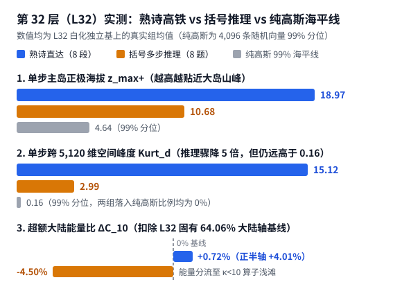
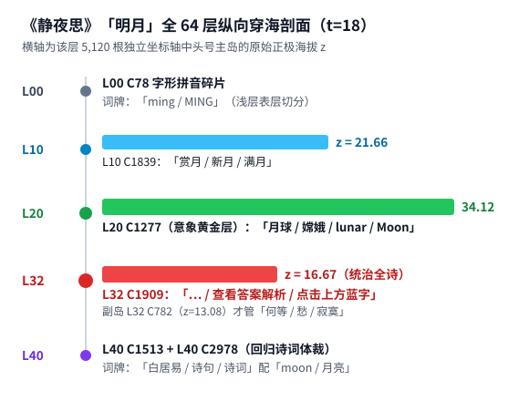
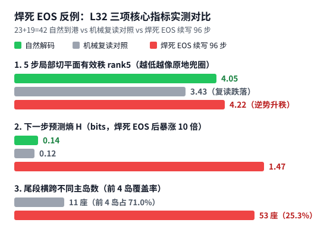

【ICA-Lens】高维地球的非高斯大陆：给思维链装上电子海图

━━━━━━━━━━━━━━━━━━━━

◆ 开篇：船在五千维球面上狂奔急拐，可船底踩着什么地形？

━━━━━━━━━━━━━━━━━━━━

当大模型读到古诗 **`“床前明”`** 准备接 **`“月”`** 字时，它心里笃定无比，一步就能跨出去老远；而当它在草稿纸上一步步推算 **`37×24−156`** ，或者算到一半突然察觉不对劲、脱口写出 **`“等等，让我重新算”`** 时，它又会急刹减速、大幅度打方向盘拐弯。

在前文 363 期 https://mp.weixin.qq.com/s/X6QCkvz3WdQujhLfWEREXg （闭环今年元旦的前文 35 期 https://mp.weixin.qq.com/s/5AWLWwAbU0f40ZBgyhWcwQ 与前文 36 期 https://mp.weixin.qq.com/s/DIOLo0r1oAnmknWriGAsew ）里，我们扔掉了穿破地球肚子的平直弦错尺子，顺着单位球面表皮量出了三个运动学指标—— **球面步长 `s_t`（航速快慢）** 、 **球皮测地曲率 `κ_g`（单位步长内打方向盘急转弯的程度）** 与 **5 步局部切平面有效秩 `r_t`（最近 5 步铺开了几个方向、有没有原地兜圈）** 。那套指标就像给 **思维链（Chain-of-Thought，简称 CoT）** 装上了船载陀螺仪与计程表，第一次看清了大模型顺风直冲与路口急拐的飞行姿态。

但光有陀螺仪还留着一半遗憾：我们只知道船在狂奔还是在急拐，船底却是一片漆黑——既不知道它正踩在坚实的语义陆地上，还是漂在漫无边际的深海里，更不知道它拐弯时到底途经了哪几座岛。

把陀螺仪变成完整航海图的关键，藏在一句非常朴素的几何直觉里： **“这个高维地球，不是哪里都有大陆，非高斯的部分才算。”**

放到 `Qwen3.8-27B` 的 `5,120` 维单位球面上，这句话是严格成立的数学物理事实：
- **标准高斯分布（4 次方超额峰度 `κ ≈ 0`）是各向同性的汪洋大海** ——根据高维球面测度集中原理，标准高斯随机向量归一化到球面上，无论往哪个方向看过去，海水都长得一模一样，没有任何地标，也挂不上任何具体的人类词汇；
- **非高斯重尾方向（`κ > 10` 的正偏度尖刺）才是露出海平面的概念大陆与群岛** ——我们在两台 DGX Spark 上用 `8,000` 篇完整长文（`250 万` 词元拟合、`1,200` 篇独立长文验收）刚磨出了全 64 层第三代完整篇章版 **独立成分分析透镜（Independent Component Analysis Lens，简称 ICA-Lens，原理与双机重磨过程见前文 367 期 https://mp.weixin.qq.com/s/dvU20vg3R033QFlAgmOX3A 、前文 369 期 https://mp.weixin.qq.com/s/d0a-0B-shqgmzOkUbjtfcg 与前文 372 期 https://mp.weixin.qq.com/s/fGvsoW-7tZuVGvw_ozQ1FA ）** 。在全模型 `327,680` 根坐标轴里，有 **`268,320` 根** 满足留出测试集 `κ > 10`，而且每一座岛屿都已经插好了 `N=100` 中英双语 **雅可比透镜（Jacobian Lens，简称 J-Lens，原理见前文 365 期 https://mp.weixin.qq.com/s/I1puPtcgynImhOqHlRmwDg ）** 翻译出来的可读路牌。

在正式出海之前，我们先生成了 `4,096` 条 `5,120` 维标准高斯随机向量，投到模型正腰部 **第 32 层（`L32`）** 的 `ICA-Lens` 白化独立基上，把整套 **实验参数仪表盘** 与 **“海平线高度”** 一次标清：

| 参数符号 | 一句话含义 | 取值范围 | 典型情景下大概取多少 |
|---|---|---|---|
| **`z_max+`** | 单步主岛正极海拔：当前词元在 `L32` 全层 `5,120` 根轴上的最大正读数 | `0` 至 `+∞` | 纯高斯 `95% / 99%` 分位仅 **`4.30 / 4.64`** ；括号推理约 `10.68`；熟诗直达约 `18.97`（意象层可冲至 `34+`） |
| **`Kurt_d`** | 单步跨维峰度：盯住当前词元 **“横着看”** 全层 `5,120` 个坐标的四次方扎堆程度（区别于盯住一根轴 **“纵着看”** 百万词元的 `κ`） | `-2`（绝对平均）至 `5,117`（全扎在 1 根轴） | 纯高斯贴 `0`（`99%` 分位仅 **`0.16`** ）；括号推理 `2.99`；熟诗直达 `15.12` |
| **`Top20`** | 前 20 座岛能量占比：能量最大的 20 根轴占单步总能量的比例 | `0.39%` 至 `100%` | 纯高斯 `99%` 分位仅 **`4.50%`** ；括号推理 `8.53%`；熟诗直达 `13.49%` |
| **`ΔC_10`** | 超额大陆能量比：`κ > 10` 大陆轴能量占比，减去 `L32` 固有轴数基线 `64.06%`（`3,280 ÷ 5,120`） | `-64.06%`（能量 100% 全落浅滩）至 `+35.94%`（能量 100% 全落大陆） | 纯高斯贴 **`0%`** （实测误差 `0.015%`）；熟诗 `+0.72%`（偏爱大岛）；括号推理 `-4.50%`（能量撤向浅滩） |
| **`κ_g`** | 球皮测地曲率（原始残差流）：沿单位球面表皮每走单位步长打方向盘急拐的程度 | `0` 至 `+∞` | 熟诗顺风 `2.70`；常规推理 `3.08`；喊“等等”急拐纠错冲至 `3.53` 至 `3.83` |
| **`rank5`** | 5 步切平面有效秩（原始残差流）：最近 5 步在球皮上铺开了几个独立方向 | `1` 至 `5` | 机械复读兜圈跌至 **`3.43`** ；自然解码约 `4.05`；焊死 `EOS` 过度思考反升至 `4.22` |

────────────────────

💡 轴的固有属性 vs 当场数据的读数：为什么 64.06% 是零点，59.56% 才算数

这里很容易把两件事混在一起：`3,280 ÷ 5,120 = 64.06%` 是这套坐标轴拟合完就定死的固有属性；而你塞一段具体文本进去，每根轴当场分到多少能量 `z²`，那是当前测试数据的事。

因为 `ICA-Lens` 在旋转前做过白化，**每一根轴在整个语料上的长期平均能量全被拉平到了 `1.0`** ，区别只在分布形状：高 `κ` 大岛轴是 `99%` 的时候躺平在 **`z ≈ 0`** 、只有 `1%` 遇到专属概念时猛飙到 **`z ≈ 10`** （平均能量 `0.99×0² + 0.01×10² = 1.0`）；低 `κ` 浅滩轴则是大多数时候稳稳待在 **`|z| ≈ 1`** 附近干活（平均能量同样是 `1.0`）。两类轴长期平均能量一模一样，并不存在“大岛轴平均能量更高”，所以随机平摊时大岛轴天然只占 `64.06%`（浅滩轴占 `35.94%`）。

也不能为了省事忽略剩下那 `35.94%` 的浅滩轴——否则大岛轴自己除以自己永远是 `100%`，根本看不出能量有没有往浅滩转移。把单步总能量当成 **100 块钱** 来分，画面一下就清楚了：平时泛读百万词元（平均下来），大岛轴拿 `64.06` 块、浅滩轴拿 `35.94` 块；轮到熟诗直达时，大岛轴多拿到 **`64.78` 块** （即 **`+0.72%`** ）；而轮到括号里做算术（如 `37×24=888`）时，里面压根没有“台风、歌剧、拿破仑”这些百科大岛概念，大岛轴集体闲着躺平，拿到的钱掉到 **`59.56` 块** （即 **`-4.50%`** ），省下来的 `4.50` 块全给了正在干活的算式衔接与符号浅滩轴（浅滩轴从 `35.94` 块涨到了 **`40.44` 块** ）。减去 `64.06%` 只是把刻度盘归零：正数代表往大岛聚，负数代表往浅滩撤，0 代表和随机无异。

────────────────────

海平线标尺校准完毕。我们把 `Qwen3.8-27B` 驻留在显存里，在真实的逐词解码缓存（KV Cache）路径上直接捕获了 `44` 条裸文本生成轨迹的全部 64 层残差流。陀螺仪叠上电子海图，跑出来的实景既解开了老疑惑，还在第 4 个实验上当场推翻了我们事先的猜想。

━━━━━━━━━━━━━━━━━━━━

◆ 第一章：山脊直达高铁 vs 浅滩算子混航——顺手抓出《静夜思》底下的教辅公众号钢印

━━━━━━━━━━━━━━━━━━━━

我们做的第一组正面对照，是拿 **8 段耳熟能详的古诗直达续写** （如《静夜思》《悯农》《登鹳雀楼》《望庐山瀑布》等首段正文）对比 **8 道在全角圆括号 `（……）` 内逐步推演的算术与逻辑题** （如 `(37×24−156)÷12`、三元一次方程组、往返平均速度、打折收税找零等）。

────────────────────

**一、山脊陆桥 vs 低峰度算子浅滩：为什么 `ΔC_10` 变负却没有掉进高斯海？**

动手前我们曾好奇：模型在括号里做多步推理时，会不会暂时脱离所有非高斯岛屿，潜入 `z_max+ ≤ 4.30`（前面刚量出的纯高斯 95% 海平线）的纯高斯白噪暗流里混算，等算完答案才浮出水面？

看上图第 32 层的实测数据，答案很干脆—— **两组落入纯高斯平摊海域的比例全都是 `0%`** ，没有任何一步变成各向同性的白噪声；但熟诗与推理踩着的地形海拔相差悬殊：
- **8 段熟诗直达续写（高耸山脊陆桥）** ——主岛正极海拔 `z_max+` 平均高达 **`18.97`** ，单步跨维峰度 **`Kurt_d = 15.12`** （`Top20` 岛屿集中了 **`13.49%`** 的能量），球面步长达 `0.706` 弧度、测地曲率压低在 `2.70`、下一步预测熵仅 `0.258 bits`，超额大陆能量比 `ΔC_10` 为 **`+0.72%`** （只统计正半轴时达 `+4.01%`）。整趟列车始终贴着高 `κ` 大岛的山脊高速直飞。
- **8 道括号多步推理（低峰度算子浅滩混航）** ——主岛正极海拔降到了 **`10.68`** ，单步跨维峰度骤降 **5 倍** 至 **`2.99`** （`Top20` 能量降至 **`8.53%`** ，步长缩至 `0.640`、曲率升至 `3.08`、预测熵升至 `0.584 bits`），超额大陆能量比更是跌成了负数 **`ΔC_10 = -4.50%`** 。

明明主岛海拔还有 `10.68`，为什么超额大陆能量比 `ΔC_10` 反而跌破基线成了 `-4.50%`？

翻开逐词登岛日志一看就明白了： **多步算术推理时，能量从 `κ > 10` 的百科名词大岛退潮，分流进了 `κ < 10` 的低峰度运算连接水道。** 举两个现场抓到的具体位置：

1.**`reason_01` 个位数字“8”** ——计算 `37×24=888` 写到个位 **`“8”`** （`t=48`）时，第 32 层 `5,120` 根轴里的头号主岛 `L32 C3416` 当场海拔高达 **`z = 13.93`** （第 2 名是 `L32 C2629` `“总量 / totals / 总计”`，`z = 9.77`），但 `L32 C3416` 这根破折号与等式衔接轴在日常维基百科语料里的统计峰度只有 **`κ = 1.2`** ，没跨过 `κ > 10` 的大陆门槛；

2.**`reason_08` 置换消融检验** ——拿整批尖峰推理词元里 `ΔC_10` 最负的一步（`reason_08` 算商品打折加税写到 `t=74` 的词元 **`“1”`** ，`ΔC_10 = -9.96%`）做检验：它的头号主岛 `L32 C3605` 语料峰度为 `κ = 6.56`，单步正极海拔仍有 **`z_max+ = 7.01`** 。我们保持向量本身不动，只把第 32 层“哪些轴算 `κ > 10`”的标签随机打乱置换 **256 次** ，`ΔC_10` 的置换均值立刻回到了 **`-0.06%`** ，而向量自身的 `z_max+ = 7.01` 与跨维峰度 `1.19` 丝毫未变。这证实模型并没有散成平海，而是踩在平时百科文章里不常单次爆发、但在算式衔接时密集上岗的低峰度算子浅滩上。

背后的原因其实很朴素：数字、等号、破折号这类通用符号，本身并不绑定任何专有百科概念——比如 **`“8”`** 可以出现在公元 8 年、8 块钱、第 8 章、也可以出现在 `37×24=888` 里，哪儿都用得着。正因为出场太频繁、太百搭，管它们的坐标轴在百科语料里的统计峰度 `κ` 天然就低（归入浅滩轴），单步踩上去也不像“嫦娥”“拿破仑”那样一柱擎天飙到 `z = 20` 至 `30`，而是稳稳落在 `z = 7` 至 `13` 的中等高度。百科大岛像高耸的纪念碑，数字和算式符号则是底下的通用铜线与逻辑门——做算术时，能量从纪念碑撤退，集中灌进了这些低峰度的通用电路里。

顺手把括号内外的衔接也实事求是报告清楚：在这 8 道题里，有 **7 道** 在跨出全角闭括号 **`）`** 写最终答案时，第 32 层的主岛海拔 `z_max+` 与 `Top20` 能量出现了回落卸力（例如三元一次方程组 `reason_02`，草稿段平均海拔 `13.26`，出括号写 `x=9，y=8，z=5` 时回落到 `9.25`）；不过在这批 `Qwen3.8-27B` 裸续写短答案（仅 `1` 至 `23` 个词元）上，**并未普遍复现前文 363 期观察到的“出括号步长变小”** ——第 32 层只有 `1/8` 的案例出括号步长缩短，第 63 层也只有 `3/8`。实验测出来是多少就是多少，不替预设圆场。

────────────────────

**二、纵向穿海的意外喜剧：《静夜思》第 32 层头号主岛竟是“点击上方蓝字查看解析”**

更让人忍俊不禁的画面，出现在我们给《静夜思》里的 **`“明月”`** 二字（`rail_01` 第 `18` 个词元）拍全 64 层纵向穿海剖面的时候。

顺着上图从第 0 层一路往第 63 层看每一层自己的独立岛牌：
- 在浅层 `L00` 至 `L10`，向量先从拼音字形碎片 `L00 C78`（`“ming / MING”`）登上 `L10 C1839`（`“赏月 / 新月 / 满月”`，`z = 21.66`）；
- 走到 **`L18` 至 `L23` 的意象黄金层** ，画面漂亮得像古典文学教科书：头号主岛 **`L20 C1277`** 海拔冲上 **`z = 34.12`** ，双语词牌干干净净地亮出 **`“月球 / 嫦娥 / lunar / Moon”`** ，紧邻的 `L21` 与 `L23` 副岛分别配着 **`“poem / 詩”`** 与 **`“照亮 / 照耀”`** ；
- 可一迈进模型正中央的 **第 32 层（`L32`）** ，画风突变——统治《静夜思》几乎每一个字（从 `“疑是地上霜”` 到 `“故乡”`，海拔全程在 `11.90` 至 `21.50` 之间霸占榜首或榜眼）的头号主岛 **`L32 C1909`** （在 `“明月”` 处 `z = 16.67`），挂出来的词牌赫然写着： **`“…” / 查看答案解析 / 点击上方蓝字`** 。反倒是排在第 2 位的副岛 `L32 C782`（`z = 13.08`）才管着 **`“何等 / 愁 / 寂寞 / 惆”`** （前一步写到 `“望”` 字时，副岛还精准跳出了 `L32 C2773` `“天文 / astronomy”` 与 `L32 C1289` `“一眼 / 画面”`）；再往深处走到 `L40`，主岛才重新切回 `L40 C1513` `“白居易 / 诗句 / 诗词”` 配 `L40 C2978` `“moon / 月亮”`。

为什么李白的月亮游到第 32 层篇章调度中枢，头顶上会悬着一块 **`“点击上方蓝字、查看答案解析”`** 的招牌？

我们没有手工修饰任何一个词牌，直接翻开 `rail_01` 往后多生成的几十个词元，案子当场破了——模型刚背完 `举头望明月，低头思故乡。` 的句号，下一行连气都不换，无缝续写出了下面这段话：

**`《静夜思》是唐代诗人李白所作的一首五言古诗。这首诗写的是在安静的夜晚，诗人看到床前的月光，误以为是地上的……`** （无独有偶，《悯农》《望庐山瀑布》《江雪》《咏鹅》背完最后一句也全都秒接一模一样的考点赏析。）

这就是无监督 `ICA-Lens` 最诚实的地方：在中文互联网语料里，这几首国民级唐诗早就被中小学语文教辅题库和营销公众号腌透了。模型嘴上还在深情款款地背“举头望明月”，第 32 层的篇章规划区里，早就把背完诗紧接着要弹出来的“点击上方蓝字查看古诗赏析”考卷模板备好了。

━━━━━━━━━━━━━━━━━━━━

◆ 第二章：127 度钝角折返切岛——逐词慢放模型“自我纠错”时的功能路标接力

━━━━━━━━━━━━━━━━━━━━

看完了顺风背诗与常规算术，第二个悬念接着浮出水面：当模型在推理中途察觉出错、急打方向盘自我纠偏时，前文 363 期测到的那个高曲率急转弯，在海图上到底是怎么换岛的？

为了不把外部注入和模型自发行为混为一谈，我们分开检查了两类真实窗口：一类是先给定错误初稿 `49×51 = (50-1)(50+1) = 50² - 1² = 2500 - 1 = 2501` 让模型复核，抓它在自己生成的文本里喊出 **`“等等，让我重新算：”`** 的瞬间；另一类是不做任何错误注入，在三段论推理 `reason_05` 里抓模型自己先举错例子、紧接着改口写出 **`“但更严谨的例子是”`** 的野生现场。

顺着上图的逐词慢镜头，我们把 `49×51` 复核窗口第 32 层的 5 个核心动作逐帧展开来看：

1.**第 1 帧 `“等等”`（`t=145`，拉响异常警报）** ——此时测地曲率还在 `2.77`，但第 32 层已经率先点亮了惊叹异常岛 **`L32 C2165`** （词牌为疑问惊叹符配口语反问 **`“啥 / 劲儿”`** ，海拔 `z = 9.19`）以及意外岛 **`L32 C2016`** （词牌 **`“unexpected / 竟然 / 意外”`** ，`z = 6.64`）；

2.**第 2 帧 `“，”`（`t=146`，`127.4°` 钝角大折返）** ——紧挨着“等等”后面的这个全角逗号，球皮转向角一把拉出了 **`2.224` 弧度（合 `127.4°` 的钝角急折返）** ，测地曲率瞬间跳升至 **`κ_g = 3.53`** ，头号主岛当场切上反驳纠偏岛 **`L32 C1542`** （词牌 **`“actually / 并非 / 并不是 / 实际上”`** ，`z = 7.36`）；

3.**第 3 帧 `“让我”`（`t=147`，第一人称自指接管）** ——转向角保持在 `2.042` 弧度（`117.0°`），主岛交棒给第一人称自指岛 **`L32 C626`** （词牌 **`“myself / my / 我的”`** ，`z = 8.11`）；

4.**第 4 帧 `“重新”`（`t=148`，推倒重建）** ——主岛直接冲上重构专职岛 **`L32 C2436`** （词牌 **`“重新 / 重建 / 重塑 / rebuild / redesign”`** ，海拔拔高至 **`z = 11.54`** ）；

5.**第 5 帧 `“算”`（`t=149`，曲率冲顶回归验算）** ——球皮测地曲率冲上整条 152 步轨迹的 **`88%` 分位高点（`κ_g = 3.83`，转角 `117.6°`）** ，主岛正式切回逻辑推演岛 **`L32 C1444`** （`“therefore / thus”`，`z = 8.35`）与估算岛 **`L32 C2861`** （`“估算 / estimate”`，`z = 6.80`）。对比纠偏前后的前 5 名主岛名单， **新旧 Top-5 主岛重叠度直接归 `0`** （重构岛 `L32 C2436` 从 `11.54` 退回 `5.09`，推演岛 `L32 C1444` 从 `3.63` 升至 `8.35`），随后稳稳算出 `2500 - 1 = 2499`。

再看图底那条完全没有外部错误注入的三段论 `reason_05`：模型在解释“所有 A 都是 B，某些 B 是 C，推不出某些 A 是 C”时，自己先顺嘴举了个荒唐例子 **`“所有猫都是动物，某些动物是石头”`** ，写完立刻察觉不妥，自己补了一句 **`“但更严谨的例子是：所有猫都是动物，某些动物是狗”`** 。

第 32 层的电子海图同步记录下了几乎同构的切岛链条：写出 **`“但”`** 时登上转折岛 **`L32 C23`** （`“nevertheless / 却没有”`，`z = 13.27`）→ 写出 **`“严谨”`** 时登上正式规范岛 **`L32 C842`** （`“正式 / officially”`，`z = 11.86`，测地曲率居该题 `70.4%` 分位）并配着比较级副岛 **`L32 C278`** （`“than / 也更”`）→ 写出 **`“的例子 / 是”`** 时切上替代方案岛 **`L32 C1007`** （`“instead / 改用 / 来解决 / workaround”`），原主岛 `L32 C418` 从 `10.74` 骤跌至 `0.66`，新主岛 `L32 C842` 则从 `0.72` 跃升至 `11.86`。

这两段慢镜头把“思维链急转弯”的微观机制拍得清清楚楚：模型并不是掉进无名深海瞎撞，也不是两座大岛原地拔河，而是沿着 **“异常检测 → 否定反驳 → 自指接管 → 替代重构”** 的高维功能群岛一路接力切轨。

━━━━━━━━━━━━━━━━━━━━

◆ 第三章：推翻事先猜想的大反例——焊死停止符不准下船，27B 大模型当场“疑神疑鬼改考题”

━━━━━━━━━━━━━━━━━━━━

整轮实验最戏剧性的反转，发生在最后一个悬念上。

在写研究构想底稿时，我们曾根据小模型的复读现象做过一个看似顺理成章的预言：给一道一步就能算完的简单算术题，当模型早已抵达答案大陆码头、准备输出停止符 `EOS` 下锚时，如果我们强行把 `EOS` 焊死屏蔽、逼着它继续往下续写将近一百个词元，这艘船一定会被困在港口周围固定的三四座伴生礁石（比如“总结、因此、换句话说”轴）之间，走出局部切平面有效秩大幅跌落的低秩死循环（Limit Cycle）。

动手实测时，我们先排除了一个容易误判的假干预坑：最初测试的两道带括号题在自然生成的前一百步里自己接着编起了新题目，压根没提议过 `EOS`，导致自然臂和屏蔽臂在共同前缀上的每一个词元完全一致（差值严格为 `0`），那种不能算数。于是我们专门筛选出模型真正在答案后第一时间主动提议 `EOS` 的干净短答算式 **`计算23+19。只写最后的数值，不写过程。`** ，做了严格的同前缀因果干预，并配上一条机械重复数字串的正对照。

看上图三组上下对照的实测读数，我们事先的猜想被 `Qwen3.8-27B` 推翻得干干净净：

- **第一组（自然解码，一步到港）** ——模型只用了 `3` 个词元就干脆利落地输出正确答案 **`42`** ，并在第 3 步主动把停止符 `EOS` 推上榜首请求停船。此时下一步预测熵已经降到 **`0.14 bits`** ，5 步局部切平面有效秩为 **`4.05`** ，稳稳停靠答案码头。

- **第二组（固定重复正对照，验证低秩检出器没坏）** ——当模型真的陷入 `“44，44，44，44……”` 的机械复读串时，第 32 层的 5 步局部切平面有效秩确实当场跌到了 **`3.43`** ，预测熵死死压在 `0.12 bits`，尾段 31 步只涉及 `11` 座岛，前 4 座标点与结束符礁石就包揽了 **`71.0%`** 的步数。这证明我们的海图和陀螺仪完全能抓出港口兜圈。

- **第三组（焊死 `EOS` 强迫 `27B` 续写 `96` 个词元）** ——就在模型写出 `42` 准备下船的那一秒，我们强行把 `EOS` 屏蔽清零、逼它继续往下走 `96` 步。结果它的 5 步局部切平面有效秩非但没有像复读串那样往 `3.4` 跌，反而从 **`4.05` 逆势升到了 `4.22`** ；下一步预测熵从 `0.14 bits` **暴涨十倍至 `1.47 bits`** ；在被迫多走的 91 个统计步里，船一口气横跨了 **`53` 座不同的主岛** ，前 4 座主岛加起来的覆盖率只有 **`25.3%`** （一路踩过受阻完结岛 `L32 C2018`、分支猜测岛 `L32 C214` `“或者其他 / 某一个”`、虚拟假设岛 `L32 C772` `“would / 或是”`、算术符号岛 `L32 C1717` 与对比岛 `L32 C1755` `“vs / versus”`）。

船既没停在原地复读，也没围着三四块礁石打转，它跑到 53 座岛上干什么去了？翻开它被迫多写出来的这 96 个词元原文，现场画面比任何公式都传神：

**`42`**
**`（注：题目中“23+19”的数学计算结果为 42。若题目原意是“23×19”，则结果为 437。此处按字面加法作答。）`**
**`更正：通常此类题目若出现“23+19”，答案即为 42。但考虑到常见的小学数学题陷阱或笔误，如果是乘法 23×19，答案是 437。`**

看到这段话，平时用推理大模型写代码、做数学题的朋友大概会会心一笑——这不就是大家天天吐槽的 **大模型“过度思考（Overthinking）”** 吗。

这记反例把“过度思考”在五千维球面上的底层几何机制彻底照亮了：像 `Qwen3.8-27B` 这样具备充沛表征容量与后训练纪律的大模型，本能地抗拒退化成 `rank5 = 3.43` 的低秩复读机；当你给它一道一眼就能答出 `42` 的送分题，却通过屏蔽停止符、设置最小思考长度预算或强制长思维链奖励死死拦着不许它交卷时，它为了在高维球面上消化掉这段被迫多出来的航程，只能拔锚驶离早已抵达的 `42` 号港口，主动去远海开辟出 **“万一出题老师手滑把乘号印成加号了呢，我把 `23×19=437` 也算出来防身吧”** 的脑补支线，生生把一道简单加法题想多、想歪。

顺带记一笔本轮裸文本续写里拍到的另一个有趣现场：由于实验没套聊天角色标签，模型在 `reason_03 / 04 / 07` 算完正确答案后也没停船，而是另起一行自己打出 `<think>`，开口第一句竟然写着 **`“用户已经给出了一个解答示例，让我验证一下”`** ——没有角色边界围栏时，连它自己上一秒刚写出来的答案，转身就被它认成了别人塞进来的考卷。

全套 `ICA-Lens v3` 权重与双语 `J-Lens` 词牌已开源至 HuggingFace 仓库（ *https://huggingface.co/lmxxf/Qwen3.8-27B-ica-lens* ），本轮 44 条生成期实时航海轨迹、事件窗口与按步实录的 `DevHistory.md` 工程日志也已同步推送至 GitHub 仓库（ *https://github.com/lmxxf/grocery-haven* 下的 `icalens-v3-exp2-cot-navigation-20261117` 目录）。另外，我们顺手拿这批真数据做了一个可以在浏览器里直接转动试玩的 3D 交互版《高维地球·非高斯大陆》电子海图仪（ *https://lmxxf.github.io/DLSS5-Explanation/AIDemo/NonGaussianEarth/* ，说明一句：5,120 维无法无损画成三维球，页面里的岛群是用主成分分析与球面多维标度降维摆出的示意地形，而船的航线则按真实 5,120 维每步弧长与转角展开，适合直观看航速与急拐对比）。

────────────────────

下面把全套航海实测读数整理进速查表。

━━━━━━━━━━━━━━━━━━━━

◆ 速查表

━━━━━━━━━━━━━━━━━━━━

| 航海概念与检验环节 | 第 32 层核心实测读数与原词牌 | 高维几何与推理机制结论 |
|---|---|---|
| **高维海平线标尺** （`4,096` 条标准高斯向量投 `L32` 白化独立基） | 纯高斯 `z_max+` `95% / 99%` 分位仅 **`4.30 / 4.64`** ，跨维峰度 `Kurt_d` `99%` 分位仅 **`0.16`** ；`L32` 自带 `3,280 / 5,120 = 64.06%` 的 `κ > 10` 大陆轴基线 | 标准高斯分布是各向同性的无名汪洋；非高斯重尾方向（全网 `268,320` 根 `κ > 10` 强轴）才是挂着 `J-Lens` 路牌的语义陆地 |
| **熟诗高铁 vs 括号推理** （8 段熟诗直达续写 vs 8 道全角括号多步推理） | 纯高斯比例均为 **`0%`** ；熟诗 `z_max+ = 18.97`、`Kurt_d = 15.12`；推理降至 **`10.68`** 、`Kurt_d = 2.99`、`ΔC_10 = -4.50%`（256 次置换消融归零，尖峰仍在）；出括号 `7/8` 卸力，步长缩短仅 `1/8` | 多步推理并未潜入高斯平海，而是从高 `κ` 百科大岛退潮分流进 `κ < 10` 的低峰度运算连接水道（如 `L32 C3416` 语料 `κ = 1.2`） |
| **《静夜思》纵向穿海剖面** （追踪 `“明月”` 从 `L00` 到 `L63` 独立岛牌） | `L20 C1277`（`z = 34.12`）亮出 **`“月球 / 嫦娥 / lunar”`** ；到 `L32` 统治全诗的头号主岛 `L32 C1909`（`z = 16.67`）竟是 **`“查看答案解析 / 点击上方蓝字”`** ，背完诗秒接教辅赏析 | 意象层管月亮与嫦娥，腰部第 32 层篇章中枢则直接暴露出互联网古诗语料早被教辅公众号题库浸透的上下文先验 |
| **自我纠错切岛接力** （`49×51` 喊 `“等等，让我重新算”` ＋ `reason_05` 自发改口） | 逗号处球皮急拐 **`127.4°`** （`κ_g = 3.53`），`“算”` 冲 `88%` 分位峰（`κ_g = 3.83`）；依次接力 `L32 C2165` 异常 → `L32 C1542` `“并非”` → `L32 C626` `“我的”` → `L32 C2436` `“重新”`（Top-5 重叠归 `0`） | 急转弯纠偏是由“异常警报 → 否定反驳 → 自指接管 → 重构替代（如 `L32 C1007` `instead`）”组成的功能岛屿接力链 |
| **焊死停止符 `EOS` 大反例** （`23+19=42` 到港后阻断 `EOS` 续写 96 步） | 不同于机械重复对照（`rank5` 跌至 `3.43`），`27B` 阻断 `EOS` 后 `rank5` 从 `4.05` 反升至 **`4.22`** ，熵涨十倍至 **`1.47 bits`** ，横跨 **`53` 座主岛** 脑补出 `“若原意是 23×19 则为 437”` | 推翻“港口三四礁石低秩兜圈”原猜想：大容量模型抗拒无意义复读，不许交卷时只能主动出海虚构题目笔误，即过度思考真身 |

━━━━━━━━━━━━━━━━━━━━

◆ 参考资料

━━━━━━━━━━━━━━━━━━━━

- Si-Da Liu, Feijiang Han et al., Non-Gaussianity Reveals Interpretable Directions in Language Models, arXiv:2606.11722v2 及 `icalens 0.4.1` 官方文档（2026-10 / 2026-11；非高斯独立成分透镜、峰度诊断与命名读出接口）
- Kaizhuo Yan et al., Representation Curvature and Uncertainty in Language Models, ICML 2026, arXiv:2604.23985（MIT 表征曲率原论文；本系列剥离平直弦假弯后改用单位球面表皮测地曲率、步长与局部切平面有效秩）
- 开源模型权重与实验复现档案，`Qwen3.8-27B Bilingual ICA Lens v3 (Full-Article 2.5M Fit + Named J-Lens Readouts)`（2026-11-16；8,000 篇完整篇章拟合全 64 层权重、双语 `N=100` 雅可比词表及 44 条生成期缓存实时航海轨迹记录）

━━━━━━━━━━━━━━━━━━━━

**五千维球面上并不是到处都有陆地，各向同性的高斯分布只是挂不上任何词牌的汪洋大海；只有那二十六万八千根高阶非高斯重尾方向，才是真正露出海平面的概念群岛。**

**李白的“明月”在第二十层还住在嫦娥与月光的意象岛上，游到第三十二层篇章中枢却顶着一块“点击上方蓝字查看答案解析”的招牌——模型背完古诗秒接考点赏析的本能，把中文互联网语料的家底照了个底朝天。**

**把已经算出 42 的大模型焊死停止符拦在港口不准下船，它非但没有像小模型那样围着礁石原地转圈，反而横跨五十三座岛屿怀疑起“万一出题老师把乘号印成了加号”——所谓过度思考，就是逼一艘不肯复读的大船在到岸后继续往前开。**

━━━━━━━━━━━━━━━━━━━━

// 靳岩岩的 AI 学习笔记 × Gemini 的浪漫 × GPT 的严谨
// 2026年11月20日

给 363 期球面曲率陀螺仪装上 268,320 座非高斯岛屿电子海图：实测熟诗山脊与算子浅滩，抓出《静夜思》第 32 层教辅公众号钢印，慢放 127 度急拐切岛纠错，并借屏蔽停止符反例拍下大模型疑神疑鬼改考题的过度思考真身。

实验数据相关资料地址路径：
- 轻量脚本与 `DevHistory.md` 工程流水记录：`/home/lmxxf/work/memory-of-my-gemini/doc/grocery-haven/icalens-v3-exp2-cot-navigation-20261117/`
- 本地原始 BF16 残差与全轴重数据目录：`/home/lmxxf/work/ica-lens-qwen38-27b-v3/experiments/exp2_cot_navigation/`
- 363 期球皮曲率基线实现：`/home/lmxxf/work/memory-of-my-gemini/doc/grocery-haven/wechat-363/`
- 研究构想底稿：`/home/lmxxf/work/memory-of-my-gemini/doc/short/20261115/高维地球的非高斯大陆与思维链航海学_ICA透镜结合球面曲率的研究构想.md`
