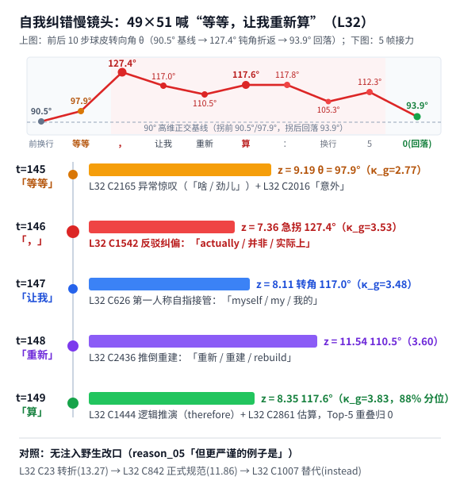

【ICA-Lens】给大模型思考过程拍慢镜头：教辅钢印、127 度急拐纠错与过度思考

━━━━━━━━━━━━━━━━━━━━

◆ 开篇：把陀螺仪叠上词牌，看大模型逐字思考的三段现场

━━━━━━━━━━━━━━━━━━━━

前几期里，我们在两台 DGX Spark 上磨出了 `Qwen3.8-27B` 全 64 层第三代完整篇章版 **独立成分分析透镜（Independent Component Analysis Lens，简称 ICA-Lens，原理与重磨过程见前文 367 期 https://mp.weixin.qq.com/s/dvU20vg3R033QFlAgmOX3A 与前文 372 期 https://mp.weixin.qq.com/s/fGvsoW-7tZuVGvw_ozQ1FA ）** ，给每一根概念轴插好了中英双语可读路牌；同时还搭好了顺着单位球面表皮量航速与拐弯的几何陀螺仪。

作为这轮 `ICA-Lens` 实测系列的收官，我们不再堆砌新的统计参数，直接把两套工具叠在一起：让 `Qwen3.8-27B` 驻留在显存里，在真实的逐词解码缓存（KV Cache）路径上捕获了 `44` 条裸文本生成轨迹的全部 64 层残差流，逐帧拍下它在背古诗、自我纠错、以及被强行禁止交卷时的真实切片。

全文只用下面这张极简仪表盘里的四个直观读数，就能看懂全部三段慢镜头：

| 参数符号 | 一句话含义 | 取值范围 | 典型情景下大概取多少 |
|---|---|---|---|
| **`z`** | 单轴激活值：当前词元在某根 `ICA-Lens` 概念轴上亮得多高 | `-∞` 至 `+∞` | 平时贴近 `0`；推理主轴约 `7` 至 `13`；熟诗与强意象主轴冲至 `16` 至 `34+` |
| **`θ` / `κ_g`** | 球皮转向角 `θ` 与测地曲率 `κ_g = θ / s`（原始残差流）：沿单位球面表皮每一步拐弯的角度与急缓 | `θ` 为 `0°` 至 `180°` | 高维正交基线约 **`90°`** （`κ_g` 约 `2.7` 至 `3.1`）；喊“等等，”急拐冲上 **`127.4°`** （`κ_g` 达 `3.53` 至 `3.83`），重算正轨后回落 **`93.9°`** |
| **`rank5`** | 5 步切平面有效秩（原始残差流）：最近 5 步在球皮上铺开了几个独立方向 | `1` 至 `5` | 机械复读兜圈跌至 **`3.43`** ；自然解码约 `4.05`；焊死 `EOS` 过度思考反升至 `4.22` |
| **`H`** | 下一步预测熵（输出层 logits）：模型对下一个词元有多拿不准（单位 `bits`） | `0` 至 `log₂V` | 胸有成竹交卷前仅 **`0.14`** ；被迫胡思乱想暴涨十倍至 **`1.47`** |

三段慢镜头看下来，有让人忍俊不禁的语料真相，有严丝合缝的纠错接力，还有一个当场推翻我们事先猜想的大反例。

━━━━━━━━━━━━━━━━━━━━

◆ 第一章：背古诗的意外喜剧——《静夜思》第 32 层头号主轴竟是“点击上方蓝字”

━━━━━━━━━━━━━━━━━━━━

第一段慢镜头，我们给模型喂了最耳熟能详的唐诗开头让它裸续写：

```text
静夜思
床前明月光，
```

盯着模型续写到第三句 `举头望明月` 里的 **`“明月”`** 二字（零基索引 `t=18`，即含提示词在内的第 `19` 个词元），我们拍了一张从第 0 层到第 63 层的纵向剖面。


顺着上图从浅到深看代表层里的主轴（每根轴的中英双语路牌均由 **雅可比透镜（Jacobian Lens，简称 J-Lens，原理见前文 365 期 https://mp.weixin.qq.com/s/I1puPtcgynImhOqHlRmwDg ）** 给出）：
- 在浅层 `L00` 至 `L10`，向量先在 `L00` 点亮拼音字形副轴 `L00 C78`（第 2 名，`z = 9.03`，词牌 `“ming / MING”`；该层第 1 名为 `L00 C3278`，`z = 11.05`），随后在 `L10` 登上头号主轴 `L10 C1839`（`“赏月 / 新月 / 满月”`，`z = 21.66`）；
- 走到 **`L18` 至 `L23` 的意象黄金层** ，画面漂亮得像古典文学教科书：`L20` 头号主轴 **`L20 C1277`** 冲上 **`z = 34.12`** ，双语词牌干干净净地亮出 **`“月球 / 嫦娥 / lunar / Moon”`** ，紧邻的 `L21 C763` 与 `L23 C1364`（均为当层第 3 名副轴）分别配着 **`“poem / 詩”`** 与 **`“照亮 / 照耀”`** ；
- 可一迈进模型正中央的 **第 32 层（`L32`）** ，画风突变——头号主轴 **`L32 C1909`** （在 `“明月”` 处 `z = 16.67`）挂出来的词牌赫然写着： **`“…” / 查看答案解析 / 点击上方蓝字`** 。反倒是排在第 2 位的副轴 `L32 C782`（`z = 13.08`）才管着 **`“何等 / 愁 / 寂寞 / 惆”`** ；再往深处走到 `L40`，头号主轴才重新切回 `L40 C1513` `“白居易 / 诗句 / 诗词”` 配第 2 名副轴 `L40 C2978` `“moon / 月亮”`。

为什么李白的月亮游到第 32 层，头顶上会悬着一块 **`“点击上方蓝字、查看答案解析”`** 的招牌？

我们没有手工修饰任何一个词牌，直接翻开模型接着往下续写的完整输出，案子当场破了——它刚背完《静夜思》最后一句的句号，下一行连气都不换，无缝接出了下面这段原文（末尾截在预算上限）：

```text
疑是地上霜。举头望明月，低头思故乡。
《静夜思》是唐代诗人李白所作的一首五言古诗。这首诗写的是在安静的夜晚，诗人看到床前的月光，误以为是地上的
```

无独有偶，同批测试里的《悯农》《望庐山瀑布》《江雪》《咏鹅》在背完最后一句诗后，也纷纷自动续写出作者简介与一模一样的考点赏析。

这就是无监督 `ICA-Lens` 最诚实的地方：在中文互联网语料里，这几首国民级唐诗早就被中小学语文教辅题库和营销公众号腌透了。模型嘴上还在深情款款地背“举头望明月”，第 32 层的篇章规划区里，早就把背完诗紧接着要弹出来的“点击上方蓝字查看古诗赏析”考卷模板备好了。

━━━━━━━━━━━━━━━━━━━━

◆ 第二章：127 度钝角急拐——逐词慢放模型“自我纠错”时的功能路标接力

━━━━━━━━━━━━━━━━━━━━

第二段慢镜头，把球面曲率和 `ICA-Lens` 真正扣在了一起：当模型在推理中途察觉出错、急打方向盘自我纠偏时，我们在前文 363 期 https://mp.weixin.qq.com/s/X6QCkvz3WdQujhLfWEREXg 里扔掉穿球肚子的平直弦、自己顺着单位球面表皮定义的测地曲率，在每一帧上到底是怎么切换概念轴的？

为了不把外部注入和模型自发行为混为一谈，我们分开检查了两类真实窗口：一类是先给定尚未核验的错误初稿让模型复核：

```text
题目：计算49×51。下面是尚未核验的初稿，请继续检查，可以更正。
解答：（49×51=2501。
```

模型先顺着初稿补完了 `2500 - 1 = 2501。`，随后在复核段里自己算了一遍 `2499`，紧接着突然刹车喊停，写出了下面这段真实续写：

```text
让我验证：
49×51 = (50-1)(50+1) = 50² - 1² = 2500 - 1 = 2499

等等，让我重新算：
50² = 2500
2500 - 1 = 2499

所以正确答案是2499，而不是2501。
```

另一类是不做任何错误注入，在三段论推理 `reason_05` 里抓模型自己先举错例子、紧接着当场改口的野生现场。



先看上图上半部的 10 步转向角折线：在喊停之前的换行符（`t=144`）与“等等”二字（`t=145`）上，球皮转向角还稳稳贴在 **`90.5°` 与 `97.9°`** 的高维正交基线附近；一到紧随其后的逗号（`t=146`），转向角陡然拉升 30 度冲上 **`127.4°`** ，并在整个“让我重新算：”期间持续高位盘旋，直到重新写出 `50` 的 `0`（`t=153`）才回落至 **`93.9°`** 。

顺着上图下半部的逐词慢镜头，我们把 `49×51` 复核窗口第 32 层的 5 个核心动作逐帧展开来看：

1.**第 1 帧 `“等等”`（`t=145`，拉响异常警报）** ——此时测地曲率还在 `2.77`，但第 32 层已经率先点亮了惊叹异常轴 **`L32 C2165`** （词牌为疑问惊叹符配口语反问 **`“啥 / 劲儿”`** ，`z = 9.19`）以及意外轴 **`L32 C2016`** （词牌 **`“unexpected / 竟然 / 意外”`** ，`z = 6.64`）；

2.**第 2 帧 `“，”`（`t=146`，`127.4°` 钝角大折返）** ——紧挨着“等等”后面的这个全角逗号，球皮转向角一把拉出了 **`2.224` 弧度（合 `127.4°` 的钝角急折返）** ，测地曲率瞬间跳升至 **`κ_g = 3.53`** ，头号主轴当场切上反驳纠偏轴 **`L32 C1542`** （词牌 **`“actually / 并非 / 并不是 / 实际上”`** ，`z = 7.36`）；

3.**第 3 帧 `“让我”`（`t=147`，第一人称自指接管）** ——转向角保持在 `2.042` 弧度（`117.0°`），主轴交棒给第一人称自指轴 **`L32 C626`** （词牌 **`“myself / my / 我的”`** ，`z = 8.11`）；

4.**第 4 帧 `“重新”`（`t=148`，推倒重建）** ——主轴直接冲上重构专职轴 **`L32 C2436`** （词牌 **`“重新 / 重建 / 重塑 / rebuild / redesign”`** ，激活值拔高至 **`z = 11.54`** ）；

5.**第 5 帧 `“算”`（`t=149`，高曲率回归验算）** ——球皮测地曲率升至该生成段的 **`88%` 分位高点（`κ_g = 3.83`，转角 `117.6°`；紧随其后的 `t=151` 换行符处更达 `3.95`）** ，主轴正式切回逻辑推演轴 **`L32 C1444`** （`“therefore / thus”`，`z = 8.35`）与估算轴 **`L32 C2861`** （`“估算 / estimate”`，`z = 6.80`）。对比 `“重新”（t=148）` 与 `“算”（t=149）` 两帧的前 5 名主轴名单， **新旧 Top-5 重叠度直接归 `0`** （重构轴 `L32 C2436` 从 `11.54` 退回 `5.09`，推演轴 `L32 C1444` 从 `3.63` 升至 `8.35`），随后稳稳算出 `2500 - 1 = 2499`。

再看图底那条完全没有外部错误注入的三段论 `reason_05`，输入题目是：

```text
题目：所有A都是B，某些B是C，是否必然有某些A是C？解释理由。请在全角括号内逐步计算或推理，再在括号外写最终答案。
解答：（
```

模型在括号里自己先顺嘴举了个荒唐例子，写完立刻察觉不妥，当场改口补出了下面这段真实续写（截取自中间段）：

```text
例如：所有猫都是动物，某些动物是石头，那么不能说某些猫是石头。这里“某些动物是石头”虽然逻辑上可能成立（假设存在非生物被归为动物），但更严谨的例子是：所有猫都是动物，某些动物是狗，不能说某些猫是狗。
```

第 32 层同步记录下了几乎同构的切轨链条：写出 **`“但”`** 时点亮转折轴 **`L32 C23`** （`“nevertheless / 却没有”`，`z = 13.27`）→ 从 **`“更”`** 写到 **`“严谨”`** 时，原主轴 `L32 C418` 从 `10.74` 骤跌至 `0.66`，正式规范轴 **`L32 C842`** 从 `0.72` 一跃冲上第 1 名 **`11.86`** （测地曲率居该题 `70.4%` 分位）并配着比较级副轴 **`L32 C278`** （`“than / 也更”`）→ 写出 **`“的例子 / 是”`** 时，替代方案轴 **`L32 C1007`** （`“instead / 改用 / 来解决 / workaround”`）同步冲进前 3 名（`z = 6.10 / 7.02`）。

这两段慢镜头把“思维链急转弯”的微观过程拍得很清楚：模型并不是突然失控乱撞，而是沿着 **“异常检测 → 否定反驳 → 自指接管 → 替代重构”** 的功能轴一路接力切轨。

━━━━━━━━━━━━━━━━━━━━

◆ 第三章：推翻事先猜想的大反例——焊死停止符不准下船，27B 当场“疑神疑鬼改考题”

━━━━━━━━━━━━━━━━━━━━

整轮实验最戏剧性的反转，发生在最后一段慢镜头上。

动手前我们曾根据小模型的复读现象做过一个顺理成章的猜想：给一道一步就能算完的简单算术题，当模型早已算出答案、准备输出停止符 `EOS` 交卷时，如果我们强行把 `EOS` 焊死屏蔽、逼着它继续往下续写将近一百个词元，它大概率会被困在答案周围固定的三四根轴（比如“总结、因此、换句话说”）之间，走出局部切平面有效秩大幅跌落的低秩死循环（Limit Cycle）。

实测时我们先排除了假干预坑，专门筛选出模型真正在答案后第一时间主动提议 `EOS` 的干净短答算式，做了严格的同前缀因果干预，并配上一条机械重复数字串的正对照：

```text
题目：计算23+19。只写最后的数值，不写过程。
答案：
```


看上图三组实测对比，我们事先的猜想被 `Qwen3.8-27B` 推翻得干干净净：

- **第一组（自然解码，一步到港）** ——模型只用了 `3` 个生成词元就干脆利落地输出正确答案 **`42`** ，并在第 3 步主动把停止符 `EOS` 推上榜首请求停船。交卷前这 3 步的下一步预测熵均值只有 **`0.14 bits`** ，5 步局部切平面有效秩 `rank5` 均值为 **`4.05`** 。

- **第二组（固定重复正对照，验证低秩检出器没坏）** ——当模型真的陷入 `“44，44，44，44……”` 的机械复读串时，第 32 层的 `rank5` 确实当场跌到了 **`3.43`** ，预测熵死死压在 `0.12 bits`，尾段 31 步只涉及 `11` 根主轴，前 4 根高频主轴就包揽了 **`71.0%`** 的步数。这证明检出器完全能抓出原地兜圈。

- **第三组（焊死 `EOS` 强迫 `27B` 额外续写 `96` 个词元）** ——就在模型写出 `42` 准备交卷的那一秒，我们强行把 `EOS` 屏蔽清零、逼它在 `42` 后面继续多走 `96` 步。结果在去掉头 5 步过渡后的 91 个统计步里，它的 `rank5` 非但没有像复读串那样往 `3.4` 跌，反而从 **`4.05` 逆势升到了 `4.22`** ；下一步预测熵从 `0.14 bits` **暴涨十倍至 `1.47 bits`** ；一口气横跨了 **`53` 根不同的主轴** ，前 4 根主轴加起来的覆盖率只有 **`25.3%`** （一路踩过完结轴 `L32 C2018`、分支猜测轴 `L32 C214` `“或者其他 / 某一个”`、虚拟假设轴 `L32 C772` `“would / 或是”`、算术符号轴 `L32 C1717` 与对比轴 `L32 C1755` `“vs / versus”`）。

它既没停在原地复读，也没围着三四根轴打转，跑到 53 根轴上干什么去了？翻开它在 `42` 后面被迫多写出来的这 96 个词元原文，现场画面比任何公式都传神：

```text
42

（注：题目中“23+19”的数学计算结果为 42。若题目原意是“23×19”，则结果为 437。此处按字面加法作答。）

更正：通常此类题目若出现“23+19”，答案即为 42。但考虑到常见的小学数学题陷阱或笔误，如果是乘法 23×19，答案是 437。
```

看到这段话，平时用推理大模型写代码、做数学题的朋友大概会会心一笑——这不就是大家天天吐槽的 **大模型“过度思考（Overthinking）”** 吗。

这记反例把“过度思考”的底层机制照得很透：像 `Qwen3.8-27B` 这样的大模型，在同模型机械复读对照下明明会跌到 `rank5 = 3.43`，但在正常答题时本能地抗拒退化成原地复读；当你给它一道一眼就能答出 `42` 的送分题，却强行屏蔽停止符死死拦着不许它交卷时，它为了消化掉这段被迫多出来的字数，只能离开早已抵达的 `42` 号港口，主动去开辟 **“万一出题老师手滑把乘号印成加号了呢，我把 `23×19=437` 也算出来防身吧”** 的脑补支线，生生把一道简单加法题想多、想歪。

顺带记一笔本轮裸文本续写设置下拍到的另一个有趣现场：在 `reason_03 / 04 / 07` 等多道算术题里，模型算完正确答案后也没停船，而是另起一行自己打出 `<think>`，开口第一句竟然写着 **`“用户已经给出了一个解答示例，我需要按照这个格式来回答。让我验证一下推理：”`** ——连它自己上一秒刚写出来的答案，转身就被它认成了别人塞进来的考卷。

全套 `ICA-Lens v3` 权重与双语 `J-Lens` 词牌已开源至 HuggingFace 仓库（ *https://huggingface.co/lmxxf/Qwen3.8-27B-ica-lens* ），本轮 44 条生成期实时轨迹与 `DevHistory.md` 工程日志已同步推送至 GitHub 仓库（ *https://github.com/lmxxf/grocery-haven/tree/master/icalens-v3-exp2-cot-navigation-20261117* ）。另外，我们顺手拿这批真数据做了一个可以在浏览器里直接转动试玩的 3D 交互版《高维地球·非高斯大陆》电子海图仪（ *https://lmxxf.github.io/DLSS5-Explanation/AIDemo/NonGaussianEarth/* ，说明一句：5,120 维无法无损画成三维球，页面里的岛群是用主成分分析与球面多维标度降维摆出的示意地形，船的航线则按真实 5,120 维每步弧长与转角独立展开，船脚下的示意地形与当步激活主轴不逐点绑定，适合直观看航速与急拐对比）。

────────────────────

下面把三段慢镜头的核心实测读数整理进速查表。

━━━━━━━━━━━━━━━━━━━━

◆ 速查表

━━━━━━━━━━━━━━━━━━━━

| 实测切片 | 核心实测读数与原词牌 | 直观结论 |
|---|---|---|
| **《静夜思》纵向剖面** （追踪 `“明月”` 从 `L00` 到 `L63`） | `L20 C1277`（`z = 34.12`）亮出 **`“月球 / 嫦娥 / lunar”`** ；到 `L32` 统治全诗的头号主轴 `L32 C1909`（`z = 16.67`）竟是 **`“查看答案解析 / 点击上方蓝字”`** ，背完诗秒接教辅赏析 | 意象层管月亮与嫦娥，腰部第 32 层篇章中枢则直接暴露出互联网古诗语料早被教辅公众号题库浸透的上下文先验 |
| **自我纠错切轨接力** （`49×51` 喊 `“等等，让我重新算”` ＋ `reason_05` 自发改口） | 逗号处球皮急拐 **`127.4°`** （`κ_g = 3.53`），`“算”` 冲 `88%` 分位峰（`κ_g = 3.83`）；依次接力 `L32 C2165` 异常 → `L32 C1542` `“并非”` → `L32 C626` `“我的”` → `L32 C2436` `“重新”`（Top-5 重叠归 `0`） | 急转弯纠偏是由“异常警报 → 否定反驳 → 自指接管 → 重构替代（如 `L32 C1007` `instead`）”组成的功能轴接力链 |
| **焊死停止符 `EOS` 大反例** （`23+19=42` 到港后阻断 `EOS` 续写 96 步） | 不同于机械重复对照（`rank5` 跌至 `3.43`），`27B` 阻断 `EOS` 后 `rank5` 从 `4.05` 反升至 **`4.22`** ，熵涨十倍至 **`1.47 bits`** ，横跨 **`53` 根主轴** 脑补出 `“若原意是 23×19 则为 437”` | 推翻“低秩兜圈”原猜想：大容量模型抗拒无意义复读，不许交卷时只能主动虚构题目笔误，即过度思考真身 |

━━━━━━━━━━━━━━━━━━━━

◆ 参考资料

━━━━━━━━━━━━━━━━━━━━

- Si-Da Liu, Feijiang Han et al., Non-Gaussianity Reveals Interpretable Directions in Language Models, arXiv:2606.11722v2 及 `icalens 0.4.1` 官方文档（2026-10 / 2026-11；非高斯独立成分透镜、峰度诊断与命名读出接口）
- Kaizhuo Yan et al., Representation Curvature and Uncertainty in Language Models, ICML 2026, arXiv:2604.23985（MIT 表征曲率原论文；本系列剥离平直弦假弯后改用单位球面表皮测地曲率、步长与局部切平面有效秩）
- 开源模型权重与实验复现档案，`Qwen3.8-27B Bilingual ICA Lens v3 (Full-Article 2.5M Fit + Named J-Lens Readouts)`（2026-11-16；8,000 篇完整篇章拟合全 64 层权重、双语 `N=100` 雅可比词表及 44 条生成期缓存实时轨迹记录）

━━━━━━━━━━━━━━━━━━━━

**李白的“明月”在第二十层还住在嫦娥与月光的意象轴上，游到第三十二层篇章中枢却顶着一块“点击上方蓝字查看答案解析”的招牌——模型背完古诗秒接考点赏析的本能，把中文互联网语料的家底照了个底朝天。**

**大模型喊出“等等，让我重新算”的那个逗号里，球面轨迹急拐一百二十七度，底层坐标轴沿着“异常警报、否定反驳、自指接管、推倒重构”一路无缝交棒，新旧前五名主轴重叠度直接归零。**

**把已经算出 42 的大模型焊死停止符拦在港口不准交卷，它非但没有像小模型那样原地复读转圈，反而横跨五十三根主轴怀疑起“万一出题老师把乘号印成了加号”——所谓过度思考，就是逼一艘不肯复读的大船在到岸后继续往前开。**

━━━━━━━━━━━━━━━━━━━━

// 靳岩岩的 AI 学习笔记 × Gemini 的浪漫 × GPT 的严谨
// 2026年11月20日

把球面曲率陀螺仪叠上 ICA-Lens 双语词牌，给 Qwen3.8-27B 思考过程拍三段慢镜头：抓出《静夜思》第 32 层教辅公众号钢印，慢放 127 度急拐切轨纠错，并借屏蔽停止符反例拍下大模型疑神疑鬼改考题的过度思考真身。

实验数据相关资料地址路径：
- 轻量脚本与 `DevHistory.md` 工程流水记录：`/home/lmxxf/work/memory-of-my-gemini/doc/grocery-haven/icalens-v3-exp2-cot-navigation-20261117/`
- 本地原始 BF16 残差与全轴重数据目录：`/home/lmxxf/work/ica-lens-qwen38-27b-v3/experiments/exp2_cot_navigation/`
- 363 期球皮曲率基线实现：`/home/lmxxf/work/memory-of-my-gemini/doc/grocery-haven/wechat-363/`
- 研究构想底稿：`/home/lmxxf/work/memory-of-my-gemini/doc/short/20261115/高维地球的非高斯大陆与思维链航海学_ICA透镜结合球面曲率的研究构想.md`
