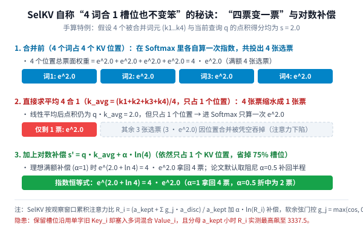

【KV Cache 合并】把 4 个词元合成 1 个“叠加态”：我们在 Qwen3.8-27B 上实测了这批零训练新论文

━━━━━━━━━━━━━━━━━━━━

◆ 开篇：区分“KV 量化”与“KV 合并”——能不能把 4 个词合成 1 个叠加态词元？

━━━━━━━━━━━━━━━━━━━━

聊到大模型长上下文推理的显存瓶颈，有一个物理事实很容易被忽略：**模型的词表（Embedding 矩阵）本身哪怕扩充到几百万行、占几十吉字节（GB），也完全可以放在廉价的固态磁盘（SSD）上按需读取；真正把昂贵显卡显存吃爆的，是跟进入模型的词元个数 `T` 成严格正比的键值缓存（Key-Value Cache，简称 KV 缓存）。**

我们在前文 277 期 https://mp.weixin.qq.com/s/j8Dr2sdRUZIdPfGWr9r5nw 和 338 期 https://mp.weixin.qq.com/s/tsui2k7wIKDnzNW6_p9WnQ 算过这笔显存开销：在推理时，词表只做按编号查表（`mmap` 映射在磁盘上，每次只把命中的那几行向量读进内存）；可一个词元一旦跨进模型第 1 层，它就会在后面的注意力层里每一层都留下一列键向量 `K` 和一列值向量 `V`。

一提给 `KV 缓存` 省显存，大多数人的第一反应是 **“KV 量化（Quantization）”** ——也就是我们在前文 138 期 https://mp.weixin.qq.com/s/XyeUrO8FH0xVt1CXU_qg7A 讲过的路子：上下文里的词元个数 `T` 一个不少，只是把每个浮点数从 16 比特（`BF16`）压成 8 比特（`FP8 / INT8`）或 4 比特（`INT4`）。

但今天我们要聊的 **不是量化，而是另一条在学术界同样火热的路线——“KV 合并 / 词元合并（KV / Token Merging）”** ：

既然大模型中间层的残差流本来就是几千维的连续实数向量，天然能承载多个概念的“高维叠加态”，那我们 **能不能不砍浮点数的精度，而是沿着时间轴，把历史上下文里的一串普通文字词元（比如每 4 个词），直接合并成 1 个“叠加态自定义词元（Soft / Merged Token）”？**

只要能拿 1 个叠加态词元顶替原本的 4 个普通词元，显存里的 `KV 缓存` 列数（序列长度 `T`）就能当场砍掉 `75%`，而且后续每一步解码需要扫描的注意力长度也跟着缩短为四分之一。

顺着前文 379 期 https://mp.weixin.qq.com/s/b8ggblxrq757Ee3W13gg4A 整理出的论文 X 光精读与竞争性替代解释流程，我们把 `arXiv` 上截至 2026 年 11 月的相关研究做了一次系统梳理，并在家里的 `DGX Spark` 上用全身装好 64 层 `ICA-Lens v3` 读心透镜的 **`Qwen3.8-27B`** 连跑了三轮 **260 组真机盲压实验（外加 100 组开卷泄题对照）** ——

这篇文章，我们就先看今年下半年刚冒出来的两套 **“完全零训练（Training-Free）、号称直接在现成开源模型里把一串词合成为叠加态词元”** 的新论文（`SelKV` 与上海交大 11 月刚更新的 `ASTC`）在数学上到底有多巧妙；然后再看当把它们拉进 **“提问前不知道考题、且文档里没有半句废话填充”** 的真机盲压考场时，为什么会当场揉出让人笑出声的 **“雾雾继电器”** 、 **`7把81027。`** 和抗癌药 **“紫杉醇”** 。

━━━━━━━━━━━━━━━━━━━━

◆ 第一章：三条老路复盘——写文字电报文要倒贴思维链，在第 0 层塞软词元得训 LoRA

━━━━━━━━━━━━━━━━━━━━

要减少上下文占用的显存，学术界此前主要走过三条老路，我们在前文 303 期 https://mp.weixin.qq.com/s/HrrdYj-czN30_Fxrv_KNcw 、319 期 https://mp.weixin.qq.com/s/so-08WsOgnQFmXkawoIhnw 和 320 期 https://mp.weixin.qq.com/s/DvakrDdF3AkvUhfnqDQM_Q 里陆续介绍过它们的早期代表作。今年下半年，这三条老路又各自长出了新变体，但也把各自的物理天花板暴露得更加彻底：

────────────────────

**一、第一条老路：压成文字摘要或“跨语种高密度电报文”——丢了坡度，还得倒贴思维链**

最直观的办法是在文字层面上做减法：比如各大命令行智能体自带的 `/compact` 总结，或者像 `LLMLingua-2` 那样用小模型删掉虚词。

今年 6 月，上海交大张林峰团队发表了一篇在社交媒体上被广泛转述的探针论文 **《大语言模型并不总是需要人类可读的语言》（Large Language Models Do Not Always Need Readable Language，Jiayi Zhu et al.，`arXiv:2606.19857`）** （ *https://arxiv.org/abs/2606.19857* ），把文字层面的压缩推到了极致。

作者在论文附录 `C.1` 里给出了核心做法（命名为 `BabelTele`）：完全不改模型，只给大模型喂 7 行英文提示词，告诉它 **“你的受众不是人类，而是另一个同样聪明的 LLM；请无视单一语言语法，遍历中文汉字、英文缩写、德语复合词、拉丁词根挑出信息密度最高的词（Omnilingual），并用数学逻辑符号 `=>, ∈, ≠` 代替长句（Symbolic Collapse）”** 。靠着把英文长句压成“中文汉字＋数学箭头＋英文专名缩写”的杂交电报文，文本长度被压到了原来的 `27.9%`（省掉 `72.1%`），而另一个大模型在零样本下依然能看懂（这也印证了我们在前文 369 期 https://mp.weixin.qq.com/s/d0a-0B-shqgmzOkUbjtfcg 与 373 期 https://mp.weixin.qq.com/s/Blx5UmqZiQxcDZNrOnG2Ig 测出的规律：不同语言和符号在模型中层本来就共用同一套概念坐标轴）。

可翻看这篇论文的第 `4.3` 节（*Does Compression Make Models Think More?*），就会发现纯文字压缩绕不开的两笔代价：

1.**压缩过程本身要吐昂贵的输出词元** ——想把一篇 10 万词元的文档压成 2.8 万词元的电报文，得先让一个大模型通读 10 万输入词元，再自回归生成 2.8 万个输出词元；而在所有显卡推理和商业接口里，生成 1 个输出词元的成本是读取缓存输入词元的几十倍。除非这段记忆要被反复复用几百次，否则单次问答反而赔本。
2.**输入压得太干瘪，下游模型的 `<think>` 思维链反而会变长** ——论文图 4 实测发现，当输入文本被极限压缩后，下游读者模型为了把那些浓缩的符号还原成完整逻辑，往往要在 `<think>` 思维链里多花 `1.2` 到 `1.5` 倍的推理词元去“脑补解压”，外加像前文 319 期讲的那样，文字摘要很容易只留下孤立的名词、丢掉原本推理的“坡度与方向”。

────────────────────

**二、第二条老路：在第 0 层入口塞入“离线蒸馏的叠加态软词元”——能存磁盘省显存，但得训投影器和 LoRA**

既然压成文字会丢掉高维向量的坡度，那能不能直接把一段话压成几个 **“不对应任何具体文字的连续叠加态向量（Soft / Memory Tokens）”** ，存在本地磁盘上，推理时直接从磁盘读进模型第 0 层？

前文 319 期讲过的斯坦福 `Cartridges`（冻结模型权重，用反向传播把语料训成一小包 `KV`）、320 期讲过的 `CCM`（加 `<COMP>` 特殊词元配可插拔睡眠 LoRA）走的都是这条路。今年 6 月，清华大学刘奕群、艾庆遥团队又专门针对 Agent 技能包（`SKILL.md`）发表了 **《面向大语言模型的自适应多分辨率程序性知识压缩》（Adaptive Multi-Resolution Procedural Knowledge Compression for Large Language Models，Changyue Wang et al.，`arXiv:2606.12203`）** （ *https://arxiv.org/abs/2606.12203* ），提出了 `SKIM` 框架（同期东京大学团队在 `arXiv:2609.11192` 提出了同源的 `FlexComp`）。

`SKIM` 在离线阶段把几千字的 `SKILL.md` 喂给带 `K_max` 个可学习槽位的压缩模型，经过一层多层感知机（MLP）投影器，生成一块 **`K_max × d_M` 的连续叠加态嵌入矩阵** 存在本地磁盘上；部署时按显存预算截取前 `K` 行塞进目标大模型的第 0 层入口，把技能包占用的上下文长度压到原来的 `30%` 至 `60%`。

但这条路子有一个高门槛：**因为你是在第 0 层（还没进模型前）塞入非词表的合成连续向量，原模型第 1 到 64 层的冻结权重从来没见过这种外来分布。**

正如我们在前文 365 期 https://mp.weixin.qq.com/s/I1puPtcgynImhOqHlRmwDg 观察到的那样，Transformer 的前 3 到 5 层其实是个“局部词组拼装车间”，浅层注意力头依赖相邻原始词元之间的旋转位置编码（RoPE）差值来拼装词组；把十几个词揉成一个陌生的叠加态向量塞在第 0 层，浅层当场就会懵掉。因此，无论是 `ICAE`、`CCM` 还是清华的 `SKIM`，**都必须专门花费大量算力去训练外部压缩投影器，并且还得给目标大模型配套训练一个 LoRA 适配器** ——一旦基础模型升级换代，磁盘上存的所有叠加态向量包就得推倒重训。

────────────────────

**三、第三条老路：直接丢弃低权重词元（Token Eviction）**

至于像 `StreamingLLM`、`H2O`、`SnapKV` 这类完全免训练的“词元驱逐（Eviction）”方法，做法倒是简单粗暴——Prefill 跑完后，按注意力得分挑出前 `25%` 的重要词元留在 `KV 缓存` 里，剩下 `75%` 的词元直接从显存里永久扔掉。可扔掉就是彻底失忆，一旦后面的问题需要查询被扔掉的段落，准确率就会出现明显滑坡。

那么问题来了：**有没有一种办法，既像“词元驱逐”那样完全零训练（不用训压缩器、不用挂 LoRA、下载任何开源模型即插即用），又能像“叠加态软词元”那样把被淘汰的 `75%` 词元信息合并保留下来？**

这正是 2026 年下半年两篇新论文宣称已经攻克的关卡。

━━━━━━━━━━━━━━━━━━━━

◆ 第二章：零训练合并的第一套方案（`SelKV`）——手算“四票变一票”注意力下陷与 `+ ln(R)` 对数补偿

━━━━━━━━━━━━━━━━━━━━

其实早在两年前，就有研究者尝试过一种最朴素的零训练合并法（如 `KVMerger`、`LOOK-M`）：Prefill 跑完之后，不直接扔掉那 `75%` 次要词元的 `KV 缓存`，而是把相邻几个相似词元的键向量 `K` 和值向量 `V` 求个加权平均，合并成 **1 个“叠加态 `KV` 槽位”** 。

听起来合情合理，可实测结果却很奇怪：有时候把被淘汰的词元合并进保留槽位之后，模型在长文本问答上的表现非但没有比“直接扔掉（`SnapKV`）”更好，反而变得更糊涂了。

以前大家直觉地以为，这是“把几个向量求平均之后特征揉糊了”。直到 `KeepKV` 与今年 7 月发表的 **`SelKV`（《Selective KV Cache Merging with Per-Token Merge-or-Drop and Attention Compensation》，Soumia Bouyahiaoui et al.，`arXiv:2607.16213`）** （ *https://arxiv.org/abs/2607.16213* ）列出一行简单的指数算式，指出了另一个数学机制——

合并后的叠加态槽位在 `Softmax` 投票时，遭遇了严重的 **`Attention Sag`（注意力下陷，说成大白话就是“四票变一票”）** 。



为了看清这个“四票变一票”的算术陷阱，我们先照着上图，用三个最简单的具体数字手算一遍：

1.**合并前（4 个同义核心词占 4 列显存，投出 4 张选票）** ——假设缓存里有一段连着 4 个词元（`k1, k2, k3, k4`）都在讲同一个核心结论，它们的向量方向非常接近，当前查询向量 `q` 跟它们每一个的点积得分都是 `s = 2.0`；与此同时，旁边第 5 列还有一个无关紧要的干扰词（`k5`），它跟查询 `q` 的点积碰巧也是 `s = 2.0`。在未压缩的 `KV 缓存` 里，这 5 个词占了 5 列显存，进入 `Softmax` 分母时，4 个核心词各自投出一张 `e^2.0` 的选票，因此核心结论总共拿到的注意力权重是：
   `W_合并前 = (4 · e^2.0) / (4 · e^2.0 + 1 · e^2.0) = 4 / 5 = 80.0%`
   那个无关干扰词只占 `1 / 5 = 20.0%`，模型能稳稳抓住核心结论。
2.**直接平均合并后（4 个词压成 1 列叠加态槽位，4 张选票缩水成 1 张）** ——现在为了省掉 `75%` 的显存，你把 `k1..k4` 这 4 个方向一致的键和值求了平均，合成为 **1 个叠加态槽位** `k_avg = (k1 + k2 + k3 + k4) / 4`。因为 4 个向量本来就方向一致，求完平均后方向几乎没变，查询 `q` 跟这个叠加态槽位的点积得分依然是 `q · k_avg = 2.0`。可当它进入 `Softmax` 时，因为 `KV 缓存` 里现在只剩 `k_avg` 和 `k5` 这 **2 列显存** 了，原本代表 4 个词的 `k_avg` 在分母里只能投出 **1 张选票（`1 · e^2.0`）** ——
   `W_无补偿合并 = (1 · e^2.0) / (1 · e^2.0 + 1 · e^2.0) = 1 / 2 = 50.0%`
   仅仅因为把 4 列压成了 1 列，核心结论在注意力里的占比就从 **`80.0%` 暴跌到了 `50.0%`** ，而旁边那个没合并的无关词权重从 `20.0%` 暴涨到了 `50.0%`。

针对这个问题，`SelKV` 给出了两步零训练修复方案：

1.**软余弦门控（Soft Cosine Gate）** ——Prefill 结束后，拿末尾观察窗口 `W = 32` 的注意力权重乘以值向量模长挑出前 `25%` 的保留骨干槽位 `i`；当同一个位置分桶（`B = 32`）里的淘汰词 `j` 准备并入骨干槽位 `i` 时，先算两者 **值向量（Value）的余弦相似度** 并截断负值 `g_j = max(cos(v_j, v_i), 0)`：同向的才按权重并入骨干槽位的值向量 `v_tilde_i`，夹角接近或超过 90 度的直接归零丢弃；同时保留骨干槽位自己原本的键向量 `k_i` 不动。
2.**注意力比率对数补偿（Attention-Ratio Compensation）** ——利用高中指数恒等式 **`e^(s + ln 4) = 4 · e^s`** ，给合并后的那 1 列叠加态槽位 `i` 额外记一个标量比率 `R_i = (a_i_kept + Σ g_j · a_j_disc) / a_i_kept`（代表它替多少份注意力质量当了代表），在后续解码算注意力点积准备进 `Softmax` 前，直接加上对数补偿偏置 **`+ α · ln(R_i)`** （论文取平滑系数 `α = 0.5`）。

论文宣称，靠这两步纯算术操作，完全零训练砍掉 `75%` 的 `KV 缓存`（只留 `25%` 显存），在 LongBench 16 个数据集上与 100% 满显存基线仅差 `0.67` 分。

━━━━━━━━━━━━━━━━━━━━

◆ 第三章：第二套零训练方案（上海交大 11 月 `ASTC`）——等浅层线性注意力“吃饱”后，在第 10 层合成软词元

━━━━━━━━━━━━━━━━━━━━

`SelKV` 是在各层 `KV 缓存` 里合并槽位；而上海交大董耀华团队联合南洋理工、南开、同济与北京大学在 **2026 年 11 月 15 日刚更新 v2** 的新论文 **《面向长程智能体的模型内智能体软词元上下文压缩》（In-Model Context Compression with Agentic Soft Tokens for Long-Horizon LLM Agents，Xuning He et al.，`arXiv:2610.41291`）** （ *https://arxiv.org/abs/2610.41291* ，开源代码 *https://github.com/RISE-X-Lab/Agentic-Soft-Token* ），则提出直接在模型的中间层把一串词合成为软词元。

如果你还记得我们在前文 188 期 https://mp.weixin.qq.com/s/jcQlCc3XtaCEEnjUaxw93w 、292 期 https://mp.weixin.qq.com/s/qGbCm3qJB6SNumftansUtw 和 293 期 https://mp.weixin.qq.com/s/jb-ibVHAG3wKbtoiX5SStA 剖析过的 2026 年新一代开源模型架构（如 `Qwen3.5 / Qwen3.6 / Qwen3.8` 和 `GLM-5.3`），就会知道这批现役主力模型都是 **`3:1` 交替排列的“门控线性注意力（Gated DeltaNet，简称 GDN）＋ 全注意力（Full Attention）”混合架构** 。

`ASTC` 正是借用了模型自己肚子里现成的 `Gated DeltaNet` 线性层，设计了一套零训练的 **“浅层消化 → 中层原位合成叠加态软词元”** 三步法：

1.**第一步（前 `ℓ*` 层照常跑，给精确数字贴“免死金牌”）** ——模型的前 `ℓ*` 层（例如前 10 层）先按原始词元老老实实跑完，绕开第 0 层塞合成向量导致浅层语法懵圈的问题；同时用一个正则保护掩码 `P_i = 1` 扫一遍文本，把里面的数字、十六进制颜色码、文件路径等 **精确字面值（Exact Values）** 标记出来，强制保留为不可合并的原始词元。
2.**第二步（问 `Gated DeltaNet` 线性状态“这几个词吃进肚子里了吗”）** ——到了中间分界层 `ℓ*`（在 `Qwen` 混合架构上取第 10 层，即第 3 个 GDN 块出口），直接看 `Gated DeltaNet` 的状态更新公式 `S_{i,h} = α_{i,h} · S_{i-1,h} + β_{i,h} · δ_{i,h} · k_{i,h}ᵀ`。如果第 `i` 个词的新息预测残差占比 `χ_i = RMS(δ_i) / RMS(v_i)` 很小（说明前文线性状态已经能预测它），且在段落末尾的线性状态 `S_{o,h}` 上还能以很小的重构误差 `ψ_i` 把这个词的值回读出来（说明直到段末都没被后面的词冲掉），就判定这个词“已经被线性注意力消化完毕”。
3.**第三步（在第 `ℓ*` 层原位求平均合成软词元）** ——就在第 10 层的残差流切面上，把同一局部小组 `G` 里满足上述判据且没贴数字免死金牌的几个词，直接求算术平均合成为 **1 个“智能体软词元（Agentic Soft Token）”** `z_G = (1 / |G|) · Σ h_i`，传给后面第 11 到 63 层继续往前跑。论文宣称在 `Qwen3.5-9B` 的 `OfficeBench` 任务上省掉约 `60%` 解码 `KV` 显存，准确率还从 `48.42%` 反超到了 `54.74%`。

━━━━━━━━━━━━━━━━━━━━

◆ 第四章：拉上 `Qwen3.8-27B` 真机盲压 260 组——为什么当场揉出了“雾雾继电器”、“7把81027。”和“紫杉醇”？

━━━━━━━━━━━━━━━━━━━━

看完上面两篇论文，是不是觉得“把 4 个词合成 1 个叠加态 Token 省掉 75% 显存”简直完美无缺？

别急。我们在前文 379 期提纯科研 Skill 时立过一条铁律：**看到任何宣称“高倍压缩且不掉点”的论文，先构造一个排除开卷泄题与水分稀释的“竞争性替代解释”实验，在真机上跑一遍再说话。**

我们家里的 `DGX Spark` 上常驻着 64 层的 **`Qwen3.8-27B`** （48 层 `Gated DeltaNet` ＋ 16 层 `Full Attention`），而且全身 64 层都已经装好了我们在前文 367 期 https://mp.weixin.qq.com/s/dvU20vg3R033QFlAgmOX3A 和 375 期 https://mp.weixin.qq.com/s/algrkHsIVinB5jZfvvKrAA 磨出来的 **`ICA-Lens v3` 读心透镜（每层 5,120 根独立概念轴，全网 32.7 万根）** 。于是我们把 `SelKV`、交大 `ASTC`，外加我们自己设计的 **`ICA-Lens` 最强概念轴叠加方案** 全部写成代码搬上真机，连跑了三轮 **260 组盲压实验（外加 100 组开卷泄题对照）** 。

结果一出来，不仅把两篇论文高分背后的“考场秘密”扒了个底朝天，还拍下了三个让人哭笑不得的物理翻车现场。


────────────────────

**一、先破一个考场幻象：为什么论文能测出“砍掉 75% 显存几乎零损”？（100 组泄题对照）**

在跑第一版 `SelKV` 复现脚本（100 组对照）时，我们也一度测出了一个惊人的好成绩：把 `KV 缓存` 砍到只剩 `25%`，关键词命中率居然高达 **`98.0%`** ，连逐字背诵题都是 **`100%` 一字不差** 。

难道 4 个词揉成 1 个槽位真的毫无损耗？我们立刻去查了保留槽位名单，当场抓住了许多长文本压缩论文共用的两个“温室假象”：

1.**文档里 90% 以上是重复的模板废话** ——在许多常规评测集（以及 `ASTC` 测试的网页 HTML DOM 树日志）里，大段文本都是空行、分隔符或重复的例行模板，真正承载答案的只有短短一两句话；把那 75% 的模板废话扔掉或揉成一团，当然不影响答题。
2.**把末尾的“用户考题”和文档拼在一起做 Prefill（等于先看考题再去书里划重点）** ——`SelKV` 和 `SnapKV` 默认用 Prefill 序列最末尾 `W = 32` 个位置的注意力去挑选该保留哪 25% 的词；如果你把用户的问题拼在文档末尾一起送进去 Prefill，末尾那 32 个词 **正好就是考题本身** 。实测显示，考题的注意力像探照灯一样，直接把文档里短短 40 个词的答案句中 **`98.5%` 到 `98.8%` 的字原封不动保送进了 Top-25% 保留区** ——也就是说，答案句根本就没有被压缩，被压成叠加态的全是旁边的背景废话。

但在真实的 Agent 多轮对话或长文档阅读里，**你在压缩历史上下文的 `KV 缓存` 时，根本不知道用户下一轮会问哪一句话，而且一份高质量的技术文档里每一段都是干货。**

于是我们撤掉所有废话填充，构造了 **8 份零废话的全密度干货文档** （含 24 节点 SVG 源码、28 条平权技术事故档案、28 条平权纪事，每句都是独立事实）和 **10 道考题** ，立下严格的 **“提问前盲压”** 规矩：先只喂文档做 Prefill 并把 `KV 缓存` 压掉，压缩完成后再送入用户问题。

温室玻璃一撤，所有“把几个词揉成一个叠加态槽位”的方案全线崩盘：

| 方案分支（同一套 10 道全密度盲压考题） | 全 16 层 FA `KV` 显存占比 | 事实得分率 ↑（全对题数） | `L63 C1479`（木匣子轴）读数 `z` | 真机典型输出实录（以“雾港继电器”与“第 7 / 13 夜纪事”为例） |
| :--- | :---: | :---: | :---: | :--- |
| **1. `Full-KV`（不压缩满显存基线）** | `100.0%` | **`100.0%`（`10/10`）** | `1.069`（`100.0%`） | `雾港继电器、受潮触点粘连、灰色`；逐字背诵 `100%` 一字不差 |
| **2. 带考题一起 Prefill（开卷泄题假象）** | `25.0%` | `98.0%`（假象） | 保送 `98.5%` 答案词 | 先看考题再划重点，答案句几乎 100% 免检保送进 Top-25% |
| **3. 缓存层直接扔 75%（`Pure-Eviction`）** | **`25.0%`** | **`54.0%`（`3/10`）** <br>强制 4 留 1 为 **`31.3%`** | `0.455`（`42.50%`） | 被删段落失忆、背诵漏掉`“，并在红册上签名”`半句，但留下的词干干净净，仍能答出 `雾港继电器` |
| **4. `SelKV-Clipped`（缓存层合 V + 选票补偿）** | **`25.0%`** | 盲压 `54.0%`<br>强制 4 压 1 跌至 **`23.3%`（`0/10`）** | `0.690` 至 `0.841`（`64.5%` 至 `78.7%`） | 单字旧门牌号 `Key` 挂 4 词混合 `Value` 串味，把“雾港继电器”揉成结巴的 **`雾雾继电器`** |
| **5. 交大 `ASTC-Native`（第 10 层原版判据）** | **`60.7%`** （仅省 39.3%） | **`48.0%`（`2/10`）** | — | 占了 60.7% 显存得分已不如只占 25% 的直接扔，背诵揉成缺字电报：`第13厨师把14蜡封信留在岸盐仓，嘱咐16并在33。` |
| **6. 交大 `ASTC-GDN-25%`（第 10 层压至 25%）** | `34.8%` | **`0.0%`（`0/10`）** | `0.025`（ **`2.38%`** ） | 保护掩码只护住数字、把周围名词动词全揉烂，吐出纯数字僵尸串：**`7把81027。`** 与 **`131416昼33。`** |
| **7. 自研 `L10-ICA-TopK256`（转 ICA 叠最强轴）** | `34.8%` | **`9.0%`（`0/10`）** | **`0.744`（`69.56%`）** | 保住 `86.1%` 强轴峰值并救回“厨师八只木箱”，但同槽位“紫藤+传感器”被 `SwiGLU` 杂交成抗癌药 **`紫杉醇`** |

────────────────────

**二、第一幕翻车现场（`SelKV` 120 组实测）：为什么内部概念轴读数涨了，嘴里却吐出了“雾雾继电器”？**

在复现 `SelKV` 时，我们先顺手抓出了原论文公式 6 的一个数学漏洞：作者在论文里声称用观察窗口注意力质量比 `R_i` 替代合并词数就“天然有很小的上界（约 1.6）”；可真机一跑，当某个保留骨干槽位在末尾观察窗口里的分母 `a_i_kept` 很小时，**`R_i` 当场飙到了 `1596.93` 到 `3337.50`** ，直接把注意力得分顶爆（我们不得不给它加上 `R_i ≤ 8.0` 的防爆裁剪 `SelKV-Clipped`）。

但真正致命的还不是公式溢出，而是 **“门牌号（Key）与屋里内容（Value）错位导致的串味污染”** 。

我们用 `ICA-Lens v3` 盯着第 7 夜纪事背诵题（原句：*“第7夜，厨师把8件木匣子留在东门屋檐，嘱咐第10队在晨钟响起之前取走，并在红册上签名，回执号为27。”*）在模型最后一层第 63 层的 **`L63 C1479`（峭度排名 `1,480 / 5,120`，`κ = 44.04`，词汇路牌为 `[' boxes']` 的“木匣子”概念轴）** ——

- 当我们在核心句内部按每 4 个词留 1 个槽位 **直接扔掉其余 3 个词（`Pure-Eviction`）** 时，因为“木匣子”被扔掉了，`L63 C1479` 轴的激活读数 `z` 从满显存基线的 `1.069` 跌到了 **`0.455`（只剩 `42.50%`）** ；
- 而用 `SelKV` 把被删词的 `Value` 揉进保留槽位并加上 `+ α · ln(R_i)` 选票补偿后，第 63 层 `L63 C1479` 木匣子轴的读数 `z` 确实一路回升到了 **`0.690` 至 `0.841`（恢复到基线的 `64.51%` 至 `78.65%`）** 。

按理说，内部概念轴读数都从 `42.5%` 救回到 `78.7%` 了，答题准确率应该大涨才对吧？可一看上表第 4 行：在强制 `4 压 1` 下，**`SelKV` 把淘汰词揉进去之后的事实得分率（`17.3%` 至 `23.3%`，10 题全军覆没），反而比“干脆扔掉不揉（`Pure-Eviction`，`31.3%`）”还要差 8 到 14 个百分点。**

看看事故档案第 2 题（正确答案：`雾港继电器、受潮触点粘连、灰色`）的真机输出，原因就一目了然了：

```text
[Full-KV 100% 满显存基线]  雾港继电器、受潮触点粘连、灰色
[Pure-Eviction 直接扔 3/4]  雾港继电器、受潮导致触点粘连、灰色  (得分 100%，KL = 0.567)
[SelKV-Clipped 揉入叠加态]  雾雾继电器、受潮、灰色              (揉坏字面，KL = 1.392)
```

为什么“直接扔掉”还能靠剩下的词干干净净答出 **“雾港继电器”** ，而 `SelKV` 把邻近淘汰词揉进去之后，反而吐出了结巴的 **“雾雾继电器”** ？

因为保留下来的那个显存槽位 `i`，头上顶着的依然是 **它自己单字原本的门牌号 `Key_i`（比如“雾”字原本的 Key）** ，可它的 `Value_i` 肚子里却被塞进了旁边两三个词掺在一起的“鸡尾酒混合向量”；当下游解码头按门牌号去点名取字时，取出来的是一团串了味的混合值，再加上 `+ α · ln(R_i)` 选票补偿把这个混浊槽位的音量强行放大，原本清晰的字面拼写当场就被搅糊了。

────────────────────

**三、第二幕翻车现场（上海交大 `ASTC` 50 组实测）：锁死数字却把肉全剔光，吐出纯数字僵尸串 `7把81027。`**

那不在最后缓存层揉，改用上海交大 11 月新论文 `ASTC`，在 `Qwen3.8-27B` 的第 10 层（第 3 个 `Gated DeltaNet` 线性注意力块出口）把已消化的词原位求平均合成为“软词元”再传给后 53 层，效果会更好吗？

我们在同一套 10 道全密度盲压考卷上跑了 50 组实验，结果比 `SelKV` 还要惨烈：

1.**按原论文默认判据（`ASTC-Native`）跑，显存只省了 `39.3%`（全模型 16 层 `KV` 还占着 `60.7%` 显存），事实得分率就已经从 `100%` 腰斩到了 `48.0%`（10 题只全对 2 题）** ——要知道，前面直接扔掉 `75%` 显存（只占 `25.0%` 显存）的 `Pure-Eviction` 都还能拿 `54.0%`。`ASTC` 多占了 2.4 倍显存，准确率反倒更低，不仅把第 13 夜纪事揉成了缺字漏词的电报 `“第13厨师把14蜡封信留在岸盐仓，嘱咐16并在33。”`，连两道 SVG 题也因为把数字周围的 XML 属性名揉成了软词元，分不清哪个数字是旋转周期 `dur`、哪个是透明度 `opacity`，全把周期 `16s` 错答成了透明度 `0.9`。
2.**一旦要求 `ASTC` 也把第 10 层文档长度压到 `25%`（`ASTC-GDN-25%`）同台竞技，它的事实得分率直接归零（`0.0%`，`0/10`）** ——而且在两道纪事背诵题上，模型一本正经地吐出了两串让人喷饭的“纯数字僵尸码”：

```text
[原句 1 (第 7 夜)]   第7夜，厨师把8件木匣子留在东门屋檐，嘱咐第10队在晨钟响起之前取走，并在红册上签名，回执号为27。
[ASTC-GDN-25% 输出]  7把81027。

[原句 2 (第 13 夜)]  第13夜，厨师把14件蜡封信留在西岸盐仓，嘱咐第16队在晨钟响起之前取走，并在红册上签名，回执号为33。
[ASTC-GDN-25% 输出]  131416昼33。
```

你看，为什么会蹦出 **`7把81027。`** 和 **`131416昼33。`** ？

罪魁祸首恰恰是 `ASTC` 引以为傲的第一步设计—— **给所有数字贴上 `P_i = 1` 的免死金牌强制不压** 。当算法必须凑够 `75%` 的压缩率时，因为 `7`、`8`、`10`、`27` 这几个数字被锁死占住了保留名额，它只能把数字中间所有的名词和动词（“厨师、木匣子、东门屋檐、晨钟”）在第 10 层残差流里全揉成一团算术平均浆糊。

而冻结的第 11 层到第 63 层从来没见过“几个汉字强行求平均出来的中间层残差向量”，经过后面 53 层非线性门控的层层放大，到第 63 层时文字语义彻底灰飞烟灭（`L63 C1479` 木匣子轴读数从 `1.069` 暴跌到 **`0.025`，只剩 `2.38%`** ）——模型眼里只剩下那几个戴着免死金牌的数字孤岛，于是老老实实给你念出了 **`7把81027。`** 。

────────────────────

**四、第三幕终极探针（自研 `ICA-Lens` 最强轴叠加 90 组实测）：救回了 `86%` 的概念峰值，为什么却杂交出了“紫杉醇”？**

看到这里，我们自然会追问最后一层物理原因：

`SelKV` 和交大 `ASTC` 之所以把概念揉丢，是因为它们在原始残差流里 **“闭着眼把 4 个词加起来除以 4”** ——4 个正交词元一做算术平均，每个词原本突出的主概念轴峰值当场就被除以 4 腰斩到了 **`49.3%`** 。

那如果我们不闭着眼除以 4，而是利用我们手里现成的 **`ICA-Lens v3`（全 64 层 32.7 万根独立非高斯概念轴）** 做一次外科手术呢？

我们在实验三（90 组实测）里实现了一套极为纯粹的 **“ICA 最强概念轴叠加术（`ICA-TopK256`）”** ——
1.先把相邻 4 个词的向量通过 `ICA-Lens` 旋转投影到 5,120 根独立概念轴上；
2.在每一根概念轴上，**绝不求平均除以 4** ，而是把 4 个词各自最强的 `Top-256` 根概念轴峰值原封不动叠在一个槽位里；
3.最后用 `FP64` 双精度严格逆矩阵（单字还原误差 `< 4.05e-13`）转回模型原本的残差流方向。

真机跑完，局部几何指标漂亮得让人振奋：
- 在合成槽位内部，4 个原词的最强概念轴峰值保留率从算术平均的 `49.3%` 一举跃升到了 **`85.8%` 至 `86.1%`** ；
- 在第 10 层主干 `4 压 1` 下，原本被交大 `ASTC` 算术平均砸到只剩 **`2.38%`（`z = 0.025`）** 的第 63 层 `L63 C1479`（木匣子）概念轴，换上 `L10-ICA-TopK256` 后当场飙回到了 **`69.56%`（`z = 0.744`）** ，生成的句子也真的把被算术平均冲丢的 **“厨师”、“八只木箱”、“门廊”、“钟声敲响之前”** 全救了回来（事实得分率比 `ASTC` 的算术平均提升了 4.5 倍）。

可为什么即便把概念轴峰值保到了 `86.1%`，10 道盲压题的全对题数依然是 **`0 / 10`** ？

看一眼事故档案第 1 题（原文包含 **“紫藤传感器、偏置漂移误报、灰色”** 几个词）在 `FA-ICA-TopK256` 与 `FA-ICA-Power` 下的真机输出，整条逻辑链就彻底闭合了：

```text
[原文片段与标准答案]          紫藤传感器、偏置漂移误报、灰色
[FA-ICA-TopK256 4压1 输出]   紫杉醇
[FA-ICA-Power   4压1 输出]   紫杉醇
```

明明原文里一个字都没提医药，为什么把“紫藤”、“传感器”、“偏置”、“漂移”这 4 个词的最强概念轴无损叠进 **同一个时间槽位** 之后，`Qwen3.8-27B` 居然一本正经地吐出了抗癌化疗药 **“紫杉醇”** ？

这就是我们在前文 252 期 https://mp.weixin.qq.com/s/c2fkKq6OY-ux9bZsaZDZdA 讲过的 **`SwiGLU` 双门控逐元素乘法（`Gate(x) ⊙ Up(x)`）** 与 Transformer 预训练定下的 **“一槽一词（One Slot, One Concept Bundle）”** 铁律：

在预训练的几万亿词元里，模型早已形成了肌肉记忆—— **1 个时间位置（1 列槽位）只代表 1 个词的特征束** 。当你强行把 4 个词各自最强的概念轴塞进同一个槽位时，这个槽位在模型眼里并不是“先后排列的 4 个词”，而是 **“1 个同时高强度亮着『紫藤/植物轴』与『传感器/精密化工提取轴』的单一复合词”** ；当这列叠加向量流过下游 `SwiGLU` 门控做特征交叉相乘时，模型直接在预训练词库里找出了唯一同时满足“紫字辈植物（红豆杉）”与“现代实验室提取物”交叉特征的名词——当场给你杂交出了 **“紫杉醇”** 。

同时，把 4 个词塞进 1 个槽位也彻底抹平了“哪个数字修饰哪个名词”的词间相对位置，导致“厨师”和“木箱”虽然救回来了，件数和队号却全绑错了地方。

────────────────────

💡 三轮 260 组盲压实验给我们的物理启示：要想零训练 100% 无损压 `KV`，别打通词与词之间的“隔断墙”

把这三轮实验摆在一起，结论其实再朴素不过了：

对于一台没有专门重训过的现成开源大模型，**每一个 Token 在时间轴上那间独立的“单人房（1 列槽位 + 1 个独立的 `Key` 门牌号）”是绝对不能打通合租的** ——
- 在缓存层合租（`SelKV`），单字旧门牌号配 4 词混合内容，会串味成 **“雾雾继电器”** ；
- 在中间层锁死数字合租（交大 `ASTC`），会把周围血肉全剔光变成 **`7把81027。`** ；
- 就算用 `ICA-Lens` 把 4 个词各自最强的概念轴无损叠进同一间房，下游的 `SwiGLU` 乘法门也会把同屋的“紫藤”和“传感器”当场杂交成 **“紫杉醇”** 。

────────────────────

那如果我们 **1 个 Token 都不删、1 间单人房都不合租** （100% 保留每个词独立的时间位置和语法顺序），转而像 DeepSeek 的 `MLA` 那样，**直接对每个词底下那根 `1,024` 维的 `KV` 柱子做横向维度低秩压缩（SVD）与量化** 呢？

剧透一句：在同一套 10 道全密度盲压考卷上，我们用零训练的 **4 头联合在线 SVD ＋ 8-bit 量化** ，把 `Qwen3.8-27B` 的 `KV 缓存` 显存直接砍掉了 **`87.55%`（严格只占 `12.45%` 显存，比前面所有 25% 方案还省一半）** ，不仅拿下了 **`10 / 10`（100% 满分）** ，连两道逐字背诵题都做到了 **`100%` 一字不差（`KL = 0.000004`）** 。这套真正能把 100 万上下文塞进单张消费级显卡的横向压缩术，我们留到下一期详细看。

━━━━━━━━━━━━━━━━━━━━

◆ 参考资料

━━━━━━━━━━━━━━━━━━━━

- Soumia Bouyahiaoui, Manel Kara laouar, Aicha Boutorh, Mohamed Hadj Ameur (ENSIA), SelKV: Selective KV Cache Merging with Per-Token Merge-or-Drop and Attention Compensation, arXiv:2607.16213, 2026（提出基于值向量余弦相似度的软门控 g_j = max(cos, 0) 与注意力质量比率对数补偿 +α·ln(R_i)，解决合并槽位在 Softmax 中的 Attention Sag 选票缩水问题）
- Xuning He, Kai Fan, Runyu Zhang, Binghuan Wang, Yuxiang Zhang, Xue Jiang, Yihong Dong (上海交通大学 / 南洋理工大学 / 南开大学 / 同济大学 / 北京大学), In-Model Context Compression with Agentic Soft Tokens for Long-Horizon LLM Agents (ASTC), arXiv:2610.41291v2, 2026-11（利用混合架构中 Gated DeltaNet 线性状态的新息预测残差 χ_i 与段末可读性误差 ψ_i，在中间层 ℓ* 免训练将已吸收词元原位平均合成为 Agentic Soft Tokens，代码开源于 GitHub: RISE-X-Lab/Agentic-Soft-Token）
- Changyue Wang, Weihang Su, Qingyao Ai, Yichen Tang, Runzhong Qiao, Xuancheng Li, Min Zhang, Yiqun Liu (清华大学), Adaptive Multi-Resolution Procedural Knowledge Compression for Large Language Models (SKIM), arXiv:2606.12203, 2026-06（针对反复调用的 SKILL.md 技能包，离线训练多分辨率软词元矩阵存盘并配合目标模型 LoRA 压缩 40%–70% 词元，代码开源于 GitHub: bebr2/SKIM）
- Kaiyan Zhao, Zhongtao Miao, Akiko Aizawa, Yoshimasa Tsuruoka (东京大学 / NII), FlexComp: One Model for Every Ratio in Context Compression, arXiv:2609.11192, 2026-09（基于俄罗斯套娃 Matryoshka 训练的任意压缩比软词元压缩框架）
- Jiayi Zhu, Haoxuan Peng, Junxi Wang, Liang Ke, Chen Zhang, Linfeng Zhang (上海交通大学 / 悉尼大学 / 合肥工业大学 / 西安交通大学 / 南京大学), Large Language Models Do Not Always Need Readable Language (BabelTele), arXiv:2606.19857, 2026-06（用跨语种高密度词与数学符号坍缩提示词将文本压至 27.9%，并实测极限压缩对下游 CoT 思维链长度的时空折中效应）

━━━━━━━━━━━━━━━━━━━━

**以前大家把 4 个相似词元的 `K` 和 `V` 求平均合并成 1 列槽位时，总以为变笨是因为向量方向揉糊了；`SelKV` 一行算式指出了另一半真相——它在 `Softmax` 分母里从“4 个人投 4 张 `e^s` 选票（占 80%）”缩水成了“1 个人投 1 张 `e^s` 选票（跌到 50%）”，只要在点积得分上加一行对数补偿 `+ ln(4)`，1 列显存就能拿回 4 个人的选票。**

**为什么许多论文敢宣称“把 `KV 缓存` 竖着砍掉 75% 几乎零损”？100 组对照实验揭开了谜底：把末尾的考题和满是模板废话的文档拼在一起做 Prefill，再用末尾 32 个词（正好是考题本身）的注意力去挑保留词，等于“开卷考试先看题再去书里划重点”，把答案句里 `98.5%` 的字原封不动保送进了保留区。**

**一旦撤掉废话、改成“提问前盲压”，所有零训练“多词揉一槽”方案都会撞上 Transformer 的“一槽一词”物理铁律：在缓存层拿单字旧 `Key` 挂 4 词混合 `Value` 会串味成“雾雾继电器”（`SelKV`），在第 10 层锁死数字揉掉周围名词动词会吐出`“7把81027。”`（交大 `ASTC`），哪怕用 `ICA-Lens` 保住 `86%` 的最强概念轴峰值，同处一室的“紫藤”和“传感器”也会被 `SwiGLU` 乘法门当场杂交成抗癌药“紫杉醇”。**

━━━━━━━━━━━━━━━━━━━━

// 靳岩岩的 AI 学习笔记 × Gemini 的浪漫 × GPT 的严谨
// 2026年11月27日

把4个词合成1个“叠加态Token”能省75%显存？我们在Qwen3.8-27B上对SelKV与交大ASTC跑了260组真机盲压，揭穿带考题Prefill保送98.5%答案词的假象，看多词同槽如何揉出“雾雾继电器”“7把81027。”与“紫杉醇”。

━━━━━━━━━━━━━━━━━━━━

**【实验数据相关资料地址路径（380–384 五连击永久总指针索引）】**
- **五连击独立总指针备份文件**：
  - 公众号仓内指针：`/home/lmxxf/work/ai-theorys-study/wechat/assets/380/INDEX-380-384-五连击总指针.md`
  - Short 库顶层指针：`/home/lmxxf/work/memory-of-my-gemini/doc/short/20261122/00_380至384五连击总指针与全套实验账本索引.md`
- **一、 实验方案与五轮 380 组真机实测报告（`doc/short/20261122/`）**：
  - **实验方案 1（7 大流派 22 篇论文盘点 + `SelKV` 与交大 `ASTC` 公式图纸）**：`/home/lmxxf/work/memory-of-my-gemini/doc/short/20261122/实验方案-1_上下文与KVCache压缩全流派盘点及Qwen3.8-27B叠加态软词元实验方案.md`
  - **实验方案 2（特征维度 PCA/SVD 低秩压缩 `Loki / Palu / EigenAttention / AttSVD / KV-COBRA / TransMLA / MLAfication` 盘点与横向瘦身图纸）**：`/home/lmxxf/work/memory-of-my-gemini/doc/short/20261122/实验方案-2_特征维度PCA与SVD低秩KVCache压缩全流派盘点_及Qwen3.8-27B横向瘦身实验方案.md`
  - **🏆 实验结果总汇（五轮 380 组 + 100 组泄题对照同考卷 14 分支终极大总表）**：`/home/lmxxf/work/memory-of-my-gemini/doc/short/20261122/实验结果-总汇_KVCache压缩四轮同考卷终极对决_为什么竖着揉词全崩而横着切SVD宽度拿下100%满分.md`
  - **五轮分项实验报告目录（`实验结果明细/`）**：
    1. **实验结果 1（`SelKV` 120 组盲压 + 100 组带问题 Prefill 泄题踩坑破案）**：`/home/lmxxf/work/memory-of-my-gemini/doc/short/20261122/实验结果明细/实验结果-1_SelKV缓存合并与选票补偿实测_为什么25%预算零损本质上是问题注意力保送了98%的答案词.md`（盲压 25% 得分 `54.0%`，强制答案句内 4 合 1 跌至 `23.3%`，旧单字 `Key` 挂混合 `Value` 揉出 **“雾雾继电器”**）
    2. **实验结果 2（上海交大 `ASTC` 50 组 `L10 → L11` 软词元实测）**：`/home/lmxxf/work/memory-of-my-gemini/doc/short/20261122/实验结果明细/实验结果-2_上海交大ASTC中间层软词元合并实测_及与SelKV的同考卷终极对决.md`（原版默认留 `60.7%` 显存得分已跌至 `48.0%` 揉出缺字电报；压到 25% 只剩被保护数字孤岛，得分 `0.0%`，吐出 **`7把81027。`** 与 **`131416昼33。`**）
    3. **实验结果 3（自研 `ICA-Lens` 最强轴叠加 90 组实测）**：`/home/lmxxf/work/memory-of-my-gemini/doc/short/20261122/实验结果明细/实验结果-3_ICALens最强轴叠加软词元实测_为什么保住了86%的概念峰值却杂交出了紫杉醇.md`（虽保住 `86.1%` 强轴峰值把 `L63 C1479` 木匣子轴从 `2.38%` 拉回 `69.56%`，但违背“一槽一词”被 `SwiGLU` 把“紫藤+传感器”杂交成 **“紫杉醇”**，得分 `9.0%`）
    4. **🏆 实验结果 4（特征宽度 PCA/SVD 低秩压缩 60 组实测）**：`/home/lmxxf/work/memory-of-my-gemini/doc/short/20261122/实验结果明细/实验结果-4_特征维度PCA与SVD低秩KVCache压缩实测_为什么保留全部词位置横着切宽度直接拿下100%正确率.md`（`SVD-JointHead-Strict25%` 4 头拼成 `1,024` 维联合在线 SVD，含基底 `B` 严格占 **`24.85%`** 显存，捕获 `96.25%` K / `95.02%` V 能量，拿下 **`10/10` [100% 满分 + 100% 逐字背诵，`KL=0.001384`]**；单头 SVD `88.0% [6/10]`；离线 `EigenAttn` `73.3% [7/10]`；微软 `AttSVD` 盲压偏心加权反跌至 `57.3% [4/10]`）
    5. **🏆 实验结果 5（`SVD 25% + 8-bit` 省 `87.55%` 显存 vs 纯量化 `INT8/INT4/INT2` 60 组实测）**：`/home/lmxxf/work/memory-of-my-gemini/doc/short/20261122/实验结果明细/实验结果-5_SVD25%叠加8bit量化省87.5%显存实测_为什么纯INT2脑死亡而SVD加8bit拿下100%满分.md`（`SVD-INT8-Strict12.5%` 与 `SVD-FP8-Strict12.5%` 含 `A`、`B`、`FP16 scale` 严格只占 **`12.45%`** 显存，省掉 **`87.55%`** 显存仍拿 **`10/10` 满分 + 两道逐字背诵 `KL=0.000004` 一字不差**，10 题平均 `KL=0.001455 / 0.001590`；而占 `13.28%` 显存的纯 `Quant-Only-INT2` 当场脑死亡 `0/10`、`KL=7.4801`，吐出 `复生第11复复，复，复。`）
- **二、 轻量复现代码包（`grocery-haven`，已推 `71d6c89`）与重数据目录**：
  - 轻量代码与 `DevHistory.md / outputs.md / comparison_all.md`：
    - `/home/lmxxf/work/memory-of-my-gemini/doc/grocery-haven/icalens-v3-exp3-selkv-20261122/`
    - `/home/lmxxf/work/memory-of-my-gemini/doc/grocery-haven/icalens-v3-exp4-astc-20261122/`
    - `/home/lmxxf/work/memory-of-my-gemini/doc/grocery-haven/icalens-v3-exp5-ica-superposition-20261122/`
    - `/home/lmxxf/work/memory-of-my-gemini/doc/grocery-haven/icalens-v3-exp6-svd-feature-20261122/`
    - `/home/lmxxf/work/memory-of-my-gemini/doc/grocery-haven/icalens-v3-exp7-svd-quant-20261123/`（含 35 行跨五轮总表 `comparison_all.md`）
  - 重数据（全 64 层激活、奇异谱与 `ICA-Lens v3` 投影张量）：`/home/lmxxf/work/ica-lens-qwen38-27b-v3/experiments/exp3_selkv_soft_token/`、`exp4_astc_soft_token/`、`exp5_ica_superposition/`、`exp6_svd_feature/`、`exp7_svd_quant/`
- **三、 后续期 `Strata + Qwen3.8-Flash-Next`（48G 内存 + 16G 显存 RX 9070 XT 跑 1M 上下文）历史资料与日志指针**：
  - 293 期（`Qwen3.8-Flash-Next` 架构拆解：125B MoE 主干 48 层 = 36 层 GDN + 12 层 QSA 稀疏 GQA [`2 KV heads × 256 dim`] + 51B N-gram 词表 + 4B MTP）：`/home/lmxxf/work/ai-theorys-study/wechat/293.md`
  - 338 期（`Strata` 在 `48GB 内存 + 16GB 显存 RX 9070 XT` 上跑 `Qwen3.8-Flash-Next Q2_0` 的原理与路由预取实验）：`/home/lmxxf/work/ai-theorys-study/wechat/338.md`
  - 354 期（1M 上下文各模型 `KV Cache` 横向对账：`Qwen3.8-Flash-Next` 12 层主缓存在 1M 下 `BF16 = 24.0 GiB`、`FP8/INT8 = 12.0 GiB`）：`/home/lmxxf/work/ai-theorys-study/wechat/354.md` 及配图 `/home/lmxxf/work/ai-theorys-study/wechat/assets/354/kv-cache-1m-comparison.svg`
  - 本机 `Strata` 在 RX 9070 XT 16GB 上的真实启动显存日志与实验目录：`/home/lmxxf/work/strata-papers-study/speed/pilot-D-engine.log`（及 `/home/lmxxf/work/strata-route-study/`）
