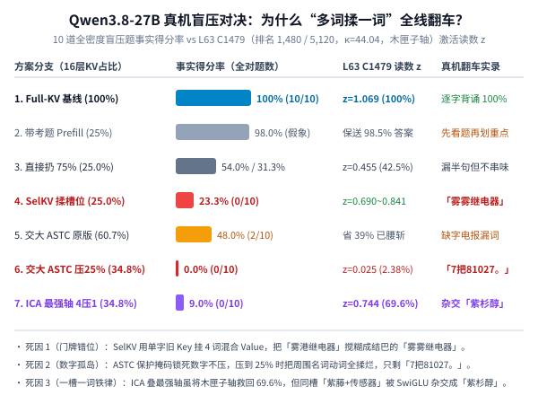

【KV Cache 合并】把 4 个词元合成 1 个“叠加态”：我们在 Qwen3.8-27B 上实测了这批零训练新论文

━━━━━━━━━━━━━━━━━━━━

◆ 开篇：哪怕开了 `FP8` 量化，24G 的国内特供 `5090D2` 跑满 `256K` 照样吃紧——能不能把 4 个词合成 1 个叠加态？

━━━━━━━━━━━━━━━━━━━━

聊到大模型长上下文推理的显存瓶颈，我们先拿手头常驻的 **`Qwen3.8-27B`** 算一笔非常现实的消费级显卡账：

我们在前文 277 期 https://mp.weixin.qq.com/s/j8Dr2sdRUZIdPfGWr9r5nw 和 338 期 https://mp.weixin.qq.com/s/tsui2k7wIKDnzNW6_p9WnQ 算过，词表本身可以映射在固态磁盘（SSD）上按需查表，真正把显卡显存吃爆的，是跟进入模型的词元个数 `T` 成严格正比的键值缓存（Key-Value Cache，简称 KV 缓存）。

假设你手里有一张 `24 GB` 显存的主流消费级显卡——无论是 `RTX 4090`，还是老黄给国内特供、把显存从 32G 砍到 **`24 GB` 的 `RTX 5090 D v2`（俗称 `5090D2`）** ，想在单卡上把 `Qwen3.8-27B` 原生支持的 **`256K`（26.2 万词元）** 满血上下文跑起来：

1.**模型空载底盘（按常规 4-bit 权重加运行时缓冲估算约 `17.5 GiB`）** ——就算把 27B 权重压成 4-bit 量化（约 `15.5 GiB`），加上 48 层线性注意力的固定循环状态与推理激活工作区（约 `2.0 GiB`），还没开始喂长文，显存就已经占掉了约 **`17.5 GiB`** ，只给 `KV 缓存` 留下 **`6.5 GiB`** 左右的空间；
2.**哪怕已经开了常规的 `FP8`（8 比特）`KV` 量化，照样超出 24G 预算** ——一般人提到压 `KV 缓存`，第一反应是前文 138 期 https://mp.weixin.qq.com/s/XyeUrO8FH0xVt1CXU_qg7A 讲过的“数值量化”（词元个数 `T` 一个不少，把每个浮点数从 16 比特 `BF16` 压成 8 比特 `FP8`）。可 `Qwen3.8-27B` 的 16 层全注意力在 `256K` 长度下，原版 `BF16 KV` 要占 `16.0 GiB`，**哪怕你已经开了 `FP8 KV` 量化砍半，它依然要吃掉整整 `8.0 GiB` 显存** 。`17.5 GiB + 8.0 GiB = 25.5 GiB > 24.0 GiB`，在这套配置下刚好超出 `24 GB` 的 `5090D2` 上限（要是再想往外推到 `512K` 或 `1M` 百万上下文，哪怕开了 `FP8`，光 `KV` 也要 `16` 到 `32 GiB`）。

既然把浮点数位数砍半的“KV 量化”已经不够用了，今天我们要聊的，**不是量化，而是另一条更激进的路线——“KV 合并 / 词元合并（KV / Token Merging）”** ——

既然大模型中间层的残差流本来就是几千维的连续实数向量，天然能承载多个概念的“高维叠加态”，那我们 **能不能沿着时间轴，把历史上下文里的一串普通文字词元（比如每 4 个词元），直接合并成 1 个“叠加态自定义词元（Soft / Merged Token）”？**

只要能拿 1 个叠加态词元顶替原本的 4 个普通词元，显存里的 `KV 缓存` 列数（序列长度 `T`）就能当场砍掉 `75%`（把 `256K` 的 `KV` 再压到 `2.0` 至 `4.0 GiB`），一张 `24 GB` 的 `5090D2` 就能轻轻松松装下。

这期我们就先复盘为什么以前做这类“软词元压缩”往往得专门训一个外部压缩网络或适配器，接着看今年下半年刚冒出来的两套 **“完全零训练（Training-Free）、号称直接在现成开源模型里把一串词合成为叠加态词元”** 的新论文（`SelKV` 与上海交大 11 月刚更新的 `ASTC`）是怎么设计的，最后把它们迁移到家里的 **`Qwen3.8-27B`** 上同台跑一遍真机盲压实测。

━━━━━━━━━━━━━━━━━━━━

◆ 第一章：老路子的死结——在模型外训“压缩网络”把长句压成“词表外的短句”，得专门训练且细节照样不准

━━━━━━━━━━━━━━━━━━━━

围绕“怎么把长上下文压短”，我们在前文 303 期 https://mp.weixin.qq.com/s/HrrdYj-czN30_Fxrv_KNcw （把对话直接训进模型权重）、319 期 https://mp.weixin.qq.com/s/so-08WsOgnQFmXkawoIhnw （专门训练出一小包浓缩的 `KV` 卡带权重）和 320 期 https://mp.weixin.qq.com/s/DvakrDdF3AkvUhfnqDQM_Q （把一整件事好几百个词压成 1 个只留印象与感觉的 `<COMP>` 记忆词元）里陆续聊过早期思路。

如果不去改写主模型权重，也不玩进模型之前的纯文字缩写游戏，此前学术界最主流的做法，是在 **模型第 0 层（Embedding 入口）** 动手：直接在主模型之外训练一个“压缩神经网络”，把原本长篇累牍的句子，压缩成一串 **“长度短得多、但里面每个 Token 都不在原模型词表里的连续向量短句（Soft / Memory Tokens，软词元）”** 。

拿本文这台含 16 个全注意力层的模型算账，它省显存的机制很直观：
- **不压缩时** ——把一份 `1,000` 个词元的 `SKILL.md` 原文喂进模型第 0 层，往后走过那 16 个全注意力层时，显存里每一层都要存下 **`1,000` 列 `KV 缓存`** ；
- **第 0 层软词元替换** ——离线阶段先用外部压缩模型读完这 `1,000` 个原词，经过一层多层感知机（MLP）投影器浓缩成 **`250` 个软词元** 。推理时不再喂原文，直接把这 `250` 个软词元塞进主模型第 0 层入口，它们往后走过 16 个全注意力层时，每一层自然就只生成 **`250` 列 `KV 缓存`** （省掉 `75%`）。

从前文 319 期讲过的早期 `Gist tokens`（改掩码微调模型把提示挤进几个特殊词元）、`ICAE`（给编码器挂 LoRA 把 512 个词压成 128 个记忆槽），到今年 6 月清华大学刘奕群、艾庆遥团队针对 Agent 技能包发表的 **`SKIM`（《面向大语言模型的自适应多分辨率程序性知识压缩》，Adaptive Multi-Resolution Procedural Knowledge Compression for Large Language Models，Changyue Wang et al.，`arXiv:2606.12203`）** （ *https://arxiv.org/abs/2606.12203* ，以及今年 9 月东京大学在 `arXiv:2609.11192` 提出的 `FlexComp`），走的都是这条“第 0 层塞软词元”的路线。

但这条路子卡在两道门槛上：

1.**浅层拼装车间不认识“词表外的外星字”，必须专门花算力训练** ——正如我们在前文 365 期 https://mp.weixin.qq.com/s/I1puPtcgynImhOqHlRmwDg 观察到的那样，Transformer 的前 3 到 5 层是个依赖相邻原词旋转位置编码（RoPE）差值工作的“局部词组拼装车间”；你在第 0 层直接塞入一串未经适配的合成向量，冻结的浅层根本不认识。因此，无论是训练编码器与投影器，还是像清华 `SKIM` 那样 **同时训练外部压缩投影器并给目标大模型配套训练一个 LoRA 适配器** ，都绕不开昂贵的专项训练——一旦基础模型升级换代，磁盘上存的所有软词元包就得推倒重训。
2.**哪怕花大价钱训出了压缩器与 LoRA，在长程任务和精细字面上照样不准** ——早期 `Gist tokens` 与 `ICAE` 论文自己就报告过，当输入变长或遇到需要逐字照搬的细节（如具体参数名、数字）时，软词元就会明显退化；而且外部压缩器在离线压文本时，根本摸不准主模型在后面第十几轮干活时到底需要哪条具体细节（即 `Model-Taste Gap` 模型品味代沟）。在后面上海交大 `ASTC` 论文的对比实测（表 1，`Qwen3.5-9B`）中，这类经过专门训练的外部软词元压缩器（`LCLM`）不仅让总注意力配对计数（Attention Pairs）暴涨了 `6.4` 到 `16.4` 倍，在 `OfficeBench` 任务上的准确率更是从不压缩基线的 `48.42%` 雪崩到了 **`21.05%`** ，在需要记住 8 个具体目标的 `8-Objective QA` 上精确匹配率甚至跌到了 **`0.00%`** 。

至于像 `StreamingLLM`、`H2O`、`SnapKV` 那类完全免训练的“词元驱逐（Eviction）”方法，只是在 Prefill 后留前 `25%` 重要词元、把剩下 `75%` 直接扔掉，一旦后面问到被扔掉的段落就彻底失忆。

那么问题来了：**有没有一种办法，完全零训练（不用训压缩网络、不用挂 LoRA、拿现成开源模型直接用），就能在模型内部把 4 个词元合并成 1 个叠加态槽位？**

━━━━━━━━━━━━━━━━━━━━

◆ 第二章：两套零训练合并新方案——在缓存层用 `+ α·ln(R)` 补选票（`SelKV`），或在第 10 层借线性注意力合软词元（交大 `ASTC`）

━━━━━━━━━━━━━━━━━━━━

为了绕开“在第 0 层塞软词元必须专门训练”的死结，今年下半年挂上 `arXiv` 的两篇新预印本论文，分别在模型的 **最后 `KV 缓存` 层** 和 **第 10 层中间残差流** 提出了完全零训练的合并方案。

────────────────────

**一、方案一 `SelKV`（在各层 `KV 缓存` 合并）：手算“四票变一票”注意力下陷与对数选票补偿**

第一套方案把刀落在了 **Prefill 跑完后的各层 `KV 缓存` 上** ——不直接扔掉那 `75%` 次要词元的 `KV`，而是把相邻几个相似词元合并进 **1 个“叠加态 `KV` 槽位”** 。

早先研究者试过直接求平均合并（如 `KVMerger`），却发现合并后的问答表现有时还不如“直接扔掉（`SnapKV`）”。今年发表的预印本 **`SelKV`（《Selective KV Cache Merging with Per-Token Merge-or-Drop and Attention Compensation》，Soumia Bouyahiaoui et al.，`arXiv:2607.16213`）** （ *https://arxiv.org/abs/2607.16213* ）承接 `KeepKV` 列出一行简单的指数算式，指出了其中一个数学原因：合并后的叠加态槽位在 `Softmax` 投票时，遭遇了严重的 **`Attention Sag`（注意力下陷，说成大白话就是“四票变一票”）** 。


照着上图，用三个具体数字手算一遍就清楚了：

1.**合并前（4 个词占 4 个位置，投出 4 张选票）** ——假设缓存里连着 4 个相近的词元（`k1..k4`），当前查询向量 `q` 跟它们每一个的点积得分都是 `s = 2.0`。未压缩时这 4 个词在显存里占 4 个独立位置，进入 `Softmax` 时各自算一次指数，总共能拿出 **`e^2.0 + e^2.0 + e^2.0 + e^2.0 = 4 · e^2.0`** 的票面权重（相当于投出 **4 张选票** ）。
2.**直接求平均 4 合 1 后（4 个位置压成 1 个位置，4 张选票缩水成 1 张）** ——为了省 `75%` 显存槽位，把 `k1..k4` 求平均合成为 1 个槽位 `k_avg = (k1 + k2 + k3 + k4) / 4`。根据线性内积性质，它与查询 `q` 的点积得分依然是 `q · k_avg = 2.0`；但因为它现在在 `KV 缓存` 里 **只占 1 个位置** ，进 `Softmax` 时只算一次指数，票面权重当场变成了 **`1 · e^2.0`（只剩 1 张选票）** ——仅仅因为把 4 个位置合为 1 个位置，这串词在注意力里的选票就平白无故被吞掉了四分之三。

为此，`SelKV` 设计了两步零训练算术修复：
- **软余弦门控（`g_j = max(cos(v_j, v_i), 0)`）** ——拿末尾观察窗口 `W = 32` 的注意力乘以值向量模长挑出前 `25%` 保留骨干槽位 `i`；同位置分桶（`B = 32`）里的淘汰词 `j` 只有当值向量与骨干词余弦夹角小于 90 度时才按权重并入骨干的 `Value_i`（异向词直接丢弃防串味），同时保留骨干槽位自己原本的门牌号 `Key_i` 不动；
- **对数选票补偿（`+ α · ln(R_i)`）** ——怎么只占 1 个显存位置，却把丢掉的选票补回来？利用高中指数恒等式 **`e^(2.0 + ln 4) = e^2.0 · e^(ln 4) = 4 · e^2.0`** ，只要给合并后的那个槽位记下它代表了多少份累积注意力质量 `R_i = (a_i_kept + Σ g_j · a_j_disc) / a_i_kept`（4 个等权重词全额合 1 时 `R_i = 4`），在解码算点积进 `Softmax` 前加上对数补偿 **`+ α · ln(R_i)`** ——理想满额补偿（`α = 1.0`）时 1 个位置就能当场投出 4 张选票；实际论文在分组查询注意力（GQA）模型上为防止大合并数过冲，默认取阻尼系数 `α = 0.5`（补回一半对数偏置，相当于 `2 · e^2.0`）。论文宣称靠这两招只留 `25%` 缓存，在 LongBench 上 `Gemma-2-9B-IT` 与满显存基线仅差 `0.67` 分（`LLaMA-3.1-8B` 差 `0.73` 分）。

────────────────────

**二、方案二上海交大 `ASTC`（在第 10 层中间残差流合并）：等浅层线性注意力“吃饱”后，原位合成软词元**

第二套方案由上海交大联合南洋理工、南开、同济与北京大学（Xuning He, ..., Yihong Dong）在 **11 月 15 日刚更新 v2** 的预印本 **`ASTC`（《面向长程智能体的模型内智能体软词元上下文压缩》，In-Model Context Compression with Agentic Soft Tokens for Long-Horizon LLM Agents，`arXiv:2610.41291`）** （ *https://arxiv.org/abs/2610.41291* ，开源代码 *https://github.com/RISE-X-Lab/Agentic-Soft-Token* ）提出：不在最后缓存层揉，而是在模型的 **中间分界层 `ℓ*`** 直接把几个词合成 1 个软词元，让后半截网络自己为这个软词元算出配套的 `Key` 和 `Value`。

我们在前文 188 期 https://mp.weixin.qq.com/s/jcQlCc3XtaCEEnjUaxw93w 和 293 期 https://mp.weixin.qq.com/s/jb-ibVHAG3wKbtoiX5SStA 剖析过，2026 年新一代 `Qwen` 系开源主力模型（如 `Qwen3.5 / Qwen3.6 / Qwen3.8`）都是 **`3:1` 交替排列的“门控线性注意力（Gated DeltaNet，简称 GDN）＋ 全注意力（Full Attention）”混合架构** 。

`ASTC` 论文写了足足 29 页，但剥掉包装，它的核心操作用一句话就能说透：**在零基第 10 层（跑完前 11 层后）通过 `Gated DeltaNet` 判断“连续几个词元是否可以合并”，如果觉得可以合且重构误差不超标，就直接把这几个词的残差流向量取个算术平均，传给第 11 层（外加用正则表达式把阿拉伯数字等精确字面值挑出来不参加平均）。**

拿我们测试集里的句子 `“第7夜，厨师把8件木匣子留在东门屋檐……”` 走一遍，具体就三步：

1.**第 0 到第 10 层（前 11 层）原样跑完，用正则表达式给“数字”贴免死金牌** ——整段话先一个字不少地跑完第 0 到第 10 层（绕开第 0 层塞外星向量导致浅层语法懵圈的问题），此时每个词在第 10 层出口都有一个 `5,120` 维的残差流向量 `h_i`；同时算法用正则表达式扫一遍原文字面，凡是看到阿拉伯数字（如 `7`、`8`、`10`、`27`）、十六进制颜色码或文件路径，就贴上保护掩码 `P_i = 1`——在原版规则下，这些数字对应的向量 **必须原封不动单独保留，不参与合并** 。
2.**拿第 10 层的 `Gated DeltaNet` 当“免训练筛子”，挑出哪些普通词元可以合并** ——注意，**`Gated DeltaNet` 并不负责合成向量，它只是被作者拿来当一个挑词的筛子** 。因为第 10 层刚好是一层 `Gated DeltaNet` 线性注意力，它在顺序读过每个词时都会更新固定大小的循环记忆矩阵 `S`；如果某个普通词元（如“厨师”、“木匣子”、“东门屋檐”）的值向量能被前文的线性状态 `S` 较好地预测（新息残差小），且读到段落结尾时还能从末尾状态 `S` 里把这个词的值向量大致回读出来（说明没被后面的词冲掉），算法就给这个词打上 **“已被线性记忆消化，候选合并”** 的标签。
3.**在第 10 层与第 11 层之间的“楼道”里，把相邻可合并词的向量加起来除以个数** ——就在第 10 层出口（还没进第 11 层之前），算法把相邻几个被打上“可合并”标签的普通词分成小段，剔除组内离群点并检查平均后的重构误差；通过检查的小段，就把它们的残差流向量 `h_i` **直接加起来除以词数 `|G|`（求算术平均）** ，变成 **1 个合成向量（即论文所说的“智能体软词元”）** `z_G = (1 / |G|) · Σ h_i`。

这样一来，送进第 11 层的序列长度就变短了——里面由 **“原封不动保留的数字与未通过合并不合格词元 ＋ 几团由已消化普通词求平均揉出来的软词元 `z_G`”** 组成，后面第 11 到 63 层（共 53 层，包含 14 个吃显存的全注意力层）直接对着这条变短的序列算 `K` 和 `V`。论文表 1 宣称在 `Qwen3.5-9B` 的 `OfficeBench` 上省掉约 `58%` 至 `63%` 的解码注意力交互量（`D-KV`），准确率还从 `48.42%` 反超到了 `54.74%`。

━━━━━━━━━━━━━━━━━━━━

◆ 第三章：拉上 `Qwen3.8-27B` 同考卷真机盲压——为什么内部概念轴读数还在，嘴里却吐出了“雾雾继电器”和 `7把81027。`？

━━━━━━━━━━━━━━━━━━━━

我们在家里的 `DGX Spark` 上，把 `SelKV`（按每头独立选位与对数偏置）与上海交大 `ASTC`（用 `4×768` 独立语料校准第 10 层回读器）同时迁移到装好全 64 层 `ICA-Lens v3` 读心透镜（每层 5,120 根独立概念轴，见前文 367 期 https://mp.weixin.qq.com/s/dvU20vg3R033QFlAgmOX3A 与 375 期 https://mp.weixin.qq.com/s/algrkHsIVinB5jZfvvKrAA ）的 **`Qwen3.8-27B`** 上，用同一套考卷连跑了 **100 组带问题 Prefill 对照 ＋ 170 组提问前盲压实验** 。



────────────────────

**一、先看两种考场的巨大分水岭：带末尾考题一起 Prefill vs 提问前全密度盲压**

在跑第一轮 100 组对照实验时，我们照着 `SelKV` 原论文“已知当前问题后压缩单次上下文”的评测做法（把“90% 模板废话填充文档 ＋ 末尾的用户考题”拼在一起做 Prefill，再用序列最末尾 `W = 32` 个位置的注意力挑 Top-25% 保留词），结果在 25% 预算下确实测出了高达 **`98.0%` 的关键词命中率** 与 **`100%` 的逐字背诵率** 。

一查保留槽位名单，原因一目了然：**当你把用户的问题拼在文档末尾一起送进去 Prefill 时，序列最末尾那 32 个词正好就是考题本身** ——考题的注意力像探照灯一样，直接把 8 道事故 QA 题里短短 41 到 44 个词元的答案句中 **`98.5%` 到 `98.8%` 的词元原封不动保送进了 Top-25% 保留区** （纪事背诵题的答案句也保送了 `80.8%` 到 `89.5%`，答案句本身几乎没被合并，被压成叠加态的全是旁边的模板废话）。

如果只是“已知问题去压一次性文档”，这样借问题注意力划重点当然省事；**但在我们关心的 Agent 多轮长会话或缓存复用场景里，压缩历史 `KV 缓存` 时根本不知道用户下一轮会问哪一句，而且技术文档里每一句都是干货。**

于是我们撤掉所有废话，构造了 **8 份零废话全密度干货文档** （每份约 `1,150` 到 `1,400` 个词元，包含 24 节点 SVG 源码、28 条平权技术事故档案、28 夜平权交接纪事）和 **10 道考题** ，严格执行 **“提问前盲压”** （先只喂文档做 Prefill 并把 `KV` 压掉，压缩完成后再送入用户问题；完整测试集 `cases_exp3b.json` 与两套方案的实验代码均已开源于 *https://github.com/lmxxf/grocery-haven/tree/master/icalens-v3-exp3-selkv-20261122* 与 *https://github.com/lmxxf/grocery-haven/tree/master/icalens-v3-exp4-astc-20261122* ）：

```text
[测试文档节选1：28条平权事故档案（每条权重相等，压完KV后随机抽考某一条的部件、机制与颜色）]
记录00：站点B-00的雾港继电器因受潮触点粘连停机；更换绿色陶瓷备件后复测3次通过，责任班组为第1组。
……
记录08：站点B-08的雾港继电器因受潮触点粘连停机；更换灰色陶瓷备件后复测11次通过，责任班组为第9组。

[测试文档节选2：28夜平权交接纪事（共28夜，压完KV后随机抽考某夜的事实概括与一字不差背诵）]
第1夜，修伞人把2件蜡封信留在北侧石阶，嘱咐第4队在晨钟响起之前取走，并在红册上签名，回执号为21。
……
第7夜，厨师把8件木匣子留在东门屋檐，嘱咐第10队在晨钟响起之前取走，并在红册上签名，回执号为27。
```

把两套方案放在这同一张全密度盲压考卷上对账，结果水落石出：

| 方案分支（同一套 10 道全密度盲压考题） | 文档预算 / 全 16 层 FA 槽位占比 | 整篇盲压事实得分率 ↑（全对题数） | `L63 C1479`（木匣子轴）读数 `z` | 真机典型输出实录（以“雾港继电器”与“第 7 / 13 夜纪事”为例） |
| :--- | :---: | :---: | :---: | :--- |
| **1. `Full-KV`（不压缩满显存基线）** | `100.0%` | **`100.0%`（`10/10`）** | `1.069`（`100.0%`） | `雾港继电器、受潮触点粘连、灰色`；逐字背诵 `100%` 一字不差 |
| **2. 按原论文做法带考题 Prefill（开卷对照）** | 文档预算 `25%` | 关键词命中 `98.0%` | QA 答案词保送 `98.5%` | 照原论文把考题拼在末尾 Prefill，QA 答案句 `98.5%` 的词元免检进 Top-25% |
| **3. 缓存层直接扔 75%（`Pure-Eviction`）** | 文档预算 **`25%`** | **`54.0%`（`3/10`）** | `0.455`（`42.50%`） | 被删段落失忆、背诵漏掉`“，并在红册上签名”`半句，但留下的词不串味，仍能答出 `雾港继电器` |
| **4. `SelKV-Clipped`（缓存层合 V + 选票补偿）** | 文档预算 **`25%`** | **`54.0%`（`3/10`）** | `0.690` 至 `0.841`（`64.5%` 至 `78.7%`） | 整篇盲压较直接扔 0 提升；若句内每 4 词强制合 1 则从 `31.3%` 跌至 **`23.3%`** ，揉出 **`雾雾继电器`** |
| **5. 交大 `ASTC-Native`（第 10 层原版判据）** | 全 16 层占 **`60.7%`** <br>（L11 起留 `54.8%`） | **`48.0%`（`2/10`）** | `1.069`（`99.98%`） | 占了 60.7% 槽位得分反而不如只留 25% 的直接扔，背诵揉成缺字电报：`第13厨师把14蜡封信留在岸盐仓，嘱咐16并在33。` |
| **6. 交大 `ASTC-GDN-25%`（放宽阈值压至 25%）** | 全 16 层占 `34.8%`<br>（L11 起留 `25.0%`） | **`0.0%`（`0/10`）** | `0.957`（`89.51%`）<br>（无脑4合1为 `0.025 / 2.38%`） | 纪事题数字保留、周围名词动词全被揉烂，虽有概念余温却只吐出纯数字串：**`7把81027。`** 与 **`131416昼33。`** |

看一眼这张总表第 3 行与第 4、5、6 行的对比，结论一目了然：**在整篇文档提问前盲压下，`SelKV` 折腾了半天软余弦门控与对数选票补偿（`54.0%`），跟最粗暴的“只留 25% 词元、把剩下 75% 直接扔进垃圾桶（`Pure-Eviction`，`54.0%`）”一分差距都没有；而上海交大 `ASTC` 原版多占了 2.4 倍槽位（`60.7%`）才拿 `48.0%`，压到同样 `25%` 文档预算更是直接掉到了 `0.0%`。**

而且更有意思的是看表格第 4 列——我们在模型最后一层（第 63 层）用 `ICA-Lens v3` 盯着第 7 夜纪事题的 **`L63 C1479`（峭度排名 `1,480 / 5,120`，`κ = 44.04`，词汇路牌为 `[' boxes']` 的“木匣子”概念轴）** ——
- 直接扔掉 3/4 词（`Pure-Eviction`）时，因为“木匣子”被扔了，`L63 C1479` 读数 `z` 从满显存基线的 `1.069` 跌到了 **`0.455`（`42.50%`）** ；
- 而无论是用 `SelKV` 在缓存层把淘汰词揉进去（`z` 回升到 **`0.690` 至 `0.841`，即 `64.51%` 至 `78.65%`** ），还是用交大 `ASTC` 在第 10 层按 GDN 消化度合成为软词元（`z` 依然保持在 **`0.957` 至 `1.069`，即 `89.51%` 至 `99.98%`** ），**模型内部残差流里粗粒度的“木匣子概念轴读数”明明都还在** 。

既然内部概念轴读数保住了七到九成，为什么外部答题准确率反而比“直接扔掉”还要惨？下面我们把两套方案的翻车切片挨个拉开看。

────────────────────

**二、`SelKV` 120 组盲压剖析：旧 `Key` 配混合 `Value` 串味，对数选票音量拧得越大，“雾雾继电器”吼得越响**

在运行 `SelKV` 时，我们先观察到一个原文未曾提及的数值现象：当某个保留槽位在末尾观察窗口里的分母 `a_i_kept` 很小时，注意力质量比 **`R_i` 在实测中最高飙到了 `1596.93` 至 `3337.50`** （我们为此专门增加了 `R_i ≤ 8.0` 的上限裁剪分支 `SelKV-Clipped` 做稳定性对照）。

但无论裁不裁剪 `R_i`：
- 在 **提问前盲压 25%** 下，`SelKV` 各分支的事实得分率统统停在 **`54.0%`（10 题只全对 3 题）** ，跟“直接扔掉 75% 不合并（`Pure-Eviction`，`54.0%`）”一模一样；
- 一旦在核心答案句内部 **强制每 4 个词合并成 1 个槽位（`Forced-4to1`）** ，`SelKV` 合并叠加态的事实得分率（ **`17.3%` 至 `23.3%`，10 题全军覆没** ） **反而比“干脆扔掉 3 个词不揉（`Pure-Eviction`，`31.3%`）”还要差 8 到 14 个百分点** 。

看看事故档案 `记录08` 那道题（标准答案：`雾港继电器、受潮触点粘连、灰色`）的真机输出，原因就非常直观了：

```text
[Full-KV 100% 满显存基线]  雾港继电器、受潮触点粘连、灰色
[Pure-Eviction 直接扔 3/4]  雾港继电器、受潮导致触点粘连、灰色  (得分 100%，KL = 0.567)
[SelKV-Clipped 揉入叠加态]  雾雾继电器、受潮、灰色              (揉坏字面，KL = 1.392)
```

为什么“直接扔掉 3 个词”靠留下的那个干净词元还能答出 **“雾港继电器”** ，而 `SelKV` 把邻近淘汰词揉进去之后，反而吐出了结巴的 **“雾雾继电器”** ？

因为保留槽位 `i` 沿用的依然是 **它自己原本位置的键向量 `Key_i`** ，可它的 `Value_i` 肚子里却被塞进了旁边几个淘汰词掺在一起的混合值向量。线性加权虽然能在残差流里留住粗略的“背景概念氛围”（让 `L63 C1479` 轴读数变高），却破坏了精细的字面拼写特征。作者想用 `+ α · ln(R_i)` 这种一维标量的对数小技巧，去挽救高维空间里已经被揉糊的键值配对关系；结果把对数补偿系数从 `α = 0.5` 开大到满额 `α = 1.0` 时，强制 4 压 1 的得分率反而从 `21.3%` 进一步跌到了 `17.3%`——因为槽位里的 `Value` 已经串味了，你把它的选票音量拧得越大，那个串了味的错字反而吼得越响。

────────────────────

**三、上海交大 `ASTC` 50 组盲压剖析：占 60% 显存已腰斩，强制压到 25% 直接吐出纯数字僵尸串 `7把81027。`**

再看上表第 5、6 行的上海交大 `ASTC`，在第 10 层中间残差流里合并软词元的表现同样经不起全密度盲压的检验：

1.**按原论文默认判据与误差界（`ASTC-Native`）跑，全模型 16 层全注意力槽位只省了 `39.3%`（还占着 `60.7%`），事实得分率就已经从 `100%` 跌到了 `48.0%`（10 题只全对 2 题）** ——多占了 2.4 倍槽位，准确率反倒比“直接扔掉 75%（`54.0%`）”还低。它不仅把第 13 夜纪事揉成了缺字漏词的电报 `“第13厨师把14蜡封信留在岸盐仓，嘱咐16并在33。”`，连两道 SVG 题也因为把数字周围的 XML 属性名揉成了软词元，分不清哪个数字是动画周期 `dur`、哪个是透明度 `opacity`，把原本正确的周期 **`16s` 和 `23s`** 全都张冠李戴答成了透明度 **`0.9`** 。
2.**为了与 `SelKV` 在同一预算下公平对比，我们放宽合并阈值与重构误差界，要求 `ASTC` 按 GDN 消化度把第 11 层起的文档也压到 `25%` 长度（`ASTC-GDN-25%`，连同前两层全注意力共占 `34.8%` 槽位），它的事实得分率直接归零（`0.0%`，`0/10`）** ——在两道纪事背诵题上，模型当场吐出了两串让人笑出声的“纯数字僵尸码”：

```text
[原句 1 (第 7 夜)]   第7夜，厨师把8件木匣子留在东门屋檐，嘱咐第10队在晨钟响起之前取走，并在红册上签名，回执号为27。
[ASTC-GDN-25% 输出]  7把81027。

[原句 2 (第 13 夜)]  第13夜，厨师把14件蜡封信留在西岸盐仓，嘱咐第16队在晨钟响起之前取走，并在红册上签名，回执号为33。
[ASTC-GDN-25% 输出]  131416昼33。
```

为什么第 63 层的木匣子概念轴 `L63 C1479` 读数还留着 `89.51%`，嘴里却只蹦出了 **`7把81027。`** 和 **`131416昼33。`** ？（如果在第 10 层不保护数字、直接无差别每 4 个词强行求平均 `L10-Forced-4to1`，连 `L63 C1479` 木匣子轴读数都会暴跌到 `0.025`，只剩 `2.38%`，背成毫不相干的`“第7夜：邮4条蓝裙……”`。）

这恰恰暴露了 `ASTC` 第一步设计的结构性悖论—— **给数字贴上 `P_i = 1` 的免死金牌优先保留** 。在这两道纪事题里，当算法必须凑够 `75%` 的压缩率时，因为 `7`、`8`、`10`、`27` 这几个数字被保护掩码锁死占住了保留名额，它只能把数字中间所有的名词和动词（“厨师、木匣子、东门屋檐、晨钟”）在第 10 层残差流里高强度揉成几团较大跨度的算术平均软词元（组内重构误差升至 `0.65` 至 `0.66`）。

虽然揉出来的软词元在残差流深处还残留着一丝“木匣子”的背景概念余温，但冻结的第 11 到 63 层在预训练时从来没学过如何从一团“多词平均软词元”里解码还原出原本的汉字词序——到了输出层采样时，只有那几个原封不动保留下来的数字词元能冲过输出层阈值，于是模型老老实实念出了 **`7把81027。`** 。

────────────────────

💡 两轮 170 组盲压实验的物理启示：误把 `Q/K` 子空间的“瞬时配对”当成了全局重要度打分，说到底还是“按权重求平均”

为什么从 `SelKV` 到上海交大 `ASTC`，这一批靠模型内部打分来挑词合并的论文，一进提问前全密度盲压考场就集体失灵？

仔细琢磨一下，这些作者都有一个共同的思维定势：**他们看到大模型预测下一个词时，每一步都会对历史每个 Token 算出一个注意力分数（或 GDN 预测残差），就以为“那我用同样的方法给历史 Token 打个分，按分数高低来保留或加权合并，不就能留住重点了吗？”**

可他们没意识到，那个 `q · k` 的打分，根本不是什么“某个词在全文里重不重要”的客观分——它只是当前位置的向量被训练好的权重投影到 `Q / K` 那个特定子空间之后，**为了预测眼前这下一个字而临时产生的某种说不清的局部配对关系** 。当文档刚读完、用户还没提问时，你拿文档末尾最后那几个词在 `Q / K` 子空间里的投影去给全文打分，筛出来的只是“谁跟结尾那句话在某个子空间里碰巧对上了眼”；等下一轮用户真正提问时，新问题在 `Q / K` 子空间里要找的完全是另一套关系，而那套关系早就被当成“低分项”揉烂了。

更何况，**无论前面打分挑词的数学公式写得多么花哨，真正落到把几个词合进 1 个槽位的那一刀时，这些方法的底层操作说到底依然只是“把几个向量按权重加起来求平均”。** 真要是“几个词求平均”在现成大模型里管用，那直接无脑取平均早就管用了——我们的对照组测得清清楚楚：在缓存层强制 4 合 1 时，什么公式都不加的 **直接取平均（`Naive-Merge`）** 事实得分是 `23.3%`，加了全套公式的 `SelKV` 还是 `17.3%` 至 `23.3%`；在第 10 层压到 25% 时，直接无脑 4 词平均事实得分是 `2.0%`，算完 29 页公式的 `ASTC-GDN-25%` 是 `0.0%`。

因此，**“把 4 个词元合成 1 个”恰恰是检验这类上下文合并算法的试金石** 。4 个相邻词元往往还不到半句完整的话（如“雾港继电器”、“8 件木匣子”这几个词元）。如果一套方法连 4 个词元合进 1 个槽位都会串味成 **“雾雾继电器”** 、或者把周围名词动词揉掉只吐出 **`7把81027。`** ，那它压得越多，就越只是在靠文档里的废话水分“压个寂寞”。

────────────────────

折腾了一整圈，这两篇把 4 个词揉成 1 个叠加态的新论文算是彻底排除掉了——至于怎么把 `Qwen3.8-27B` 的 `256K` 上下文塞进 `24 GB` 显存里，我的问题还是没解决，有空再想。

━━━━━━━━━━━━━━━━━━━━

◆ 参考资料

━━━━━━━━━━━━━━━━━━━━

- Soumia Bouyahiaoui, Manel Kara laouar, Aicha Boutorh, Mohamed Hadj Ameur (ENSIA), SelKV: Selective KV Cache Merging with Per-Token Merge-or-Drop and Attention Compensation, arXiv:2607.16213, 2026（提出基于值向量余弦相似度的软门控 g_j = max(cos, 0) 与注意力质量比率对数补偿 +α·ln(R_i)，解决合并槽位在 Softmax 中的 Attention Sag 选票缩水问题）
- Xuning He, Kai Fan, Runyu Zhang, Binghuan Wang, Yuxiang Zhang, Xue Jiang, Yihong Dong (上海交通大学 / 南洋理工大学 / 南开大学 / 同济大学 / 北京大学), In-Model Context Compression with Agentic Soft Tokens for Long-Horizon LLM Agents (ASTC), arXiv:2610.41291v2, 2026-11（利用混合架构中 Gated DeltaNet 线性状态的新息预测残差 χ_i 与段末可读性误差 ψ_i，在中间层 ℓ* 免训练将已吸收词元原位平均合成为 Agentic Soft Tokens，代码开源于 GitHub: RISE-X-Lab/Agentic-Soft-Token）
- Changyue Wang, Weihang Su, Qingyao Ai, Yichen Tang, Runzhong Qiao, Xuancheng Li, Min Zhang, Yiqun Liu (清华大学), Adaptive Multi-Resolution Procedural Knowledge Compression for Large Language Models (SKIM), arXiv:2606.12203, 2026-06（针对反复调用的 SKILL.md 技能包，离线训练多分辨率软词元矩阵存盘并配合目标模型 LoRA 压缩 40%–70% 词元，代码开源于 GitHub: bebr2/SKIM）
- Kaiyan Zhao, Zhongtao Miao, Akiko Aizawa, Yoshimasa Tsuruoka (东京大学 / NII), FlexComp: One Model for Every Ratio in Context Compression, arXiv:2609.11192, 2026-09（基于俄罗斯套娃 Matryoshka 训练的任意压缩比软词元压缩框架）

━━━━━━━━━━━━━━━━━━━━

**以前大家把 4 个相似词元的 `K` 和 `V` 求平均合并成 1 个位置时，总以为变笨是因为向量揉糊了；`SelKV` 一行算式指出了另一半数学机制——4 个位置合为 1 个位置后，它在 `Softmax` 里从“投出 4 张 `e^s` 选票（`4 · e^s`）”缩水成了“只投 1 张 `e^s` 选票（`1 · e^s`）”，理论上在点积得分上加对数补偿 `+ α · ln(4)`（`α = 1` 时 `e^(s + ln 4) = 4 · e^s`）就能用 1 个位置拿回选票权重。**

**为什么许多论文能测出“把 `KV 缓存` 竖着砍掉 75% 几乎零损”？对照实验揭开了考场分水岭：如果把末尾的考题和满是模板废话的文档拼在一起做 Prefill，再用末尾 32 个词（正好是考题本身）的注意力去挑保留词，等于“先看题再去书里划重点”，把 QA 答案句里 `98.5%` 的词元原封不动保送进了保留区。**

**“把 4 个词元合成 1 个”是检验上下文合并算法的试金石：这些方法误把 `Q / K` 子空间里为预测眼前下一个字而产生的瞬时配对当成了全文重要度打分，且落到合并那一刀上说到底依然只是“按权重求平均”——在提问前全密度盲压下，尽管第 63 层概念轴还留着七到九成余温，缓存层旧 `Key` 挂混合 `Value` 却串味成了“雾雾继电器”（`SelKV`），第 10 层压到 25% 则只吐出了数字孤岛`“7把81027。”`（交大 `ASTC`）。**

━━━━━━━━━━━━━━━━━━━━

// 靳岩岩的 AI 学习笔记 × Gemini 的浪漫 × GPT 的严谨
// 2026年11月27日

把4个词元合成1个“叠加态”能省75%显存？我们在Qwen3.8-27B上实测了SelKV（+α·ln R选票补偿）与交大ASTC（第10层软词元）两篇零训练新论文，揭穿带考题Prefill保送98.5%答案词的假象，看多词求平均如何揉出“雾雾继电器”与“7把81027。”。

━━━━━━━━━━━━━━━━━━━━

**【实验数据相关资料地址路径（380–384 五连击永久总指针索引）】**
- **五连击独立总指针备份文件**：
  - 公众号仓内指针：`/home/lmxxf/work/ai-theorys-study/wechat/assets/380/INDEX-380-384-五连击总指针.md`
  - Short 库顶层指针：`/home/lmxxf/work/memory-of-my-gemini/doc/short/20261122/00_380至384五连击总指针与全套实验账本索引.md`
- **一、 实验方案与五轮 380 组真机实测报告（`doc/short/20261122/`）**：
  - **实验方案 1（7 大流派 22 篇论文盘点 + `SelKV` 与交大 `ASTC` 公式图纸）**：`/home/lmxxf/work/memory-of-my-gemini/doc/short/20261122/实验方案-1_上下文与KVCache压缩全流派盘点及Qwen3.8-27B叠加态软词元实验方案.md`
  - **实验方案 2（特征维度 PCA/SVD 低秩压缩 `Loki / Palu / EigenAttention / AttSVD / KV-COBRA / TransMLA / MLAfication` 盘点与横向瘦身图纸）**：`/home/lmxxf/work/memory-of-my-gemini/doc/short/20261122/实验方案-2_特征维度PCA与SVD低秩KVCache压缩全流派盘点_及Qwen3.8-27B横向瘦身实验方案.md`
  - **🏆 实验结果总汇（五轮 380 组 + 100 组泄题对照同考卷 14 分支终极大总表）**：`/home/lmxxf/work/memory-of-my-gemini/doc/short/20261122/实验结果-总汇_KVCache压缩四轮同考卷终极对决_为什么竖着揉词全崩而横着切SVD宽度拿下100%满分.md`
  - **五轮分项实验报告目录（`实验结果明细/`）**：
    1. **实验结果 1（`SelKV` 120 组盲压 + 100 组带问题 Prefill 泄题踩坑破案）**：`/home/lmxxf/work/memory-of-my-gemini/doc/short/20261122/实验结果明细/实验结果-1_SelKV缓存合并与选票补偿实测_为什么25%预算零损本质上是问题注意力保送了98%的答案词.md`（盲压 25% 得分 `54.0%`，强制答案句内 4 合 1 跌至 `23.3%`，旧单字 `Key` 挂混合 `Value` 揉出 **“雾雾继电器”**）
    2. **实验结果 2（上海交大 `ASTC` 50 组 `L10 → L11` 软词元实测）**：`/home/lmxxf/work/memory-of-my-gemini/doc/short/20261122/实验结果明细/实验结果-2_上海交大ASTC中间层软词元合并实测_及与SelKV的同考卷终极对决.md`（原版默认留 `60.7%` 显存得分已跌至 `48.0%` 揉出缺字电报；压到 25% 只剩被保护数字孤岛，得分 `0.0%`，吐出 **`7把81027。`** 与 **`131416昼33。`**）
    3. **实验结果 3（自研 `ICA-Lens` 最强轴叠加 90 组实测）**：`/home/lmxxf/work/memory-of-my-gemini/doc/short/20261122/实验结果明细/实验结果-3_ICALens最强轴叠加软词元实测_为什么保住了86%的概念峰值却杂交出了紫杉醇.md`（虽保住 `86.1%` 强轴峰值把 `L63 C1479` 木匣子轴从 `2.38%` 拉回 `69.56%`，但违背“一槽一词”被 `SwiGLU` 把“紫藤+传感器”杂交成 **“紫杉醇”**，得分 `9.0%`）
    4. **🏆 实验结果 4（特征宽度 PCA/SVD 低秩压缩 60 组实测）**：`/home/lmxxf/work/memory-of-my-gemini/doc/short/20261122/实验结果明细/实验结果-4_特征维度PCA与SVD低秩KVCache压缩实测_为什么保留全部词位置横着切宽度直接拿下100%正确率.md`（`SVD-JointHead-Strict25%` 4 头拼成 `1,024` 维联合在线 SVD，含基底 `B` 严格占 **`24.85%`** 显存，捕获 `96.25%` K / `95.02%` V 能量，拿下 **`10/10` [100% 满分 + 100% 逐字背诵，`KL=0.001384`]**；单头 SVD `88.0% [6/10]`；离线 `EigenAttn` `73.3% [7/10]`；微软 `AttSVD` 盲压偏心加权反跌至 `57.3% [4/10]`）
    5. **🏆 实验结果 5（`SVD 25% + 8-bit` 省 `87.55%` 显存 vs 纯量化 `INT8/INT4/INT2` 60 组实测）**：`/home/lmxxf/work/memory-of-my-gemini/doc/short/20261122/实验结果明细/实验结果-5_SVD25%叠加8bit量化省87.5%显存实测_为什么纯INT2脑死亡而SVD加8bit拿下100%满分.md`（`SVD-INT8-Strict12.5%` 与 `SVD-FP8-Strict12.5%` 含 `A`、`B`、`FP16 scale` 严格只占 **`12.45%`** 显存，省掉 **`87.55%`** 显存仍拿 **`10/10` 满分 + 两道逐字背诵 `KL=0.000004` 一字不差**，10 题平均 `KL=0.001455 / 0.001590`；而占 `13.28%` 显存的纯 `Quant-Only-INT2` 当场脑死亡 `0/10`、`KL=7.4801`，吐出 `复生第11复复，复，复。`）
- **二、 轻量复现代码包（`grocery-haven`，已推 `71d6c89`）与重数据目录**：
  - 轻量代码与 `DevHistory.md / outputs.md / comparison_all.md`：
    - `/home/lmxxf/work/memory-of-my-gemini/doc/grocery-haven/icalens-v3-exp3-selkv-20261122/`
    - `/home/lmxxf/work/memory-of-my-gemini/doc/grocery-haven/icalens-v3-exp4-astc-20261122/`
    - `/home/lmxxf/work/memory-of-my-gemini/doc/grocery-haven/icalens-v3-exp5-ica-superposition-20261122/`
    - `/home/lmxxf/work/memory-of-my-gemini/doc/grocery-haven/icalens-v3-exp6-svd-feature-20261122/`
    - `/home/lmxxf/work/memory-of-my-gemini/doc/grocery-haven/icalens-v3-exp7-svd-quant-20261123/`（含 35 行跨五轮总表 `comparison_all.md`）
  - 重数据（全 64 层激活、奇异谱与 `ICA-Lens v3` 投影张量）：`/home/lmxxf/work/ica-lens-qwen38-27b-v3/experiments/exp3_selkv_soft_token/`、`exp4_astc_soft_token/`、`exp5_ica_superposition/`、`exp6_svd_feature/`、`exp7_svd_quant/`
- **三、 后续期 `Strata + Qwen3.8-Flash-Next`（48G 内存 + 16G 显存 RX 9070 XT 跑 1M 上下文）历史资料与日志指针**：
  - 293 期（`Qwen3.8-Flash-Next` 架构拆解：125B MoE 主干 48 层 = 36 层 GDN + 12 层 QSA 稀疏 GQA [`2 KV heads × 256 dim`] + 51B N-gram 词表 + 4B MTP）：`/home/lmxxf/work/ai-theorys-study/wechat/293.md`
  - 338 期（`Strata` 在 `48GB 内存 + 16GB 显存 RX 9070 XT` 上跑 `Qwen3.8-Flash-Next Q2_0` 的原理与路由预取实验）：`/home/lmxxf/work/ai-theorys-study/wechat/338.md`
  - 354 期（1M 上下文各模型 `KV Cache` 横向对账：`Qwen3.8-Flash-Next` 12 层主缓存在 1M 下 `BF16 = 24.0 GiB`、`FP8/INT8 = 12.0 GiB`）：`/home/lmxxf/work/ai-theorys-study/wechat/354.md` 及配图 `/home/lmxxf/work/ai-theorys-study/wechat/assets/354/kv-cache-1m-comparison.svg`
  - 本机 `Strata` 在 RX 9070 XT 16GB 上的真实启动显存日志与实验目录：`/home/lmxxf/work/strata-papers-study/speed/pilot-D-engine.log`（及 `/home/lmxxf/work/strata-route-study/`）
