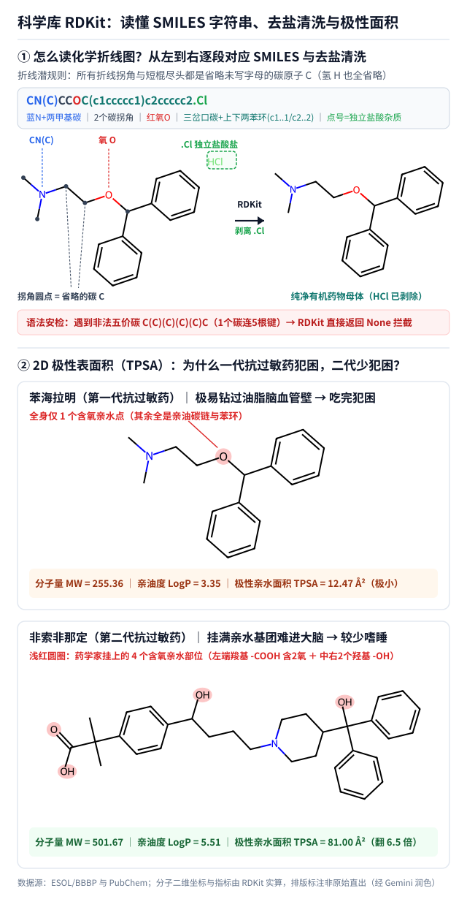
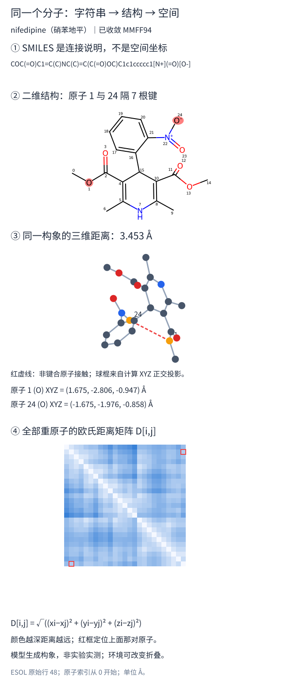
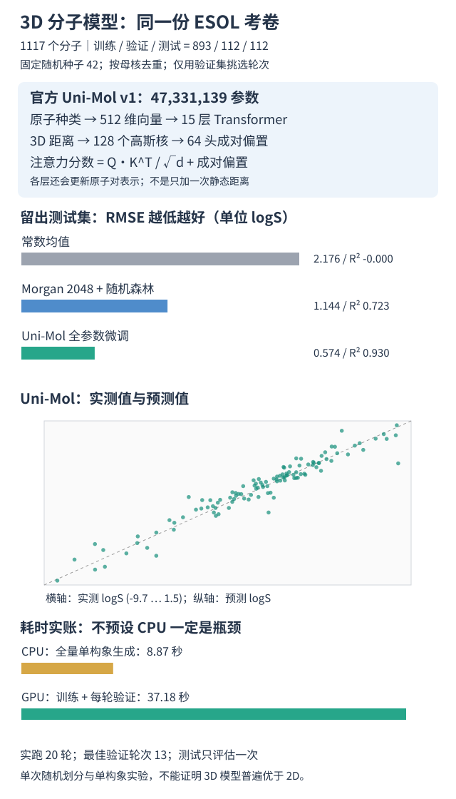
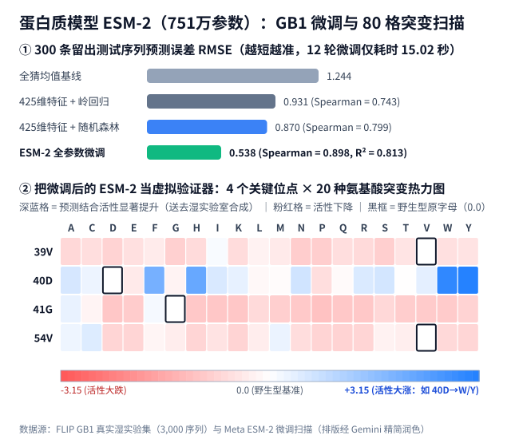

【AI for Science】有了千亿通用大模型，搞科研为啥还要用 RDKit 科学库和微调几千万参数的分子、蛋白质小模型？

━━━━━━━━━━━━━━━━━━━━

◆ 开篇：当一个不搞化学和生物的程序员，点开了英伟达的科学智能体推文

━━━━━━━━━━━━━━━━━━━━

前文 379 期 https://mp.weixin.qq.com/s/b8ggblxrq757Ee3W13gg4A 我们刚把 GitHub 上动辄五万星的八个“AI 自动搞科研 Skill”仓库全部克隆到本地清点了一遍，发现排在榜一的 `K-Dense` 仓库（5.81 万星）底下，藏着 `177` 个专门给大模型智能体调用的科学计算库技能包；紧接着这两天，一位做科学智能体的朋友又给我转来了一篇英伟达（NVIDIA）官方公众号刚发的推文《NVIDIA CUDA-X 库为智能体提供加速科学发现的工具》（ https://mp.weixin.qq.com/s/WkwcQoc5KUJMYr5dQbGhkw ），顺手聊起了他们日常最核心的三个工程场景：**一是用科学计算库处理实验数据，二是微调分子、蛋白质等科学专有模型，三是用科研 Skill 把这些工具串起来调用。**

作为一个平时只折腾通用大语言模型（LLM）和 GPU 算子、高中毕业后就没再碰过化学和生物的程序员，我第一反应冒出了三个非常朴素的疑问：

1.**既然现在已经有几百亿、上千亿参数的 DeepSeek、Qwen 和 Claude 了，为什么不能直接把化学分子式喂给通用大模型猜药效，非要先调 `RDKit`、`Biopython` 这类传统的“科学计算库”做数据处理？**
2.**做语言模型微调动辄是 `14B`、`32B`、`72B` 起步（参见前文 108 期 https://mp.weixin.qq.com/s/L3nacKQwhlHxOWcGhPvaYg ），为什么科学计算领域微调的“分子专有大模型（如深势科技的 `Uni-Mol`）”和“蛋白质专有大模型（如 Meta 的 `ESM-2`）”，参数量往往只有几百万到几千万（不到 `0.05B`）？它们肚子里到底改了 Transformer 的哪个零件？**
3.**在这个“科学库处理数据 → 专有模型微调推理 → 科研 Skill 串联调用”的流水线里，时间到底花在哪一步了？英伟达高调推出的 `CUDA-X` 科学加速库又是在替哪一步救急？**

光看概念综述永远隔着一层纱。为了把这三件事摸透，我们干脆在家里的 `DGX Spark`（`NVIDIA GB10`，128GB 统一内存）上建了一个实验仓库（全套源码、真实数据集、微调脚本与数据账本均已开源： *https://github.com/lmxxf/ai-for-science-on-cuda-x* ），拉下真实的药物分子水溶性数据集（`ESOL`）、血脑屏障穿透数据集（`BBBP`）以及蛋白质四位点组合突变湿实验数据集（`GB1`），把 **`RDKit` 科学库洗数据捏三维坐标 → 深势 `Uni-Mol`（`4,733 万`参数）三维分子模型全参数微调 → Meta `ESM-2`（`751 万`参数）蛋白质模型全参数微调 → 科研 `SKILL.md` 一键串联** 从头到尾真机跑了一遍。

跑完这套实验再回头看，原本被各种物理、化学、生物学术语包裹的“AI for Science（科学智能）”，在程序员眼里瞬间变成了三个清清楚楚的数据结构。

━━━━━━━━━━━━━━━━━━━━

◆ 第一章：科学库 `RDKit` 在干什么——从剥离盐酸盐、为什么一代抗过敏药吃完犯困，到降压药在三维空间里的 `3.453 埃` 折叠

━━━━━━━━━━━━━━━━━━━━

**一、化学家存在表格里的分子长啥样：一维字符串 `SMILES` 与科学库 `RDKit` 的语法安检**

在化学和制药实验室导出的 CSV 表格里，分子并不是一张张画好的六边形图片，而是一串叫 **`SMILES`（Simplified Molecular Input Line Entry System，简化分子线性输入规范）** 的单行 ASCII 字符串。比如：

- **阿司匹林（解热镇痛药）** ——`CC(=O)OC1=CC=CC=C1C(=O)O`
- **咖啡因（中枢神经兴奋剂）** ——`CN1C=NC2=C1C(=O)N(C(=O)N2C)C`

在程序员眼里，`SMILES` 其实就是一张 **无向图（Graph）的序列化字符串** ——每个原子符号代表一个节点（比如 `C` 是碳、`O` 是氧、`Cl` 整体是一个氯原子）（`C` 是碳原子、`O` 是氧原子、`N` 是氮原子），括号代表分支，`=` 代表双键，成对出现的数字 `1...1` 代表把带同一数字的两个原子连起来扣成一个环。

如果你直接把这串字符喂给通用大语言模型（比如 `Qwen` 或 `DeepSeek`），分词器（Tokenizer）会按子词频次把它切得七零八落——通用大模型既不会去数每个碳原子是不是严格只伸出了 4 条化学键，也不知道末尾跟着的 `.Cl` 是什么意思，只能凭预训练语料里背过的几个知名药名盲猜。

而开源科学计算库 **`RDKit`** （ *https://github.com/rdkit/rdkit* ，底层 C++ 实现、上层提供 Python 接口，地位相当于化学信息学界的 `NumPy + OpenCV`），干的第一件脏活就是 **“化学语法安检与去盐清洗”** 。请看我们在真实数据集上用 `RDKit` 跑出来并绘制的第一张图：

我们在真实的 **`BBBP`（Blood-Brain Barrier Penetration，血脑屏障穿透率数据集，原始 CSV 共 `2,050` 行）** 和 **`ESOL`（Estimated SOLubility，水溶性数据集，共 `1,128` 行）** 上跑了一遍 `RDKit` 的标准入库清洗管线（`exp1_rdkit_data_processing.py`），当场抓出了两类最典型的实验脏数据：

1.**拦截违背化学价定律的错录结构** ——碳原子最外层只有 4 个电子，最多只能结成 4 根共价键（四价）。但在人工录入或 OCR 提取的实验表里，常会混入像 `C(C)(C)(C)(C)C`（一个中心碳原子连了 5 个甲基，成了“五条腿的非法五价碳”）或氮原子价态错误的字符串。调用 `RDKit` 的 `Chem.MolFromSmiles(smiles, sanitize=True)` 时，这套 `RDKit` 入库清洗与描述符计算流程会在 `0.875 秒` 内处理完 `BBBP` 的 2,050 行记录， **当场拦截并剔除 `11` 条未通过解析与化合价校验的非法结构** ，放行 `2,039` 条可处理记录（随后将同一母核却标了相反 0/1 标签的 `11` 组冲突记录整组剔除并按标准母核去重得到 `1,955` 个唯一母体，再剔除 `3` 个无法生成三维构象的样本后，最终 `1,952` 个分子进入后续三方同考卷对照）。
2.**去盐清洗（Salt Stripping）** ——在真实制药实验里，为了把油状的药物分子做成好溶解的药片，化学家常把药物做成“盐酸盐”或“钠盐”。为此我们另外构造了一条带 `.Cl` 的 **盐酸苯海拉明** 盐型演示样本（见上方配图第 ① 部分左侧，字符串为 `CN(C)CCOC(c1ccccc1)c2ccccc2.Cl`）——那个小圆点 `.` 代表两个没有共价键相连的独立碎片，药分子旁边还飘着一团绿色的 `HCl`（盐酸）。如果不洗掉它直接喂给模型，分子量就会凭空多出 `36.46`，还会干扰真正起药效的有机母体。我们调用 `RDKit` 的 `SaltRemover` 并保留最大重原子连通母核，就能直接剥掉 `.Cl`，还原出右侧纯净的药物母体。

────────────────────

**二、算二维理化描述符：看图秒懂“为什么第一代抗过敏药吃完直犯困，第二代却很少犯困？”**

洗干净分子结构后，科学库 `RDKit` 的第二项本事，是直接根据二维分子图算出几十种物理化学指标（Descriptors）。为了直观看到这些指标有啥用，我们在实验里挑了 7 种大家家里药箱常备的真实药物（全部与美国国家医学图书馆 `PubChem` 官方标准结构 CID 逐一核对无误），用 `RDKit` 算出了三个最核心的药学描述符：

| 常见真实药物（中性母体结构） | 临床用途与体征差异 | 分子量 `MW` | 脂水分配系数 `LogP`（越大越亲油） | 拓扑极性表面积 `TPSA`（平方埃 `Ų`，越大越亲水） |
| :--- | :--- | ---: | ---: | ---: |
| **苯海拉明（Diphenhydramine，CID 3100）** | **第一代抗过敏药（可引起明显嗜睡）** | **`255.36`** | **`3.35`** | **`12.47`** |
| **非索非那定（Fexofenadine，CID 3348）** | **第二代抗过敏药（通常较少引起嗜睡）** | **`501.67`** | **`5.51`** | **`81.00`** |
| **氯雷他定（Loratadine，开瑞坦，CID 3957）** | 第二代抗过敏药（较少嗜睡） | `382.89` | `4.89` | `42.43` |
| **西替利嗪（Cetirizine，仙特明，CID 2678）** | 第二代抗过敏药（较少嗜睡） | `388.90` | `3.15` | `53.01` |
| **阿司匹林（Aspirin，CID 2244）** | 解热镇痛抗炎药 | `180.16` | `1.31` | `63.60` |
| **咖啡因（Caffeine，CID 2519）** | 中枢神经兴奋剂（秒进大脑提神） | `194.19` | `-1.03` | `61.82` |
| **布洛芬（Ibuprofen，芬必得，CID 3672）** | 解热镇痛抗炎药 | `206.28` | `3.07` | `37.30` |

回看上方第一张配图的第 ② 部分，只要把 **苯海拉明（第一代抗过敏药）** 和 **非索非那定（第二代抗过敏药）** 的结构并排摆在一起，并将分子上含氧的 **极性部位（容易与水分子形成氢键的亲水部位，如羟基 `-OH`、羧基 `-COOH`）** 用浅红色圆圈高亮出来，一个困扰过无数鼻炎患者的日常谜题就迎刃而解了：

- 人脑毛细血管的内皮细胞靠紧密连接等机制形成了致密的 **血脑屏障（Blood-Brain Barrier，简称 BBB）** ，专门阻挡血液里的乱七八糟物质随便钻进大脑。抗过敏药本来只需要在鼻腔黏膜和皮肤里阻断组胺受体就够了；可如果药分子不小心穿过了血脑屏障钻进大脑，就会把大脑里负责维持清醒的中枢组胺受体也一并关掉，人吃完就会困得睁不开眼。
- 你看 **第一代抗过敏药（苯海拉明）** 的结构：左边两个苯环，右边一条叔胺碳链，全身上下只有中间 **1 个浅红色的醚氧原子** ，`RDKit` 算出来的 **拓扑极性表面积（`TPSA`）只有区区 `12.47 平方埃`** ，分子量也只有 `255.36`。因为极性极小、个头又小、浑身亲油，它遇到同样是油脂做的血脑屏障时，更容易穿过细胞膜进入中枢神经系统，因此容易引起明显嗜睡；
- 再看药学家改进出来的 **第二代抗过敏药（非索非那定）** ——为了不让它进大脑，设计师在它身上挂上了 **2 个醇羟基（`-OH`）和 1 个完整的羧基（`-COOH`，含 2 个氧原子）** ——图上 4 个显眼的浅红色高亮圈，直接把它的极性表面积 **`TPSA` 增至原来的 6.5 倍（达到 `81.00 平方埃`）** ，分子量也翻倍到 `501.67`（再加上它在生理环境下会电离成带电的两性离子，并被血管壁上的外排泵主动往外推），很难再大量钻过血脑屏障，自然就少了嗜睡的副作用。

────────────────────

**三、为什么二维结构图还不够：降压药“硝苯地平”在三维空间里相隔 7 根键却折到 `3.453 埃`**

既然 `RDKit` 算出来的二维拓扑结构和理化描述符这么好使，为什么深势科技还要费劲去开发 **三维分子大模型 `Uni-Mol`** ？

因为分子不是印在纸上的扁平贴画，而是活在三维物理空间里、单键可以自由旋转折叠的立体结构。我们在 `ESOL` 水溶性数据集（`0` 起始索引第 `48` 条）里，直接抓出了一个极具代表性的真实药物案例——家里老人常吃的降压药 **硝苯地平（Nifedipine）** ，请看我们用 `RDKit` 算出的第二张实测图：

顺着图上的 ① → ② → ③ → ④ 四步往下看：

1.**在二维平面图上（图 ②）** ——请盯住左下角标了浅红圈的 **`1` 号酯基氧原子（`O`）** ，以及右上角苯环上标了浅红圈的 **`24` 号硝基氧原子（`O-`）** 。如果顺着二维化学键一格一格数过去（`1 → 2 → 4 → 15 → 16 → 21 → 22 → 24`），这两个氧原子中间 **足足隔了 7 根化学键** 。在任何只看一维字符串或二维分子指纹（如半径为 2 的 Morgan 指纹）的模型眼里，这俩原子隔了十万八千里，这个精确的三维空间接触距离并没有直接写在二维局部指纹里。
2.**用 `RDKit` 吹气折叠成三维空间坐标（图 ③）** ——我们调用 `RDKit` 的两步物理几何算法：先调 `Chem.AddHs` 补齐显式氢原子，再用 `ETKDGv3`（基于晶体实验扭转角偏好与距离几何算法）生成初始三维构象，接着调 `MMFFOptimizeMoleculeConfs(maxIters=200, mmffVariant='MMFF94')`（用 **默克分子力场 MMFF94** 做最多 200 步能量最小化松弛），最后去掉显式氢导出重原子三维坐标。
3.**惊人的空间折叠** ——当硝苯地平在三维空间里松弛稳定下来后，因为上方的硝基苯环与下方的二氢吡啶主环是近乎垂直拧着的，原本在平面图上隔了 7 根化学键的 **`1` 号氧原子三维坐标 `(1.675, -2.806, -0.947)`** 与 **`24` 号氧原子三维坐标 `(-1.675, -1.976, -0.858)`** ，在半空中竟然面对面折到了一块儿（图 ③ 中的红色虚线）。拿初中立体几何的距离公式 `√((x₁-x₂)² + (y₁-y₂)² + (z₁-z₂)²)` 一算，它俩的真实三维直线距离只有 **`3.453 埃`（`Å`，1 埃等于 `10⁻¹⁰` 米）** 。
4.**变成满足旋转平移不变性的距离矩阵 `D[i, j]`（图 ④）** ——把硝苯地平全部 `25` 个重原子（`C17H18N2O6`，索引 `0` 至 `24`）两两之间的三维欧氏距离都算出来，就得到了图 ④ 那张 **`25 × 25` 的对称距离矩阵热力图** （红框标出的浅色格就是 `(1, 24)` 那对近邻）。更有意思的是：不管这个分子在水杯里怎么翻滚旋转、怎么平移，单个原子的 `(x, y, z)` 坐标会跟着全变，但 **任意两个原子之间的内部直线距离 `D[i, j]` 永远分毫不差** 。

不过，用 `RDKit` 捏出这套三维立体坐标是有算力代价的。我们在 `DGX Spark` 的 CPU 上对 1,000 个真实药物分子做了严格的单核与 8 核墙钟计时：

| 分子数量 | 每个分子请求的 3D 构象数 | CPU 进程数 | 实测墙钟耗时（秒） | 成功生成构象数 | 200 步内 MMFF94 力场完全收敛数 |
| ---: | ---: | ---: | ---: | ---: | ---: |
| `1,000` | `1` 个构象（快速单构象） | 单核（`1` 进程） | **`7.961 秒`** | `1,000` | `883` |
| `1,000` | `1` 个构象（快速单构象） | `8` 核并行 | **`1.146 秒`** | `1,000` | `883` |
| `1,000` | **`10` 个构象（多构象能量采样）** | 单核（`1` 进程） | **`66.608 秒`** | `10,000` | `8,870` |
| `1,000` | **`10` 个构象（多构象能量采样）** | `8` 核并行 | **`9.987 秒`** | `10,000` | `8,870` |

先记住表里那个 **`66.608 秒`** ——等下一章我们看完 GPU 微调神经网络只花多少秒，你就会发现一个非常反直觉的工程真相。

━━━━━━━━━━━━━━━━━━━━

◆ 第二章：分子专有模型微调在干什么——剖析深势科技 `4,733 万`参数的 `Uni-Mol`，看 128 把高斯尺子怎么把水溶性预测误差砍半

━━━━━━━━━━━━━━━━━━━━

**一、剖析 `Uni-Mol` 的网络骨架：词表只有 31 个词元，用 128 个高斯核把三维距离塞进注意力偏置**

拿到了第一章 `RDKit` 算出来的原子列表和三维距离矩阵 `D[i, j]`，接下来就轮到 **“分子专有模型”** 登场了。我们直接拉取了深势科技（DP Technology）开源在 GitHub 上的看家三维分子预训练模型 **`Uni-Mol v1`** （ *https://github.com/deepmodeling/Uni-Mol* ，加载官方预训练权重 `mol_pre_no_h_220816.pt`），用脚本把它的每一层张量形状全部打印了出来（保存在仓库 `results/unimol_architecture.json`）。

习惯了动辄几百亿参数通用大模型的程序员，第一眼看到 `Uni-Mol` 的真实体检单都会愣一下—— **它的总参数量只有 `47,331,139`（约 `4,733 万`参数，不到 `0.05B`，FP32 权重文件才 180MB）** 。为什么它这么小，却比几百亿参数的通用语言模型更懂化学分子？把它和普通文本 Transformer 并排一对比就全清楚了：

1.**词表（Vocabulary）从通用模型的十万量级词元缩成了 `31` 个词元** ——通用语言模型得覆盖许多语种和十万量级词元；而构成常见有机分子的元素来回就那么二十几种。`Uni-Mol` 的实际嵌入层词表总共只有 **`31` 个词元（`Embedding(31, 512)`）** ——包含 `26` 种元素符号以及 `PAD / CLS / SEP / UNK / MASK` 五个特殊词元，主干是一个 **15 层、隐藏维 `512`、前馈网络（FFN）维 `2048`、带 `64` 个注意力头（每头宽度仅 `512 / 64 = 8` 维）** 的双向 Transformer 编码器（类似 BERT）。
2.**把一维位置编码 `RoPE`，换成了“128 把高斯核尺子”量出来的三维距离偏置** ——文本句子的词是有先后顺序的（第 1 个字、第 2 个字），所以用一维位置编码；但三维空间里的分子没有“谁先谁后”，只有“谁离谁多远”。`Uni-Mol` 在进第 1 层之前，先把任意两个原子 `(i, j)` 之间的三维直线距离 `d_ij`（比如刚才硝苯地平那两个氧原子的 `3.453 埃`）按原子对种类做一次缩放平移，然后送进 **128 个中心 `μ_k` 和宽度 `σ_k` 各不相同的高斯钟形函数（Gaussian Kernels）** ——
   `g_k(d_ij) = exp( - (d_tilde_ij - μ_k)² / (2 · s_k²) ) / (√(2π) · s_k)` （`s_k = |σ_k| + 10⁻⁵`，`k = 1 ... 128`）
   说人话：这 128 个高斯核就像 **128 把不同刻度的卡尺** （打个比方，比如某把卡尺盯是不是 `1.2 埃` 左右的共价双键，第 50 把卡尺专门盯是不是 `3.4 埃` 左右的空间折叠非键接触，另一把卡尺盯更远处的空间轮廓）。接着过一个两层小网络（`128 → 128 → 64`），把 128 把卡尺的读数压成 **64 个注意力头的初始成对偏置 `PairRepr[i, j]`（形状 `[原子数, 原子数, 64]`）** 。
3.**每一层 Attention 都在同时演化“单原子特征”和“原子对空间关系”** ——在第 `l` 层（共 15 层）的第 `h` 个注意力头（共 64 头）里，原子 `i` 对原子 `j` 的注意力打分直接加上这格空间偏置：
   `Score_ij^(l, h) = ( Q_i^(l, h) · (K_j^(l, h))ᵀ ) / √8 + PairRepr_ij^(l-1, h)`
   而且扒开源码会发现一个很多二手文章漏掉的关键细节：`PairRepr` 并不是 15 层死板共用同一个初始距离，而是 **每一层算出来的注意力未归一化分数 `Score_ij`，会直接覆写更新成为下一层的 `PairRepr_ij`** 。深势在预训练时喂了 **2.09 亿个三维分子构象** （一边遮住原子猜元素，一边把故意加噪声晃歪的 3D 坐标还原回真实距离），早就把三维立体化学的物理规律刻进了这 15 层的 64 个头里。

────────────────────

**二、真机微调实验一（药物水溶性 `ESOL`）：37 秒全参数微调，把预测误差从 `1.144` 直接砍半到 `0.574`**

那么，科学计算公司常说的 **“微调科学专有模型”** ，具体到代码上到底在干什么？

我们在 `DGX Spark` 上写了 `exp2_unimol_finetune.py`，拿制药第一关—— **预测药物分子的水溶性（`ESOL`，单位 `logS`）** 做了一场严格的同考卷对决。

- **考卷怎么切（防同母核泄题）** ——把 `ESOL` 原始 1,128 行经 `RDKit` 去盐清洗并按标准母核去重，得到 **`1,117` 个唯一分子** ；固定随机种子 `42` 按 `80% : 10% : 10%` 切分为 **训练集 `893` 个、验证集 `112` 个、留出测试集 `112` 个** （确保同一分子绝不跨集合出现）。
- **微调改了哪里** ——取 `Uni-Mol` 第 15 层输出的第一个特殊汇总词元 `[CLS]` 的 `512` 维向量，外接一个全新的线性回归预测头（`512 → 1`）。因为整台模型加上新头总共才 **`4,733 万`参数** （训练时 Torch 峰值分配 GPU 显存仅 **`2.234 GiB`** ），根本不需要像微调 70B 语言模型那样抠门地只挂 LoRA，而是 **把全部 4,733 万个参数全部解冻，用 `AdamW`（学习率 `1e-4`）和均方误差 `MSELoss` 做 20 轮全参数微调** ，仅用验证集 `RMSE` 挑选最佳的第 13 轮权重，在 112 个留出测试分子上只做一次盲测。

请看我们在同一张 112 分子测试考卷上跑出来的第三张实测对比图：

三名选手的同考卷实测成绩单如下（`RMSE` 与 `MAE` 误差越低越好，决定系数 `R²` 越接近 `1.0` 越好）：

| 参赛方案 | 输入给模型的特征是什么 | 留出测试集 `RMSE`（`logS`）↓ | 测试集平均绝对误差 `MAE` ↓ | 决定系数 `R²` ↑ |
| :--- | :--- | ---: | ---: | ---: |
| **1. 常数均值基线（Dummy Mean）** | 什么都不看，全猜训练集均值 `-3.06` | `2.1757` | `1.6646` | `-0.0003` |
| **2. 传统化学机器学习（`RDKit` 2D 指纹 ＋ 随机森林）** | `RDKit` 提取 `2,048` 位半径 2 的 Morgan 二维拓扑指纹 ＋ `400` 棵树随机森林 | `1.1442` | `0.8203` | `0.7234` |
| **3. 微调深势 `Uni-Mol` 3D 分子专有模型** | **原子种类 ＋ `RDKit` 三维构象欧氏距离矩阵 `D[i, j]`（20 轮全参数微调）** | **`0.5738`** | **`0.4120`** | **`0.9304`** |

这张表和图底部的耗时条，直接给出了两个非常实在的工程洞察：

1.**`4,733 万`参数的 3D 专有模型把传统 2D 指纹的误差砍掉了一半** ——在完全相同的 112 个测试药物分子上，传统化学界最常用的 `RDKit` 2048 维二维指纹配随机森林，误差 `RMSE` 停在 `1.1442`（`R² = 0.7234`）；而引入了三维原子距离矩阵并对 `Uni-Mol` 预训练主干做微调后，测试误差直接腰斩到 **`0.5738`** ，决定系数飙升至 **`0.9304`** （图中部绿色散点严丝合缝地贴在对角线上）。
2.**CPU 预处理与 GPU 训模型的耗时倒挂点** ——在 `DGX Spark` 的 GPU 上，把 `4,733 万`参数的 `Uni-Mol` 完整训完 20 轮（外加每轮跑一次验证集），总共只花了 **`37.183 秒`** 。如果我们像本次基准这样每个分子只让单核 CPU `RDKit` 生成 **1 个** 三维构象，本轮微调所使用的 1,128 个分子单构象生成计时为 **`8.870 秒`** （此时 GPU 训练仍是主头）；但只要切到第一章表里的 **“每分子采样 10 个三维构象做力场优化”** ，单核 CPU `RDKit` 的耗时就会立刻飙到 **`66.608 秒`** —— **CPU 调科学库捏三维坐标的时间，反过来超过了 GPU 训 20 轮 Transformer 的时间。**

────────────────────

**三、真机微调实验二（血脑屏障 `BBBP` 与逐原子遮挡归因）：什么时候 2D 已经够用，以及模型眼里的“犯困开关”在哪？**

既然 `Uni-Mol` 在水溶性回归上大胜，那它在任何药物任务上都能碾压二维指纹吗？本着“不替任何模型吹牛、跑出什么记什么”的原则，我们接着在 **`BBBP`（1,955 个去重且无冲突标签的母体中成功生成三维构象的 `1,952` 个药物分子，判断能否穿过血脑屏障的 0/1 二分类任务）** 上跑了同样的 20 轮全参数微调（`exp4_bbbp_unimol_and_amd.py`），并把微调好的模型拉出来做了一次 **“逐重原子遮挡归因（Atom Occlusion Attribution）”** ，请看第四张实测图：

这一轮跑出了两项极其有意思的结果：

1.**诚实的阴性对照：在 `BBBP` 二分类上，`Uni-Mol`（`ROC-AUC = 0.9333`）与二维指纹随机森林（`0.9326`）基本打平** ——为什么在水溶性 `ESOL` 上 3D 模型能把误差砍半，到了血脑屏障 `BBBP` 二分类上两边却打了个平手（甚至随机森林的 `PR-AP` `0.9759` 与准确率 `90.31%` 还略高于 `Uni-Mol` 的 `0.9750` 与 `89.29%`）？原因回到第一章的药学机理就明白了：**一个分子能不能钻过血脑屏障这层油脂膜，起决定性作用的往往就是它身上挂了几个像 `-COOH`、`-OH` 这样的强极性亲水基团（也就是二维拓扑连接本身）** ，2048 维的二维子结构指纹已经把这些极性官能团数得清清楚楚了。这个对照提醒我们：做科学模型微调绝不能迷信“3D 一定通杀 2D”，先跑一把 `RDKit` 二维基线当尺子，才知道多出来的三维几何到底有没有贡献增量。
2.**用“逐重原子遮挡”给模型拍 X 光：一眼看清微调后的 `Uni-Mol` 盯上了哪个原子** ——我们把第一章对比过的 **苯海拉明（一代犯困抗过敏药）** 和 **非索非那定（二代少犯困抗过敏药）** 喂给微调好的 `Uni-Mol`，模型（这两个药物均包含在本次训练集中，此处作为探测模型内部依赖哪个原子的敏感性探针）给出的预测穿脑概率分别是 **`95.7%`（`0.9573`）** 和 **`3.8%`（`0.0385`）** 。接着我们依次遮住分子上的单个重原子词元（删掉该原子 Token 及其对应的三维距离行和列，不重做构象优化，计算完整对数几率与遮挡后对数几率的差值 `Δlogit = full_logit - occluded_logit`）：
   - 在 **苯海拉明** 上，图上正向依赖最高（染成 **亮绿色** ）的是右侧叔胺基团上的氮原子（`N`），单原子正向贡献达 **`+1.7780 logit`** ；
   - 在 **非索非那定** 上，图上负向贡献最显著（染成 **深红色** ）的是左端 **羧基（`-COOH`）里的单个氧原子** ，单原子遮挡差值达 **`-2.1513 logit`** （遮住这一个氧原子词元后，模型输出的穿脑概率从 `0.0385` 升至 `0.2560`），反映出模型确实把羧基氧识别为了压低穿脑分数的关键特征。

━━━━━━━━━━━━━━━━━━━━

◆ 第三章：从分子到蛋白质专有模型 `ESM-2`，以及科研 `Skill` 与 `CUDA-X` 在四层软件栈里的真实位置

━━━━━━━━━━━━━━━━━━━━

**一、补齐“蛋白质专有模型”拼图：科学库 `Biopython` ＋ 仅 `751 万`参数的 `ESM-2` 真机微调与 80 格突变热力图**

除了化学小分子，科学智能体高频处理的另一大类对象是 **蛋白质（Protein）** 。如果说小分子是几十个原子在三维空间里搭积木，那么蛋白质就是由 **20 种标准氨基酸（Amino Acids，用 `A, C, D, E, F, G, H, I, K, L, M, N, P, Q, R, S, T, V, W, Y` 20 个大写英文字母表示）** 首尾相连串成的一条长链。

为了看清蛋白质专有模型的微调流程，我们拉取了经典的 **`GB1` 蛋白质结合适应度四位点组合突变湿实验数据集（Wu et al., *eLife* 2016 / FLIP 标准归档，在 `56` 个氨基酸的免疫球蛋白结合域 `GB1` 的第 `39、40、41、54` 四个关键位置做组合突变并实测结合适应度 Fitness）** ，配齐了生物信息学科学库 **`Biopython`** 与 Meta 开源的蛋白质语言模型 **`ESM-2`（`facebook/esm2_t6_8M_UR50D`）** ，在 `DGX Spark` 上跑通了模块八（`exp6_protein_esm2_finetune.py`），请看第五张实测图：

顺着图上的四个模块看，蛋白质专有模型的底牌同样清晰得像教科书一样：

1.**科学库 `Biopython` 先做序列安检与理化特征提取（图 ①）** ——对均匀抽取的 `3,000` 条真实实验序列（固定种子切分为 `2,400` 训练 / `300` 验证 / `300` 留出测试），先调 `Biopython` 的 `ProteinAnalysis` 校验每一个字符是否属于 20 种标准氨基酸（`0` 条非法残基），并在 `0.206 秒` 内算出每条序列的分子量、等电点（`pI`）、芳香性、不稳定指数与亲疏水指数（`GRAVY`），再拼上 20 维单氨基酸频次（AAC）与 400 维相邻二肽频次（Dipeptide），构成 `425` 维传统生物信息学特征基线。
2.**剖析 `ESM-2`：词表只有 `33` 个符号、总参数仅 `751 万`的袖珍 RoPE 编码器（图 ②）** ——我们加载的 `esm2_t6_8M_UR50D` 实际可训练参数只有 **`7,512,122`（`7.51M`，751 万参数。）** ，共 **6 层、隐藏维 `320`、`20` 个注意力头、前馈维 `1280`** ，采用与大语言模型同款的 **`RoPE` 旋转位置编码** ；唯一的区别是它的词表只有 **33 个 Token** （20 种标准氨基酸字母外加少量模糊残基与控制符）。因为它已经在数千万条自然界真实进化出的蛋白质序列上做过完形填空预训练，哪两个位置同时突变会破坏蛋白质折叠稳定性的共进化规律，早就写进了这 6 层注意力权重里。
3.**15 秒全参数微调，相关性 `Spearman` 从 `0.799` 跃升至 `0.898`（图 ③）** ——在 `DGX Spark` GPU 上把这 `751 万`参数全部放开微调 12 轮，连带每轮跑一次验证集，总共只花了 **`15.016 秒`** 。在 300 条留出测试序列上：
   - 常数均值基线：`RMSE = 1.2437`；
   - `425` 维传统特征（氨基酸/二肽频次 ＋ `Biopython` 描述符）＋ 岭回归 Ridge：`RMSE = 0.9314`（`Spearman = 0.7428`，`R² = 0.4390`）；
   - `425` 维传统特征 ＋ `400` 棵树随机森林：`RMSE = 0.8705`（`Spearman = 0.7988`，`R² = 0.5100`）；
   - **`ESM-2（7.51M）` 全参数微调** ——测试误差直接压到 **`RMSE = 0.5381`** ，排序相关系数高达 **`Spearman = 0.8983`（`R² = 0.8127`）** 。
4.**80 格单点突变虚拟扫描（图 ④）** ——有了微调好的 `ESM-2`，我们把野生型（Wild-Type）序列在 `39V、40D、41G、54V` 四个位点依次替换成全部 20 种氨基酸（共 `4 × 20 = 80` 格替换设置，含 4 格野生型自替换与 76 种单点突变），一批前向推理就扫出了图 ④ 那张红蓝突变效应热力图（黑色方框是野生型原有的氨基酸，差值为 `0`；第 `40D` 位点换上芳香族色氨酸 `W` 或酪氨酸 `Y` 时呈现深蓝色强正向增益，而第 `41G` 甘氨酸位点几乎换成任何大体积氨基酸都变成粉红色负向掉分）。

────────────────────

**二、收束全篇：科研 `Skill` 在串什么，而英伟达的 `CUDA-X` 又在加速哪一环？**

把今晚跑完的 `RDKit`、`Uni-Mol`、`Biopython` 和 `ESM-2` 摆在一张桌子上，开头那三个让程序员犯迷糊的问题，答案已经 浮出水面了——整个 **AI for Science（科学智能体）** 的软件架构，其实就是下面这四层分工明确的金字塔：

| 软件栈层级 | 核心组件与代表作 | 在整条流水线里干什么活 | 本次 `DGX Spark` 真机实测指标 |
| :--- | :--- | :--- | :--- |
| **第 4 层：智能体编排与科研 `Skill` 层** | 通用大模型（Claude / Qwen / DeepSeek）＋ 本地 `SKILL.md`（如本文 `ai4s-mol-skill`） | 通用大模型自己绝不直接瞎猜分子水溶性或蛋白活性（必出幻觉），而是当 **“总调度员”** ——读 `SKILL.md` 规范，按顺序发起工具调用串联下面三层确定性程序 | `run_pipeline.py` 一键串起数据安检、构象生成、专有模型微调、哈希对账与配图生成，带 `250ms` 统一内存安全看护 |
| **第 3 层：科学专有大模型微调与推理层** | 分子 3D 模型（深势 `Uni-Mol` `47.3M`）、蛋白质序列模型（Meta `ESM-2` `7.51M`） | 把词表换成 **31 个分子词元** 或 **33 个蛋白质词元（含 20 种标准氨基酸）** ，把位置编码换成 **128 个高斯核 3D 距离偏置** 或序列 `RoPE`；在下游几百至几千条湿实验数据上做全参数微调 | • `Uni-Mol` 20 轮微调仅 **`37.18 秒`** （显存 `2.23 GiB`），`ESOL` 误差从 `1.144` 砍半至 **`0.574`（`R² = 0.930`）**  • `ESM-2` 12 轮微调仅 **`15.02 秒`** ，`GB1` 测试 `RMSE` 从 `0.870` 降至 **`0.538`（`Spearman = 0.898`）** |
| **第 2 层：传统科学计算库与实验数据处理层** | 化学信息库 `RDKit`、生物序列库 `Biopython`、分子动力学 `OpenMM`、材料量子力学 `VASP`、单细胞 `Scanpy` | 拦截五价碳等非法结构、剥离 `.Cl` 盐酸盐、算 `MW / LogP / TPSA` 与 `pI`、用 `ETKDGv3 + MMFF94` 弹簧力场把一维字符串捏成三维原子坐标与距离矩阵 `D[i, j]` | • `BBBP` 2,050 行拦下 `11` 条非法结构 • 抓出硝苯地平隔 7 根键在 3D 折叠至 **`3.453 埃`**  • **1,000 分子×10 构象单核 CPU 耗时 `66.61 秒`（反超 GPU 训 20 轮模型。）** |
| **第 1 层：底层 GPU 算子加速层（`CUDA-X` vs `AMD HIP`）** | 英伟达 `CUDA-X`（`cuSpa`、`cuPotential`、`Daviator`、`cuPhoton`）及跨架构 `AMD HIP` 移植 | **专门救第 2 层的命。** 因为第 3 层的 Transformer 专有模型只有几千万参数，在 GPU 上几十秒就训完了；真正卡住智能体循环脖子的，是第 2 层那些原本跑在 CPU 上的传统几何、力场、量子力学与多边形计算 | 我们已将老黄刚开源的 `2,378` 行 `cuSpa` 原源码迁移至 **`AMD RX 9070 XT (HIP)`** （整数结果逐字节一致），并按公开机制编写了三维非键力场、10,000 构象批量松弛、全 GPU 驻留 Davidson 与全 15 层 `Uni-Mol` 原生 HIP 推理（浮点按误差阈值对账，详实评测见姊妹篇） |

仔细看上面这张表的 **第 3 层** 和 **第 2 层** ，你会发现一个特别好玩、甚至有点颠覆外行直觉的事实：

在大语言模型（LLM）的世界里，模型动辄几百亿、上千亿参数，所有的算力瓶颈都在第 3 层的 **Transformer 矩阵乘法（Tensor Core）** 上；
可一旦跨进 **AI for Science（科学智能）** 的大门，第 3 层的分子、蛋白质专有模型（像 `4,733 万`参数的 `Uni-Mol` 和 `751 万`参数的 `ESM-2`）反而袖珍得像个精致的玩具，随便一张显卡花十几秒到三十几秒就把全参数微调跑完了。

**真正拖慢整条科研智能体流水线、甚至给第 3 层模型“造训练标签”时最烧算力的，反而是第 2 层那些没有神经网络的传统物理、化学、生物几何计算** ——比如用 `RDKit` 给几万个分子捏三维构象做弹簧力场松弛、用 `OpenMM` 算十几万个水分子和蛋白质之间的库仑静电力与范德华力、用 `VASP` 解量子力学方程，或者在显微镜切片上判断两百万个基因点落在了哪五万个细胞多边形肚子里。

更有意思的是：我们扒开 `cuSpa` 这类空间几何与分子非键力场算子的源码，发现它们底下跑的 **并不是依赖英伟达私有指令的 `Tensor Core` 矩阵乘法，而是最古典的 `CUDA Core`（SIMT 流处理器标量/向量几何运算、射线相交判断、邻居列表与基数排序；至于 `Daviator` 这类包含子空间线性代数的模块，在 AMD 的 `hipBLAS / hipFFT` 上同样有对应的标准实现）** 。

这就引出了一个更刺激的问题：既然老黄想靠这批新发布的 `CUDA-X` 科学计算库把“AI 自动搞科研”锁死在英伟达显卡上，那我们能不能把老黄刚开源的 `cuSpa` 原源码直接迁移到 **`AMD Radeon RX 9070 XT`** 上，并把闭源或未发布的分子力场、批量构象松弛、量子本征值、射电相关、十万蛋白序列 HMM 搜索以及全 15 层 `Uni-Mol` 推理，全部用同源 `CUDA / AMD HIP` 在两张显卡上真机跑通对账？

答案是：我们今晚已经把这九大跨架构算子与全 15 层模型推理全部在 `NVIDIA GB10` 与 `AMD RX 9070 XT` 上跑通对完账了，而且在射线查询、12.8 万原子非键力场、1,000 步 PME 分子动力学、256 组全 GPU 驻留 Davidson 本征值和十万条蛋白质序列 HMM 扫描上，那张家用 `AMD RX 9070 XT` 甚至跑得比 `NVIDIA GB10` 还要快。这盘跨越英伟达与 AMD 显卡的 `CUDA-X` 科学算子大评测，我们紧接着专门展开。

━━━━━━━━━━━━━━━━━━━━

◆ 参考资料

━━━━━━━━━━━━━━━━━━━━

- NVIDIA 官方微信公众号，《NVIDIA CUDA-X 库为智能体提供加速科学发现的工具》，2026-11（ https://mp.weixin.qq.com/s/WkwcQoc5KUJMYr5dQbGhkw ；对应 NVIDIA SC26 官方技术博客 *NVIDIA CUDA-X Libraries Give Agents the Tools to Accelerate Scientific Discovery*，2026-11-16）
- G. Zhou, Z. Gao, Q. Ding, H. Zheng, H. Xu, Z. Wei, L. Zhang, G. Ke (DP Technology / 深势科技), *Uni-Mol: A Universal 3D Molecular Representation Learning Framework*, ICLR 2023（开源仓库 `github.com/deepmodeling/Uni-Mol`，本文实测加载官方 `mol_pre_no_h_220816.pt` 预训练权重，`47,331,139` 参数）
- Z. Lin, H. Akin, R. Rao, B. Hie, Z. Zhu, W. Lu, N. Smetanin, R. Verkuil, O. Kabeli, Y. Shmueli, A. dos Santos Costa, M. Fazel-Zarandi, T. Sercu, S. Candido, A. Rives (Meta AI), *Evolutionary-scale prediction of atomic-level protein structure with a language model (ESM-2)*, Science, 2023（本文实测微调官方 `facebook/esm2_t6_8M_UR50D` 权重，`7,512,122` 参数）
- G. Landrum et al., *RDKit: Open-source cheminformatics*（`github.com/rdkit/rdkit`，本文使用 `RDKit 2026.9.2` 执行 SMILES 化合价校验、`SaltRemover` 去盐、`MW/LogP/TPSA` 描述符计算与 `ETKDGv3 + MMFF94` 三维构象生成）
- J. S. Delaney, *ESOL: Estimating Aqueous Solubility Directly from Molecular Structure*, J. Chem. Inf. Comput. Sci., 2004 & I. F. Martins et al., *A Bayesian Approach to in Silico Blood-Brain Barrier Penetration Modeling (BBBP)*, J. Chem. Inf. Model., 2012（MoleculeNet 标准药物数据集）
- N. C. Wu, L. Dai, C. A. Olson, J. O. Lloyd-Smith, R. Sun, *Adaptation in protein fitness landscapes is facilitated by indirect paths (GB1 combinatorial mutation dataset)*, eLife, 2016（FLIP 标准蛋白质适应度基准归档）

━━━━━━━━━━━━━━━━━━━━

**化学家存在表格里的分子式 `SMILES` 只是一维连接字符串，不是三维空间坐标——科学库 `RDKit` 先替模型拦下五条腿的非法碳原子、剥离 `.Cl` 盐酸盐杂质、算出让第一代抗过敏药（苯海拉明，`TPSA = 12.47 平方埃`）更容易进脑引起嗜睡而把第二代（非索非那定，`TPSA = 81.00 平方埃`）挡在大脑外的极性表面积，再用弹簧力场把平面上隔了 7 根化学键的降压药硝苯地平氧原子折叠到三维空间里仅距 `3.453 埃` 的计算构象姿态。**

**分子与蛋白质专有大模型根本不需要百亿参数：深势科技的 `Uni-Mol` 只有 `4,733 万`参数（词表仅 31 个词元，用 128 个高斯核把三维原子距离矩阵投成 64 个注意力头的成对偏置并逐层演化），在 `DGX Spark` 上全参数微调 20 轮仅需 `37.18 秒`，就把药物水溶性预测误差从二维指纹随机森林的 `1.144` 直接砍半至 `0.574`（`R² = 0.930`），还能用逐原子遮挡直接照出模型对非索非那定左端羧基氧原子的负向依赖（`-2.151 logit`）；而 Meta 的蛋白质模型 `ESM-2`（`751 万`参数，33 词表）微调 12 轮仅需 `15.02 秒`，就在 3,000 条真实 `GB1` 蛋白质突变实验序列上把预测相关性从 `0.799` 拉升至 `0.898`。**

**在“科研 Skill 调度 → 科学库处理数据 → 专有模型微调推理”的四层架构里，几千万参数的神经网络在 GPU 上几十秒就跑完了，真正卡住智能体循环脖子的反而是模型外围跑在 CPU 上的传统三维构象、物理力场与几何计算——这正是英伟达推出 `CUDA-X` 科学加速库的真实算盘。**

━━━━━━━━━━━━━━━━━━━━

// 靳岩岩的 AI 学习笔记 × Gemini 的浪漫 × GPT 的严谨
// 2026年11月25日

为什么有了千亿通用大模型，搞科研还得用RDKit科学库和微调几千万参数的分子、蛋白质专有模型？我们在DGX Spark上用真实药物与蛋白质湿实验数据跑通了RDKit三维折叠、深势4733万参数Uni-Mol与751万参数ESM-2的全参数微调。

━━━━━━━━━━━━━━━━━━━━

**【实验数据相关资料地址路径】**
- **1. 本期全套开源实验代码、真实数据集、微调脚本与五张实测 SVG 原稿仓库** ——
  - GitHub 公开仓库： *https://github.com/lmxxf/ai-for-science-on-cuda-x* （本地路径：`/home/lmxxf/work/ai-for-science-on-cuda-x/`，含 `exp1_rdkit_data_processing.py`、`exp2_unimol_finetune.py`、`exp4_bbbp_unimol_and_amd.py`、`exp6_protein_esm2_finetune.py`、`run_pipeline.py`、`skill/ai4s-mol-skill/SKILL.md`、`REPORT.md` 与 `DevHistory.md`）；
  - 跨架构 `AMD Radeon RX 9070 XT (gfx1201 HIP)` 算子移植姊妹仓库： *https://github.com/lmxxf/ai-for-science-on-amd-9070xt* （本地路径：`/home/lmxxf/work/ai-for-science-on-amd-9070xt/`）。
- **2. 公众号仓内配图与封面路径（`wechat/assets/381/`）** ——
  - 正文五张 640px 纯白底单栏 SVG 配图：`wechat/assets/381/fig1_rdkit_cleaning_and_bbb_drugs.svg`、`fig2_1d_smiles_to_3d_conformer_distance.svg`、`fig3_unimol_3d_finetune_vs_baselines.svg`、`fig5_bbbp_unimol_roc_and_atom_attribution.svg`、`fig7_protein_esm2_finetune_and_mutation_scan.svg`；
  - 封面图：`wechat/cover381.svg`。
- **3. 私有仓五篇图文深度教程底稿路径** ——
  - `/home/lmxxf/work/memory-of-my-gemini/doc/short/20261123/ai-for-science-tutorial/00_总览_我们到底做了什么与AI4Science全栈软件架构.md`（及同目录下 `01` 至 `04` 分篇教程）。
