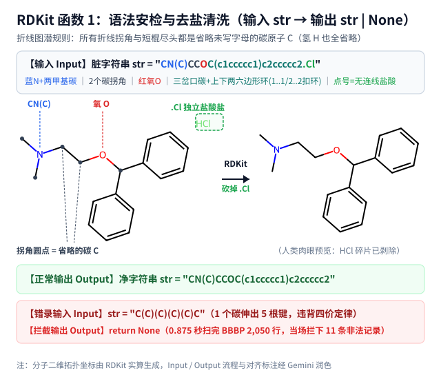
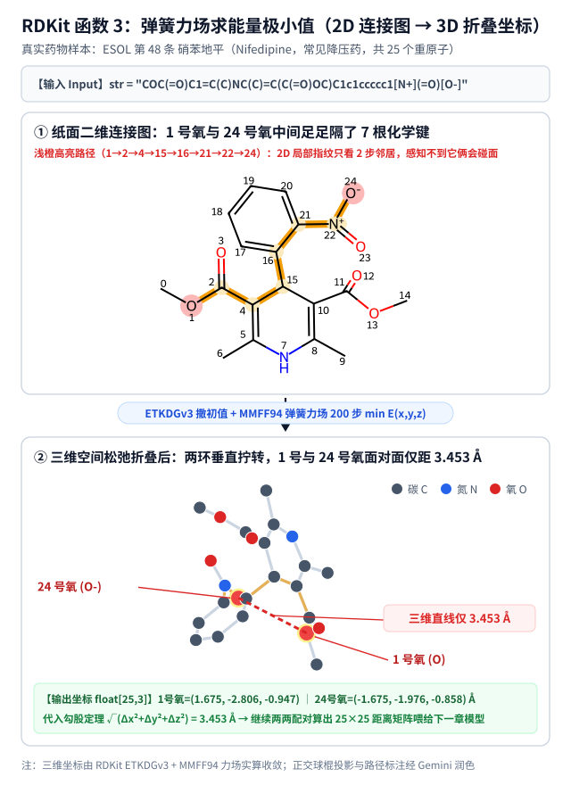
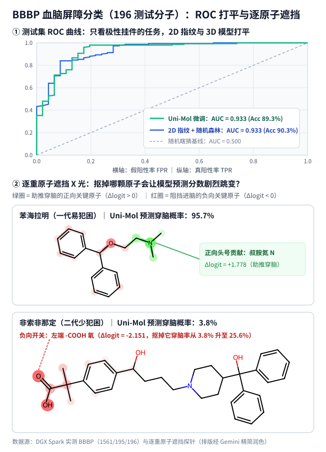

【AI for Science】有了千亿通用大模型，搞科研为啥还要用 RDKit 科学库和微调几千万参数的分子、蛋白质小模型？

━━━━━━━━━━━━━━━━━━━━

◆ 开篇：当一个不搞化学和生物的程序员，点开了英伟达的科学智能体推文

━━━━━━━━━━━━━━━━━━━━

前文 379 期 https://mp.weixin.qq.com/s/b8ggblxrq757Ee3W13gg4A 我们刚把 GitHub 上动辄五万星的八个“AI 自动搞科研 Skill”仓库全部克隆到本地清点了一遍，发现排在榜一的 `K-Dense` 仓库（5.81 万星）底下，藏着 `177` 个专门给大模型智能体调用的科学计算库技能包；紧接着这两天，一位做科学智能体的朋友又给我转来了一篇英伟达（NVIDIA）官方公众号刚发的推文《NVIDIA CUDA-X 库为智能体提供加速科学发现的工具》（ https://mp.weixin.qq.com/s/WkwcQoc5KUJMYr5dQbGhkw ），顺手聊起了他们日常最核心的三个工程场景：**一是用科学计算库处理实验数据，二是微调分子、蛋白质等科学专有模型，三是用科研 Skill 把这些工具串起来调用。**

作为一个平时只折腾通用大语言模型（LLM）和 GPU 算子、高中毕业后就没再碰过化学和生物的程序员，我第一反应冒出了三个非常朴素的疑问：

1.**既然现在已经有几百亿、上千亿参数的 DeepSeek、Qwen 和 Claude 了，为什么不能直接把化学分子式喂给通用大模型猜药效，非要先调 `RDKit`、`Biopython` 这类传统的“科学计算库”做数据处理？**
2.**做语言模型微调动辄是 `14B`、`32B`、`72B` 起步（参见前文 108 期 https://mp.weixin.qq.com/s/L3nacKQwhlHxOWcGhPvaYg ），为什么科学计算领域微调的“分子专有大模型（如深势科技的 `Uni-Mol`）”和“蛋白质专有大模型（如 Meta 的 `ESM-2`）”，参数量往往只有几百万到几千万（不到 `0.05B`）？它们肚子里到底改了 Transformer 的哪个零件？**
3.**在这个“科学库处理数据 → 专有模型微调推理 → 科研 Skill 串联调用”的流水线里，时间到底花在哪一步了？英伟达高调推出的 `CUDA-X` 科学加速库又是在替哪一步救急？**

光看概念综述永远隔着一层纱，尤其是刚接触“科学智能（AI for Science）”的程序员，看到文章里一会儿蹦出 `RDKit`、`Biopython`，一会儿蹦出 `Uni-Mol`、`ESM-2`，一会儿又是英伟达的 `CUDA-X`（`nvMolKit`、`cuPotential`、`cuSpa`），最容易犯迷糊的就是：**这些名字到底谁是谁的子模块？谁在调谁？**

其实只要把天文、材料那些外围学科先撇开，单盯住最核心的 **“生物制药（小分子化药 ＋ 大分子蛋白质）”** 领域，按 **“这软件到底是谁家出的、属于哪一类程序”** 切一刀，所有名字的边界一秒钟就清清楚楚了—— **没有什么比组织归属更清晰的分割线：**

| 软件性质（按东家与代码形态分） | **左列：化学小分子制药**  （阿司匹林等几十个原子的药片） | **右列：生物蛋白质与细胞**  （由 20 种氨基酸拼成的长链或切片） | 它们到底是什么，互相怎么配合？ |
| :--- | :--- | :--- | :--- |
| **第 1 类：中立开源社区的传统 CPU 科学基础库**  （写死物理化学公式，零神经网络） | **`RDKit`**  （最初源于瑞士诺华制药，现由独立开源社区维护） | **`Biopython`**  （国际开放生物基金会 OBF 社区维护） | **它俩是平级的“跨学科亲兄弟”** ——相当于化学界的 `NumPy` 和生物界的 `NumPy`，全是纯 CPU 跑的老牌 C++/Python 库，跟英伟达和各家大模型公司都没有隶属关系 |
| **第 2 类：AI 公司训出来的科学专有神经网络**  （`.pt` 权重文件，跑在常规 `PyTorch` 上） | **`Uni-Mol`**  （ **中国深势科技** 开源，`4,733 万`参数） | **`ESM-2`**  （ **美国 Meta / Facebook** 开源，`751 万`参数） | **它俩也是平级的“跨学科亲兄弟”** ——就跟语言领域的 `Qwen`、`Llama` 一样，本质是各家公司预训练好的微型 Transformer 权重，吃第 1 类科学库洗好的数据做微调打分，既不属于 `RDKit`，也不属于 `CUDA-X` |
| **第 3 类：英伟达自家的 `CUDA-X` 加速外挂库**  （老黄写的 GPU 算子扩展包） | **`nvMolKit`** （给 `RDKit` 捏构象加速）  **`cuPotential`** （给分子动力学加速） （均为 **美国英伟达 NVIDIA** 出品） | **`GPU-HMMER`** （蛋白序列搜索加速）  **`cuSpa`** （显微镜单细胞切片加速） （均为 **美国英伟达 NVIDIA** 出品） | **这一行才是英伟达 `CUDA-X` 军团** ——老黄为了卖显卡，专门把第 1 类传统科学计算里那些 CPU 跑得太慢的数值重活（如捏几万个三维构象、算十万原子力场）改写成 GPU 算子 |

看清这张“按东家切分”的座位表，调用关系就彻底透明了：
- 搞小分子药，标准动作是 **先调社区的 `RDKit`（第 1 行左）洗数据算三维坐标，再喂给深势的 `Uni-Mol`（第 2 行左）微调预测药效** ；
- 搞蛋白质改造，标准动作是 **先调社区的 `Biopython`（第 1 行右）做序列检查，再喂给 Meta 的 `ESM-2`（第 2 行右）微调预测活性** ；
- 至于第 3 行英伟达自家的 **`CUDA-X`** ，如果你平时只处理几千个分子，纯靠第 1 行 CPU 库加第 2 行 `PyTorch` 就全跑通了，压根不用装它；只有当数据量飙到几万、几亿级卡死 CPU 时，才会挂上第 3 行的 GPU 算子替第 1 行分担重活。

为了把这套体系用真代码摸透，我们把实验分成了上下两篇：下篇专门去拆第 3 行老黄那批 `CUDA-X` GPU 算子的源码，并把它们搬到家里的 `AMD RX 9070 XT` 显卡上真机跑分对账；而今天这篇上篇，我们先在家里的 `DGX Spark`（`NVIDIA GB10`，128GB 统一内存）上建好实验仓库（全套源码、真实数据集、微调脚本与数据账本均已开源： *https://github.com/lmxxf/ai-for-science-on-cuda-x* ）， **100% 聚焦上面表格的第 1 行和第 2 行（全程只调纯 CPU 的 `RDKit / Biopython` 配合标准 `PyTorch`）** ，拉下真实的药物水溶性数据集（`ESOL`）、血脑屏障穿透数据集（`BBBP`）以及蛋白质四位点组合突变湿实验数据集（`GB1`），把 **`RDKit` 洗数据捏三维坐标 → 深势 `Uni-Mol`（`4,733 万`参数）全参数微调 → Meta `ESM-2`（`751 万`参数）全参数微调 → 科研 `SKILL.md` 一键串联** 从头到尾跑了一遍。

跑完这套实验再回头看，原本被各种物理、化学、生物学术语包裹的“AI for Science（科学智能）”，在程序员眼里瞬间祛了魅—— **它跟我们熟悉的“大模型生成代码 + 编译器做语法校验 + 奖励模型（Reward Model）给结果打分”是完全同构的一套工程流水线。**

在进入每一章的实验细节之前，我们再用程序员最熟悉的 **“要解决什么业务问题 → 优化目标是什么 → 函数的输入与输出数据类型是什么”** ，把今天实测登场的四个核心工具压成一张极简的 IT 接口总表：

| 工具 / 模型 | 它在计算机体系里相当于什么？ | **输入（Input 数据类型）** | **内部操作与优化目标（Operation & Objective）** | **输出（Output 数据类型）** |
| :--- | :--- | :--- | :--- | :--- |
| **1. `RDKit`**  （开源化学信息学基础库） | 化学界的 **编译器前端（语法安检）＋ 3D 物理几何引擎** | **一行 ASCII 字符串** （分子式 `SMILES`，如阿司匹林 `CC(=O)OC1=CC=CC=C1C(=O)O`） | ① **语法验证器** ——按化合价规则查语法树、剥离 `.Cl` 盐杂质（非法直接 `return None`）； ② **2D 特征公式** ——遍历二维分子图算理化常数与子结构哈希； ③ **3D 坐标优化** —— **优化目标是最小化分子内胡克定律弹簧势能与空间排斥能 `min E(x,y,z)`** （`ETKDGv3 + MMFF94` 迭代 200 步松弛） | ① **`float[6]` 理化指标** （分子量 `MW`、亲油度 `LogP`、极性表面积 `TPSA` 等）； ② **`int[2048]` 的 0/1 比特数组** （Morgan 2D 指纹）； ③ **`float[N, 3]` 三维坐标 ＋ `float[N, N]` 两两原子欧氏距离矩阵 `D[i, j]`** （单位：埃 `Å`） |
| **2. `Uni-Mol`**  （深势科技的 3D 分子专有模型，`4,733 万`参数） | 吃 **3D 距离矩阵** 的 15 层微型 **BERT 编码器（快速代理判分器 / Surrogate Verifier）** | **① `int[N]` 原子编号数组** （词表总共仅 `31` 个词元：C/N/O/S…）；  **② `float[N, N]` 原子三维距离矩阵 `D[i, j]`** （由上一步 `RDKit` 生成后喂入） | **预训练目标** ——完形填空猜被遮住的原子 ＋ 把加噪晃歪的 3D 坐标还原回真实距离；  **微调优化目标** ——在第 15 层 `[CLS]` 向量后接 `512 → 1` 线性头， **最小化模型预测值与湿实验真值的均方误差 `MSELoss`（回归）或交叉熵 `BCE`（分类）** ，在每一层 Attention 打分上直接叠加 128 个高斯核量出的三维空间距离偏置 | **`float[1]` 预测标量** （无需进实验室，毫秒级推理输出该分子在真水里的 **水溶解度 `logS`** ，或穿过 **血脑屏障的概率 `0 至 1`** ） |
| **3. `Biopython`**  （开源生物序列基础库） | 蛋白质界的 **字符串静态检查与统计脚本** | **一行大写字母字符串** （蛋白质氨基酸序列，如长度 `56` 的 `MQYKLILNGK...`，仅由 `20` 种标准字母组成） | 校验每个字符是否属于 20 种合法标准氨基酸，并按每个氨基酸字母的固定物理化学常数做确定性公式累加 | **`float[5]` 理化特征向量** （分子量 `MW`、等电点酸碱度 `pI`、芳香性、不稳定指数、亲疏水均值 `GRAVY`） |
| **4. `ESM-2`**  （Meta 的蛋白质专有模型，`751 万`参数） | 吃 **20 种氨基酸字母** 的 6 层微型 **RoPE 编码器（突变活性代理判分器）** | **一行氨基酸大写字母字符串** （词表总共仅 `33` 个词元：20 种标准氨基酸 ＋ 控制符） | **预训练目标** ——在数千万条自然界进化存活的蛋白质上做完形填空，记住哪些位点同时改会破坏折叠；  **微调优化目标** ——接 `320 → 1` 回归头， **最小化与湿实验结合活性真值的 `MSELoss`** ；微调后作为 **虚拟验证器** 对未做过实验的突变组合批量打分 | **`float[1]` 预测标量** （输入一条改了几个字母的突变蛋白序列，直接推理输出它与靶点结合的 **实验适应度打分 `Fitness`** ） |

看清这张接口表，整个“科学智能”的底层逻辑就一句话： **在制药和生物工程里，真实物理世界的“最终验证器（湿实验室合成与测试）”跑一次要花几周时间和几万块钱；所以我们先用 `RDKit / Biopython` 当“编译器前端与几何模拟器”把一维字符串变成合法的三维结构特征，再拿几千条真实湿实验数据微调出一个几千万参数的 `Uni-Mol / ESM-2` 当“毫秒级神经网络代理验证器（Surrogate Verifier / Reward Model）”，在显卡上先替湿实验室把成千上万种候选分子和突变蛋白筛一遍。**

下面我们就顺着每个函数的 **“问题是什么 → 输入/操作/输出是什么 → 实测优化效果如何”** ，把这套流水线逐一跑开。

━━━━━━━━━━━━━━━━━━━━

◆ 第一章：科学库 `RDKit` 的三个函数在干什么——语法安检、2D 理化公式，与求能量极小值的 3D 坐标展开

━━━━━━━━━━━━━━━━━━━━

**一、第一个函数（语法验证与清洗 `SMILES -> Cleaned Mol`）：要解决什么问题，怎么拦下非法五价碳与剥离盐酸盐？**

**1. 要解决的工程问题** ——在化学和制药实验室导出的 CSV 表格里，分子并不是一张张画好的六边形图片，而是一串叫 **`SMILES`（Simplified Molecular Input Line Entry System，简化分子线性输入规范）** 的单行 ASCII 字符串。比如：

- **阿司匹林（解热镇痛药）** ——`CC(=O)OC1=CC=CC=C1C(=O)O`
- **咖啡因（中枢神经兴奋剂）** ——`CN1C=NC2=C1C(=O)N(C(=O)N2C)C`

在程序员眼里，`SMILES` 其实就是一张 **无向图（Graph）的序列化字符串** ——每个原子符号代表一个节点（`C` 是碳原子、`O` 是氧原子、`N` 是氮原子、`Cl` 整体是一个氯原子），括号代表分支，`=` 代表双键，成对出现的数字 `1...1` 代表把带同一数字的两个原子连起来扣成一个环。

如果你直接把这串字符喂给通用大语言模型（比如 `Qwen` 或 `DeepSeek`），或者喂给后面的神经网络，会立刻撞上两个脏数据灾难：一是人工录入或大模型生成的字符串里常有 **“编译语法错误”** （比如一个碳原子伸出了 5 条化学键，在物理世界根本不存在）；二是真实药片里常混着起助溶作用的 **“无机盐尾巴”** （比如 `.Cl` 盐酸）。通用大模型的分词器（Tokenizer）只会按子词频次把字符串切碎盲猜，根本不会做化学语法校验。

**2. `RDKit` 的输入、操作与输出** ——开源科学计算库 **`RDKit`** （ *https://github.com/rdkit/rdkit* ，底层 C++ 实现、上层提供 Python 接口，地位相当于化学界的 `gcc 前端 + NumPy`），干的第一件活就是确定性的 **“语法安检与去盐清洗”** ——
- **输入（Input）** ——一行原始 `SMILES` 字符串；
- **内部操作（Operation）** ——把字符串解析为内存里的分子图（节点=原子，边=共价键），逐个节点核对元素最外层电子允许的化合价上限（`sanitize=True`），随后调用 `SaltRemover` 剥离掉以 `.` 分隔的无机盐碎片，只保留最大的有机母体连通图；
- **输出（Output）** ——校验不通过直接返回 `None` 拒收；通过则返回净化的标准 `Mol` 图对象（及其规范化 `Canonical SMILES` 字符串）。

请看我们在真实数据集上调用 `RDKit` 第一个函数跑出来的 **输入字符串 → 解析预览 → 输出净字符串 / `None`** 示意图（分子二维坐标由 `RDKit` 实算，排版标注经 Gemini 润色对齐）：

没学过有机化学的程序员第一次看上面这张折线图，只要记住 **四条符号潜规则** ，顺着图顶部的彩色输入字符串 `CN(C)CCOC(c1ccccc1)c2ccccc2.Cl` 从左往右一指就全通了：

- **潜规则 1（为什么图上看不见字母 `C`？）** ——化学家画折线图时偷懒把所有的碳原子 `C`（以及补满化合价的氢原子 `H`）全省略了， **图上每一个折线拐角和短棍尽头（图中标出的小黑点），其实都是一个碳原子 `C`** ；只有遇到氮 `N`（蓝）、氧 `O`（红）、氯 `Cl`（绿）这些非碳原子，才把英文字母印出来。
- **潜规则 2（括号 `()` 是分叉）** ——开头的 `CN(C)` 从左往右看：左上短棍尽头是第 1 个碳 `C`，连着蓝色的 `N`，括号 `(C)` 代表从 `N` 分叉往下伸出去的另一根甲基碳短棍；接着往右走两步锯齿拐角就是 `CC`，再连上中间红色的氧 `O`。
- **潜规则 3（`c1ccccc1` 和 `c2ccccc2` 里的数字 `1, 2` 是什么？）** ——它们 **不是** 原子个数或数组下标，而是 **把一维直线首尾扣成六边形圆环的“成对卡扣标签”** 。一维字符串只能直着写，怎么画六边形？就在第 1 个碳后面贴个 `1` 号标签（`c1`），连写中间 4 个碳，到第 6 个碳后面再贴同一个 `1` 号标签（`c1`，数一数刚好 6 个字母 `c`），解析器见到成对的 `1...1` 就把头尾两个碳连起来扣成上方的六边形苯环；下方的六边形同理换用一对 `2...2` 号卡扣写成 `c2ccccc2`（小写字母 `c` 自动代表六边形里单双键交替的芳香碳）。
- **潜规则 4（为什么右上角的绿色 `HCl` 没有线连着主分子？）** ——这正是末尾那个 **英文句点 `.`（`.Cl`）** 的语法定义：**句点 `.` 代表前后两部分之间没有任何共价键连线，是散装在同一个格子里的两个独立分子** 。药厂卖的“盐酸苯海拉明”，是把药分子泡进盐酸里靠静电吸在一起压成药片，进水就各散各的。

看懂了这张图，再看我们在真实的 **`BBBP` 血脑屏障穿透率数据集** （Blood-Brain Barrier Penetration，原始 CSV 共 `2,050` 行： *https://github.com/lmxxf/ai-for-science-on-cuda-x/blob/main/data/BBBP.csv* ）和 **`ESOL` 水溶性数据集** （Estimated SOLubility，共 `1,128` 行： *https://github.com/lmxxf/ai-for-science-on-cuda-x/blob/main/data/delaney-processed.csv* ）上跑完 `RDKit` 入库清洗管线（`exp1_rdkit_data_processing.py`）抓出的两类典型脏数据，就一目了然了：

1.**拦截违背化学价定律的错录结构** ——碳原子最外层只有 4 个电子，最多只能结成 4 根共价键（四价）。但在人工录入或 OCR 提取的实验表里，常会混入像 `C(C)(C)(C)(C)C`（一个中心碳原子连了 5 个甲基，成了“五条腿的非法五价碳”）或氮原子价态错误的字符串。调用 `RDKit` 的 `Chem.MolFromSmiles(smiles, sanitize=True)` 时，这套入库清洗与描述符流程在 `0.875 秒` 内扫完 `BBBP` 的 2,050 行记录， **当场拦截并剔除 `11` 条未通过解析与化合价校验的非法结构** ，放行 `2,039` 条可处理记录（随后将同一母核却标了相反 0/1 标签的 `11` 组冲突记录整组剔除并按标准母核去重得到 `1,955` 个唯一母体，再剔除 `3` 个无法生成三维构象的样本后，最终 `1,952` 个分子进入后续三方同考卷对照）。
2.**按句点 `.` 去盐清洗（Salt Stripping）** ——正如图左侧演示的那条盐酸苯海拉明（`CN(C)CCOC(c1ccccc1)c2ccccc2.Cl`），如果不把右上角那团没有共价键连着的绿色 `HCl`（盐酸）洗掉就直接喂给下游模型，分子量就会凭空多出 `36.46`，还会干扰真正起药效的有机母体。调用 `RDKit` 的 `SaltRemover` 并保留最大重原子连通母核，就能顺着 `.` 直接剥掉 `.Cl`，输出洗净的母体字符串 `"CN(C)CCOC(c1ccccc1)c2ccccc2"`。

────────────────────

**二、第二个函数（2D 理化属性与指纹计算 `Mol -> float[6] & int[2048]`）：输入分子图、输出几个浮点数，看图秒懂“为什么一代抗过敏药吃完犯困，二代却很少犯困？”**

**1. 要解决的问题与输入/输出** ——洗干净分子图 `Mol` 之后，如果我们想知道这个分子有多重、喜不喜欢溶于油脂、容不容易钻过人脑的血管壁，最快的方法不是上神经网络，而是调 `RDKit` 的第二个确定性函数直接查表算二维物理化学指标（Descriptors）：
- **输入（Input）** ——上一步洗净的二维分子图 `Mol` 对象；
- **内部操作（Operation）** ——遍历图上的每个原子与局部子结构，按经验物理化学公式直接累加；同时把每个原子周围半径 2 步以内的局部连接小零件做一次 `Hash % 2048`，把长度为 `2,048` 的一维 `0/1` 数组中对应下标置为 `1`（化学上叫 **Morgan 2D 指纹** ——注意它 **不是图像** ，本质就是一个只看纸面连接关系、不看三维坐标的 **一维布隆过滤器 `0/1` 数组** ，可直接喂给随机森林训练）；
- **输出（Output）** ——一组浮点数标量（如分子量 `MW`、脂水分配系数 `LogP`、拓扑极性表面积 `TPSA`）以及一个 `int[2048]` 的 0/1 特征向量。

为了直观看到这几个输出浮点数在真实药物筛选里怎么当“第一道粗筛验证器”，我们在实验里挑了 7 种大家家里药箱常备的真实药物（全部与美国国家医学图书馆 `PubChem` 官方标准结构 CID 逐一核对无误），用 `RDKit` 算出了三个最核心的药学描述符：

| 常见真实药物（中性母体结构） | 临床用途与体征差异 | 分子量 `MW` | 脂水分配系数 `LogP`（越大越亲油） | 拓扑极性表面积 `TPSA`（平方埃 `Ų`，越大越亲水） |
| :--- | :--- | ---: | ---: | ---: |
| **苯海拉明（Diphenhydramine，CID 3100）** | **第一代抗过敏药（可引起明显嗜睡）** | **`255.36`** | **`3.35`** | **`12.47`** |
| **非索非那定（Fexofenadine，CID 3348）** | **第二代抗过敏药（通常较少引起嗜睡）** | **`501.67`** | **`5.51`** | **`81.00`** |
| **氯雷他定（Loratadine，开瑞坦，CID 3957）** | 第二代抗过敏药（较少嗜睡） | `382.89` | `4.89` | `42.43` |
| **西替利嗪（Cetirizine，仙特明，CID 2678）** | 第二代抗过敏药（较少嗜睡） | `388.90` | `3.15` | `53.01` |
| **阿司匹林（Aspirin，CID 2244）** | 解热镇痛抗炎药 | `180.16` | `1.31` | `63.60` |
| **咖啡因（Caffeine，CID 2519）** | 中枢神经兴奋剂（秒进大脑提神） | `194.19` | `-1.03` | `61.82` |
| **布洛芬（Ibuprofen，芬必得，CID 3672）** | 解热镇痛抗炎药 | `206.28` | `3.07` | `37.30` |

请看把 **苯海拉明（第一代抗过敏药）** 和 **非索非那定（第二代抗过敏药）** 分别喂进 `RDKit` 第二个函数（输入分子字符串 `str` → 查常数表做小学加法 → 输出 `[MW, LogP, TPSA]` 三个浮点数）的实算示意图：

![RDKit 函数 2：查表累加含氧亲水挂件输出三个浮点数（str -> float[3]），秒懂一二代抗过敏药嗜睡差异](assets/381/fig1b_rdkit_2d_props_bbb.svg)

把上面两张卡片里的浅红色圆圈（即容易与水分子结合的 **含氧亲水挂件** ，不用死记化学上的“羟基 `-OH`、羧基 `-COOH`”名字，直接看分子上挂了几个氧原子就行）和底部的输出数组 `float[3]` 对着看，一个困扰过无数鼻炎患者的日常谜题就迎刃而解了：

- 人脑毛细血管的内皮细胞靠紧密连接等机制形成了致密的 **血脑屏障（Blood-Brain Barrier，简称 BBB）** ，专门阻挡血液里的乱七八糟物质随便钻进大脑。抗过敏药本来只需要在鼻腔黏膜和皮肤里阻断组胺受体就够了；可如果药分子不小心穿过了血脑屏障钻进大脑，就会把大脑里负责维持清醒的中枢组胺受体也一并关掉，人吃完就会困得睁不开眼。
- 你看 **样本 A（第一代抗过敏药：苯海拉明）** ——碳原子全算 `0` 分（不亲水），它左端一条碳链、右端两个苯环，全身上下只有中间 **1 个浅红色的氧原子挂件** ，`RDKit` 查表累加输出的第三个浮点数 **`TPSA`（极性亲水面积）只有区区 `12.47 平方埃`** ，分子量也只有 `255.36`。因为亲水面积极小、浑身亲油，它遇到同样是油脂做的血脑屏障时，很容易钻进中枢神经系统引起明显嗜睡；
- 再看 **样本 B（第二代抗过敏药：非索非那定）** ——为了不让它进大脑，药学家故意在它左端挂了一个 `-COOH`（含 2 个氧）、中右又挂了 2 个 `-OH`（共 **4 个浅红色含氧亲水挂件** ），`RDKit` 查表加出来的 **`TPSA` 直接翻了 6.5 倍（输出 `81.00 平方埃`）** ，分子量也翻倍到 `501.67`（外加生理环境下电离与血管壁外排泵作用），很难再大量钻过血脑屏障，自然就少了嗜睡的副作用。

────────────────────

**三、第三个函数（3D 物理力场能量最小化 `Mol -> float[N, N]` 距离矩阵）：为什么 2D 拓扑还不够？看降压药“硝苯地平”在三维空间里隔 7 根键却折到 `3.453 埃`**

**1. 要解决的问题（为什么 2D 图不够用）** ——既然 `RDKit` 算出来的二维拓扑图和 `int[2048]` 指纹这么快，为什么深势科技还要费劲开发吃三维坐标的 **分子专有模型 `Uni-Mol`** ？

因为真实的分子不是印在纸上的扁平贴画，而是活在三维物理空间里、单键可以像铰链一样自由旋转折叠的立体结构。两个原子在二维拓扑图上隔了七八步远（`int[2048]` 的局部 2D 指纹根本感知不到它俩的关系），在三维空间里弯折过来之后，却可能面对面贴在一起发生强烈的静电吸引或空间排斥。

**2. `RDKit` 3D 构象生成的输入、优化目标与输出** ——为了在电脑里算出分子在自然界最稳定的三维折叠形状，我们需要调 `RDKit` 最耗算力的第三个函数：
- **输入（Input）** ——二维分子图 `Mol`（只知道谁和谁连着，没有三维坐标）；
- **内部操作与优化目标（Operation & Optimization Objective）** ——把每一根化学键看作一根胡克定律弹簧、把不相连的原子看作带电小球， **优化目标是寻找一组三维原子坐标 `(x_i, y_i, z_i)`，使整个分子的经典物理总势能 `E_total = E_键长伸缩 + E_键角弯曲 + E_二面角扭转 + E_范德华力 + E_库仑静电力` 降到极小值（即对三维坐标做物理力场梯度下降）** 。具体分两步：先补齐氢原子（`Chem.AddHs`）并用 `ETKDGv3` 距离几何算法随机撒出初始 3D 姿态，再调默克分子力场 `MMFFOptimizeMoleculeConfs(maxIters=200, mmffVariant='MMFF94')` 迭代最多 200 步把分子松弛到能量谷底；
- **输出（Output）** ——去掉氢原子后的 `N` 个重原子三维坐标 `float[N, 3]`，以及两两原子之间的 **三维欧氏距离矩阵 `D[i, j]`（形状 `float[N, N]`，单位：埃 `Å`）** 。

我们在 `ESOL` 水溶性数据集（`0` 起始索引第 `48` 条）里，直接抓出了一个极具代表性的真实药物案例——家里老人常吃的降压药 **硝苯地平（Nifedipine）** ，请看我们用 `RDKit` 第三个函数算出的 **二维平面隔 7 根键 → 三维空间折叠到 `3.453 埃`** 实测示意图（坐标由 `RDKit` 力场实算，路径与投影标注经 Gemini 润色）：

顺着图上的 ① → ② 两步往下看：

1.**在纸面二维连接图上（图 ①）** ——请盯住左下角标了浅红圈的 **`1` 号氧原子（`O`）** ，以及右上角苯环上标了浅红圈的 **`24` 号氧原子（`O-`）** 。如果顺着图中浅橙色高亮出来的二维化学键一格一格数过去（`1 → 2 → 4 → 15 → 16 → 21 → 22 → 24`），这两个氧原子中间 **足足隔了 7 根化学键** 。在任何只看一维字符串或二维分子指纹（如半径为 2 步的 Morgan 布隆过滤器数组）的模型眼里，这俩原子隔了十万八千里，压根感知不到它俩会在半空中碰面。
2.**用 `RDKit` 弹簧力场松弛成三维折叠坐标（图 ②）** ——我们调用 `RDKit` 的两步物理几何算法：先调 `Chem.AddHs` 补齐显式氢原子并用 `ETKDGv3` 撒出初始三维构象，接着调 `MMFFOptimizeMoleculeConfs(maxIters=200, mmffVariant='MMFF94')` 做最多 200 步弹簧势能最小化松弛，最后去掉显式氢导出全部 `25` 个重原子的三维坐标 `float[25, 3]`。
3.**惊人的空间折叠** ——当硝苯地平在三维空间里松弛到能量谷底后，因为两个环是近乎垂直拧着的，原本在平面图上隔了 7 根键的 **`1` 号氧原子 `(1.675, -2.806, -0.947)`** 与 **`24` 号氧原子 `(-1.675, -1.976, -0.858)`** ，在半空中竟然面对面折到了一块儿（图 ② 中的红色虚线）。拿初中勾股定理 `√((x₁-x₂)² + (y₁-y₂)² + (z₁-z₂)²)` 一算，它俩的真实三维直线距离只有 **`3.453 埃`（`Å`，1 埃等于 `10⁻¹⁰` 米）** ；再把全部 `25` 个重原子两两配对算一遍勾股定理，就得到了下一章喂给神经网络的 **`25 × 25` 欧氏距离矩阵 `D[i, j]`** 。

不过，用 `RDKit` 捏出这套三维立体坐标是有算力代价的。我们在 `DGX Spark` 的 CPU 上对 1,000 个真实药物分子做了严格的单核与 8 核墙钟计时：

| 分子数量 | 每个分子请求的 3D 构象数 | CPU 进程数 | 实测墙钟耗时（秒） | 成功生成构象数 | 200 步内 MMFF94 力场完全收敛数 |
| ---: | ---: | ---: | ---: | ---: | ---: |
| `1,000` | `1` 个构象（快速单构象） | 单核（`1` 进程） | **`7.961 秒`** | `1,000` | `883` |
| `1,000` | `1` 个构象（快速单构象） | `8` 核并行 | **`1.146 秒`** | `1,000` | `883` |
| `1,000` | **`10` 个构象（多构象能量采样）** | 单核（`1` 进程） | **`66.608 秒`** | `10,000` | `8,870` |
| `1,000` | **`10` 个构象（多构象能量采样）** | `8` 核并行 | **`9.987 秒`** | `10,000` | `8,870` |

先记住表里那个 **`66.608 秒`** ——等下一章我们看完 GPU 微调神经网络只花多少秒，你就会发现一个非常反直觉的工程真相。

━━━━━━━━━━━━━━━━━━━━

◆ 第二章：分子专有模型 `Uni-Mol` 在干什么——输入 `31` 词表原子与 `N×N` 距离矩阵，微调出一个毫秒级“水溶性与穿脑率验证器”

━━━━━━━━━━━━━━━━━━━━

**一、`Uni-Mol` 的输入、架构与输出：为什么它只有 `4,733 万`参数，却能当三维分子的通用底座？**

拿到了第一章 `RDKit` 第三个函数输出的重原子列表 `int[N]` 和三维距离矩阵 `D[i, j]`（`float[N, N]`），接下来就轮到 **“分子专有大模型”** 登场了。

先用程序员视角把它的角色定清楚：如果我们在电脑里设计或筛选成千上万个新药分子，最卡脖子的不是“怎么生出分子字符串”，而是 **“怎么在进湿实验室真做之前，快速验证这个分子在水里溶不溶得开（水溶性 `logS`）、会不会钻进大脑引起嗜睡（血脑屏障穿透率 `BBBP`）”** 。深势科技（DP Technology）开源的三维分子预训练模型 **`Uni-Mol v1`** （ *https://github.com/deepmodeling/Uni-Mol* ，加载官方预训练权重 `mol_pre_no_h_220816.pt`），本质上就是一个 **吃三维分子结构、输出物理化学属性分数的神经网络代理验证器（Surrogate Verifier / Reward Model）** 。

我们用脚本把 `Uni-Mol` 的每一层张量形状全部打印了出来（保存在仓库 `results/unimol_architecture.json`）。习惯了动辄几百亿参数通用大模型的程序员，第一眼看到它的真实体检单都会愣一下—— **它的总参数量只有 `47,331,139`（约 `4,733 万`参数，不到 `0.05B`，FP32 权重文件才 180MB）** 。请先看这张从上一章硝苯地平 `25 × 25` 距离矩阵一路喂进 `Uni-Mol` 注意力层的结构分解图：

![从 RDKit 输出的 25×25 欧氏距离矩阵 D[i,j]，到深势 Uni-Mol 的 128 个高斯卡尺与 64 头空间偏置](assets/381/fig2b_distance_matrix_to_unimol.svg)

对照上图把 `Uni-Mol` 的 **输入、内部计算与输出** 和普通文本 Transformer 并排一比，你就明白为什么它这么小却比千亿通用语言模型更懂分子了：

1.**输入端（Input）——`31` 词表原子编号 ＋ 满足旋转平移不变性的 `N × N` 距离矩阵（图 ①）** ——通用语言模型得覆盖十万个人类词汇；而构成常见有机药分子的化学元素来回就二十几种。`Uni-Mol` 每次前向只吃两样东西：
   - **第一路输入（节点特征 `int[N]`）** ——分子里的 `N` 个原子编号（词表总共仅 **`31` 个词元 `Embedding(31, 512)`** ——含 `26` 种元素符号及 `PAD / CLS / SEP / UNK / MASK` 五个控制符），查表变成 `[N, 512]` 的原子向量；
   - **第二路输入（边特征 `float[N, N]`）** ——就是上图 ① 那张 `25 × 25` 对称距离矩阵 `D[i, j]`（红框标出的浅色格就是 `1` 号与 `24` 号氧那 `3.453 埃` 的折叠近邻）。为什么不直接喂 `(x, y, z)` 坐标而要喂 `D[i, j]`？因为不管分子在水杯里怎么翻滚旋转、怎么平移，单个原子的 `(x, y, z)` 会全变，但 **内部两两原子间的直线距离 `D[i, j]` 永远分毫不差** 。
2.**中间计算（Operation）——把一维位置编码 `RoPE`，换成“128 把高斯核尺子”量出来的三维距离注意力偏置** ——文本句子的词是有先后顺序的（第 1 个字、第 2 个字），所以用一维位置编码；但三维空间里的分子没有“谁排第一、谁排第二”，只有“谁离谁多远”。`Uni-Mol` 的主干是一个 **15 层、隐藏维 `512`、前馈网络（FFN）维 `2048`、带 `64` 个注意力头（每头宽度仅 `512 / 64 = 8` 维）** 的双向 Transformer 编码器（类似 BERT）。在进第 1 层之前，它先把任意两个原子 `(i, j)` 之间的三维直线距离 `d_ij`（比如刚才硝苯地平那两个氧原子的 `3.453 埃`）按原子对种类做一次缩放平移，然后送进 **128 个中心 `μ_k` 和宽度 `σ_k` 各不相同的高斯钟形函数（Gaussian Kernels）** ——
   `g_k(d_ij) = exp( - (d_tilde_ij - μ_k)² / (2 · s_k²) ) / (√(2π) · s_k)` （`s_k = |σ_k| + 10⁻⁵`，`k = 1 ... 128`）
   说人话：这 128 个高斯核就像 **128 把不同刻度的卡尺** （比如某把卡尺专门盯是不是 `1.2 埃` 左右的共价双键，另一把卡尺专门盯是不是 `3.4 埃` 左右的空间折叠接触）。接着过一个两层小网络（`128 → 128 → 64`），把 128 把卡尺的读数压成 **64 个注意力头的初始成对空间偏置 `PairRepr[i, j]`（形状 `[N, N, 64]`）** 。
3.**逐层演化与输出端（Output）** ——在第 `l` 层（共 15 层）的第 `h` 个注意力头（共 64 头）里，原子 `i` 对原子 `j` 的注意力打分直接加上这格三维空间偏置：
   `Score_ij^(l, h) = ( Q_i^(l, h) · (K_j^(l, h))ᵀ ) / √8 + PairRepr_ij^(l-1, h)`
   而且扒开源码会发现一个关键细节：`PairRepr` 并不是 15 层死板共用同一个初始距离，而是 **每一层算出来的注意力未归一化分数 `Score_ij`，会直接覆写更新成为下一层的 `PairRepr_ij`** 。深势在预训练阶段喂了 **2.09 亿个三维分子构象** （预训练的优化目标有两个：一是完形填空猜被遮住的原子符号，二是把故意加高斯噪声晃歪的 3D 坐标还原回真实距离），早就把三维立体化学的物理规律刻进了这 15 层权重里。跑完 15 层后，模型输出每个原子的 `[N, 512]` 表征（其中第 0 号位置 `[CLS]` 的 `512` 维向量就是整个三维分子的全局摘要）。

────────────────────

**二、真机微调实验一（训一个“药物水溶性验证器”）：优化目标是什么？37 秒全参数微调把误差从 `1.144` 砍半到 `0.574`**

有了预训练好的 `Uni-Mol` 底座，科学智能体公司常说的 **“微调科学专有模型”** ，在代码里到底在优化什么？

我们在 `DGX Spark` 上写了 `exp2_unimol_finetune.py`，针对制药第一关—— **给定一个新分子，预测它在真水里的溶解度（`ESOL`，输出连续实数 `logS`，单位是摩尔浓度的对数）** ，做了一场严格的同考卷对照：

- **训练数据与防泄题切分** ——把 `ESOL` 原始 1,128 行湿实验测出的真实水溶性记录经 `RDKit` 去盐清洗并按标准母核去重，得到 **`1,117` 个唯一分子** ；固定随机种子 `42` 按 `80% : 10% : 10%` 切分为 **训练集 `893` 个、验证集 `112` 个、留出测试集 `112` 个** （确保同一母核分子绝不跨集合出现）。
- **微调的输入、输出与优化目标（Optimization Objective）** ——
  - **输入** ——`RDKit` 生成的原子编号 `int[N]` ＋ 三维距离矩阵 `float[N, N]`；
  - **输出** ——取 `Uni-Mol` 第 15 层输出的全局汇总词元 `[CLS]`（`512` 维向量），外接一个线性回归头 `Linear(512 -> 1)`，输出一个标量浮点数 `ŷ`（模型预测的水溶解度 `logS`）；
  - **优化目标（Loss 函数）** —— **最小化模型预测溶解度 `ŷ` 与湿实验真实溶解度 `y` 之间的均方误差 `L = MSELoss(ŷ, y) = mean((ŷ - y)²)`** 。因为整台模型加上新回归头总共才 **`4,733 万`参数** （训练时 Torch 峰值分配 GPU 显存仅 **`2.234 GiB`** ），根本不需要像微调 70B 语言模型那样抠门地只挂 LoRA，而是 **把全部 4,733 万个参数全部解冻，用 `AdamW`（学习率 `1e-4`）做 20 轮全参数微调** ，仅用验证集 `RMSE`（均方根误差）挑选最佳的第 13 轮权重，在 112 个留出测试分子上只做一次盲测。

请看我们在同一张 112 分子测试考卷上跑出来的第三张实测对比图：

三名选手的同考卷实测成绩单如下（`RMSE` 与 `MAE` 误差越低越好，决定系数 `R²` 越接近 `1.0` 越好）：

| 参赛方案 | 输入给模型的特征是什么 | 留出测试集 `RMSE`（`logS`）↓ | 测试集平均绝对误差 `MAE` ↓ | 决定系数 `R²` ↑ |
| :--- | :--- | ---: | ---: | ---: |
| **1. 常数均值基线（Dummy Mean）** | 什么都不看，全猜训练集均值 `-3.06` | `2.1757` | `1.6646` | `-0.0003` |
| **2. 传统化学机器学习（`RDKit` 2D 指纹 ＋ 随机森林）** | `RDKit` 提取 `2,048` 位半径 2 的 Morgan 二维拓扑指纹 ＋ `400` 棵树随机森林 | `1.1442` | `0.8203` | `0.7234` |
| **3. 微调深势 `Uni-Mol` 3D 分子专有模型** | **原子种类 ＋ `RDKit` 三维构象欧氏距离矩阵 `D[i, j]`（20 轮全参数微调）** | **`0.5738`** | **`0.4120`** | **`0.9304`** |

这张表和图底部的耗时条，直接给出了两个非常实在的工程洞察：

1.**`4,733 万`参数的 3D 专有模型把传统 2D 指纹的误差砍掉了一半** ——在完全相同的 112 个测试药物分子上，传统化学界最常用的 `RDKit` 2048 维二维指纹配随机森林，误差 `RMSE` 停在 `1.1442`（`R² = 0.7234`）；而引入了三维原子距离矩阵并对 `Uni-Mol` 预训练主干做微调后，测试误差直接腰斩到 **`0.5738`** ，决定系数飙升至 **`0.9304`** （图中部绿色散点严丝合缝地贴在对角线上）。
2.**CPU 预处理与 GPU 训模型的耗时倒挂点** ——在 `DGX Spark` 的 GPU 上，把 `4,733 万`参数的 `Uni-Mol` 完整训完 20 轮（外加每轮跑一次验证集），总共只花了 **`37.183 秒`** 。如果我们像本次基准这样每个分子只让单核 CPU `RDKit` 生成 **1 个** 三维构象，本轮微调所使用的 1,128 个分子单构象生成计时为 **`8.870 秒`** （此时 GPU 训练仍是主头）；但只要切到第一章表里的 **“每分子采样 10 个三维构象做力场优化”** ，单核 CPU `RDKit` 的耗时就会立刻飙到 **`66.608 秒`** —— **CPU 调科学库捏三维坐标的时间，反过来超过了 GPU 训 20 轮 Transformer 的时间。**

────────────────────

**三、真机微调实验二（训一个“血脑屏障二分类验证器” `BBBP` 与逐原子遮挡归因）：什么时候 2D 已经够用，以及模型眼里的“犯困开关”在哪？**

既然 `Uni-Mol` 在水溶性回归（`MSELoss`）上大胜，那把它的输出头换成二分类（优化目标换成二元交叉熵 `BCEWithLogitsLoss`，输出 `0 至 1` 之间的穿脑概率），它在任何药物任务上都能碾压二维指纹吗？本着“不替任何模型吹牛、跑出什么记什么”的原则，我们接着在 **`BBBP`（1,955 个去重且无冲突标签的母体中成功生成三维构象的 `1,952` 个药物分子，判断能否穿过血脑屏障的 0/1 二分类任务）** 上跑了同样的 20 轮全参数微调（`exp4_bbbp_unimol_and_amd.py`），并把微调好的模型拉出来做了一次 **“逐重原子遮挡归因（Atom Occlusion Attribution）”** ，请看第四张实测图：

这一轮跑出了两项极其有意思的结果：

1.**诚实的阴性对照：在 `BBBP` 二分类上，`Uni-Mol`（`ROC-AUC = 0.9333`）与二维指纹随机森林（`0.9326`）基本打平** ——为什么在水溶性 `ESOL` 上 3D 模型能把误差砍半，到了血脑屏障 `BBBP` 二分类上两边却打了个平手（甚至随机森林的 `PR-AP` `0.9759` 与准确率 `90.31%` 还略高于 `Uni-Mol` 的 `0.9750` 与 `89.29%`）？原因回到第一章的药学机理就明白了：**一个分子能不能钻过血脑屏障这层油脂膜，起决定性作用的往往就是它身上挂了几个像 `-COOH`、`-OH` 这样的强极性亲水基团（也就是二维拓扑连接本身）** ，2048 维的二维子结构指纹已经把这些极性官能团数得清清楚楚了。这个对照提醒我们：做科学模型微调绝不能迷信“3D 一定通杀 2D”，先跑一把 `RDKit` 二维基线当尺子，才知道多出来的三维几何到底有没有贡献增量。
2.**用“逐重原子遮挡”给模型拍 X 光：一眼看清微调后的 `Uni-Mol` 盯上了哪个原子** ——我们把第一章对比过的 **苯海拉明（一代犯困抗过敏药）** 和 **非索非那定（二代少犯困抗过敏药）** 喂给微调好的 `Uni-Mol`，模型（这两个药物均包含在本次训练集中，此处作为探测模型内部依赖哪个原子的敏感性探针）给出的预测穿脑概率分别是 **`95.7%`（`0.9573`）** 和 **`3.8%`（`0.0385`）** 。接着我们依次遮住分子上的单个重原子词元（删掉该原子 Token 及其对应的三维距离行和列，不重做构象优化，计算完整对数几率与遮挡后对数几率的差值 `Δlogit = full_logit - occluded_logit`）：
   - 在 **苯海拉明** 上，图上正向依赖最高（染成 **亮绿色** ）的是右侧叔胺基团上的氮原子（`N`），单原子正向贡献达 **`+1.7780 logit`** ；
   - 在 **非索非那定** 上，图上负向贡献最显著（染成 **深红色** ）的是左端 **羧基（`-COOH`）里的单个氧原子** ，单原子遮挡差值达 **`-2.1513 logit`** （遮住这一个氧原子词元后，模型输出的穿脑概率从 `0.0385` 升至 `0.2560`），反映出模型确实把羧基氧识别为了压低穿脑分数的关键特征。

━━━━━━━━━━━━━━━━━━━━

◆ 第三章：蛋白质专有模型 `ESM-2` 在干什么——输入 `20` 种氨基酸字母串、微调突变活性验证器，以及 `CUDA-X` 在科研工具链里的真实位置

━━━━━━━━━━━━━━━━━━━━

**一、蛋白质工程的问题与输入输出：科学库 `Biopython` ＋ 仅 `751 万`参数的 `ESM-2` 真机微调与 80 格突变虚拟扫描**

**1. 蛋白质工程要解决什么计算问题？** ——除了化学小分子，科学智能体高频处理的另一大类对象是 **蛋白质（Protein）** 。在程序员眼里，蛋白质的数据结构比小分子还要干净：它就是一条由 **20 种标准氨基酸（Amino Acids，用 `A, C, D, E, F, G, H, I, K, L, M, N, P, Q, R, S, T, V, W, Y` 这 20 个大写英文字母表示）** 首尾相连拼成的纯文本字符串。

生物制药工程师日常最核心的一个任务叫 **“定向进化与突变优化”** ——比如有一条长度为 `56` 个字母的免疫球蛋白结合域序列 `GB1`，工程师想改动其中第 `39、40、41、54` 这 4 个关键位置的字母（`20⁴ = 160,000` 种可能的字母组合），**优化目标是找到一条突变后的新字符串，让它跟目标抗体结合得最紧（湿实验测出的结合适应度 `Fitness` 越高越好）** 。同样地，湿实验室不可能把 16 万种组合全做出来，自然要先在电脑里训一个 **“输入氨基酸字符串 `string` → 输出结合活性分数 `float[1]`”的蛋白质代理验证器** 。

为了看清这套“模型推理 + 验证器筛选”的全流程，我们拉取了经典的 **`GB1` 蛋白质结合适应度四位点组合突变湿实验数据集** （Wu et al., *eLife* 2016 / FLIP 标准归档，本次 3,000 条样本 CSV 见 *https://github.com/lmxxf/ai-for-science-on-cuda-x/blob/main/data/gb1_experiment.csv* ），配齐了生物信息学科学库 **`Biopython`** 与 Meta 开源的蛋白质语言模型 **`ESM-2`（`facebook/esm2_t6_8M_UR50D`）** ，在 `DGX Spark` 上跑通了模块八（`exp6_protein_esm2_finetune.py`），请看实测图：

顺着图上的四个模块看，这两个工具的 **输入、操作、优化目标与输出** 同样清晰得像教科书一样：

1.**科学库 `Biopython`（输入 `string[56]` → 输出 `float[5]` 理化特征向量，图 ①）** ——对均匀抽取的 `3,000` 条真实湿实验序列（固定种子切分为 `2,400` 训练 / `300` 验证 / `300` 留出测试），先调 `Biopython` 的 `ProteinAnalysis` 做字符语法安检（校验每个字符是否属于 20 种标准氨基酸字母，拦下 `0` 条非法残基），并在 `0.206 秒` 内按确定性物理化学公式算出每条序列的 5 个浮点数（分子量 `MW`、等电点酸碱度 `pI`、芳香性、不稳定指数与亲疏水均值 `GRAVY`），再拼上 20 维单字母频次（AAC）与 400 维相邻双字母频次（Dipeptide），构成 `425` 维传统特征基线。
2.**专有模型 `ESM-2` 的输入与骨架（词表仅 `33` 个符号、总参数仅 `751 万`的袖珍 RoPE 编码器，图 ②）** ——我们加载的 `esm2_t6_8M_UR50D` 实际可训练参数只有 **`7,512,122`（`7.51M`，751 万参数）** ，共 **6 层、隐藏维 `320`、`20` 个注意力头、前馈维 `1280`** ，采用与大语言模型同款的 **`RoPE` 旋转位置编码** 。它的输入就是一行氨基酸字母串，词表总共只有 **33 个 Token** （20 种标准氨基酸字母外加少量模糊残基与控制符）。因为它已经在数千万条自然界真实进化存活的蛋白质序列上做过完形填空预训练，哪两个位置的字母同时改动会互相打架、破坏蛋白质三维折叠稳定性的规律，早就写进了这 6 层注意力权重里。
3.**微调优化目标与实测成绩（15 秒全参数微调，相关性 `Spearman` 从 `0.799` 跃升至 `0.898`，图 ③）** ——我们在 `ESM-2` 输出的序列均值池化向量（`320` 维）后接一个线性回归头 `Linear(320 -> 1)`，**优化目标是最小化模型预测活性分与湿实验真实活性分之间的均方误差 `MSELoss`** 。在 `DGX Spark` GPU 上把这 `751 万`参数全部放开微调 12 轮（连带每轮跑一次验证集），总共只花了 **`15.016 秒`** 。在 300 条留出测试序列上：
   - 常数均值基线：`RMSE = 1.2437`；
   - `425` 维传统特征（字母/双字母频次 ＋ `Biopython` 5 维描述符）＋ 岭回归 Ridge：`RMSE = 0.9314`（`Spearman = 0.7428`，`R² = 0.4390`）；
   - `425` 维传统特征 ＋ `400` 棵树随机森林：`RMSE = 0.8705`（`Spearman = 0.7988`，`R² = 0.5100`）；
   - **`ESM-2（7.51M）` 全参数微调** ——测试误差直接压到 **`RMSE = 0.5381`** ，排序相关系数高达 **`Spearman = 0.8983`（`R² = 0.8127`）** 。
4.**把微调好的 `ESM-2` 当“虚拟验证器”做 80 格突变扫描（图 ④）** ——训好了这个高精度的活性判分器，我们就能在电脑里干湿实验室最眼馋的事：**直接对候选突变序列做批量虚拟打分** 。我们把野生型（Wild-Type）基准序列在 `39V、40D、41G、54V` 四个位点依次替换成全部 20 种氨基酸字母（共 `4 × 20 = 80` 条输入字符串，含 4 格野生型自替换与 76 种单点突变），调用 `ESM-2` 做一次批量前向推理，瞬间扫出了图 ④ 那张红蓝突变效应热力图（黑色方框是野生型原有的氨基酸，差值为 `0`；第 `40D` 位点换上芳香族色氨酸 `W` 或酪氨酸 `Y` 时呈现深蓝色强正向增益，而第 `41G` 甘氨酸位点几乎换成任何大体积氨基酸都变成粉红色负向掉分——工程师一眼就能挑出深蓝色高分突变送去实验室合成）。

────────────────────

**二、收束全篇：科研 `Skill` 在串什么，而英伟达的 `CUDA-X` 又在加速哪一环？**

把今晚跑完的 `RDKit`、`Uni-Mol`、`Biopython` 和 `ESM-2` 摆在一张桌子上，开头那三个让程序员犯迷糊的问题，答案已经浮出水面了——在单条科学智能体（Agent）的任务流水线里，三个软件环节按先后顺序各司其职，而 `CUDA-X` 则是平级替中间那一步传统科学计算加速的 GPU 外挂：

| 流水线环节 | 核心组件（及各自所属东家） | 在生物制药调用链里干什么活 | 本次 `DGX Spark` 真机实测指标 |
| :--- | :--- | :--- | :--- |
| **环节 ①：顶层智能体编排与科研 `Skill`** | 通用大模型（Claude / Qwen / DeepSeek）＋ 本地 `SKILL.md`（如本文 `ai4s-mol-skill`） | 通用大模型自己绝不直接瞎猜分子水溶性或蛋白活性（必出幻觉），而是当 **“总调度员”** ——读 `SKILL.md` 规范，按顺序发起命令行或函数调用，把下面两步确定性程序串起来 | `run_pipeline.py` 一键串起数据安检、构象生成、专有模型微调、哈希对账与配图生成，带 `250ms` 统一内存安全看护 |
| **环节 ②：确定性科学计算库（社区 CPU 基础库 ＋ 按需外挂的英伟达 `CUDA-X` 算子）** | • **社区开源 CPU 库** ——化学 `RDKit`、生物 `Biopython` • **英伟达 `CUDA-X` 加速库** ——化学构象 `nvMolKit`、分子动力学 `cuPotential`、蛋白搜索 `GPU-HMMER`、单细胞几何 `cuSpa` | 负责把原始实验数据变成合法的物理几何特征（或给模型造训练标签）。 **零碎语法校验（拦五价碳、剥 `.Cl` 盐、算 `TPSA`）直接在 CPU `RDKit / Biopython` 上跑；只有大批量捏三维构象、算十万原子力场或扫十万条蛋白序列这类数值重活，才甩给英伟达对应的 `CUDA-X` 算子加速** | • 纯 CPU `RDKit` 0.875 秒洗完 `BBBP` 2,050 行拦下 `11` 条非法结构，抓出硝苯地平隔 7 根键在 3D 折叠至 **`3.453 埃`**  • **但 1,000 分子×10 构象单核 CPU 耗时达 `66.61 秒`（反超了下一步 GPU 训 20 轮神经网络的时间）** |
| **环节 ③：科学专有大模型微调与代理验证** | • **深势科技** 分子 3D 模型 `Uni-Mol`（`47.3M`） • **Meta AI** 蛋白质序列模型 `ESM-2`（`7.51M`） | 用常规 `PyTorch` 加载预训练权重，吃上一步科学库吐出的 `31` 词元原子＋三维距离矩阵或 `33` 词元氨基酸串，在几百至几千条湿实验真数据上做全参数微调，化身毫秒级 **“虚拟验证器”** 批量给候选方案打分 | • `Uni-Mol` 20 轮微调仅 **`37.18 秒`** （显存 `2.23 GiB`），`ESOL` 误差从 `1.144` 砍半至 **`0.574`（`R² = 0.930`）**  • `ESM-2` 12 轮微调仅 **`15.02 秒`** ，`GB1` 测试 `RMSE` 从 `0.870` 降至 **`0.538`（`Spearman = 0.898`）** |

仔细看上面这张表的 **环节 ②** 和 **环节 ③** ，你会发现一个特别好玩、甚至有点颠覆外行直觉的事实：

在大语言模型（LLM）的世界里，模型动辄几百亿、上千亿参数，所有的算力瓶颈都在 **Transformer 矩阵乘法（Tensor Core）** 上；
可一旦跨进生物制药与 **AI for Science（科学智能）** 的大门，环节 ③ 负责预测打分的分子、蛋白质专有神经网络（像深势 `4,733 万`参数的 `Uni-Mol` 和 Meta `751 万`参数的 `ESM-2`）反而袖珍得像个精致的玩具，随便一张显卡花十几秒到三十几秒就把全参数微调跑完了。

**真正拖慢整条科研智能体流水线、甚至给专有模型“造训练数据”时最烧算力的，反而是环节 ② 里那些没有神经网络的传统物理、化学与生物数值计算** ——比如用 `RDKit` 给几万个药物分子捏三维构象做弹簧力场松弛、算十几万个水分子与蛋白质原子之间的库仑静电力与范德华力、对十万条未知蛋白质序列做隐马尔可夫搜索，或者在显微镜切片上判断两百万个基因点落在了哪五万个细胞多边形肚子里。

更有意思的是：我们扒开英伟达刚开源的 `cuSpa` 这类空间几何与分子力场算子的源码，发现它们底下跑的 **并不是依赖英伟达私有指令的 `Tensor Core` 矩阵乘法，而是最古典的 `CUDA Core`（SIMT 流处理器标量/向量几何运算、射线相交判断、邻居列表与基数排序）** 。

这就引出了一个更刺激的问题：既然老黄想靠这批 `CUDA-X` 科学计算库把“AI 自动搞科研”锁死在英伟达显卡上，那我们能不能把老黄这篇推文里点名的科学计算任务（包括刚开源的 `cuSpa` 原源码迁移、“CPU `RDKit` 解析分子图 + GPU 批量松弛 10,000 个三维分子构象”、12.8 万原子三维非键力场、1,000 步分子动力学、十万蛋白序列 HMM 搜索，外加推文同场亮相的量子本征值与射电成像），连同深势全 15 层 `Uni-Mol` 模型推理，全部搬到家里那张消费级的 **`AMD Radeon RX 9070 XT`** 显卡上真机跑通对账？

答案是：我们今晚已经把这批跨架构科学算子与全 15 层模型推理全部在 `NVIDIA GB10` 与 `AMD RX 9070 XT` 上跑通对完账了，而且在射线查询、12.8 万原子非键力场、1,000 步 PME 分子动力学、256 组全 GPU 驻留 Davidson 本征值和十万条蛋白质序列 HMM 扫描上，那张家用 `AMD RX 9070 XT` 甚至跑得比 `NVIDIA GB10` 还要快。这盘跨越英伟达与 AMD 显卡的 `CUDA-X` 科学算子大评测，我们紧接着专门展开。

━━━━━━━━━━━━━━━━━━━━

◆ 参考资料

━━━━━━━━━━━━━━━━━━━━

- NVIDIA 官方微信公众号，《NVIDIA CUDA-X 库为智能体提供加速科学发现的工具》，2026-11（参见开篇链接；对应 NVIDIA SC26 官方技术博客 *NVIDIA CUDA-X Libraries Give Agents the Tools to Accelerate Scientific Discovery*，2026-11-16）
- G. Zhou, Z. Gao, Q. Ding, H. Zheng, H. Xu, Z. Wei, L. Zhang, G. Ke (DP Technology / 深势科技), *Uni-Mol: A Universal 3D Molecular Representation Learning Framework*, ICLR 2023（开源仓库 `github.com/deepmodeling/Uni-Mol`，本文实测加载官方 `mol_pre_no_h_220816.pt` 预训练权重，`47,331,139` 参数）
- Z. Lin, H. Akin, R. Rao, B. Hie, Z. Zhu, W. Lu, N. Smetanin, R. Verkuil, O. Kabeli, Y. Shmueli, A. dos Santos Costa, M. Fazel-Zarandi, T. Sercu, S. Candido, A. Rives (Meta AI), *Evolutionary-scale prediction of atomic-level protein structure with a language model (ESM-2)*, Science, 2023（本文实测微调官方 `facebook/esm2_t6_8M_UR50D` 权重，`7,512,122` 参数）
- G. Landrum et al., *RDKit: Open-source cheminformatics*（`github.com/rdkit/rdkit`，本文使用 `RDKit 2026.9.2` 执行 SMILES 化合价校验、`SaltRemover` 去盐、`MW/LogP/TPSA` 描述符计算与 `ETKDGv3 + MMFF94` 三维构象生成）
- J. S. Delaney, *ESOL: Estimating Aqueous Solubility Directly from Molecular Structure*, J. Chem. Inf. Comput. Sci., 2004 & I. F. Martins et al., *A Bayesian Approach to in Silico Blood-Brain Barrier Penetration Modeling (BBBP)*, J. Chem. Inf. Model., 2012（MoleculeNet 标准药物数据集）
- N. C. Wu, L. Dai, C. A. Olson, J. O. Lloyd-Smith, R. Sun, *Adaptation in protein fitness landscapes is facilitated by indirect paths (GB1 combinatorial mutation dataset)*, eLife, 2016（FLIP 标准蛋白质适应度基准归档）

━━━━━━━━━━━━━━━━━━━━

**化学家存在表格里的分子式 `SMILES` 只是一维连接字符串，不是三维空间坐标——科学库 `RDKit` 先替模型拦下五条腿的非法碳原子、剥离 `.Cl` 盐酸盐杂质、算出让第一代抗过敏药（苯海拉明，`TPSA = 12.47 平方埃`）更容易进脑引起嗜睡而把第二代（非索非那定，`TPSA = 81.00 平方埃`）挡在大脑外的极性表面积，再用弹簧力场把平面上隔了 7 根化学键的降压药硝苯地平氧原子折叠到三维空间里仅距 `3.453 埃` 的计算构象姿态。**

**分子与蛋白质专有大模型根本不需要百亿参数：深势科技的 `Uni-Mol` 只有 `4,733 万`参数（词表仅 31 个词元，用 128 个高斯核把三维原子距离矩阵投成 64 个注意力头的成对偏置并逐层演化），在 `DGX Spark` 上全参数微调 20 轮仅需 `37.18 秒`，就把药物水溶性预测误差从二维指纹随机森林的 `1.144` 直接砍半至 `0.574`（`R² = 0.930`），还能用逐原子遮挡直接照出模型对非索非那定左端羧基氧原子的负向依赖（`-2.151 logit`）；而 Meta 的蛋白质模型 `ESM-2`（`751 万`参数，33 词表）微调 12 轮仅需 `15.02 秒`，就在 3,000 条真实 `GB1` 蛋白质突变实验序列上把预测相关性从 `0.799` 拉升至 `0.898`。**

**在“科研 Skill 调度 → 科学库处理数据 → 专有模型微调推理”的三步流水线里，几千万参数的神经网络在 GPU 上几十秒就跑完了，真正卡住智能体循环脖子的反而是模型外围跑在 CPU 上的各学科传统三维构象、物理力场与几何计算——这正是英伟达推出 `CUDA-X` 各领域科学加速库的真实算盘。**

━━━━━━━━━━━━━━━━━━━━

// 靳岩岩的 AI 学习笔记 × Gemini 的浪漫 × GPT 的严谨
// 2026年11月25日

为什么有了千亿通用大模型，搞科研还得用RDKit科学库和微调几千万参数的分子、蛋白质专有模型？我们在DGX Spark上用真实药物与蛋白质湿实验数据跑通了RDKit三维折叠、深势4733万参数Uni-Mol与751万参数ESM-2的全参数微调。

━━━━━━━━━━━━━━━━━━━━

**【实验数据相关资料地址路径】**
- **1. 本期全套开源实验代码、真实数据集、微调脚本与五张实测 SVG 原稿仓库** ——
  - GitHub 公开仓库： *https://github.com/lmxxf/ai-for-science-on-cuda-x* （本地路径：`/home/lmxxf/work/ai-for-science-on-cuda-x/`，含 `exp1_rdkit_data_processing.py`、`exp2_unimol_finetune.py`、`exp4_bbbp_unimol_and_amd.py`、`exp6_protein_esm2_finetune.py`、`run_pipeline.py`、`skill/ai4s-mol-skill/SKILL.md`、`REPORT.md` 与 `DevHistory.md`）；
  - 跨架构 `AMD Radeon RX 9070 XT (gfx1201 HIP)` 算子移植姊妹仓库： *https://github.com/lmxxf/ai-for-science-on-amd-9070xt* （本地路径：`/home/lmxxf/work/ai-for-science-on-amd-9070xt/`）。
- **2. 公众号仓内配图与封面路径（`wechat/assets/381/`）** ——
  - 正文七张 640px 纯白底单栏 SVG 配图：`wechat/assets/381/fig1a_rdkit_smiles_cleaning.svg`、`fig1b_rdkit_2d_props_bbb.svg`、`fig2a_rdkit_2d_vs_3d_folding.svg`、`fig2b_distance_matrix_to_unimol.svg`、`fig3_unimol_3d_finetune_vs_baselines.svg`、`fig5_bbbp_unimol_roc_and_atom_attribution.svg`、`fig7_protein_esm2_finetune_and_mutation_scan.svg`；
  - 封面图：`wechat/cover381.svg`。
- **3. 私有仓五篇图文深度教程底稿路径** ——
  - `/home/lmxxf/work/memory-of-my-gemini/doc/short/20261123/ai-for-science-tutorial/00_总览_我们到底做了什么与AI4Science全栈软件架构.md`（及同目录下 `01` 至 `04` 分篇教程）。
