【CUDA-X】大模型之外的“科学计算”只能靠英伟达？我们把这套科研算子搬上了 AMD RX 9070 XT

━━━━━━━━━━━━━━━━━━━━

◆ 开篇：大模型早已跨出 CUDA，为什么连 `Tensor Core` 都不需要的科学计算还缺开源库？

━━━━━━━━━━━━━━━━━━━━

随着 AI 编程能力的突飞猛进，这一年大语言模型（LLM）其实已经大量移植到了英伟达（NVIDIA）之外的硬件平台上——无论是消费级的 AMD 显卡（参见前文 338 期 https://mp.weixin.qq.com/s/tsui2k7wIKDnzNW6_p9WnQ 与 339 期 https://mp.weixin.qq.com/s/1SXOj7vAhB-CD4M9GokghQ ）还是各类国产 GPU，跑起千亿大模型推理早已不是新鲜事，甚至连老黄闭源的 DLSS 5 神经网络都能被搬过去（参见前文 304 期 https://mp.weixin.qq.com/s/v3_KM8zqCg8bp01GglFvxQ ）。但唯独到了物理、化学、生物、天文这些 **“传统科学计算（Scientific Computing）”** 领域，开源社区里能跑在 AMD 乃至国产 GPU 上的现成加速库却依然寥寥无几。原因并不神秘：过去几年全行业的火力都集中在神经网络矩阵乘法上，没人腾得出几千名工程师去给几十个细分学科挨个重写 GPU 算子库；而英伟达攒了十几年的软件生态护城河，恰恰就藏在这堆被称作 **`CUDA-X`** 的行业加速库里。

可如果把图纸摊开细看，就会发现一件非常反直觉的事：大模型推理好歹还重度依赖老黄历代升级的 `Tensor Core` 专用矩阵指令（如 Hopper 的 `WGMMA`、Blackwell 的 `tcgen05` 与低精度浮点）；而传统科学计算绝大多数都是物理方程与几何规则一清二楚的经典数值计算， **底下甚至连 `Tensor Core` 都不需要** ，跑的全是二十年前老显卡就具备的通用流处理器——单指令多线程（Single Instruction, Multiple Threads，SIMT）算术、分支、傅里叶变换与排序。在 AI 编程已经能照着数学公式写核函数、并直接拿 CPU 结果做逐位对账的今天，这道软件护城河真的还锁得住人吗？

在前文 381 期（ https://mp.weixin.qq.com/s/gkCBO_iTJNFPEJA1_CoOng ）里，我们顺着英伟达官方公众号刚发布的推文《NVIDIA CUDA-X 库为智能体提供加速科学发现的工具》（ https://mp.weixin.qq.com/s/WkwcQoc5KUJMYr5dQbGhkw ），在家里的 `DGX Spark`（`NVIDIA GB10`）上跑通了生物制药的数据清洗与小模型微调，发现真正拖慢科研智能体（Agent）工具调用脖子的，恰恰是模型外围那些没有神经网络的传统科学计算。老黄在这篇 SC26 推文里一口气端出 **`cuSpa`、`cuPotential`、`Daviator`、`GPU-HMMER` 与 `cuPhoton.xBeam`** （外加配合 `RDKit` 的 **`nvMolKit`** ），正是想给每门学科的传统 CPU 软件单配一个英伟达专属的 GPU 外挂包：

| 所属科学领域 | 传统 CPU 科学库 / 软件 | 对应的英伟达 `CUDA-X` 库（及当前发布状态） | 具体把哪一步 CPU 重活搬上了 GPU？（与 CPU 库的分工） |
| :--- | :--- | :--- | :--- |
| **1. 空间单细胞生物学** | **`Scanpy`** / `Shapely` | **`cuSpa`**  （Apache-2.0 开源，`cpp/src/` `2,378` 行） | 显微镜切片数细胞——输入几万个细胞膜二维多边形和几百万个基因坐标点，用 **二维网格包围盒 ＋ 水平射线奇偶法 ＋ 基数排序** 统计每个细胞里的基因数 |
| **2. 分子动力学模拟** | **`OpenMM`** / `GROMACS` | **`cuPotential`**  （OpenMM 胶水开源，核心 `libcupo.so` 闭源） | 模拟几万到几十万个原子在盒子里的热运动，把最耗时的 **三维邻居分桶、实空间范德华与库仑受力、倒易空间 `PME (3D-FFT)` 长程静电与热浴积分** 搬上 GPU |
| **3. 化学小分子制药** | **`RDKit`**  （社区开源基础库） | **`nvMolKit`**  （Apache-2.0 开源，仅支持 CUDA） | 零碎的 `SMILES` 语法检查与描述符照旧归 CPU `RDKit`；只挑最慢的 **大批量三维分子构象弹簧力场松弛** 搬上 GPU |
| **4. 材料量子力学** | **`VASP`**  （商业专有许可软件） | **`Daviator`**  （通过 ALCHEMI 云端微服务提供，未开源内核） | 算小型晶胞电子能带时，单发 GPU 核吃不饱流处理器，改为对几十到几百个 `k` 点并行跑 **`Block-Davidson` 批处理本征值求解** |
| **5. 射电天文成像** | 传统天文软件关联器 | **`cuPhoton.xBeam`**  （Apache-2.0 开源，仅支持 CUDA） | 给黑洞拍照——对多台射电望远镜采集的几千万个复数电磁波采样点，在 GPU 上做 **分信道 FFT（F 阶段）与全基线复数交叉相关（X 阶段）** |
| **6. 蛋白质序列注释** | **`Biopython`** / **`HMMER`** | **`GPU-HMMER`**  （NVIDIA 开源，仅支持 CUDA） | 基础序列检查归 `Biopython`；拿着已知蛋白家族的 **`Profile-HMM`（`M/I/D` 三状态轮廓）** 去十万条未知蛋白库里做动态规划并行扫描，搬上 GPU |

为了实测这六门学科的计算（其中第 2 项分子动力学分成了“近处推撞力”与“远处 `3D-FFT` 吸力”两步独立验证，共七个算子模块）能不能用 AI 编程快速搬到非英伟达显卡上，我们把它们全部移植到了书房那张消费级的 **`AMD Radeon RX 9070 XT`** （`gfx1201` RDNA4，16GB 显存，Windows 11 ＋ `ROCm 10.2` HIP 工具链）上，与 **`NVIDIA DGX Spark`（`GB10` `sm_121`）** 跑完了同一份输入、关闭乘加融合收缩（FMA contraction，避免 `a*b+c` 单指令舍入差异，确保三端每一步浮点四则运算规则一致）的真机对决。表中 CPU 基线均统一在 `DGX Spark` 主机 ARM CPU 单线程下测得（全套源码、编译脚本及 SHA256 对账单已开源于 *https://github.com/lmxxf/ai-for-science-on-amd-9070xt* 与 *https://github.com/lmxxf/ai-for-science-on-cuda-x* ）：

| 跨架构科学算子模块（及 `amd_hip_port/` 对应目录） | 任务规模与实现性质（`float64` 双精度） | CPU 单线程基线（`GB10` 主机） | `NVIDIA GB10`（`sm_121` CUDA） | `AMD RX 9070 XT`（`gfx1201` HIP） | 跨架构数值与字节对账结果 |
| :--- | :--- | ---: | ---: | ---: | :--- |
| **1. `cuSpa` 空间单细胞多边形库** （`index/ + query/ + aggregate/`） | **原源码 HIP 迁移** ——`50,000` 合成细胞 × `2,000,000` 点 × `500` 基因 | 全流程 `272.27 ms` （射线 `236.06 ms`） | 同源 C++ **`5.760 ms`** （射线 `1.520 ms`） | 同源 C++ **`6.050 ms`** （快 CPU `45.0×`） （ **射线仅 `0.921 ms`** ，快 CPU `256.3×`） | **200 万点归属数组与 3 个 CSR 数组共四项 SHA256 逐字节相同（`0 mismatch`）** |
| **2. 三维分子非键力场** （`cupotential_open/`） | **原创同源参考核** （绕开闭源 `libcupo.so`）：27 邻格 ＋ `LJ 12-6` ＋ 库仑力 • `32,000` / `128,000` 原子 | `61.09 ms` `240.92 ms` | `7.992 ms` `27.137 ms` | **`7.767 ms`** **`20.948 ms`** （ **反超 `22.8%`** ） | **全部 `128,000` 能量与 `384,000` 受力分量三端相对 L2 = `0`** |
| **3. `PME (3D-FFT)` ＋ 1,000 步动力学** （`cupotential_pme_md/`） | **原创同源物理原型** ——`81` 原子体系，4 阶 B 样条 → `64³` `cuFFT/hipFFT` → 驻留 1,000 步 | NVE `2.873 s` NVT `2.872 s` | NVE `1.063 s` NVT `1.067 s` | NVE **`0.797 s`** （ **反超 GB10 `25.0%`** ） NVT **`0.658 s`** （ **反超 GB10 `38.3%`** ） | **初始全受力跨卡相对 L2 = `4.66×10⁻¹⁶`；步长减半能量漂移改善 `4.0004×`** |
| **4. 10,000 构象 × 200 步批量松弛** （`nvmolkit_batched_conformer/`） | **原创同源批量松弛核** ——`ESOL` 1,000 条记录 × 10 构象，每构象 32 线程共享内存分桶 | 同源 C++ `10.561 s` （另一流程 RDKit 含氢 `66.61 s`） | **`0.689 s`** | **`0.522 s`** （ **反超 GB10 `24.2%`** ，快同源 CPU `20.2×`） | **全部 `400,350` 个三维坐标与 201 步历史三端逐字节一致（`L2 = 0`），碰撞 `47 → 0`** |
| **5. 全 GPU 驻留 `Block-Davidson` 本征值** （`daviator_batched_dft/`） | **原创同源量子原型** ——子空间对角化与正交化全进持久核，零主机往返 • `64` 组 / `256` 组（`4,096` 根） | `3.212 s` `11.655 s` | 串行 `10.004 s` → **批 `0.457 s`** 串行 `39.193 s` → **批 `0.791 s`** | 串行 `5.423 s` → **批 `0.378 s`** 串行 `20.495 s` → **批 `0.698 s`** （ **反超 GB10** ） | **全部 `4,096` 个本征值与精确 `eigvalsh` 最大绝对误差 `≤ 7.22×10⁻¹⁵`** |
| **6. `cuPhoton` 黑洞射电 FX 相关** （`cuphoton_xbeam_fx/`） | **原创同源干涉原型** ——16 天线 × 120 基线 × `6,710 万`个合成 `complex128` 采样 | F+X `1,056.03 ms` （X 相关 `849.00 ms`） | F+X **`39.64 ms`** （X 相关 `22.21 ms`） | F+X **`19.81 ms`** （ **快 GB10 `2.00×`** ） （ **X 相关 `11.06 ms`** ，快 CPU `76.8×`） | **跨卡可见度相对 L2 = `2.96×10⁻¹⁶`；经共同 CPU CLEAN 恢复图像跨卡 L2 = `6.73×10⁻¹⁶`** |
| **7. `GPU-HMMER` 10 万蛋白维特比扫描** （`gpuhmmer_viterbi/`） | **原创同源三状态动态规划** ——真实 56 位点 `GB1` 的 `M/I/D` 轮廓扫描 `100,000` 条合成蛋白序列 | `1,136.21 ms` （`16.88M 残基/s`） | `234.40 ms` （`81.82M 残基/s`） | **`60.70 ms`** （ **`315.97M 残基/s`** ， **反超 GB10 `3.86×`** ） | **全部 `100,000` 个维特比分数三端逐字节一致（`SHA256: aaf96d10...`）** |

因为这七个模块横跨六个互不相干的理工学科，没必要去啃晦涩的领域细节。下面我们就严格按照上面这张总表从 `1` 到 `7` 的顺序，逐一用大白话讲清楚 **“这东西在干啥（输入与输出是什么）”、“原版开源还是闭源、对应我们 AMD 仓库的哪个目录”以及“为什么不用 `Tensor Core` 就能跑得飞快”** ，最后再在灯泡彩蛋里聊聊顺手用纯 HIP 重写深势 15 层 `Uni-Mol` 的小实验。

━━━━━━━━━━━━━━━━━━━━

◆ 按表巡礼：七个科学计算算子到底在算什么，以及怎么搬上 AMD 显卡

━━━━━━━━━━━━━━━━━━━━

**一、模块 1：`cuSpa` 空间单细胞多边形库（工程目录：`amd_hip_port/` 根下 `index/ + query/ + aggregate/`）**

- **这东西在干啥** ——显微镜切片数细胞（本次评测使用程序生成的空间组学量级合成数据）。输入两份二维平面坐标：一份是 `50,000` 个细胞的细胞膜八边形轮廓，另一份是 `2,000,000` 个基因点 `(x, y)`；输出是每个点所属的细胞编号，以及一张“每个细胞肚子里落了多少个某类基因”的压缩稀疏行统计表（Compressed Sparse Row，CSR 矩阵）。算法就是大一计算机图形学课本里的两步：先画 `224 × 224` 网格筛出点附近的 1 至 2 个候选细胞，再从点往正右方发一条水平射线——穿过细胞边界 **奇数次（如 1 次）就在细胞内，偶数次（如 2 次）就在细胞外** ，最后把命中的 `(细胞ID, 基因ID)` 拼成 64 位整数做一次基数排序计数：

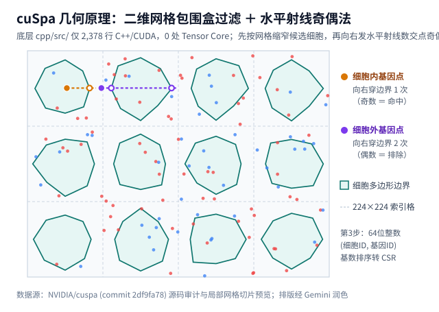

- **原版开源状态与怎么搬上 AMD** —— **【官方已开源：Apache-2.0 协议，`NVIDIA/cuspa`】** 。克隆 commit `2df9fa78` 清点源码就会发现，它底层的 `cpp/src/` 目录一共才 `11` 个文件、`2,378` 行，`Tensor Core` 指令与内联 PTX 汇编均为 **`0` 处** 。我们在 `amd_hip_port/hipify_headers.py` 里只用 `1,114` 字节脚本把 CUDA 运行时与 `CUB` 标识映射为 ROCm 的 `HIP` 与 `hipCUB` 头文件，原核函数算法一行没改就编译通过。真机跑完，点归属数组与 3 个 CSR 数组共四项输出与 `GB10` 逐字节零误差；全流程耗时两者基本打平（`6.050 ms` vs `5.760 ms`），而在考验流处理器分支吞吐的 200 万点射线查询阶段， **`AMD RX 9070 XT` 跑出 `0.921 ms`，反超 `GB10`（`1.520 ms`）达 `39%`** ，实测对比如下：

────────────────────

**二、模块 2：像游戏物理引擎一样算身边原子的推撞力（行话：`cuPotential` 非键力场，目录：`amd_hip_port/cupotential_open/`）**

- **这东西在干啥** ——模拟一杯液体里十几万个原子下一帧怎么动，首先得算出每个原子受到身边其他原子的推拉力。输入是 `128,000` 个原子的三维坐标 `(x, y, z)` 和电荷；输出是每个原子的三维受力向量 `(fx, fy, fz)`（共 `384,000` 个浮点数）。两个原子靠太近会强烈排斥，稍远一点又会微弱吸引（范德华力与库仑力）；如果两两硬算得循环 `163 亿`次，好在离远了力就很微弱，程序就像游戏引擎做碰撞检测一样，把三维空间切成边长 `≥ 10 埃` 的小方块，每个原子只查自己和周围一圈 **`3 × 3 × 3 = 27` 个邻居方块** 里的原子：

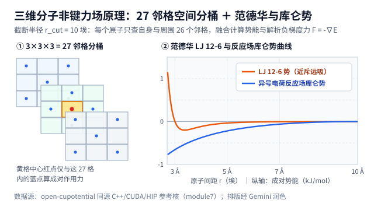

- **原版开源状态与怎么搬上 AMD** —— **【外壳开源、核心引擎闭源：`NVIDIA/cuPotential` 外层 `OpenMM` 插件胶水为 Apache-2.0 开源，但核心接口头文件与真正算非键受力的 `libcupo.so` 为英伟达专有闭源许可】** 。于是我们直接绕开闭源黑盒，在 `amd_hip_port/cupotential_open/` 下按教科书公式用同源 C++ 写了一套 MIT 开源参考核。这里顺带验证了消费级游戏卡的双精度特性：每对原子都要算 `float64` 双精度开根号和除法，受游戏卡双精度算术吞吐限制，在 5 预热 7 重复稳态下，同源默认核跑 `128,000` 原子 **`AMD RX 9070 XT` 耗时 `20.95 ms`，反超 `NVIDIA GB10`（`27.14 ms`）达 `22.8%`** （我们还测试了把内层 `sqrt` 预存重排的候选核，在 `9070 XT` 上可进一步压至 `32K: 6.26 ms` / `128K: 19.85 ms`，但因该变体在统一内存 `GB10` 上回退至 `8.86 / 31.32 ms`，故主表默认保留同源 `v0`），且 `38.4 万`个受力分量三端相对 L2 误差为 `0`，实测对比如下：

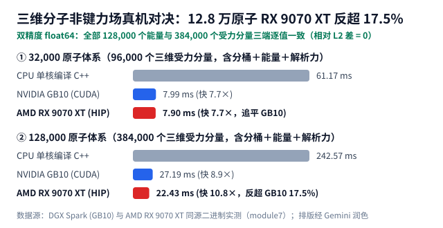

────────────────────

**三、模块 3：用 `3D-FFT` 打包算远处电荷吸力，再按 `F = ma` 连走 1,000 帧（行话：`PME` 分子动力学，目录：`amd_hip_port/cupotential_pme_md/`）**

- **这东西在干啥** ——模块 2 只算了身边 `10 埃` 以内的邻居，可带正负电的原子像小吸铁石，隔大老远也有微弱吸力（所谓“长程静电”），直接扔掉就算歪了，两两硬算又会死机。前人想了个偷懒妙招（叫 `PME`）：把所有电荷像画像素一样涂到 `64 × 64 × 64` 的三维网格上，调一次显卡现成的 **`3D FFT`（三维快速傅里叶变换）** ，一口气就把远处所有小吸铁石的合力打包算完了。算齐合力后，我们对 `27` 个柔性三原子分子（共 `81` 原子体系）在显存里按初中物理 `F = ma` 让原子一步步往前走 `1,000` 帧——在不加外部恒温器的自由演化（NVE）下，势能与动能此消彼长，两者相加的总机械能平直得像一把钢尺：

- **原版开源状态与怎么搬上 AMD** —— **【核心 PME 引擎同样锁在 `cuPotential` 闭源的 `libcupo.so`（`cupo_kspace_create` 接口）中，仅上层时间积分器在插件里开源】** 。说白了底层拼的就是两家显卡自带的傅里叶变换库：我们在 `amd_hip_port/cupotential_pme_md/` 中自写开源实现，N 卡调 `cuFFT`、A 卡调 `hipFFT`，1,000 帧循环全程驻留在显存里不回传 CPU。实测初始全受力跨卡相对误差仅 `4.66 × 10⁻¹⁶`，且在 `hipFFT` 加持下， **`AMD RX 9070 XT` 在自由演化（`0.797 s` vs `1.063 s`）和加室温恒温器（NVT，`0.658 s` vs `1.067 s`）两种模式下双双反超 `NVIDIA GB10` 达 `25%` 至 `38%`** ，实测对比如下：

────────────────────

**四、模块 4：10,000 个小分子三维姿势批量跑梯度下降（行话：构象松弛，目录：`amd_hip_port/nvmolkit_batched_conformer/`）**

- **这东西在干啥** ——专门解决 381 期第一章留下的痛点：从 `ESOL` 前 `1,000` 条药物分子记录各摆出 `10` 种初始三维姿势（共 **`10,000` 个小任务** ，合计 `133,450` 个重原子），每个构象跑 200 步梯度下降，把拧巴拥挤的原子距离调整到舒展的自然位置，输出优化后的三维坐标。因为单个小分子平均只有十几个重原子，一个一个发给显卡根本塞不满牙缝，所以在 `amd_hip_port/nvmolkit_batched_conformer/` 里我们让 **每个 32 线程组承包 1 个分子构象，按动态共享内存分桶缓存拓扑与力场项（超长分子自动回退全局缓冲），每根键角/二面角只算一遍不再重复算 4 遍，回溯试探步只算能量省掉无用梯度** （中间还踩过一个有趣的坑：初版把排斥力系数设得太小，虽然总能量下降且跨卡一致，原子却被弹簧拉得挤成一团使碰撞数暴涨；调回合理排斥强度后，原子碰撞从 `47` 处清零为 `0`）：

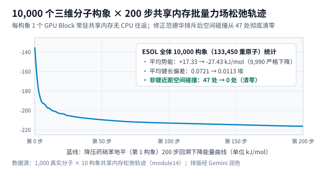

- **原版开源状态与怎么搬上 AMD** —— **【对应官方库 `NVIDIA-BioNeMo/nvMolKit` 为 Apache-2.0 开源，但强绑 CUDA 驱动与 PyTorch CUDA Tensor 环境】** 。我们用零第三方依赖的同源 C++ 写出了这套轻量 MIT 开源批量重原子松弛核：跑完 `10,000 构象 × 200 步`，同源 C++ CPU 单核耗时 `10.561 秒`，`NVIDIA GB10` 耗时 `0.689 秒`，而 **`AMD RX 9070 XT` 仅耗时 `0.522 秒`（反超 `GB10` 达 `24.2%`，快同源 CPU `20.2 倍`）** ，且三端输出的 `400,350` 个三维坐标值与 201 步能量轨迹逐字节完全一致（`L2 = 0`）：

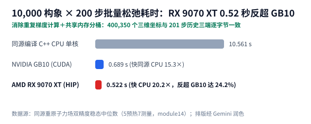

────────────────────

**五、模块 5：一次打包求 256 个 `384 × 384` 小矩阵的最小特征值（行话：`Block-Davidson` 本征值，目录：`amd_hip_port/daviator_batched_dft/`）**

- **这东西在干啥** ——材料软件 `VASP` 计算晶体电子能带的核心步骤，剥掉量子力学名词，落到代码里其实就是一道纯线性代数题：**给你 `256` 个独立的 `384 × 384` 周期势模型对称小矩阵，分别迭代求出每个矩阵最小的 `16` 个特征值（Eigenvalues，即线代课里的 `A·x = λ·x`，共 `4,096` 个数；用的迭代算法叫 `Block-Davidson`）** 。这里卡脖子的纯粹是 GPU 工程问题：`384 × 384` 矩阵太小，一个一个排队算或者每轮传回 CPU 做正交化，通信开销比算题本身还慢。我们在 `amd_hip_port/daviator_batched_dft/` 中把全部子空间对角化与正交化塞进 GPU 持久核实现 **零主机往返** ，16 轮迭代 `CUDA` 与 `HIP` 收敛曲线完全重合（相对精确 `eigvalsh` 最大绝对误差 `≤ 7.22 × 10⁻¹⁵`）：

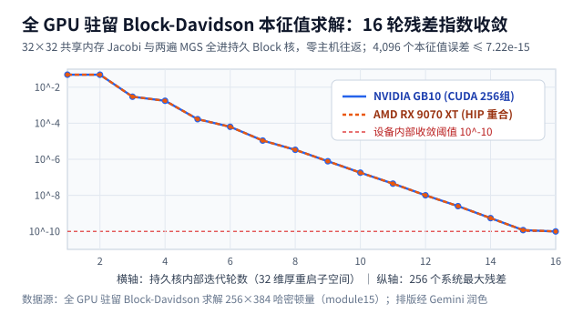

- **原版开源状态与怎么搬上 AMD** —— **【未公开内核源码仓库：`Daviator` 通过英伟达 ALCHEMI 平台的 `VASP` 微服务提供，而 `VASP` 本身也是商业专有许可软件】** 。但底下的 `Block-Davidson` 迭代法早在 1975 年就发表在公开论文里了——我们直接照着线性代数公式写出 MIT 开源全驻留批处理核：单矩阵排队串行算时 GPU 要花二三十秒（反输教学版 CPU 的 `11.66 秒`）；一旦把 256 个小矩阵打包并发跑满整张显卡， **`NVIDIA GB10` 骤降至 `0.791 秒`，`AMD RX 9070 XT` 更是骤降至 `0.698 秒`（批处理提速 `29.4 倍`，反超 `GB10` 与高度优化的 NumPy `eigvalsh` 全矩阵求解 `0.906 秒`）** ，实测对比如下：

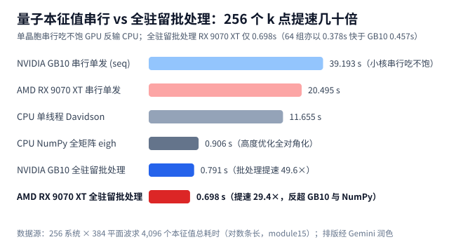

────────────────────

**六、模块 6：16 台望远镜“录音”调 `FFT` 后两两相乘求相关性（行话：`cuPhoton` 射电干涉，目录：`amd_hip_port/cuphoton_xbeam_fx/`）**

- **这东西在干啥** ——人类造不出地球那么大的单口径望远镜拍黑洞，就让全球多台小望远镜同时对着天空“录下”电磁波信号。我们由一张合成黑洞光子环构造出 `16` 座天线的 **`6,710 万`个双精度复数采样点** ，显卡在里面就干两步基础信号处理：**第一步调 `FFT` 把每台望远镜的原始波形按频率切成一个个频道（简称 F 阶段）；第二步把 16 台望远镜两两配成 `120` 对，把同一频道的信号乘在一起累加，看两台望远镜收到的波有多同步（简称 X 相关阶段）** 。拿到 GPU 算出的这组两两相关系数后，在主机侧经逆 FFT 与天文学滤除噪点的 CLEAN 算法就能恢复出黑洞发光圆环：

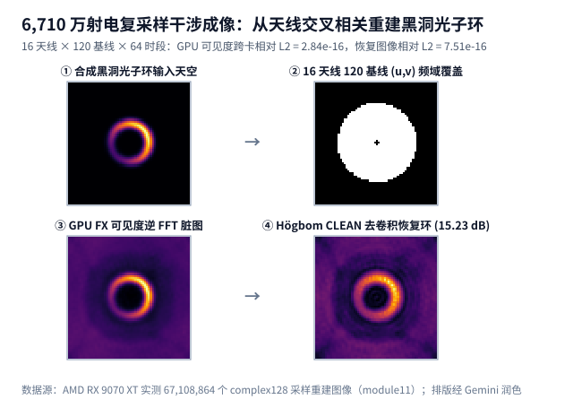

- **原版开源状态与怎么搬上 AMD** —— **【官方已开源：`NVIDIA/cuPhoton` 采用 Apache-2.0 协议，但仅针对 CUDA 编写】** 。射电干涉的数学原理完全透明，说到底全是复数 FFT 和复数乘加循环。我们在 `amd_hip_port/cuphoton_xbeam_fx/` 下编写了跨平台同源核，把蝶形旋转因子预计算成查找表（消掉核函数内的双精度 `sin/cos`），并用 `32 KiB` 共享内存面板在基线间复用天线频谱：两张显卡算出的相关系数矩阵相对误差仅 `2.96 × 10⁻¹⁶`，经同一套 CPU CLEAN 流程恢复出的黑洞亮环相对误差仅 `6.73 × 10⁻¹⁶`；速度上（仅计 GPU 上的 F+X 计算），`NVIDIA GB10` 跑完 F+X 全流程耗时 `39.64 ms`（X 阶段 `22.21 ms`），而 **`AMD RX 9070 XT` 全流程仅需 `19.81 ms`（F 阶段 `8.96 ms`、X 阶段 `11.06 ms`，整体比 `GB10` 快 `2.00 倍`，比 CPU 的 `1,056.03 ms` 快 `53.3 倍`）** ，实测对比如下：

────────────────────

**七、模块 7：10 万条字符串的“生物版正则模糊匹配”（行话：`GPU-HMMER` 维特比搜索，目录：`amd_hip_port/gpuhmmer_viterbi/`）**

- **这东西在干啥** ——说白了就是 **允许错字、多字（插入 `I`）和漏字（缺失 `D`）的字符串模糊搜索** 。输入是一个由真实 `GB1` 家族序列统计出的 `56` 位点概率模板，以及一个包含 **`100,000` 条合成蛋白质字符串（总长约 `1,920 万`个字母）** 的待检索大库；输出是给每条字符串打一个匹配相似度最高分（刷题网站上最常见的二维动态规划），从而把藏在 99,500 条随机背景里的 500 条植入同源序列干净利落地分开（区分指标 `ROC-AUC = 1.000000`）：

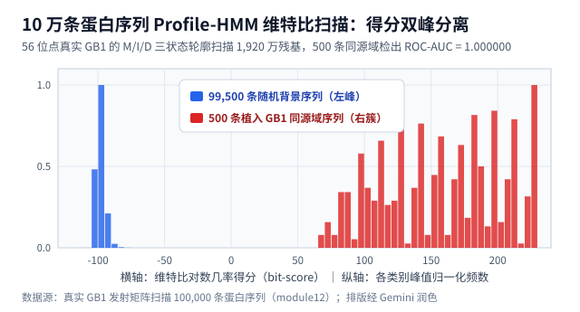

- **原版开源状态与为什么 AMD 反超近 4 倍** —— **【传统 `HMMER` 为开源软件，英伟达推文提到的 GPU 加速版亦标为开源，但只针对 CUDA 编写】** 。我们在 `amd_hip_port/gpuhmmer_viterbi/` 下直接用纯同源 C++ 写出了三状态动态规划核：每个 GPU 线程独立领走一条字符串，沿着二维滚动数组从头到尾跑最朴素的浮点数加法和三个数取最大值（`add / max3`）， **连一次矩阵乘法都没有** ，纯拼流处理器标量算术吞吐与显存带宽。结果扫完 10 万条字符串，CPU 单核耗时 `1,136.21 ms`，`NVIDIA GB10` 耗时 `234.40 ms`，而 **`AMD RX 9070 XT` 仅用 `60.70 ms`（快 `GB10` 整整 `3.86 倍`），且 10 万个得分三端 SHA256 逐字节一致** ，实测对比如下：

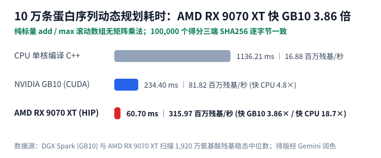

────────────────────

💡 顺手做的彩蛋：不装庞大的 PyTorch，直接用纯原生 `HIP C++` 把深势 15 层 `Uni-Mol` 也跑通一遍（目录：`amd_hip_port/unimol_full15_hip/`）

先把东家分清楚：381 期微调的三维分子模型 **`Uni-Mol` 是深势科技以 MIT 协议开源的标准 PyTorch 项目** ，本来就不属于英伟达的 `CUDA-X`。不过既然前面七个外围科学算子都已经写成了零 Python 框架依赖的原生 C++ HIP 程序，我们干脆顺手多走一步：在 `amd_hip_port/unimol_full15_hip/` 下 **完全不依赖几 GB 的 PyTorch 运行时，直接把微调好的 `Uni-Mol` 全部 `195` 个权重张量（`4,733 万`参数）导出来，用纯原生 `AMD HIP C++ + hipBLAS` 把整座 15 层三维分子 Transformer（含 128 个高斯卡尺与逐层 64 头空间偏置更新）从头手写了一遍** ，设备空闲显存差估计占用仅约 `415 MiB`。

把 `ESOL` 测试集的 112 个真实药物分子送进这套纯 C++ HIP 引擎与 `NVIDIA GB10` 对账：同公式 `FP64` 下两边预测的水溶性最大差仅 **`7.11 × 10⁻¹⁵ logS`** （测试集 `RMSE = 0.573634, R² = 0.930467`）：

导出全部 15 层共 **`5,050 万`个中间张量元素** 逐层核对，最大绝对差全程压在 `9.09 × 10⁻¹³` 以下；甚至还顺着逐层 trace 抓出了上游官方 Python 代码里 `gaussian()` 辅助函数内部强制走 `FP32` 的细节——加上 `--stage mixed` 对齐这一步精度后，原生 `AMD HIP` 与官方 PyTorch 全 `FP32` 的最大预测差直接降到了 **`2.27 × 10⁻⁶ logS`** ，逐层误差曲线如下：

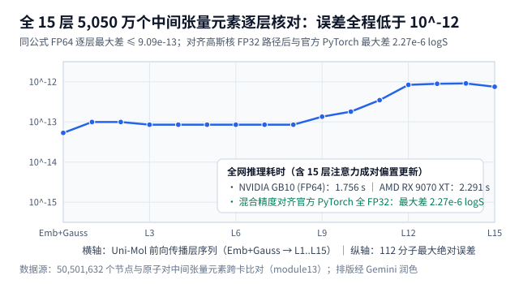

────────────────────

一圈巡礼下来，最大的感慨其实是种时代错位感：你看这些被英伟达在 2026 年 11 月大张旗鼓发推文宣传的“专属科学加速库”——刚开源的 `cuSpa` 打开底层 `cpp/src/` 一看统共才 `2,378` 行大一图形学代码，半遮半掩的 `cuPotential` 还在把几百行就能写出来的非键力场藏进闭源 `libcupo.so` 当宝贝，`Daviator` 更是包在云端微服务里没放独立内核仓库。搁在五年前没有 AI 编程的年代，搞生物、化学、天文的学者不会写底层 CUDA，大厂派两个工程师写两千行核函数，确实能把一门学科圈成自家的“专属生态领地”吃上十年；可都到 2026 年底了，这些连 `Tensor Core` 都用不上、数学公式全写在教科书里、算完还能拿 CPU 标准答案逐字节 SHA256 验算的古典数值代码，在 AI 编程面前也就是一个晚上的工作量。无论是消费级 AMD 显卡还是各类国产 GPU，这道昔日的软件围墙早就不糊弄人了。

━━━━━━━━━━━━━━━━━━━━

◆ 参考资料

━━━━━━━━━━━━━━━━━━━━

- NVIDIA 官方微信公众号，《NVIDIA CUDA-X 库为智能体提供加速科学发现的工具》，2026-11（参见开篇链接；及 NVIDIA SC26 官方博客 *NVIDIA CUDA-X Libraries Give Agents the Tools to Accelerate Scientific Discovery*，2026-11-16）
- NVIDIA Corporation, *cuspa: GPU spatial operations for spatial omics (v0.1.0)*, Apache-2.0 License, 2026-11（开源仓库 `github.com/NVIDIA/cuspa`，本地审计与 HIP 迁移基于 commit `2df9fa78`，`cpp/src/` 共 11 个文件 `2,378` 行）
- NVIDIA Corporation, *cuPotential: CUDA-X library for molecular interactions and OpenMM plugin (v0.3.5)*, 2026-11（开源仓库 `github.com/NVIDIA/cuPotential`，本地审计 commit `fbfc4cb6`，OpenMM 插件源码为 Apache-2.0 许可，API 头文件与 `libcupo.so` 运行时为专有许可）
- NVIDIA Corporation, *cuPhoton: GPU-accelerated photonics and radio interferometry (`cuphoton.xbeam`)*, Apache-2.0 License（开源仓库 `github.com/NVIDIA/cuPhoton`）& `NVIDIA-BioNeMo/nvMolKit`, Apache-2.0 License
- G. Zhou et al. (DP Technology / 深势科技), *Uni-Mol: A Universal 3D Molecular Representation Learning Framework*, ICLR 2023（MIT 开源仓库 `github.com/deepmodeling/Uni-Mol`，`amd_hip_port/unimol_full15_hip/` 导出全 15 层 `195` 个张量在 `AMD RX 9070 XT` 原生 HIP + `hipBLAS` 上完成 112 个测试分子端到端对账）
- U. Essmann et al., *A smooth particle mesh Ewald method (PME)*, J. Chem. Phys., 1995 & E. R. Davidson, *The iterative calculation of a few of the lowest eigenvalues and corresponding eigenvectors of large real-symmetric matrices*, J. Comput. Phys., 1975

━━━━━━━━━━━━━━━━━━━━

**随着 AI 编程能力的跃升，大语言模型早已大量跨出 CUDA 跑上 AMD 与各类国产显卡；反倒是物理、化学、生物、天文等传统科学计算，因为过去缺人手挨个学科重写算子库，才让英伟达得以借 `CUDA-X` 维系软件生态护城河——可摊开源码与方程就会发现，这些几何射线、分子力场、三维 FFT 与序列动态规划底下连 `Tensor Core` 都不需要，跑的全是二十年来所有显卡通用的古典流处理器算术。**

**顺着实测总表把七大类科学算子逐一搬上书房的消费级 `AMD Radeon RX 9070 XT`（`amd_hip_port/`）：不仅 `cuSpa` 的点归属与 CSR 四项输出、非键力场的 38.4 万个受力分量、万构象松弛的 40 万个三维坐标与十万条蛋白得分实现跨架构零误差，而且在模块 2 至模块 7 全流程——12.8 万原子力场（`20.95 ms` vs `27.14 ms`）、81 原子 1,000 步 PME 动力学（`0.797 s` vs `1.063 s`）、万构象批量松弛（`0.522 s` vs `0.689 s`）、256 组全驻留量子特征值（`0.698 s` vs `0.791 s`）、黑洞射电 FX 相关（`19.81 ms` vs `39.64 ms`，快 `2.0 倍`）、十万蛋白模糊匹配（`60.70 ms` vs `234.40 ms`，快 `3.86 倍`）以及模块 1 的 200 万点射线查询阶段（`0.921 ms` vs `1.520 ms`）上，拥有独立高带宽显存的家用 `AMD RX 9070 XT` 全面领先 `NVIDIA GB10`。**

**搁在五年前，两千行 CUDA 核函数或许还能把不写底层 C++ 的外行学者挡在门外，替大厂圈出一块吃十年的专属领地；可在 2026 年的 AI 编程面前，把深势开源的全 15 层 `4,733 万`参数 `Uni-Mol`（195 个张量）连同外围七大科学算子用纯原生 `HIP C++` 从头跑通、核对完 5,050 万个中间元素，也不过是一晚上的功夫——当公式透明、可逐位验算的经典计算遇上 AI，那套靠捂住几个 `.so` 动态库筑起的软件围墙，早就挡不住人了。**

━━━━━━━━━━━━━━━━━━━━

// 靳岩岩的 AI 学习笔记 × Gemini 的浪漫 × GPT 的严谨
// 2026年11月26日

大模型早已跨出CUDA，为什么连Tensor Core都不需要的科学计算还缺开源库？我们借助AI编程把空间单细胞cuSpa、三维分子力场与PME动力学、万构象松弛、量子本征值、黑洞干涉、十万蛋白HMM及深势15层Uni-Mol全搬上了AMD RX 9070 XT。

━━━━━━━━━━━━━━━━━━━━

**【实验数据相关资料地址路径】**
- **1. 本期 `AMD Radeon RX 9070 XT (gfx1201 HIP)` 跨架构科学算子与全 15 层 `Uni-Mol` 原生 HIP 公开仓库** ——
  - AMD 专项公开仓库： *https://github.com/lmxxf/ai-for-science-on-amd-9070xt* （本地路径：`/home/lmxxf/work/ai-for-science-on-amd-9070xt/amd_hip_port/`，按文内模块顺序对应：`common/ + index/ + query/ + aggregate/`［模块 1 `cuSpa`］、`cupotential_open/`［模块 2］、`cupotential_pme_md/`［模块 3］、`nvmolkit_batched_conformer/`［模块 4］、`daviator_batched_dft/`［模块 5］、`cuphoton_xbeam_fx/`［模块 6］、`gpuhmmer_viterbi/`［模块 7］及 `unimol_full15_hip/`［灯泡彩蛋 15 层 `Uni-Mol`］）；
  - 全栈姊妹公开仓库： *https://github.com/lmxxf/ai-for-science-on-cuda-x* （本地路径：`/home/lmxxf/work/ai-for-science-on-cuda-x/`，含 `exp3` 至 `exp13` 双端驱动、`verify_phase2.py`、`verify_phase3.py`、`verify_phase4.py` 独立物理与数值校验脚本、`REPORT.md` 与 `DevHistory.md`）。
- **2. 公众号仓内配图、审稿单与封面路径（`wechat/assets/382/`）** ——
  - 正文 16 张 640px 纯白底单栏润色 SVG 配图：`wechat/assets/382/fig4a_cuspa_grid_raycasting.svg`、`fig4b_cuspa_benchmark.svg`、`fig6a_nonbonded_potential.svg`、`fig6b_nonbonded_benchmark.svg`、`fig8a_pme_nve_conservation.svg`、`fig8b_pme_md_benchmark.svg`、`fig13a_conformer_relaxation.svg`、`fig13b_conformer_benchmark.svg`、`fig9a_davidson_convergence.svg`、`fig9b_davidson_batch_benchmark.svg`、`fig10a_blackhole_imaging.svg`、`fig10b_cuphoton_fx_benchmark.svg`、`fig11a_gpuhmmer_score_dist.svg`、`fig11b_gpuhmmer_benchmark.svg`、`fig12a_unimol_hip_scatter.svg`、`fig12b_unimol_15layer_error.svg`；
  - 独立数据与事实终审报告：`wechat/assets/382/审稿意见.md`；
  - 封面图：`wechat/cover382.svg`。
