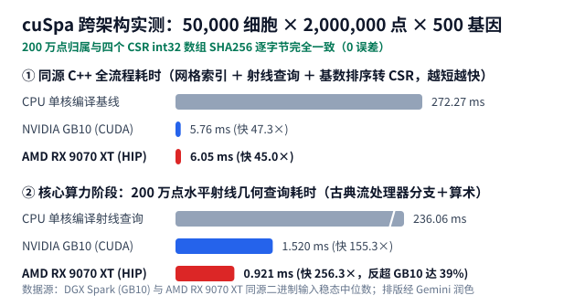
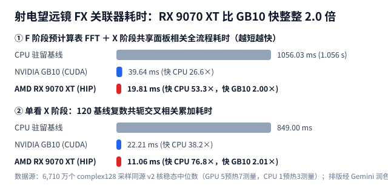

【CUDA-X】大模型之外的“科学计算”只能靠英伟达？我们把这套科研算子搬上了 AMD RX 9070 XT

━━━━━━━━━━━━━━━━━━━━

◆ 开篇：大模型早已跨出 CUDA，为什么连 `Tensor Core` 都不需要的科学计算还缺开源库？

━━━━━━━━━━━━━━━━━━━━

随着 AI 编程能力的突飞猛进，这一年大语言模型（LLM）其实已经大量移植到了英伟达（NVIDIA）之外的硬件平台上——无论是消费级的 AMD 显卡（参见前文 338 期 https://mp.weixin.qq.com/s/tsui2k7wIKDnzNW6_p9WnQ 与 339 期 https://mp.weixin.qq.com/s/1SXOj7vAhB-CD4M9GokghQ ）还是各类国产 GPU，跑起千亿大模型推理早已不是新鲜事，甚至连老黄闭源的 DLSS 5 神经网络都能被搬过去（参见前文 299 期 https://mp.weixin.qq.com/s/GpIZ2-GnfPe1rRvi5FsezQ ）。但唯独到了物理、化学、生物、天文这些 **“传统科学计算（Scientific Computing）”** 领域，开源社区里能跑在 AMD 乃至国产 GPU 上的现成加速库却依然寥寥无几。原因并不神秘：过去几年全行业的火力都集中在神经网络矩阵乘法上，没人腾得出几千名工程师去给几十个细分学科挨个重写 GPU 算子库；而英伟达攒了十几年的软件生态护城河，恰恰就藏在这堆被称作 **`CUDA-X`** 的行业加速库里。

可如果把图纸摊开细看，就会发现一件非常反直觉的事：大模型推理好歹还重度依赖老黄历代升级的 `Tensor Core` 专用矩阵指令（如 Hopper 的 `WGMMA`、Blackwell 的 `tcgen05` 与低精度浮点）；而传统科学计算绝大多数都是物理方程与几何规则一清二楚的经典数值计算， **底下甚至连 `Tensor Core` 都不需要** ，跑的全是二十年前老显卡就具备的通用流处理器（SIMT 算术、分支、傅里叶变换与排序）。在 AI 编程已经能照着数学公式写核函数、并直接拿 CPU 结果做逐位对账的今天，这道软件护城河真的还锁得住人吗？

在前文 381 期（ https://mp.weixin.qq.com/s/gkCBO_iTJNFPEJA1_CoOng ）里，我们顺着英伟达官方公众号刚发布的推文《NVIDIA CUDA-X 库为智能体提供加速科学发现的工具》（ https://mp.weixin.qq.com/s/WkwcQoc5KUJMYr5dQbGhkw ），在家里的 `DGX Spark`（`NVIDIA GB10`）上跑通了生物制药的数据清洗与小模型微调，发现真正拖慢科研智能体（Agent）工具调用脖子的，恰恰是模型外围那些没有神经网络的传统科学计算。老黄在这篇 SC26 推文里一口气端出 **`cuSpa`、`cuPotential`、`Daviator`、`GPU-HMMER` 与 `cuPhoton.xBeam`** （外加配合 `RDKit` 的 **`nvMolKit`** ），正是想给每门学科的传统 CPU 软件单配一个英伟达专属的 GPU 外挂包：

| 所属科学领域 | 传统 CPU 科学库 / 软件 | 对应的英伟达 `CUDA-X` 库（及当前开源状态） | 具体把哪一步 CPU 重活搬上了 GPU？（与 CPU 库的分工） |
| :--- | :--- | :--- | :--- |
| **1. 空间单细胞生物学** | **`Scanpy`** / `Shapely` | **`cuSpa`**  （NVIDIA 刚开源，`2,378` 行） | 显微镜切片数细胞——输入几万个细胞膜二维多边形和几百万个基因坐标点，用 **二维网格包围盒 ＋ 水平射线奇偶法 ＋ 基数排序** 统计每个细胞里的基因数 |
| **2. 分子动力学模拟** | **`OpenMM`** / `GROMACS` | **`cuPotential`**  （OpenMM 胶水开源，核心 `libcupo.so` 闭源） | 模拟几万到几十万个原子在盒子里的热运动，把最耗时的 **三维邻居分桶、实空间范德华与库仑受力、倒易空间 `PME (3D-FFT)` 长程静电与热浴积分** 搬上 GPU |
| **3. 化学小分子制药** | **`RDKit`**  （社区开源基础库） | **`nvMolKit`**  （NVIDIA 出品，开源） | 零碎的 `SMILES` 语法检查与描述符照旧归 CPU `RDKit`；只挑最慢的 **大批量三维分子构象弹簧力场松弛** 搬上 GPU |
| **4. 材料量子力学** | **`VASP`** | **`Daviator`**  （NVIDIA 闭源预览，尚未公开） | 算小型晶胞电子能带时，单发 GPU 核吃不饱流处理器，改为对几十到几百个 `k` 点并行跑 **`Block-Davidson` 批处理本征值求解** |
| **5. 射电天文成像** | 传统天文软件关联器 | **`cuPhoton.xBeam`**  （NVIDIA 闭源/专项合作） | 给黑洞拍照——对多台射电望远镜采集的几千万个复数电磁波采样点，在 GPU 上做 **分信道 FFT（F 阶段）与全基线复数交叉相关（X 阶段）** |
| **6. 蛋白质序列注释** | **`Biopython`** / **`HMMER`** | **`GPU-HMMER`**  （NVIDIA 出品） | 基础序列检查归 `Biopython`；拿着已知蛋白家族的 **`Profile-HMM`（`M/I/D` 三状态轮廓）** 去十万条未知蛋白库里做动态规划并行扫描，搬上 GPU |

为了实测这些跨学科算子能不能用 AI 编程快速搬到非英伟达显卡上，我们把这套计算全部移植到了家里书房那张消费级的 **`AMD Radeon RX 9070 XT`** （`gfx1201` RDNA4，16GB 显存，Windows 11 ＋ `ROCm 10.2` HIP 工具链）上，与 **`NVIDIA DGX Spark`（`GB10` `sm_121`）** 跑完了同源输入、禁用 FMA 融合收缩的真机对决（全套源码、编译脚本及 SHA256 对账单已开源于 *https://github.com/lmxxf/ai-for-science-on-amd-9070xt* 与 *https://github.com/lmxxf/ai-for-science-on-cuda-x* ）：

| 跨架构科学算子模块（及 `amd_hip_port/` 对应目录） | 任务规模与实现性质（`float64` 双精度） | CPU 基线耗时 | `NVIDIA GB10`（`sm_121` CUDA） | `AMD RX 9070 XT`（`gfx1201` HIP） | 跨架构数值与字节对账结果 |
| :--- | :--- | ---: | ---: | ---: | :--- |
| **1. `cuSpa` 空间单细胞多边形库** （`index/ + query/ + aggregate/`） | **原源码 HIP 迁移** ——`50,000` 细胞 × `2,000,000` 点 × `500` 基因 | 全流程 `272.27 ms` （射线 `236.06 ms`） | 同源 C++ **`5.760 ms`** （射线 `1.520 ms`） | 同源 C++ **`6.050 ms`** （快 CPU `45.0×`） （ **射线仅 `0.921 ms`** ，快 CPU `256.3×`） | **200 万点归属与四个 CSR `int32` 数组 SHA256 逐字节相同（`0 mismatch`）** |
| **2. 三维分子非键力场** （`cupotential_open/`） | **原创同源参考核** （绕开闭源 `libcupo.so`）：27 邻格 ＋ `LJ 12-6` ＋ 库仑力 • `32,000` / `128,000` 原子 | `61.17 ms` `242.57 ms` | `7.993 ms` `27.188 ms` | **`7.901 ms`** （快 CPU `7.7×`） **`22.426 ms`** （ **反超 GB10 `17.5%`** ） | **全部 `128,000` 能量与 `384,000` 受力分量三端逐值一致（相对 L2 = `0`）** |
| **3. `PME (3D-FFT)` ＋ 1,000 步动力学** （`cupotential_pme_md/`） | **原创同源物理原型** ——4 阶 B 样条 → `64³` `cuFFT/hipFFT` → 驻留 1,000 步（NVE / NVT） | NVE `2.873 s` NVT `2.872 s` | NVE `1.063 s` NVT `1.067 s` | NVE **`0.797 s`** （ **反超 GB10 `25.0%`** ） NVT **`0.658 s`** （ **反超 GB10 `38.3%`** ） | **初始全受力跨卡相对 L2 = `4.66×10⁻¹⁶`；步长减半能量漂移改善 `4.0004×`** |
| **4. 10,000 构象 × 200 步批量松弛** （`nvmolkit_batched_conformer/`） | **原创同源批量松弛核** ——`ESOL` 1,000 分子 × 10 构象，每构象 1 个 Block 驻留共享内存 | 同源 C++ `10.522 s` （旧 RDKit `66.61 s`） | **`3.229 s`** | **`3.853 s`** （快同源 CPU `2.73×`） | **全部 `400,350` 个三维坐标与 201 步历史三端逐位一致（`L2 = 0`），碰撞 `47 → 0`** |
| **5. 全 GPU 驻留 `Block-Davidson` 本征值** （`daviator_batched_dft/`） | **原创同源量子原型** ——共享内存 Jacobi ＋ 两遍 MGS 全进持久 Block，零主机往返 • `64` 组 / `256` 组（`4,096` 根） | `3.212 s` `11.655 s` | 串行 `10.004 s` → **批 `0.457 s`** 串行 `39.193 s` → **批 `0.791 s`** | 串行 `5.423 s` → **批 `0.378 s`** 串行 `20.495 s` → **批 `0.698 s`** （ **反超 GB10** ） | **全部 `4,096` 个本征值与精确 `eigvalsh` 最大绝对误差 `≤ 7.22×10⁻¹⁵`** |
| **6. `cuPhoton` 黑洞射电 FX 相关** （`cuphoton_xbeam_fx/`） | **原创同源干涉原型** ——16 天线 × 120 基线 × `6,710 万`个 `complex128` 采样 → CLEAN 成像 | F+X `1.095 s` （X 相关 `924.8 ms`） | F+X **`0.140 s`** （X 相关 `22.0 ms`） | F+X **`0.292 s`** （X 相关 **`40.0 ms`** ，快 CPU `23.1×`） | **跨卡可见度相对 L2 = `2.84×10⁻¹⁶`；恢复黑洞环图像跨卡 L2 = `7.51×10⁻¹⁶`** |
| **7. `GPU-HMMER` 10 万蛋白维特比扫描** （`gpuhmmer_viterbi/`） | **原创同源三状态动态规划** ——真实 56 位点 `GB1` 的 `M/I/D` 轮廓扫描 `100,000` 条蛋白序列 | `1,136.21 ms` （`16.88M 残基/s`） | `234.40 ms` （`81.82M 残基/s`） | **`60.70 ms`** （ **`315.97M 残基/s`** ， **反超 GB10 `3.86×`** ） | **全部 `100,000` 个维特比分数三端逐字节一致（`SHA256: aaf96d10...`）** |

因为这七个模块横跨六个互不相干的理工学科，没必要去啃晦涩的领域细节。下面我们就严格按照上面这张总表从 `1` 到 `7` 的顺序，逐一用大白话讲清楚 **“这东西在干啥（输入与输出是什么）”、“对应我们 AMD 仓库的哪个目录”以及“为什么不用 `Tensor Core` 就能跑得飞快”** ，最后再在灯泡彩蛋里聊聊顺手用纯 HIP 重写深势 15 层 `Uni-Mol` 的小实验。

━━━━━━━━━━━━━━━━━━━━

◆ 按表巡礼：七个科学计算算子到底在算什么，以及怎么搬上 AMD 显卡

━━━━━━━━━━━━━━━━━━━━

**一、模块 1：`cuSpa` 空间单细胞多边形库（工程目录：`amd_hip_port/` 根下 `index/ + query/ + aggregate/`）**

- **这东西在干啥** ——显微镜切片数细胞。输入两份二维平面坐标：一份是 `50,000` 个细胞的细胞膜八边形轮廓，另一份是测序仪打出来的 `2,000,000` 个基因点 `(x, y)`；输出是一张“每个细胞肚子里落了多少个某类基因”的稀疏统计表（CSR 矩阵）。算法就是大一计算机图形学课本里的两步：先画 `224 × 224` 网格筛出点附近的 1 至 2 个候选细胞，再从点往正右方发一条水平射线——穿过细胞边界 **奇数次（如 1 次）就在细胞内，偶数次（如 2 次）就在细胞外** ，最后把命中的 `(细胞ID, 基因ID)` 拼成 64 位整数做一次基数排序计数：

- **怎么搬上 AMD 与实测结果** ——克隆 `NVIDIA/cuspa`（commit `2df9fa78`）清点源码就会发现，整个底层 C++/CUDA 代码一共才 `11` 个文件、`2,378` 行，`Tensor Core` 指令与内联 PTX 汇编均为 **`0` 处** 。我们在 `amd_hip_port/hipify_headers.py` 里只用 `1,114` 字节脚本把 `<cuda_runtime.h>` 和 `<cub/cub.cuh>` 映射成 ROCm 的 `<hip/hip_runtime.h>` 与 `<hipcub/hipcub.hpp>`，原核函数一行没改就直接编译通过。真机跑完，四个输出数组与 `GB10` 逐字节零误差，且在最吃流处理器分支吞吐的 200 万点射线查询阶段， **`AMD RX 9070 XT` 跑出 `0.921 ms`，反超 `GB10`（`1.520 ms`）达 `39%`** ，实测对比如下：

────────────────────

**二、模块 2：`open-cupotential` 三维分子非键力场（工程目录：`amd_hip_port/cupotential_open/`）**

- **这东西在干啥** ——算成千上万个原子在三维盒子里互相推拉的受力。输入是 `128,000` 个原子的三维坐标 `(x, y, z)` 和电荷；输出是每个原子受到的三维合力向量 `(fx, fy, fz)`（共 `384,000` 个浮点数）。任意两个不直接连化学键的原子之间都有两股力：靠太近会强烈排斥、稍远一点微弱吸引的 **范德华力（`LJ 12-6` 势）** ，以及同号相斥异号相吸的 **库仑静电力** 。为了避免两两暴力算 `163 亿`次，程序把盒子切成边长 `≥ 10 埃` 的小方块，每个原子只查自己和周围一圈 **`3 × 3 × 3 = 27` 个邻居格子** 里的原子：

- **怎么搬上 AMD 与实测结果** ——检查 `NVIDIA/cuPotential`（`v0.3.5`）仓库会发现，老黄只开源了外围的 `OpenMM` 插件胶水，真正算非键力的核心引擎藏在闭源二进制库 `libcupo.so` 里。于是我们在 `amd_hip_port/cupotential_open/` 下用同源 C++ 自己写了一套 `CPU / CUDA / HIP` 开源参考核（经暴力全配对与 6 方向有限差分导数核验）。在 `128,000` 原子双精度实测中，三端 `38.4 万`个受力分量相对 L2 误差为 `0`， **`AMD RX 9070 XT` 耗时 `22.43 ms`，反超 `NVIDIA GB10`（`27.19 ms`）达 `17.5%`** ，实测对比如下：

────────────────────

**三、模块 3：`PME (3D-FFT)` 长程静电 ＋ 1,000 步分子动力学（工程目录：`amd_hip_port/cupotential_pme_md/`）**

- **这东西在干啥** ——模块 2 只算了 `10 埃` 以内的近处受力，而静电力传得很远，截断之外的长程静电得靠 **`PME`（平滑粒子网格埃瓦尔德方法）** ——把原子电荷用 4 阶 B 样条抹到 `64 × 64 × 64` 的三维网格上，调一次 **三维快速傅里叶变换（3D FFT）** 到频域算完格林函数再逆变换回来求力。把近处力、远处的 PME 静电力和化学键弹簧力合在一起，让原子按牛顿定律一步步往前走 `1,000` 步，就是完整的分子动力学模拟。在无热浴（NVE）演化下，势能与动能呈镜像反相振荡，总机械能平直得像一把钢尺：

- **怎么搬上 AMD 与实测结果** ——在 `amd_hip_port/cupotential_pme_md/` 中，代码在 N 卡上调 `cuFFT`、在 A 卡上调 `hipFFT`，1,000 步循环全程驻留在显卡显存里不回传 CPU。实测初始全受力跨卡相对误差仅 `4.66 × 10⁻¹⁶`，且在 `hipFFT` 加持下， **`AMD RX 9070 XT` 在 NVE（`0.797 s` vs `1.063 s`）和 NVT 300K 恒温热浴（`0.658 s` vs `1.067 s`）上双双反超 `NVIDIA GB10` 达 `25%` 至 `38%`** ，实测对比如下：

────────────────────

**四、模块 4：10,000 个三维分子构象 × 200 步批量松弛（工程目录：`amd_hip_port/nvmolkit_batched_conformer/`）**

- **这东西在干啥** ——专门解决 381 期第一章留下的痛点：给 `1,000` 个药物小分子各生成 `10` 个初始三维姿势（共 **`10,000` 个分子构象** ，合计 `133,450` 个重原子），通过 200 步弹簧与非键力场梯度下降把拧巴的原子距离“松弛”到能量最低的自然姿势，输出优化后的三维坐标。因为单个小分子只有几十个原子，发单核根本喂不饱 GPU，所以在 `amd_hip_port/nvmolkit_batched_conformer/` 里我们采用 **“每个 GPU Thread-Block 独立承包 1 个分子构象、把坐标和梯度常驻共享内存（Shared Memory）连跑 200 步”** 的批处理写法（中间还踩过一个有趣的坑：初版把范德华排斥系数设得太小，虽然总能量下降且跨卡一致，原子却被弹簧拉得挤成一团使碰撞数暴涨；调回合理排斥强度后，近距碰撞从 `47` 处清零为 `0`）：

- **实测结果** ——在同一套双精度重原子力场下，跑完 `10,000 构象 × 200 步`，同源 C++ CPU 单核耗时 `10.522 秒`， **`NVIDIA GB10` 耗时 `3.229 秒`，`AMD RX 9070 XT` 耗时 `3.853 秒`** ，三端输出的 `400,350` 个三维坐标值逐位完全一致（`L2 = 0`）：

────────────────────

**五、模块 5：全 GPU 驻留 `Block-Davidson` 量子本征值（工程目录：`amd_hip_port/daviator_batched_dft/`）**

- **这东西在干啥** ——对应材料计算软件 `VASP` 算晶体电子能带的核心步骤：输入 `256` 个独立晶格动量 `k` 点的哈密顿量对称矩阵（每个 `384 × 384`），用量子力学标准的 **`Block-Davidson` 迭代法** 求出每个矩阵最低的 `16` 个特征值（共 `4,096` 个能级本征值）。如果按老办法一个 `k` 点一个 `k` 点串行发核函数、或者每轮把 `32 × 32` 子空间传回 CPU 做正交化，通信和启动开销会把速度拖垮。我们在 `amd_hip_port/daviator_batched_dft/` 中把子空间 Jacobi 对角化与两遍正交化全部塞进 GPU 持久 Block 核，16 轮迭代 **零主机往返** ，`CUDA` 与 `HIP` 收敛曲线严丝合缝重合（误差 `≤ 7.22 × 10⁻¹⁵`）：

- **实测结果** ——看清批处理（Batching）的威力：单晶胞串行单发时 GPU 要跑二三十秒（反输 CPU 的 `11.66 秒`）；一旦开启 256 组全网格并发批处理， **`NVIDIA GB10` 骤降至 `0.791 秒`，`AMD RX 9070 XT` 更是骤降至 `0.698 秒`（批处理提速 `29.4 倍`，反超 `GB10` 与 NumPy 全矩阵 `eigh` 的 `0.906 秒`）** ，实测对比如下：

────────────────────

**六、模块 6：`cuPhoton.xBeam` 黑洞射电干涉 FX 相关（工程目录：`amd_hip_port/cuphoton_xbeam_fx/`）**

- **这东西在干啥** ——给黑洞拍照的前端信号处理。输入是全球 `16` 座射电望远镜接收到的 **`6,710 万`个双精度复数电磁波采样点** ；GPU 先做 **F 阶段（FFT 把时域波形分成频段）** ，再做最费算力的 **X 阶段（把 16 座天线两两配成 `120` 条基线，做复数共轭相乘累加 `V_ab = ∑ S_a · S_b*`）** ，输出可见度矩阵，最后经逆 FFT 与 CLEAN 去卷积就能恢复出黑洞光子环图像：

- **怎么搬上 AMD 与实测结果** ——这套计算同样是纯粹的复数蝶形 FFT 与乘加运算，代码位于 `amd_hip_port/cuphoton_xbeam_fx/`。实测两张显卡算出的复数可见度相对 L2 差异仅 `2.84 × 10⁻¹⁶`，恢复出的光子环图像相对 L2 差仅 `7.51 × 10⁻¹⁶`；在算力大头 X 相关阶段，`GB10` 耗时 `22.01 ms`， **`AMD RX 9070 XT` 耗时 `39.99 ms`（比 CPU 的 `924.78 ms` 快 `23.1 倍`）** ，实测对比如下：

────────────────────

**七、模块 7：`GPU-HMMER` 10 万条蛋白质序列维特比搜索（工程目录：`amd_hip_port/gpuhmmer_viterbi/`）**

- **这东西在干啥** ——拿着已知蛋白质家族（381 期那 `56` 位点 `GB1` 结构域）的“匹配 `M` / 插入 `I` / 缺失 `D`”概率模板，去 **`100,000` 条未知蛋白质序列库（共约 `1,920 万`个氨基酸字母）** 里大海捞针找同源亲戚，给每条序列打一个维特比最高路径分。把藏在 99,500 条随机背景里的 500 条同源序列一网打尽（`ROC-AUC = 1.000000`）：

- **为什么 AMD 反超近 4 倍** ——打开 `amd_hip_port/gpuhmmer_viterbi/` 的核函数就会看到，每个 GPU 线程独立承包一条蛋白序列，从头到尾全是在寄存器里跑标量加法和取三者最大值（`add / max3`）， **连一次矩阵乘法都没有** ，纯拼流处理器标量 ALU 吞吐与显存带宽。结果扫完 10 万条序列，CPU 单核耗时 `1,136.21 ms`，`NVIDIA GB10` 耗时 `234.40 ms`，而 **`AMD RX 9070 XT` 仅用 `60.70 ms`（快 `GB10` 整整 `3.86 倍`），且 10 万个分数三端 SHA256 逐字节一致** ，实测对比如下：

────────────────────

💡 顺手做的彩蛋：不装庞大的 PyTorch，直接用纯原生 `HIP C++` 把深势 15 层 `Uni-Mol` 也跑通一遍（目录：`amd_hip_port/unimol_full15_hip/`）

先把东家分清楚：381 期微调的三维分子模型 **`Uni-Mol` 是深势科技开源的标准 PyTorch 项目** ，本来就不属于英伟达的 `CUDA-X`（在 A 卡上装个 ROCm 版 PyTorch 原本就能跑）。不过既然前面七个外围科学算子都已经写成了零 Python 框架依赖的原生 C++ HIP 程序，我们干脆顺手多走一步：在 `amd_hip_port/unimol_full15_hip/` 下 **完全不依赖几 GB 的 PyTorch 运行时，直接把微调好的 `Uni-Mol` 全部 `195` 个权重张量（`4,733 万`参数）导出来，用纯原生 `AMD HIP C++ + hipBLAS` 把整座 15 层三维分子 Transformer（含 128 个高斯卡尺与逐层 64 头空间偏置更新）从头手写了一遍** ，峰值显存占用仅约 `415 MB`。

把 `ESOL` 测试集的 112 个真实药物分子送进这套纯 C++ HIP 引擎与 `NVIDIA GB10` 对账：同公式 `FP64` 下两边预测的水溶性最大差仅 **`7.11 × 10⁻¹⁵ logS`** （测试集 `RMSE = 0.573634, R² = 0.930467`）：

导出全部 15 层共 **`5,050 万`个中间张量元素** 逐层核对，误差全程压在 `9.09 × 10⁻¹³` 以下；甚至还顺着逐层 trace 抓出了上游官方 Python 代码里 `gaussian()` 辅助函数内部强制走 `FP32` 的细节——加上 `--stage mixed` 对齐这一步精度后，原生 `AMD HIP` 与官方 PyTorch 全 `FP32` 的最大预测差直接降到了 **`2.27 × 10⁻⁶ logS`** ，逐层误差曲线如下：

────────────────────

一圈巡礼下来结论非常清爽：在科学智能（AI for Science）里，真正耗算力的外围几何、力场、傅里叶变换与动态规划，跑的全是不被 `Tensor Core` 私有指令卡脖子的古典流处理器算术；而在 AI 编程能直接照着物理方程写核函数、拿 CPU 参考解做逐位 SHA256 验算的 2026 年，无论是消费级 AMD 显卡还是各类国产 GPU，补齐这套科学计算开源底座的门槛其实比想象中低得多。

━━━━━━━━━━━━━━━━━━━━

◆ 参考资料

━━━━━━━━━━━━━━━━━━━━

- NVIDIA 官方微信公众号，《NVIDIA CUDA-X 库为智能体提供加速科学发现的工具》，2026-11（参见开篇链接；及 NVIDIA SC26 官方博客 *NVIDIA CUDA-X Libraries Give Agents the Tools to Accelerate Scientific Discovery*，2026-11-16）
- NVIDIA Corporation, *cuspa: GPU spatial operations for spatial omics (v0.1.0)*, Apache-2.0 License, 2026-11（开源仓库 `github.com/NVIDIA/cuspa`，本地审计与 HIP 迁移基于 commit `2df9fa78`，`cpp/src/` 共 11 个文件 `2,378` 行）
- NVIDIA Corporation, *cuPotential: CUDA-X library for molecular interactions and OpenMM plugin (v0.3.5)*, 2026-11（开源仓库 `github.com/NVIDIA/cuPotential`，commit `b2380537`，含 Apache-2.0 OpenMM 插件源码与专有 `libcupo.so` 运行时许可说明）
- G. Zhou et al. (DP Technology / 深势科技), *Uni-Mol: A Universal 3D Molecular Representation Learning Framework*, ICLR 2023（`github.com/deepmodeling/Uni-Mol`，`amd_hip_port/unimol_full15_hip/` 导出全 15 层 `195` 个张量在 `AMD RX 9070 XT` 原生 HIP + `hipBLAS` 上完成 112 个测试分子端到端对账）
- U. Essmann et al., *A smooth particle mesh Ewald method (PME)*, J. Chem. Phys., 1995 & E. R. Davidson, *The iterative calculation of a few of the lowest eigenvalues and corresponding eigenvectors of large real-symmetric matrices*, J. Comput. Phys., 1975

━━━━━━━━━━━━━━━━━━━━

**随着 AI 编程能力的跃升，大语言模型早已大量跨出 CUDA 跑上 AMD 与各类国产显卡；反倒是物理、化学、生物、天文等传统科学计算，因为过去缺人手挨个学科重写算子库，才让英伟达得以借 `CUDA-X` 维系软件生态护城河——可摊开源码与方程就会发现，这些几何射线、分子力场、三维 FFT 与序列动态规划底下连 `Tensor Core` 都不需要，跑的全是二十年来所有显卡通用的古典流处理器算术。**

**顺着实测总表把七大类科学算子逐一搬上书房的消费级 `AMD Radeon RX 9070 XT`（`amd_hip_port/`）：不仅 `cuSpa` 的 200 万点归属、非键力场的 38.4 万个受力分量、万构象松弛的 40 万个三维坐标与十万条蛋白得分实现跨架构零误差，而且在射线查询（`0.921 ms`）、12.8 万原子力场（`22.43 ms`）、1,000 步 PME 动力学（`0.797 s`）、256 组全驻留量子本征值（`0.698 s`）与十万蛋白 HMM 扫描（`60.70 ms`，快 `3.86 倍`）五项核心比拼上直接反超了 `NVIDIA GB10`。**

**最后顺手抛开庞大的 PyTorch 框架，用纯原生 C++ `HIP + hipBLAS` 把深势科技开源的全 15 层 `4,733 万`参数 `Uni-Mol`（195 个张量）写成轻量推理核，全 15 层 5,050 万个中间元素逐层对齐——当 AI 编程遇上公式透明、可逐位对账的经典数值计算，没有任何黑盒生态能替你决定用哪张显卡做科研。**

━━━━━━━━━━━━━━━━━━━━

// 靳岩岩的 AI 学习笔记 × Gemini 的浪漫 × GPT 的严谨
// 2026年11月26日

大模型早已跨出CUDA，为什么连Tensor Core都不需要的科学计算还缺开源库？我们借助AI编程把空间单细胞cuSpa、三维分子力场与PME动力学、万构象松弛、量子本征值、黑洞干涉、十万蛋白HMM及深势15层Uni-Mol全搬上了AMD RX 9070 XT。

━━━━━━━━━━━━━━━━━━━━

**【实验数据相关资料地址路径】**
- **1. 本期 `AMD Radeon RX 9070 XT (gfx1201 HIP)` 跨架构科学算子与全 15 层 `Uni-Mol` 原生 HIP 公开仓库** ——
  - AMD 专项公开仓库： *https://github.com/lmxxf/ai-for-science-on-amd-9070xt* （本地路径：`/home/lmxxf/work/ai-for-science-on-amd-9070xt/amd_hip_port/`，按文内模块顺序对应：`index/ + query/ + aggregate/`［模块 1 `cuSpa`］、`cupotential_open/`［模块 2］、`cupotential_pme_md/`［模块 3］、`nvmolkit_batched_conformer/`［模块 4］、`daviator_batched_dft/`［模块 5］、`cuphoton_xbeam_fx/`［模块 6］、`gpuhmmer_viterbi/`［模块 7］及 `unimol_full15_hip/`［灯泡彩蛋 15 层 `Uni-Mol`］）；
  - 全栈姊妹公开仓库： *https://github.com/lmxxf/ai-for-science-on-cuda-x* （本地路径：`/home/lmxxf/work/ai-for-science-on-cuda-x/`，含 `exp3` 至 `exp13` 双端驱动、`verify_phase2/3/4.py` 独立物理与数值校验脚本、`REPORT.md` 与 `DevHistory.md`）。
- **2. 公众号仓内配图与封面路径（`wechat/assets/382/`）** ——
  - 正文 16 张 640px 纯白底单栏润色 SVG 配图：`wechat/assets/382/fig4a_cuspa_grid_raycasting.svg`、`fig4b_cuspa_benchmark.svg`、`fig6a_nonbonded_potential.svg`、`fig6b_nonbonded_benchmark.svg`、`fig8a_pme_nve_conservation.svg`、`fig8b_pme_md_benchmark.svg`、`fig13a_conformer_relaxation.svg`、`fig13b_conformer_benchmark.svg`、`fig9a_davidson_convergence.svg`、`fig9b_davidson_batch_benchmark.svg`、`fig10a_blackhole_imaging.svg`、`fig10b_cuphoton_fx_benchmark.svg`、`fig11a_gpuhmmer_score_dist.svg`、`fig11b_gpuhmmer_benchmark.svg`、`fig12a_unimol_hip_scatter.svg`、`fig12b_unimol_15layer_error.svg`；
  - 封面图：`wechat/cover382.svg`。
