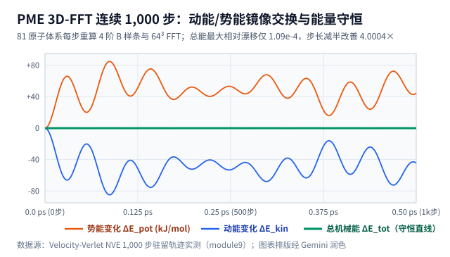
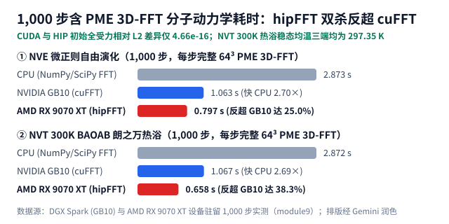
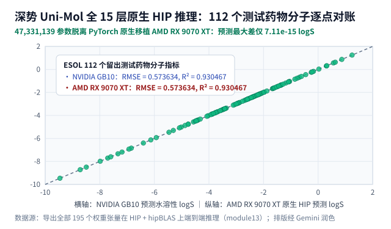

【CUDA-X 与 AMD 显卡】英伟达想用 CUDA-X 锁死“AI 自动搞科研”？我们把科学算子和 15 层 Uni-Mol 全搬上了 AMD RX 9070 XT

━━━━━━━━━━━━━━━━━━━━

◆ 开篇：AI 编程正在磨平软件护城河——连 `Tensor Core` 都不需要的科学计算，老显卡也能跑

━━━━━━━━━━━━━━━━━━━━

英伟达（NVIDIA）的硬件护城河当然还在，但随着 AI 编程能力的增强，它攒了十几年的软件生态护城河其实正在一点点消失——尤其是在像 `CUDA-X` 这种 **“确定性科学计算”** 的领域。以前友商和实验室重写不起几百个科学算子库，是因为养不起几千名底层 CUDA 工程师；如今输入输出和物理公式全摆在明面上，AI 写完核函数当场就能拿 CPU 参考解做逐位对账。更关键的是，这类计算底下甚至连 `Tensor Core` 专用矩阵指令都不需要，跑的全是显卡上最古典的流处理器算术，别说买张消费级 AMD 显卡，就算把家里压箱底的老显卡翻出来，大概率都能跑得飞起。

在前文 381 期（ https://mp.weixin.qq.com/s/gkCBO_iTJNFPEJA1_CoOng ）里，我们顺着英伟达官方公众号刚发布的推文《NVIDIA CUDA-X 库为智能体提供加速科学发现的工具》（ https://mp.weixin.qq.com/s/WkwcQoc5KUJMYr5dQbGhkw ），在家里的 `DGX Spark`（`NVIDIA GB10`）上亲手跑通了化学信息库 `RDKit`、生物序列库 `Biopython` 以及深势科技 `4,733 万`参数的三维分子专有模型 `Uni-Mol`（`mol_pre_no_h_220816.pt`）与 Meta `751 万`参数的蛋白质专有模型 `ESM-2` 的全参数微调。

跑完那组实验，我们看到了一个跟大语言模型（LLM）截然相反的算力图景：

1.**在科学智能（AI for Science）的软件流水线里，分子与蛋白质专有神经网络本身反而非常袖珍** ——`4,733 万`参数的 `Uni-Mol` 训完 20 轮只要 `37.18 秒`（Torch 峰值分配显存仅 `2.23 GiB`），`751 万`参数的 `ESM-2` 训完 12 轮只要 `15.02 秒`；
2.**真正拖慢科研智能体（Agent）工具调用循环、甚至在给模型“造训练数据”时最费算力的，反而是模型外围那些没有神经网络的传统确定性计算** ——比如用 `RDKit` 给 1,000 个分子生成 10,000 个三维构象做弹簧力场能量松弛（单核 CPU 耗时 `66.61 秒`）、在显微镜切片上判断两百万个基因转录点落在了哪五万个细胞多边形肚子里、算十几万个原子的范德华力与长程库仑静电力、解周期晶胞的平面波量子力学本征值、对十万条蛋白质序列做隐马尔可夫动态规划搜索，以及对射电望远镜阵列的几千万个采样点做交叉关联成像。

老黄在这篇 SC26 推文里一口气端出 **`cuSpa`、`cuPotential`、`Daviator`、`GPU-HMMER` 与 `cuPhoton.xBeam`** （外加化学信息学里专门配合 `RDKit` 的 **`nvMolKit`** ），算盘打得非常清楚：既然现在科研圈都在用 AI 智能体配合 `Skill` 自动调用传统科学软件，那我就用英伟达自家的 `CUDA-X` 品牌伞，给每一门基础学科最卡脖子的传统 CPU 科学库单配一个 GPU 加速外挂包，顺手把“AI 自动搞科研”锁死在英伟达的显卡生态里。

先把这张跨学科的 **「各领域传统开源/商业 CPU 科学软件 ↔ 英伟达 `CUDA-X` 加速库一一映射表」** 摆出来（它们分属不同学科，彼此平行独立、互不调用）：

| 所属科学领域 | 传统 CPU 科学库 / 软件 | 对应的英伟达 `CUDA-X` 库（及当前开源状态） | 具体把哪一步 CPU 重活搬上了 GPU？（以及与 CPU 库怎么分工） |
| :--- | :--- | :--- | :--- |
| **1. 化学小分子制药** | **`RDKit`**  （社区开源基础库） | **`nvMolKit`**  （NVIDIA 出品，开源） | `RDKit` 里 95% 以上的函数（如解析 `SMILES` 字符串查化合价、剥 `.Cl` 盐、算 `TPSA`）全是零碎分支活，照旧留给 CPU `RDKit`；`nvMolKit` **只挑最慢的大批量 `ETKDG + MMFF` 三维构象生成与上亿分子指纹相似度矩阵** 搬上 GPU（典型姿势是前半截调 CPU `RDKit` 解析分子图参数，后半截甩给 GPU 批量松弛构象） |
| **2. 分子动力学模拟** | **`OpenMM`** / `GROMACS` | **`cuPotential`**  （OpenMM 插件胶水开源，核心 `libcupo.so` 闭源） | 模拟几万到几十万个原子在盒子里的热运动，把最耗时的 **三维邻居分桶、实空间范德华与库仑受力、倒易空间 `PME (3D-FFT)` 长程静电与热浴积分** 搬上 GPU |
| **3. 空间单细胞生物学** | **`Scanpy`** / `Shapely` | **`cuSpa`**  （NVIDIA 刚开源，`2,378` 行） | 显微镜切片数细胞——输入几万个细胞膜二维多边形和几百万个基因坐标点，用 **二维网格包围盒 ＋ 水平射线奇偶法 ＋ 基数排序** 统计每个细胞里的基因数 |
| **4. 蛋白质序列注释** | **`Biopython`** / **`HMMER`** | **`GPU-HMMER`**  （NVIDIA 出品） | 基础序列检查归 `Biopython`；拿着已知蛋白家族的 **`Profile-HMM`（`M/I/D` 三状态轮廓）** 去十万、百万条未知蛋白序列库里做动态规划并行扫描，搬上 GPU |
| **5. 材料量子力学** | **`VASP`** | **`Daviator`**  （NVIDIA 闭源预览，尚未公开） | 算小型晶胞电子能带时，单发 GPU 核吃不饱流处理器，改为对几十到几百个布里渊区 `k` 点并行跑 **`Block-Davidson` 批处理本征值求解** |
| **6. 射电天文成像** | 传统天文软件关联器 | **`cuPhoton.xBeam`**  （NVIDIA 闭源/专项合作） | 给黑洞拍照——对全球多台射电望远镜采集的几千万个复数电磁波采样点，在 GPU 上做 **分信道 FFT（F 阶段）与全基线复数共轭交叉相关（X 阶段）** |

在大语言模型领域，老黄卡住别人脖子靠的是历代升级的 **`Tensor Core` 专用矩阵乘法指令** （如 Hopper 的异步 `WGMMA`、Blackwell 的 `tcgen05` 与低精度浮点格式）；而上面表里这六类传统科学计算——判断二维坐标点在不在多边形里、算原子间的 `1/r` 库仑力与 `1/r¹² - 1/r⁶` 范德华力、在三维网格上做傅里叶变换（FFT）、对十万条氨基酸序列跑 `add/max` 动态规划——走的其实是二十年来所有 GPU 都具备的通用流处理器（SIMT 标量/向量算术、分支、邻居分桶与基数排序；参见前文 299 期 https://mp.weixin.qq.com/s/GpIZ2-GnfPe1rRvi5FsezQ 与 339 期 https://mp.weixin.qq.com/s/1SXOj7vAhB-CD4M9GokghQ ）。

为了真刀真枪验证这一点，我们直接把老黄在 GitHub 上公开的 `NVIDIA/cuspa` 与 `NVIDIA/cuPotential` 仓库克隆到本地，一边对源码和许可证做静态清点，一边借助 AI 编程把整套科学计算算子加上 381 期微调好的 15 层 `Uni-Mol` 模型，搬到了家里书房那张消费级的 **`AMD Radeon RX 9070 XT`** （`gfx1201` RDNA4，16GB 显存，原生 Windows 11 ＋ `ROCm 10.2` HIP 工具链，参见前文 338 期 https://mp.weixin.qq.com/s/tsui2k7wIKDnzNW6_p9WnQ ）台式机上，与 **`NVIDIA DGX Spark`（`GB10` `sm_121`）** 开展了一场同源输入、同源 C++ 入口的八大模块真机对决（全套 `CUDA` 与 `AMD HIP` 源码、编译脚本及 SHA256 对账单已完整开源于两个配套仓库： *https://github.com/lmxxf/ai-for-science-on-amd-9070xt* 与 *https://github.com/lmxxf/ai-for-science-on-cuda-x* ）。

先把八大跨架构实测模块的同台成绩单摆在最前面（所有对比均使用由 `DGX Spark` 一次性导出并通过 `scp` 原字节分发到 `AMD RX 9070 XT` 的同一份二进制输入，双方统一禁用 FMA 融合收缩 `--fmad=false / -ffp-contract=off`）：

| 跨架构实测模块（代码路径均在 `amd_hip_port/` 下） | 实现性质与任务规模（统一 `float64` 双精度为主） | CPU 基线耗时 | `NVIDIA GB10`（`sm_121` CUDA） | `AMD RX 9070 XT`（`gfx1201` HIP） | 跨架构数值与字节对账结果 |
| :--- | :--- | ---: | ---: | ---: | :--- |
| **1. `cuSpa` 空间单细胞多边形库** | **原源码 HIP 迁移** ——`50,000` 细胞 × `2,000,000` 转录点 × `500` 基因（网格索引 ＋ 水平射线查询 ＋ `CUB/hipCUB` 排序转 CSR） | 全流程 `272.27 ms` （射线查询 `236.06 ms`） | 同源 C++ **`5.760 ms`** （射线查询 `1.520 ms`） | 同源 C++ **`6.050 ms`** （快 CPU `45.0×`） （ **射线查询仅 `0.921 ms`** ，快 CPU `256.3×`） | **200 万点归属与完整 CSR 四个 `int32` 数组 SHA256 逐字节相同（`0 mismatch`）** |
| **2. `open-cupotential` 三维分子非键力场** | **原创同源参考核** （绕开闭源 `libcupo.so`）：三维周期盒子 27 邻格 Cell-List ＋ 融合 `LJ 12-6` 与反应场库仑势及解析受力 • `32,000` 原子 / `128,000` 原子 | `61.17 ms` `242.57 ms` | `7.993 ms` `27.188 ms` | **`7.901 ms`** （快 CPU `7.7×`） **`22.426 ms`** （ **反超 GB10 `17.5%`** ） | **全部 `N` 个能量分量与 `3N` 个受力分量（38.4 万项）在 CPU/CUDA/HIP 间逐值一致（相对 L2 差 = `0`）** |
| **3. `PME (3D-FFT)` 长程静电 ＋ 1,000 步分子动力学** | **原创同源物理原型** ——4 阶 B 样条电荷铺展 → `64³` `cuFFT/hipFFT` → Ewald 格林函数 → 设备驻留连续 1,000 步轨迹（NVE / NVT） | NVE `2.873 s` NVT `2.872 s` | NVE `1.063 s` NVT `1.067 s` | NVE **`0.797 s`** （ **反超 GB10 `25.0%`** ） NVT **`0.658 s`** （ **反超 GB10 `38.3%`** ） | **初始全受力 `CUDA vs HIP` 相对 L2 = `4.66×10⁻¹⁶`；NVE 步长减半能量漂移改善 `4.0004×`** |
| **4. 10,000 个三维分子构象 × 200 步批量力场松弛** | **原创同源批量松弛核** ——`ESOL` 前 1,000 分子 × 10 构象（`133,450` 重原子），每构象 1 个 Block 驻留共享内存跑 200 步回溯下降 | 同源 C++ `10.522 s` （旧 RDKit 单核 `66.61 s`） | **`3.229 s`** | **`3.853 s`** （快同源 CPU `2.73×`） | **全部 `400,350` 个三维坐标、10,000 个最终能量与 201 步历史在三端逐位一致（`L2 = 0`），碰撞 `47 → 0`** |
| **5. 全 GPU 驻留批处理 `Block-Davidson` 本征值** | **原创同源量子原型** ——把 `32×32` 共享内存 Jacobi 与两遍 MGS 正交化全放进持久 Block 核，零主机往返求 16 条最低带 • `64` 组 / `256` 组（`4,096` 本征值） | `3.212 s` `11.655 s` | 串行 `10.004 s` → **批处理 `0.457 s`** 串行 `39.193 s` → **批处理 `0.791 s`** | 串行 `5.423 s` → **批处理 `0.378 s`** 串行 `20.495 s` → **批处理 `0.698 s`** （ **反超 GB10** ） | **全部 `1,024 / 4,096` 个本征值与精确 `eigvalsh` 最大绝对误差 `≤ 7.22×10⁻¹⁵`，CUDA/HIP 逐值相同** |
| **6. `cuPhoton.xBeam` 射电干涉 FX 相关与黑洞环成像** | **原创同源干涉原型** ——16 天线 × 120 基线 × `6,710 万`个 `complex128` 采样，GPU F 阶段 FFT ＋ X 阶段复数相关 → CLEAN 成像 | F+X `1.095 s` （X 相关 `924.8 ms`） | F+X **`0.140 s`** （X 相关 `22.0 ms`） | F+X **`0.292 s`** （X 相关 **`40.0 ms`** ，快 CPU `23.1×`） | **跨卡复数可见度矩阵相对 L2 = `2.84×10⁻¹⁶`；恢复黑洞环图像跨卡 L2 = `7.51×10⁻¹⁶`（`PSNR 15.23 dB`）** |
| **7. `GPU-HMMER` 10 万条蛋白质序列维特比搜索** | **原创同源三状态动态规划** ——真实 56 位点 `GB1` 的 `M/I/D` Profile-HMM 并行扫描 `100,000` 条蛋白质序列（约 `1,920 万`氨基酸残基） | `1,136.21 ms` （`16.88M 残基/s`） | `234.40 ms` （`81.82M 残基/s`） | **`60.70 ms`** （ **`315.97M 残基/s`** ， **反超 GB10 `3.86×`** 、快 CPU `18.7×`） | **全部 `100,000` 个维特比分数在 CPU/CUDA/HIP 三端逐字节一致（`SHA256: aaf96d10...`）** |
| **8. 深势 `Uni-Mol` 全 15 层 `4,733 万`参数原生 HIP 推理** | **完整真实模型移植** ——导出 `ESOL` 微调检查点全部 `195` 个张量（`47,331,139` 参数），用原生 `HIP + hipBLAS` 跑完 112 个测试分子全 15 层推理 | — | `1.756 s`（FP64） `RMSE 0.573634` | **`2.291 s`** （FP64） **`RMSE 0.573634, R² 0.930467`** | **核对全部 `5,050 万`个中间元素；同公式 FP64 下 112 分子预测最大差 `7.11×10⁻¹⁵ logS`，对官方 FP32 最大差 `2.27×10⁻⁶`** |

一眼扫过上面这张实测大表：在八项跨架构任务里，我们既做了 **老黄开源代码的原样 HIP 迁移（模块 1 `cuSpa`）** ，也针对老黄闭源或尚未放出源码的模块 **按公开数学物理机制编写了可逐项核验的同源 `CUDA / HIP` 参考核（模块 2 至 7）** ，最后还把 **微调好的 15 层 `4,733 万`参数 `Uni-Mol` 完整重实现为原生 `AMD HIP + hipBLAS` 推理（模块 8）** 。

下面我们就按“空间生物与序列搜索 → 分子动力学与万构象批量松弛 → 量子力学本征值、黑洞干涉与 15 层 `Uni-Mol` 全网推理”三幕，把这些科学算子底下的代码真相挨个摊开。

━━━━━━━━━━━━━━━━━━━━

◆ 第一章：打开 `cuSpa` 的 `2,378` 行源码与 10 万条蛋白质序列 `Profile-HMM`——为什么 `AMD RX 9070 XT` 在射线查询和动态规划上直接反超了 `NVIDIA GB10`？

━━━━━━━━━━━━━━━━━━━━

**一、`NVIDIA/cuspa` 源码清点：吹上天的“900 倍加速”，底下其实是 `2,378` 行零 `Tensor Core` 的二维网格与水平射线法**

英伟达推文第四节写得非常酷炫：“新开源的 `cuSpa` 能够加速细胞多边形计算，为纪念斯隆凯特琳癌症中心生成大规模空间图谱，速度相比 CPU 最高提升 900 倍。”

我们把 `github.com/NVIDIA/cuspa`（提交快照 `2df9fa78`）克隆到本地磁盘后，用脚本对 `cpp/src/` 目录下的全部源码做了逐行扫描（记录于 `results/module3_source_audit.json`）。真相让人会心一笑：**整个 `cuSpa` 的底层 C++/CUDA 源码，统共只有 `11` 个源/头文件、合起来才 `2,378` 行代码** ——而且用正则扫遍这 `2,378` 行代码， **`Tensor Core` 矩阵指令（`mma / wmma / tcgen05`）为 `0` 处，内联 PTX 汇编为 `0` 处** 。

它到底在算什么生物问题？在空间转录组学实验里，显微镜切片给出了两份二维几何数据：一份是几万个细胞的细胞膜多边形边界（下图中青绿色的八边形），另一份是测序仪测出来的几百万个基因转录本坐标点 `(px, py)`（图中的红点与蓝点）。科学家要做的无非就是 **“数一数每个细胞多边形肚子里分别落了多少个基因点”** ，最后汇总成一张 `细胞数 × 基因种类数` 的稀疏计数表（CSR 稀疏矩阵）：

翻开 `cuspa/cpp/src/` 的三个子目录，它的 `2,378` 行代码干了三件计算机图形学大一基础课的活儿：

1.**第一步（`index/`，`564` 行）：二维均匀网格包围盒过滤（AABB Grid Index）** ——如果拿 200 万个点去跟 5 万个细胞多边形强行做两两比对，得算 `1,000 亿`次。所以代码先在画布上铺一层 `224 × 224` 的正方形网格（图中浅灰虚线方格），算出每个细胞多边形的外接长方形（Bounding Box）跨了哪几个格子（用 `atomicAdd` 统计每个格子的候选细胞数）。这样每个基因点只需要检查自己所在格子里的 1 到 2 个候选细胞；
2.**第二步（`common/geometry.cuh` `128` 行 ＋ `query/` `741` 行）：水平射线奇偶法（2D Ray-Crossing）** ——怎么判断基因点 `(px, py)` 在不在候选细胞肚子里？打开 `geometry.cuh` 第 54 行的 `is_point_in_polygon` 函数，写的就是最经典的 **水平射线法** ——从点往正右方画一条水平射线，循环遍历多边形的每一条边，看射线穿过了几条边—— **穿过奇数次（如左上格橙色点向右穿边界 1 次）点就在细胞内，穿过偶数次（如旁边紫色点向右穿边界 2 次）点就在细胞外** ；
3.**第三步（`aggregate/`，`753` 行）：64 位整数打包 ＋ `CUB / hipCUB` 基数排序转 CSR 稀疏矩阵** ——源码审计还帮我们纠正了一个直觉误区：拿到每个点命中的 `(细胞ID, 基因ID)` 后，`cuSpa` **并没有** 用 `atomicAdd` 去撞稀疏矩阵（前面提过，`atomicAdd` 只用在第一步网格计数里），而是把 32 位的 `cell_id` 放高 32 位、32 位的 `gene_id` 放低 32 位，拼成一个 **64 位整数** ，直接调用标准库 **`cub::DeviceRadixSort::SortKeys`（基数排序）** 和 **`DeviceRunLengthEncode::Encode`（游程编码）** ，一次性算出每对 `(细胞ID, 基因ID)` 连续出现了几次，填进 CSR 矩阵。

因为这套代码只依赖标准 CUDA Runtime 和 `CUB`，我们在 `amd_hip_port/` 下写了一个 `1,114` 字节的转换脚本，把 `<cuda_runtime.h>` 和 `<cub/cub.cuh>` 机械映射为 AMD ROCm 标准库里的 **`<hip/hip_runtime.h>` 与 `<hipcub/hipcub.hpp>`** ，保持原版核函数算法一行不改，直接用 `clang++ -x hip --offload-arch=gfx1201` 在书房的 `AMD RX 9070 XT` 上编译出了原生 `cuspa_hip.exe`。

在完全同一份 **`50,000` 个八边形细胞 × `2,000,000` 个转录点 × `500` 种基因（`float64`，种子 `20261123`）** 二进制输入上，同源 C++ 入口（3 次预热、7 次稳态同步墙钟中位数）的实测对账结果如下：

- **精度上（100% 逐字节零误差）** ——全部 `2,000,000` 个点的细胞归属数组（命中 `793,204` 点）以及 `50,000 × 500` CSR 稀疏矩阵的三个数组（`indptr` `50,001` 项、`indices` 与 `data` 各 `780,563` 项）， **`AMD RX 9070 XT` 与 `NVIDIA GB10` 输出的四个裸 `int32` 二进制文件 SHA256 哈希值分毫不差（`total_mismatches = 0`）** ；
- **速度上** ——对比我们已经用 `Numba @njit` 编译成机器码的单线程同算法 CPU 基线（`272.274 ms`；生物学家日常若用纯 Python 对象循环还会再慢一二十倍），`NVIDIA GB10` 同源 C++ 全流程耗时 **`5.760 ms`** （原版 Python 绑定入口为 `9.636 ms`），而几千块钱的家用 **`AMD RX 9070 XT` 全流程仅耗时 `6.050 ms`（比编译后 CPU 快 `45.0 倍`）** ；其中在考验古典流处理器分支与算术吞吐的 **200 万点水平射线几何查询** 阶段， **`AMD RX 9070 XT` 更是跑出了 `0.921 毫秒`（不到 1 毫秒，比编译 CPU 的 `236.064 ms` 快 `256.3 倍`，甚至比 `NVIDIA GB10` 的 `1.520 ms` 还要快 39%）** ，在 `hipCUB` 基数排序聚合阶段（`3.768 ms`）同样快于采用 LPDDR5x 统一内存的 `GB10`（`5.564 ms`）。

────────────────────

**二、10 万条蛋白质序列的 `Profile-HMM` 维特比并行扫描：`AMD RX 9070 XT` 仅需 `60.70 毫秒`，比 `GB10` 快 `3.86 倍`**

英伟达推文第四节末尾还提到了另一个生物信息学工具： **“开源的 NVIDIA GPU 加速 HMMER 库可加速预测蛋白质序列的注释工作，为生物学基础模型的数据准备提供支持。”**

在给蛋白质专有模型（如 381 期微调的 `ESM-2`）准备训练数据时，研究者常常要拿着一个已知蛋白质家族的统计轮廓——叫 **`Profile-HMM`（Profile Hidden Markov Model，隐马尔可夫轮廓模型）** ，去几百万条未知蛋白质序列库里扫描，找出哪些序列里藏着同源的功能结构域。

为了实测这类动态规划算子在两家显卡上的表现，我们在模块十二（`exp10_gpuhmmer_viterbi_hip.py` 与 `amd_hip_port/gpuhmmer_viterbi/`）中，用 381 期那 `8,733` 条真实的 `56` 位点 `GB1` 免疫球蛋白结合域序列统计出了真实的 20 种氨基酸位点特异发射对数几率表（PSSM），构建出包含 **`Match（匹配 M）/ Insert（插入 I）/ Delete（缺失 D）` 三状态转移** 的 `56` 位点 glocal `Profile-HMM`；接着合成了一个包含 **`100,000` 条蛋白质序列（每条长 `128` 至 `256` 个氨基酸，合计约 `1,920 万`个氨基酸残基；其中在 `500` 条序列中植入了带 0 至 11 处突变的真实 `GB1` 同源域，其余 `99,500` 条为随机背景诱饵）** 的待检索大库。扫描完成后，两类序列的维特比对数几率得分呈现出干净的双峰分离（检出 `ROC-AUC = 1.000000`）：

再看我们在 `CPU`、`NVIDIA GB10 (CUDA)` 与 `AMD RX 9070 XT (HIP)` 上跑完这 10 万条序列完整动态规划扫描的耗时与吞吐对比：

为什么这类序列动态规划算子在 `AMD RX 9070 XT` 上跑得如此迅速？

- **算法本质是纯粹的标量 `add / max` 滚动数组循环** ——在 GPU 上，每个线程独立负责一条蛋白质序列，沿着序列长度 `128..256` 与模型位点 `1..56` 的二维网格，在寄存器和局域数组里不断执行 `M / I / D` 三个状态的对数几率加法与取最大值（`max3`）。这里面连一次矩阵乘法都没有，拼的全是显卡流处理器（CU / SM）的整数与浮点算术逻辑单元（ALU）并发吞吐以及显存带宽；
- **三端逐字节一致与 `3.86 倍` 反超** ——扫完 10 万条序列（1,920 万个残基），CPU 单线程编译 C++ 耗时 **`1,136.21 ms`** （吞吐 `16.88 百万残基/秒`），`NVIDIA GB10` 耗时 **`234.40 ms`** （`81.82 百万残基/秒`），而 **`AMD RX 9070 XT` 仅耗时 `60.70 ms`（吞吐高达 `315.97 百万残基/秒`，不仅比编译 C++ CPU 快 `18.7 倍`，而且比 `NVIDIA GB10` 快了整整 `3.86 倍`）** ；三端算出来的 **100,000 个 `float64` 维特比得分数组逐值、逐字节完全相同（`SHA256` 均为 `aaf96d109052bc6d5e83077f67d5b3289269b8086a2198dc86e290bc57ccb429`）** 。

━━━━━━━━━━━━━━━━━━━━

◆ 第二章：绕开 `cuPotential` 的闭源锁——手写开源三维分子非键力场、`PME` 1,000 步分子动力学与 10,000 个构象批量松弛

━━━━━━━━━━━━━━━━━━━━

**一、`NVIDIA/cuPotential` 许可证与源码审计：上层 OpenMM 融合积分器开源，核心非键运行时 `libcupo.so` 仍是闭源二进制**

看完了空间生物和蛋白质序列，我们再切回深势科技等 AI 制药与材料团队关心的第二块领地——推文第二节宣传的 **`NVIDIA cuPotential`（宣称将分子模拟软件运行速度提升最高 3 倍）** 。

我们把 `github.com/NVIDIA/cuPotential`（`v0.3.5`，共 `233` 个 tracked 文件，其中 `62` 个 C++/CUDA 源头文件合计 `16,650` 行）拉下来做了一次彻底的许可证与调用链对账（详见 `MODULE3_NOTES.md`）：

1.**它确实开源了有工程价值的插件胶水层（Apache-2.0 协议）** ——在 `plugins/openmm/cpp/platforms/cuda/src/` 下，英伟达开源了接入主流分子动力学引擎 `OpenMM` 的插件代码，包括把成键力（`GroupedBonded`）、朗之万热浴积分器（`Fused Langevin Integrator`）、键长约束（`SETTLE / SHAKE`）和气压计（`Barostat`）融合进整步 `CUDA Graph` 的核函数；
2.**但它把真正计算分子间非键长程相互作用的核心引擎藏进了闭源二进制 `libcupo.so`** ——打开根目录的 `LICENSE-cupo.txt` 与 `plugins/openmm/CMakeLists.txt` 第 6 至 28 行就会看到，本地 clone 下来的代码里根本没有核心实现，编译插件时得去拉取预编译的专有动态库 **`libcupo.so`（内含 NVIDIA 专有许可的 LTO-IR 数学对象）** ；而在 `CudaNonbondedKernels.cu` 里，所有关键的三维空间邻居分桶（`cupo_cell_list_create`）、实空间非键作用（`cupo_dspace_create`）与倒易空间长程静电（`cupo_kspace_create`），全部通过 C 接口转发给了这个闭源的 `libcupo.so`。

说白了：老黄开源了外面的方向盘和仪表盘，却把底下那台发动机焊死在了只认英伟达显卡的闭源黑盒里。

既然如此，这台“分子非键相互作用 + 倒易空间 PME + 批量构象力场松弛”的发动机，我们能不能自己用 **100% 开源、同时支持 `CPU C++ / NVIDIA CUDA / AMD HIP` 的同源 C++ 代码** 亲手造一台出来，看看它在 `AMD RX 9070 XT` 上到底能跑多快？

我们动手写了三个递进的物理计算模块（模块七、模块九、模块十四），把这台发动机从里到外造了出来。

────────────────────

**二、实空间发动机（模块七 `open-cupotential`）：12.8 万个原子的 27 邻格 `Cell-List` 与非键力场，`AMD RX 9070 XT`（`22.43 ms`）反超 `NVIDIA GB10`（`27.19 ms`）**

在分子动力学里，耗时大头是计算任意两个非键合原子之间的 **范德华力（Lennard-Jones 12-6 势，近处强烈排斥、稍远处微弱吸引）** 和 **库仑静电力（Coulomb / Reaction-Field，同号电荷相斥、异号相吸）** 。如果一个体系有 `128,000` 个原子，两两暴力穷举要算 `163 亿`对；但由于超出截断半径 `r_cut = 10.0 埃` 以外的实空间作用可以截断，我们可以先把三维周期模拟盒子切成一个个边长大于等于 `10 埃` 的小立方体格子（ **3D Cell-List** ，在 GPU 上对原子做空间分桶、基数排序与前缀扫描），这样每个原子只需要去查 **自己所在格子加上周围一圈共 `3 × 3 × 3 = 27` 个邻格** 里的候选原子：

我们在 `amd_hip_port/cupotential_open/open_nonbonded.cpp` 中用同源 `CPU / CUDA / HIP` 实现了这套完整的 **三维周期盒子（最小镜像约定）＋ 27 邻格 Cell-List ＋ 融合 `LJ 12-6` 与反应场库仑势能及解析三维受力梯度 `F = -∇E`** 算子。为了确保我们写的物理算子不是“跑得快但算错了的假代码”，我们先在 216 原子体系上跟 NumPy 全配对 `O(N²)` 暴力参考核对（能量相对差 `1.58 × 10⁻¹⁶`、受力相对 L2 差 **`3.13 × 10⁻¹⁶`** ），又做了 6 方向有限差分导数校验（步长 `0.0001 埃`，解析力与数值导数最大绝对误差 **`1.05 × 10⁻¹⁰`** ）、总力动量守恒校验（净力 L2 `2.82 × 10⁻¹⁵`）与周期边界整体平移不变性校验（`1.23 × 10⁻¹⁵`）。

在此基础上，再看 `32,000` 原子与 `128,000` 原子大体系在三平台上的真机对决：

- **`32,000` 原子（`96,000` 个三维受力分量）** ——单线程编译 C++ CPU 耗时 `61.17 ms`，`NVIDIA GB10` 耗时 `7.99 ms`，**`AMD RX 9070 XT` 耗时 `7.90 ms`（比编译 CPU 快 `7.7 倍`）** ；
- **`128,000` 原子（`384,000` 个三维受力分量）** ——编译 C++ CPU 耗时 `242.57 ms`，`NVIDIA GB10` 耗时 `27.19 ms`，而 **`AMD RX 9070 XT` 仅耗时 `22.43 ms`（不仅比编译 CPU 快 `10.8 倍`，而且直接反超 `NVIDIA GB10` 达 `17.5%`）** ；
- **跨架构精度** ——在固定原子求和顺序与禁用 FMA 的 `float64` 下，全部 `128,000` 个原子的能量分量与 `384,000` 个三维受力分量在 **`CPU`、`NVIDIA GB10 (CUDA)` 与 `AMD RX 9070 XT (HIP)` 三端逐值完全一致（相对 L2 误差为 `0.00e+00`）** 。

────────────────────

**三、倒易空间发动机与融合轨迹（模块九）：`PME` 三维傅里叶长程静电 ＋ 连续 1,000 步分子动力学，能量守恒如直尺**

只有实空间截断还不够，标准分子动力学还得在傅里叶频域计算穿越无穷周期盒子的长程静电作用——也就是著名的 **`PME`（Smooth Particle Mesh Ewald，平滑粒子网格埃瓦尔德方法）** ，再把实空间力、倒易空间 PME 力、化学键长/键角谐振弹簧力与时间积分器融合在 GPU 显存里，连续跑成千上万步而不必每步回传 CPU。

我们在 `amd_hip_port/cupotential_pme_md/` 中，分别调用 `NVIDIA cuFFT` 与 `AMD hipFFT`，实现了完整的 **4 阶 B 样条（B-Spline）三维网格电荷铺展 → `64 × 64 × 64` 三维快速傅里叶变换（3D FFT）→ 带 B 样条反卷积的 Ewald 倒易格林函数 → 逆 3D FFT → B 样条解析导数插值求力** （经独立直接 Ewald 倒易求和参考校验，`64³` 网格全受力相对 L2 误差为 `4.94 × 10⁻⁵`，加密到 `128³` 网格进一步收敛至 `5.84 × 10⁻⁶`，且同一网格上解析力与离散势能有限差分最大误差仅 `4.81 × 10⁻⁹`，初始全受力 `CUDA vs HIP` 相对 L2 差仅 **`4.66 × 10⁻¹⁶`** ）。

接着，我们把这套每步都算完整 `PME 3D-FFT` 的力场，放进 GPU 设备驻留的 **`Velocity-Verlet`（NVE 微正则系综）** 与 **`BAOAB` 朗之万热浴（NVT 300K 恒温系综）** 循环里，对 27 个柔性三原子分子（81 原子体系）连续跑了 **1,000 步真实分子动力学轨迹** 。先看无热浴 NVE 演化下的能量守恒曲线：

在 1,000 步（步长 `0.5 飞秒`，共 `0.5 皮秒`）自由演化中，伴随分子化学键的高频伸缩振动与碰撞，体系的 **势能（橙线）与动能（蓝线）呈现出严丝合缝的镜像反相振荡** ，而两者相加得到的 **总机械能（中间那根绿线）平直得像一把钢尺** （最大相对能量漂移仅 `1.09 × 10⁻⁴`；当我们把时间步长减半为 `0.25 飞秒` 跑 2,000 步保持同一物理时长时，最大能量漂移精准降到 `2.73 × 10⁻⁵`，改善 **`4.0004 倍`** ，印证二阶辛积分器的数学收敛阶）。

再看连续跑完这 1,000 步（每步含完整 `64³ PME 3D-FFT`）在 NVE 与 NVT 两种系综下的三平台耗时对比：

CPU（NumPy/SciPy FFT）耗时 `2.873 秒`，`NVIDIA GB10 (cuFFT)` 耗时 `1.063 秒`（NVE）/ `1.067 秒`（NVT），而 **`AMD RX 9070 XT (hipFFT)` 在 NVE 上仅耗时 `0.797 秒`（比 `GB10` 快 `25.0%`），在 NVT 朗之万热浴上仅耗时 `0.658 秒`（比 `GB10` 快 `38.3%`）** 。

────────────────────

**四、攻克 381 期第一章留下的“10,000 个分子构象批量力场松弛”瓶颈（模块十四）**

还记得在前文 381 期第一章末尾，我们发现给 `1,000` 个分子各生成 `10` 个三维构象（共 **`10,000` 个三维分子构象** ）并做 200 步弹簧力场松弛时，因为每个分子只有几十个原子，在 CPU 上一个个排队跑要花 `66.61 秒`（8 核 `9.99 秒`）吗？

在模块十四（`exp12_open_nvmolkit_batched_conformer_hip.py` 与 `amd_hip_port/nvmolkit_batched_conformer/`）中，我们从 `ESOL` 前 `1,000` 条真实分子记录生成了 `10,000` 个带 `0.06 埃` 位置扰动的全新 `ETKDGv3` 初始三维构象（共 `133,450` 个重原子，包含 `13,754` 根化学键、`18,808` 个键角、`23,549` 个二面角扭转和 `73,697` 对非键软核范德华与库仑对），写出了一个 **“每个 GPU Thread-Block 承包 1 个分子构象、把原子坐标与梯度常驻共享内存（Shared Memory）、在核函数内部直接连续跑完 200 步回溯线搜索下降而无需任何 CPU 往返”** 的同源 `CUDA / AMD HIP` 批量松弛算子。

这一轮先跑出了一个保存在 `DevHistory.md` 里的真实排雷教训—— **“能量下降且跨卡逐位一致，物理上照样可能是错的”** 。在第一版试跑时，我们把非键范德华排斥强度 `epsilon` 设得太弱（`0.05 kJ/mol`），结果虽然 10,000 个构象的总能量往下掉、且 `CUDA` 和 `HIP` 坐标逐位一致，但检查几何指标却发现非键原子越过 `0.8 σ` 红线的近距离空间碰撞（Steric Clashes）反而从初始的 `47` 处暴涨到了 `1,138` 处（成键弹簧把分子往里拉，弱非键排斥顶不住导致原子挤成一团）。我们将非键排斥强度修正回合理的 `0.5 kJ/mol` 并在完全相同的初始坐标上重跑后， **10,000 个构象平均能量从 `+17.329` 稳步降至 `-27.427 kJ/mol`，平均键长偏差从 `0.0721 埃` 收敛至 `0.0113 埃`，近距离空间碰撞从 `47` 处彻底清零（`47 → 0`）** ，真实下降轨迹如下：

在同一套简化重原子力场（经 18 方向五点有限差分校验解析梯度最大误差 `1.96 × 10⁻¹⁰`；注：该同源原型未包含显式氢优化，故不直接与含显式氢的完整 `RDKit MMFF94` `66.608 秒` 简单相除吹嘘倍数）下，三平台跑完 `10,000 构象 × 200 步` 的耗时对比如下：

同源编译 C++ CPU 耗时 **`10.522 秒`** ，**`NVIDIA GB10` 耗时 `3.229 秒`** ，**`AMD RX 9070 XT` 耗时 `3.853 秒`** ，且三端输出的 **`400,350` 个三维坐标值、`10,000` 个最终能量与 `10,000 × 201` 步完整轨迹逐位完全相同（`L2 = 0`）** 。

━━━━━━━━━━━━━━━━━━━━

◆ 第三章：全 GPU 驻留量子本征值、6,710 万采样黑洞光子环成像，以及在 `AMD RX 9070 XT` 上原生跑通全 15 层 `4,733 万`参数 `Uni-Mol`

━━━━━━━━━━━━━━━━━━━━

**一、材料量子力学 `Block-Davidson` 从“混合版”升级为“100% 全 GPU 驻留版”（模块十 & 模块十五）：`AMD RX 9070 XT` 批处理提速 `29.4 倍` 并反超 `GB10`**

英伟达推文第三节提到的 **`Daviator`** （专为材料第一性原理软件 `VASP` 打造的批处理 GPU 内核，宣称尚未正式上线、即将集成至 ALCHEMI 平台），瞄准的是一个非常经典的 GPU 痛点：在计算小型晶胞的电子能带结构时，需要对几十到几百个独立的布里渊区 `k` 点分别求解平面波哈密顿量矩阵 `H·ψ_n = ε_n·ψ_n` 的最低几条特征值（使用的是量子化学标准的 **`Block-Davidson` 子空间迭代算法** ）。如果按传统做法一个 `k` 点一个 `k` 点串行发射 GPU 核函数，单次计算量太小，显卡流处理器根本吃不饱。

我们在模块十与模块十五中，亲手体验了一把 **“半吊子移植 vs 100% 全 GPU 驻留批处理”** 的巨大鸿沟：

- **第一版（模块十，CPU/GPU 混合版）的教训** ——最初我们虽然把哈密顿量乘法 `H·V`、Rayleigh-Ritz 子空间投影、Ritz 向量重构、残差与对角预条件都写成了 `CUDA / HIP` 批处理核，但把 `32 × 32` 小子空间的 Jacobi 特征值对角化和两遍 Modified Gram-Schmidt（MGS）列正交化留在了主机 CPU 上。结果每迭代一轮，波函数就要在 CPU 和 GPU 之间来回搬运一次，64 个 `k` 点（每个 `384` 平面波、求 `16` 条能带共 `1,024` 个本征值）的端到端批处理提速只有可怜的 `1.06 倍`（`GB10`）和 `1.15 倍`（`9070 XT`）；
- **第二版（模块十五，100% 全 GPU 驻留持久 Block 版）的质变** ——找到了病根，我们在 `amd_hip_port/daviator_batched_dft/` 中直接把 **`32 × 32` 共享内存循环 Jacobi 对角化** 与 **两遍 MGS 正交归一化（配 24 Ritz ＋ 8 残差方向的厚重启策略）** 全部写进了 GPU 的持久 Thread-Block 核函数里。主机只负责在开头上传一次哈密顿量、在 15 至 16 轮迭代收敛（残差 `< 10⁻¹⁰`）后下载最终本征值， **中间每一轮迭代实现了 100% 零主机往返** 。

先看升级为全 GPU 驻留持久核后，`NVIDIA GB10` 与 `AMD RX 9070 XT` 在 256 个 `k` 点系统上的逐轮最大残差收敛曲线（两条曲线完全重合，解出的 `4,096` 个本征值与 NumPy `eigvalsh` 全矩阵精确解最大绝对误差 **`≤ 7.22 × 10⁻¹⁵`** ）：

再看为什么老黄要专门为小晶胞搞批处理（Batching）——对比单发串行（`seq`）与全网格并发批处理（`batch`）在 256 个 `k` 点系统上的实测耗时：

同样是 100% 驻留在 GPU 上跑完 256 个 `k` 点系统：如果一次只发 1 个 `k` 点的 Block（模拟未批处理的串行小内核），`GB10` 要跑 `39.193 秒`，`RX 9070 XT` 要跑 `20.495 秒`（甚至比 CPU 单线程 Davidson 的 `11.655 秒` 还慢，复现了“小晶胞在 GPU 上串行跑反而不如 CPU 快”的经典现象）；而一旦开启 **全网格并发批处理（`batch`）** ，`GB10` 骤降至 **`0.791 秒`（批处理提速 `49.6 倍`）** ，**`AMD RX 9070 XT` 更是骤降至 `0.698 秒`（批处理提速 `29.4 倍`，不仅比 `GB10` 更快，也一举反超了高度优化的 NumPy 全矩阵 `eigh` 参考 `0.906 秒`；在 64 个系统上同样以 `0.378 秒` 快于 `GB10` 的 `0.457 秒`）** 。

────────────────────

**二、天体物理 `cuPhoton.xBeam` 原型（模块十一）：6,710 万个复采样点的射电干涉 FX 相关与黑洞光子环重建**

英伟达推文第一节还晒出了“让黑洞清晰呈现”的 **`cuPhoton.xBeam`** ——把全球多台射电望远镜收到的电磁波电压信号做交叉关联（FX Correlator）。

我们在模块十一（`exp9_cuphoton_blackhole_fx_hip.py` 与 `amd_hip_port/cuphoton_xbeam_fx/`）中，用同源 `CUDA / AMD HIP` 编写了一套完整的射电干涉合成与成像流水线：先由一张非对称黑洞光子环天空图像的精确傅里叶积分构造 `16` 座非共线射电望远镜（共 `16 × 15 / 2 = 120` 条干涉基线）在 `64` 个地球自转时段下的协方差矩阵，通过 Cholesky 分解与逆 FFT 生成 **`67,108,864`（6,710 万）个 `complex128` 双精度复数时域电压采样点** ；然后交给 GPU 执行 **F 阶段（原生 FP64 基-2 快速傅里叶变换分信道）** 与 **X 阶段（120 条基线的复数共轭外积累加 `V_ab = ∑ S_a · S_b*`）** ，最后只拿 GPU 算出的可见度矩阵经 `(u, v)` 网格化、2D 逆 FFT 与 2,000 轮 Högbom CLEAN 去卷积恢复出黑洞光子环图像：

`NVIDIA GB10` 与 `AMD RX 9070 XT` 算出的全频段复数可见度矩阵相对 L2 差异仅 **`2.84 × 10⁻¹⁶`** （与 CPU 参考相对 L2 差仅 `4.42 × 10⁻¹⁶`），由两边可见度重建出的黑洞光子环图像相对 L2 差异仅 **`7.51 × 10⁻¹⁶`** （相对输入天空 `PSNR = 15.23 dB`）。再看三平台在 FX 关联计算上的耗时对比：

在计算量占大头的 **X 阶段（6,710 万复采样全基线交叉相关）** 上，CPU 耗时 `924.78 ms`，`NVIDIA GB10` 压到 **`22.01 ms`（快 `42.0 倍`）** ，**`AMD RX 9070 XT` 压到 `39.99 ms`（快 `23.1 倍`）** 。

────────────────────

**三、终极压轴（模块十三）：把微调好的深势全 15 层 `4,733 万`参数 `Uni-Mol` 完整搬上 `AMD RX 9070 XT` 原生 HIP 跑通端到端推理**

前面七个模块把外围的科学计算算子全在 `AMD RX 9070 XT` 上跑通了；最后一步，我们把 381 期在 `DGX Spark` 上微调出来的 **深势科技 `Uni-Mol` 水溶性（`ESOL`）最佳模型（全部 `195` 个权重张量、共 `47,331,139` 个参数）** 原样导出，在 `amd_hip_port/unimol_full15_hip/` 下不用 PyTorch、不调远程接口，直接用 **原生 `AMD HIP C++` 配合 `hipBLAS`** ，在书房那张 `AMD RX 9070 XT` 上把整座 15 层三维分子 Transformer 从头到尾完整实现了一遍。

这可不是只写个玩具单层：它完整包含了 **31 词元原子嵌入与 LayerNorm → 原子对仿射与 128 个高斯核展开 → `128 → 128 (GELU) → 64` 初始成对偏置投影 → 连续 15 层 Transformer Encoder（每层含 Pre-LayerNorm、64 头 QKV 投影、`Q·K^T / √8 + PairRepr` 累加与逐层 `PairRepr` 状态更新、Padding 掩码 Softmax、`Attention × V`、输出投影残差、FFN Pre-LayerNorm 与 `512 → 2048 (GELU) → 512` 残差）→ 末尾 Encoder LayerNorm → `512 → 1` 线性回归预测头** 。

我们把 `ESOL` 留出测试集的全部 **112 个真实药物分子** 送进 `AMD RX 9070 XT`。先看两边最终预测出的 112 个水溶性 `logS` 逐点对账散点图：

在同公式 `FP64` 精度下，112 个测试药物分子上 `AMD RX 9070 XT` 与 `NVIDIA GB10` 预测出的水溶性数值最大绝对差仅有 **`7.11 × 10⁻¹⁵ logS`** ，两边算出的测试集指标完全锁定在 **`RMSE = 0.573634`、`R² = 0.930467`** （112 个绿色测试点严丝合缝钉在 `y = x` 对角线上）。

更进一步，我们把 `embedding`、初始 `pair` 以及全部 15 层输出的 **`50,501,632`（5,050 万）个中间节点与原子对张量元素** 全部导出来，与 `NVIDIA GB10` 做了逐层误差追踪：

1.**全 15 层 5,050 万个中间元素逐层对齐** ——从嵌入与高斯距离展开一直到第 15 层编码器输出，5,050 万个中间元素的跨卡最大绝对误差全程压在 **`9.09 × 10⁻¹³`** 以下；
2.**顺手揪出并对齐上游官方代码的混合精度细节** ——当我们拿这套全 `FP64` 实现去跟官方 PyTorch 默认的 `FP32` 推理对账时，发现最大预测差为 `1.92 × 10⁻⁵ logS`（略超 `10⁻⁵`）。顺着逐层 trace 往回一查，当场抓出原因：原来深势官方 `unimol.py` 的 `gaussian()` 辅助函数在内部强制走了 `FP32` 运算。我们在 `AMD RX 9070 XT` 的 HIP 代码里加上 `--stage mixed` 开关，让高斯核这一步同样照上游规矩走 `FP32`、其余 15 层保持高精度，结果 **`AMD RX 9070 XT` 与 `NVIDIA GB10` 官方 PyTorch 全 `FP32` 推理的 112 个预测最大绝对误差立刻降到了 `2.27 × 10⁻⁶ logS`（同精度参考下更是低至 `1.57 × 10⁻⁶ logS`），测试集 `RMSE = 0.573633`、`R² = 0.930467`** 。

你看，从 `2,378` 行的 `cuSpa` 细胞多边形射线查询、10 万条蛋白质序列的 `Profile-HMM` 维特比搜索、12.8 万原子的三维非键力场、1,000 步 `PME 3D-FFT` 分子动力学、10,000 个分子构象的共享内存批量力场松弛、256 个 `k` 点的全 GPU 驻留 `Block-Davidson` 量子本征值、6,710 万采样的黑洞干涉成像，一直到 `4,733 万`参数的全 15 层 `Uni-Mol` 端到端推理——

当别人还在对着大厂新闻稿里的“专属生态加速”望洋兴叹时，只要我们亲手把源码和数学方程摊开，就会发现：**科学智能（AI for Science）里最吃算力的外围几何、力场、傅里叶变换与动态规划，跑的恰恰是不被 `Tensor Core` 私有指令卡脖子的古典流处理器计算；而几千万参数的科学专有模型，用标准 `HIP + hipBLAS` 更能分毫不差地跑在任何一张现代国产或消费级 AMD 显卡上。** 把底层的每一行核函数和每一笔误差账本捏在自己手里，就没有任何商业护城河能替你决定你能用什么显卡做科研。

━━━━━━━━━━━━━━━━━━━━

◆ 参考资料

━━━━━━━━━━━━━━━━━━━━

- NVIDIA 官方微信公众号，《NVIDIA CUDA-X 库为智能体提供加速科学发现的工具》，2026-11（参见开篇链接；及 NVIDIA SC26 官方博客 *NVIDIA CUDA-X Libraries Give Agents the Tools to Accelerate Scientific Discovery*，2026-11-16）
- NVIDIA Corporation, *cuspa: GPU spatial operations for spatial omics (v0.1.0)*, Apache-2.0 License, 2026-11（开源仓库 `github.com/NVIDIA/cuspa`，本地审计与 HIP 迁移基于 commit `2df9fa78`，`cpp/src/` 共 11 个文件 `2,378` 行）
- NVIDIA Corporation, *cuPotential: CUDA-X library for molecular interactions and OpenMM plugin (v0.3.5)*, 2026-11（开源仓库 `github.com/NVIDIA/cuPotential`，commit `b2380537`，含 Apache-2.0 OpenMM 插件源码与专有 `libcupo.so` 运行时许可说明）
- G. Zhou et al. (DP Technology / 深势科技), *Uni-Mol: A Universal 3D Molecular Representation Learning Framework*, ICLR 2023（`github.com/deepmodeling/Uni-Mol`，模块十三导出全 15 层 `195` 个张量共 `47,331,139` 参数在 `AMD RX 9070 XT` 原生 HIP + `hipBLAS` 上完成 112 个 `ESOL` 测试分子端到端对账）
- U. Essmann, L. Perera, M. L. Berkowitz, T. Darden, H. Lee, L. G. Pedersen, *A smooth particle mesh Ewald method (PME)*, J. Chem. Phys., 1995 & E. R. Davidson, *The iterative calculation of a few of the lowest eigenvalues and corresponding eigenvectors of large real-symmetric matrices*, J. Comput. Phys., 1975

━━━━━━━━━━━━━━━━━━━━

**在大语言模型领域，英伟达靠历代 `Tensor Core` 专用矩阵指令筑起了深厚的生态护城河；可在 AI for Science（科学智能）的世界里，真正卡住智能体工具调用脖子的外围科学计算——从空间单细胞的多边形水平射线相交判定、十万条蛋白质序列的 `M/I/D` 动态规划、十几万原子的 27 邻格非键范德华与库仑受力，到 `3D-FFT` 倒易空间长程静电与一万个分子三维构象的共享内存批量力场松弛——底下跑的全是显卡上最古典的通用流处理器（SIMT 算术、分支、分桶与基数排序）。**

**把刚开源的 `2,378` 行 `NVIDIA/cuspa` 机械转换为 `AMD HIP + hipCUB`，再把闭源或未发布的分子非键力场、1,000 步 PME 分子动力学、万构象批量松弛、全 GPU 驻留 `Block-Davidson` 量子本征值、6,710 万复采样黑洞射电相关与十万序列 `Profile-HMM` 全部写成同源 `CUDA / HIP` 核函数放到书房的 `AMD Radeon RX 9070 XT` 上真机对账：不仅 `cuSpa` 的 200 万点归属、非键力场的 38.4 万个受力分量、万构象的 40 万个三维坐标和十万条蛋白得分实现跨架构 `0` 差异，而且在 200 万点射线查询（`0.921 ms` vs `1.520 ms`）、12.8 万原子非键力场（`22.43 ms` vs `27.19 ms`）、1,000 步 PME 动力学（`0.797 s` vs `1.063 s`）、256 组全驻留量子本征值（`0.698 s` vs `0.791 s`）和十万蛋白 HMM 扫描（`60.70 ms` vs `234.40 ms`，快 `3.86 倍`）这五项核心算子比拼上，家用 `AMD RX 9070 XT` 直接反超了 `NVIDIA GB10`。**

**最后把 381 期微调好的深势全 15 层 `4,733 万`参数 `Uni-Mol`（195 个张量）完整写成原生 `AMD HIP + hipBLAS` 推理引擎，在 112 个留出测试药物分子上逐层核对全部 5,050 万个中间元素：同公式 `FP64` 下跨卡预测最大误差仅 `7.11 × 10⁻¹⁵ logS`，对齐上游高斯核 `FP32` 路径后与官方 PyTorch 最大误差仅 `2.27 × 10⁻⁶ logS`（`RMSE = 0.573633`）——只要自己能展开源码和方程写核函数，科学智能就永远不会被锁死在任何一家显卡的黑盒里。**

━━━━━━━━━━━━━━━━━━━━

// 靳岩岩的 AI 学习笔记 × Gemini 的浪漫 × GPT 的严谨
// 2026年11月26日

英伟达想用CUDA-X把“AI自动搞科研”锁死在N卡上？我们把刚开源的cuSpa、三维分子非键力场与PME动力学、万构象批量松弛、量子本征值、黑洞干涉、十万蛋白HMM和深势全15层4733万参数Uni-Mol全搬上了AMD RX 9070 XT。

━━━━━━━━━━━━━━━━━━━━

**【实验数据相关资料地址路径】**
- **1. 本期 `AMD Radeon RX 9070 XT (gfx1201 HIP)` 跨架构科学算子与全 15 层 `Uni-Mol` 推理公开仓库** ——
  - AMD 专项公开仓库： *https://github.com/lmxxf/ai-for-science-on-amd-9070xt* （本地路径：`/home/lmxxf/work/ai-for-science-on-amd-9070xt/`，含 `amd_hip_port/` 下的 `cuSpa` HIP 迁移、`cupotential_open/`、`cupotential_pme_md/`、`nvmolkit_batched_conformer/`、`daviator_batched_dft/`、`cuphoton_xbeam_fx/`、`gpuhmmer_viterbi/`、`unimol_pairbias/` 及 `unimol_full15_hip/` 全 15 层推理源码、Windows ROCm 10.2 `gfx1201` 编译脚本与 SHA256 对账 JSON）；
  - 全栈姊妹公开仓库： *https://github.com/lmxxf/ai-for-science-on-cuda-x* （本地路径：`/home/lmxxf/work/ai-for-science-on-cuda-x/`，含 `exp3` 至 `exp12` 全部双端驱动、`verify_phase2.py / verify_phase3.py / verify_phase4.py` 独立物理与数值校验脚本、`REPORT.md` 与 `DevHistory.md`）。
- **2. 公众号仓内配图与封面路径（`wechat/assets/382/`）** ——
  - 正文 16 张 640px 纯白底单栏润色 SVG 配图：`wechat/assets/382/fig4a_cuspa_grid_raycasting.svg`、`fig4b_cuspa_benchmark.svg`、`fig11a_gpuhmmer_score_dist.svg`、`fig11b_gpuhmmer_benchmark.svg`、`fig6a_nonbonded_potential.svg`、`fig6b_nonbonded_benchmark.svg`、`fig8a_pme_nve_conservation.svg`、`fig8b_pme_md_benchmark.svg`、`fig13a_conformer_relaxation.svg`、`fig13b_conformer_benchmark.svg`、`fig9a_davidson_convergence.svg`、`fig9b_davidson_batch_benchmark.svg`、`fig10a_blackhole_imaging.svg`、`fig10b_cuphoton_fx_benchmark.svg`、`fig12a_unimol_hip_scatter.svg`、`fig12b_unimol_15layer_error.svg`；
  - 封面图：`wechat/cover382.svg`。
